# 【卡牌修仙传】图鉴攻略 — 法宝&傀儡

- 收录总数：115（游戏官方数据）
- 更新时间：2026-11-20 06:49

---

## 1. 飞魂

- 类型：剑　特性：修复次数+1；攻击造成伤害后，会附加易伤
- 五行：金

### 【练气 · 飞虹剑】

攻击 3 / 血量 6（基础数值）

修仙界中最常见的仙剑，制作简单，深受修士喜爱。

技能「聚光」（被动）加入战场时，获得**光盾**

隐藏效果：剑特性：攻击后，对目标施加等同于大境界值的易伤

### 【筑基 · 飞虹化剑】

攻击 7 / 血量 16（基础数值）

最常见的仙剑，经历过洗礼后，也能幻化出一丝戾气。

技能「聚光」（被动）加入战场时，获得**光盾**

隐藏效果：剑特性：攻击后，对目标施加等同于大境界值的易伤

### 【结丹 · 飞虹化魂剑】

攻击 19 / 血量 45（基础数值）

被飞剑击败的人，魂魄残留在剑身，使得飞剑更加的凌厉。

技能「聚光」（被动）加入战场时，获得**光盾**

隐藏效果：剑特性：攻击后，对目标施加等同于大境界值的易伤

### 【元婴 · 飞魂】

攻击 53 / 血量 124（基础数值）

比剑身更锋利的，是无法逃离的剑下亡魂。

技能「聚光」（被动）加入战场时，获得**光盾**

隐藏效果：剑特性：攻击后，对目标施加等同于大境界值的易伤

### 【化神 · 飞魂】

攻击 146 / 血量 341（基础数值）

比剑身更锋利的，是无法逃离的剑下亡魂。

技能「聚光」（被动）加入战场时，获得**光盾**

隐藏效果：剑特性：攻击后，对目标施加等同于大境界值的易伤

---

## 2. 夺目

- 类型：剑　特性：修复次数+1；攻击造成伤害后，会附加易伤
- 五行：金

### 【筑基 · 破光灵剑】

攻击 10 / 血量 18（基础数值）

纯粹的光能量凝聚成剑，能斩妖除魔。

技能「共鸣肆」敌方卡牌失去**光盾**时，此卡牌获得**光盾**

隐藏效果：剑特性：攻击后，对目标施加等同于大境界值的易伤

### 【结丹 · 破光灭灵剑】

攻击 27 / 血量 51（基础数值）

每斩杀一只妖魔鬼怪，剑里的光都更加的耀眼夺目。

技能「共鸣肆」敌方卡牌失去**光盾**时，此卡牌获得**光盾**

隐藏效果：剑特性：攻击后，对目标施加等同于大境界值的易伤

### 【元婴 · 破光灭灵剑】

攻击 74 / 血量 141（基础数值）

每斩杀一只妖魔鬼怪，剑里的光都更加的耀眼夺目。

技能「共鸣肆」敌方卡牌失去**光盾**时，此卡牌获得**光盾**

隐藏效果：剑特性：攻击后，对目标施加等同于大境界值的易伤

### 【化神 · 夺目】

攻击 204 / 血量 387（基础数值）

不要试图直视此剑，否则双目不保。

技能「共鸣肆」敌方卡牌失去**光盾**时，此卡牌获得**光盾**

隐藏效果：剑特性：攻击后，对目标施加等同于大境界值的易伤

---

## 3. 钻心

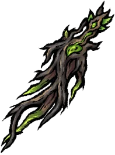

- 类型：剑　特性：修复次数+1；攻击造成伤害后，会附加易伤
- 五行：木

### 【练气 · 枯木剑】

攻击 2 / 血量 10（基础数值）

取数截"仙"树的枯枝绞合而成，枯枝内竟然蕴含剧毒

技能「中毒」攻击前，使攻击的目标属性回到战斗初且获得**中毒**

隐藏效果：剑特性：攻击后，对目标施加等同于大境界值的易伤

### 【筑基 · 枯木毒剑】

攻击 4 / 血量 25（基础数值）

此枯木似乎不是寻常物，竟有毒物从剑尖处渗出。

技能「中毒」攻击前，使攻击的目标属性回到战斗初且获得**中毒**

隐藏效果：剑特性：攻击后，对目标施加等同于大境界值的易伤

### 【结丹 · 枯木毒心剑】

攻击 10 / 血量 70（基础数值）

若是被刺中心脏，神医再世也无法救活。

技能「中毒」攻击前，使攻击的目标属性回到战斗初且获得**中毒**

隐藏效果：剑特性：攻击后，对目标施加等同于大境界值的易伤

### 【元婴 · 钻心】

攻击 27 / 血量 191（基础数值）

直取要害，直指心脏。

技能「中毒」攻击前，使攻击的目标属性回到战斗初且获得**中毒**

隐藏效果：剑特性：攻击后，对目标施加等同于大境界值的易伤

### 【化神 · 钻心】

攻击 73 / 血量 524（基础数值）

直取要害，直指心脏。

技能「中毒」攻击前，使攻击的目标属性回到战斗初且获得**中毒**

隐藏效果：剑特性：攻击后，对目标施加等同于大境界值的易伤

---

## 4. 万物

- 类型：剑　特性：修复次数+1；攻击造成伤害后，会附加易伤
- 五行：木

### 【筑基 · 桃木神剑】

攻击 2 / 血量 35（基础数值）

将吸收天地灵气的桃木制造成的仙剑。

技能「嘲讽」（锁定技）战斗中，会优先受到攻击

技能「唤灵」加入战场后的第一回合开始时，召唤2张**毒藤**

隐藏效果：剑特性：攻击后，对目标施加等同于大境界值的易伤

### 【结丹 · 桃木神剑】

攻击 6 / 血量 94（基础数值）

将吸收天地灵气的桃木制造成的仙剑。

技能「嘲讽」（锁定技）战斗中，会优先受到攻击

技能「唤灵」加入战场后的第一回合开始时，召唤3张**毒藤**

隐藏效果：剑特性：攻击后，对目标施加等同于大境界值的易伤

### 【元婴 · 桃木灵神剑】

攻击 16 / 血量 259（基础数值）

木剑虽离开了土地，但依然能继续生长，似有灵物藏于剑。

技能「嘲讽」（锁定技）战斗中，会优先受到攻击

技能「唤灵」加入战场后的第一回合开始时，召唤4张**毒藤**

隐藏效果：剑特性：攻击后，对目标施加等同于大境界值的易伤

### 【化神 · 万物】

攻击 44 / 血量 714（基础数值）

蕴含了天地万物的意识，名曰：万物。

技能「嘲讽」（锁定技）战斗中，会优先受到攻击

技能「唤灵」加入战场后的第一回合开始时，召唤5张**毒藤**

隐藏效果：剑特性：攻击后，对目标施加等同于大境界值的易伤

---

## 5. 霜寒

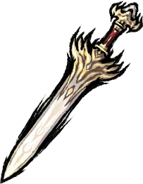

- 类型：剑　特性：修复次数+1；攻击造成伤害后，会附加易伤
- 五行：水

### 【练气 · 寒光剑】

攻击 3 / 血量 4（基础数值）

剑身通透无比，剑内似有水纹流动，反射出若隐若现的寒光。

技能「寒冰」回合开始时，使此卡牌和随机友军获得5点**减伤**

隐藏效果：剑特性：攻击后，对目标施加等同于大境界值的易伤

### 【筑基 · 寒冰魄剑】

攻击 8 / 血量 12（基础数值）

剑内的水纹逐渐凝结成冰，不时散发出一丝凉气。

技能「寒冰」回合开始时，使此卡牌和随机友军获得13点**减伤**

隐藏效果：剑特性：攻击后，对目标施加等同于大境界值的易伤

### 【结丹 · 寒冰冻魄剑】

攻击 23 / 血量 32（基础数值）

寒气不仅能冻伤体肤，更是冻住了魂魄。

技能「寒冰」回合开始时，使此卡牌和随机友军获得35点**减伤**

隐藏效果：剑特性：攻击后，对目标施加等同于大境界值的易伤

### 【元婴 · 霜寒】

攻击 64 / 血量 89（基础数值）

取极地不融冰铸造而成，能将持剑人的哀伤之情冻住。

技能「寒冰」回合开始时，使此卡牌和随机友军获得95点**减伤**

隐藏效果：剑特性：攻击后，对目标施加等同于大境界值的易伤

### 【化神 · 霜寒】

攻击 175 / 血量 245（基础数值）

取极地不融冰铸造而成，能将持剑人的哀伤之情冻住。

技能「寒冰」回合开始时，使此卡牌和随机友军获得263点**减伤**

隐藏效果：剑特性：攻击后，对目标施加等同于大境界值的易伤

---

## 6. 九阴

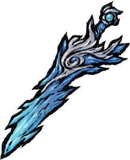

- 类型：剑　特性：修复次数+1；攻击造成伤害后，会附加易伤
- 五行：水

### 【筑基 · 玄阴魂剑】

攻击 10 / 血量 18（基础数值）

需要到幽冥之地寻找汲取了阴魂之力的钢材，才能铸造的阴剑。

技能「欺弱」攻击时，如果此卡牌的攻击力比目标要高，则伤害结果〔伤害〕将增加两者的差值的50%

隐藏效果：剑特性：攻击后，对目标施加等同于大境界值的易伤

### 【结丹 · 玄魄阴魂剑】

攻击 26 / 血量 50（基础数值）

需要到幽冥之地寻找汲取了阴魂之力的钢材，才能铸造的阴剑。

技能「欺弱」攻击时，如果此卡牌的攻击力比目标要高，则伤害结果〔伤害〕将增加两者的差值的50%

隐藏效果：剑特性：攻击后，对目标施加等同于大境界值的易伤

### 【元婴 · 玄魄阴魂剑】

攻击 71 / 血量 140（基础数值）

需要到幽冥之地寻找汲取了阴魂之力的钢材，才能铸造的阴剑。

技能「欺弱」攻击时，如果此卡牌的攻击力比目标要高，则伤害结果〔伤害〕将增加两者的差值的50%

隐藏效果：剑特性：攻击后，对目标施加等同于大境界值的易伤

### 【化神 · 九阴】

攻击 197 / 血量 385（基础数值）

将九种不同的阴魂注入剑内，体弱之人无法靠近。

技能「欺弱」攻击时，如果此卡牌的攻击力比目标要高，则伤害结果〔伤害〕将增加两者的差值的50%

隐藏效果：剑特性：攻击后，对目标施加等同于大境界值的易伤

---

## 7. 赤炎

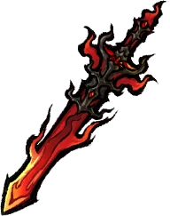

- 类型：剑　特性：修复次数+1；攻击造成伤害后，会附加易伤
- 五行：火

### 【练气 · 烈火剑】

攻击 3 / 血量 8（基础数值）

用灵气驱动仙剑，可使火花从剑身四溅开来，实是危险！

技能「燃魄」（被动）此卡牌造成的伤害无视护甲；对〔木〕和〔阴〕卡牌造成2倍伤害

隐藏效果：剑特性：攻击后，对目标施加等同于大境界值的易伤

### 【筑基 · 烈火阳剑】

攻击 8 / 血量 22（基础数值）

蕴含的火焰力量大幅提高，稍微不慎便会引火焚身。

技能「燃魄」（被动）此卡牌造成的伤害无视护甲；对〔木〕和〔阴〕卡牌造成2倍伤害

隐藏效果：剑特性：攻击后，对目标施加等同于大境界值的易伤

### 【结丹 · 烈火纯阳剑】

攻击 20 / 血量 60（基础数值）

蕴含的火焰力量大幅提高，稍微不慎便会引火焚身。

技能「燃魄」（被动）此卡牌造成的伤害无视护甲；对〔木〕和〔阴〕卡牌造成2倍伤害

隐藏效果：剑特性：攻击后，对目标施加等同于大境界值的易伤

### 【元婴 · 赤炎】

攻击 56 / 血量 166（基础数值）

一挥舞就能引起熊熊烈火。

技能「燃魄」（被动）此卡牌造成的伤害无视护甲；对〔木〕和〔阴〕卡牌造成2倍伤害

隐藏效果：剑特性：攻击后，对目标施加等同于大境界值的易伤

### 【化神 · 赤炎】

攻击 153 / 血量 455（基础数值）

一挥舞就能引起熊熊烈火。

技能「燃魄」（被动）此卡牌造成的伤害无视护甲；对〔木〕和〔阴〕卡牌造成2倍伤害

隐藏效果：剑特性：攻击后，对目标施加等同于大境界值的易伤

---

## 8. 燎原

- 类型：剑　特性：修复次数+1；攻击造成伤害后，会附加易伤
- 五行：火

### 【筑基 · 三炎神剑】

攻击 10 / 血量 43（基础数值）

修道者在铸造此剑时，才发现火焰也有不同的等级。

技能「怒意肆」每次攻击造成的伤害结果〔伤害〕+14，但攻击时也会受到目标的伤害

隐藏效果：剑特性：攻击后，对目标施加等同于大境界值的易伤

### 【结丹 · 七炎神火剑】

攻击 27 / 血量 120（基础数值）

能迸发出更高等级火焰的神剑，点燃一切污秽之物。

技能「怒意肆」每次攻击造成的伤害结果〔伤害〕+38，但攻击时也会受到目标的伤害

隐藏效果：剑特性：攻击后，对目标施加等同于大境界值的易伤

### 【元婴 · 七炎神火剑】

攻击 74 / 血量 331（基础数值）

能迸发出更高等级火焰的神剑，点燃一切污秽之物。

技能「怒意肆」每次攻击造成的伤害结果〔伤害〕+104，但攻击时也会受到目标的伤害

隐藏效果：剑特性：攻击后，对目标施加等同于大境界值的易伤

### 【化神 · 燎原】

攻击 204 / 血量 910（基础数值）

星星之火亦可燎原，更何况这天外神火。

技能「怒意肆」每次攻击造成的伤害结果〔伤害〕+286，但攻击时也会受到目标的伤害

隐藏效果：剑特性：攻击后，对目标施加等同于大境界值的易伤

---

## 9. 断界

- 类型：剑　特性：修复次数+1；攻击造成伤害后，会附加易伤
- 五行：土

### 【练气 · 黄泉剑】

攻击 1 / 血量 8（基础数值）

使用玉石制造的仙剑，看上去并不锋利却吹发即断。

技能「反弹」（被动）将受到的近战攻击伤害反弹50%给攻击者

隐藏效果：剑特性：攻击后，对目标施加等同于大境界值的易伤

### 【筑基 · 黄泉界剑】

攻击 3 / 血量 23（基础数值）

并不锋利的玉剑，每次的斩击，似乎都把空间撕开一道裂缝

技能「反弹」（被动）将受到的近战攻击伤害反弹50%给攻击者

隐藏效果：剑特性：攻击后，对目标施加等同于大境界值的易伤

### 【结丹 · 黄泉分界剑】

攻击 8 / 血量 62（基础数值）

并不锋利的玉剑，每次的斩击，似乎都把空间撕开一道裂缝

技能「反弹」（被动）将受到的近战攻击伤害反弹50%给攻击者

隐藏效果：剑特性：攻击后，对目标施加等同于大境界值的易伤

### 【元婴 · 断界】

攻击 21 / 血量 172（基础数值）

在它的面前，连空间也能被斩断。

技能「反弹」（被动）将受到的近战攻击伤害反弹50%给攻击者

隐藏效果：剑特性：攻击后，对目标施加等同于大境界值的易伤

### 【化神 · 断界】

攻击 58 / 血量 473（基础数值）

在它的面前，连空间也能被斩断。

技能「反弹」（被动）将受到的近战攻击伤害反弹50%给攻击者

隐藏效果：剑特性：攻击后，对目标施加等同于大境界值的易伤

---

## 10. 翡翠

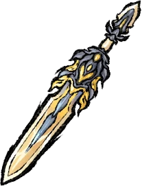

- 类型：剑　特性：修复次数+1；攻击造成伤害后，会附加易伤
- 五行：土

### 【筑基 · 白玉刚剑】

攻击 7 / 血量 16（基础数值）

由一块地底玉石雕琢的剑，硬度却是比金属还刚硬。

技能「远程」（锁定技）此卡牌的攻击模式为：**远程攻击**（单体）

技能「遁甲贰」造成伤害后，为我方卡牌增加5点〔护甲〕

隐藏效果：剑特性：攻击后，对目标施加等同于大境界值的易伤

### 【结丹 · 白玉刚剑】

攻击 19 / 血量 45（基础数值）

由一块地底玉石雕琢的剑，硬度却是比金属还刚硬。

技能「远程」（锁定技）此卡牌的攻击模式为：**远程攻击**（单体）

技能「遁甲贰」造成伤害后，为我方卡牌增加14点〔护甲〕

隐藏效果：剑特性：攻击后，对目标施加等同于大境界值的易伤

### 【元婴 · 白玉金刚剑】

攻击 52 / 血量 124（基础数值）

此剑的刚硬程度，就连钻石也无法与之相媲美。

技能「远程」（锁定技）此卡牌的攻击模式为：**远程攻击**（单体）

技能「遁甲贰」造成伤害后，为我方卡牌增加40点〔护甲〕

隐藏效果：剑特性：攻击后，对目标施加等同于大境界值的易伤

### 【化神 · 翡翠】

攻击 143 / 血量 341（基础数值）

此剑就如同一块翡翠般，光滑圆润，却又无法击碎。

技能「远程」（锁定技）此卡牌的攻击模式为：**远程攻击**（单体）

技能「遁甲贰」造成伤害后，为我方卡牌增加110点〔护甲〕

隐藏效果：剑特性：攻击后，对目标施加等同于大境界值的易伤

---

## 11. 碎星

- 类型：剑　特性：修复次数+1；攻击造成伤害后，会附加易伤
- 五行：金

### 【筑基 · 碎星】（图鉴未收录）

攻击 4 / 血量 22（基础数值）

金芒凛冽如万钧寒锋，出鞘可裂星辰、锋芒摄魂，乃斩妖破阵之无上利器

技能「光力肆」当我方卡牌失去**光盾**时，使自己获得一次攻击次数和〔攻击〕+2。

隐藏效果：剑特性：攻击后，对目标施加等同于大境界值的易伤

### 【结丹 · 碎星】

攻击 11 / 血量 60（基础数值）

金芒凛冽如万钧寒锋，出鞘可裂星辰、锋芒摄魂，乃斩妖破阵之无上利器

技能「光力肆」当我方卡牌失去**光盾**时，使自己获得一次攻击次数和〔攻击〕+6。

隐藏效果：剑特性：攻击后，对目标施加等同于大境界值的易伤

### 【元婴 · 碎星】

攻击 30 / 血量 166（基础数值）

金芒凛冽如万钧寒锋，出鞘可裂星辰、锋芒摄魂，乃斩妖破阵之无上利器

技能「光力肆」当我方卡牌失去**光盾**时，使自己获得一次攻击次数和〔攻击〕+16。

隐藏效果：剑特性：攻击后，对目标施加等同于大境界值的易伤

### 【化神 · 碎星】

攻击 82 / 血量 455（基础数值）

金芒凛冽如万钧寒锋，出鞘可裂星辰、锋芒摄魂，乃斩妖破阵之无上利器

技能「光力肆」当我方卡牌失去**光盾**时，使自己获得一次攻击次数和〔攻击〕+45。

隐藏效果：剑特性：攻击后，对目标施加等同于大境界值的易伤

---

## 12. 春蘅

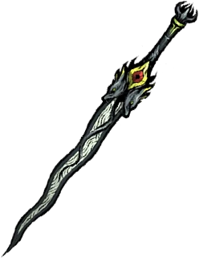

- 类型：剑　特性：修复次数+1；攻击造成伤害后，会附加易伤
- 五行：木

### 【筑基 · 春蘅】（图鉴未收录）

攻击 7 / 血量 21（基础数值）

翠影含春蕴草木生机，挥刃引青岚破敌，剑风过处可催芽生叶

技能「唤灵肆」当战场的第一只**花灵**战败时，再召唤3只

隐藏效果：剑特性：攻击后，对目标施加等同于大境界值的易伤

### 【结丹 · 春蘅】

攻击 19 / 血量 59（基础数值）

翠影含春蕴草木生机，挥刃引青岚破敌，剑风过处可催芽生叶

技能「唤灵肆」当战场的第一只**花灵**战败时，再召唤3只

隐藏效果：剑特性：攻击后，对目标施加等同于大境界值的易伤

### 【元婴 · 春蘅】

攻击 53 / 血量 162（基础数值）

翠影含春蕴草木生机，挥刃引青岚破敌，剑风过处可催芽生叶

技能「唤灵肆」当战场的第一只**花灵**战败时，再召唤3只

隐藏效果：剑特性：攻击后，对目标施加等同于大境界值的易伤

### 【化神 · 春蘅】

攻击 146 / 血量 446（基础数值）

翠影含春蕴草木生机，挥刃引青岚破敌，剑风过处可催芽生叶

技能「唤灵肆」当战场的第一只**花灵**战败时，再召唤3只

隐藏效果：剑特性：攻击后，对目标施加等同于大境界值的易伤

---

## 13. 寒月

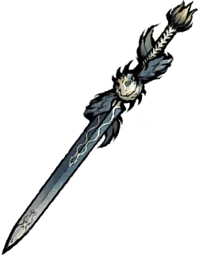

- 类型：剑　特性：修复次数+1；攻击造成伤害后，会附加易伤
- 五行：水

### 【筑基 · 寒月】（图鉴未收录）

攻击 10 / 血量 22（基础数值）

冰魄凝光映月辉，挥刃引霜风裂敌，剑势所及凝冰封脉

技能「寒冰叁」加入战场后的首个回合，使此我方全体获得8点持续一回合的**减伤**

隐藏效果：剑特性：攻击后，对目标施加等同于大境界值的易伤

### 【结丹 · 寒月】

攻击 27 / 血量 60（基础数值）

冰魄凝光映月辉，挥刃引霜风裂敌，剑势所及凝冰封脉

技能「寒冰叁」加入战场后的首个回合，使此我方全体获得21点持续一回合的**减伤**

隐藏效果：剑特性：攻击后，对目标施加等同于大境界值的易伤

### 【元婴 · 寒月】

攻击 74 / 血量 166（基础数值）

冰魄凝光映月辉，挥刃引霜风裂敌，剑势所及凝冰封脉

技能「寒冰叁」加入战场后的首个回合，使此我方全体获得60点持续一回合的**减伤**

隐藏效果：剑特性：攻击后，对目标施加等同于大境界值的易伤

### 【化神 · 寒月】

攻击 204 / 血量 455（基础数值）

冰魄凝光映月辉，挥刃引霜风裂敌，剑势所及凝冰封脉

技能「寒冰叁」加入战场后的首个回合，使此我方全体获得165点持续一回合的**减伤**

隐藏效果：剑特性：攻击后，对目标施加等同于大境界值的易伤

---

## 14. 流火

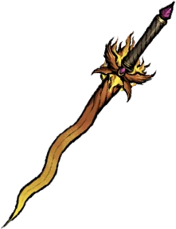

- 类型：剑　特性：修复次数+1；攻击造成伤害后，会附加易伤
- 五行：阳

### 【练气 · 流火】（图鉴未收录）

攻击 1 / 血量 8（基础数值）

赤红流焰缠剑身，挥刃卷燎原火浪，剑迹留火痕灼敌

技能「后发贰」每当一张友方〔火〕卡牌攻击后，此卡牌在本回合获得一次攻击机会

隐藏效果：剑特性：攻击后，对目标施加等同于大境界值的易伤

### 【筑基 · 流火】（图鉴未收录）

攻击 3 / 血量 22（基础数值）

赤红流焰缠剑身，挥刃卷燎原火浪，剑迹留火痕灼敌

技能「后发贰」每当一张友方〔火〕卡牌攻击后，此卡牌在本回合获得一次攻击机会

隐藏效果：剑特性：攻击后，对目标施加等同于大境界值的易伤

### 【结丹 · 流火】

攻击 8 / 血量 60（基础数值）

赤红流焰缠剑身，挥刃卷燎原火浪，剑迹留火痕灼敌

技能「后发贰」每当一张友方〔火〕卡牌攻击后，此卡牌在本回合获得一次攻击机会

隐藏效果：剑特性：攻击后，对目标施加等同于大境界值的易伤

### 【元婴 · 流火】

攻击 21 / 血量 166（基础数值）

赤红流焰缠剑身，挥刃卷燎原火浪，剑迹留火痕灼敌

技能「后发贰」每当一张友方〔火〕卡牌攻击后，此卡牌在本回合获得一次攻击机会

隐藏效果：剑特性：攻击后，对目标施加等同于大境界值的易伤

### 【化神 · 流火】

攻击 58 / 血量 455（基础数值）

赤红流焰缠剑身，挥刃卷燎原火浪，剑迹留火痕灼敌

技能「后发贰」每当一张友方〔火〕卡牌攻击后，此卡牌在本回合获得一次攻击机会

隐藏效果：剑特性：攻击后，对目标施加等同于大境界值的易伤

---

## 15. 镇元

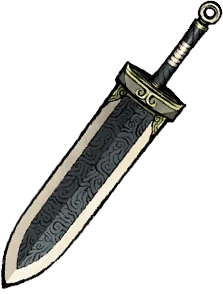

- 类型：剑　特性：修复次数+1；攻击造成伤害后，会附加易伤
- 五行：土

### 【筑基 · 镇元】（图鉴未收录）

攻击 3 / 血量 30（基础数值）

岩纹裹身蕴地脉，挥斩凝厚重土劲，可镇妖邪稳地脉破敌

技能「护主叁」当队伍里的角色卡牌受到伤害时，用剑气反击攻击者，造成5〔伤害〕

隐藏效果：剑特性：攻击后，对目标施加等同于大境界值的易伤

### 【结丹 · 镇元】

攻击 8 / 血量 83（基础数值）

岩纹裹身蕴地脉，挥斩凝厚重土劲，可镇妖邪稳地脉破敌

技能「护主叁」当队伍里的角色卡牌受到伤害时，用剑气反击攻击者，造成14〔伤害〕

隐藏效果：剑特性：攻击后，对目标施加等同于大境界值的易伤

### 【元婴 · 镇元】

攻击 21 / 血量 229（基础数值）

岩纹裹身蕴地脉，挥斩凝厚重土劲，可镇妖邪稳地脉破敌

技能「护主叁」当队伍里的角色卡牌受到伤害时，用剑气反击攻击者，造成38〔伤害〕

隐藏效果：剑特性：攻击后，对目标施加等同于大境界值的易伤

### 【化神 · 镇元】

攻击 58 / 血量 630（基础数值）

岩纹裹身蕴地脉，挥斩凝厚重土劲，可镇妖邪稳地脉破敌

技能「护主叁」当队伍里的角色卡牌受到伤害时，用剑气反击攻击者，造成105〔伤害〕

隐藏效果：剑特性：攻击后，对目标施加等同于大境界值的易伤

---

## 16. 元曦

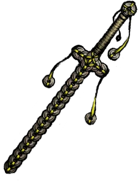

- 类型：剑　特性：修复次数+1；攻击造成伤害后，会附加易伤
- 五行：阳

### 【练气 · 元曦】（图鉴未收录）

攻击 3 / 血量 10（基础数值）

铜钱串连凝正阳曦光，挥斩破阴驱邪，剑势所及阴煞溃散、邪祟难存

技能「克邪」（被动）对〔阴〕卡牌造成五倍伤害

隐藏效果：剑特性：攻击后，对目标施加等同于大境界值的易伤

### 【筑基 · 元曦】

攻击 7 / 血量 25（基础数值）

铜钱串连凝正阳曦光，挥斩破阴驱邪，剑势所及阴煞溃散、邪祟难存

技能「克邪」（被动）对〔阴〕卡牌造成五倍伤害

隐藏效果：剑特性：攻击后，对目标施加等同于大境界值的易伤

### 【结丹 · 元曦】

攻击 19 / 血量 70（基础数值）

铜钱串连凝正阳曦光，挥斩破阴驱邪，剑势所及阴煞溃散、邪祟难存

技能「克邪」（被动）对〔阴〕卡牌造成五倍伤害

隐藏效果：剑特性：攻击后，对目标施加等同于大境界值的易伤

### 【元婴 · 元曦】

攻击 53 / 血量 191（基础数值）

铜钱串连凝正阳曦光，挥斩破阴驱邪，剑势所及阴煞溃散、邪祟难存

技能「克邪」（被动）对〔阴〕卡牌造成五倍伤害

隐藏效果：剑特性：攻击后，对目标施加等同于大境界值的易伤

### 【化神 · 元曦】

攻击 146 / 血量 524（基础数值）

铜钱串连凝正阳曦光，挥斩破阴驱邪，剑势所及阴煞溃散、邪祟难存

技能「克邪」（被动）对〔阴〕卡牌造成五倍伤害

隐藏效果：剑特性：攻击后，对目标施加等同于大境界值的易伤

---

## 17. 冥刃

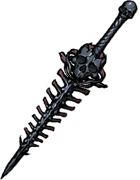

- 类型：剑　特性：修复次数+1；攻击造成伤害后，会附加易伤
- 五行：阴

### 【练气 · 冥刃】（图鉴未收录）

攻击 3 / 血量 8（基础数值）

玄铁铸身缠幽冥寒影，挥斩携蚀骨冥气，中者神魂被噬、肉身腐坏。

技能「使者」每当战场有非召唤卡牌阵亡，召唤一个骸骨傀儡（每回合最多触发5次）

隐藏效果：剑特性：攻击后，对目标施加等同于大境界值的易伤

### 【筑基 · 冥刃】

攻击 7 / 血量 21（基础数值）

玄铁铸身缠幽冥寒影，挥斩携蚀骨冥气，中者神魂被噬、肉身腐坏。

技能「使者」每当战场有非召唤卡牌阵亡，召唤一个骸骨傀儡（每回合最多触发5次）

隐藏效果：剑特性：攻击后，对目标施加等同于大境界值的易伤

### 【结丹 · 冥刃】

攻击 19 / 血量 59（基础数值）

玄铁铸身缠幽冥寒影，挥斩携蚀骨冥气，中者神魂被噬、肉身腐坏。

技能「使者」每当战场有非召唤卡牌阵亡，召唤一个骸骨傀儡（每回合最多触发5次）

隐藏效果：剑特性：攻击后，对目标施加等同于大境界值的易伤

### 【元婴 · 冥刃】

攻击 53 / 血量 162（基础数值）

玄铁铸身缠幽冥寒影，挥斩携蚀骨冥气，中者神魂被噬、肉身腐坏。

技能「使者」每当战场有非召唤卡牌阵亡，召唤一个骸骨傀儡（每回合最多触发5次）

隐藏效果：剑特性：攻击后，对目标施加等同于大境界值的易伤

### 【化神 · 冥刃】

攻击 146 / 血量 446（基础数值）

玄铁铸身缠幽冥寒影，挥斩携蚀骨冥气，中者神魂被噬、肉身腐坏。

技能「使者」每当战场有非召唤卡牌阵亡，召唤一个骸骨傀儡（每回合最多触发5次）

隐藏效果：剑特性：攻击后，对目标施加等同于大境界值的易伤

---

## 18. 破山重剑

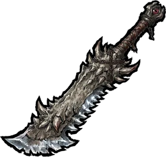

- 类型：剑　特性：修复次数+1；攻击造成伤害后，会附加易伤
- 五行：土

### 【练气 · 破山重剑】（图鉴未收录）

攻击 3 / 血量 10（基础数值）

暴君（铁骨熊）的专属法宝，蕴地脉山髓之力，势大力沉，专破罡甲防御

技能「攻守平衡」攻击的目标如果不是满血，则自己获得一回合嘲讽和2减伤（持续一回合）

隐藏效果：剑特性：攻击后，对目标施加等同于大境界值的易伤

### 【筑基 · 破山重剑】（图鉴未收录）

攻击 7 / 血量 25（基础数值）

暴君（铁骨熊）的专属法宝，蕴地脉山髓之力，势大力沉，专破罡甲防御

技能「攻守平衡」攻击的目标如果不是满血，则自己获得一回合嘲讽和4减伤（持续一回合）

隐藏效果：剑特性：攻击后，对目标施加等同于大境界值的易伤

### 【结丹 · 破山重剑】（图鉴未收录）

攻击 19 / 血量 70（基础数值）

暴君（铁骨熊）的专属法宝，蕴地脉山髓之力，势大力沉，专破罡甲防御

技能「攻守平衡」攻击的目标如果不是满血，则自己获得一回合嘲讽和12减伤（持续一回合）

隐藏效果：剑特性：攻击后，对目标施加等同于大境界值的易伤

### 【元婴 · 破山重剑】

攻击 53 / 血量 191（基础数值）

暴君（铁骨熊）的专属法宝，蕴地脉山髓之力，势大力沉，专破罡甲防御

技能「攻守平衡」攻击的目标如果不是满血，则自己获得一回合嘲讽和32减伤（持续一回合）

隐藏效果：剑特性：攻击后，对目标施加等同于大境界值的易伤

### 【化神 · 破山重剑】

攻击 146 / 血量 524（基础数值）

暴君（铁骨熊）的专属法宝，蕴地脉山髓之力，势大力沉，专破罡甲防御

技能「攻守平衡」攻击的目标如果不是满血，则自己获得一回合嘲讽和88减伤（持续一回合）

隐藏效果：剑特性：攻击后，对目标施加等同于大境界值的易伤

---

## 19. 吞天

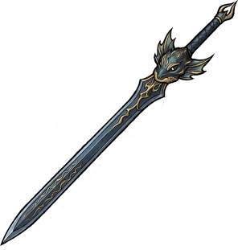

- 类型：剑　特性：修复次数+1；攻击造成伤害后，会附加易伤
- 五行：风

### 【练气 · 吞天】（图鉴未收录）

攻击 1 / 血量 12（基础数值）

扶溟（鲲）的专属法宝，取北冥深渊万载寒铁融自身鲲元精血锻铸而成

技能「远程」（锁定技）此卡牌的攻击模式为：**远程攻击**（单体）

技能「吞噬」每场战斗一次，在攻击前，会吸取目标所有攻击力（对角色/妖王不生效）

隐藏效果：剑特性：攻击后，对目标施加等同于大境界值的易伤

### 【筑基 · 吞天】（图鉴未收录）

攻击 1 / 血量 34（基础数值）

扶溟（鲲）的专属法宝，取北冥深渊万载寒铁融自身鲲元精血锻铸而成

技能「远程」（锁定技）此卡牌的攻击模式为：**远程攻击**（单体）

技能「吞噬」每场战斗一次，在攻击前，会吸取目标所有攻击力（对角色/妖王不生效）

隐藏效果：剑特性：攻击后，对目标施加等同于大境界值的易伤

### 【结丹 · 吞天】（图鉴未收录）

攻击 1 / 血量 92（基础数值）

扶溟（鲲）的专属法宝，取北冥深渊万载寒铁融自身鲲元精血锻铸而成

技能「远程」（锁定技）此卡牌的攻击模式为：**远程攻击**（单体）

技能「吞噬」每场战斗一次，在攻击前，会吸取目标所有攻击力（对角色/妖王不生效）

隐藏效果：剑特性：攻击后，对目标施加等同于大境界值的易伤

### 【元婴 · 吞天】

攻击 1 / 血量 254（基础数值）

扶溟（鲲）的专属法宝，取北冥深渊万载寒铁融自身鲲元精血锻铸而成

技能「远程」（锁定技）此卡牌的攻击模式为：**远程攻击**（单体）

技能「吞噬」每场战斗一次，在攻击前，会吸取目标所有攻击力（对角色/妖王不生效）

隐藏效果：剑特性：攻击后，对目标施加等同于大境界值的易伤

### 【化神 · 吞天】

攻击 1 / 血量 700（基础数值）

扶溟（鲲）的专属法宝，取北冥深渊万载寒铁融自身鲲元精血锻铸而成

技能「远程」（锁定技）此卡牌的攻击模式为：**远程攻击**（单体）

技能「吞噬」每场战斗一次，在攻击前，会吸取目标所有攻击力（对角色/妖王不生效）

隐藏效果：剑特性：攻击后，对目标施加等同于大境界值的易伤

### 【炼虚 · 吞天】

攻击 1 / 血量 1925（基础数值）

扶溟（鲲）的专属法宝，取北冥深渊万载寒铁融自身鲲元精血锻铸而成

技能「远程」（锁定技）此卡牌的攻击模式为：**远程攻击**（单体）

技能「吞噬」每场战斗一次，在攻击前，会吸取目标所有攻击力（对角色/妖王不生效）

隐藏效果：剑特性：攻击后，对目标施加等同于大境界值的易伤

### 【合体 · 吞天】

攻击 1 / 血量 5293（基础数值）

扶溟（鲲）的专属法宝，取北冥深渊万载寒铁融自身鲲元精血锻铸而成

技能「远程」（锁定技）此卡牌的攻击模式为：**远程攻击**（单体）

技能「吞噬」每场战斗一次，在攻击前，会吸取目标所有攻击力（对角色/妖王不生效）

隐藏效果：剑特性：攻击后，对目标施加等同于大境界值的易伤

---

## 20. 狼嚎剑

- 类型：剑　特性：修复次数+1；攻击造成伤害后，会附加易伤
- 五行：火

### 【练气 · 狼嚎剑】（图鉴未收录）

攻击 3 / 血量 8（基础数值）

赤牙（祸斗）的专属法宝，剑成之时苍狼嚎啸彻于荒野，故得名“狼嚎”。

技能「狼嚎」战斗中第一次攻击时，会使自己和随机友方获得1增伤（本场战斗均生效）

隐藏效果：剑特性：攻击后，对目标施加等同于大境界值的易伤

### 【筑基 · 狼嚎剑】（图鉴未收录）

攻击 8 / 血量 24（基础数值）

赤牙（祸斗）的专属法宝，剑成之时苍狼嚎啸彻于荒野，故得名“狼嚎”。

技能「狼嚎」战斗中第一次攻击时，会使自己和随机友方获得3增伤（本场战斗均生效）

隐藏效果：剑特性：攻击后，对目标施加等同于大境界值的易伤

### 【结丹 · 狼嚎剑】（图鉴未收录）

攻击 23 / 血量 65（基础数值）

赤牙（祸斗）的专属法宝，剑成之时苍狼嚎啸彻于荒野，故得名“狼嚎”。

技能「狼嚎」战斗中第一次攻击时，会使自己和随机友方获得7增伤（本场战斗均生效）

隐藏效果：剑特性：攻击后，对目标施加等同于大境界值的易伤

### 【元婴 · 狼嚎剑】

攻击 64 / 血量 178（基础数值）

赤牙（祸斗）的专属法宝，剑成之时苍狼嚎啸彻于荒野，故得名“狼嚎”。

技能「狼嚎」战斗中第一次攻击时，会使自己和随机友方获得19增伤（本场战斗均生效）

隐藏效果：剑特性：攻击后，对目标施加等同于大境界值的易伤

### 【化神 · 狼嚎剑】

攻击 175 / 血量 490（基础数值）

赤牙（祸斗）的专属法宝，剑成之时苍狼嚎啸彻于荒野，故得名“狼嚎”。

技能「狼嚎」战斗中第一次攻击时，会使自己和随机友方获得53增伤（本场战斗均生效）

隐藏效果：剑特性：攻击后，对目标施加等同于大境界值的易伤

---

## 21. 血藤剑

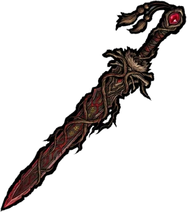

- 类型：剑　特性：修复次数+1；攻击造成伤害后，会附加易伤
- 五行：血

### 【练气 · 血藤剑】（图鉴未收录）

攻击 2 / 血量 8（基础数值）

饮岁（血藤古树）的专属法宝，剑刃可借血引之势攻击敌人

技能「五行:血」（锁定技）：此卡牌拥有血属性，卡牌的〔血量〕比同级别卡稍低，但攻击附带吸血效果

技能「血引」当我方卡牌成功恢复〔血量〕时，对随机敌人造成3〔伤害〕

隐藏效果：剑特性：攻击后，对目标施加等同于大境界值的易伤

### 【筑基 · 血藤剑】（图鉴未收录）

攻击 5 / 血量 21（基础数值）

饮岁（血藤古树）的专属法宝，剑刃可借血引之势攻击敌人

技能「五行:血」（锁定技）：此卡牌拥有血属性，卡牌的〔血量〕比同级别卡稍低，但攻击附带吸血效果

技能「血引」当我方卡牌成功恢复〔血量〕时，对随机敌人造成8〔伤害〕

隐藏效果：剑特性：攻击后，对目标施加等同于大境界值的易伤

### 【结丹 · 血藤剑】（图鉴未收录）

攻击 12 / 血量 58（基础数值）

饮岁（血藤古树）的专属法宝，剑刃可借血引之势攻击敌人

技能「五行:血」（锁定技）：此卡牌拥有血属性，卡牌的〔血量〕比同级别卡稍低，但攻击附带吸血效果

技能「血引」当我方卡牌成功恢复〔血量〕时，对随机敌人造成20〔伤害〕

隐藏效果：剑特性：攻击后，对目标施加等同于大境界值的易伤

### 【元婴 · 血藤剑】

攻击 34 / 血量 159（基础数值）

饮岁（血藤古树）的专属法宝，剑刃可借血引之势攻击敌人

技能「五行:血」（锁定技）：此卡牌拥有血属性，卡牌的〔血量〕比同级别卡稍低，但攻击附带吸血效果

技能「血引」当我方卡牌成功恢复〔血量〕时，对随机敌人造成55〔伤害〕

隐藏效果：剑特性：攻击后，对目标施加等同于大境界值的易伤

### 【化神 · 血藤剑】

攻击 95 / 血量 437（基础数值）

饮岁（血藤古树）的专属法宝，剑刃可借血引之势攻击敌人

技能「五行:血」（锁定技）：此卡牌拥有血属性，卡牌的〔血量〕比同级别卡稍低，但攻击附带吸血效果

技能「血引」当我方卡牌成功恢复〔血量〕时，对随机敌人造成153〔伤害〕

隐藏效果：剑特性：攻击后，对目标施加等同于大境界值的易伤

---

## 22. 禁魔

- 类型：刀　特性：每1点攻击会减少2点〔护甲〕
- 五行：金

### 【练气 · 金光刀】

攻击 3 / 血量 9（基础数值）

金光凝聚在剑身，每一次的挥舞，都灿烂无比。

技能「天罡」回合开始时，场上每有一张〔金〕卡牌，则此卡牌的〔攻击〕和〔血量〕均提高1

隐藏效果：刀特性：对护甲造成的伤害为2倍

### 【筑基 · 金光天刀】

攻击 6 / 血量 23（基础数值）

金光凝聚在剑身，每一次的挥舞，都灿烂无比。

技能「天罡」回合开始时，场上每有一张〔金〕卡牌，则此卡牌的〔攻击〕和〔血量〕均提高2

隐藏效果：刀特性：对护甲造成的伤害为2倍

### 【结丹 · 金光禁魔刀】

攻击 17 / 血量 63（基础数值）

金光覆盖之处，就连修道者都无法使用法术。

技能「天罡」回合开始时，场上每有一张〔金〕卡牌，则此卡牌的〔攻击〕和〔血量〕均提高3

隐藏效果：刀特性：对护甲造成的伤害为2倍

### 【元婴 · 禁魔】

攻击 48 / 血量 172（基础数值）

每一次拼刀，都能暂时将敌人的能力封印。

技能「天罡」回合开始时，场上每有一张〔金〕卡牌，则此卡牌的〔攻击〕和〔血量〕均提高5

隐藏效果：刀特性：对护甲造成的伤害为2倍

### 【化神 · 禁魔】

攻击 131 / 血量 472（基础数值）

每一次拼刀，都能暂时将敌人的能力封印。

技能「天罡」回合开始时，场上每有一张〔金〕卡牌，则此卡牌的〔攻击〕和〔血量〕均提高10

隐藏效果：刀特性：对护甲造成的伤害为2倍

---

## 23. 殒神

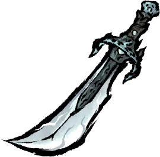

- 类型：刀　特性：每1点攻击会减少2点〔护甲〕
- 五行：金

### 【筑基 · 斩月妖刀】

攻击 3 / 血量 24（基础数值）

铸刀人怀着将一切妖魔斩杀的心念而打造的妖刀。

技能「天罡贰」回合开始时，场上每有一张〔金〕卡牌，此卡牌的〔攻击〕+4

隐藏效果：刀特性：对护甲造成的伤害为2倍

### 【结丹 · 斩月妖刀】

攻击 8 / 血量 66（基础数值）

铸刀人怀着将一切妖魔斩杀的心念而打造的妖刀。

技能「天罡贰」回合开始时，场上每有一张〔金〕卡牌，此卡牌的〔攻击〕+6

隐藏效果：刀特性：对护甲造成的伤害为2倍

### 【元婴 · 穿云斩月刀】

攻击 21 / 血量 183（基础数值）

铸刀人怀着将一切妖魔斩杀的心念而打造的妖刀。

技能「天罡贰」回合开始时，场上每有一张〔金〕卡牌，此卡牌的〔攻击〕+10

隐藏效果：刀特性：对护甲造成的伤害为2倍

### 【化神 · 殒神】

攻击 58 / 血量 504（基础数值）

就连神仙也能斩杀的妖刀。

技能「天罡贰」回合开始时，场上每有一张〔金〕卡牌，此卡牌的〔攻击〕+20

隐藏效果：刀特性：对护甲造成的伤害为2倍

---

## 24. 留影

- 类型：刀　特性：每1点攻击会减少2点〔护甲〕
- 五行：木

### 【练气 · 碧影刀】

攻击 3 / 血量 8（基础数值）

碧影略过之处，木叶飞舞，生命川流不息。

技能「封魔」攻击前，使目标卡牌的技能在本回合失效，且属性恢复至战斗初。

隐藏效果：刀特性：对护甲造成的伤害为2倍

### 【筑基 · 碧影明刀】

攻击 8 / 血量 24（基础数值）

碧影略过之处，木叶飞舞，生命川流不息。

技能「封魔」攻击前，使目标卡牌的技能在本回合失效，且属性恢复至战斗初。

隐藏效果：刀特性：对护甲造成的伤害为2倍

### 【结丹 · 碧影明目刀】

攻击 23 / 血量 65（基础数值）

碧影略过之处，木叶飞舞，生命川流不息。

技能「封魔」攻击前，使目标卡牌的技能在本回合失效，且属性恢复至战斗初。

隐藏效果：刀特性：对护甲造成的伤害为2倍

### 【元婴 · 留影】

攻击 64 / 血量 178（基础数值）

刀过之处，仅留一道残影。

技能「封魔」攻击前，使目标卡牌的技能在本回合失效，且属性恢复至战斗初。

隐藏效果：刀特性：对护甲造成的伤害为2倍

### 【化神 · 留影】

攻击 175 / 血量 490（基础数值）

刀过之处，仅留一道残影。

技能「封魔」攻击前，使目标卡牌的技能在本回合失效，且属性恢复至战斗初。

隐藏效果：刀特性：对护甲造成的伤害为2倍

---

## 25. 分水

- 类型：刀　特性：每1点攻击会减少2点〔护甲〕
- 五行：水

### 【练气 · 凝水刀】

攻击 3 / 血量 10（基础数值）

你看它平平无奇的样子，却可将水砍成两半。

技能「卸力」攻击造成伤害后，使目标的〔攻击〕-2；（一场战斗只会触发5次）

隐藏效果：刀特性：对护甲造成的伤害为2倍

### 【筑基 · 凝水天刀】

攻击 7 / 血量 25（基础数值）

你看它平平无奇的样子，却可将水砍成两半。

技能「卸力」攻击造成伤害后，使目标的〔攻击〕-5；（一场战斗只会触发5次）

隐藏效果：刀特性：对护甲造成的伤害为2倍

### 【结丹 · 凝水玄天刀】

攻击 19 / 血量 70（基础数值）

你看它平平无奇的样子，却可将水砍成两半。

技能「卸力」攻击造成伤害后，使目标的〔攻击〕-15；（一场战斗只会触发5次）

隐藏效果：刀特性：对护甲造成的伤害为2倍

### 【元婴 · 分水】

攻击 53 / 血量 191（基础数值）

被分开的水无法再聚成一团。

技能「卸力」攻击造成伤害后，使目标的〔攻击〕-40；（一场战斗只会触发5次）

隐藏效果：刀特性：对护甲造成的伤害为2倍

### 【化神 · 分水】

攻击 146 / 血量 524（基础数值）

被分开的水无法再聚成一团。

技能「卸力」攻击造成伤害后，使目标的〔攻击〕-100；（一场战斗只会触发5次）

隐藏效果：刀特性：对护甲造成的伤害为2倍

---

## 26. 燃神

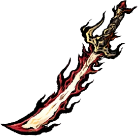

- 类型：刀　特性：每1点攻击会减少2点〔护甲〕
- 五行：火

### 【练气 · 赤焰刀】

攻击 6 / 血量 1（基础数值）

整个剑身被火焰包围，点燃一切污秽之物。

技能「怒意」（被动）加入战场后的第一次攻击，造成的伤害结果〔伤害〕+5；如果攻击将目标杀死，则再攻击一次（每回合只触发一次）

隐藏效果：刀特性：对护甲造成的伤害为2倍

### 【筑基 · 赤焰心刀】

攻击 17 / 血量 1（基础数值）

整个剑身被火焰包围，点燃一切污秽之物。

技能「怒意」（被动）加入战场后的第一次攻击，造成的伤害结果〔伤害〕+15；如果攻击将目标杀死，则再攻击一次（每回合只触发一次）

隐藏效果：刀特性：对护甲造成的伤害为2倍

### 【结丹 · 赤焰燃心刀】

攻击 46 / 血量 4（基础数值）

整个剑身被火焰包围，点燃一切污秽之物。

技能「怒意」（被动）加入战场后的第一次攻击，造成的伤害结果〔伤害〕+41；如果攻击将目标杀死，则再攻击一次（每回合只触发一次）

隐藏效果：刀特性：对护甲造成的伤害为2倍

### 【元婴 · 燃神】

攻击 127 / 血量 10（基础数值）

如果被它砍中，就连神仙也会燃烧殆尽。

技能「怒意」（被动）加入战场后的第一次攻击，造成的伤害结果〔伤害〕+111；如果攻击将目标杀死，则再攻击一次（每回合只触发一次）

隐藏效果：刀特性：对护甲造成的伤害为2倍

### 【化神 · 燃神】

攻击 350 / 血量 28（基础数值）

如果被它砍中，就连神仙也会燃烧殆尽。

技能「怒意」（被动）加入战场后的第一次攻击，造成的伤害结果〔伤害〕+306；如果攻击将目标杀死，则再攻击一次（每回合只触发一次）

隐藏效果：刀特性：对护甲造成的伤害为2倍

---

## 27. 破军

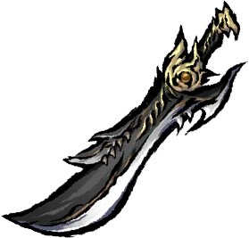

- 类型：刀　特性：每1点攻击会减少2点〔护甲〕
- 五行：土

### 【练气 · 碎石刀】

攻击 7 / 血量 6（基础数值）

发黑的剑身有个石核心，据说只要核心不破，剑身就不会损毁。

技能「潜力」这张卡牌没有技能，但它的属性会更高

隐藏效果：刀特性：对护甲造成的伤害为2倍

### 【筑基 · 碎石刀】

攻击 20 / 血量 16（基础数值）

发黑的剑身有个石核心，据说只要核心不破，剑身就不会损毁。

技能「潜力」这张卡牌没有技能，但它的属性会更高

隐藏效果：刀特性：对护甲造成的伤害为2倍

### 【结丹 · 破山碎石刀】

攻击 55 / 血量 45（基础数值）

不仅能轻易的砍碎石头，甚至连大山也无法抗衡。

技能「潜力」这张卡牌没有技能，但它的属性会更高

隐藏效果：刀特性：对护甲造成的伤害为2倍

### 【元婴 · 破军】

攻击 152 / 血量 122（基础数值）

虽千军万马在前，也无法抵御此刀。

技能「潜力」这张卡牌没有技能，但它的属性会更高

隐藏效果：刀特性：对护甲造成的伤害为2倍

### 【化神 · 破军】

攻击 420 / 血量 336（基础数值）

虽千军万马在前，也无法抵御此刀。

技能「潜力」这张卡牌没有技能，但它的属性会更高

隐藏效果：刀特性：对护甲造成的伤害为2倍

### 【炼虚 · 破军】（图鉴未收录）

攻击 1154 / 血量 924（基础数值）

虽千军万马在前，也无法抵御此刀。

技能「潜力」这张卡牌没有技能，但它的属性会更高

隐藏效果：刀特性：对护甲造成的伤害为2倍

### 【合体 · 破军】（图鉴未收录）

攻击 3176 / 血量 2540（基础数值）

虽千军万马在前，也无法抵御此刀。

技能「潜力」这张卡牌没有技能，但它的属性会更高

隐藏效果：刀特性：对护甲造成的伤害为2倍

---

## 28. 裂地

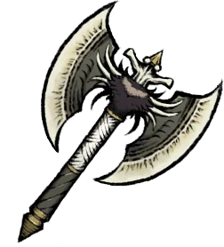

- 类型：刀　特性：每1点攻击会减少2点〔护甲〕
- 五行：土

### 【练气 · 裂地】（图鉴未收录）

攻击 3 / 血量 8（基础数值）

斧身凝岩覆土纹，挥劈即震裂大地、崩石碎岩破敌无匹

技能「憾地贰」攻击时，对目标身旁卡牌造成30%伤害

隐藏效果：刀特性：对护甲造成的伤害为2倍；只会攻击血量最少目标

### 【筑基 · 裂地】

攻击 8 / 血量 22（基础数值）

斧身凝岩覆土纹，挥劈即震裂大地、崩石碎岩破敌无匹

技能「憾地贰」攻击时，对目标身旁卡牌造成30%伤害

隐藏效果：刀特性：对护甲造成的伤害为2倍；只会攻击血量最少目标

### 【结丹 · 裂地】

攻击 20 / 血量 60（基础数值）

斧身凝岩覆土纹，挥劈即震裂大地、崩石碎岩破敌无匹

技能「憾地贰」攻击时，对目标身旁卡牌造成30%伤害

隐藏效果：刀特性：对护甲造成的伤害为2倍；只会攻击血量最少目标

### 【元婴 · 裂地】

攻击 56 / 血量 166（基础数值）

斧身凝岩覆土纹，挥劈即震裂大地、崩石碎岩破敌无匹

技能「憾地贰」攻击时，对目标身旁卡牌造成30%伤害

隐藏效果：刀特性：对护甲造成的伤害为2倍；只会攻击血量最少目标

### 【化神 · 裂地】

攻击 153 / 血量 455（基础数值）

斧身凝岩覆土纹，挥劈即震裂大地、崩石碎岩破敌无匹

技能「憾地贰」攻击时，对目标身旁卡牌造成30%伤害

隐藏效果：刀特性：对护甲造成的伤害为2倍；只会攻击血量最少目标

---

## 29. 熊骨斧

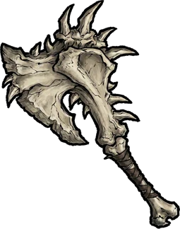

- 类型：刀　特性：每1点攻击会减少2点〔护甲〕
- 五行：阳

### 【练气 · 熊骨斧】（图鉴未收录）

攻击 3 / 血量 8（基础数值）

暴君（铁骨熊）的专属法宝，蕴骨中凶煞之力，势大力沉，专破罡甲。

技能「狂斧」攻击的目标如果是兵器（剑/刀/双刀/扇子/暗器/枪/锤），则可再攻击一次；（一回合最多触发2次）

隐藏效果：刀特性：对护甲造成的伤害为2倍

### 【筑基 · 熊骨斧】（图鉴未收录）

攻击 8 / 血量 24（基础数值）

暴君（铁骨熊）的专属法宝，蕴骨中凶煞之力，势大力沉，专破罡甲。

技能「狂斧」攻击的目标如果是兵器（剑/刀/双刀/扇子/暗器/枪/锤），则可再攻击一次；（一回合最多触发2次）

隐藏效果：刀特性：对护甲造成的伤害为2倍

### 【结丹 · 熊骨斧】（图鉴未收录）

攻击 23 / 血量 65（基础数值）

暴君（铁骨熊）的专属法宝，蕴骨中凶煞之力，势大力沉，专破罡甲。

技能「狂斧」攻击的目标如果是兵器（剑/刀/双刀/扇子/暗器/枪/锤），则可再攻击一次；（一回合最多触发2次）

隐藏效果：刀特性：对护甲造成的伤害为2倍

### 【元婴 · 熊骨斧】

攻击 64 / 血量 178（基础数值）

暴君（铁骨熊）的专属法宝，蕴骨中凶煞之力，势大力沉，专破罡甲。

技能「狂斧」攻击的目标如果是兵器（剑/刀/双刀/扇子/暗器/枪/锤），则可再攻击一次；（一回合最多触发2次）

隐藏效果：刀特性：对护甲造成的伤害为2倍

### 【化神 · 熊骨斧】

攻击 175 / 血量 490（基础数值）

暴君（铁骨熊）的专属法宝，蕴骨中凶煞之力，势大力沉，专破罡甲。

技能「狂斧」攻击的目标如果是兵器（剑/刀/双刀/扇子/暗器/枪/锤），则可再攻击一次；（一回合最多触发2次）

隐藏效果：刀特性：对护甲造成的伤害为2倍

---

## 30. 勾魂焰镰

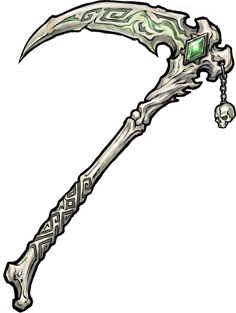

- 类型：刀　特性：每1点攻击会减少2点〔护甲〕
- 五行：阴

### 【练气 · 勾魂焰镰】（图鉴未收录）

攻击 3 / 血量 8（基础数值）

素影（九幽骨魅）的专属法宝，被镰刃所伤者，肉体未损而魂魄先离

技能「收割」攻击的目标如果是生物（角色/灵兽），则再召唤两个骸骨傀儡

隐藏效果：刀特性：对护甲造成的伤害为2倍

### 【筑基 · 勾魂焰镰】（图鉴未收录）

攻击 8 / 血量 24（基础数值）

素影（九幽骨魅）的专属法宝，被镰刃所伤者，肉体未损而魂魄先离

技能「收割」攻击的目标如果是生物（角色/灵兽），则再召唤两个骸骨傀儡

隐藏效果：刀特性：对护甲造成的伤害为2倍

### 【结丹 · 勾魂焰镰】（图鉴未收录）

攻击 23 / 血量 65（基础数值）

素影（九幽骨魅）的专属法宝，被镰刃所伤者，肉体未损而魂魄先离

技能「收割」攻击的目标如果是生物（角色/灵兽），则再召唤两个骸骨傀儡

隐藏效果：刀特性：对护甲造成的伤害为2倍

### 【元婴 · 勾魂焰镰】

攻击 64 / 血量 178（基础数值）

素影（九幽骨魅）的专属法宝，被镰刃所伤者，肉体未损而魂魄先离

技能「收割」攻击的目标如果是生物（角色/灵兽），则再召唤两个骸骨傀儡

隐藏效果：刀特性：对护甲造成的伤害为2倍

### 【化神 · 勾魂焰镰】

攻击 175 / 血量 490（基础数值）

素影（九幽骨魅）的专属法宝，被镰刃所伤者，肉体未损而魂魄先离

技能「收割」攻击的目标如果是生物（角色/灵兽），则再召唤两个骸骨傀儡

隐藏效果：刀特性：对护甲造成的伤害为2倍

---

## 31. 蝶舞

- 类型：双刀　特性：每次主动出手，都会攻击2次
- 五行：金

### 【练气 · 金蝶刺】

攻击 2 / 血量 7（基础数值）

一金一黑，一长一短，相辉交映犹如金蝶起舞。

技能「力拔」此卡牌攻击后，〔攻击〕+1

隐藏效果：双刀特性：每次行动，会攻击2次

### 【筑基 · 金皇蝶刺】

攻击 6 / 血量 20（基础数值）

一金一黑，一长一短，相辉交映犹如金蝶起舞。

技能「力拔」此卡牌攻击后，〔攻击〕+3

隐藏效果：双刀特性：每次行动，会攻击2次

### 【结丹 · 金芒皇蝶刺】

攻击 16 / 血量 55（基础数值）

一金一黑，一长一短，相辉交映犹如金蝶起舞。

技能「力拔」此卡牌攻击后，〔攻击〕+8

隐藏效果：双刀特性：每次行动，会攻击2次

### 【元婴 · 蝶舞】

攻击 43 / 血量 152（基础数值）

像金蝶般翩翩起舞，却给敌人带起死亡的恐惧。

技能「力拔」此卡牌攻击后，〔攻击〕+22

隐藏效果：双刀特性：每次行动，会攻击2次

### 【化神 · 蝶舞】

攻击 117 / 血量 420（基础数值）

像金蝶般翩翩起舞，却给敌人带起死亡的恐惧。

技能「力拔」此卡牌攻击后，〔攻击〕+60

隐藏效果：双刀特性：每次行动，会攻击2次

---

## 32. 绝情

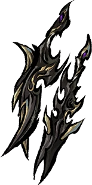

- 类型：双刀　特性：每次主动出手，都会攻击2次
- 五行：木

### 【练气 · 幽芒刺】

攻击 1 / 血量 8（基础数值）

常年浸泡毒液使得刀身黑得深邃，隐隐中又透射出一丝黑芒，因而取名“幽芒”。

技能「中毒」攻击后，使受击者**中毒**

隐藏效果：双刀特性：每次行动，会攻击2次

### 【筑基 · 幽芒毒刺】

攻击 3 / 血量 22（基础数值）

常年浸泡毒液使得刀身黑得深邃，隐隐中又透射出一丝黑芒，因而取名“幽芒”。

技能「中毒」攻击后，使受击者**中毒**

隐藏效果：双刀特性：每次行动，会攻击2次

### 【结丹 · 幽芒枯毒刺】

攻击 9 / 血量 60（基础数值）

常年浸泡毒液使得刀身黑得深邃，隐隐中又透射出一丝黑芒，因而取名“幽芒”。

技能「中毒」攻击后，使受击者**中毒**

隐藏效果：双刀特性：每次行动，会攻击2次

### 【元婴 · 绝情】

攻击 24 / 血量 166（基础数值）

只需轻轻一划，没有任何生命能延续。

技能「中毒」攻击后，使受击者**中毒**

隐藏效果：双刀特性：每次行动，会攻击2次

### 【化神 · 绝情】

攻击 65 / 血量 455（基础数值）

只需轻轻一划，没有任何生命能延续。

技能「中毒」攻击后，使受击者**中毒**

隐藏效果：双刀特性：每次行动，会攻击2次

---

## 33. 太极

- 类型：双刀　特性：每次主动出手，都会攻击2次
- 五行：土

### 【练气 · 雌雄双刺】（图鉴未收录）

攻击 1 / 血量 8（基础数值）

世间万物皆是成双结对。

技能「护主」当队伍里的角色卡牌受到伤害时，此卡牌的〔攻击〕+1

隐藏效果：双刀特性：每次行动，会攻击2次

### 【筑基 · 雌雄双刺】

攻击 3 / 血量 26（基础数值）

世间万物皆是成双结对。

技能「护主」当队伍里的角色卡牌受到伤害时，此卡牌的〔攻击〕+2

隐藏效果：双刀特性：每次行动，会攻击2次

### 【结丹 · 雌雄双刺】

攻击 8 / 血量 74（基础数值）

世间万物皆是成双结对。

技能「护主」当队伍里的角色卡牌受到伤害时，此卡牌的〔攻击〕+5

隐藏效果：双刀特性：每次行动，会攻击2次

### 【元婴 · 雌雄阴阳刺】

攻击 21 / 血量 204（基础数值）

成双的小刀逐渐演化出阴阳的理念。

技能「护主」当队伍里的角色卡牌受到伤害时，此卡牌的〔攻击〕+12

隐藏效果：双刀特性：每次行动，会攻击2次

### 【化神 · 太极】

攻击 59 / 血量 559（基础数值）

一攻一守，兼具平衡。

技能「护主」当队伍里的角色卡牌受到伤害时，此卡牌的〔攻击〕+25

隐藏效果：双刀特性：每次行动，会攻击2次

---

## 34. 破阵

- 类型：双刀　特性：每次主动出手，都会攻击2次
- 五行：火

### 【筑基 · 裂金炎刃】（图鉴未收录）

攻击 2 / 血量 25（基础数值）

双刃燃炽烈炎火，挥斩携焚天热浪，专攻阵眼破阵斩敌

技能「破阵」（被动）每一点攻击会削除4点护甲

隐藏效果：双刀特性：每次行动，会攻击2次

### 【结丹 · 裂金炎刃】

攻击 5 / 血量 70（基础数值）

双刃燃炽烈炎火，挥斩携焚天热浪，专攻阵眼破阵斩敌

技能「破阵」（被动）每一点攻击会削除4点护甲

隐藏效果：双刀特性：每次行动，会攻击2次

### 【元婴 · 破阵】

攻击 12 / 血量 191（基础数值）

双刃燃炽烈炎火，挥斩携焚天热浪，专攻阵眼破阵斩敌

技能「破阵」（被动）每一点攻击会削除4点护甲

隐藏效果：双刀特性：每次行动，会攻击2次

### 【化神 · 破阵】

攻击 33 / 血量 524（基础数值）

双刃燃炽烈炎火，挥斩携焚天热浪，专攻阵眼破阵斩敌

技能「破阵」（被动）每一点攻击会削除4点护甲

隐藏效果：双刀特性：每次行动，会攻击2次

---

## 35. 剜骨

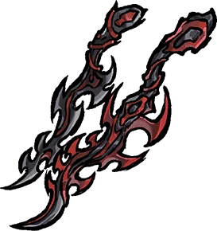

- 类型：双刀　特性：每次主动出手，都会攻击2次
- 五行：阴

### 【练气 · 剜骨】（图鉴未收录）

攻击 2 / 血量 10（基础数值）

寒芒裹蚀骨阴煞，双刃交错破甲剜魂，中者阴毒侵体难愈。

技能「刺杀」此卡牌造成真实伤害，攻击前封印目标1回合

隐藏效果：双刀特性：每次行动，会攻击2次；造成真实伤害

### 【筑基 · 剜骨】

攻击 4 / 血量 25（基础数值）

寒芒裹蚀骨阴煞，双刃交错破甲剜魂，中者阴毒侵体难愈。

技能「刺杀」此卡牌造成真实伤害，攻击前封印目标1回合

隐藏效果：双刀特性：每次行动，会攻击2次；造成真实伤害

### 【结丹 · 剜骨】

攻击 10 / 血量 70（基础数值）

寒芒裹蚀骨阴煞，双刃交错破甲剜魂，中者阴毒侵体难愈。

技能「刺杀」此卡牌造成真实伤害，攻击前封印目标1回合

隐藏效果：双刀特性：每次行动，会攻击2次；造成真实伤害

### 【元婴 · 剜骨】

攻击 27 / 血量 191（基础数值）

寒芒裹蚀骨阴煞，双刃交错破甲剜魂，中者阴毒侵体难愈。

技能「刺杀」此卡牌造成真实伤害，攻击前封印目标1回合

隐藏效果：双刀特性：每次行动，会攻击2次；造成真实伤害

### 【化神 · 剜骨】

攻击 73 / 血量 524（基础数值）

寒芒裹蚀骨阴煞，双刃交错破甲剜魂，中者阴毒侵体难愈。

技能「刺杀」此卡牌造成真实伤害，攻击前封印目标1回合

隐藏效果：双刀特性：每次行动，会攻击2次；造成真实伤害

---

## 36. 熊爪手套

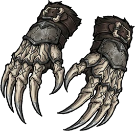

- 类型：双刀　特性：每次主动出手，都会攻击2次
- 五行：土

### 【练气 · 熊爪手套】（图鉴未收录）

攻击 2 / 血量 8（基础数值）

暴君（铁骨熊）的专属法宝，增幅肉身蛮力，撕抓破甲，近身搏杀无往不利

技能「攻守平衡贰」攻击造成伤害后，使自己和任意友方卡牌获得2〔护甲〕

隐藏效果：双刀特性：每次行动，会攻击2次

### 【筑基 · 熊爪手套】（图鉴未收录）

攻击 4 / 血量 20（基础数值）

暴君（铁骨熊）的专属法宝，增幅肉身蛮力，撕抓破甲，近身搏杀无往不利

技能「攻守平衡贰」攻击造成伤害后，使自己和任意友方卡牌获得4〔护甲〕

隐藏效果：双刀特性：每次行动，会攻击2次

### 【结丹 · 熊爪手套】（图鉴未收录）

攻击 11 / 血量 56（基础数值）

暴君（铁骨熊）的专属法宝，增幅肉身蛮力，撕抓破甲，近身搏杀无往不利

技能「攻守平衡贰」攻击造成伤害后，使自己和任意友方卡牌获得11〔护甲〕

隐藏效果：双刀特性：每次行动，会攻击2次

### 【元婴 · 熊爪手套】

攻击 32 / 血量 153（基础数值）

暴君（铁骨熊）的专属法宝，增幅肉身蛮力，撕抓破甲，近身搏杀无往不利

技能「攻守平衡贰」攻击造成伤害后，使自己和任意友方卡牌获得29〔护甲〕

隐藏效果：双刀特性：每次行动，会攻击2次

### 【化神 · 熊爪手套】

攻击 88 / 血量 420（基础数值）

暴君（铁骨熊）的专属法宝，增幅肉身蛮力，撕抓破甲，近身搏杀无往不利

技能「攻守平衡贰」攻击造成伤害后，使自己和任意友方卡牌获得78〔护甲〕

隐藏效果：双刀特性：每次行动，会攻击2次

---

## 37. 藏锋

- 类型：笛子　特性：使用音律远程攻击全体目标
- 五行：金

### 【练气 · 破风古笛】（图鉴未收录）

攻击 1 / 血量 7（基础数值）

笛声悠扬，却又破风之势。

技能「远程」（锁定技）此卡牌的攻击模式为：**远程攻击**（全体）

技能「共鸣」我方其他〔金〕卡牌攻击后，自身的〔攻击〕+1

### 【筑基 · 破风古笛】

攻击 2 / 血量 18（基础数值）

笛声悠扬，却又破风之势。

技能「远程」（锁定技）此卡牌的攻击模式为：**远程攻击**（全体）

技能「共鸣」我方其他〔金〕卡牌攻击后，自身的〔攻击〕+2

### 【结丹 · 破风穿云笛】

攻击 5 / 血量 52（基础数值）

悠扬的笛声竟能把云朵也击穿。

技能「远程」（锁定技）此卡牌的攻击模式为：**远程攻击**（全体）

技能「共鸣」我方其他〔金〕卡牌攻击后，自身的〔攻击〕+4

### 【元婴 · 破风穿云笛】

攻击 15 / 血量 143（基础数值）

悠扬的笛声竟能把云朵也击穿。

技能「远程」（锁定技）此卡牌的攻击模式为：**远程攻击**（全体）

技能「共鸣」我方其他〔金〕卡牌攻击后，自身的〔攻击〕+8

### 【化神 · 藏锋】

攻击 41 / 血量 391（基础数值）

似有刀锋藏在笛声中，不可听也。

技能「远程」（锁定技）此卡牌的攻击模式为：**远程攻击**（全体）

技能「共鸣」我方其他〔金〕卡牌攻击后，自身的〔攻击〕+16

---

## 38. 鸣世

- 类型：笛子　特性：使用音律远程攻击全体目标
- 五行：木

### 【练气 · 紫藤笛】

攻击 1 / 血量 7（基础数值）

不知名的木头制作而成的笛子，笛声经过木身的加持，悠扬悦耳。

技能「远程」（锁定技）此卡牌的攻击模式为：**远程攻击**（全体）

技能「连根贰」场上每有一张〔木〕卡牌，攻击造成的伤害结果〔伤害〕+1（每场战斗只触发一次）

### 【筑基 · 紫青藤笛】

攻击 2 / 血量 18（基础数值）

不知名的木头制作而成的笛子，笛声经过木身的加持，悠扬悦耳。

技能「远程」（锁定技）此卡牌的攻击模式为：**远程攻击**（全体）

技能「连根贰」场上每有一张〔木〕卡牌，攻击造成的伤害结果〔伤害〕+2（每场战斗只触发一次）

### 【结丹 · 紫青枯藤笛】

攻击 5 / 血量 52（基础数值）

不知名的木头制作而成的笛子，笛声经过木身的加持，悠扬悦耳。

技能「远程」（锁定技）此卡牌的攻击模式为：**远程攻击**（全体）

技能「连根贰」场上每有一张〔木〕卡牌，攻击造成的伤害结果〔伤害〕+4（每场战斗只触发一次）

### 【元婴 · 鸣世】

攻击 15 / 血量 143（基础数值）

悠扬的笛声传遍千里，把附近的城市也唤醒了。

技能「远程」（锁定技）此卡牌的攻击模式为：**远程攻击**（全体）

技能「连根贰」场上每有一张〔木〕卡牌，攻击造成的伤害结果〔伤害〕+8（每场战斗只触发一次）

### 【化神 · 鸣世】

攻击 41 / 血量 391（基础数值）

悠扬的笛声传遍千里，把附近的城市也唤醒了。

技能「远程」（锁定技）此卡牌的攻击模式为：**远程攻击**（全体）

技能「连根贰」场上每有一张〔木〕卡牌，攻击造成的伤害结果〔伤害〕+16（每场战斗只触发一次）

### 【炼虚 · 鸣世】（图鉴未收录）

攻击 112 / 血量 1078（基础数值）

悠扬的笛声传遍千里，把附近的城市也唤醒了。

技能「远程」（锁定技）此卡牌的攻击模式为：**远程攻击**（全体）

技能「连根贰」场上每有一张〔木〕卡牌，攻击造成的伤害结果〔伤害〕+48（每场战斗只触发一次）

### 【合体 · 鸣世】（图鉴未收录）

攻击 309 / 血量 2964（基础数值）

悠扬的笛声传遍千里，把附近的城市也唤醒了。

技能「远程」（锁定技）此卡牌的攻击模式为：**远程攻击**（全体）

技能「连根贰」场上每有一张〔木〕卡牌，攻击造成的伤害结果〔伤害〕+132（每场战斗只触发一次）

---

## 39. 勾魂

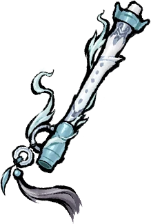

- 类型：笛子　特性：使用音律远程攻击全体目标
- 五行：水

### 【练气 · 琉璃笛】

攻击 1 / 血量 6（基础数值）

经过百年灵泉冲刷过的笛子，笛声婉转缥缈，洗净听者的尘俗旧事。

技能「远程」（锁定技）此卡牌的攻击模式为：**远程攻击**（全体）

技能「噬魂」造成伤害后，吸取1点〔攻击〕附加于此卡牌上

### 【筑基 · 琉璃骨笛】

攻击 3 / 血量 17（基础数值）

经过百年灵泉冲刷过的笛子，笛声婉转缥缈，洗净听者的尘俗旧事。

技能「远程」（锁定技）此卡牌的攻击模式为：**远程攻击**（全体）

技能「噬魂」造成伤害后，吸取2点〔攻击〕附加于此卡牌上

### 【结丹 · 琉璃白骨笛】

攻击 8 / 血量 45（基础数值）

经过百年灵泉冲刷过的笛子，笛声婉转缥缈，洗净听者的尘俗旧事。

技能「远程」（锁定技）此卡牌的攻击模式为：**远程攻击**（全体）

技能「噬魂」造成伤害后，吸取3点〔攻击〕附加于此卡牌上

### 【元婴 · 勾魂】

攻击 22 / 血量 124（基础数值）

一曲肝肠断，魂魄不知处。

技能「远程」（锁定技）此卡牌的攻击模式为：**远程攻击**（全体）

技能「噬魂」造成伤害后，吸取5点〔攻击〕附加于此卡牌上

### 【化神 · 勾魂】

攻击 61 / 血量 343（基础数值）

一曲肝肠断，魂魄不知处。

技能「远程」（锁定技）此卡牌的攻击模式为：**远程攻击**（全体）

技能「噬魂」造成伤害后，吸取10点〔攻击〕附加于此卡牌上

---

## 40. 号令

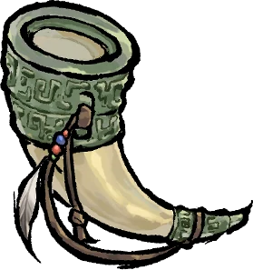

- 类型：笛子　特性：使用音律远程攻击全体目标
- 五行：土

### 【练气 · 号令】（图鉴未收录）

攻击 1 / 血量 8（基础数值）

土纹盘绕蕴厚重，吹奏可号令灵兽进攻

技能「远程」（锁定技）此卡牌的攻击模式为：**远程攻击**（全体）

技能「战鼓」每回合开始时，使友方随机灵兽获得一次攻击机会。

### 【筑基 · 号令】

攻击 2 / 血量 20（基础数值）

土纹盘绕蕴厚重，吹奏可号令灵兽进攻

技能「远程」（锁定技）此卡牌的攻击模式为：**远程攻击**（全体）

技能「战鼓」每回合开始时，使友方随机灵兽获得一次攻击机会。

### 【结丹 · 号令】

攻击 7 / 血量 56（基础数值）

土纹盘绕蕴厚重，吹奏可号令灵兽进攻

技能「远程」（锁定技）此卡牌的攻击模式为：**远程攻击**（全体）

技能「战鼓」每回合开始时，使友方随机灵兽获得一次攻击机会。

### 【元婴 · 号令】

攻击 19 / 血量 153（基础数值）

土纹盘绕蕴厚重，吹奏可号令灵兽进攻

技能「远程」（锁定技）此卡牌的攻击模式为：**远程攻击**（全体）

技能「战鼓」每回合开始时，使友方随机灵兽获得一次攻击机会。

### 【化神 · 号令】

攻击 51 / 血量 420（基础数值）

土纹盘绕蕴厚重，吹奏可号令灵兽进攻

技能「远程」（锁定技）此卡牌的攻击模式为：**远程攻击**（全体）

技能「战鼓」每回合开始时，使友方随机灵兽获得一次攻击机会。

---

## 41. 驭秽

- 类型：笛子　特性：使用音律远程攻击全体目标
- 五行：阴

### 【练气 · 驭秽】（图鉴未收录）

攻击 1 / 血量 7（基础数值）

乌光流转蕴秽气，吹奏即散蚀骨毒雾

技能「远程」（锁定技）此卡牌的攻击模式为：**远程攻击**（全体）

技能「使虫」如果击伤灵兽类型卡牌，使其获得中毒

### 【筑基 · 驭秽】

攻击 2 / 血量 18（基础数值）

乌光流转蕴秽气，吹奏即散蚀骨毒雾

技能「远程」（锁定技）此卡牌的攻击模式为：**远程攻击**（全体）

技能「使虫」如果击伤灵兽类型卡牌，使其获得中毒

### 【结丹 · 驭秽】

攻击 5 / 血量 52（基础数值）

乌光流转蕴秽气，吹奏即散蚀骨毒雾

技能「远程」（锁定技）此卡牌的攻击模式为：**远程攻击**（全体）

技能「使虫」如果击伤灵兽类型卡牌，使其获得中毒

### 【元婴 · 驭秽】

攻击 13 / 血量 143（基础数值）

乌光流转蕴秽气，吹奏即散蚀骨毒雾

技能「远程」（锁定技）此卡牌的攻击模式为：**远程攻击**（全体）

技能「使虫」如果击伤灵兽类型卡牌，使其获得中毒

### 【化神 · 驭秽】

攻击 35 / 血量 391（基础数值）

乌光流转蕴秽气，吹奏即散蚀骨毒雾

技能「远程」（锁定技）此卡牌的攻击模式为：**远程攻击**（全体）

技能「使虫」如果击伤灵兽类型卡牌，使其获得中毒

---

## 42. 沉香

- 类型：葫芦　特性：攻击方式是：远程。可在灵田里辅助灵草生长。
- 五行：木

### 【练气 · 翠竹葫芦】

攻击 2 / 血量 9（基础数值）

将百年葫芦种子种植在百年老树里催发生长出来的葫芦。

技能「远程」（锁定技）此卡牌的攻击模式为：**远程攻击**（单体）

技能「中毒叁」当敌方卡牌失去**中毒**时，使随机敌方卡牌再次获得**中毒**（此技能每回合只触发一次）

### 【筑基 · 翠竹葫芦】

攻击 4 / 血量 23（基础数值）

将百年葫芦种子种植在百年老树里催发生长出来的葫芦。

技能「远程」（锁定技）此卡牌的攻击模式为：**远程攻击**（单体）

技能「中毒叁」当敌方卡牌失去**中毒**时，使随机敌方卡牌再次获得**中毒**（此技能每回合只触发一次）

### 【结丹 · 翠竹香韵葫芦】

攻击 11 / 血量 63（基础数值）

葫芦生长过后，有一股不可思议的香气散发而出。

技能「远程」（锁定技）此卡牌的攻击模式为：**远程攻击**（单体）

技能「中毒叁」当敌方卡牌失去**中毒**时，使随机敌方卡牌再次获得**中毒**（此技能每回合只触发一次）

### 【元婴 · 沉香】

攻击 32 / 血量 172（基础数值）

香气缓慢沉淀凝聚，久久而不散。

技能「远程」（锁定技）此卡牌的攻击模式为：**远程攻击**（单体）

技能「中毒叁」当敌方卡牌失去**中毒**时，使随机敌方卡牌再次获得**中毒**（此技能每回合只触发一次）

### 【化神 · 沉香】

攻击 88 / 血量 472（基础数值）

香气缓慢沉淀凝聚，久久而不散。

技能「远程」（锁定技）此卡牌的攻击模式为：**远程攻击**（单体）

技能「中毒叁」当敌方卡牌失去**中毒**时，使随机敌方卡牌再次获得**中毒**（此技能每回合只触发一次）

---

## 43. 焚天

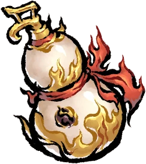

- 类型：葫芦　特性：攻击方式是：远程。可在灵田里辅助灵草生长。
- 五行：火

### 【练气 · 炽焰葫芦】

攻击 2 / 血量 9（基础数值）

将葫芦用地火焚烧而成，能吸火苗吐火龙。

技能「远程」（锁定技）此卡牌的攻击模式为：**远程攻击**（单体）

技能「怒意贰」攻击的目标如果没有受伤，则再攻击一次（一回合最多触发2次）

### 【筑基 · 炽焰明葫芦】

攻击 6 / 血量 24（基础数值）

将葫芦用地火焚烧而成，能吸火苗吐火龙。

技能「远程」（锁定技）此卡牌的攻击模式为：**远程攻击**（单体）

技能「怒意贰」攻击的目标如果没有受伤，则再攻击一次（一回合最多触发2次）

### 【结丹 · 炽焰明天葫芦】

攻击 15 / 血量 67（基础数值）

将葫芦用地火焚烧而成，能吸火苗吐火龙。

技能「远程」（锁定技）此卡牌的攻击模式为：**远程攻击**（单体）

技能「怒意贰」攻击的目标如果没有受伤，则再攻击一次（一回合最多触发2次）

### 【元婴 · 焚天】

攻击 42 / 血量 184（基础数值）

如果将葫芦里的火焰全部释放出来，大概连天空也能焚烧

技能「远程」（锁定技）此卡牌的攻击模式为：**远程攻击**（单体）

技能「怒意贰」攻击的目标如果没有受伤，则再攻击一次（一回合最多触发2次）

### 【化神 · 焚天】

攻击 117 / 血量 503（基础数值）

如果将葫芦里的火焰全部释放出来，大概连天空也能焚烧

技能「远程」（锁定技）此卡牌的攻击模式为：**远程攻击**（单体）

技能「怒意贰」攻击的目标如果没有受伤，则再攻击一次（一回合最多触发2次）

---

## 44. 不摧

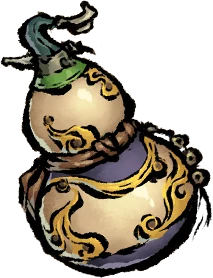

- 类型：葫芦　特性：攻击方式是：远程。可在灵田里辅助灵草生长。
- 五行：土

### 【练气 · 黄砂葫芦】

攻击 None / 血量 16（基础数值）

用高原黄土堆砌成葫芦形状，能吸纳天上精华，地上污秽。

技能「远程」（锁定技）此卡牌的攻击模式为：**远程攻击**（单体）

技能「嘲讽」（锁定技）战斗中，会优先受到攻击

技能「遁甲」（被动）加入战场的首个回合开始时，〔护甲〕+10

### 【筑基 · 千精砂葫芦】

攻击 None / 血量 45（基础数值）

用高原黄土堆砌成葫芦形状，能吸纳天上精华，地上污秽。

技能「远程」（锁定技）此卡牌的攻击模式为：**远程攻击**（单体）

技能「嘲讽」（锁定技）战斗中，会优先受到攻击

技能「遁甲」（被动）加入战场的首个回合开始时，〔护甲〕+25

### 【结丹 · 万精刚砂葫芦】

攻击 None / 血量 125（基础数值）

吸纳了精华和污秽的葫芦，越发的变得坚硬。

技能「远程」（锁定技）此卡牌的攻击模式为：**远程攻击**（单体）

技能「嘲讽」（锁定技）战斗中，会优先受到攻击

技能「遁甲」（被动）加入战场的首个回合开始时，〔护甲〕+50

### 【元婴 · 不摧】

攻击 None / 血量 343（基础数值）

目前还没发现有何利器能将其击碎。

技能「远程」（锁定技）此卡牌的攻击模式为：**远程攻击**（单体）

技能「嘲讽」（锁定技）战斗中，会优先受到攻击

技能「遁甲」（被动）加入战场的首个回合开始时，〔护甲〕+120

### 【化神 · 不摧】

攻击 None / 血量 944（基础数值）

目前还没发现有何利器能将其击碎。

技能「远程」（锁定技）此卡牌的攻击模式为：**远程攻击**（单体）

技能「嘲讽」（锁定技）战斗中，会优先受到攻击

技能「遁甲」（被动）加入战场的首个回合开始时，〔护甲〕+350

---

## 45. 骇浪

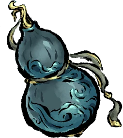

- 类型：葫芦　特性：攻击方式是：远程。可在灵田里辅助灵草生长。
- 五行：水

### 【筑基 · 幻海葫芦】（图鉴未收录）

攻击 3 / 血量 25（基础数值）

腹藏万顷碧波，启盖即涌滔天骇浪覆敌淹阵

技能「远程」（锁定技）此卡牌的攻击模式为：**远程攻击**（全体）

技能「唤海」（被动）对〔火〕卡牌造成3倍伤害

### 【结丹 · 幻海葫芦】

攻击 8 / 血量 70（基础数值）

腹藏万顷碧波，启盖即涌滔天骇浪覆敌淹阵

技能「远程」（锁定技）此卡牌的攻击模式为：**远程攻击**（全体）

技能「唤海」（被动）对〔火〕卡牌造成3倍伤害

### 【元婴 · 骇浪】

攻击 21 / 血量 191（基础数值）

腹藏万顷碧波，启盖即涌滔天骇浪覆敌淹阵

技能「远程」（锁定技）此卡牌的攻击模式为：**远程攻击**（全体）

技能「唤海」（被动）对〔火〕卡牌造成3倍伤害

### 【化神 · 骇浪】

攻击 58 / 血量 524（基础数值）

腹藏万顷碧波，启盖即涌滔天骇浪覆敌淹阵

技能「远程」（锁定技）此卡牌的攻击模式为：**远程攻击**（全体）

技能「唤海」（被动）对〔火〕卡牌造成3倍伤害

---

## 46. 鎏金葫芦

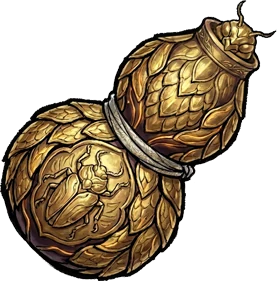

- 类型：葫芦　特性：攻击方式是：远程。可在灵田里辅助灵草生长。
- 五行：金

### 【练气 · 鎏金葫芦】（图鉴未收录）

攻击 2 / 血量 8（基础数值）

金缕（金蝉蛊）的专属法宝，以自身千年蝉蜕熔铸而成。葫身覆层叠金鳞，宛若蝉甲包覆。

技能「远程」（锁定技）此卡牌的攻击模式为：**远程攻击**（单体）

技能「蝉甲」当自己的持有者受到攻击后，为它增加1减伤（持续一回合）

### 【筑基 · 鎏金葫芦】（图鉴未收录）

攻击 6 / 血量 24（基础数值）

金缕（金蝉蛊）的专属法宝，以自身千年蝉蜕熔铸而成。葫身覆层叠金鳞，宛若蝉甲包覆。

技能「远程」（锁定技）此卡牌的攻击模式为：**远程攻击**（单体）

技能「蝉甲」当自己的持有者受到攻击后，为它增加3减伤（持续一回合）

### 【结丹 · 鎏金葫芦】（图鉴未收录）

攻击 15 / 血量 65（基础数值）

金缕（金蝉蛊）的专属法宝，以自身千年蝉蜕熔铸而成。葫身覆层叠金鳞，宛若蝉甲包覆。

技能「远程」（锁定技）此卡牌的攻击模式为：**远程攻击**（单体）

技能「蝉甲」当自己的持有者受到攻击后，为它增加7减伤（持续一回合）

### 【元婴 · 鎏金葫芦】

攻击 42 / 血量 178（基础数值）

金缕（金蝉蛊）的专属法宝，以自身千年蝉蜕熔铸而成。葫身覆层叠金鳞，宛若蝉甲包覆。

技能「远程」（锁定技）此卡牌的攻击模式为：**远程攻击**（单体）

技能「蝉甲」当自己的持有者受到攻击后，为它增加17减伤（持续一回合）

### 【化神 · 鎏金葫芦】

攻击 117 / 血量 490（基础数值）

金缕（金蝉蛊）的专属法宝，以自身千年蝉蜕熔铸而成。葫身覆层叠金鳞，宛若蝉甲包覆。

技能「远程」（锁定技）此卡牌的攻击模式为：**远程攻击**（单体）

技能「蝉甲」当自己的持有者受到攻击后，为它增加50减伤（持续一回合）

---

## 47. 惊神

- 类型：铃铛　特性：使用音律远程攻击目标
- 五行：金

### 【练气 · 金芒铃】

攻击 2 / 血量 8（基础数值）

普普通通的铃铛，只是听过其铃声的人，都无法回忆当时发生的事情。

技能「远程」（锁定技）此卡牌的攻击模式为：**远程攻击**（单体）

技能「共鸣贰」我方其他〔金〕卡牌攻击前，使它的〔攻击〕+1

### 【筑基 · 金芒铃】

攻击 6 / 血量 21（基础数值）

普普通通的铃铛，只是听过其铃声的人，都无法回忆当时发生的事情。

技能「远程」（锁定技）此卡牌的攻击模式为：**远程攻击**（单体）

技能「共鸣贰」我方其他〔金〕卡牌攻击前，使它的〔攻击〕+3

### 【结丹 · 金芒脆音铃】

攻击 15 / 血量 60（基础数值）

普普通通的铃铛，只是听过其铃声的人，都无法回忆当时发生的事情。

技能「远程」（锁定技）此卡牌的攻击模式为：**远程攻击**（单体）

技能「共鸣贰」我方其他〔金〕卡牌攻击前，使它的〔攻击〕+10

### 【元婴 · 惊神】

攻击 42 / 血量 163（基础数值）

催动铃铛发出的脆音，熟睡的神仙也会被惊醒。

技能「远程」（锁定技）此卡牌的攻击模式为：**远程攻击**（单体）

技能「共鸣贰」我方其他〔金〕卡牌攻击前，使它的〔攻击〕+25

### 【化神 · 惊神】

攻击 117 / 血量 447（基础数值）

催动铃铛发出的脆音，熟睡的神仙也会被惊醒。

技能「远程」（锁定技）此卡牌的攻击模式为：**远程攻击**（单体）

技能「共鸣贰」我方其他〔金〕卡牌攻击前，使它的〔攻击〕+50

---

## 48. 不悔

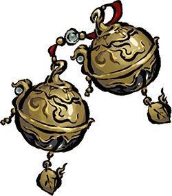

- 类型：铃铛　特性：使用音律远程攻击目标
- 五行：金

### 【筑基 · 合欢魔铃】

攻击 3 / 血量 20（基础数值）

闻音者，心中泛起一丝无名爱意。

技能「远程」（锁定技）此卡牌的攻击模式为：**远程攻击**（单体）

技能「聚光叁」受到伤害时，使随机友军获得**光盾**

### 【结丹 · 合欢魔铃】

攻击 8 / 血量 54（基础数值）

闻音者，心中泛起一丝无名爱意。

技能「远程」（锁定技）此卡牌的攻击模式为：**远程攻击**（单体）

技能「聚光叁」受到伤害时，使随机友军获得**光盾**

### 【元婴 · 合欢痴情铃】

攻击 21 / 血量 149（基础数值）

相传心中有着最痴情的情意，才能催动这铃铛。

技能「远程」（锁定技）此卡牌的攻击模式为：**远程攻击**（单体）

技能「聚光叁」受到伤害时，使随机友军获得**光盾**

### 【化神 · 不悔】

攻击 58 / 血量 410（基础数值）

“九幽阴灵，诸天神魔；以我血躯，奉为牺牲；三生七世，永堕阎罗；只为情故，虽死不悔。”

技能「远程」（锁定技）此卡牌的攻击模式为：**远程攻击**（单体）

技能「聚光叁」受到伤害时，使随机友军获得**光盾**

---

## 49. 震霄

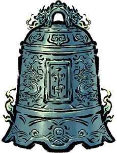

- 类型：铃铛　特性：使用音律远程攻击目标
- 五行：水

### 【练气 · 震霄】（图鉴未收录）

攻击 None / 血量 5（基础数值）

用夔牛的雷核制作的钟，可引来雷电，响彻天地

技能「远程」（锁定技）此卡牌的攻击模式为：**远程攻击**（单体）

技能「落雷」回合开始时，对随机2名敌方卡牌造成6点伤害

### 【筑基 · 震霄】

攻击 None / 血量 13（基础数值）

用夔牛的雷核制作的钟，可引来雷电，响彻天地

技能「远程」（锁定技）此卡牌的攻击模式为：**远程攻击**（单体）

技能「落雷」回合开始时，对随机2名敌方卡牌造成17点伤害

### 【结丹 · 震霄】

攻击 None / 血量 37（基础数值）

用夔牛的雷核制作的钟，可引来雷电，响彻天地

技能「远程」（锁定技）此卡牌的攻击模式为：**远程攻击**（单体）

技能「落雷」回合开始时，对随机2名敌方卡牌造成47点伤害

### 【元婴 · 震霄】

攻击 None / 血量 102（基础数值）

用夔牛的雷核制作的钟，可引来雷电，响彻天地

技能「远程」（锁定技）此卡牌的攻击模式为：**远程攻击**（单体）

技能「落雷」回合开始时，对随机2名敌方卡牌造成127点伤害

### 【化神 · 震霄】

攻击 None / 血量 280（基础数值）

用夔牛的雷核制作的钟，可引来雷电，响彻天地

技能「远程」（锁定技）此卡牌的攻击模式为：**远程攻击**（单体）

技能「落雷」回合开始时，对随机2名敌方卡牌造成350点伤害

---

## 50. 惑音

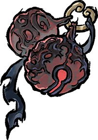

- 类型：铃铛　特性：使用音律远程攻击目标
- 五行：阴

### 【练气 · 惑音】（图鉴未收录）

攻击 2 / 血量 6（基础数值）

黑囊裹幽魅之音，启袋即散幻音惑敌，乱其神魂令其失智盲从

技能「远程」（锁定技）此卡牌的攻击模式为：**远程攻击**（单体）

技能「分身」加入战场时，复制两个假的惑音；（假惑音被击败后，使攻击者获得混乱）

### 【筑基 · 惑音】

攻击 4 / 血量 15（基础数值）

黑囊裹幽魅之音，启袋即散幻音惑敌，乱其神魂令其失智盲从

技能「远程」（锁定技）此卡牌的攻击模式为：**远程攻击**（单体）

技能「分身」加入战场时，复制两个假的惑音；（假惑音被击败后，使攻击者获得混乱）

### 【结丹 · 惑音】

攻击 11 / 血量 42（基础数值）

黑囊裹幽魅之音，启袋即散幻音惑敌，乱其神魂令其失智盲从

技能「远程」（锁定技）此卡牌的攻击模式为：**远程攻击**（单体）

技能「分身」加入战场时，复制两个假的惑音；（假惑音被击败后，使攻击者获得混乱）

### 【元婴 · 惑音】

攻击 32 / 血量 114（基础数值）

黑囊裹幽魅之音，启袋即散幻音惑敌，乱其神魂令其失智盲从

技能「远程」（锁定技）此卡牌的攻击模式为：**远程攻击**（单体）

技能「分身」加入战场时，复制两个假的惑音；（假惑音被击败后，使攻击者获得混乱）

### 【化神 · 惑音】

攻击 88 / 血量 315（基础数值）

黑囊裹幽魅之音，启袋即散幻音惑敌，乱其神魂令其失智盲从

技能「远程」（锁定技）此卡牌的攻击模式为：**远程攻击**（单体）

技能「分身」加入战场时，复制两个假的惑音；（假惑音被击败后，使攻击者获得混乱）

---

## 51. 涤尘

- 类型：瓶子　特性：攻击方式是：远程。可在灵田里辅助灵草生长。回合开始时，清除我方一名随机卡牌的负面效果
- 五行：水

### 【练气 · 雨露瓶】

攻击 2 / 血量 10（基础数值）

收集天地间的水灵气，小小一滴，可以滋养大片的土地

技能「远程」（锁定技）此卡牌的攻击模式为：**远程攻击**（单体）

技能「涤静」每当有己方卡牌获得治疗时，使其〔攻击〕+2

隐藏效果：瓶子特性：回合开始时，清除一名随机友军的负面效果

### 【筑基 · 雨露清瓶】

攻击 4 / 血量 26（基础数值）

收集天地间的水灵气，小小一滴，可以滋养大片的土地

技能「远程」（锁定技）此卡牌的攻击模式为：**远程攻击**（单体）

技能「涤静」每当有己方卡牌获得治疗时，使其〔攻击〕+4

隐藏效果：瓶子特性：回合开始时，清除一名随机友军的负面效果

### 【结丹 · 雨露净水瓶】

攻击 12 / 血量 70（基础数值）

收集到的净水，似有特殊的功效，居家必备之物。

技能「远程」（锁定技）此卡牌的攻击模式为：**远程攻击**（单体）

技能「涤静」每当有己方卡牌获得治疗时，使其〔攻击〕+11

隐藏效果：瓶子特性：回合开始时，清除一名随机友军的负面效果

### 【元婴 · 涤尘】

攻击 32 / 血量 194（基础数值）

一滴灵水，便可以洗净天下尘俗之物。

技能「远程」（锁定技）此卡牌的攻击模式为：**远程攻击**（单体）

技能「涤静」每当有己方卡牌获得治疗时，使其〔攻击〕+30

隐藏效果：瓶子特性：回合开始时，清除一名随机友军的负面效果

### 【化神 · 涤尘】

攻击 87 / 血量 536（基础数值）

一滴灵水，便可以洗净天下尘俗之物。

技能「远程」（锁定技）此卡牌的攻击模式为：**远程攻击**（单体）

技能「涤静」每当有己方卡牌获得治疗时，使其〔攻击〕+75

隐藏效果：瓶子特性：回合开始时，清除一名随机友军的负面效果

---

## 52. 蜕烬

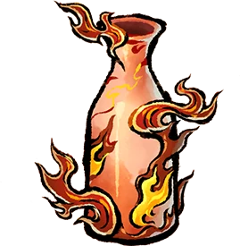

- 类型：瓶子　特性：攻击方式是：远程。可在灵田里辅助灵草生长。回合开始时，清除我方一名随机卡牌的负面效果
- 五行：火

### 【练气 · 红莲极瓶】（图鉴未收录）

攻击 7 / 血量 7（基础数值）

瓶身上刻印着远古符文，瓶内虽无火焰，但温度却极高。

技能「远程」（锁定技）此卡牌的攻击模式为：**远程攻击**（单体）

技能「潜力」这张卡牌没有技能，但它的属性会更高

隐藏效果：瓶子特性：回合开始时，清除一名随机友军的负面效果

### 【筑基 · 红莲极瓶】

攻击 18 / 血量 17（基础数值）

瓶身上刻印着远古符文，瓶内虽无火焰，但温度却极高。

技能「远程」（锁定技）此卡牌的攻击模式为：**远程攻击**（单体）

技能「潜力」这张卡牌没有技能，但它的属性会更高

隐藏效果：瓶子特性：回合开始时，清除一名随机友军的负面效果

### 【结丹 · 红莲至阳瓶】

攻击 50 / 血量 46（基础数值）

瓶身上刻印着远古符文，瓶内虽无火焰，但温度却极高。

技能「远程」（锁定技）此卡牌的攻击模式为：**远程攻击**（单体）

技能「潜力」这张卡牌没有技能，但它的属性会更高

隐藏效果：瓶子特性：回合开始时，清除一名随机友军的负面效果

### 【元婴 · 蜕烬】

攻击 140 / 血量 125（基础数值）

如果不幸被吸入瓶内，不久后便只剩下灰烬。

技能「远程」（锁定技）此卡牌的攻击模式为：**远程攻击**（单体）

技能「潜力」这张卡牌没有技能，但它的属性会更高

隐藏效果：瓶子特性：回合开始时，清除一名随机友军的负面效果

### 【化神 · 蜕烬】

攻击 385 / 血量 346（基础数值）

如果不幸被吸入瓶内，不久后便只剩下灰烬。

技能「远程」（锁定技）此卡牌的攻击模式为：**远程攻击**（单体）

技能「潜力」这张卡牌没有技能，但它的属性会更高

隐藏效果：瓶子特性：回合开始时，清除一名随机友军的负面效果

---

## 53. 海纳

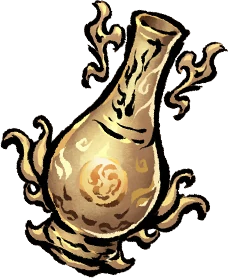

- 类型：瓶子　特性：攻击方式是：远程。可在灵田里辅助灵草生长。回合开始时，清除我方一名随机卡牌的负面效果
- 五行：土

### 【练气 · 星华瓶】

攻击 3 / 血量 7（基础数值）

瓶身小巧，瓶内却另有乾坤，能吸纳攻击法术化为己有。

技能「远程」（锁定技）此卡牌的攻击模式为：**远程攻击**（单体）

技能「巧劲」回合开始时，使一名拥有护甲的友方卡牌获得等同于护甲值的攻击力

隐藏效果：瓶子特性：回合开始时，清除一名随机友军的负面效果

### 【筑基 · 星华宝瓶】

攻击 7 / 血量 19（基础数值）

瓶身小巧，瓶内却另有乾坤，能吸纳攻击法术化为己有。

技能「远程」（锁定技）此卡牌的攻击模式为：**远程攻击**（单体）

技能「巧劲」回合开始时，使一名拥有护甲的友方卡牌获得等同于护甲值的攻击力

隐藏效果：瓶子特性：回合开始时，清除一名随机友军的负面效果

### 【结丹 · 星华掌天瓶】

攻击 19 / 血量 52（基础数值）

瓶身小巧，瓶内却另有乾坤，能吸纳攻击法术化为己有。

技能「远程」（锁定技）此卡牌的攻击模式为：**远程攻击**（单体）

技能「巧劲」回合开始时，使一名拥有护甲的友方卡牌获得等同于护甲值的攻击力

隐藏效果：瓶子特性：回合开始时，清除一名随机友军的负面效果

### 【元婴 · 海纳】

攻击 53 / 血量 143（基础数值）

小巧的瓶身，无人能知内里空间有多广阔。

技能「远程」（锁定技）此卡牌的攻击模式为：**远程攻击**（单体）

技能「巧劲」回合开始时，使一名拥有护甲的友方卡牌获得等同于护甲值的攻击力

隐藏效果：瓶子特性：回合开始时，清除一名随机友军的负面效果

### 【化神 · 海纳】

攻击 146 / 血量 393（基础数值）

小巧的瓶身，无人能知内里空间有多广阔。

技能「远程」（锁定技）此卡牌的攻击模式为：**远程攻击**（单体）

技能「巧劲」回合开始时，使一名拥有护甲的友方卡牌获得等同于护甲值的攻击力

隐藏效果：瓶子特性：回合开始时，清除一名随机友军的负面效果

---

## 54. 血祭

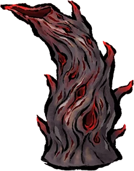

- 类型：瓶子　特性：攻击方式是：远程。可在灵田里辅助灵草生长。回合开始时，清除我方一名随机卡牌的负面效果
- 五行：木

### 【练气 · 血祭】（图鉴未收录）

攻击 2 / 血量 7（基础数值）

木制的瓶子，但瓶身却透露着一种诡异的红纹

技能「远程」（锁定技）此卡牌的攻击模式为：**远程攻击**（单体）

技能「引路叁」攻击后，随机使敌方一个**中毒**状态立即生效，并使目标旁边随机卡牌受到20%的伤害

隐藏效果：瓶子特性：回合开始时，清除一名随机友军的负面效果

### 【筑基 · 血祭】

攻击 6 / 血量 18（基础数值）

木制的瓶子，但瓶身却透露着一种诡异的红纹

技能「远程」（锁定技）此卡牌的攻击模式为：**远程攻击**（单体）

技能「引路叁」攻击后，随机使敌方一个**中毒**状态立即生效，并使目标旁边随机卡牌受到30%的伤害

隐藏效果：瓶子特性：回合开始时，清除一名随机友军的负面效果

### 【结丹 · 血祭】

攻击 15 / 血量 49（基础数值）

木制的瓶子，但瓶身却透露着一种诡异的红纹

技能「远程」（锁定技）此卡牌的攻击模式为：**远程攻击**（单体）

技能「引路叁」攻击后，随机使敌方一个**中毒**状态立即生效，并使目标旁边随机卡牌受到40%的伤害

隐藏效果：瓶子特性：回合开始时，清除一名随机友军的负面效果

### 【元婴 · 血祭】

攻击 42 / 血量 134（基础数值）

木制的瓶子，但瓶身却透露着一种诡异的红纹

技能「远程」（锁定技）此卡牌的攻击模式为：**远程攻击**（单体）

技能「引路叁」攻击后，随机使敌方一个**中毒**状态立即生效，并使目标旁边随机卡牌受到50%的伤害

隐藏效果：瓶子特性：回合开始时，清除一名随机友军的负面效果

### 【化神 · 血祭】

攻击 117 / 血量 367（基础数值）

瓶子在攻击后会吸收目标的血液，红纹越深证明......

技能「远程」（锁定技）此卡牌的攻击模式为：**远程攻击**（单体）

技能「引路叁」攻击后，随机使敌方一个**中毒**状态立即生效，并使目标旁边随机卡牌受到60%的伤害

隐藏效果：瓶子特性：回合开始时，清除一名随机友军的负面效果

---

## 55. 千蝉净瓶

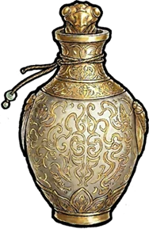

- 类型：瓶子　特性：攻击方式是：远程。可在灵田里辅助灵草生长。回合开始时，清除我方一名随机卡牌的负面效果
- 五行：金

### 【练气 · 千蝉净瓶】（图鉴未收录）

攻击 2 / 血量 10（基础数值）

金缕（金蝉蛊）的专属法宝，内蕴千蝉清灵元气，将溃散的灵光尽数转化为护身之甲。

技能「远程」（锁定技）此卡牌的攻击模式为：**远程攻击**（单体）

技能「凝甲」当我方卡牌失去**光盾**时，使它获得2〔护甲〕

隐藏效果：瓶子特性：回合开始时，清除一名随机友军的负面效果

### 【筑基 · 千蝉净瓶】（图鉴未收录）

攻击 4 / 血量 26（基础数值）

金缕（金蝉蛊）的专属法宝，内蕴千蝉清灵元气，将溃散的灵光尽数转化为护身之甲。

技能「远程」（锁定技）此卡牌的攻击模式为：**远程攻击**（单体）

技能「凝甲」当我方卡牌失去**光盾**时，使它获得5〔护甲〕

隐藏效果：瓶子特性：回合开始时，清除一名随机友军的负面效果

### 【结丹 · 千蝉净瓶】（图鉴未收录）

攻击 12 / 血量 74（基础数值）

金缕（金蝉蛊）的专属法宝，内蕴千蝉清灵元气，将溃散的灵光尽数转化为护身之甲。

技能「远程」（锁定技）此卡牌的攻击模式为：**远程攻击**（单体）

技能「凝甲」当我方卡牌失去**光盾**时，使它获得14〔护甲〕

隐藏效果：瓶子特性：回合开始时，清除一名随机友军的负面效果

### 【元婴 · 千蝉净瓶】

攻击 32 / 血量 204（基础数值）

金缕（金蝉蛊）的专属法宝，内蕴千蝉清灵元气，将溃散的灵光尽数转化为护身之甲。

技能「远程」（锁定技）此卡牌的攻击模式为：**远程攻击**（单体）

技能「凝甲」当我方卡牌失去**光盾**时，使它获得40〔护甲〕

隐藏效果：瓶子特性：回合开始时，清除一名随机友军的负面效果

### 【化神 · 千蝉净瓶】

攻击 87 / 血量 559（基础数值）

金缕（金蝉蛊）的专属法宝，内蕴千蝉清灵元气，将溃散的灵光尽数转化为护身之甲。

技能「远程」（锁定技）此卡牌的攻击模式为：**远程攻击**（单体）

技能「凝甲」当我方卡牌失去**光盾**时，使它获得110〔护甲〕

隐藏效果：瓶子特性：回合开始时，清除一名随机友军的负面效果

---

## 56. 留客

- 类型：扇子　特性：攻击方式是：远程。战斗开始时，会先攻击1次
- 五行：木

### 【练气 · 青岚扇】

攻击 2 / 血量 7（基础数值）

扇子扇出的风，能使周围的变幻出奇特的生机。

技能「远程」（锁定技）此卡牌的攻击模式为：**远程攻击**（单体）

技能「中毒贰」回合开始时，使随机敌方卡牌获得**中毒**

隐藏效果：扇子特性：加入战场后，会先执行一次攻击

### 【筑基 · 青岚宝扇】

攻击 4 / 血量 17（基础数值）

扇子扇出的风，能使周围的变幻出奇特的生机。

技能「远程」（锁定技）此卡牌的攻击模式为：**远程攻击**（单体）

技能「中毒贰」回合开始时，使随机敌方卡牌获得**中毒**

隐藏效果：扇子特性：加入战场后，会先执行一次攻击

### 【结丹 · 青岚碧影扇】

攻击 11 / 血量 48（基础数值）

扇子扇出的风，能使周围的变幻出奇特的生机。

技能「远程」（锁定技）此卡牌的攻击模式为：**远程攻击**（单体）

技能「中毒贰」回合开始时，使随机敌方卡牌获得**中毒**

隐藏效果：扇子特性：加入战场后，会先执行一次攻击

### 【元婴 · 留客】

攻击 30 / 血量 132（基础数值）

此扇一出，幻化出奇特的幻境，客人何不留下一聚？

技能「远程」（锁定技）此卡牌的攻击模式为：**远程攻击**（单体）

技能「中毒贰」回合开始时，使随机敌方卡牌获得**中毒**

隐藏效果：扇子特性：加入战场后，会先执行一次攻击

### 【化神 · 留客】

攻击 82 / 血量 364（基础数值）

此扇一出，幻化出奇特的幻境，客人何不留下一聚？

技能「远程」（锁定技）此卡牌的攻击模式为：**远程攻击**（单体）

技能「中毒贰」回合开始时，使随机敌方卡牌获得**中毒**

隐藏效果：扇子特性：加入战场后，会先执行一次攻击

---

## 57. 寒螭

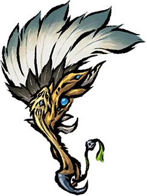

- 类型：扇子　特性：攻击方式是：远程。战斗开始时，会先攻击1次
- 五行：水

### 【练气 · 游龙古扇】（图鉴未收录）

攻击 3 / 血量 8（基础数值）

扇子上似乎封印着一条生灵活现的龙。

技能「远程」（锁定技）此卡牌的攻击模式为：**远程攻击**（单体）

技能「潜力」这张卡牌没有技能，但它的属性会更高

隐藏效果：扇子特性：加入战场后，会先执行一次攻击

### 【筑基 · 游龙古扇】

攻击 8 / 血量 23（基础数值）

扇子上似乎封印着一条生灵活现的龙。

技能「远程」（锁定技）此卡牌的攻击模式为：**远程攻击**（单体）

技能「潜力」这张卡牌没有技能，但它的属性会更高

隐藏效果：扇子特性：加入战场后，会先执行一次攻击

### 【结丹 · 螭龙纹水扇】

攻击 23 / 血量 62（基础数值）

扇子上似乎封印着一条生灵活现的龙。

技能「远程」（锁定技）此卡牌的攻击模式为：**远程攻击**（单体）

技能「潜力」这张卡牌没有技能，但它的属性会更高

隐藏效果：扇子特性：加入战场后，会先执行一次攻击

### 【元婴 · 螭龙纹水扇】

攻击 65 / 血量 170（基础数值）

扇子上似乎封印着一条生灵活现的龙。

技能「远程」（锁定技）此卡牌的攻击模式为：**远程攻击**（单体）

技能「潜力」这张卡牌没有技能，但它的属性会更高

隐藏效果：扇子特性：加入战场后，会先执行一次攻击

### 【化神 · 寒螭】

攻击 179 / 血量 470（基础数值）

远古时候的极北地区，有龙名曰：寒螭。

技能「远程」（锁定技）此卡牌的攻击模式为：**远程攻击**（单体）

技能「潜力」这张卡牌没有技能，但它的属性会更高

隐藏效果：扇子特性：加入战场后，会先执行一次攻击

---

## 58. 辟地

- 类型：扇子　特性：攻击方式是：远程。战斗开始时，会先攻击1次
- 五行：土

### 【练气 · 山河扇】

攻击 3 / 血量 7（基础数值）

小小的扇子里藏有一大片的山河土地，能抵挡一切伤害。

技能「远程」（锁定技）此卡牌的攻击模式为：**远程攻击**（单体）

技能「反击贰」受到近战攻击后，以50%的攻击力反击攻击者

隐藏效果：扇子特性：加入战场后，会先执行一次攻击

### 【筑基 · 山河神扇】

攻击 7 / 血量 17（基础数值）

小小的扇子里藏有一大片的山河土地，能抵挡一切伤害。

技能「远程」（锁定技）此卡牌的攻击模式为：**远程攻击**（单体）

技能「反击贰」受到近战攻击后，以50%的攻击力反击攻击者

隐藏效果：扇子特性：加入战场后，会先执行一次攻击

### 【结丹 · 太极山河扇】

攻击 19 / 血量 48（基础数值）

小小的扇子里藏有一大片的山河土地，能抵挡一切伤害。

技能「远程」（锁定技）此卡牌的攻击模式为：**远程攻击**（单体）

技能「反击贰」受到近战攻击后，以50%的攻击力反击攻击者

隐藏效果：扇子特性：加入战场后，会先执行一次攻击

### 【元婴 · 辟地】

攻击 52 / 血量 132（基础数值）

挥舞之间，可开辟一处沃土。

技能「远程」（锁定技）此卡牌的攻击模式为：**远程攻击**（单体）

技能「反击贰」受到近战攻击后，以50%的攻击力反击攻击者

隐藏效果：扇子特性：加入战场后，会先执行一次攻击

### 【化神 · 辟地】

攻击 143 / 血量 364（基础数值）

挥舞之间，可开辟一处沃土。

技能「远程」（锁定技）此卡牌的攻击模式为：**远程攻击**（单体）

技能「反击贰」受到近战攻击后，以50%的攻击力反击攻击者

隐藏效果：扇子特性：加入战场后，会先执行一次攻击

---

## 59. 乌炎

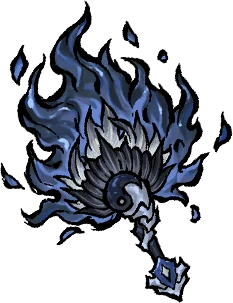

- 类型：扇子　特性：攻击方式是：远程。战斗开始时，会先攻击1次
- 五行：阴

### 【练气 · 乌炎】（图鉴未收录）

攻击 2 / 血量 8（基础数值）

乌光裹幽冥寒焰，扇动即卷蚀骨黑风，焰风所及阳刚灵力尽散。

技能「远程」（锁定技）此卡牌的攻击模式为：**远程攻击**（单体）

技能「噬魂贰」攻击造成伤害后，吸取目标1〔攻击〕附加到随机友军上

隐藏效果：扇子特性：加入战场后，会先执行一次攻击

### 【筑基 · 乌炎】

攻击 6 / 血量 20（基础数值）

乌光裹幽冥寒焰，扇动即卷蚀骨黑风，焰风所及阳刚灵力尽散。

技能「远程」（锁定技）此卡牌的攻击模式为：**远程攻击**（单体）

技能「噬魂贰」攻击造成伤害后，吸取目标2〔攻击〕附加到随机友军上

隐藏效果：扇子特性：加入战场后，会先执行一次攻击

### 【结丹 · 乌炎】

攻击 15 / 血量 56（基础数值）

乌光裹幽冥寒焰，扇动即卷蚀骨黑风，焰风所及阳刚灵力尽散。

技能「远程」（锁定技）此卡牌的攻击模式为：**远程攻击**（单体）

技能「噬魂贰」攻击造成伤害后，吸取目标3〔攻击〕附加到随机友军上

隐藏效果：扇子特性：加入战场后，会先执行一次攻击

### 【元婴 · 乌炎】

攻击 42 / 血量 153（基础数值）

乌光裹幽冥寒焰，扇动即卷蚀骨黑风，焰风所及阳刚灵力尽散。

技能「远程」（锁定技）此卡牌的攻击模式为：**远程攻击**（单体）

技能「噬魂贰」攻击造成伤害后，吸取目标5〔攻击〕附加到随机友军上

隐藏效果：扇子特性：加入战场后，会先执行一次攻击

### 【化神 · 乌炎】

攻击 117 / 血量 420（基础数值）

乌光裹幽冥寒焰，扇动即卷蚀骨黑风，焰风所及阳刚灵力尽散。

技能「远程」（锁定技）此卡牌的攻击模式为：**远程攻击**（单体）

技能「噬魂贰」攻击造成伤害后，吸取目标10〔攻击〕附加到随机友军上

隐藏效果：扇子特性：加入战场后，会先执行一次攻击

---

## 60. 不灭

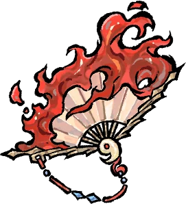

- 类型：扇子　特性：攻击方式是：远程。战斗开始时，会先攻击1次
- 五行：阳

### 【练气 · 不灭】（图鉴未收录）

攻击 3 / 血量 7（基础数值）

鎏金镶焰纹蕴不灭正阳火，扇动即卷燎原炎浪，焰光所及阴煞焚尽、阳气不衰。

技能「远程」（锁定技）此卡牌的攻击模式为：**远程攻击**（单体）

技能「燃魄贰」（被动）对〔木〕卡牌造成叁倍伤害

隐藏效果：扇子特性：加入战场后，会先执行一次攻击

### 【筑基 · 不灭】

攻击 8 / 血量 17（基础数值）

鎏金镶焰纹蕴不灭正阳火，扇动即卷燎原炎浪，焰光所及阴煞焚尽、阳气不衰。

技能「远程」（锁定技）此卡牌的攻击模式为：**远程攻击**（单体）

技能「燃魄贰」（被动）对〔木〕卡牌造成叁倍伤害

隐藏效果：扇子特性：加入战场后，会先执行一次攻击

### 【结丹 · 不灭】

攻击 22 / 血量 48（基础数值）

鎏金镶焰纹蕴不灭正阳火，扇动即卷燎原炎浪，焰光所及阴煞焚尽、阳气不衰。

技能「远程」（锁定技）此卡牌的攻击模式为：**远程攻击**（单体）

技能「燃魄贰」（被动）对〔木〕卡牌造成叁倍伤害

隐藏效果：扇子特性：加入战场后，会先执行一次攻击

### 【元婴 · 不灭】

攻击 59 / 血量 132（基础数值）

鎏金镶焰纹蕴不灭正阳火，扇动即卷燎原炎浪，焰光所及阴煞焚尽、阳气不衰。

技能「远程」（锁定技）此卡牌的攻击模式为：**远程攻击**（单体）

技能「燃魄贰」（被动）对〔木〕卡牌造成叁倍伤害

隐藏效果：扇子特性：加入战场后，会先执行一次攻击

### 【化神 · 不灭】

攻击 163 / 血量 364（基础数值）

鎏金镶焰纹蕴不灭正阳火，扇动即卷燎原炎浪，焰光所及阴煞焚尽、阳气不衰。

技能「远程」（锁定技）此卡牌的攻击模式为：**远程攻击**（单体）

技能「燃魄贰」（被动）对〔木〕卡牌造成叁倍伤害

隐藏效果：扇子特性：加入战场后，会先执行一次攻击

---

## 61. 乾坤

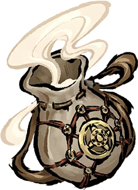

- 类型：袋子　特性：攻击方式是：远程。战斗中，减少第一回合受到的伤害量〔伤害〕。
- 五行：金

### 【练气 · 锁尘袋】

攻击 4 / 血量 10（基础数值）

这是修道者携带的常见储物袋。

技能「远程」（锁定技）此卡牌的攻击模式为：**远程攻击**（单体）

技能「潜力」这张卡牌没有技能，但它的属性会更高

隐藏效果：袋子特性：加入战斗时，获得一次性减伤

### 【筑基 · 锁尘金袋】

攻击 8 / 血量 25（基础数值）

这是修道者携带的常见储物袋。

技能「远程」（锁定技）此卡牌的攻击模式为：**远程攻击**（单体）

技能「潜力」这张卡牌没有技能，但它的属性会更高

隐藏效果：袋子特性：加入战斗时，获得一次性减伤

### 【结丹 · 锁尘金袋】

攻击 23 / 血量 70（基础数值）

这是修道者携带的常见储物袋。

技能「远程」（锁定技）此卡牌的攻击模式为：**远程攻击**（单体）

技能「潜力」这张卡牌没有技能，但它的属性会更高

隐藏效果：袋子特性：加入战斗时，获得一次性减伤

### 【元婴 · 乾坤】

攻击 64 / 血量 191（基础数值）

小小袋子，内含乾坤。

技能「远程」（锁定技）此卡牌的攻击模式为：**远程攻击**（单体）

技能「潜力」这张卡牌没有技能，但它的属性会更高

隐藏效果：袋子特性：加入战斗时，获得一次性减伤

### 【化神 · 乾坤】

攻击 175 / 血量 524（基础数值）

小小袋子，内含乾坤。

技能「远程」（锁定技）此卡牌的攻击模式为：**远程攻击**（单体）

技能「潜力」这张卡牌没有技能，但它的属性会更高

隐藏效果：袋子特性：加入战斗时，获得一次性减伤

---

## 62. 炼天

- 类型：袋子　特性：攻击方式是：远程。战斗中，减少第一回合受到的伤害量〔伤害〕。
- 五行：火

### 【练气 · 御火袋】

攻击 2 / 血量 8（基础数值）

能驾驭火焰的宝袋，千万不要被吸进去。

技能「远程」（锁定技）此卡牌的攻击模式为：**远程攻击**（单体）

技能「溅射」攻击时，对目标身旁卡牌造成50%伤害

隐藏效果：袋子特性：加入战斗时，获得一次性减伤

### 【筑基 · 离火灵袋】

攻击 5 / 血量 19（基础数值）

能驾驭火焰的宝袋，千万不要被吸进去。

技能「远程」（锁定技）此卡牌的攻击模式为：**远程攻击**（单体）

技能「溅射」攻击时，对目标身旁卡牌造成50%伤害

隐藏效果：袋子特性：加入战斗时，获得一次性减伤

### 【结丹 · 离火玄清袋】

攻击 14 / 血量 54（基础数值）

能驾驭火焰的宝袋，千万不要被吸进去。

技能「远程」（锁定技）此卡牌的攻击模式为：**远程攻击**（单体）

技能「溅射」攻击时，对目标身旁卡牌造成50%伤害

隐藏效果：袋子特性：加入战斗时，获得一次性减伤

### 【元婴 · 炼天】

攻击 37 / 血量 149（基础数值）

当宝袋全开之时，可遮天盖地，炼制万物。

技能「远程」（锁定技）此卡牌的攻击模式为：**远程攻击**（单体）

技能「溅射」攻击时，对目标身旁卡牌造成50%伤害

隐藏效果：袋子特性：加入战斗时，获得一次性减伤

### 【化神 · 炼天】

攻击 102 / 血量 409（基础数值）

当宝袋全开之时，可遮天盖地，炼制万物。

技能「远程」（锁定技）此卡牌的攻击模式为：**远程攻击**（单体）

技能「溅射」攻击时，对目标身旁卡牌造成50%伤害

隐藏效果：袋子特性：加入战斗时，获得一次性减伤

---

## 63. 雪啸

- 类型：袋子　特性：攻击方式是：远程。战斗中，减少第一回合受到的伤害量〔伤害〕。
- 五行：水

### 【练气 · 冰心袋】

攻击 3 / 血量 7（基础数值）

自带寒气的宝袋，总有丝丝凉风从袋口出涌出。

技能「远程」（锁定技）此卡牌的攻击模式为：**远程攻击**（单体）

技能「卸力叁」受到伤害后，使攻击者的攻击力减少1（一场战斗只触发5次）

隐藏效果：袋子特性：加入战斗时，获得一次性减伤

### 【筑基 · 冰心灵袋】

攻击 7 / 血量 18（基础数值）

自带寒气的宝袋，总有丝丝凉风从袋口出涌出。

技能「远程」（锁定技）此卡牌的攻击模式为：**远程攻击**（单体）

技能「卸力叁」受到伤害后，使攻击者的攻击力减少3（一场战斗只触发5次）

隐藏效果：袋子特性：加入战斗时，获得一次性减伤

### 【结丹 · 冰心寒风袋】

攻击 19 / 血量 49（基础数值）

自带寒气的宝袋，总有丝丝凉风从袋口出涌出。

技能「远程」（锁定技）此卡牌的攻击模式为：**远程攻击**（单体）

技能「卸力叁」受到伤害后，使攻击者的攻击力减少6（一场战斗只触发5次）

隐藏效果：袋子特性：加入战斗时，获得一次性减伤

### 【元婴 · 雪啸】

攻击 53 / 血量 134（基础数值）

袋口全开之时，夹带雪雨的狂风呼啸而出。

技能「远程」（锁定技）此卡牌的攻击模式为：**远程攻击**（单体）

技能「卸力叁」受到伤害后，使攻击者的攻击力减少20（一场战斗只触发5次）

隐藏效果：袋子特性：加入战斗时，获得一次性减伤

### 【化神 · 雪啸】

攻击 146 / 血量 367（基础数值）

袋口全开之时，夹带雪雨的狂风呼啸而出。

技能「远程」（锁定技）此卡牌的攻击模式为：**远程攻击**（单体）

技能「卸力叁」受到伤害后，使攻击者的攻击力减少50（一场战斗只触发5次）

隐藏效果：袋子特性：加入战斗时，获得一次性减伤

---

## 64. 蕴灵

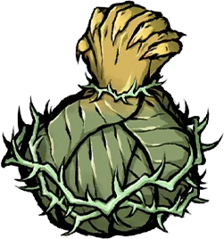

- 类型：袋子　特性：攻击方式是：远程。战斗中，减少第一回合受到的伤害量〔伤害〕。
- 五行：木

### 【练气 · 千棘袋】

攻击 None / 血量 10（基础数值）

藤纹盘绕蕴生机，似有阵阵生灵之气从中涌出

技能「远程」（锁定技）此卡牌的攻击模式为：**远程攻击**（单体）

技能「滋养」在战斗中召唤卡牌时，对随机敌人造成3〔伤害〕

隐藏效果：袋子特性：加入战斗时，获得一次性减伤

### 【筑基 · 千棘灵袋】

攻击 None / 血量 27（基础数值）

藤纹盘绕蕴生机，似有阵阵生灵之气从中涌出

技能「远程」（锁定技）此卡牌的攻击模式为：**远程攻击**（单体）

技能「滋养」在战斗中召唤卡牌时，对随机敌人造成9〔伤害〕

隐藏效果：袋子特性：加入战斗时，获得一次性减伤

### 【结丹 · 千棘灵袋】

攻击 None / 血量 74（基础数值）

藤纹盘绕蕴生机，似有阵阵生灵之气从中涌出

技能「远程」（锁定技）此卡牌的攻击模式为：**远程攻击**（单体）

技能「滋养」在战斗中召唤卡牌时，对随机敌人造成18〔伤害〕

隐藏效果：袋子特性：加入战斗时，获得一次性减伤

### 【元婴 · 蕴灵】

攻击 None / 血量 204（基础数值）

藤纹盘绕蕴生机，似有阵阵生灵之气从中涌出

技能「远程」（锁定技）此卡牌的攻击模式为：**远程攻击**（单体）

技能「滋养」在战斗中召唤卡牌时，对随机敌人造成50〔伤害〕

隐藏效果：袋子特性：加入战斗时，获得一次性减伤

### 【化神 · 蕴灵】

攻击 None / 血量 560（基础数值）

藤纹盘绕蕴生机，似有阵阵生灵之气从中涌出

技能「远程」（锁定技）此卡牌的攻击模式为：**远程攻击**（单体）

技能「滋养」在战斗中召唤卡牌时，对随机敌人造成150〔伤害〕

隐藏效果：袋子特性：加入战斗时，获得一次性减伤

---

## 65. 瘟疫

- 类型：袋子　特性：攻击方式是：远程。战斗中，减少第一回合受到的伤害量〔伤害〕。
- 五行：阴

### 【练气 · 瘟疫】（图鉴未收录）

攻击 2 / 血量 8（基础数值）

黑纹缠秽气蕴疫毒，启袋即散致命瘟雾，生灵触之染疾、灵力蚀散

技能「远程」（锁定技）此卡牌的攻击模式为：**远程攻击**（单体）

技能「瘟疫」每当有卡牌死亡时，使随机敌人获得中毒

隐藏效果：袋子特性：加入战斗时，获得一次性减伤

### 【筑基 · 瘟疫】

攻击 6 / 血量 21（基础数值）

黑纹缠秽气蕴疫毒，启袋即散致命瘟雾，生灵触之染疾、灵力蚀散

技能「远程」（锁定技）此卡牌的攻击模式为：**远程攻击**（单体）

技能「瘟疫」每当有卡牌死亡时，使随机敌人获得中毒

隐藏效果：袋子特性：加入战斗时，获得一次性减伤

### 【结丹 · 瘟疫】

攻击 15 / 血量 60（基础数值）

黑纹缠秽气蕴疫毒，启袋即散致命瘟雾，生灵触之染疾、灵力蚀散

技能「远程」（锁定技）此卡牌的攻击模式为：**远程攻击**（单体）

技能「瘟疫」每当有卡牌死亡时，使随机敌人获得中毒

隐藏效果：袋子特性：加入战斗时，获得一次性减伤

### 【元婴 · 瘟疫】

攻击 42 / 血量 163（基础数值）

黑纹缠秽气蕴疫毒，启袋即散致命瘟雾，生灵触之染疾、灵力蚀散

技能「远程」（锁定技）此卡牌的攻击模式为：**远程攻击**（单体）

技能「瘟疫」每当有卡牌死亡时，使随机敌人获得中毒

隐藏效果：袋子特性：加入战斗时，获得一次性减伤

### 【化神 · 瘟疫】

攻击 117 / 血量 447（基础数值）

黑纹缠秽气蕴疫毒，启袋即散致命瘟雾，生灵触之染疾、灵力蚀散

技能「远程」（锁定技）此卡牌的攻击模式为：**远程攻击**（单体）

技能「瘟疫」每当有卡牌死亡时，使随机敌人获得中毒

隐藏效果：袋子特性：加入战斗时，获得一次性减伤

---

## 66. 克邪

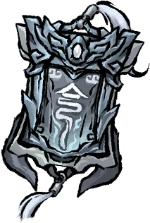

- 类型：令牌　特性：战斗中，当友方角色卡受到伤害时，自己会提高〔攻击〕
- 五行：火

### 【练气 · 焚石令】

攻击 1 / 血量 13（基础数值）

虽是石做的令牌，没有可燃物却依然可以自燃。

技能「怒意叁」攻击时，如果此卡牌不是满血，则造成的伤害结果〔伤害〕+4

隐藏效果：当主角卡受到伤害时，自己增加攻击力

### 【筑基 · 焚秽石令】

攻击 3 / 血量 36（基础数值）

这是一块将世间污秽之物当做燃料的令牌。

技能「怒意叁」攻击时，如果此卡牌不是满血，则造成的伤害结果〔伤害〕+11

隐藏效果：当主角卡受到伤害时，自己增加攻击力

### 【结丹 · 焚秽神石令】

攻击 8 / 血量 99（基础数值）

这是一块将世间污秽之物当做燃料的令牌。

技能「怒意叁」攻击时，如果此卡牌不是满血，则造成的伤害结果〔伤害〕+30

隐藏效果：当主角卡受到伤害时，自己增加攻击力

### 【元婴 · 克邪】

攻击 21 / 血量 275（基础数值）

此令一出世，可另所有妖邪现形而焚之。

技能「怒意叁」攻击时，如果此卡牌不是满血，则造成的伤害结果〔伤害〕+83

隐藏效果：当主角卡受到伤害时，自己增加攻击力

### 【化神 · 克邪】

攻击 58 / 血量 756（基础数值）

此令一出世，可另所有妖邪现形而焚之。

技能「怒意叁」攻击时，如果此卡牌不是满血，则造成的伤害结果〔伤害〕+229

隐藏效果：当主角卡受到伤害时，自己增加攻击力

---

## 67. 叱天

- 类型：令牌　特性：战斗中，当友方角色卡受到伤害时，自己会提高〔攻击〕
- 五行：金

### 【练气 · 银霄天令】（图鉴未收录）

攻击 1 / 血量 9（基础数值）

令牌上有着不知名的符号

技能「嘲讽」（锁定技）战斗中，会优先受到攻击

技能「共鸣叁」友方卡牌获得**光盾**时，此卡牌也获得**光盾**

隐藏效果：当主角卡受到伤害时，自己增加攻击力

### 【筑基 · 银霄天令】

攻击 3 / 血量 26（基础数值）

令牌上有着不知名的符号

技能「嘲讽」（锁定技）战斗中，会优先受到攻击

技能「共鸣叁」友方卡牌获得**光盾**时，此卡牌也获得**光盾**

隐藏效果：当主角卡受到伤害时，自己增加攻击力

### 【结丹 · 银霄天敕令】

攻击 8 / 血量 70（基础数值）

令牌上有着不知名的符号

技能「嘲讽」（锁定技）战斗中，会优先受到攻击

技能「共鸣叁」友方卡牌获得**光盾**时，此卡牌也获得**光盾**

隐藏效果：当主角卡受到伤害时，自己增加攻击力

### 【元婴 · 银霄天敕令】

攻击 21 / 血量 195（基础数值）

令牌上有着不知名的符号

技能「嘲讽」（锁定技）战斗中，会优先受到攻击

技能「共鸣叁」友方卡牌获得**光盾**时，此卡牌也获得**光盾**

隐藏效果：当主角卡受到伤害时，自己增加攻击力

### 【化神 · 叱天】

攻击 58 / 血量 536（基础数值）

令牌上有着不知名的符号

技能「嘲讽」（锁定技）战斗中，会优先受到攻击

技能「共鸣叁」友方卡牌获得**光盾**时，此卡牌也获得**光盾**

隐藏效果：当主角卡受到伤害时，自己增加攻击力

---

## 68. 镇岳

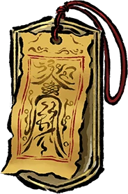

- 类型：令牌　特性：战斗中，当友方角色卡受到伤害时，自己会提高〔攻击〕
- 五行：土

### 【练气 · 玄黄灵符】（图鉴未收录）

攻击 3 / 血量 7（基础数值）

这是一“张”用无名泥沙炼制的符，祭出时会四散开来，覆盖在其他法宝的表面。

技能「遁甲叁」加入战场后的首个回合，为我方所有卡牌增加3点〔护甲〕

隐藏效果：当主角卡受到伤害时，自己增加攻击力

### 【筑基 · 玄黄灵符】

攻击 7 / 血量 18（基础数值）

这是一“张”用无名泥沙炼制的符，祭出时会四散开来，覆盖在其他法宝的表面。

技能「遁甲叁」加入战场后的首个回合，为我方所有卡牌增加7点〔护甲〕

隐藏效果：当主角卡受到伤害时，自己增加攻击力

### 【结丹 · 玄黄无疆符】

攻击 19 / 血量 49（基础数值）

这是一“张”用无名泥沙炼制的符，祭出时会四散开来，覆盖在其他法宝的表面。

技能「遁甲叁」加入战场后的首个回合，为我方所有卡牌增加21点〔护甲〕

隐藏效果：当主角卡受到伤害时，自己增加攻击力

### 【元婴 · 玄黄无疆符】

攻击 53 / 血量 134（基础数值）

这是一“张”用无名泥沙炼制的符，祭出时会四散开来，覆盖在其他法宝的表面。

技能「遁甲叁」加入战场后的首个回合，为我方所有卡牌增加60点〔护甲〕

隐藏效果：当主角卡受到伤害时，自己增加攻击力

### 【化神 · 镇岳】

攻击 146 / 血量 367（基础数值）

这是一“张”用无名泥沙炼制的符，祭出时会四散开来，覆盖在其他法宝的表面。

技能「遁甲叁」加入战场后的首个回合，为我方所有卡牌增加165点〔护甲〕

隐藏效果：当主角卡受到伤害时，自己增加攻击力

---

## 69. 拘尸

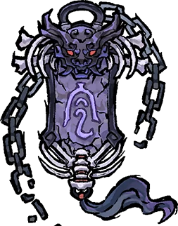

- 类型：令牌　特性：战斗中，当友方角色卡受到伤害时，自己会提高〔攻击〕
- 五行：阴

### 【练气 · 拘尸】（图鉴未收录）

攻击 None / 血量 18（基础数值）

玄纹刻尸篆蕴幽冥煞，持之可号令尸类、召亡灵为兵，令牌所指阴兵听令

技能「尸诏」每当战场的骸骨傀儡阵亡时，消耗自身5〔血量〕再次召唤一只

隐藏效果：当主角卡受到伤害时，自己增加攻击力

### 【筑基 · 拘尸】

攻击 None / 血量 50（基础数值）

玄纹刻尸篆蕴幽冥煞，持之可号令尸类、召亡灵为兵，令牌所指阴兵听令

技能「尸诏」每当战场的骸骨傀儡阵亡时，消耗自身13〔血量〕再次召唤一只

隐藏效果：当主角卡受到伤害时，自己增加攻击力

### 【结丹 · 拘尸】

攻击 None / 血量 139（基础数值）

玄纹刻尸篆蕴幽冥煞，持之可号令尸类、召亡灵为兵，令牌所指阴兵听令

技能「尸诏」每当战场的骸骨傀儡阵亡时，消耗自身35〔血量〕再次召唤一只

隐藏效果：当主角卡受到伤害时，自己增加攻击力

### 【元婴 · 拘尸】

攻击 None / 血量 382（基础数值）

玄纹刻尸篆蕴幽冥煞，持之可号令尸类、召亡灵为兵，令牌所指阴兵听令

技能「尸诏」每当战场的骸骨傀儡阵亡时，消耗自身95〔血量〕再次召唤一只

隐藏效果：当主角卡受到伤害时，自己增加攻击力

### 【化神 · 拘尸】

攻击 None / 血量 1049（基础数值）

玄纹刻尸篆蕴幽冥煞，持之可号令尸类、召亡灵为兵，令牌所指阴兵听令

技能「尸诏」每当战场的骸骨傀儡阵亡时，消耗自身260〔血量〕再次召唤一只

隐藏效果：当主角卡受到伤害时，自己增加攻击力

---

## 70. 福缘

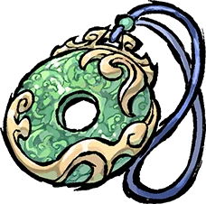

- 类型：令牌　特性：战斗中，当友方角色卡受到伤害时，自己会提高〔攻击〕
- 五行：阳

### 【练气 · 福缘】（图鉴未收录）

攻击 None / 血量 5（基础数值）

鎏金嵌福纹蕴正阳瑞气，持之可召福泽增机缘，令牌所及阴邪退散、福运傍身

技能「福缘」加入战场的首个回合开始时，使自己的持有者，获得复活

隐藏效果：当主角卡受到伤害时，自己增加攻击力

### 【筑基 · 福缘】

攻击 None / 血量 13（基础数值）

鎏金嵌福纹蕴正阳瑞气，持之可召福泽增机缘，令牌所及阴邪退散、福运傍身

技能「福缘」加入战场的首个回合开始时，使自己的持有者，获得复活

隐藏效果：当主角卡受到伤害时，自己增加攻击力

### 【结丹 · 福缘】

攻击 None / 血量 37（基础数值）

鎏金嵌福纹蕴正阳瑞气，持之可召福泽增机缘，令牌所及阴邪退散、福运傍身

技能「福缘」加入战场的首个回合开始时，使自己的持有者，获得复活

隐藏效果：当主角卡受到伤害时，自己增加攻击力

### 【元婴 · 福缘】

攻击 None / 血量 102（基础数值）

鎏金嵌福纹蕴正阳瑞气，持之可召福泽增机缘，令牌所及阴邪退散、福运傍身

技能「福缘」加入战场的首个回合开始时，使自己的持有者，获得复活

隐藏效果：当主角卡受到伤害时，自己增加攻击力

### 【化神 · 福缘】

攻击 None / 血量 280（基础数值）

鎏金嵌福纹蕴正阳瑞气，持之可召福泽增机缘，令牌所及阴邪退散、福运傍身

技能「福缘」加入战场的首个回合开始时，使自己的持有者，获得复活

隐藏效果：当主角卡受到伤害时，自己增加攻击力

---

## 71. 墨玉牌

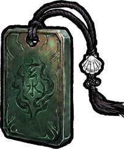

- 类型：令牌　特性：战斗中，当友方角色卡受到伤害时，自己会提高〔攻击〕
- 五行：水

### 【练气 · 墨玉牌】（图鉴未收录）

攻击 1 / 血量 10（基础数值）

玄墨（北海巨妖）的专属法宝，持此牌可号可凝玄水成幕护持神魂，是北海妖权与水道法统的象征

技能「寄灵」当友方的一只章鱼臂阵亡时，使其他的章鱼臂的〔攻击〕+1；〔血量〕和〔护甲〕+3

隐藏效果：当主角卡受到伤害时，自己增加攻击力

### 【筑基 · 墨玉牌】（图鉴未收录）

攻击 3 / 血量 25（基础数值）

玄墨（北海巨妖）的专属法宝，持此牌可号可凝玄水成幕护持神魂，是北海妖权与水道法统的象征

技能「寄灵」当友方的一只章鱼臂阵亡时，使其他的章鱼臂的〔攻击〕+2；〔血量〕和〔护甲〕+9

隐藏效果：当主角卡受到伤害时，自己增加攻击力

### 【结丹 · 墨玉牌】（图鉴未收录）

攻击 8 / 血量 70（基础数值）

玄墨（北海巨妖）的专属法宝，持此牌可号可凝玄水成幕护持神魂，是北海妖权与水道法统的象征

技能「寄灵」当友方的一只章鱼臂阵亡时，使其他的章鱼臂的〔攻击〕+7；〔血量〕和〔护甲〕+24

隐藏效果：当主角卡受到伤害时，自己增加攻击力

### 【元婴 · 墨玉牌】

攻击 21 / 血量 191（基础数值）

玄墨（北海巨妖）的专属法宝，持此牌可号可凝玄水成幕护持神魂，是北海妖权与水道法统的象征

技能「寄灵」当友方的一只章鱼臂阵亡时，使其他的章鱼臂的〔攻击〕+19；〔血量〕和〔护甲〕+67

隐藏效果：当主角卡受到伤害时，自己增加攻击力

### 【化神 · 墨玉牌】

攻击 58 / 血量 524（基础数值）

玄墨（北海巨妖）的专属法宝，持此牌可号可凝玄水成幕护持神魂，是北海妖权与水道法统的象征

技能「寄灵」当友方的一只章鱼臂阵亡时，使其他的章鱼臂的〔攻击〕+53；〔血量〕和〔护甲〕+179

隐藏效果：当主角卡受到伤害时，自己增加攻击力

---

## 72. 照命

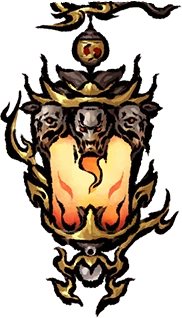

- 类型：灯　特性：攻击方式是：远程。对〔木〕的敌人造成3倍伤害
- 五行：火

### 【练气 · 冥火提灯】（图鉴未收录）

攻击 3 / 血量 7（基础数值）

幽暗的冥火在灯里燃烧着，预示着敌人的为时不多的命途。

技能「远程」（锁定技）此卡牌的攻击模式为：**远程攻击**（单体）

技能「再攻」如果攻击没有造成伤害，则使友方随机2个〔火〕卡牌获得额外攻击次数

隐藏效果：灯特性：对木属性伤害翻倍

### 【筑基 · 冥火提灯】

攻击 9 / 血量 20（基础数值）

幽暗的冥火在灯里燃烧着，预示着敌人的为时不多的命途。

技能「远程」（锁定技）此卡牌的攻击模式为：**远程攻击**（单体）

技能「再攻」如果攻击没有造成伤害，则使友方随机2个〔火〕卡牌获得额外攻击次数

隐藏效果：灯特性：对木属性伤害翻倍

### 【结丹 · 九幽冥火灯】

攻击 25 / 血量 55（基础数值）

幽暗的冥火在灯里燃烧着，预示着敌人的为时不多的命途。

技能「远程」（锁定技）此卡牌的攻击模式为：**远程攻击**（单体）

技能「再攻」如果攻击没有造成伤害，则使友方随机2个〔火〕卡牌获得额外攻击次数

隐藏效果：灯特性：对木属性伤害翻倍

### 【元婴 · 照命】

攻击 68 / 血量 152（基础数值）

欲知命途如何，不妨拿起照照？

技能「远程」（锁定技）此卡牌的攻击模式为：**远程攻击**（单体）

技能「再攻」如果攻击没有造成伤害，则使友方随机2个〔火〕卡牌获得额外攻击次数

隐藏效果：灯特性：对木属性伤害翻倍

### 【化神 · 照命】

攻击 186 / 血量 420（基础数值）

欲知命途如何，不妨拿起照照？

技能「远程」（锁定技）此卡牌的攻击模式为：**远程攻击**（单体）

技能「再攻」如果攻击没有造成伤害，则使友方随机2个〔火〕卡牌获得额外攻击次数

隐藏效果：灯特性：对木属性伤害翻倍

---

## 73. 灵烛

- 类型：灯　特性：攻击方式是：远程。对〔木〕的敌人造成3倍伤害
- 五行：阴

### 【练气 · 灵烛】（图鉴未收录）

攻击 None / 血量 14（基础数值）

幽焰凝霜裹阴煞，燃之可照见阴魂、蚀散灵力。

技能「远程」（锁定技）此卡牌的攻击模式为：**远程攻击**（单体）

技能「送行」每当场上有卡牌战败时，对随机敌人造成3伤害

隐藏效果：灯特性：对木属性伤害翻倍

### 【筑基 · 灵烛】

攻击 None / 血量 39（基础数值）

幽焰凝霜裹阴煞，燃之可照见阴魂、蚀散灵力。

技能「远程」（锁定技）此卡牌的攻击模式为：**远程攻击**（单体）

技能「送行」每当场上有卡牌战败时，对随机敌人造成11伤害

隐藏效果：灯特性：对木属性伤害翻倍

### 【结丹 · 灵烛】

攻击 None / 血量 106（基础数值）

幽焰凝霜裹阴煞，燃之可照见阴魂、蚀散灵力。

技能「远程」（锁定技）此卡牌的攻击模式为：**远程攻击**（单体）

技能「送行」每当场上有卡牌战败时，对随机敌人造成26伤害

隐藏效果：灯特性：对木属性伤害翻倍

### 【元婴 · 灵烛】

攻击 None / 血量 293（基础数值）

幽焰凝霜裹阴煞，燃之可照见阴魂、蚀散灵力。

技能「远程」（锁定技）此卡牌的攻击模式为：**远程攻击**（单体）

技能「送行」每当场上有卡牌战败时，对随机敌人造成71伤害

隐藏效果：灯特性：对木属性伤害翻倍

### 【化神 · 灵烛】

攻击 None / 血量 805（基础数值）

幽焰凝霜裹阴煞，燃之可照见阴魂、蚀散灵力。

技能「远程」（锁定技）此卡牌的攻击模式为：**远程攻击**（单体）

技能「送行」每当场上有卡牌战败时，对随机敌人造成192伤害

隐藏效果：灯特性：对木属性伤害翻倍

---

## 74. 焚天灯

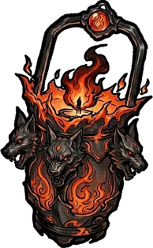

- 类型：灯　特性：攻击方式是：远程。对〔木〕的敌人造成3倍伤害
- 五行：火

### 【练气 · 焚天灯】（图鉴未收录）

攻击 None / 血量 10（基础数值）

赤牙（祸斗）的专属法宝，承祸地火深洞的本源火灵之力，灯焰起时可熔铄金铁。

技能「远程」（锁定技）此卡牌的攻击模式为：**远程攻击**（单体）

技能「地火领域」（被动）每回合开始时，对场上所有的〔金〕，〔木〕，〔阴〕卡牌造成2〔伤害〕

隐藏效果：灯特性：对木属性伤害翻倍

### 【筑基 · 焚天灯】（图鉴未收录）

攻击 None / 血量 26（基础数值）

赤牙（祸斗）的专属法宝，承祸地火深洞的本源火灵之力，灯焰起时可熔铄金铁。

技能「远程」（锁定技）此卡牌的攻击模式为：**远程攻击**（单体）

技能「地火领域」（被动）每回合开始时，对场上所有的〔金〕，〔木〕，〔阴〕卡牌造成6〔伤害〕

隐藏效果：灯特性：对木属性伤害翻倍

### 【结丹 · 焚天灯】（图鉴未收录）

攻击 None / 血量 74（基础数值）

赤牙（祸斗）的专属法宝，承祸地火深洞的本源火灵之力，灯焰起时可熔铄金铁。

技能「远程」（锁定技）此卡牌的攻击模式为：**远程攻击**（单体）

技能「地火领域」（被动）每回合开始时，对场上所有的〔金〕，〔木〕，〔阴〕卡牌造成16〔伤害〕

隐藏效果：灯特性：对木属性伤害翻倍

### 【元婴 · 焚天灯】

攻击 None / 血量 204（基础数值）

赤牙（祸斗）的专属法宝，承祸地火深洞的本源火灵之力，灯焰起时可熔铄金铁。

技能「远程」（锁定技）此卡牌的攻击模式为：**远程攻击**（单体）

技能「地火领域」（被动）每回合开始时，对场上所有的〔金〕，〔木〕，〔阴〕卡牌造成45〔伤害〕

隐藏效果：灯特性：对木属性伤害翻倍

### 【化神 · 焚天灯】

攻击 None / 血量 559（基础数值）

赤牙（祸斗）的专属法宝，承祸地火深洞的本源火灵之力，灯焰起时可熔铄金铁。

技能「远程」（锁定技）此卡牌的攻击模式为：**远程攻击**（单体）

技能「地火领域」（被动）每回合开始时，对场上所有的〔金〕，〔木〕，〔阴〕卡牌造成123〔伤害〕

隐藏效果：灯特性：对木属性伤害翻倍

---

## 75. 观天

- 类型：镜子　特性：攻击方式是：远程。被攻击后，会执行一次反击
- 五行：金

### 【练气 · 凝光宝镜】（图鉴未收录）

攻击 3 / 血量 8（基础数值）

光线凝聚成字显示在镜子上，能知天命否？

技能「远程」（锁定技）此卡牌的攻击模式为：**远程攻击**（单体）

技能「光力伍」当友军获得**光盾**时，此卡牌也获得光盾

隐藏效果：镜子特性：受到攻击时，会反击攻击者

### 【筑基 · 凝光宝镜】

攻击 8 / 血量 22（基础数值）

光线凝聚成字显示在镜子上，能知天命否？

技能「远程」（锁定技）此卡牌的攻击模式为：**远程攻击**（单体）

技能「光力伍」当友军获得**光盾**时，此卡牌也获得光盾

隐藏效果：镜子特性：受到攻击时，会反击攻击者

### 【结丹 · 凝光观星镜】

攻击 22 / 血量 60（基础数值）

把日月星辰都照入镜内，试图借此了解天地规则。

技能「远程」（锁定技）此卡牌的攻击模式为：**远程攻击**（单体）

技能「光力伍」当友军获得**光盾**时，此卡牌也获得光盾

隐藏效果：镜子特性：受到攻击时，会反击攻击者

### 【元婴 · 观天】

攻击 59 / 血量 166（基础数值）

知天易，逆天难。果真如此吗？

技能「远程」（锁定技）此卡牌的攻击模式为：**远程攻击**（单体）

技能「光力伍」当友军获得**光盾**时，此卡牌也获得光盾

隐藏效果：镜子特性：受到攻击时，会反击攻击者

### 【化神 · 观天】

攻击 163 / 血量 455（基础数值）

知天易，逆天难。果真如此吗？

技能「远程」（锁定技）此卡牌的攻击模式为：**远程攻击**（单体）

技能「光力伍」当友军获得**光盾**时，此卡牌也获得光盾

隐藏效果：镜子特性：受到攻击时，会反击攻击者

---

## 76. 蜃楼

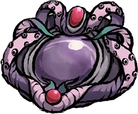

- 类型：镜子　特性：攻击方式是：远程。被攻击后，会执行一次反击
- 五行：水

### 【练气 · 蜃楼】（图鉴未收录）

攻击 2 / 血量 10（基础数值）

莹润含水光，凝镜以幻蜃景御敌

技能「远程」（锁定技）此卡牌的攻击模式为：**远程攻击**（单体）

技能「幻觉」使攻击的目标获得2回合的混乱

隐藏效果：镜子特性：受到攻击时，会反击攻击者

### 【筑基 · 蜃楼】

攻击 5 / 血量 26（基础数值）

莹润含水光，凝镜以幻蜃景御敌

技能「远程」（锁定技）此卡牌的攻击模式为：**远程攻击**（单体）

技能「幻觉」使攻击的目标获得2回合的混乱

隐藏效果：镜子特性：受到攻击时，会反击攻击者

### 【结丹 · 蜃楼】

攻击 12 / 血量 74（基础数值）

莹润含水光，凝镜以幻蜃景御敌

技能「远程」（锁定技）此卡牌的攻击模式为：**远程攻击**（单体）

技能「幻觉」使攻击的目标获得2回合的混乱

隐藏效果：镜子特性：受到攻击时，会反击攻击者

### 【元婴 · 蜃楼】

攻击 34 / 血量 204（基础数值）

莹润含水光，凝镜以幻蜃景御敌

技能「远程」（锁定技）此卡牌的攻击模式为：**远程攻击**（单体）

技能「幻觉」使攻击的目标获得2回合的混乱

隐藏效果：镜子特性：受到攻击时，会反击攻击者

### 【化神 · 蜃楼】

攻击 94 / 血量 559（基础数值）

莹润含水光，凝镜以幻蜃景御敌

技能「远程」（锁定技）此卡牌的攻击模式为：**远程攻击**（单体）

技能「幻觉」使攻击的目标获得2回合的混乱

隐藏效果：镜子特性：受到攻击时，会反击攻击者

---

## 77. 渡玄

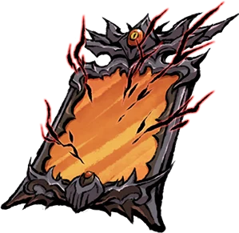

- 类型：镜子　特性：攻击方式是：远程。被攻击后，会执行一次反击
- 五行：阴

### 【练气 · 渡玄】（图鉴未收录）

攻击 3 / 血量 12（基础数值）

玄光幽冷蕴冥力，照之可引幽冥煞气、渡化阴魂，镜辉所及蚀散阳刚灵力。

技能「远程」（锁定技）此卡牌的攻击模式为：**远程攻击**（单体）

技能「潜力」这张卡牌没有技能，但它的属性会更高

隐藏效果：镜子特性：受到攻击时，会反击攻击者

### 【筑基 · 渡玄】

攻击 7 / 血量 30（基础数值）

玄光幽冷蕴冥力，照之可引幽冥煞气、渡化阴魂，镜辉所及蚀散阳刚灵力。

技能「远程」（锁定技）此卡牌的攻击模式为：**远程攻击**（单体）

技能「潜力」这张卡牌没有技能，但它的属性会更高

隐藏效果：镜子特性：受到攻击时，会反击攻击者

### 【结丹 · 渡玄】

攻击 18 / 血量 84（基础数值）

玄光幽冷蕴冥力，照之可引幽冥煞气、渡化阴魂，镜辉所及蚀散阳刚灵力。

技能「远程」（锁定技）此卡牌的攻击模式为：**远程攻击**（单体）

技能「潜力」这张卡牌没有技能，但它的属性会更高

隐藏效果：镜子特性：受到攻击时，会反击攻击者

### 【元婴 · 渡玄】

攻击 51 / 血量 229（基础数值）

玄光幽冷蕴冥力，照之可引幽冥煞气、渡化阴魂，镜辉所及蚀散阳刚灵力。

技能「远程」（锁定技）此卡牌的攻击模式为：**远程攻击**（单体）

技能「潜力」这张卡牌没有技能，但它的属性会更高

隐藏效果：镜子特性：受到攻击时，会反击攻击者

### 【化神 · 渡玄】

攻击 140 / 血量 629（基础数值）

玄光幽冷蕴冥力，照之可引幽冥煞气、渡化阴魂，镜辉所及蚀散阳刚灵力。

技能「远程」（锁定技）此卡牌的攻击模式为：**远程攻击**（单体）

技能「潜力」这张卡牌没有技能，但它的属性会更高

隐藏效果：镜子特性：受到攻击时，会反击攻击者

---

## 78. 幻蜕镜

- 类型：镜子　特性：攻击方式是：远程。被攻击后，会执行一次反击
- 五行：阳

### 【练气 · 幻蜕镜】（图鉴未收录）

攻击 2 / 血量 8（基础数值）

金缕（金蝉蛊）的专属法宝，取其千年修行中蜕下的蝉壳，混融玄银、流金锻铸而成。

技能「远程」（锁定技）此卡牌的攻击模式为：**远程攻击**（单体）

技能「分光」当友方卡牌获得**光盾**时，以1〔伤害〕攻击随机敌人；（每回合最多3次）

隐藏效果：镜子特性：受到攻击时，会反击攻击者

### 【筑基 · 幻蜕镜】（图鉴未收录）

攻击 6 / 血量 24（基础数值）

金缕（金蝉蛊）的专属法宝，取其千年修行中蜕下的蝉壳，混融玄银、流金锻铸而成。

技能「远程」（锁定技）此卡牌的攻击模式为：**远程攻击**（单体）

技能「分光」当友方卡牌获得**光盾**时，以4〔伤害〕攻击随机敌人；（每回合最多3次）

隐藏效果：镜子特性：受到攻击时，会反击攻击者

### 【结丹 · 幻蜕镜】（图鉴未收录）

攻击 18 / 血量 65（基础数值）

金缕（金蝉蛊）的专属法宝，取其千年修行中蜕下的蝉壳，混融玄银、流金锻铸而成。

技能「远程」（锁定技）此卡牌的攻击模式为：**远程攻击**（单体）

技能「分光」当友方卡牌获得**光盾**时，以10〔伤害〕攻击随机敌人；（每回合最多3次）

隐藏效果：镜子特性：受到攻击时，会反击攻击者

### 【元婴 · 幻蜕镜】

攻击 51 / 血量 178（基础数值）

金缕（金蝉蛊）的专属法宝，取其千年修行中蜕下的蝉壳，混融玄银、流金锻铸而成。

技能「远程」（锁定技）此卡牌的攻击模式为：**远程攻击**（单体）

技能「分光」当友方卡牌获得**光盾**时，以30〔伤害〕攻击随机敌人；（每回合最多3次）

隐藏效果：镜子特性：受到攻击时，会反击攻击者

### 【化神 · 幻蜕镜】

攻击 140 / 血量 490（基础数值）

金缕（金蝉蛊）的专属法宝，取其千年修行中蜕下的蝉壳，混融玄银、流金锻铸而成。

技能「远程」（锁定技）此卡牌的攻击模式为：**远程攻击**（单体）

技能「分光」当友方卡牌获得**光盾**时，以85〔伤害〕攻击随机敌人；（每回合最多3次）

隐藏效果：镜子特性：受到攻击时，会反击攻击者

---

## 79. 残耳

- 类型：琵琶　特性：使用音律远程攻击全体目标
- 五行：木

### 【练气 · 妙音琵琶】（图鉴未收录）

攻击 2 / 血量 5（基础数值）

弹奏琵琶本是一件雅事，如果听出幻觉那便不好说了。

技能「远程」（锁定技）此卡牌的攻击模式为：**远程攻击**（全体）

技能「潜力」这张卡牌没有技能，但它的属性会更高

### 【筑基 · 妙音琵琶】

攻击 6 / 血量 14（基础数值）

弹奏琵琶本是一件雅事，如果听出幻觉那便不好说了。

技能「远程」（锁定技）此卡牌的攻击模式为：**远程攻击**（全体）

技能「潜力」这张卡牌没有技能，但它的属性会更高

### 【结丹 · 妙音幻灵琵琶】

攻击 16 / 血量 39（基础数值）

弹奏琵琶本是一件雅事，如果听出幻觉那便不好说了。

技能「远程」（锁定技）此卡牌的攻击模式为：**远程攻击**（全体）

技能「潜力」这张卡牌没有技能，但它的属性会更高

### 【元婴 · 妙音幻灵琵琶】

攻击 45 / 血量 107（基础数值）

弹奏琵琶本是一件雅事，如果听出幻觉那便不好说了。

技能「远程」（锁定技）此卡牌的攻击模式为：**远程攻击**（全体）

技能「潜力」这张卡牌没有技能，但它的属性会更高

### 【化神 · 残耳】

攻击 123 / 血量 294（基础数值）

凡人如果听完一曲琵琶曲，那将是他最后听到的声音。

技能「远程」（锁定技）此卡牌的攻击模式为：**远程攻击**（全体）

技能「潜力」这张卡牌没有技能，但它的属性会更高

---

## 80. 安魂

- 类型：琵琶　特性：使用音律远程攻击全体目标
- 五行：阴

### 【练气 · 安魂】（图鉴未收录）

攻击 1 / 血量 8（基础数值）

玄木为身缠幽丝，弦动引幽冥之力，可安阴魂、镇邪煞，亦能扰敌神魂使其失序。

技能「远程」（锁定技）此卡牌的攻击模式为：**远程攻击**（全体）

技能「安魂」造成伤害时，会清除目标在战斗中临时增加的〔攻击〕

### 【筑基 · 安魂】

攻击 3 / 血量 24（基础数值）

玄木为身缠幽丝，弦动引幽冥之力，可安阴魂、镇邪煞，亦能扰敌神魂使其失序。

技能「远程」（锁定技）此卡牌的攻击模式为：**远程攻击**（全体）

技能「安魂」造成伤害时，会清除目标在战斗中临时增加的〔攻击〕

### 【结丹 · 安魂】

攻击 8 / 血量 65（基础数值）

玄木为身缠幽丝，弦动引幽冥之力，可安阴魂、镇邪煞，亦能扰敌神魂使其失序。

技能「远程」（锁定技）此卡牌的攻击模式为：**远程攻击**（全体）

技能「安魂」造成伤害时，会清除目标在战斗中临时增加的〔攻击〕

### 【元婴 · 安魂】

攻击 22 / 血量 178（基础数值）

玄木为身缠幽丝，弦动引幽冥之力，可安阴魂、镇邪煞，亦能扰敌神魂使其失序。

技能「远程」（锁定技）此卡牌的攻击模式为：**远程攻击**（全体）

技能「安魂」造成伤害时，会清除目标在战斗中临时增加的〔攻击〕

### 【化神 · 安魂】

攻击 61 / 血量 490（基础数值）

玄木为身缠幽丝，弦动引幽冥之力，可安阴魂、镇邪煞，亦能扰敌神魂使其失序。

技能「远程」（锁定技）此卡牌的攻击模式为：**远程攻击**（全体）

技能「安魂」造成伤害时，会清除目标在战斗中临时增加的〔攻击〕

---

## 81. 蜕翼琴

- 类型：琵琶　特性：使用音律远程攻击全体目标
- 五行：金

### 【练气 · 蜕翼琴】（图鉴未收录）

攻击 1 / 血量 11（基础数值）

金缕（金蝉蛊）的专属法宝，取自身千年蜕下的蝉翼灵丝为弦，混玄银精金锻铸琴身。

技能「远程」（锁定技）此卡牌的攻击模式为：**远程攻击**（全体）

技能「聚光伍」攻击后，使持有者获得**光盾**

### 【筑基 · 蜕翼琴】（图鉴未收录）

攻击 3 / 血量 29（基础数值）

金缕（金蝉蛊）的专属法宝，取自身千年蜕下的蝉翼灵丝为弦，混玄银精金锻铸琴身。

技能「远程」（锁定技）此卡牌的攻击模式为：**远程攻击**（全体）

技能「聚光伍」攻击后，使持有者获得**光盾**

### 【结丹 · 蜕翼琴】（图鉴未收录）

攻击 8 / 血量 78（基础数值）

金缕（金蝉蛊）的专属法宝，取自身千年蜕下的蝉翼灵丝为弦，混玄银精金锻铸琴身。

技能「远程」（锁定技）此卡牌的攻击模式为：**远程攻击**（全体）

技能「聚光伍」攻击后，使持有者获得**光盾**

### 【元婴 · 蜕翼琴】

攻击 22 / 血量 216（基础数值）

金缕（金蝉蛊）的专属法宝，取自身千年蜕下的蝉翼灵丝为弦，混玄银精金锻铸琴身。

技能「远程」（锁定技）此卡牌的攻击模式为：**远程攻击**（全体）

技能「聚光伍」攻击后，使持有者获得**光盾**

### 【化神 · 蜕翼琴】

攻击 61 / 血量 595（基础数值）

金缕（金蝉蛊）的专属法宝，取自身千年蜕下的蝉翼灵丝为弦，混玄银精金锻铸琴身。

技能「远程」（锁定技）此卡牌的攻击模式为：**远程攻击**（全体）

技能「聚光伍」攻击后，使持有者获得**光盾**

---

## 82. 遮月

- 类型：伞　特性：来自〔水〕卡牌的攻击伤害降低一半
- 五行：水

### 【练气 · 避水纸伞】（图鉴未收录）

攻击 1 / 血量 12（基础数值）

看似普通的纸伞，遇水却不湿。

技能「嘲讽」（锁定技）战斗中，会优先受到攻击

技能「寒冰贰」（被动）加入战场时，获得持续一回合的12点**减伤**

隐藏效果：伞特性：免疫水属性卡牌的伤害

### 【筑基 · 避水纸伞】

攻击 3 / 血量 32（基础数值）

看似普通的纸伞，遇水却不湿。

技能「嘲讽」（锁定技）战斗中，会优先受到攻击

技能「寒冰贰」（被动）加入战场时，获得持续一回合的30点**减伤**

隐藏效果：伞特性：免疫水属性卡牌的伤害

### 【结丹 · 避水镇海伞】

攻击 8 / 血量 89（基础数值）

看似普通的纸伞，遇水却不湿。

技能「嘲讽」（锁定技）战斗中，会优先受到攻击

技能「寒冰贰」（被动）加入战场时，获得持续一回合的80点**减伤**

隐藏效果：伞特性：免疫水属性卡牌的伤害

### 【元婴 · 避水镇海伞】

攻击 21 / 血量 248（基础数值）

看似普通的纸伞，遇水却不湿。

技能「嘲讽」（锁定技）战斗中，会优先受到攻击

技能「寒冰贰」（被动）加入战场时，获得持续一回合的250点**减伤**

隐藏效果：伞特性：免疫水属性卡牌的伤害

### 【化神 · 遮月】

攻击 58 / 血量 680（基础数值）

此伞撑开之时，连月亮也要为躲避之。

技能「嘲讽」（锁定技）战斗中，会优先受到攻击

技能「寒冰贰」（被动）加入战场时，获得持续一回合的600点**减伤**

隐藏效果：伞特性：免疫水属性卡牌的伤害

---

## 83. 引渡

- 类型：伞　特性：来自〔水〕卡牌的攻击伤害降低一半
- 五行：阴

### 【筑基 · 镇魂伞】

攻击 8 / 血量 22（基础数值）

由顾杳杳所炼制，有锁魂的效果，曾把爱人庄兰台的魂魄凝聚而不散，但副作用会让魂魄失去记忆。

技能「镇魂」每当战场中有卡牌阵亡时，禁锢一名敌人2回合；（一场战斗最多触发3次）

隐藏效果：伞特性：免疫水属性卡牌的伤害

### 【结丹 · 镇魂伞】

攻击 23 / 血量 58（基础数值）

由顾杳杳所炼制，有锁魂的效果，曾把爱人庄兰台的魂魄凝聚而不散，但副作用会让魂魄失去记忆。

技能「镇魂」每当战场中有卡牌阵亡时，禁锢一名敌人2回合；（一场战斗最多触发3次）

隐藏效果：伞特性：免疫水属性卡牌的伤害

### 【元婴 · 玄骨镇魂伞】

攻击 64 / 血量 160（基础数值）

由顾杳杳所炼制，有锁魂的效果，曾把爱人庄兰台的魂魄凝聚而不散，但副作用会让魂魄失去记忆。

技能「镇魂」每当战场中有卡牌阵亡时，禁锢一名敌人2回合；（一场战斗最多触发3次）

隐藏效果：伞特性：免疫水属性卡牌的伤害

### 【化神 · 引渡】

攻击 175 / 血量 441（基础数值）

由顾杳杳所炼制，有锁魂的效果，曾把爱人庄兰台的魂魄凝聚而不散，但副作用会让魂魄失去记忆。

技能「镇魂」每当战场中有卡牌阵亡时，禁锢一名敌人2回合；（一场战斗最多触发3次）

隐藏效果：伞特性：免疫水属性卡牌的伤害

---

## 84. 贝罗伞

- 类型：伞　特性：来自〔水〕卡牌的攻击伤害降低一半
- 五行：水

### 【练气 · 贝罗伞】（图鉴未收录）

攻击 2 / 血量 12（基础数值）

玄墨（北海巨妖）的专属法宝，蕴深海潮汐之力，可御水成障、卷浪击敌

技能「嘲讽」（锁定技）战斗中，会优先受到攻击

技能「生潮」每回合第一次受到攻击时，召唤一只章鱼臂

隐藏效果：伞特性：免疫水属性卡牌的伤害

### 【筑基 · 贝罗伞】（图鉴未收录）

攻击 4 / 血量 32（基础数值）

玄墨（北海巨妖）的专属法宝，蕴深海潮汐之力，可御水成障、卷浪击敌

技能「嘲讽」（锁定技）战斗中，会优先受到攻击

技能「生潮」每回合第一次受到攻击时，召唤一只章鱼臂

隐藏效果：伞特性：免疫水属性卡牌的伤害

### 【结丹 · 贝罗伞】（图鉴未收录）

攻击 12 / 血量 88（基础数值）

玄墨（北海巨妖）的专属法宝，蕴深海潮汐之力，可御水成障、卷浪击敌

技能「嘲讽」（锁定技）战斗中，会优先受到攻击

技能「生潮」每回合第一次受到攻击时，召唤一只章鱼臂

隐藏效果：伞特性：免疫水属性卡牌的伤害

### 【元婴 · 贝罗伞】

攻击 32 / 血量 243（基础数值）

玄墨（北海巨妖）的专属法宝，蕴深海潮汐之力，可御水成障、卷浪击敌

技能「嘲讽」（锁定技）战斗中，会优先受到攻击

技能「生潮」每回合第一次受到攻击时，召唤一只章鱼臂

隐藏效果：伞特性：免疫水属性卡牌的伤害

### 【化神 · 贝罗伞】

攻击 87 / 血量 670（基础数值）

玄墨（北海巨妖）的专属法宝，蕴深海潮汐之力，可御水成障、卷浪击敌

技能「嘲讽」（锁定技）战斗中，会优先受到攻击

技能「生潮」每回合第一次受到攻击时，召唤一只章鱼臂

隐藏效果：伞特性：免疫水属性卡牌的伤害

---

## 85. 幻纱伞

- 类型：伞　特性：来自〔水〕卡牌的攻击伤害降低一半
- 五行：金

### 【练气 · 幻纱伞】（图鉴未收录）

攻击 3 / 血量 10（基础数值）

金缕（金蝉蛊）的专属法宝，幻纱为面，赤金铸骨，可卸神通劲力

技能「聚光肆」每回合一次，自己受到攻击时，为持有者施加**光盾**

隐藏效果：伞特性：免疫水属性卡牌的伤害

### 【筑基 · 幻纱伞】（图鉴未收录）

攻击 7 / 血量 25（基础数值）

金缕（金蝉蛊）的专属法宝，幻纱为面，赤金铸骨，可卸神通劲力

技能「聚光肆」每回合一次，自己受到攻击时，为持有者施加**光盾**

隐藏效果：伞特性：免疫水属性卡牌的伤害

### 【结丹 · 幻纱伞】（图鉴未收录）

攻击 19 / 血量 70（基础数值）

金缕（金蝉蛊）的专属法宝，幻纱为面，赤金铸骨，可卸神通劲力

技能「聚光肆」每回合一次，自己受到攻击时，为持有者施加**光盾**

隐藏效果：伞特性：免疫水属性卡牌的伤害

### 【元婴 · 幻纱伞】

攻击 53 / 血量 191（基础数值）

金缕（金蝉蛊）的专属法宝，幻纱为面，赤金铸骨，可卸神通劲力

技能「聚光肆」每回合一次，自己受到攻击时，为持有者施加**光盾**

隐藏效果：伞特性：免疫水属性卡牌的伤害

### 【化神 · 幻纱伞】

攻击 146 / 血量 524（基础数值）

金缕（金蝉蛊）的专属法宝，幻纱为面，赤金铸骨，可卸神通劲力

技能「聚光肆」每回合一次，自己受到攻击时，为持有者施加**光盾**

隐藏效果：伞特性：免疫水属性卡牌的伤害

---

## 86. 古藤伞

- 类型：伞　特性：来自〔水〕卡牌的攻击伤害降低一半
- 五行：木

### 【练气 · 古藤伞】（图鉴未收录）

攻击 2 / 血量 11（基础数值）

饮岁（血藤古树）的专属法宝，自身千年古藤的枝桠为骨、老树皮为面炼制而成

技能「木殒」当我方〔木〕卡牌战败时，**召唤**一只具有自身50%属性的毒藤；（每回合触发一次）

隐藏效果：伞特性：免疫水属性卡牌的伤害

### 【筑基 · 古藤伞】（图鉴未收录）

攻击 4 / 血量 29（基础数值）

饮岁（血藤古树）的专属法宝，自身千年古藤的枝桠为骨、老树皮为面炼制而成

技能「木殒」当我方〔木〕卡牌战败时，**召唤**一只具有自身50%属性的毒藤；（每回合触发一次）

隐藏效果：伞特性：免疫水属性卡牌的伤害

### 【结丹 · 古藤伞】（图鉴未收录）

攻击 12 / 血量 78（基础数值）

饮岁（血藤古树）的专属法宝，自身千年古藤的枝桠为骨、老树皮为面炼制而成

技能「木殒」当我方〔木〕卡牌战败时，**召唤**一只具有自身50%属性的毒藤；（每回合触发一次）

隐藏效果：伞特性：免疫水属性卡牌的伤害

### 【元婴 · 古藤伞】

攻击 32 / 血量 216（基础数值）

饮岁（血藤古树）的专属法宝，自身千年古藤的枝桠为骨、老树皮为面炼制而成

技能「木殒」当我方〔木〕卡牌战败时，**召唤**一只具有自身50%属性的毒藤；（每回合触发一次）

隐藏效果：伞特性：免疫水属性卡牌的伤害

### 【化神 · 古藤伞】

攻击 87 / 血量 595（基础数值）

饮岁（血藤古树）的专属法宝，自身千年古藤的枝桠为骨、老树皮为面炼制而成

技能「木殒」当我方〔木〕卡牌战败时，**召唤**一只具有自身50%属性的毒藤；（每回合触发一次）

隐藏效果：伞特性：免疫水属性卡牌的伤害

---

## 87. 翻天

- 类型：印　特性：对妖兽（包括妖王）的造成1.5倍伤害
- 五行：土

### 【练气 · 混土神印】（图鉴未收录）

攻击 1 / 血量 9（基础数值）

糅杂了中原大地各处泥土铸造的印，混合的力量难以估量。

技能「反击」受到近战攻击后，反击敌方所有卡牌2点〔伤害〕

隐藏效果：印特性：对妖兽的伤害为1.5

### 【筑基 · 混土神印】

攻击 3 / 血量 24（基础数值）

糅杂了中原大地各处泥土铸造的印，混合的力量难以估量。

技能「反击」受到近战攻击后，反击敌方所有卡牌4点〔伤害〕

隐藏效果：印特性：对妖兽的伤害为1.5

### 【结丹 · 混土平山印】

攻击 8 / 血量 66（基础数值）

糅杂了中原大地各处泥土铸造的印，混合的力量难以估量。

技能「反击」受到近战攻击后，反击敌方所有卡牌10点〔伤害〕

隐藏效果：印特性：对妖兽的伤害为1.5

### 【元婴 · 混土平山印】

攻击 21 / 血量 183（基础数值）

糅杂了中原大地各处泥土铸造的印，混合的力量难以估量。

技能「反击」受到近战攻击后，反击敌方所有卡牌25点〔伤害〕

隐藏效果：印特性：对妖兽的伤害为1.5

### 【化神 · 翻天】

攻击 58 / 血量 504（基础数值）

谁说在地上的凡人，不能把上天掀翻？

技能「反击」受到近战攻击后，反击敌方所有卡牌70点〔伤害〕

隐藏效果：印特性：对妖兽的伤害为1.5

---

## 88. 黎诏

- 类型：印　特性：对妖兽（包括妖王）的造成1.5倍伤害
- 五行：木

### 【练气 · 黎诏】（图鉴未收录）

攻击 2 / 血量 13（基础数值）

此乃由血肉灵芝的材料炼制而成的，有唤妖木之功效

技能「唤灵叁」受到攻击后，召唤一张**小血肉灵芝**

隐藏效果：印特性：对妖兽的伤害为1.5

### 【筑基 · 黎诏】

攻击 4 / 血量 35（基础数值）

此乃由血肉灵芝的材料炼制而成的，有唤妖木之功效

技能「唤灵叁」受到攻击后，召唤一张**小血肉灵芝**

隐藏效果：印特性：对妖兽的伤害为1.5

### 【结丹 · 黎诏】

攻击 12 / 血量 94（基础数值）

此乃由血肉灵芝的材料炼制而成的，有唤妖木之功效

技能「唤灵叁」受到攻击后，召唤一张**小血肉灵芝**

隐藏效果：印特性：对妖兽的伤害为1.5

### 【元婴 · 黎诏】

攻击 32 / 血量 259（基础数值）

此乃由血肉灵芝的材料炼制而成的，有唤妖木之功效

技能「唤灵叁」受到攻击后，召唤一张**小血肉灵芝**

隐藏效果：印特性：对妖兽的伤害为1.5

### 【化神 · 黎诏】

攻击 87 / 血量 714（基础数值）

此乃由血肉灵芝的材料炼制而成的，有唤妖木之功效

技能「唤灵叁」受到攻击后，召唤一张**小血肉灵芝**

隐藏效果：印特性：对妖兽的伤害为1.5

---

## 89. 凶煞骨印

- 类型：印　特性：对妖兽（包括妖王）的造成1.5倍伤害
- 五行：阴

### 【练气 · 凶煞骨印】（图鉴未收录）

攻击 2 / 血量 8（基础数值）

暴君（铁骨熊）的专属法宝，蕴凶煞之力，引动凶煞可增幅自身蛮力

技能「凶煞之力」回合开始前，使随机一名友军（拥有护甲）获得等同于护甲值一半的增伤和减伤（独立计算，触发一次后移除）

隐藏效果：印特性：对妖兽的伤害为1.5

### 【筑基 · 凶煞骨印】（图鉴未收录）

攻击 5 / 血量 21（基础数值）

暴君（铁骨熊）的专属法宝，蕴凶煞之力，引动凶煞可增幅自身蛮力

技能「凶煞之力」回合开始前，使随机一名友军（拥有护甲）获得等同于护甲值一半的增伤和减伤（独立计算，触发一次后移除）

隐藏效果：印特性：对妖兽的伤害为1.5

### 【结丹 · 凶煞骨印】（图鉴未收录）

攻击 12 / 血量 60（基础数值）

暴君（铁骨熊）的专属法宝，蕴凶煞之力，引动凶煞可增幅自身蛮力

技能「凶煞之力」回合开始前，使随机一名友军（拥有护甲）获得等同于护甲值一半的增伤和减伤（独立计算，触发一次后移除）

隐藏效果：印特性：对妖兽的伤害为1.5

### 【元婴 · 凶煞骨印】

攻击 34 / 血量 163（基础数值）

暴君（铁骨熊）的专属法宝，蕴凶煞之力，引动凶煞可增幅自身蛮力

技能「凶煞之力」回合开始前，使随机一名友军（拥有护甲）获得等同于护甲值一半的增伤和减伤（独立计算，触发一次后移除）

隐藏效果：印特性：对妖兽的伤害为1.5

### 【化神 · 凶煞骨印】

攻击 94 / 血量 447（基础数值）

暴君（铁骨熊）的专属法宝，蕴凶煞之力，引动凶煞可增幅自身蛮力

技能「凶煞之力」回合开始前，使随机一名友军（拥有护甲）获得等同于护甲值一半的增伤和减伤（独立计算，触发一次后移除）

隐藏效果：印特性：对妖兽的伤害为1.5

---

## 90. 缚妖

- 类型：索　特性：战斗开始时，使自己和随机一名敌人无法行动一回合
- 五行：金

### 【筑基 · 缚妖】

攻击 4 / 血量 24（基础数值）

丝缕凝金坚不可摧，展开即缠缚锁灵，专克妖邪且任御者操控

技能「光力贰」当友军获得**光盾**时，此卡牌的〔攻击〕和〔血量〕均提高4

隐藏效果：绳索特性：第一回合，自己和随机敌人无法行动

### 【结丹 · 缚妖】

攻击 12 / 血量 66（基础数值）

丝缕凝金坚不可摧，展开即缠缚锁灵，专克妖邪且任御者操控

技能「光力贰」当友军获得**光盾**时，此卡牌的〔攻击〕和〔血量〕均提高12

隐藏效果：绳索特性：第一回合，自己和随机敌人无法行动

### 【元婴 · 缚妖】

攻击 32 / 血量 184（基础数值）

丝缕凝金坚不可摧，展开即缠缚锁灵，专克妖邪且任御者操控

技能「光力贰」当友军获得**光盾**时，此卡牌的〔攻击〕和〔血量〕均提高32

隐藏效果：绳索特性：第一回合，自己和随机敌人无法行动

### 【化神 · 缚妖】

攻击 87 / 血量 506（基础数值）

丝缕凝金坚不可摧，展开即缠缚锁灵，专克妖邪且任御者操控

技能「光力贰」当友军获得**光盾**时，此卡牌的〔攻击〕和〔血量〕均提高90

隐藏效果：绳索特性：第一回合，自己和随机敌人无法行动

---

## 91. 缠魂

- 类型：索　特性：战斗开始时，使自己和随机一名敌人无法行动一回合
- 五行：水

### 【练气 · 缠魂】（图鉴未收录）

攻击 2 / 血量 9（基础数值）

水丝凝束柔中带刚，缠身即锁灵力封神魂，任妖邪难脱

技能「噬魂贰」受到伤害后，吸取攻击者1点〔攻击〕附加于此卡牌上

隐藏效果：绳索特性：第一回合，自己和随机敌人无法行动

### 【筑基 · 缠魂】

攻击 4 / 血量 23（基础数值）

水丝凝束柔中带刚，缠身即锁灵力封神魂，任妖邪难脱

技能「噬魂贰」受到伤害后，吸取攻击者2点〔攻击〕附加于此卡牌上

隐藏效果：绳索特性：第一回合，自己和随机敌人无法行动

### 【结丹 · 缠魂】

攻击 12 / 血量 62（基础数值）

水丝凝束柔中带刚，缠身即锁灵力封神魂，任妖邪难脱

技能「噬魂贰」受到伤害后，吸取攻击者3点〔攻击〕附加于此卡牌上

隐藏效果：绳索特性：第一回合，自己和随机敌人无法行动

### 【元婴 · 缠魂】

攻击 32 / 血量 173（基础数值）

水丝凝束柔中带刚，缠身即锁灵力封神魂，任妖邪难脱

技能「噬魂贰」受到伤害后，吸取攻击者5点〔攻击〕附加于此卡牌上

隐藏效果：绳索特性：第一回合，自己和随机敌人无法行动

### 【化神 · 缠魂】

攻击 87 / 血量 476（基础数值）

水丝凝束柔中带刚，缠身即锁灵力封神魂，任妖邪难脱

技能「噬魂贰」受到伤害后，吸取攻击者10点〔攻击〕附加于此卡牌上

隐藏效果：绳索特性：第一回合，自己和随机敌人无法行动

---

## 92. 血煞鞭

- 类型：索　特性：战斗开始时，使自己和随机一名敌人无法行动一回合
- 五行：血

### 【练气 · 血煞鞭】（图鉴未收录）

攻击 2 / 血量 8（基础数值）

饮岁（血藤古树）的专属法宝，取自身最凶戾的一截血藤主脉，鞭成之时煞气冲天，林中山木尽枯，故号"血煞"。

技能「五行:血」（锁定技）：此卡牌拥有血属性，卡牌的〔血量〕比同级别卡稍低，但攻击附带吸血效果

技能「血引贰」当我方卡牌成功恢复〔血量〕时，**封印**随机敌人2回合

隐藏效果：绳索特性：第一回合，自己和随机敌人无法行动

### 【筑基 · 血煞鞭】（图鉴未收录）

攻击 6 / 血量 22（基础数值）

饮岁（血藤古树）的专属法宝，取自身最凶戾的一截血藤主脉，鞭成之时煞气冲天，林中山木尽枯，故号"血煞"。

技能「五行:血」（锁定技）：此卡牌拥有血属性，卡牌的〔血量〕比同级别卡稍低，但攻击附带吸血效果

技能「血引贰」当我方卡牌成功恢复〔血量〕时，**封印**随机敌人2回合

隐藏效果：绳索特性：第一回合，自己和随机敌人无法行动

### 【结丹 · 血煞鞭】（图鉴未收录）

攻击 15 / 血量 62（基础数值）

饮岁（血藤古树）的专属法宝，取自身最凶戾的一截血藤主脉，鞭成之时煞气冲天，林中山木尽枯，故号"血煞"。

技能「五行:血」（锁定技）：此卡牌拥有血属性，卡牌的〔血量〕比同级别卡稍低，但攻击附带吸血效果

技能「血引贰」当我方卡牌成功恢复〔血量〕时，**封印**随机敌人2回合

隐藏效果：绳索特性：第一回合，自己和随机敌人无法行动

### 【元婴 · 血煞鞭】

攻击 42 / 血量 170（基础数值）

饮岁（血藤古树）的专属法宝，取自身最凶戾的一截血藤主脉，鞭成之时煞气冲天，林中山木尽枯，故号"血煞"。

技能「五行:血」（锁定技）：此卡牌拥有血属性，卡牌的〔血量〕比同级别卡稍低，但攻击附带吸血效果

技能「血引贰」当我方卡牌成功恢复〔血量〕时，**封印**随机敌人2回合

隐藏效果：绳索特性：第一回合，自己和随机敌人无法行动

### 【化神 · 血煞鞭】

攻击 117 / 血量 466（基础数值）

饮岁（血藤古树）的专属法宝，取自身最凶戾的一截血藤主脉，鞭成之时煞气冲天，林中山木尽枯，故号"血煞"。

技能「五行:血」（锁定技）：此卡牌拥有血属性，卡牌的〔血量〕比同级别卡稍低，但攻击附带吸血效果

技能「血引贰」当我方卡牌成功恢复〔血量〕时，**封印**随机敌人2回合

隐藏效果：绳索特性：第一回合，自己和随机敌人无法行动

---

## 93. 骨煞鞭

- 类型：索　特性：战斗开始时，使自己和随机一名敌人无法行动一回合
- 五行：阴

### 【练气 · 骨煞鞭】（图鉴未收录）

攻击 2 / 血量 11（基础数值）

素影（九幽骨魅）的专属法宝，取九幽战场千万亡魂遗骨中，以脊椎骨节节串联而成

技能「传薪」当一个骸骨傀儡战败时，使随机友军获得额外一次攻击次数；（每回合只触发一次）

隐藏效果：绳索特性：第一回合，自己和随机敌人无法行动

### 【筑基 · 骨煞鞭】（图鉴未收录）

攻击 4 / 血量 29（基础数值）

素影（九幽骨魅）的专属法宝，取九幽战场千万亡魂遗骨中，以脊椎骨节节串联而成

技能「传薪」当一个骸骨傀儡战败时，使随机友军获得额外一次攻击次数；（每回合只触发一次）

隐藏效果：绳索特性：第一回合，自己和随机敌人无法行动

### 【结丹 · 骨煞鞭】（图鉴未收录）

攻击 12 / 血量 78（基础数值）

素影（九幽骨魅）的专属法宝，取九幽战场千万亡魂遗骨中，以脊椎骨节节串联而成

技能「传薪」当一个骸骨傀儡战败时，使随机友军获得额外一次攻击次数；（每回合只触发一次）

隐藏效果：绳索特性：第一回合，自己和随机敌人无法行动

### 【元婴 · 骨煞鞭】

攻击 32 / 血量 216（基础数值）

素影（九幽骨魅）的专属法宝，取九幽战场千万亡魂遗骨中，以脊椎骨节节串联而成

技能「传薪」当一个骸骨傀儡战败时，使随机友军获得额外一次攻击次数；（每回合只触发一次）

隐藏效果：绳索特性：第一回合，自己和随机敌人无法行动

### 【化神 · 骨煞鞭】

攻击 87 / 血量 595（基础数值）

素影（九幽骨魅）的专属法宝，取九幽战场千万亡魂遗骨中，以脊椎骨节节串联而成

技能「传薪」当一个骸骨傀儡战败时，使随机友军获得额外一次攻击次数；（每回合只触发一次）

隐藏效果：绳索特性：第一回合，自己和随机敌人无法行动

---

## 94. 无双

- 类型：容器　特性：可装载战斗卡牌，装载的卡牌进入战斗不消耗〔灵气〕
- 五行：金

### 【练气 · 无双】（图鉴未收录）

攻击 None / 血量 10（基础数值）

金纹嵌锋蕴锐金之力，启匣即喷万剑齐发，锋芒所及破敌无匹。

技能「容器」（锁定技）：此卡牌可收纳**剑**法宝

技能「藏剑」（被动）无双收纳剑的容量+1

### 【筑基 · 无双】

攻击 None / 血量 28（基础数值）

金纹嵌锋蕴锐金之力，启匣即喷万剑齐发，锋芒所及破敌无匹。

技能「容器」（锁定技）：此卡牌可收纳**剑**法宝

技能「藏剑」（被动）无双收纳剑的容量+1

### 【结丹 · 无双】

攻击 None / 血量 77（基础数值）

金纹嵌锋蕴锐金之力，启匣即喷万剑齐发，锋芒所及破敌无匹。

技能「容器」（锁定技）：此卡牌可收纳**剑**法宝

技能「藏剑」（被动）无双收纳剑的容量+1

### 【元婴 · 无双】

攻击 None / 血量 212（基础数值）

金纹嵌锋蕴锐金之力，启匣即喷万剑齐发，锋芒所及破敌无匹。

技能「容器」（锁定技）：此卡牌可收纳**剑**法宝

技能「藏剑」（被动）无双收纳剑的容量+1

### 【化神 · 无双】

攻击 None / 血量 583（基础数值）

金纹嵌锋蕴锐金之力，启匣即喷万剑齐发，锋芒所及破敌无匹。

技能「容器」（锁定技）：此卡牌可收纳**剑**法宝

技能「藏剑」（被动）无双收纳剑的容量+1

---

## 95. 万魂

- 类型：容器　特性：可装载战斗卡牌，装载的卡牌进入战斗不消耗〔灵气〕
- 五行：阴

### 【练气 · 万魂】（图鉴未收录）

攻击 None / 血量 9（基础数值）

玄幡招展裹幽冥煞，挥动即召万魂为兵，魂煞所及蚀骨侵魂

技能「容器」（锁定技）：此卡牌可收纳**魂体**卡牌

技能「祭幡」每当敌方的活物卡（角色，灵兽不包含召唤物）战败时，恢复我方血量最少魂体的12〔血量〕

### 【筑基 · 万魂】

攻击 None / 血量 24（基础数值）

玄幡招展裹幽冥煞，挥动即召万魂为兵，魂煞所及蚀骨侵魂

技能「容器」（锁定技）：此卡牌可收纳**魂体**卡牌

技能「祭幡」每当敌方的活物卡（角色，灵兽不包含召唤物）战败时，恢复我方血量最少魂体的36〔血量〕

### 【结丹 · 万魂】

攻击 None / 血量 65（基础数值）

玄幡招展裹幽冥煞，挥动即召万魂为兵，魂煞所及蚀骨侵魂

技能「容器」（锁定技）：此卡牌可收纳**魂体**卡牌

技能「祭幡」每当敌方的活物卡（角色，灵兽不包含召唤物）战败时，恢复我方血量最少魂体的105〔血量〕

### 【元婴 · 万魂】

攻击 None / 血量 180（基础数值）

玄幡招展裹幽冥煞，挥动即召万魂为兵，魂煞所及蚀骨侵魂

技能「容器」（锁定技）：此卡牌可收纳**魂体**卡牌

技能「祭幡」每当敌方的活物卡（角色，灵兽不包含召唤物）战败时，恢复我方血量最少魂体的240〔血量〕

### 【化神 · 万魂】

攻击 None / 血量 496（基础数值）

玄幡招展裹幽冥煞，挥动即召万魂为兵，魂煞所及蚀骨侵魂

技能「容器」（锁定技）：此卡牌可收纳**魂体**卡牌

技能「祭幡」每当敌方的活物卡（角色，灵兽不包含召唤物）战败时，恢复我方血量最少魂体的810〔血量〕

---

## 96. 豢灵

- 类型：容器　特性：可装载战斗卡牌，装载的卡牌进入战斗不消耗〔灵气〕
- 五行：土

### 【练气 · 豢灵】（图鉴未收录）

攻击 None / 血量 10（基础数值）

凝地脉生气而成，可收纳豢养灵宠，温养灵韵、稳固神魂。

技能「容器」（锁定技）：此卡牌可收纳**灵兽**卡牌，但容量比同境界容器少一格

技能「豢养」战斗开始时，使随机友方灵兽先进行一次攻击

### 【筑基 · 豢灵】

攻击 None / 血量 28（基础数值）

凝地脉生气而成，可收纳豢养灵宠，温养灵韵、稳固神魂。

技能「容器」（锁定技）：此卡牌可收纳**灵兽**卡牌，但容量比同境界容器少一格

技能「豢养」战斗开始时，使随机友方灵兽先进行一次攻击

### 【结丹 · 豢灵】

攻击 None / 血量 77（基础数值）

凝地脉生气而成，可收纳豢养灵宠，温养灵韵、稳固神魂。

技能「容器」（锁定技）：此卡牌可收纳**灵兽**卡牌，但容量比同境界容器少一格

技能「豢养」战斗开始时，使随机友方灵兽先进行一次攻击

### 【元婴 · 豢灵】

攻击 None / 血量 212（基础数值）

凝地脉生气而成，可收纳豢养灵宠，温养灵韵、稳固神魂。

技能「容器」（锁定技）：此卡牌可收纳**灵兽**卡牌，但容量比同境界容器少一格

技能「豢养」战斗开始时，使随机友方灵兽先进行一次攻击

### 【化神 · 豢灵】

攻击 None / 血量 583（基础数值）

凝地脉生气而成，可收纳豢养灵宠，温养灵韵、稳固神魂。

技能「容器」（锁定技）：此卡牌可收纳**灵兽**卡牌，但容量比同境界容器少一格

技能「豢养」战斗开始时，使随机友方灵兽先进行一次攻击

---

## 97. 玄水幡

- 类型：容器　特性：可装载战斗卡牌，装载的卡牌进入战斗不消耗〔灵气〕
- 五行：水

### 【练气 · 玄水幡】（图鉴未收录）

攻击 None / 血量 10（基础数值）

玄墨（北海巨妖）的专属法宝，蕴玄冥寒水本源，可召浪布雾、御水破敌，为北海妖权象征

技能「容器」（锁定技）：此卡牌可收纳〔水〕卡牌

技能「招魂」可装载〔水〕卡牌；每回合第一个〔水〕卡牌战败后，召唤一只章鱼臂

### 【筑基 · 玄水幡】（图鉴未收录）

攻击 None / 血量 28（基础数值）

玄墨（北海巨妖）的专属法宝，蕴玄冥寒水本源，可召浪布雾、御水破敌，为北海妖权象征

技能「容器」（锁定技）：此卡牌可收纳〔水〕卡牌

技能「招魂」可装载〔水〕卡牌；每回合第一个〔水〕卡牌战败后，召唤一只章鱼臂

### 【结丹 · 玄水幡】（图鉴未收录）

攻击 None / 血量 77（基础数值）

玄墨（北海巨妖）的专属法宝，蕴玄冥寒水本源，可召浪布雾、御水破敌，为北海妖权象征

技能「容器」（锁定技）：此卡牌可收纳〔水〕卡牌

技能「招魂」可装载〔水〕卡牌；每回合第一个〔水〕卡牌战败后，召唤一只章鱼臂

### 【元婴 · 玄水幡】

攻击 None / 血量 212（基础数值）

玄墨（北海巨妖）的专属法宝，蕴玄冥寒水本源，可召浪布雾、御水破敌，为北海妖权象征

技能「容器」（锁定技）：此卡牌可收纳〔水〕卡牌

技能「招魂」可装载〔水〕卡牌；每回合第一个〔水〕卡牌战败后，召唤一只章鱼臂

### 【化神 · 玄水幡】

攻击 None / 血量 583（基础数值）

玄墨（北海巨妖）的专属法宝，蕴玄冥寒水本源，可召浪布雾、御水破敌，为北海妖权象征

技能「容器」（锁定技）：此卡牌可收纳〔水〕卡牌

技能「招魂」可装载〔水〕卡牌；每回合第一个〔水〕卡牌战败后，召唤一只章鱼臂

---

## 98. 毒萝篮

- 类型：容器　特性：可装载战斗卡牌，装载的卡牌进入战斗不消耗〔灵气〕
- 五行：木

### 【练气 · 毒萝篮】（图鉴未收录）

攻击 1 / 血量 11（基础数值）

饮岁（血藤古树）的专属法宝，经年累月以古树毒瘴浸润，毒雾氤氲不散。

技能「容器」（锁定技）：此卡牌可收纳〔木〕和血**法宝**卡牌

技能「木殒贰」当我方〔木〕卡牌战败时，时随机敌人**中毒**

### 【筑基 · 毒萝篮】（图鉴未收录）

攻击 2 / 血量 30（基础数值）

饮岁（血藤古树）的专属法宝，经年累月以古树毒瘴浸润，毒雾氤氲不散。

技能「容器」（锁定技）：此卡牌可收纳〔木〕和血**法宝**卡牌

技能「木殒贰」当我方〔木〕卡牌战败时，时随机敌人**中毒**

### 【结丹 · 毒萝篮】（图鉴未收录）

攻击 5 / 血量 83（基础数值）

饮岁（血藤古树）的专属法宝，经年累月以古树毒瘴浸润，毒雾氤氲不散。

技能「容器」（锁定技）：此卡牌可收纳〔木〕和血**法宝**卡牌

技能「木殒贰」当我方〔木〕卡牌战败时，时随机敌人**中毒**

### 【元婴 · 毒萝篮】

攻击 14 / 血量 229（基础数值）

饮岁（血藤古树）的专属法宝，经年累月以古树毒瘴浸润，毒雾氤氲不散。

技能「容器」（锁定技）：此卡牌可收纳〔木〕和血**法宝**卡牌

技能「木殒贰」当我方〔木〕卡牌战败时，时随机敌人**中毒**

### 【化神 · 毒萝篮】

攻击 38 / 血量 630（基础数值）

饮岁（血藤古树）的专属法宝，经年累月以古树毒瘴浸润，毒雾氤氲不散。

技能「容器」（锁定技）：此卡牌可收纳〔木〕和血**法宝**卡牌

技能「木殒贰」当我方〔木〕卡牌战败时，时随机敌人**中毒**

---

## 99. 定海

- 类型：珠　特性：受到远程攻击减少所受的伤害
- 五行：水

### 【练气 · 定海】（图鉴未收录）

攻击 3 / 血量 7（基础数值）

莹润含浩渺水韵，持之可平涛息浪，遇险能凝水壁御敌。

技能「定身」战斗开始的第一回合，使敌方所有〔水〕卡牌无法行动1回合

隐藏效果：珠子特性：受到远程攻击时，获得一次性减伤

### 【筑基 · 定海】

攻击 7 / 血量 19（基础数值）

莹润含浩渺水韵，持之可平涛息浪，遇险能凝水壁御敌。

技能「定身」战斗开始的第一回合，使敌方所有〔水〕卡牌无法行动1回合

隐藏效果：珠子特性：受到远程攻击时，获得一次性减伤

### 【结丹 · 定海】

攻击 19 / 血量 52（基础数值）

莹润含浩渺水韵，持之可平涛息浪，遇险能凝水壁御敌。

技能「定身」战斗开始的第一回合，使敌方所有〔水〕卡牌无法行动1回合

隐藏效果：珠子特性：受到远程攻击时，获得一次性减伤

### 【元婴 · 定海】

攻击 53 / 血量 143（基础数值）

莹润含浩渺水韵，持之可平涛息浪，遇险能凝水壁御敌。

技能「定身」战斗开始的第一回合，使敌方所有〔水〕卡牌无法行动1回合

隐藏效果：珠子特性：受到远程攻击时，获得一次性减伤

### 【化神 · 定海】

攻击 146 / 血量 393（基础数值）

莹润含浩渺水韵，持之可平涛息浪，遇险能凝水壁御敌。

技能「定身」战斗开始的第一回合，使敌方所有〔水〕卡牌无法行动1回合

隐藏效果：珠子特性：受到远程攻击时，获得一次性减伤

---

## 100. 朱坻

- 类型：珠　特性：受到远程攻击减少所受的伤害
- 五行：火

### 【练气 · 朱坻】（图鉴未收录）

攻击 2 / 血量 10（基础数值）

赤红莹润蕴炎火，掷出即爆焚天烈焰

技能「弹射」攻击的目标如果是〔木〕或〔阴〕，则可再攻击一次；（一回合最多触发2次）

隐藏效果：珠子特性：受到远程攻击时，获得一次性减伤

### 【筑基 · 朱坻】

攻击 6 / 血量 25（基础数值）

赤红莹润蕴炎火，掷出即爆焚天烈焰

技能「弹射」攻击的目标如果是〔木〕或〔阴〕，则可再攻击一次；（一回合最多触发2次）

隐藏效果：珠子特性：受到远程攻击时，获得一次性减伤

### 【结丹 · 朱坻】

攻击 15 / 血量 70（基础数值）

赤红莹润蕴炎火，掷出即爆焚天烈焰

技能「弹射」攻击的目标如果是〔木〕或〔阴〕，则可再攻击一次；（一回合最多触发2次）

隐藏效果：珠子特性：受到远程攻击时，获得一次性减伤

### 【元婴 · 朱坻】

攻击 42 / 血量 191（基础数值）

赤红莹润蕴炎火，掷出即爆焚天烈焰

技能「弹射」攻击的目标如果是〔木〕或〔阴〕，则可再攻击一次；（一回合最多触发2次）

隐藏效果：珠子特性：受到远程攻击时，获得一次性减伤

### 【化神 · 朱坻】

攻击 117 / 血量 524（基础数值）

赤红莹润蕴炎火，掷出即爆焚天烈焰

技能「弹射」攻击的目标如果是〔木〕或〔阴〕，则可再攻击一次；（一回合最多触发2次）

隐藏效果：珠子特性：受到远程攻击时，获得一次性减伤

---

## 101. 墨魄珠

- 类型：珠　特性：受到远程攻击减少所受的伤害
- 五行：阴

### 【练气 · 墨魄珠】（图鉴未收录）

攻击 3 / 血量 10（基础数值）

玄墨（北海巨妖）的专属法宝，蕴深海墨魄本源，可摄魂布幻、增幅玄水神通

技能「寄灵贰」当友方的章鱼臂战败时，自己的〔攻击〕+1以及获得一次攻击次数

隐藏效果：珠子特性：受到远程攻击时，获得一次性减伤

### 【筑基 · 墨魄珠】（图鉴未收录）

攻击 7 / 血量 25（基础数值）

玄墨（北海巨妖）的专属法宝，蕴深海墨魄本源，可摄魂布幻、增幅玄水神通

技能「寄灵贰」当友方的章鱼臂战败时，自己的〔攻击〕+2以及获得一次攻击次数

隐藏效果：珠子特性：受到远程攻击时，获得一次性减伤

### 【结丹 · 墨魄珠】（图鉴未收录）

攻击 19 / 血量 70（基础数值）

玄墨（北海巨妖）的专属法宝，蕴深海墨魄本源，可摄魂布幻、增幅玄水神通

技能「寄灵贰」当友方的章鱼臂战败时，自己的〔攻击〕+6以及获得一次攻击次数

隐藏效果：珠子特性：受到远程攻击时，获得一次性减伤

### 【元婴 · 墨魄珠】

攻击 53 / 血量 191（基础数值）

玄墨（北海巨妖）的专属法宝，蕴深海墨魄本源，可摄魂布幻、增幅玄水神通

技能「寄灵贰」当友方的章鱼臂战败时，自己的〔攻击〕+16以及获得一次攻击次数

隐藏效果：珠子特性：受到远程攻击时，获得一次性减伤

### 【化神 · 墨魄珠】

攻击 146 / 血量 524（基础数值）

玄墨（北海巨妖）的专属法宝，蕴深海墨魄本源，可摄魂布幻、增幅玄水神通

技能「寄灵贰」当友方的章鱼臂战败时，自己的〔攻击〕+45以及获得一次攻击次数

隐藏效果：珠子特性：受到远程攻击时，获得一次性减伤

---

## 102. 墨晶刺

- 类型：暗器　特性：攻击无视〔护甲〕
- 五行：水

### 【练气 · 墨晶刺】（图鉴未收录）

攻击 3 / 血量 7（基础数值）

玄墨（北海巨妖）的专属法宝，蕴深海阴寒潮汐之力，偷袭淬煞，克制纯阳道体。

技能「转化」此卡牌只会攻击血量最少目标；当击败目标时，把目标转化成一只章鱼臂

隐藏效果：造成真实伤害；只会攻击血量最少目标

### 【筑基 · 墨晶刺】（图鉴未收录）

攻击 7 / 血量 18（基础数值）

玄墨（北海巨妖）的专属法宝，蕴深海阴寒潮汐之力，偷袭淬煞，克制纯阳道体。

技能「转化」此卡牌只会攻击血量最少目标；当击败目标时，把目标转化成一只章鱼臂

隐藏效果：造成真实伤害；只会攻击血量最少目标

### 【结丹 · 墨晶刺】（图鉴未收录）

攻击 18 / 血量 50（基础数值）

玄墨（北海巨妖）的专属法宝，蕴深海阴寒潮汐之力，偷袭淬煞，克制纯阳道体。

技能「转化」此卡牌只会攻击血量最少目标；当击败目标时，把目标转化成一只章鱼臂

隐藏效果：造成真实伤害；只会攻击血量最少目标

### 【元婴 · 墨晶刺】

攻击 48 / 血量 140（基础数值）

玄墨（北海巨妖）的专属法宝，蕴深海阴寒潮汐之力，偷袭淬煞，克制纯阳道体。

技能「转化」此卡牌只会攻击血量最少目标；当击败目标时，把目标转化成一只章鱼臂

隐藏效果：造成真实伤害；只会攻击血量最少目标

### 【化神 · 墨晶刺】

攻击 131 / 血量 385（基础数值）

玄墨（北海巨妖）的专属法宝，蕴深海阴寒潮汐之力，偷袭淬煞，克制纯阳道体。

技能「转化」此卡牌只会攻击血量最少目标；当击败目标时，把目标转化成一只章鱼臂

隐藏效果：造成真实伤害；只会攻击血量最少目标

---

## 103. 熊齿刺

- 类型：暗器　特性：攻击无视〔护甲〕
- 五行：土

### 【练气 · 熊齿刺】（图鉴未收录）

攻击 4 / 血量 8（基础数值）

暴君（铁骨熊）的专属法宝，熊齿锻成，锋锐破甲，附凶煞蚀骨之效

技能「弱点标记」友方角色造成伤害后，给目标附加易伤（攻击的目标境界越高，易伤数值越高）

隐藏效果：造成真实伤害

### 【筑基 · 熊齿刺】（图鉴未收录）

攻击 10 / 血量 22（基础数值）

暴君（铁骨熊）的专属法宝，熊齿锻成，锋锐破甲，附凶煞蚀骨之效

技能「弱点标记」友方角色造成伤害后，给目标附加易伤（攻击的目标境界越高，易伤数值越高）

隐藏效果：造成真实伤害

### 【结丹 · 熊齿刺】（图鉴未收录）

攻击 27 / 血量 60（基础数值）

暴君（铁骨熊）的专属法宝，熊齿锻成，锋锐破甲，附凶煞蚀骨之效

技能「弱点标记」友方角色造成伤害后，给目标附加易伤（攻击的目标境界越高，易伤数值越高）

隐藏效果：造成真实伤害

### 【元婴 · 熊齿刺】

攻击 74 / 血量 166（基础数值）

暴君（铁骨熊）的专属法宝，熊齿锻成，锋锐破甲，附凶煞蚀骨之效

技能「弱点标记」友方角色造成伤害后，给目标附加易伤（攻击的目标境界越高，易伤数值越高）

隐藏效果：造成真实伤害

### 【化神 · 熊齿刺】

攻击 204 / 血量 455（基础数值）

暴君（铁骨熊）的专属法宝，熊齿锻成，锋锐破甲，附凶煞蚀骨之效

技能「弱点标记」友方角色造成伤害后，给目标附加易伤（攻击的目标境界越高，易伤数值越高）

隐藏效果：造成真实伤害

---

## 104. 铁骨锤

- 类型：锤　特性：锤的属性比其他类型稍高
- 五行：金

### 【练气 · 铁骨锤】（图鉴未收录）

攻击 4 / 血量 11（基础数值）

暴君（铁骨熊）的专属法宝，蕴山岳巨力，擅破甲震魂

技能「潜力」这张卡牌没有技能，但它的属性会更高

### 【筑基 · 铁骨锤】（图鉴未收录）

攻击 11 / 血量 32（基础数值）

暴君（铁骨熊）的专属法宝，蕴山岳巨力，擅破甲震魂

技能「潜力」这张卡牌没有技能，但它的属性会更高

### 【结丹 · 铁骨锤】（图鉴未收录）

攻击 30 / 血量 86（基础数值）

暴君（铁骨熊）的专属法宝，蕴山岳巨力，擅破甲震魂

技能「潜力」这张卡牌没有技能，但它的属性会更高

### 【元婴 · 铁骨锤】

攻击 84 / 血量 234（基础数值）

暴君（铁骨熊）的专属法宝，蕴山岳巨力，擅破甲震魂

技能「潜力」这张卡牌没有技能，但它的属性会更高

### 【化神 · 铁骨锤】

攻击 231 / 血量 646（基础数值）

暴君（铁骨熊）的专属法宝，蕴山岳巨力，擅破甲震魂

技能「潜力」这张卡牌没有技能，但它的属性会更高

---

## 105. 熊脊枪

- 类型：枪　特性：攻击带有溅射效果。
- 五行：土

### 【练气 · 熊脊枪】（图鉴未收录）

攻击 2 / 血量 10（基础数值）

暴君（铁骨熊）的专属法宝，脊骨锻成，势猛枪沉，擅贯穿破甲

技能「裂脊」攻击的目标如果是生物（角色/灵兽），则再攻击一次

隐藏效果：枪特性：造成真实伤害

### 【筑基 · 熊脊枪】（图鉴未收录）

攻击 6 / 血量 25（基础数值）

暴君（铁骨熊）的专属法宝，脊骨锻成，势猛枪沉，擅贯穿破甲

技能「裂脊」攻击的目标如果是生物（角色/灵兽），则再攻击一次

隐藏效果：枪特性：造成真实伤害

### 【结丹 · 熊脊枪】（图鉴未收录）

攻击 15 / 血量 70（基础数值）

暴君（铁骨熊）的专属法宝，脊骨锻成，势猛枪沉，擅贯穿破甲

技能「裂脊」攻击的目标如果是生物（角色/灵兽），则再攻击一次

隐藏效果：枪特性：造成真实伤害

### 【元婴 · 熊脊枪】

攻击 42 / 血量 191（基础数值）

暴君（铁骨熊）的专属法宝，脊骨锻成，势猛枪沉，擅贯穿破甲

技能「裂脊」攻击的目标如果是生物（角色/灵兽），则再攻击一次

隐藏效果：枪特性：造成真实伤害

### 【化神 · 熊脊枪】

攻击 117 / 血量 524（基础数值）

暴君（铁骨熊）的专属法宝，脊骨锻成，势猛枪沉，擅贯穿破甲

技能「裂脊」攻击的目标如果是生物（角色/灵兽），则再攻击一次

隐藏效果：枪特性：造成真实伤害

---

## 106. 熊王甲

- 类型：护具　特性：自带嘲讽和一回合减伤
- 五行：土

### 【练气 · 熊王甲】（图鉴未收录）

攻击 None / 血量 14（基础数值）

暴君（铁骨熊）的专属法宝，以本命妖骨锻成，坚不可摧，可增幅肉身、反震敌力

技能「嘲讽」（锁定技）战斗中，会优先受到攻击

技能「熊刃甲」受到近战攻击会反弹1〔伤害〕

### 【筑基 · 熊王甲】（图鉴未收录）

攻击 None / 血量 39（基础数值）

暴君（铁骨熊）的专属法宝，以本命妖骨锻成，坚不可摧，可增幅肉身、反震敌力

技能「嘲讽」（锁定技）战斗中，会优先受到攻击

技能「熊刃甲」受到近战攻击会反弹2〔伤害〕

### 【结丹 · 熊王甲】（图鉴未收录）

攻击 None / 血量 105（基础数值）

暴君（铁骨熊）的专属法宝，以本命妖骨锻成，坚不可摧，可增幅肉身、反震敌力

技能「嘲讽」（锁定技）战斗中，会优先受到攻击

技能「熊刃甲」受到近战攻击会反弹6〔伤害〕

### 【元婴 · 熊王甲】

攻击 None / 血量 289（基础数值）

暴君（铁骨熊）的专属法宝，以本命妖骨锻成，坚不可摧，可增幅肉身、反震敌力

技能「嘲讽」（锁定技）战斗中，会优先受到攻击

技能「熊刃甲」受到近战攻击会反弹16〔伤害〕

### 【化神 · 熊王甲】

攻击 None / 血量 798（基础数值）

暴君（铁骨熊）的专属法宝，以本命妖骨锻成，坚不可摧，可增幅肉身、反震敌力

技能「嘲讽」（锁定技）战斗中，会优先受到攻击

技能「熊刃甲」受到近战攻击会反弹44〔伤害〕

---

## 107. 狼首甲

- 类型：护具　特性：自带嘲讽和一回合减伤
- 五行：火

### 【练气 · 狼首甲】（图鉴未收录）

攻击 None / 血量 14（基础数值）

赤牙（祸斗）的专属法宝，可御兵刃术法之击。

技能「嘲讽」（锁定技）战斗中，会优先受到攻击

技能「淬焰」（被动）受到〔金〕和〔火〕的伤害减少0.2；但受到〔水〕的伤害增加0.2

### 【筑基 · 狼首甲】（图鉴未收录）

攻击 None / 血量 40（基础数值）

赤牙（祸斗）的专属法宝，可御兵刃术法之击。

技能「嘲讽」（锁定技）战斗中，会优先受到攻击

技能「淬焰」（被动）受到〔金〕和〔火〕的伤害减少0.3；但受到〔水〕的伤害增加0.3

### 【结丹 · 狼首甲】（图鉴未收录）

攻击 None / 血量 111（基础数值）

赤牙（祸斗）的专属法宝，可御兵刃术法之击。

技能「嘲讽」（锁定技）战斗中，会优先受到攻击

技能「淬焰」（被动）受到〔金〕和〔火〕的伤害减少0.4；但受到〔水〕的伤害增加0.4

### 【元婴 · 狼首甲】

攻击 None / 血量 305（基础数值）

赤牙（祸斗）的专属法宝，可御兵刃术法之击。

技能「嘲讽」（锁定技）战斗中，会优先受到攻击

技能「淬焰」（被动）受到〔金〕和〔火〕的伤害减少0.5；但受到〔水〕的伤害增加0.5

### 【化神 · 狼首甲】

攻击 None / 血量 840（基础数值）

赤牙（祸斗）的专属法宝，可御兵刃术法之击。

技能「嘲讽」（锁定技）战斗中，会优先受到攻击

技能「淬焰」（被动）受到〔金〕和〔火〕的伤害减少0.6；但受到〔水〕的伤害增加0.6

---

## 108. 万藤甲

- 类型：护具　特性：自带嘲讽和一回合减伤
- 五行：木

### 【练气 · 万藤甲】（图鉴未收录）

攻击 None / 血量 13（基础数值）

饮岁（血藤古树）的专属法宝，取自身万千藤蔓锻织而成，藤与甲同息，甲与树同生，故号"万藤甲"

技能「嘲讽」（锁定技）战斗中，会优先受到攻击

技能「血引叁」当我方卡牌成功恢复〔血量〕时，自己也会恢复2〔血量〕（超出部分转为〔护甲〕）

### 【筑基 · 万藤甲】（图鉴未收录）

攻击 None / 血量 36（基础数值）

饮岁（血藤古树）的专属法宝，取自身万千藤蔓锻织而成，藤与甲同息，甲与树同生，故号"万藤甲"

技能「嘲讽」（锁定技）战斗中，会优先受到攻击

技能「血引叁」当我方卡牌成功恢复〔血量〕时，自己也会恢复6〔血量〕（超出部分转为〔护甲〕）

### 【结丹 · 万藤甲】（图鉴未收录）

攻击 None / 血量 99（基础数值）

饮岁（血藤古树）的专属法宝，取自身万千藤蔓锻织而成，藤与甲同息，甲与树同生，故号"万藤甲"

技能「嘲讽」（锁定技）战斗中，会优先受到攻击

技能「血引叁」当我方卡牌成功恢复〔血量〕时，自己也会恢复17〔血量〕（超出部分转为〔护甲〕）

### 【元婴 · 万藤甲】

攻击 None / 血量 275（基础数值）

饮岁（血藤古树）的专属法宝，取自身万千藤蔓锻织而成，藤与甲同息，甲与树同生，故号"万藤甲"

技能「嘲讽」（锁定技）战斗中，会优先受到攻击

技能「血引叁」当我方卡牌成功恢复〔血量〕时，自己也会恢复45〔血量〕（超出部分转为〔护甲〕）

### 【化神 · 万藤甲】

攻击 None / 血量 756（基础数值）

饮岁（血藤古树）的专属法宝，取自身万千藤蔓锻织而成，藤与甲同息，甲与树同生，故号"万藤甲"

技能「嘲讽」（锁定技）战斗中，会优先受到攻击

技能「血引叁」当我方卡牌成功恢复〔血量〕时，自己也会恢复123〔血量〕（超出部分转为〔护甲〕）

---

## 109. 古树杖

- 类型：法器　特性：在加入战斗的首回合，会召唤一张召唤物卡（同时只存在一张）。
- 五行：血

### 【练气 · 古树杖】（图鉴未收录）

攻击 2 / 血量 8（基础数值）

饮岁（血藤古树）的专属法宝，取自身最古老的一截主根，经地脉血髓与百年妖元滋养而成

技能「法器」（锁定技）：加入战斗的首回合，召唤与自身属性一样的〔木〕或血**灵兽**（同时只存在一张）

技能「远程」（锁定技）此卡牌的攻击模式为：**远程攻击**（单体）

技能「五行:血」（锁定技）：此卡牌拥有血属性，卡牌的〔血量〕比同级别卡稍低，但攻击附带吸血效果

技能「唤灵伍」当我方在战斗中召唤卡牌时，使随机友方的〔攻击〕+2

### 【筑基 · 古树杖】（图鉴未收录）

攻击 5 / 血量 23（基础数值）

饮岁（血藤古树）的专属法宝，取自身最古老的一截主根，经地脉血髓与百年妖元滋养而成

技能「法器」（锁定技）：加入战斗的首回合，召唤与自身属性一样的〔木〕或血**灵兽**（同时只存在一张）

技能「远程」（锁定技）此卡牌的攻击模式为：**远程攻击**（单体）

技能「五行:血」（锁定技）：此卡牌拥有血属性，卡牌的〔血量〕比同级别卡稍低，但攻击附带吸血效果

技能「唤灵伍」当我方在战斗中召唤卡牌时，使随机友方的〔攻击〕+4

### 【结丹 · 古树杖】（图鉴未收录）

攻击 14 / 血量 62（基础数值）

饮岁（血藤古树）的专属法宝，取自身最古老的一截主根，经地脉血髓与百年妖元滋养而成

技能「法器」（锁定技）：加入战斗的首回合，召唤与自身属性一样的〔木〕或血**灵兽**（同时只存在一张）

技能「远程」（锁定技）此卡牌的攻击模式为：**远程攻击**（单体）

技能「五行:血」（锁定技）：此卡牌拥有血属性，卡牌的〔血量〕比同级别卡稍低，但攻击附带吸血效果

技能「唤灵伍」当我方在战斗中召唤卡牌时，使随机友方的〔攻击〕+11

### 【元婴 · 古树杖】

攻击 40 / 血量 172（基础数值）

饮岁（血藤古树）的专属法宝，取自身最古老的一截主根，经地脉血髓与百年妖元滋养而成

技能「法器」（锁定技）：加入战斗的首回合，召唤与自身属性一样的〔木〕或血**灵兽**（同时只存在一张）

技能「远程」（锁定技）此卡牌的攻击模式为：**远程攻击**（单体）

技能「五行:血」（锁定技）：此卡牌拥有血属性，卡牌的〔血量〕比同级别卡稍低，但攻击附带吸血效果

技能「唤灵伍」当我方在战斗中召唤卡牌时，使随机友方的〔攻击〕+30

### 【化神 · 古树杖】

攻击 110 / 血量 473（基础数值）

饮岁（血藤古树）的专属法宝，取自身最古老的一截主根，经地脉血髓与百年妖元滋养而成

技能「法器」（锁定技）：加入战斗的首回合，召唤与自身属性一样的〔木〕或血**灵兽**（同时只存在一张）

技能「远程」（锁定技）此卡牌的攻击模式为：**远程攻击**（单体）

技能「五行:血」（锁定技）：此卡牌拥有血属性，卡牌的〔血量〕比同级别卡稍低，但攻击附带吸血效果

技能「唤灵伍」当我方在战斗中召唤卡牌时，使随机友方的〔攻击〕+82

---

## 110. 噬魂骨杖

- 类型：法器　特性：在加入战斗的首回合，会召唤一张召唤物卡（同时只存在一张）。
- 五行：阴

### 【练气 · 噬魂骨杖】（图鉴未收录）

攻击 None / 血量 10（基础数值）

素影（九幽骨魅）的专属法宝，可召鬼火焚魂、役使阴灵

技能「法器」（锁定技）：加入战斗的首回合，召唤一个骸骨傀儡；（同时只存在一张）

技能「远程」（锁定技）此卡牌的攻击模式为：**远程攻击**（单体）

技能「固骸」当友方召唤卡牌后，使友方随机一个骸骨傀儡获得10〔护甲〕；（每回合最多触发3次）

### 【筑基 · 噬魂骨杖】（图鉴未收录）

攻击 None / 血量 27（基础数值）

素影（九幽骨魅）的专属法宝，可召鬼火焚魂、役使阴灵

技能「法器」（锁定技）：加入战斗的首回合，召唤一个骸骨傀儡；（同时只存在一张）

技能「远程」（锁定技）此卡牌的攻击模式为：**远程攻击**（单体）

技能「固骸」当友方召唤卡牌后，使友方随机一个骸骨傀儡获得30〔护甲〕；（每回合最多触发3次）

### 【结丹 · 噬魂骨杖】（图鉴未收录）

攻击 None / 血量 74（基础数值）

素影（九幽骨魅）的专属法宝，可召鬼火焚魂、役使阴灵

技能「法器」（锁定技）：加入战斗的首回合，召唤一个骸骨傀儡；（同时只存在一张）

技能「远程」（锁定技）此卡牌的攻击模式为：**远程攻击**（单体）

技能「固骸」当友方召唤卡牌后，使友方随机一个骸骨傀儡获得80〔护甲〕；（每回合最多触发3次）

### 【元婴 · 噬魂骨杖】

攻击 None / 血量 204（基础数值）

素影（九幽骨魅）的专属法宝，可召鬼火焚魂、役使阴灵

技能「法器」（锁定技）：加入战斗的首回合，召唤一个骸骨傀儡；（同时只存在一张）

技能「远程」（锁定技）此卡牌的攻击模式为：**远程攻击**（单体）

技能「固骸」当友方召唤卡牌后，使友方随机一个骸骨傀儡获得230〔护甲〕；（每回合最多触发3次）

### 【化神 · 噬魂骨杖】

攻击 None / 血量 560（基础数值）

素影（九幽骨魅）的专属法宝，可召鬼火焚魂、役使阴灵

技能「法器」（锁定技）：加入战斗的首回合，召唤一个骸骨傀儡；（同时只存在一张）

技能「远程」（锁定技）此卡牌的攻击模式为：**远程攻击**（单体）

技能「固骸」当友方召唤卡牌后，使友方随机一个骸骨傀儡获得630〔护甲〕；（每回合最多触发3次）

---

## 111. 机关傀儡

- 类型：傀儡
- 五行：木

### 【练气 · 机关傀儡】

攻击 4 / 血量 18（基础数值）

这是一个木制的机关傀儡。

技能「潜力」这张卡牌没有技能，但它的属性会更高

### 【筑基 · 机关傀儡】

攻击 12 / 血量 49（基础数值）

这是一个木制的机关傀儡。

技能「潜力」这张卡牌没有技能，但它的属性会更高

### 【结丹 · 机关傀儡】

攻击 33 / 血量 135（基础数值）

这是一个木制的机关傀儡。

技能「潜力」这张卡牌没有技能，但它的属性会更高

### 【元婴 · 机关傀儡】

攻击 90 / 血量 373（基础数值）

这是一个木制的机关傀儡。

技能「潜力」这张卡牌没有技能，但它的属性会更高

### 【化神 · 机关傀儡】

攻击 247 / 血量 1024（基础数值）

这是一个木制的机关傀儡。

技能「潜力」这张卡牌没有技能，但它的属性会更高

---

## 112. 骸骨傀儡

- 类型：傀儡
- 五行：阴

### 【练气 · 骸骨傀儡】

攻击 6 / 血量 1（基础数值）

把不知名的骸骨加入神魄而形成具有一定意识的傀儡。

技能「阴气」场上每有一个〔阴〕卡牌，骸骨傀儡第一次造成的伤害提高1

### 【筑基 · 骸骨傀儡】

攻击 16 / 血量 1（基础数值）

把不知名的骸骨加入神魄而形成具有一定意识的傀儡。

技能「阴气」场上每有一个〔阴〕卡牌，骸骨傀儡第一次造成的伤害提高2

### 【结丹 · 骸骨傀儡】

攻击 45 / 血量 1（基础数值）

把不知名的骸骨加入神魄而形成具有一定意识的傀儡。

技能「阴气」场上每有一个〔阴〕卡牌，骸骨傀儡第一次造成的伤害提高4

### 【元婴 · 骸骨傀儡】

攻击 124 / 血量 1（基础数值）

把不知名的骸骨加入神魄而形成具有一定意识的傀儡。

技能「阴气」场上每有一个〔阴〕卡牌，骸骨傀儡第一次造成的伤害提高8

### 【化神 · 骸骨傀儡】

攻击 341 / 血量 1（基础数值）

把不知名的骸骨加入神魄而形成具有一定意识的傀儡。

技能「阴气」场上每有一个〔阴〕卡牌，骸骨傀儡第一次造成的伤害提高16

---

## 113. 骨龙

- 类型：傀儡
- 五行：土

### 【结丹 · 骨龙】

攻击 30 / 血量 126（基础数值）

把一副玉骨制作成形成的傀儡

技能「嘲讽」（锁定技）战斗中，会优先受到攻击

技能「坚硬」受到来自兵器的伤害减少50%

### 【元婴 · 骨龙】

攻击 83 / 血量 347（基础数值）

把一副玉骨制作成形成的傀儡

技能「嘲讽」（锁定技）战斗中，会优先受到攻击

技能「坚硬」受到来自兵器的伤害减少50%

### 【化神 · 骨龙】

攻击 227 / 血量 956（基础数值）

把一副玉骨制作成形成的傀儡

技能「嘲讽」（锁定技）战斗中，会优先受到攻击

技能「坚硬」受到来自兵器的伤害减少50%

---

## 114. 熔岩傀儡

- 类型：傀儡
- 五行：火

### 【练气 · 熔岩傀儡】（图鉴未收录）

攻击 5 / 血量 9（基础数值）

在地火深洞孕育而成的战斗傀儡，通体玄黑岩甲覆身，灼热逼人。

技能「熔岩之心」（锁定技）此傀儡的〔攻击〕比同级别卡牌更高。但在战斗中每回合结束时，〔攻击〕会降低3

### 【筑基 · 熔岩傀儡】

攻击 15 / 血量 24（基础数值）

在地火深洞孕育而成的战斗傀儡，通体玄黑岩甲覆身，灼热逼人。

技能「熔岩之心」（锁定技）此傀儡的〔攻击〕比同级别卡牌更高。但在战斗中每回合结束时，〔攻击〕会降低9

### 【结丹 · 熔岩傀儡】

攻击 42 / 血量 66（基础数值）

在地火深洞孕育而成的战斗傀儡，通体玄黑岩甲覆身，灼热逼人。

技能「熔岩之心」（锁定技）此傀儡的〔攻击〕比同级别卡牌更高。但在战斗中每回合结束时，〔攻击〕会降低25

### 【元婴 · 熔岩傀儡】

攻击 115 / 血量 183（基础数值）

在地火深洞孕育而成的战斗傀儡，通体玄黑岩甲覆身，灼热逼人。

技能「熔岩之心」（锁定技）此傀儡的〔攻击〕比同级别卡牌更高。但在战斗中每回合结束时，〔攻击〕会降低69

### 【化神 · 熔岩傀儡】

攻击 315 / 血量 504（基础数值）

在地火深洞孕育而成的战斗傀儡，通体玄黑岩甲覆身，灼热逼人。

技能「熔岩之心」（锁定技）此傀儡的〔攻击〕比同级别卡牌更高。但在战斗中每回合结束时，〔攻击〕会降低189

---

## 115. 血木傀儡

- 类型：傀儡
- 五行：血

### 【练气 · 血木傀儡】（图鉴未收录）

攻击 3 / 血量 10（基础数值）

从饮岁（血藤古树）身上分裂出来的傀儡，是一具嗜血的枯木

技能「五行:血」（锁定技）：此卡牌拥有血属性，卡牌的〔血量〕比同级别卡稍低，但攻击附带吸血效果

技能「连根」（被动）回合开始时，场上每有一张〔木〕或〔水〕卡牌，〔攻击〕+1；每有一张〔火〕卡牌，〔攻击〕-1；每有一张血卡牌，〔血量〕+2

### 【筑基 · 血木傀儡】（图鉴未收录）

攻击 6 / 血量 27（基础数值）

从饮岁（血藤古树）身上分裂出来的傀儡，是一具嗜血的枯木

技能「五行:血」（锁定技）：此卡牌拥有血属性，卡牌的〔血量〕比同级别卡稍低，但攻击附带吸血效果

技能「连根」（被动）回合开始时，场上每有一张〔木〕或〔水〕卡牌，〔攻击〕+2；每有一张〔火〕卡牌，〔攻击〕-2；每有一张血卡牌，〔血量〕+5

### 【结丹 · 血木傀儡】（图鉴未收录）

攻击 17 / 血量 73（基础数值）

从饮岁（血藤古树）身上分裂出来的傀儡，是一具嗜血的枯木

技能「五行:血」（锁定技）：此卡牌拥有血属性，卡牌的〔血量〕比同级别卡稍低，但攻击附带吸血效果

技能「连根」（被动）回合开始时，场上每有一张〔木〕或〔水〕卡牌，〔攻击〕+3；每有一张〔火〕卡牌，〔攻击〕-3；每有一张血卡牌，〔血量〕+13

### 【元婴 · 血木傀儡】

攻击 48 / 血量 201（基础数值）

从饮岁（血藤古树）身上分裂出来的傀儡，是一具嗜血的枯木

技能「五行:血」（锁定技）：此卡牌拥有血属性，卡牌的〔血量〕比同级别卡稍低，但攻击附带吸血效果

技能「连根」（被动）回合开始时，场上每有一张〔木〕或〔水〕卡牌，〔攻击〕+8；每有一张〔火〕卡牌，〔攻击〕-8；每有一张血卡牌，〔血量〕+35

### 【化神 · 血木傀儡】

攻击 131 / 血量 555（基础数值）

从饮岁（血藤古树）身上分裂出来的傀儡，是一具嗜血的枯木

技能「五行:血」（锁定技）：此卡牌拥有血属性，卡牌的〔血量〕比同级别卡稍低，但攻击附带吸血效果

技能「连根」（被动）回合开始时，场上每有一张〔木〕或〔水〕卡牌，〔攻击〕+22；每有一张〔火〕卡牌，〔攻击〕-22；每有一张血卡牌，〔血量〕+97

---
