# 【卡牌修仙传】图鉴攻略 — 卡牌 / 材料

- 收录总数：87（游戏官方数据，其中图鉴未收录 7 条）
- 更新时间：2026-11-20 16:59

---

## 1. 紫金铜

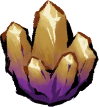

作为主材料可打造出：剑法宝（〈飞虹剑〉、〈破光灵剑〉）

### 【各版本（境界 / 品质）】

紫金铜·练气：常见的法宝材料，只需要加入一丁点，就能让法宝变得坚硬。

黑金铜·筑基：金属的颜色愈发的幽黑，也显得更加的珍贵难得。

墨金·结丹：金属外表被一大片墨黑色物体覆盖着，很难分辨里面的物质。

墨魄金·元婴：孕于幽冥地脉深处的金属，通体幽紫，内蕴魄气流转。

### 【获取途径】

炼制工作台「炼制材料」放同境界的〔金〕灵气卡（〈金灵气〉这一类），随机炼出同境界的〔金〕材料（再加〔金〕/〔土〕灵气或〈混沌灵气〉炼得更快）

练气～结丹期（紫金铜 / 黑金铜 / 墨金）：可以在「金芒矿」搜索出来

元婴期（墨魄金）：在炼制工作台「炼制材料」放〈本源灵气〉，随机炼出一种元婴期材料（不分属性）

元婴期（墨魄金）：和妖王「金蝉蛊」对话（在「月照之地」），有概率获得

练气期（紫金铜）：在「山脚下」探索、或在「客栈」拜访时，可能遇到凡人「贪玩的年轻人」：他 120 日后消失时，有20%概率送你一张练气期材料，可能是它

练气期（紫金铜）：开局剧情：「无名氏」挖出〈半掩的鼎炉〉时随机得到一张练气期材料，可能是它

---

## 2. 星辉晶

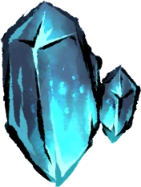

作为主材料可打造出：刀法宝（〈金光刀〉、〈斩月妖刀〉）

### 【各版本（境界 / 品质）】

星辉晶·练气：不知为何，星星的亮光都存储在晶体内，在夜晚时，便能照亮附近的区域。

曜明晶·筑基：亮度是星辉晶的好几倍，但体型缺只有一半。

炫目晶·结丹：晶体发出的光芒过于刺眼，寻常人无法直视。

神霄晶·元婴：神霄雷光凝结而成的灵晶，通体青蓝，晶身隐现金色雷纹。

### 【获取途径】

炼制工作台「炼制材料」放同境界的〔金〕灵气卡（〈金灵气〉这一类），随机炼出同境界的〔金〕材料（再加〔金〕/〔土〕灵气或〈混沌灵气〉炼得更快）

练气～结丹期（星辉晶 / 曜明晶 / 炫目晶）：可以在「金芒矿」搜索出来

元婴期（神霄晶）：在炼制工作台「炼制材料」放〈本源灵气〉，随机炼出一种元婴期材料（不分属性）

元婴期（神霄晶）：和妖王「金蝉蛊」对话（在「月照之地」），有概率获得

练气期（星辉晶）：在「山脚下」探索、或在「客栈」拜访时，可能遇到凡人「贪玩的年轻人」：他 120 日后消失时，有20%概率送你一张练气期材料，可能是它

练气期（星辉晶）：开局剧情：「无名氏」挖出〈半掩的鼎炉〉时随机得到一张练气期材料，可能是它

---

## 3. 蓝光铁

作为主材料可打造出：双刀法宝（〈金蝶刺〉）

### 【各版本（境界 / 品质）】

蓝光铁·练气：铁的表面偶尔会泛起一丝的蓝光。

星纹铁·筑基：类似星星的花纹分布在铁的表面，但不知道是怎样形成的。

流纹钢·结丹：经过灵水冲刷的钢铁，表面有一道道深沟。

星辰钢·元婴：以星辰之力反复锻打而成的灵钢，钢体内星光流转如星河，质地坚韧且蕴含星力

### 【获取途径】

炼制工作台「炼制材料」放同境界的〔金〕灵气卡（〈金灵气〉这一类），随机炼出同境界的〔金〕材料（再加〔金〕/〔土〕灵气或〈混沌灵气〉炼得更快）

练气～结丹期（蓝光铁 / 星纹铁 / 流纹钢）：可以在「金芒矿」搜索出来

元婴期（星辰钢）：在炼制工作台「炼制材料」放〈本源灵气〉，随机炼出一种元婴期材料（不分属性）

元婴期（星辰钢）：和妖王「金蝉蛊」对话（在「月照之地」），有概率获得

练气期（蓝光铁）：在「山脚下」探索、或在「客栈」拜访时，可能遇到凡人「贪玩的年轻人」：他 120 日后消失时，有20%概率送你一张练气期材料，可能是它

练气期（蓝光铁）：开局剧情：「无名氏」挖出〈半掩的鼎炉〉时随机得到一张练气期材料，可能是它

---

## 4. 黑尾毛

作为主材料可打造出：铃铛法宝（〈金芒铃〉、〈合欢魔铃〉）

### 【各版本（境界 / 品质）】

黑尾毛·练气：每只鸣鸟都只有一根的纯黑羽毛，是鸣鸟修为的关键。

黑尾毛·筑基：鸣坟鸠的修为提升，黑尾毛的数量也逐渐增加。

尸黑羽毛·结丹：一根散发尸气的羽毛，哪怕是尸鸠，也只有一根。

### 【获取途径】

击败妖兽有极小概率掉落：练气期「鸣鸟」→〈黑尾毛〉、筑基期「鸣坟鸠」→〈黑尾毛〉、结丹期「尸鸠」→〈尸黑羽毛〉

炼化〔金〕属性的内丹有较大概率获得

练气期（黑尾毛）：在「山脚下」探索、或在「客栈」拜访时，可能遇到凡人「贪玩的年轻人」：他 120 日后消失时，有20%概率送你一张练气期材料，可能是它

练气期（黑尾毛）：开局剧情：「无名氏」挖出〈半掩的鼎炉〉时随机得到一张练气期材料，可能是它

---

## 5. 毒囊

作为主材料可打造出：袋子法宝（〈锁尘袋〉）

### 【各版本（境界 / 品质）】

毒囊·练气：一个充满毒素的囊袋，小心处理，否则会中毒身亡。

金色毒囊·筑基：毒囊因为长期浸泡剧毒，已然成为了金色。

金色毒囊·结丹：随着毒蟾的修为提高，毒囊的数量也随之提高。

### 【获取途径】

击败妖兽有极小概率掉落：练气期「毒蟾」→〈毒囊〉、筑基期「金毒蟾」→〈金色毒囊〉、结丹期「三足金毒蟾」→〈金色毒囊〉

炼化〔金〕属性的内丹有较大概率获得

练气期（毒囊）：在「山脚下」探索、或在「客栈」拜访时，可能遇到凡人「贪玩的年轻人」：他 120 日后消失时，有20%概率送你一张练气期材料，可能是它

练气期（毒囊）：开局剧情：「无名氏」挖出〈半掩的鼎炉〉时随机得到一张练气期材料，可能是它

---

## 6. 琉光珠

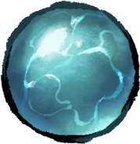

作为主材料可打造出：镜子法宝（〈凝光宝镜〉）

### 【各版本（境界 / 品质）】

琉光珠·筑基：透明无暇的珠子的表面有琉光流动。

金光宝珠·结丹：珠子里蕴含着金光，靠近甚至能感受到一丝热量。

紫曜神珠·元婴：紫曜精气凝化而成的灵珠，珠身紫光流溢，内蕴星芒神纹。

### 【获取途径】

炼制工作台「炼制材料」放同境界的〔金〕灵气卡（〈金灵气〉这一类），随机炼出同境界的〔金〕材料（再加〔金〕/〔土〕灵气或〈混沌灵气〉炼得更快）

筑基 / 结丹期（琉光珠 / 金光宝珠）：可以在「金芒矿」搜索出来

元婴期（紫曜神珠）：在炼制工作台「炼制材料」放〈本源灵气〉，随机炼出一种元婴期材料（不分属性）

元婴期（紫曜神珠）：和妖王「金蝉蛊」对话（在「月照之地」），有概率获得

---

## 7. 獠牙

作为主材料可打造出：笛子法宝（〈破风古笛〉）

### 【各版本（境界 / 品质）】

獠牙·筑基：青口兽的獠牙，看似粗糙但又锋利无比。

滴血獠牙·结丹：獠牙上的血并不是猎物的，而是从牙里渗出来。

### 【获取途径】

击败妖兽有极小概率掉落：筑基期「青口兽」→〈獠牙〉、结丹期「獠牙烈兽」→〈滴血獠牙〉

炼化〔金〕属性的内丹有较大概率获得

---

## 8. 银精

作为主材料可打造出：令牌法宝（〈银霄天令〉）

### 【各版本（境界 / 品质）】

银精·筑基：在银矿石中经受常年压力后才会形成。

皇极银·结丹：大量银精经过提纯后才会形成。

### 【获取途径】

击败妖兽有掉落：筑基期「剑冢的灵剑（筑基期）」→〈银精〉、结丹期「剑冢的灵剑（结丹期）」→〈皇极银〉

炼化〔金〕属性的内丹有较大概率获得

---

## 9. 九劫赤金

经九重天劫淬炼而生，赤芒灼目且内蕴劫火神威，是铸就弑神兵器的万古奇材

作为主材料可打造出：所有〔金〕法宝（容器法宝除外）

### 【获取途径】

在炼制工作台「炼制材料」放〈本源灵气〉，随机炼出一种元婴期材料（不分属性）

和妖王「金蝉蛊」对话（在「月照之地」），有概率获得

---

## 10. 太白玄金

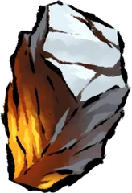

太白玄金采自九天太白星核，质坚逾万钢且天生蕴纳星辰清辉，是锻造顶级法宝与破障法器的无上神材

作为主材料可打造出：所有〔金〕法宝（容器法宝除外）

### 【获取途径】

击败〔金〕妖王后有5%概率获得

---

## 11. 幽残木

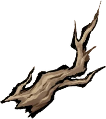

作为主材料可打造出：剑法宝（〈枯木剑〉、〈桃木神剑〉）

### 【各版本（境界 / 品质）】

幽残木·练气：被煞气影响而接近枯萎的残木，有毒。

龙葵木·筑基：葵木的香气怡然，能吸引龙在树上休息，从而吸收龙身上的灵气。

养魂木·结丹：养魂木有奇特的芳香，能镇魂定魄。

凝婴木·元婴：生长于灵气充沛之地的千年灵木，木性温润，结紫华灵实。

### 【获取途径】

炼制工作台「炼制材料」放同境界的〔木〕灵气卡（〈木灵气〉这一类），随机炼出同境界的〔木〕材料（再加〔木〕/〔水〕灵气或〈混沌灵气〉炼得更快）

练气～结丹期（幽残木 / 龙葵木 / 养魂木）：可以在「青灵木」搜索出来

元婴期（凝婴木）：在炼制工作台「炼制材料」放〈本源灵气〉，随机炼出一种元婴期材料（不分属性）

元婴期（凝婴木）：和妖王「金蝉蛊」对话（在「月照之地」），有概率获得

练气期（幽残木）：在「山脚下」探索、或在「客栈」拜访时，可能遇到凡人「贪玩的年轻人」：他 120 日后消失时，有20%概率送你一张练气期材料，可能是它

练气期（幽残木）：开局剧情：「无名氏」挖出〈半掩的鼎炉〉时随机得到一张练气期材料，可能是它

---

## 12. 紫叶树

作为主材料可打造出：葫芦法宝（〈翠竹葫芦〉）

### 【各版本（境界 / 品质）】

紫叶树·练气：一种奇树，无论什么东西长在这种树的身上，都会变成紫色。

滴血树·筑基：这种树会捕食灵兽，灵兽的血淋在叶子上，把叶子都染红了。

血纹树·结丹：生长了千年的树，不知多少猎杀了多少灵兽。

泣血树·元婴：捕食生灵的数量太多已让树木都渗出了血液，像极了在哭泣一样

### 【获取途径】

炼制工作台「炼制材料」放同境界的〔木〕灵气卡（〈木灵气〉这一类），随机炼出同境界的〔木〕材料（再加〔木〕/〔水〕灵气或〈混沌灵气〉炼得更快）

练气～结丹期（紫叶树 / 滴血树 / 血纹树）：可以在「青灵木」搜索出来

元婴期（泣血树）：在炼制工作台「炼制材料」放〈本源灵气〉，随机炼出一种元婴期材料（不分属性）

元婴期（泣血树）：和妖王「金蝉蛊」对话（在「月照之地」），有概率获得

练气期（紫叶树）：在「山脚下」探索、或在「客栈」拜访时，可能遇到凡人「贪玩的年轻人」：他 120 日后消失时，有20%概率送你一张练气期材料，可能是它

练气期（紫叶树）：开局剧情：「无名氏」挖出〈半掩的鼎炉〉时随机得到一张练气期材料，可能是它

---

## 13. 缠灵根

作为主材料可打造出：双刀法宝（〈幽芒刺〉）

### 【各版本（境界 / 品质）】

缠灵根·练气：树根能把灵气实体化，并牢牢的缠住。

醉心藤·筑基：藤蔓会趁灵兽不注意将其缠住，然后把灵兽心脏麻痹了。

绕骨藤·结丹：酔心藤把灵兽吸收干净后，就变成了缠绕在骨架上的藤蔓。

### 【获取途径】

炼制工作台「炼制材料」放同境界的〔木〕灵气卡（〈木灵气〉这一类），随机炼出同境界的〔木〕材料（再加〔木〕/〔水〕灵气或〈混沌灵气〉炼得更快）

练气～结丹期（缠灵根 / 醉心藤 / 绕骨藤）：可以在「青灵木」搜索出来

元婴期（缚魂藤）：在炼制工作台「炼制材料」放〈本源灵气〉，随机炼出一种元婴期材料（不分属性）

元婴期（缚魂藤）：和妖王「金蝉蛊」对话（在「月照之地」），有概率获得

练气期（缠灵根）：在「山脚下」探索、或在「客栈」拜访时，可能遇到凡人「贪玩的年轻人」：他 120 日后消失时，有20%概率送你一张练气期材料，可能是它

练气期（缠灵根）：开局剧情：「无名氏」挖出〈半掩的鼎炉〉时随机得到一张练气期材料，可能是它

---

## 14. 血灵竹

作为主材料可打造出：刀法宝（〈碧影刀〉）

### 【各版本（境界 / 品质）】

血灵竹·练气：在表面就能看出竹子内分布着“血管”。

血纹竹·筑基：和人血管不同的是，竹子上更像是一种符文。

赤纹竹·结丹：血的颜色更加深，纹路也愈发的清晰。

朱魂竹·元婴：竹子已经孕育出魂珠

### 【获取途径】

炼制工作台「炼制材料」放同境界的〔木〕灵气卡（〈木灵气〉这一类），随机炼出同境界的〔木〕材料（再加〔木〕/〔水〕灵气或〈混沌灵气〉炼得更快）

练气～结丹期（血灵竹 / 血纹竹 / 赤纹竹）：可以在「青灵木」搜索出来

元婴期（朱魂竹）：在炼制工作台「炼制材料」放〈本源灵气〉，随机炼出一种元婴期材料（不分属性）

元婴期（朱魂竹）：和妖王「金蝉蛊」对话（在「月照之地」），有概率获得

练气期（血灵竹）：在「山脚下」探索、或在「客栈」拜访时，可能遇到凡人「贪玩的年轻人」：他 120 日后消失时，有20%概率送你一张练气期材料，可能是它

练气期（血灵竹）：开局剧情：「无名氏」挖出〈半掩的鼎炉〉时随机得到一张练气期材料，可能是它

---

## 15. 青蛇鳞片

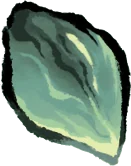

作为主材料可打造出：扇子法宝（〈青岚扇〉）

### 【各版本（境界 / 品质）】

青蛇鳞片·练气：蛇原本是没有鳞片的，不知道这蛇有何不同。

青蛇鳞片·筑基：从蛇身上整块剥下来的鳞片，较为完整所以才更有价值。

凝阴树叶·结丹：树叶会散发出阴气，经常看到有毒虫尸体在树叶上被冰冻着。

九幽寒叶·元婴：叶身凝有千年冰晶，蕴含极阴寒气。

### 【获取途径】

结丹期（凝阴树叶）：炼制工作台「炼制材料」放同境界的〔木〕灵气卡（〈木灵气〉这一类），随机炼出同境界的〔木〕材料（再加〔木〕/〔水〕灵气或〈混沌灵气〉炼得更快）

击败妖兽有极小概率掉落：练气期「青蛇」→〈青蛇鳞片〉、筑基期「长蛇」→〈青蛇鳞片〉

练气 / 筑基期（青蛇鳞片）：炼化〔木〕属性的内丹有较大概率获得

结丹期（凝阴树叶）：可以在「青灵木」搜索出来

元婴期（九幽寒叶）：在炼制工作台「炼制材料」放〈本源灵气〉，随机炼出一种元婴期材料（不分属性）

元婴期（九幽寒叶）：和妖王「金蝉蛊」对话（在「月照之地」），有概率获得

练气期（青蛇鳞片）：在「山脚下」探索、或在「客栈」拜访时，可能遇到凡人「贪玩的年轻人」：他 120 日后消失时，有20%概率送你一张练气期材料，可能是它

练气期（青蛇鳞片）：开局剧情：「无名氏」挖出〈半掩的鼎炉〉时随机得到一张练气期材料，可能是它

---

## 16. 小根兽骨

作为主材料可打造出：笛子法宝（〈紫藤笛〉）

### 【各版本（境界 / 品质）】

小根兽骨·练气：小型灵兽的骨头。

骨爪·筑基：化蛇下半部分的爪子，异常的大。

骨脸·结丹：修炼至筑基后，脸部慢慢骨化。

### 【获取途径】

击败妖兽有极小概率掉落：练气期「耳鼠」→〈小根兽骨〉、筑基期「化蛇」→〈骨爪〉、结丹期「鬼脸飞蛇」→〈骨脸〉

炼化〔木〕属性的内丹有较大概率获得

练气期（小根兽骨）：在「山脚下」探索、或在「客栈」拜访时，可能遇到凡人「贪玩的年轻人」：他 120 日后消失时，有20%概率送你一张练气期材料，可能是它

练气期（小根兽骨）：开局剧情：「无名氏」挖出〈半掩的鼎炉〉时随机得到一张练气期材料，可能是它

---

## 17. 扇耳

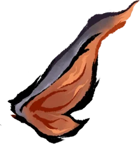

作为主材料可打造出：琵琶法宝（〈妙音琵琶〉）

### 【各版本（境界 / 品质）】

扇耳·筑基：耳鼠的完整大耳朵。

辟虫灵木·结丹：这种树木连剧毒的虫子也不敢靠近。

青莹灵木·元婴：在经过多年的修炼后，曾经辟虫的灵木开始吸引灵虫

### 【获取途径】

结丹期（辟虫灵木）：炼制工作台「炼制材料」放同境界的〔木〕灵气卡（〈木灵气〉这一类），随机炼出同境界的〔木〕材料（再加〔木〕/〔水〕灵气或〈混沌灵气〉炼得更快）

筑基期（扇耳）：击败「飞鼠」后有极小概率掉落

筑基期（扇耳）：炼化〔木〕属性的内丹有较大概率获得

结丹期（辟虫灵木）：可以在「青灵木」搜索出来

元婴期（青莹灵木）：在炼制工作台「炼制材料」放〈本源灵气〉，随机炼出一种元婴期材料（不分属性）

元婴期（青莹灵木）：和妖王「金蝉蛊」对话（在「月照之地」），有概率获得

---

## 18. 千棘藤心

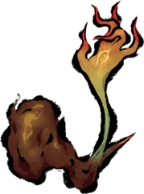

凝萃千棘藤妖千年木灵本源与噬灵妖力，坚韧无比且暗藏尖刺玄机

作为主材料可打造出：袋子法宝（〈千棘袋〉）

### 【获取途径】

击败「千棘藤妖」后有极小概率掉落

炼化〔木〕属性的内丹有较大概率获得

---

## 19. 紫电雷竹

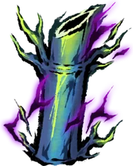

紫电雷竹生于九霄雷泽秘境，竿蕴先天紫电、节藏雷霆真意，坚韧且能引动天雷之力

作为主材料可打造出：所有〔木〕法宝（容器法宝除外）

### 【获取途径】

在炼制工作台「炼制材料」放〈本源灵气〉，随机炼出一种元婴期材料（不分属性）

和妖王「金蝉蛊」对话（在「月照之地」），有概率获得

---

## 20. 血凤木

木质朱红如血且蕴纳涅槃真火本源，坚韧不朽还能滋养灵脉

作为主材料可打造出：所有〔木〕法宝（容器法宝除外）

### 【获取途径】

击败〔木〕妖王后有5%概率获得

---

## 21. 月泉水

作为主材料可打造出：瓶子法宝（〈雨露瓶〉）

### 【各版本（境界 / 品质）】

月泉水·练气：当满月照射在泉水时，如果出现灵气异常，灵气和月光都会被存储在泉水中。

月泉灵乳·筑基：月泉水吸收的灵气越多，就会逐渐变得浓稠。

月泉晶·结丹：浓缩了千年月亮精华的泉乳，充满灵气。

### 【获取途径】

炼制工作台「炼制材料」放同境界的〔水〕灵气卡（〈水灵气〉这一类），随机炼出同境界的〔水〕材料（再加〔水〕/〔金〕灵气或〈混沌灵气〉炼得更快）

练气～结丹期（月泉水 / 月泉灵乳 / 月泉晶）：可以在「愈魂池」搜索出来

元婴期（月泉神晶）：在炼制工作台「炼制材料」放〈本源灵气〉，随机炼出一种元婴期材料（不分属性）

元婴期（月泉神晶）：和妖王「金蝉蛊」对话（在「月照之地」），有概率获得

练气期（月泉水）：在「山脚下」探索、或在「客栈」拜访时，可能遇到凡人「贪玩的年轻人」：他 120 日后消失时，有20%概率送你一张练气期材料，可能是它

练气期（月泉水）：开局剧情：「无名氏」挖出〈半掩的鼎炉〉时随机得到一张练气期材料，可能是它

---

## 22. 海波晶

作为主材料可打造出：剑法宝（〈寒光剑〉、〈玄阴魂剑〉）

### 【各版本（境界 / 品质）】

海波晶·练气：汹涌的灵气波浪无时无刻的拍打着岸边后形成的特殊结晶。

冥河水晶·筑基：世上有一条河流，没有固定的位置，称之为冥河。这便是从冥河流过之处剩下的结晶。

幽冥寒晶·结丹：之所以叫寒晶，是因为连火焰也无法驱走来自幽冥地界的寒意。

九幽魂晶·元婴：九幽深处阴气凝结而成的魂晶，晶身幽紫斑斓，内蕴魂息流转。

### 【获取途径】

炼制工作台「炼制材料」放同境界的〔水〕灵气卡（〈水灵气〉这一类），随机炼出同境界的〔水〕材料（再加〔水〕/〔金〕灵气或〈混沌灵气〉炼得更快）

练气～结丹期（海波晶 / 冥河水晶 / 幽冥寒晶）：可以在「愈魂池」搜索出来

元婴期（九幽魂晶）：在炼制工作台「炼制材料」放〈本源灵气〉，随机炼出一种元婴期材料（不分属性）

元婴期（九幽魂晶）：和妖王「金蝉蛊」对话（在「月照之地」），有概率获得

练气期（海波晶）：在「山脚下」探索、或在「客栈」拜访时，可能遇到凡人「贪玩的年轻人」：他 120 日后消失时，有20%概率送你一张练气期材料，可能是它

练气期（海波晶）：开局剧情：「无名氏」挖出〈半掩的鼎炉〉时随机得到一张练气期材料，可能是它

---

## 23. 凝魄冰

作为主材料可打造出：刀法宝（〈凝水刀〉）

### 【各版本（境界 / 品质）】

凝魄冰·练气：在极寒地区死亡的生命，有时候魂魄都被冻住了。

黑魄寒冰·筑基：寒冰里的魂魄数量太多，以至于显露出黑色。

万年黑魄冰·结丹：经过万年沉淀的寒冰，在炼制时要注意魂魄的反击。

玄魄冰髓·元婴：万年黑魄冰与阴魄之气交融孕育的冰髓，外层冰寒彻骨，内蕴幽紫魄息。

### 【获取途径】

炼制工作台「炼制材料」放同境界的〔水〕灵气卡（〈水灵气〉这一类），随机炼出同境界的〔水〕材料（再加〔水〕/〔金〕灵气或〈混沌灵气〉炼得更快）

练气～结丹期（凝魄冰 / 黑魄寒冰 / 万年黑魄冰）：可以在「愈魂池」搜索出来

元婴期（玄魄冰髓）：在炼制工作台「炼制材料」放〈本源灵气〉，随机炼出一种元婴期材料（不分属性）

元婴期（玄魄冰髓）：和妖王「金蝉蛊」对话（在「月照之地」），有概率获得

练气期（凝魄冰）：在「山脚下」探索、或在「客栈」拜访时，可能遇到凡人「贪玩的年轻人」：他 120 日后消失时，有20%概率送你一张练气期材料，可能是它

练气期（凝魄冰）：开局剧情：「无名氏」挖出〈半掩的鼎炉〉时随机得到一张练气期材料，可能是它

---

## 24. 鱼鳞片

作为主材料可打造出：笛子法宝（〈琉璃笛〉）

### 【各版本（境界 / 品质）】

鱼鳞片·练气：鱼类灵兽的普通鳞片。

冰蝉·筑基：蝉身如同冰块般晶莹剔透。

冰晶蝉·结丹：蝉身如同冰块般晶莹剔透。

千年冰晶蝉·元婴：蝉身如同冰块般晶莹剔透。

### 【获取途径】

筑基 / 结丹期（冰蝉 / 冰晶蝉）：炼制工作台「炼制材料」放同境界的〔水〕灵气卡（〈水灵气〉这一类），随机炼出同境界的〔水〕材料（再加〔水〕/〔金〕灵气或〈混沌灵气〉炼得更快）

练气期（鱼鳞片）：击败「飞鱼」后有极小概率掉落

练气期（鱼鳞片）：炼化〔水〕属性的内丹有较大概率获得

筑基 / 结丹期（冰蝉 / 冰晶蝉）：可以在「愈魂池」搜索出来

元婴期（千年冰晶蝉）：在炼制工作台「炼制材料」放〈本源灵气〉，随机炼出一种元婴期材料（不分属性）

元婴期（千年冰晶蝉）：和妖王「金蝉蛊」对话（在「月照之地」），有概率获得

练气期（鱼鳞片）：在「山脚下」探索、或在「客栈」拜访时，可能遇到凡人「贪玩的年轻人」：他 120 日后消失时，有20%概率送你一张练气期材料，可能是它

练气期（鱼鳞片）：开局剧情：「无名氏」挖出〈半掩的鼎炉〉时随机得到一张练气期材料，可能是它

---

## 25. 水囊

哪怕脱离了宿主，囊袋依然可以渗出水分。

作为主材料可打造出：袋子法宝（〈冰心袋〉）

### 【获取途径】

击败妖兽有极小概率掉落：练气期「花臂章鱼」→〈水囊〉、筑基期「北海巨妖（小）」→〈巨大水囊〉

炼化〔水〕属性的内丹有较大概率获得

练气期（水囊）：在「山脚下」探索、或在「客栈」拜访时，可能遇到凡人「贪玩的年轻人」：他 120 日后消失时，有20%概率送你一张练气期材料，可能是它

练气期（水囊）：开局剧情：「无名氏」挖出〈半掩的鼎炉〉时随机得到一张练气期材料，可能是它

---

## 26. 玄灵液

作为主材料可打造出：袋子法宝（〈冰心袋〉）

### 【各版本（境界 / 品质）】

玄灵液·筑基：富含灵气的灵液，用于培养灵草的好材料。

天元灵液·结丹：富含灵气的灵液，用于培养灵草的好材料。

天元神液·元婴：富含灵气的灵液，用于培养灵药的好材料。

### 【获取途径】

炼制工作台「炼制材料」放同境界的〔水〕灵气卡（〈水灵气〉这一类），随机炼出同境界的〔水〕材料（再加〔水〕/〔金〕灵气或〈混沌灵气〉炼得更快）

筑基 / 结丹期（玄灵液 / 天元灵液）：可以在「愈魂池」搜索出来

元婴期（天元神液）：在炼制工作台「炼制材料」放〈本源灵气〉，随机炼出一种元婴期材料（不分属性）

元婴期（天元神液）：和妖王「金蝉蛊」对话（在「月照之地」），有概率获得

---

## 27. 水玉

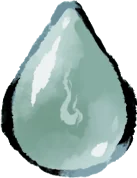

作为主材料可打造出：伞法宝（〈避水纸伞〉）

### 【各版本（境界 / 品质）】

水玉·筑基：不知道如何形成的，玉里有流动的水。

泪玉·结丹：玉的形状像一滴泪，也许里面装着的的确就是泪水。

冰勾玉·元婴：以千年寒冰雕琢而成的勾玉，通体冰蓝通透，触手生凉。

### 【获取途径】

炼制工作台「炼制材料」放同境界的〔水〕灵气卡（〈水灵气〉这一类），随机炼出同境界的〔水〕材料（再加〔水〕/〔金〕灵气或〈混沌灵气〉炼得更快）

筑基 / 结丹期（水玉 / 泪玉）：可以在「愈魂池」搜索出来

元婴期（冰勾玉）：在炼制工作台「炼制材料」放〈本源灵气〉，随机炼出一种元婴期材料（不分属性）

元婴期（冰勾玉）：和妖王「金蝉蛊」对话（在「月照之地」），有概率获得

---

## 28. 蛟鳞片

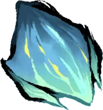

作为主材料可打造出：扇子法宝（〈游龙古扇〉）

### 【各版本（境界 / 品质）】

蛟鳞片·筑基：蛟龙的大块鳞片，每一片都是坚韧无比。

流水鳞片·结丹：鳞片可以轻易的切割水流，虽然只能维持一小段时间。

### 【获取途径】

击败妖兽有极小概率掉落：筑基期「入水蛟」→〈蛟鳞片〉、结丹期「凶蛟」→〈流水鳞片〉

炼化〔水〕属性的内丹有较大概率获得

---

## 29. 龙鲤血

凝萃彩鳞龙鲤本源与锦鲤祥瑞之力，殷红如霞且蕴含澎湃生机

作为主材料可打造出：葫芦法宝（〈幻海葫芦〉）

### 【获取途径】

击败「彩鳞龙鲤」后有极小概率掉落

炼化〔水〕属性的内丹有较大概率获得

---

## 30. 星海灵波

弥散于星海深处的无形灵韵，凝萃亿万星辰潮汐之力与空间真意

### 【获取途径】

在炼制工作台「炼制材料」放〈本源灵气〉，随机炼出一种元婴期材料（不分属性）

和妖王「金蝉蛊」对话（在「月照之地」），有概率获得

---

## 31. 幻雾琉璃

由天地间最纯净的水雾凝结千年而成的半透明晶体，能随光线变换七种水色

作为主材料可打造出：所有〔水〕法宝（容器法宝除外）

### 【获取途径】

击败〔水〕妖王后有5%概率获得

---

## 32. 火魂石

作为主材料可打造出：袋子法宝（〈御火袋〉）

### 【各版本（境界 / 品质）】

火魂石·练气：当吸附了死亡灵兽的魂魄后，又被地火焚烧了数十年才能形成火魂石。

燃魄石·筑基：当吸附了死亡灵兽的魂魄后，又被地火焚烧了数十年才能形成火魂石。

焚城石·结丹：原本只是普通的城墙石头，被焚烧后吸印大量冤魂而变得不凡。

焚天石·元婴：上古火域深处孕育的异石，内含焚天烈焰，触之灼骨熔金

### 【获取途径】

炼制工作台「炼制材料」放同境界的〔火〕灵气卡（〈火灵气〉这一类），随机炼出同境界的〔火〕材料（再加〔火〕/〔木〕灵气或〈混沌灵气〉炼得更快）

练气～结丹期（火魂石 / 燃魄石 / 焚城石）：可以在「火云树」搜索出来

元婴期（焚天石）：在炼制工作台「炼制材料」放〈本源灵气〉，随机炼出一种元婴期材料（不分属性）

元婴期（焚天石）：和妖王「金蝉蛊」对话（在「月照之地」），有概率获得

练气期（火魂石）：在「山脚下」探索、或在「客栈」拜访时，可能遇到凡人「贪玩的年轻人」：他 120 日后消失时，有20%概率送你一张练气期材料，可能是它

练气期（火魂石）：开局剧情：「无名氏」挖出〈半掩的鼎炉〉时随机得到一张练气期材料，可能是它

---

## 33. 地心之火

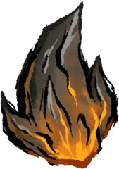

作为主材料可打造出：葫芦法宝（〈炽焰葫芦〉）

### 【各版本（境界 / 品质）】

地心之火·练气：从地底深处采集的地火。

天外之火·筑基：从天上坠落的无名之火。

天地之火·结丹：融合了地火和天火的混合火焰，温度极高。

混沌灵焰·元婴：天地初开时混沌之气所化的本源灵火，藏于熔岩石胎之中。

### 【获取途径】

炼制工作台「炼制材料」放同境界的〔火〕灵气卡（〈火灵气〉这一类），随机炼出同境界的〔火〕材料（再加〔火〕/〔木〕灵气或〈混沌灵气〉炼得更快）

练气～结丹期（地心之火 / 天外之火 / 天地之火）：可以在「火云树」搜索出来

元婴期（混沌灵焰）：在炼制工作台「炼制材料」放〈本源灵气〉，随机炼出一种元婴期材料（不分属性）

元婴期（混沌灵焰）：和妖王「金蝉蛊」对话（在「月照之地」），有概率获得

练气期（地心之火）：在「山脚下」探索、或在「客栈」拜访时，可能遇到凡人「贪玩的年轻人」：他 120 日后消失时，有20%概率送你一张练气期材料，可能是它

练气期（地心之火）：开局剧情：「无名氏」挖出〈半掩的鼎炉〉时随机得到一张练气期材料，可能是它

---

## 34. 赤阳石

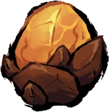

作为主材料可打造出：令牌法宝（〈焚石令〉）

### 【各版本（境界 / 品质）】

赤阳石·练气：像太阳般的石头，自身会发出热和红光。

落阳石·筑基：会在燃烧熄灭之间无限循环的神奇火石。

赤日石·结丹：燃烧的火焰已经能和正午的太阳媲美。

曜阳石·元婴：燃烧的火焰已经能和正午的太阳媲美。

### 【获取途径】

炼制工作台「炼制材料」放同境界的〔火〕灵气卡（〈火灵气〉这一类），随机炼出同境界的〔火〕材料（再加〔火〕/〔木〕灵气或〈混沌灵气〉炼得更快）

练气～结丹期（赤阳石 / 落阳石 / 赤日石）：可以在「火云树」搜索出来

元婴期（曜阳石）：在炼制工作台「炼制材料」放〈本源灵气〉，随机炼出一种元婴期材料（不分属性）

元婴期（曜阳石）：和妖王「金蝉蛊」对话（在「月照之地」），有概率获得

练气期（赤阳石）：在「山脚下」探索、或在「客栈」拜访时，可能遇到凡人「贪玩的年轻人」：他 120 日后消失时，有20%概率送你一张练气期材料，可能是它

练气期（赤阳石）：开局剧情：「无名氏」挖出〈半掩的鼎炉〉时随机得到一张练气期材料，可能是它

---

## 35. 利爪

作为主材料可打造出：刀法宝（〈赤焰刀〉）

### 【各版本（境界 / 品质）】

利爪·练气：兽类灵兽的锋利爪子。

赤红利爪·筑基：爪子因为捕杀猎物太多已经染成了红色。

赤红角·结丹：赤豹会先用独角将猎物击倒，有时候一击便能贯穿心脏。

### 【获取途径】

击败妖兽有极小概率掉落：练气期「山豹」→〈利爪〉、筑基期「赤红豹」→〈赤红利爪〉、结丹期「独角赤豹」→〈赤红角〉

炼化〔火〕属性的内丹有较大概率获得

练气期（利爪）：在「山脚下」探索、或在「客栈」拜访时，可能遇到凡人「贪玩的年轻人」：他 120 日后消失时，有20%概率送你一张练气期材料，可能是它

练气期（利爪）：开局剧情：「无名氏」挖出〈半掩的鼎炉〉时随机得到一张练气期材料，可能是它

---

## 36. 红蛇鳞片

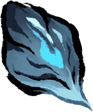

作为主材料可打造出：剑法宝（〈烈火剑〉、〈三炎神剑〉）

### 【各版本（境界 / 品质）】

红蛇鳞片·练气：鳞片整个都是红色的，似血。

红蛇鳞片·筑基：一片完整的血红鳞片，较为珍贵。

鲜红蛇鳞片·结丹：鲜红的鳞片上偶尔还能自燃起来。

### 【获取途径】

击败妖兽有极小概率掉落：练气期「枳首蛇」→〈红蛇鳞片〉、筑基期「三头枳首蛇」→〈红蛇鳞片〉、结丹期「六头枳首蛇」→〈鲜红蛇鳞片〉

炼化〔火〕属性的内丹有较大概率获得

练气期（红蛇鳞片）：在「山脚下」探索、或在「客栈」拜访时，可能遇到凡人「贪玩的年轻人」：他 120 日后消失时，有20%概率送你一张练气期材料，可能是它

练气期（红蛇鳞片）：开局剧情：「无名氏」挖出〈半掩的鼎炉〉时随机得到一张练气期材料，可能是它

---

## 37. 火珊瑚

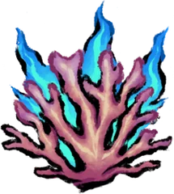

作为主材料可打造出：灯法宝（〈冥火提灯〉）

### 【各版本（境界 / 品质）】

火珊瑚·筑基：在海底的依然能燃烧的珊瑚。

千年火珊瑚·结丹：已经在海底燃烧了千年，却仍未烧尽的千年珊瑚。

万年火珊瑚·元婴：生于深海火山裂隙中的奇珍，吸纳地火万年方得成形

### 【获取途径】

炼制工作台「炼制材料」放同境界的〔火〕灵气卡（〈火灵气〉这一类），随机炼出同境界的〔火〕材料（再加〔火〕/〔木〕灵气或〈混沌灵气〉炼得更快）

筑基 / 结丹期（火珊瑚 / 千年火珊瑚）：可以在「火云树」搜索出来

元婴期（万年火珊瑚）：在炼制工作台「炼制材料」放〈本源灵气〉，随机炼出一种元婴期材料（不分属性）

元婴期（万年火珊瑚）：和妖王「金蝉蛊」对话（在「月照之地」），有概率获得

---

## 38. 青火晶

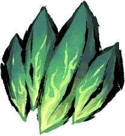

作为主材料可打造出：瓶子法宝（〈红莲极瓶〉）

### 【各版本（境界 / 品质）】

青火晶·筑基：偶有外火从天上坠落，把附近之物燃烧殆尽后形成的结晶。

冥火晶·结丹：不待落下的外火燃烧殆尽便将其收集保存，才有着外火本源的能量。

幽冥晶石·元婴：产自幽冥深渊的阴寒灵晶，晶身萦绕紫色幽焰，内含金纹冥火

### 【获取途径】

炼制工作台「炼制材料」放同境界的〔火〕灵气卡（〈火灵气〉这一类），随机炼出同境界的〔火〕材料（再加〔火〕/〔木〕灵气或〈混沌灵气〉炼得更快）

筑基 / 结丹期（青火晶 / 冥火晶）：可以在「火云树」搜索出来

元婴期（幽冥晶石）：在炼制工作台「炼制材料」放〈本源灵气〉，随机炼出一种元婴期材料（不分属性）

元婴期（幽冥晶石）：和妖王「金蝉蛊」对话（在「月照之地」），有概率获得

---

## 39. 噬金甲

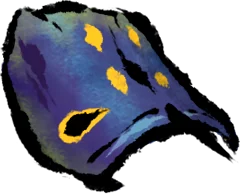

噬金甲是噬金狂蚣蜕化的本命甲壳，坚不可摧且能吞噬金属之力淬炼自身

作为主材料可打造出：瓶子法宝（〈红莲极瓶〉）

### 【获取途径】

击败「噬金狂蚣」后有极小概率掉落

炼化〔火〕属性的内丹有较大概率获得

---

## 40. 炎龙碎骨

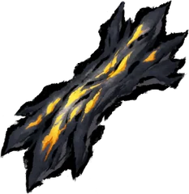

上古炎龙陨落后遗存的骨骼碎片，凝萃火龙本源之力与霸道龙威，坚硬耐高温且火韵绵长

作为主材料可打造出：所有〔火〕法宝（容器法宝除外）

### 【获取途径】

在炼制工作台「炼制材料」放〈本源灵气〉，随机炼出一种元婴期材料（不分属性）

和妖王「金蝉蛊」对话（在「月照之地」），有概率获得

---

## 41. 火莲晶核

表面有太阳黑子般的纹路，燃烧时释放亿万道金芒，能照亮九幽地府

作为主材料可打造出：所有〔火〕法宝（容器法宝除外）

### 【获取途径】

击败〔火〕妖王后有5%概率获得

---

## 42. 玉髓石

作为主材料可打造出：剑法宝（〈黄泉剑〉、〈白玉刚剑〉）

### 【各版本（境界 / 品质）】

玉髓石·练气：在地底里被大地挤压成玉的石头。

玉芯石·筑基：形成的玉髓石会缓慢吞噬附近的石头，最终形成子午岩。

血玉石·结丹：玉芯被挤压出血状的物质，所以名曰血玉石。

### 【获取途径】

炼制工作台「炼制材料」放同境界的〔土〕灵气卡（〈土灵气〉这一类），随机炼出同境界的〔土〕材料（再加〔土〕/〔火〕灵气或〈混沌灵气〉炼得更快）

练气～结丹期（玉髓石 / 玉芯石 / 血玉石）：可以在「凝土墟」搜索出来

元婴期（血髓玉）：在炼制工作台「炼制材料」放〈本源灵气〉，随机炼出一种元婴期材料（不分属性）

元婴期（血髓玉）：和妖王「金蝉蛊」对话（在「月照之地」），有概率获得

练气期（玉髓石）：在「山脚下」探索、或在「客栈」拜访时，可能遇到凡人「贪玩的年轻人」：他 120 日后消失时，有20%概率送你一张练气期材料，可能是它

练气期（玉髓石）：开局剧情：「无名氏」挖出〈半掩的鼎炉〉时随机得到一张练气期材料，可能是它

---

## 43. 铁精砂

作为主材料可打造出：葫芦法宝（〈黄砂葫芦〉）

### 【各版本（境界 / 品质）】

铁精砂·练气：异常锋利的砂子，收集的过程可谓是痛苦至极。

银精砂·筑基：砂里混杂着细小的银精，比铁更加的锋利。

黑金砂·结丹：哪怕一颗小小的砂粒，在空中也能闪出黑色金光。

紫金砂·元婴：紫金共生矿脉中淘洗出的灵砂，紫中含金，粒粒生辉。

### 【获取途径】

炼制工作台「炼制材料」放同境界的〔土〕灵气卡（〈土灵气〉这一类），随机炼出同境界的〔土〕材料（再加〔土〕/〔火〕灵气或〈混沌灵气〉炼得更快）

练气～结丹期（铁精砂 / 银精砂 / 黑金砂）：可以在「凝土墟」搜索出来

元婴期（紫金砂）：在炼制工作台「炼制材料」放〈本源灵气〉，随机炼出一种元婴期材料（不分属性）

元婴期（紫金砂）：和妖王「金蝉蛊」对话（在「月照之地」），有概率获得

练气期（铁精砂）：在「山脚下」探索、或在「客栈」拜访时，可能遇到凡人「贪玩的年轻人」：他 120 日后消失时，有20%概率送你一张练气期材料，可能是它

练气期（铁精砂）：开局剧情：「无名氏」挖出〈半掩的鼎炉〉时随机得到一张练气期材料，可能是它

---

## 44. 藏灵土

作为主材料可打造出：扇子法宝（〈山河扇〉）

### 【各版本（境界 / 品质）】

藏灵土·练气：泥土里蕴含着大量的灵气，但外表又和普通泥土一样。

叱灵土·筑基：灵土里的灵气因为过于饱满，有时候会爆发出一声巨响。

散灵土·结丹：泥土的质地较为松软，更有灵气从中散发而出。

灵土息壤·元婴：泥土的质地较为松软，更有灵气从中散发而出。

### 【获取途径】

炼制工作台「炼制材料」放同境界的〔土〕灵气卡（〈土灵气〉这一类），随机炼出同境界的〔土〕材料（再加〔土〕/〔火〕灵气或〈混沌灵气〉炼得更快）

练气～结丹期（藏灵土 / 叱灵土 / 散灵土）：可以在「凝土墟」搜索出来

元婴期（灵土息壤）：在炼制工作台「炼制材料」放〈本源灵气〉，随机炼出一种元婴期材料（不分属性）

元婴期（灵土息壤）：和妖王「金蝉蛊」对话（在「月照之地」），有概率获得

练气期（藏灵土）：在「山脚下」探索、或在「客栈」拜访时，可能遇到凡人「贪玩的年轻人」：他 120 日后消失时，有20%概率送你一张练气期材料，可能是它

练气期（藏灵土）：开局剧情：「无名氏」挖出〈半掩的鼎炉〉时随机得到一张练气期材料，可能是它

---

## 45. 长兽骨

作为主材料可打造出：刀法宝（〈碎石刀〉）

### 【各版本（境界 / 品质）】

练气：灵长类妖兽的骨头，比一般家畜要长得多。

筑基：这个灵兽绝对是灵长类里长得最高的。

### 【获取途径】

筑基期：和「祸斗」对话（在「深洞内部」），获得

击败妖兽有极小概率掉落：练气期「长臂猴」→〈长兽骨〉、筑基期「鬼脸长臂猴」→〈长兽骨〉

炼化〔土〕属性的内丹有较大概率获得

练气期（长兽骨）：在「山脚下」探索、或在「客栈」拜访时，可能遇到凡人「贪玩的年轻人」：他 120 日后消失时，有20%概率送你一张练气期材料，可能是它

练气期（长兽骨）：开局剧情：「无名氏」挖出〈半掩的鼎炉〉时随机得到一张练气期材料，可能是它

---

## 46. 大兽骨

作为主材料可打造出：瓶子法宝（〈星华瓶〉）

### 【各版本（境界 / 品质）】

大兽骨·练气：粗壮的兽骨，也只有巨象能长这么大了。

墨翠玉·筑基：墨绿色的翡翠玉石，绿色得非常深邃。

### 【获取途径】

筑基期（墨翠玉）：炼制工作台「炼制材料」放同境界的〔土〕灵气卡（〈土灵气〉这一类），随机炼出同境界的〔土〕材料（再加〔土〕/〔火〕灵气或〈混沌灵气〉炼得更快）

练气期（大兽骨）：击败「巨象」后有极小概率掉落

练气期（大兽骨）：炼化〔土〕属性的内丹有较大概率获得

筑基期（墨翠玉）：可以在「凝土墟」搜索出来

练气期（大兽骨）：在「山脚下」探索、或在「客栈」拜访时，可能遇到凡人「贪玩的年轻人」：他 120 日后消失时，有20%概率送你一张练气期材料，可能是它

练气期（大兽骨）：开局剧情：「无名氏」挖出〈半掩的鼎炉〉时随机得到一张练气期材料，可能是它

---

## 47. 迷天岩

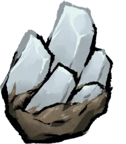

作为主材料可打造出：印法宝（〈混土神印〉）

### 【各版本（境界 / 品质）】

迷天岩·筑基：岩石非常难寻找，不是因为太小，而是人们根本看不见它。

镇妖岩·结丹：镇压在灵兽身上的石头，包含戾气。

### 【获取途径】

炼制工作台「炼制材料」放同境界的〔土〕灵气卡（〈土灵气〉这一类），随机炼出同境界的〔土〕材料（再加〔土〕/〔火〕灵气或〈混沌灵气〉炼得更快）

筑基 / 结丹期（迷天岩 / 镇妖岩）：可以在「凝土墟」搜索出来

元婴期（凌霄岩）：在炼制工作台「炼制材料」放〈本源灵气〉，随机炼出一种元婴期材料（不分属性）

元婴期（凌霄岩）：和妖王「金蝉蛊」对话（在「月照之地」），有概率获得

---

## 48. 百年妖骨

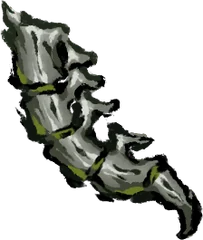

作为主材料可打造出：双刀法宝（〈雌雄双刺〉）

### 【各版本（境界 / 品质）】

百年妖骨·筑基：在戈壁地区经过百年时间风干的妖骨，灵力还未散尽，反而更加的浓郁。

千年妖骨·结丹：在戈壁地区经过千年时间风干的妖骨，灵力还未散尽，反而更加的浓郁。

万年妖骨·元婴：在戈壁地区经过千年时间风干的妖骨，灵力还未散尽，反而更加的浓郁。

### 【获取途径】

炼制工作台「炼制材料」放同境界的〔土〕灵气卡（〈土灵气〉这一类），随机炼出同境界的〔土〕材料（再加〔土〕/〔火〕灵气或〈混沌灵气〉炼得更快）

筑基 / 结丹期（百年妖骨 / 千年妖骨）：可以在「凝土墟」搜索出来

元婴期（万年妖骨）：在炼制工作台「炼制材料」放〈本源灵气〉，随机炼出一种元婴期材料（不分属性）

元婴期（万年妖骨）：和妖王「金蝉蛊」对话（在「月照之地」），有概率获得

---

## 49. 姜黄晶

作为主材料可打造出：令牌法宝（〈玄黄灵符〉）

### 【各版本（境界 / 品质）】

姜黄晶·筑基：深藏在地底，据说是大地精华凝结而成。

龙髓晶·结丹：深藏在地底，据说是地龙的脊髓。

神髓晶·元婴：深藏在地底，据说是地龙的脊髓。

### 【获取途径】

炼制工作台「炼制材料」放同境界的〔土〕灵气卡（〈土灵气〉这一类），随机炼出同境界的〔土〕材料（再加〔土〕/〔火〕灵气或〈混沌灵气〉炼得更快）

筑基 / 结丹期（姜黄晶 / 龙髓晶）：可以在「凝土墟」搜索出来

元婴期（神髓晶）：在炼制工作台「炼制材料」放〈本源灵气〉，随机炼出一种元婴期材料（不分属性）

元婴期（神髓晶）：和妖王「金蝉蛊」对话（在「月照之地」），有概率获得

---

## 50. 地心磁石

地核深处孕生的奇矿，蕴纳先天磁元且控磁镇灵，能引聚灵脉、吸附金属灵能

### 【获取途径】

在炼制工作台「炼制材料」放〈本源灵气〉，随机炼出一种元婴期材料（不分属性）

和妖王「金蝉蛊」对话（在「月照之地」），有概率获得

---

## 51. 九天息壤

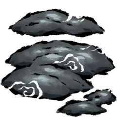

九天之上孕生的上古灵土，蕴纳混沌生机与稳固本源之力，生生不息且能滋养万灵

作为主材料可打造出：所有〔土〕法宝（容器法宝除外）

### 【获取途径】

击败〔土〕妖王后有5%概率获得

---

## 52. 九幽魂玉

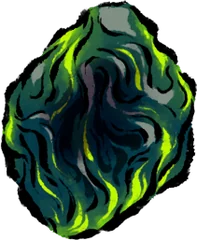

自九幽寒渊深处，蕴纳无尽阴魂本源与幽冥真意，温润却藏寒煞

作为主材料可打造出：所有〔阴〕法宝（容器法宝除外）

### 【获取途径】

击败〔阴〕妖王后有5%概率获得

---

## 53. 昊阳金石

昊阳真火淬炼的烈日岩脉，蕴纳极致阳刚本源与焚天热力，坚不可摧且能破邪驱阴

作为主材料可打造出：所有〔阳〕法宝（容器法宝除外）

### 【获取途径】

极难获得的材料

---

## 54. 剑魂残魄

击败剑冢内的**妖剑**获得的剑魄。

是制作**无双剑匣**的重要材料。

作为主材料可打造出：所有剑法宝

放进修炼工作台修炼可以获得感悟〈剑意〉

### 【获取途径】

击败妖王「妖剑」后有20%概率获得，炼化妖剑的眼大概率获得

---

## 55. 魂蛊丝

作为主材料可打造出：笛子法宝（〈驭秽〉）

### 【获取途径】

击败妖王「金蝉蛊」后有20%概率获得，炼化金蝉蛊的内丹大概率获得

结丹期：和「金蝉蛊」对话（在「月照之地」），有概率获得

---

## 56. 裂石赤角

作为主材料可打造出：剑法宝（〈碎星〉）

### 【获取途径】

击败妖王「狰」后有20%概率获得，炼化狰的内丹大概率获得

---

## 57. 五色妖尾

作为主材料可打造出：索法宝（〈缚妖〉）

### 【获取途径】

击败妖王「狰」后有20%概率获得，炼化狰的内丹大概率获得

---

## 58. 血藤蔓

击败**血藤古树**后有概率获得。

作为主材料可打造出：瓶子法宝（〈血祭〉）

### 【获取途径】

击败妖王「血藤古树」后有20%概率获得，炼化血藤古树的内丹大概率获得

---

## 59. 血藤毒刺

击败**血藤古树**后有概率获得。

作为主材料可打造出：双刀法宝（〈剜骨〉）

### 【获取途径】

击败妖王「血藤古树」后有20%概率获得，炼化血藤古树的内丹大概率获得

---

## 60. 旱火蛇鳞

击败**肥遗**后有概率获得。

作为主材料可打造出：剑法宝（〈春蘅〉）

### 【获取途径】

击败妖王「肥遗」后有20%概率获得，炼化肥遗的内丹大概率获得

---

## 61. 旱火丹

击败**肥遗**后有概率获得。

作为主材料可打造出：珠子法宝（〈朱坻〉）

### 【获取途径】

击败妖王「肥遗」后有20%概率获得，炼化肥遗的内丹大概率获得

---

## 62. 夔雷核

击败**夔牛**后有概率获得。

作为主材料可打造出：铃铛法宝（〈震霄〉）

### 【获取途径】

击败妖王「夔牛」后有20%概率获得，炼化夔牛的内丹大概率获得

---

## 63. 风雨精魄

击败**夔牛**后有概率获得。

作为主材料可打造出：珠子法宝（〈定海〉）

### 【获取途径】

击败妖王「夔牛」后有20%概率获得，炼化夔牛的内丹大概率获得

---

## 64. 巨妖触须

击败**北海巨妖**后有概率获得。

作为主材料可打造出：索法宝（〈缠魂〉）

### 【获取途径】

击败妖王「北海巨妖」后有20%概率获得，炼化北海巨妖的内丹大概率获得

---

## 65. 风暴之瞳

击败**北海巨妖**后有概率获得。

作为主材料可打造出：镜子法宝（〈蜃楼〉）

### 【获取途径】

击败妖王「北海巨妖」后有20%概率获得，炼化北海巨妖的内丹大概率获得

---

## 66. 赤喙锐骨

击败**文鳐鱼**后有概率获得。

作为主材料可打造出：剑法宝（〈寒月〉）

### 【获取途径】

击败妖王「文鳐鱼」后有20%概率获得，炼化文鳐鱼的内丹大概率获得

---

## 67. 苍文瑞鳞

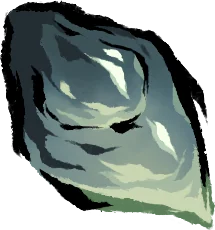

击败**文鳐鱼**后有概率获得。

作为主材料可打造出：令牌法宝（〈福缘〉）

### 【获取途径】

击败妖王「文鳐鱼」后有20%概率获得，炼化文鳐鱼的内丹大概率获得

---

## 68. 九阳火种

击败**祸斗**后有概率获得。

作为主材料可打造出：扇子法宝（〈不灭〉）

### 【获取途径】

击败妖王「祸斗」后有20%概率获得，炼化祸斗的内丹大概率获得

---

## 69. 灾焰爪

击败**祸斗**后有概率获得。

作为主材料可打造出：灯法宝（〈灵烛〉）

### 【获取途径】

击败妖王「祸斗」后有20%概率获得，炼化祸斗的内丹大概率获得

---

## 70. 黑焰

击败**黑焰虎**后有概率获得。

作为主材料可打造出：扇子法宝（〈乌炎〉）

### 【获取途径】

击败妖王「黑焰虎」后有20%概率获得，炼化黑焰虎的内丹大概率获得

---

## 71. 火云翼

击败**火云雀**后有概率获得。

作为主材料可打造出：剑法宝（〈流火〉）

### 【获取途径】

击败妖王「火云雀」后有20%概率获得，炼化火云雀的内丹大概率获得

---

## 72. 烈象巨齿

击败**巨灵烈象**后有概率获得。

作为主材料可打造出：笛子法宝（〈号令〉）

### 【获取途径】

击败妖王「巨灵烈象」后有20%概率获得，炼化巨灵烈象的内丹大概率获得

---

## 73. 玄铁战骨

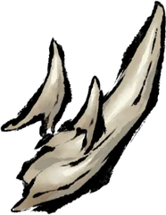

击败**铁骨熊**后有概率获得。

作为主材料可打造出：刀法宝（〈裂地〉）

### 【获取途径】

击败妖王「铁骨熊」后有20%概率获得，炼化铁骨熊的内丹大概率获得

---

## 74. 千岳脊骨

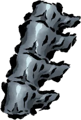

击败**石魈**后有概率获得。

作为主材料可打造出：剑法宝（〈镇元〉）

### 【获取途径】

击败妖王「石魈」后有20%概率获得，炼化石魈的内丹大概率获得

---

## 75. 阴坟骨

击败**坟蛊鸪**后有概率获得。

作为主材料可打造出：令牌法宝（〈拘尸〉）

### 【获取途径】

击败妖王「坟蛊鸪」后有20%概率获得，炼化坟蛊鸪的内丹大概率获得

---

## 76. 腐羽蛊翎

击败**坟蛊鸪**后有概率获得。

作为主材料可打造出：琵琶法宝（〈安魂〉）

### 【获取途径】

击败妖王「坟蛊鸪」后有20%概率获得，炼化坟蛊鸪的内丹大概率获得

---

## 77. 鬼面毒丝

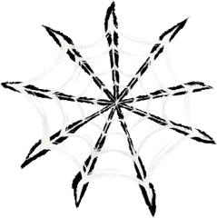

击败**鬼面蛛**后有概率获得。

作为主材料可打造出：袋子法宝（〈瘟疫〉）

### 【获取途径】

击败妖王「鬼面蛛」后有20%概率获得，炼化鬼面蛛的内丹大概率获得

---

## 78. 摄魂音囊

击败**青翼蝠王**后有概率获得。

作为主材料可打造出：铃铛法宝（〈惑音〉）

### 【获取途径】

击败妖王「青翼蝠王」后有20%概率获得，炼化青翼蝠王的内丹大概率获得

---

## 79. 九幽魂火

击败**九幽骨魅**后有概率获得。

作为主材料可打造出：所有〔阴〕法宝

### 【获取途径】

击败妖王「九幽骨魅」后有20%概率获得，炼化九幽骨魅的内丹大概率获得

---

## 80. 幽魂骨

击败**九幽骨魅**后有概率获得。

作为主材料可打造出：剑法宝（〈冥刃〉）

### 【获取途径】

击败妖王「九幽骨魅」后有20%概率获得，炼化九幽骨魅的内丹大概率获得

---

## 81. 混沌灵气（图鉴未收录）

我在修炼时将两种相克灵气结合后产生的混沌灵气。它没有五行属性，也可以说它拥有全部五行属性

（混沌灵气对所有属性灵气，均是相生关系）

### 【获取途径】

修炼混元功可获得

修炼时有极小概率获得

完美炼化神品内丹有15%概率获得

炼化绝品内丹有20%概率获得

调查混沌之地必定获得

捏碎灵石：把灵石拖到主角身上换一张灵气卡——练气期 150 / 筑基期 400 / 结丹期 1300 灵石，各有 20% 是〈混沌灵气〉，元婴期 1300 灵石有 50% 是〈混沌灵气〉

练气～元婴期的〈小灵气源〉每 90 日随机生成一张灵气卡，可能是它

元婴期的「无名灵体」120 日后消失时，必定留下一张

---

## 82. 本源灵气（图鉴未收录）

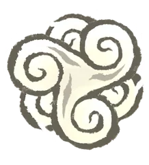

本源灵气是天地初开时诞生的万灵之源，纯粹无垢且蕴纳至高大道之力，是修仙者追寻的终极能量根基

### 【用途】

炼制材料：在炼制工作台「炼制材料」放〈本源灵气〉，随机炼出一种元婴期材料（不分属性）

培养金丹：在培养工作台「培养金丹？」放入〈本源灵气〉，让〈金丹〉吸收 → 金丹〔灵气〕上限+1

### 【获取途径】

元婴期起，在炼制工作台「炼制灵气？」放入〈混沌灵气〉→ 必定得到（我用法力揭开混沌的外表，展露出来的是灵气的本源）

元婴期起，调查「危险之地」（不会再出现妖兽）有 30% 概率获得

击败元婴期的宗门「护法」或神品「精英」修士后获得（玄剑阁 / 清虚谷 / 雪隐宗 / 武极门 / 兽王府 / 紫霄殿 / 蚀月教）

---

## 83. 金灵气（图鉴未收录）

### 【各版本（境界 / 品质）】

金灵气·练气：灵气凝聚后发出淡淡的金光，光芒时而锐利耀眼，时而柔和坚固。

兑金·筑基：在兑位凝聚的金灵气，纯度更高。

太乙精金·结丹：将兑金进行提炼后，形态已变为金属。

### 【获取途径】

独自修炼有20%概率获得

灵气充沛年份部分地点会生成

炼化对应属性的内丹大概率获得

把兽血通过恢复工作台消除必定获得

调查灵气异常之地必定获得

探索地点灵气源必定获得

捏碎灵石：把灵石拖到主角身上，随机获得一张灵气卡——练气期 150 灵石〈金灵气〉/ 筑基期 400 灵石〈兑金〉/ 结丹期 1300 灵石〈太乙精金〉（五种属性随机，另有 20% 是〈混沌灵气〉；元婴期仍给结丹级，〈混沌灵气〉占 50%）

〈小灵气源〉每 90 日随机生成一张同境界的灵气卡，可能是它

「无名灵体」120 日后消失时，必定留下一张同境界的灵气卡，可能是它

筑基～结丹期：〈损坏的机关傀儡〉放满 180 日到期消失时，必定留下 1～3 张同境界的灵气卡，可能是它

---

## 84. 木灵气（图鉴未收录）

### 【各版本（境界 / 品质）】

木灵气·练气：灵气凝聚后发出淡淡的翠绿光，在光芒笼罩的下，周围环境似乎散发着不一样的生机。

震木·筑基：在震位凝聚的木灵气，纯度更高。

青阳木精·结丹：将震木进行提炼后，化为一颗种子。

### 【获取途径】

独自修炼有20%概率获得

灵气充沛年份部分地点会生成

炼化对应属性的内丹大概率获得

把兽血通过恢复工作台消除必定获得

调查灵气异常之地必定获得

探索地点灵气源必定获得

捏碎灵石：把灵石拖到主角身上，随机获得一张灵气卡——练气期 150 灵石〈木灵气〉/ 筑基期 400 灵石〈震木〉/ 结丹期 1300 灵石〈青阳木精〉（五种属性随机，另有 20% 是〈混沌灵气〉；元婴期仍给结丹级，〈混沌灵气〉占 50%）

〈小灵气源〉每 90 日随机生成一张同境界的灵气卡，可能是它

「无名灵体」120 日后消失时，必定留下一张同境界的灵气卡，可能是它

筑基～结丹期：〈损坏的机关傀儡〉放满 180 日到期消失时，必定留下 1～3 张同境界的灵气卡，可能是它

---

## 85. 水灵气（图鉴未收录）

### 【各版本（境界 / 品质）】

水灵气·练气：灵气凝聚后发出淡淡的蓝光，它清澈透明，和自然融合在一体，净化着四周。

坎水·筑基：在坎位凝聚的水灵气，纯度更高。

九阴黑水·结丹：将坎水进行提炼后，凝聚成一股黑色的水。

### 【获取途径】

独自修炼有20%概率获得

灵气充沛年份部分地点会生成

炼化对应属性的内丹大概率获得

把兽血通过恢复工作台消除必定获得

调查灵气异常之地必定获得

探索地点灵气源必定获得

捏碎灵石：把灵石拖到主角身上，随机获得一张灵气卡——练气期 150 灵石〈水灵气〉/ 筑基期 400 灵石〈坎水〉/ 结丹期 1300 灵石〈九阴黑水〉（五种属性随机，另有 20% 是〈混沌灵气〉；元婴期仍给结丹级，〈混沌灵气〉占 50%）

〈小灵气源〉每 90 日随机生成一张同境界的灵气卡，可能是它

「无名灵体」120 日后消失时，必定留下一张同境界的灵气卡，可能是它

筑基～结丹期：〈损坏的机关傀儡〉放满 180 日到期消失时，必定留下 1～3 张同境界的灵气卡，可能是它

---

## 86. 火灵气（图鉴未收录）

### 【各版本（境界 / 品质）】

火灵气·练气：灵气凝聚后发出淡淡的红光，红光如火焰般跳动，炽热的能量不时地向外逃逸。

离火·筑基：在离位凝聚的火灵气，纯度更高。

三昧真火·结丹：将离火进行提炼后，出现了三种不同颜色的火焰。

### 【获取途径】

独自修炼有20%概率获得

灵气充沛年份部分地点会生成

炼化对应属性的内丹大概率获得

把兽血通过恢复工作台消除必定获得

调查灵气异常之地必定获得

探索地点灵气源必定获得

捏碎灵石：把灵石拖到主角身上，随机获得一张灵气卡——练气期 150 灵石〈火灵气〉/ 筑基期 400 灵石〈离火〉/ 结丹期 1300 灵石〈三昧真火〉（五种属性随机，另有 20% 是〈混沌灵气〉；元婴期仍给结丹级，〈混沌灵气〉占 50%）

〈小灵气源〉每 90 日随机生成一张同境界的灵气卡，可能是它

「无名灵体」120 日后消失时，必定留下一张同境界的灵气卡，可能是它

筑基～结丹期：〈损坏的机关傀儡〉放满 180 日到期消失时，必定留下 1～3 张同境界的灵气卡，可能是它

---

## 87. 土灵气（图鉴未收录）

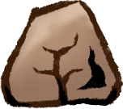

### 【各版本（境界 / 品质）】

土灵气·练气：灵气凝聚后发出淡淡的深黄光，黄色的光浓缩成一团，流动极其缓慢。

艮土·筑基：在艮位凝聚的土灵气，纯度更高。

镇地黄土·结丹：将艮土进行提炼后，泥土变得更加肥沃。

### 【获取途径】

独自修炼有20%概率获得

灵气充沛年份部分地点会生成

炼化对应属性的内丹大概率获得

把兽血通过恢复工作台消除必定获得

调查灵气异常之地必定获得

探索地点灵气源必定获得

捏碎灵石：把灵石拖到主角身上，随机获得一张灵气卡——练气期 150 灵石〈土灵气〉/ 筑基期 400 灵石〈艮土〉/ 结丹期 1300 灵石〈镇地黄土〉（五种属性随机，另有 20% 是〈混沌灵气〉；元婴期仍给结丹级，〈混沌灵气〉占 50%）

〈小灵气源〉每 90 日随机生成一张同境界的灵气卡，可能是它

「无名灵体」120 日后消失时，必定留下一张同境界的灵气卡，可能是它

筑基～结丹期：〈损坏的机关傀儡〉放满 180 日到期消失时，必定留下 1～3 张同境界的灵气卡，可能是它

---
