# 【卡牌修仙传】图鉴攻略 — 卡牌 / 材料

- 收录总数：93（游戏官方数据，其中图鉴未收录 6 条）
- 更新时间：2026-11-18 17:00

---

## 1. 紫金铜

### 【各版本（境界 / 品质）】

紫金铜·练气：常见的法宝材料，只需要加入一丁点，就能让法宝变得坚硬。；作为主材料可打造出**剑法宝**。；获取途径 常见的地点材料，可以在金芒矿搜索出来；用〔金〕灵气可以炼制获得；用途：作为主材料可炼制出剑法宝：飞虹剑，破光灵剑（筑基期）

黑金铜·筑基：金属的颜色愈发的幽黑，也显得更加的珍贵难得。；作为主材料可打造出剑法宝。；获取途径 常见的地点材料，可以在金芒矿搜索出来；用〔金〕灵气可以炼制获得；用途：作为主材料可炼制出剑法宝：飞虹剑，破光灵剑（筑基期）

墨金·结丹：金属外表被一大片墨黑色物体覆盖着，很难分辨里面的物质。；作为主材料可打造出剑法宝。；获取途径 常见的地点材料，可以在金芒矿搜索出来；用〔金〕灵气可以炼制获得；用途：作为主材料可炼制出剑法宝：飞虹剑，破光灵剑（筑基期）

墨魄金·元婴：孕于幽冥地脉深处的金属，通体幽紫，内蕴魄气流转。；作为主材料可打造出剑法宝。

---

## 2. 星辉晶

作为主材料可打造出刀法宝。

### 【各版本（境界 / 品质）】

星辉晶·练气：不知为何，星星的亮光都存储在晶体内，在夜晚时，便能照亮附近的区域。；获取途径 常见的地点材料，可以在金芒矿搜索出来；用〔金〕灵气可以炼制获得；用途：作为主材料可炼制出刀法宝：金光刀，斩月妖刀（筑基期）

曜明晶·筑基：亮度是星辉晶的好几倍，但体型缺只有一半。；获取途径 常见的地点材料，可以在金芒矿搜索出来；用〔金〕灵气可以炼制获得；用途：作为主材料可炼制出刀法宝：金光刀，斩月妖刀（筑基期）

炫目晶·结丹：晶体发出的光芒过于刺眼，寻常人无法直视。；获取途径 常见的地点材料，可以在金芒矿搜索出来；用〔金〕灵气可以炼制获得；用途：作为主材料可炼制出刀法宝：金光刀，斩月妖刀（筑基期）

神霄晶·元婴：神霄雷光凝结而成的灵晶，通体青蓝，晶身隐现金色雷纹。

---

## 3. 蓝光铁

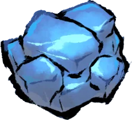

作为主材料可打造出双刀法宝。

### 【各版本（境界 / 品质）】

蓝光铁·练气：铁的表面偶尔会泛起一丝的蓝光。；获取途径 常见的地点材料，可以在金芒矿搜索出来；用〔金〕灵气可以炼制获得；用途：作为主材料可炼制出双刀法宝：金蝶刺

星纹铁·筑基：类似星星的花纹分布在铁的表面，但不知道是怎样形成的。；获取途径 常见的地点材料，可以在金芒矿搜索出来；用〔金〕灵气可以炼制获得；用途：作为主材料可炼制出双刀法宝：金蝶刺

流纹钢·结丹：经过灵水冲刷的钢铁，表面有一道道深沟。；获取途径 常见的地点材料，可以在金芒矿搜索出来；用〔金〕灵气可以炼制获得；用途：作为主材料可炼制出双刀法宝：金蝶刺

星辰钢·元婴：以星辰之力反复锻打而成的灵钢，钢体内星光流转如星河，质地坚韧且蕴含星力

---

## 4. 黑尾毛

作为主材料可打造出铃铛法宝。

### 【各版本（境界 / 品质）】

黑尾毛·练气：每只鸣鸟都只有一根的纯黑羽毛，是鸣鸟修为的关键。；获取途径 击败鸣鸟后有极小概率掉落；炼制〔金〕内丹有较大概率获得；用途：作为主材料可炼制出铃铛法宝：金芒铃，合欢魔铃（筑基）

黑尾毛·筑基：鸣坟鸠的修为提升，黑尾毛的数量也逐渐增加。；获取途径 击败鸣坟鸠后有极小概率掉落；炼制〔金〕内丹有较大概率获得；用途：作为主材料可炼制出铃铛法宝：金芒铃，合欢魔铃（筑基）

尸黑羽毛·结丹：一根散发尸气的羽毛，哪怕是尸鸠，也只有一根。；获取途径 击败尸鸠后有极小概率掉落；炼制〔金〕内丹有较大概率获得；用途：作为主材料可炼制出铃铛法宝：金芒铃，合欢魔铃（筑基）

---

## 5. 毒囊

作为主材料可打造出袋子法宝。

### 【各版本（境界 / 品质）】

毒囊·练气：一个充满毒素的囊袋，小心处理，否则会中毒身亡。；获取途径 击败毒蟾后有极小概率掉落；炼制〔金〕内丹有较大概率获得；用途：作为主材料可炼制出袋子法宝：锁尘袋

金色毒囊·筑基：毒囊因为长期浸泡剧毒，已然成为了金色。；获取途径 击败金毒蟾后有极小概率掉落；炼制〔金〕内丹有较大概率获得；用途：作为主材料可炼制出袋子法宝：锁尘袋

金色毒囊·结丹：随着毒蟾的修为提高，毒囊的数量也随之提高。；获取途径 击败三足金毒蟾后有极小概率掉落；炼制〔金〕内丹有较大概率获得；用途：作为主材料可炼制出袋子法宝：锁尘袋

---

## 6. 琉光珠

### 【各版本（境界 / 品质）】

琉光珠·筑基：透明无暇的珠子的表面有琉光流动。；作为主材料可打造出镜子法宝。；获取途径 常见的地点材料，可以在金芒矿搜索出来；用〔金〕灵气可以炼制获得；用途：作为主材料可炼制出镜子法宝：凝光宝镜（筑基期）

金光宝珠·结丹：珠子里蕴含着金光，靠近甚至能感受到一丝热量。；作为主材料可打造出镜子法宝。；获取途径 常见的地点材料，可以在金芒矿搜索出来；用〔金〕灵气可以炼制获得；用途：作为主材料可炼制出镜子法宝：凝光宝镜（筑基期）

紫曜神珠·元婴：紫曜精气凝化而成的灵珠，珠身紫光流溢，内蕴星芒神纹。

---

## 7. 獠牙

作为主材料可打造出笛子法宝。

### 【各版本（境界 / 品质）】

獠牙·筑基：青口兽的獠牙，看似粗糙但又锋利无比。；获取途径 击败青口兽后有极小概率掉落；炼制〔金〕内丹有较大概率获得；用途：作为主材料可炼制出笛子法宝：破风古笛（筑基）

滴血獠牙·结丹：獠牙上的血并不是猎物的，而是从牙里渗出来。；获取途径 击败獠牙烈兽后有极小概率掉落；炼制〔金〕内丹有较大概率获得；用途：作为主材料可炼制出笛子法宝：破风古笛（筑基）

---

## 8. 银精

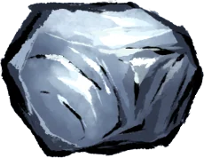

### 【各版本（境界 / 品质）】

银精·筑基：在银矿石中经受常年压力后才会形成。；作为主材料可打造出令牌法宝。；获取途径 击败剑冢的灵剑（筑基期）后有掉落；炼制〔金〕内丹有较大概率获得；用途：作为主材料可炼制出令牌法宝：银霄天令（筑基）

皇极银·结丹：大量银精经过提纯后才会形成。；获取途径 击败剑冢的灵剑（结丹期）后有掉落；炼制〔金〕内丹有较大概率获得；用途：作为主材料可炼制出令牌法宝：银霄天令（筑基）

---

## 9. 九劫赤金

经九重天劫淬炼而生，赤芒灼目且内蕴劫火神威，是铸就弑神兵器的万古奇材

---

## 10. 太白玄金

太白玄金采自九天太白星核，质坚逾万钢且天生蕴纳星辰清辉，是锻造顶级法宝与破障法器的无上神材

### 【获取途径】

击败〔金〕妖王后有5%概率获得

用途：作为主材料可炼制出所有〔金〕法宝（容器法宝除外）

---

## 11. 幽残木

作为主材料可打造出剑法宝。

### 【各版本（境界 / 品质）】

幽残木·练气：被煞气影响而接近枯萎的残木，有毒。；获取途径 常见的地点材料，可以在青灵木搜索出来；用〔木〕灵气可以炼制获得；用途：作为主材料可炼制出剑法宝：枯木剑，桃木神剑（筑基期）

龙葵木·筑基：葵木的香气怡然，能吸引龙在树上休息，从而吸收龙身上的灵气。；获取途径 常见的地点材料，可以在青灵木搜索出来；用〔木〕灵气可以炼制获得；用途：作为主材料可炼制出剑法宝：枯木剑，桃木神剑（筑基期）

养魂木·结丹：养魂木有奇特的芳香，能镇魂定魄。；获取途径 常见的地点材料，可以在青灵木搜索出来；用〔木〕灵气可以炼制获得；用途：作为主材料可炼制出剑法宝：枯木剑，桃木神剑（筑基期）

凝婴木·元婴：生长于灵气充沛之地的千年灵木，木性温润，结紫华灵实。

---

## 12. 紫叶树

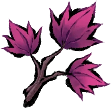

作为主材料可打造出葫芦法宝。

### 【各版本（境界 / 品质）】

紫叶树·练气：一种奇树，无论什么东西长在这种树的身上，都会变成紫色。；获取途径 常见的地点材料，可以在青灵木搜索出来；用〔木〕灵气可以炼制获得；用途：作为主材料可炼制出葫芦法宝：翠竹葫芦

滴血树·筑基：这种树会捕食灵兽，灵兽的血淋在叶子上，把叶子都染红了。；获取途径 常见的地点材料，可以在青灵木搜索出来；用〔木〕灵气可以炼制获得；用途：作为主材料可炼制出葫芦法宝：翠竹葫芦

血纹树·结丹：生长了千年的树，不知多少猎杀了多少灵兽。；获取途径 常见的地点材料，可以在青灵木搜索出来；用〔木〕灵气可以炼制获得；用途：作为主材料可炼制出葫芦法宝：翠竹葫芦

泣血树·元婴：捕食生灵的数量太多已让树木都渗出了血液，像极了在哭泣一样

---

## 13. 缠灵根

### 【各版本（境界 / 品质）】

缠灵根·练气：树根能把灵气实体化，并牢牢的缠住。；作为主材料可打造出双刀法宝。；获取途径 常见的地点材料，可以在青灵木搜索出来；用〔木〕灵气可以炼制获得；用途：作为主材料可炼制出双刀法宝：幽芒刺

醉心藤·筑基：藤蔓会趁灵兽不注意将其缠住，然后把灵兽心脏麻痹了。；作为主材料可打造出双刀法宝。；获取途径 常见的地点材料，可以在青灵木搜索出来；用〔木〕灵气可以炼制获得；用途：作为主材料可炼制出双刀法宝：幽芒刺

绕骨藤·结丹：酔心藤把灵兽吸收干净后，就变成了缠绕在骨架上的藤蔓。；作为主材料可打造出双刀法宝。；获取途径 常见的地点材料，可以在青灵木搜索出来；用〔木〕灵气可以炼制获得；用途：作为主材料可炼制出双刀法宝：幽芒刺

---

## 14. 血灵竹

作为主材料可打造出刀法宝。

### 【各版本（境界 / 品质）】

血灵竹·练气：在表面就能看出竹子内分布着“血管”。；获取途径 常见的地点材料，可以在青灵木搜索出来；用〔木〕灵气可以炼制获得；用途：作为主材料可炼制出刀法宝：碧影刀

血纹竹·筑基：和人血管不同的是，竹子上更像是一种符文。；获取途径 常见的地点材料，可以在青灵木搜索出来；用〔木〕灵气可以炼制获得；用途：作为主材料可炼制出刀法宝：碧影刀

赤纹竹·结丹：血的颜色更加深，纹路也愈发的清晰。；获取途径 常见的地点材料，可以在青灵木搜索出来；用〔木〕灵气可以炼制获得；用途：作为主材料可炼制出刀法宝：碧影刀

朱魂竹·元婴：竹子已经孕育出魂珠

---

## 15. 青蛇鳞片

作为主材料可打造出扇子法宝。

### 【各版本（境界 / 品质）】

练气：蛇原本是没有鳞片的，不知道这蛇有何不同。；获取途径 击败青蛇后有极小概率掉落；炼制〔木〕内丹有较大概率获得；用途：作为主材料可炼制出扇子法宝：青岚扇

筑基：从蛇身上整块剥下来的鳞片，较为完整所以才更有价值。；获取途径 击败长蛇后有极小概率掉落；炼制〔木〕内丹有较大概率获得；用途：作为主材料可炼制出扇子法宝：青岚扇

---

## 16. 小根兽骨

小型灵兽的骨头。

作为主材料可打造出笛子法宝。

### 【获取途径】

击败耳鼠后有极小概率掉落

炼制〔木〕内丹有较大概率获得

用途：作为主材料可炼制出笛子法宝：紫藤笛

---

## 17. 扇耳

耳鼠的完整大耳朵。

作为主材料可打造出琵琶法宝。

### 【获取途径】

击败飞鼠后有极小概率掉落

炼制〔木〕内丹有较大概率获得

用途：作为主材料可炼制出琵琶法宝：妙音琵琶

---

## 18. 骨爪

化蛇下半部分的爪子，异常的大。

作为主材料可打造出笛子法宝。

### 【获取途径】

击败化蛇后有极小概率掉落

炼制〔木〕内丹有较大概率获得

用途：作为主材料可炼制出笛子法宝：紫藤笛

---

## 19. 骨脸

修炼至筑基后，脸部慢慢骨化。

作为主材料可打造出笛子法宝。

### 【获取途径】

击败鬼脸飞蛇后有极小概率掉落

炼制〔木〕内丹有较大概率获得

用途：作为主材料可炼制出笛子法宝：紫藤笛

---

## 20. 辟虫灵木

作为主材料可打造出琵琶法宝。

### 【各版本（境界 / 品质）】

辟虫灵木·结丹：这种树木连剧毒的虫子也不敢靠近。；获取途径 常见的地点材料，可以在青灵木搜索出来；用〔木〕灵气可以炼制获得；用途：作为主材料可炼制出琵琶法宝：妙音琵琶

青莹灵木·元婴：在经过多年的修炼后，曾经辟虫的灵木开始吸引灵虫

---

## 21. 凝阴树叶

作为主材料可打造出扇子法宝。

### 【各版本（境界 / 品质）】

凝阴树叶·结丹：树叶会散发出阴气，经常看到有毒虫尸体在树叶上被冰冻着。；获取途径 常见的地点材料，可以在青灵木搜索出来；用〔木〕灵气可以炼制获得；用途：作为主材料可炼制出扇子法宝：青岚扇

九幽寒叶·元婴：叶身凝有千年冰晶，蕴含极阴寒气。

---

## 22. 千棘藤心

凝萃千棘藤妖千年木灵本源与噬灵妖力，坚韧无比且暗藏尖刺玄机

### 【获取途径】

击败千棘藤妖后有极小概率掉落

炼制〔木〕内丹有较大概率获得

用途：作为主材料可炼制出袋子法宝：千棘袋

---

## 23. 紫电雷竹

紫电雷竹生于九霄雷泽秘境，竿蕴先天紫电、节藏雷霆真意，坚韧且能引动天雷之力

---

## 24. 血凤木

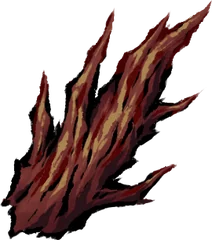

木质朱红如血且蕴纳涅槃真火本源，坚韧不朽还能滋养灵脉

### 【获取途径】

击败〔木〕妖王后有5%概率获得

用途：作为主材料可炼制出所有〔木〕法宝（容器法宝除外）

---

## 25. 月泉水

### 【各版本（境界 / 品质）】

月泉水·练气：当满月照射在泉水时，如果出现灵气异常，灵气和月光都会被存储在泉水中。；作为主材料可打造出瓶子法宝。；获取途径 常见的地点材料，可以在愈魂池搜索出来；用〔水〕灵气可以炼制获得；用途：作为主材料可炼制出瓶子法宝：雨露瓶

月泉灵乳·筑基：月泉水吸收的灵气越多，就会逐渐变得浓稠。；作为主材料可打造出瓶子法宝。；获取途径 常见的地点材料，可以在愈魂池搜索出来；用〔水〕灵气可以炼制获得；用途：作为主材料可炼制出瓶子法宝：雨露瓶

月泉晶·结丹：浓缩了千年月亮精华的泉乳，充满灵气。；作为主材料可打造出瓶子法宝。；获取途径 常见的地点材料，可以在愈魂池搜索出来；用〔水〕灵气可以炼制获得；用途：作为主材料可炼制出瓶子法宝：雨露瓶

---

## 26. 海波晶

作为主材料可打造出剑法宝。

### 【各版本（境界 / 品质）】

海波晶·练气：汹涌的灵气波浪无时无刻的拍打着岸边后形成的特殊结晶。；获取途径 常见的地点材料，可以在愈魂池搜索出来；用〔水〕灵气可以炼制获得；用途：作为主材料可炼制出剑法宝：寒光剑，玄阴魂剑（筑基期）

冥河水晶·筑基：世上有一条河流，没有固定的位置，称之为冥河。这便是从冥河流过之处剩下的结晶。；获取途径 常见的地点材料，可以在愈魂池搜索出来；用〔水〕灵气可以炼制获得；用途：作为主材料可炼制出剑法宝：寒光剑，玄阴魂剑（筑基期）

幽冥寒晶·结丹：之所以叫寒晶，是因为连火焰也无法驱走来自幽冥地界的寒意。；获取途径 常见的地点材料，可以在愈魂池搜索出来；用〔水〕灵气可以炼制获得；用途：作为主材料可炼制出剑法宝：寒光剑，玄阴魂剑（筑基期）

九幽魂晶·元婴：九幽深处阴气凝结而成的魂晶，晶身幽紫斑斓，内蕴魂息流转。

---

## 27. 凝魄冰

### 【各版本（境界 / 品质）】

凝魄冰·练气：在极寒地区死亡的生命，有时候魂魄都被冻住了。；作为主材料可打造出刀法宝。；获取途径 常见的地点材料，可以在愈魂池搜索出来；用〔水〕灵气可以炼制获得；用途：作为主材料可炼制出刀法宝：凝水刀

黑魄寒冰·筑基：寒冰里的魂魄数量太多，以至于显露出黑色。；作为主材料可打造出刀法宝。；获取途径 常见的地点材料，可以在愈魂池搜索出来；用〔水〕灵气可以炼制获得；用途：作为主材料可炼制出刀法宝：凝水刀

万年黑魄冰·结丹：经过万年沉淀的寒冰，在炼制时要注意魂魄的反击。；作为主材料可打造出刀法宝。；获取途径 常见的地点材料，可以在愈魂池搜索出来；用〔水〕灵气可以炼制获得；用途：作为主材料可炼制出刀法宝：凝水刀

玄魄冰髓·元婴：万年黑魄冰与阴魄之气交融孕育的冰髓，外层冰寒彻骨，内蕴幽紫魄息。

---

## 28. 鱼鳞片

鱼类灵兽的普通鳞片。

作为主材料可打造出笛子法宝。

### 【获取途径】

击败飞鱼后有极小概率掉落

炼制〔水〕内丹有较大概率获得

用途：作为主材料可炼制出笛子法宝：琉璃笛

---

## 29. 水囊

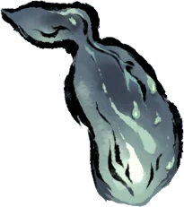

哪怕脱离了宿主，囊袋依然可以渗出水分。

作为主材料可打造出袋子法宝。

### 【各版本（境界 / 品质）】

水囊·练气：获取途径 击败花臂章鱼后有极小概率掉落；炼制〔水〕内丹有较大概率获得；用途：作为主材料可炼制出袋子法宝：冰心袋

巨大水囊·筑基：获取途径 击败北海巨妖（小）后有极小概率掉落；炼制〔水〕内丹有较大概率获得；用途：作为主材料可炼制出袋子法宝：冰心袋

---

## 30. 玄灵液

作为主材料可打造出袋子法宝。

### 【各版本（境界 / 品质）】

玄灵液·筑基：富含灵气的灵液，用于培养灵草的好材料。；获取途径 常见的地点材料，可以在愈魂池搜索出来；用〔水〕灵气可以炼制获得；用途：作为主材料可炼制出袋子法宝：冰心袋

天元灵液·结丹：富含灵气的灵液，用于培养灵草的好材料。；获取途径 常见的地点材料，可以在愈魂池搜索出来；用〔水〕灵气可以炼制获得；用途：作为主材料可炼制出袋子法宝：冰心袋

天元神液·元婴：富含灵气的灵液，用于培养灵药的好材料。

---

## 31. 水玉

作为主材料可打造出伞法宝。

### 【各版本（境界 / 品质）】

水玉·筑基：不知道如何形成的，玉里有流动的水。；获取途径 常见的地点材料，可以在愈魂池搜索出来；用〔水〕灵气可以炼制获得；用途：作为主材料可炼制出伞法宝：避水纸伞

泪玉·结丹：玉的形状像一滴泪，也许里面装着的的确就是泪水。；获取途径 常见的地点材料，可以在愈魂池搜索出来；用〔水〕灵气可以炼制获得；用途：作为主材料可炼制出伞法宝：避水纸伞

冰勾玉·元婴：以千年寒冰雕琢而成的勾玉，通体冰蓝通透，触手生凉。

---

## 32. 蛟鳞片

作为主材料可打造出扇子法宝。

### 【各版本（境界 / 品质）】

蛟鳞片·筑基：蛟龙的大块鳞片，每一片都是坚韧无比。；获取途径 击败入水蛟后有极小概率掉落；炼制〔水〕内丹有较大概率获得；用途：作为主材料可炼制出扇子法宝：游龙古扇

流水鳞片·结丹：鳞片可以轻易的切割水流，虽然只能维持一小段时间。；获取途径 击败凶蛟后有极小概率掉落；炼制〔水〕内丹有较大概率获得；用途：作为主材料可炼制出扇子法宝：游龙古扇

---

## 33. 冰蝉

蝉身如同冰块般晶莹剔透。

作为主材料可打造出笛子法宝。

### 【各版本（境界 / 品质）】

冰蝉·筑基：获取途径 常见的地点材料，可以在愈魂池搜索出来；用〔水〕灵气可以炼制获得；用途：作为主材料可炼制出笛子法宝：琉璃笛

冰晶蝉·结丹：获取途径 常见的地点材料，可以在愈魂池搜索出来；用〔水〕灵气可以炼制获得；用途：作为主材料可炼制出笛子法宝：琉璃笛

---

## 34. 龙鲤血

凝萃彩鳞龙鲤本源与锦鲤祥瑞之力，殷红如霞且蕴含澎湃生机

### 【获取途径】

击败彩鳞龙鲤后有极小概率掉落

炼制〔水〕内丹有较大概率获得

用途：作为主材料可炼制出葫芦法宝：幻海葫芦

---

## 35. 星海灵波

弥散于星海深处的无形灵韵，凝萃亿万星辰潮汐之力与空间真意

---

## 36. 幻雾琉璃

由天地间最纯净的水雾凝结千年而成的半透明晶体，能随光线变换七种水色

### 【获取途径】

击败〔水〕妖王后有5%概率获得

用途：作为主材料可炼制出所有〔水〕法宝（容器法宝除外）

---

## 37. 火魂石

作为主材料可打造出袋子法宝。

### 【各版本（境界 / 品质）】

火魂石·练气：当吸附了死亡灵兽的魂魄后，又被地火焚烧了数十年才能形成火魂石。；获取途径 常见的地点材料，可以在火云树搜索出来；用〔火〕灵气可以炼制获得；用途：作为主材料可炼制出袋子法宝：御火袋

燃魄石·筑基：当吸附了死亡灵兽的魂魄后，又被地火焚烧了数十年才能形成火魂石。；获取途径 常见的地点材料，可以在火云树搜索出来；用〔火〕灵气可以炼制获得；用途：作为主材料可炼制出袋子法宝：御火袋

焚城石·结丹：原本只是普通的城墙石头，被焚烧后吸印大量冤魂而变得不凡。；获取途径 常见的地点材料，可以在火云树搜索出来；用〔火〕灵气可以炼制获得；用途：作为主材料可炼制出袋子法宝：御火袋

焚天石·元婴：上古火域深处孕育的异石，内含焚天烈焰，触之灼骨熔金

---

## 38. 地心之火

### 【各版本（境界 / 品质）】

地心之火·练气：从地底深处采集的地火。；作为主材料可打造出葫芦法宝。；获取途径 常见的地点材料，可以在火云树搜索出来；用〔火〕灵气可以炼制获得；用途：作为主材料可炼制出葫芦法宝：炽焰葫芦

天外之火·筑基：从天上坠落的无名之火。；作为主材料可打造出葫芦法宝。；获取途径 常见的地点材料，可以在火云树搜索出来；用〔火〕灵气可以炼制获得；用途：作为主材料可炼制出葫芦法宝：炽焰葫芦

天地之火·结丹：融合了地火和天火的混合火焰，温度极高。；作为主材料可打造出葫芦法宝。；获取途径 常见的地点材料，可以在火云树搜索出来；用〔火〕灵气可以炼制获得；用途：作为主材料可炼制出葫芦法宝：炽焰葫芦

混沌灵焰·元婴：天地初开时混沌之气所化的本源灵火，藏于熔岩石胎之中。

---

## 39. 赤阳石

作为主材料可打造出令牌法宝。

### 【各版本（境界 / 品质）】

赤阳石·练气：像太阳般的石头，自身会发出热和红光。；获取途径 常见的地点材料，可以在火云树搜索出来；用〔火〕灵气可以炼制获得；用途：作为主材料可炼制出令牌法宝：焚石令

落阳石·筑基：会在燃烧熄灭之间无限循环的神奇火石。；获取途径 常见的地点材料，可以在火云树搜索出来；用〔火〕灵气可以炼制获得；用途：作为主材料可炼制出令牌法宝：焚石令

赤日石·结丹：燃烧的火焰已经能和正午的太阳媲美。；获取途径 常见的地点材料，可以在火云树搜索出来；用〔火〕灵气可以炼制获得；用途：作为主材料可炼制出令牌法宝：焚石令

曜阳石·元婴：燃烧的火焰已经能和正午的太阳媲美。

---

## 40. 利爪

作为主材料可打造出刀法宝。

### 【各版本（境界 / 品质）】

利爪·练气：兽类灵兽的锋利爪子。；获取途径 击败山豹后有极小概率掉落；炼制〔火〕内丹有较大概率获得；用途：作为主材料可炼制出刀法宝：赤焰刀

赤红利爪·筑基：爪子因为捕杀猎物太多已经染成了红色。；获取途径 击败赤红豹后有极小概率掉落；炼制〔火〕内丹有较大概率获得；用途：作为主材料可炼制出刀法宝：赤焰刀

---

## 41. 赤红角

赤豹会先用独角将猎物击倒，有时候一击便能贯穿心脏。

作为主材料可打造出刀法宝。

### 【获取途径】

击败独角赤豹后有极小概率掉落

炼制〔火〕内丹有较大概率获得

用途：作为主材料可炼制出刀法宝：赤焰刀

---

## 42. 红蛇鳞片

作为主材料可打造出剑法宝。

### 【各版本（境界 / 品质）】

红蛇鳞片·练气：鳞片整个都是红色的，似血。；获取途径 击败枳首蛇后有极小概率掉落；炼制〔火〕内丹有较大概率获得；用途：作为主材料可炼制出剑法宝：烈火剑，三炎神剑（筑基期）

红蛇鳞片·筑基：一片完整的血红鳞片，较为珍贵。；获取途径 击败三头枳首蛇后有极小概率掉落；炼制〔火〕内丹有较大概率获得；用途：作为主材料可炼制出剑法宝：烈火剑，三炎神剑（筑基期）

鲜红蛇鳞片·结丹：鲜红的鳞片上偶尔还能自燃起来。；获取途径 击败六头枳首蛇后有极小概率掉落；炼制〔火〕内丹有较大概率获得；用途：作为主材料可炼制出剑法宝：烈火剑，三炎神剑（筑基期）

---

## 43. 火珊瑚

作为主材料可打造出灯法宝。

### 【各版本（境界 / 品质）】

火珊瑚·筑基：在海底的依然能燃烧的珊瑚。；获取途径 常见的地点材料，可以在火云树搜索出来；用〔火〕灵气可以炼制获得；用途：作为主材料可炼制出灯法宝：冥火提灯

千年火珊瑚·结丹：已经在海底燃烧了千年，却仍未烧尽的千年珊瑚。；获取途径 常见的地点材料，可以在火云树搜索出来；用〔火〕灵气可以炼制获得；用途：作为主材料可炼制出灯法宝：冥火提灯

万年火珊瑚·元婴：生于深海火山裂隙中的奇珍，吸纳地火万年方得成形

---

## 44. 青火晶

### 【各版本（境界 / 品质）】

青火晶·筑基：偶有外火从天上坠落，把附近之物燃烧殆尽后形成的结晶。；作为主材料可打造出瓶子法宝。；获取途径 常见的地点材料，可以在火云树搜索出来；用〔火〕灵气可以炼制获得；用途：作为主材料可炼制出瓶子法宝：红莲极瓶

冥火晶·结丹：不待落下的外火燃烧殆尽便将其收集保存，才有着外火本源的能量。；作为主材料可打造出瓶子法宝。；获取途径 常见的地点材料，可以在火云树搜索出来；用〔火〕灵气可以炼制获得；用途：作为主材料可炼制出瓶子法宝：红莲极瓶

幽冥晶石·元婴：产自幽冥深渊的阴寒灵晶，晶身萦绕紫色幽焰，内含金纹冥火

---

## 45. 噬金甲

噬金甲是噬金狂蚣蜕化的本命甲壳，坚不可摧且能吞噬金属之力淬炼自身

### 【获取途径】

击败噬金狂蚣后有极小概率掉落

炼制〔火〕内丹有较大概率获得

用途：作为主材料可炼制出瓶子法宝：红莲极瓶

---

## 46. 炎龙碎骨

上古炎龙陨落后遗存的骨骼碎片，凝萃火龙本源之力与霸道龙威，坚硬耐高温且火韵绵长

---

## 47. 火莲晶核

表面有太阳黑子般的纹路，燃烧时释放亿万道金芒，能照亮九幽地府

### 【获取途径】

击败〔火〕妖王后有5%概率获得

用途：作为主材料可炼制出所有〔火〕法宝（容器法宝除外）

---

## 48. 玉髓石

### 【各版本（境界 / 品质）】

玉髓石·练气：在地底里被大地挤压成玉的石头。；作为主材料可打造出剑法宝。；获取途径 常见的地点材料，可以在凝土墟搜索出来；用〔土〕灵气可以炼制获得；用途：作为主材料可炼制出剑法宝：黄泉剑，白玉刚剑（筑基期）

玉芯石·筑基：形成的玉髓石会缓慢吞噬附近的石头，最终形成子午岩。；作为主材料可打造出剑法宝。；获取途径 常见的地点材料，可以在凝土墟搜索出来；用〔土〕灵气可以炼制获得；用途：作为主材料可炼制出剑法宝：黄泉剑，白玉刚剑（筑基期）

血玉石·结丹：玉芯被挤压出血状的物质，所以名曰血玉石。；作为主材料可打造出剑法宝。；获取途径 常见的地点材料，可以在凝土墟搜索出来；用〔土〕灵气可以炼制获得；用途：作为主材料可炼制出剑法宝：黄泉剑，白玉刚剑（筑基期）

---

## 49. 铁精砂

作为主材料可打造出葫芦法宝。

### 【各版本（境界 / 品质）】

铁精砂·练气：异常锋利的砂子，收集的过程可谓是痛苦至极。；获取途径 常见的地点材料，可以在凝土墟搜索出来；用〔土〕灵气可以炼制获得；用途：作为主材料可炼制出葫芦法宝：黄砂葫芦

银精砂·筑基：砂里混杂着细小的银精，比铁更加的锋利。；获取途径 常见的地点材料，可以在凝土墟搜索出来；用〔土〕灵气可以炼制获得；用途：作为主材料可炼制出葫芦法宝：黄砂葫芦

黑金砂·结丹：哪怕一颗小小的砂粒，在空中也能闪出黑色金光。；获取途径 常见的地点材料，可以在凝土墟搜索出来；用〔土〕灵气可以炼制获得；用途：作为主材料可炼制出葫芦法宝：黄砂葫芦

紫金砂·元婴：紫金共生矿脉中淘洗出的灵砂，紫中含金，粒粒生辉。

---

## 50. 藏灵土

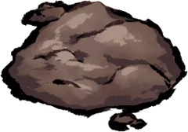

作为主材料可打造出扇子法宝。

### 【各版本（境界 / 品质）】

藏灵土·练气：泥土里蕴含着大量的灵气，但外表又和普通泥土一样。；获取途径 常见的地点材料，可以在凝土墟搜索出来；用〔土〕灵气可以炼制获得；用途：作为主材料可炼制出扇子法宝：山河扇

叱灵土·筑基：灵土里的灵气因为过于饱满，有时候会爆发出一声巨响。；获取途径 常见的地点材料，可以在凝土墟搜索出来；用〔土〕灵气可以炼制获得；用途：作为主材料可炼制出扇子法宝：山河扇

散灵土·结丹：泥土的质地较为松软，更有灵气从中散发而出。；获取途径 常见的地点材料，可以在凝土墟搜索出来；用〔土〕灵气可以炼制获得；用途：作为主材料可炼制出扇子法宝：山河扇

灵土息壤·元婴：泥土的质地较为松软，更有灵气从中散发而出。

---

## 51. 长兽骨

作为主材料可打造出刀法宝。

### 【各版本（境界 / 品质）】

练气：灵长类妖兽的骨头，比一般家畜要长得多。；获取途径 击败长臂猴后有极小概率掉落；炼制〔土〕内丹有较大概率获得；用途：作为主材料可炼制出刀法宝：碎石刀

筑基：这个灵兽绝对是灵长类里长得最高的。；获取途径 击败鬼脸长臂猴后有极小概率掉落；炼制〔土〕内丹有较大概率获得；用途：作为主材料可炼制出刀法宝：碎石刀

---

## 52. 大兽骨

粗壮的兽骨，也只有巨象能长这么大了。

作为主材料可打造出瓶子法宝。

### 【获取途径】

击败巨象后有极小概率掉落

炼制〔土〕内丹有较大概率获得

用途：作为主材料可炼制出瓶子法宝：星华瓶

---

## 53. 迷天岩

### 【各版本（境界 / 品质）】

迷天岩·筑基：岩石非常难寻找，不是因为太小，而是人们根本看不见它。；作为主材料可打造出印法宝。；获取途径 常见的地点材料，可以在凝土墟搜索出来；用〔土〕灵气可以炼制获得；用途：作为主材料可炼制出印法宝：混土神印

镇妖岩·结丹：镇压在灵兽身上的石头，包含戾气。；作为主材料可打造出印法宝。；获取途径 常见的地点材料，可以在凝土墟搜索出来；用〔土〕灵气可以炼制获得；用途：作为主材料可炼制出印法宝：混土神印

---

## 54. 百年妖骨

作为主材料可打造出双刀法宝。

### 【各版本（境界 / 品质）】

百年妖骨·筑基：在戈壁地区经过百年时间风干的妖骨，灵力还未散尽，反而更加的浓郁。；获取途径 常见的地点材料，可以在凝土墟搜索出来；用〔土〕灵气可以炼制获得；用途：作为主材料可炼制出双刀法宝：雌雄双刺

千年妖骨·结丹：在戈壁地区经过千年时间风干的妖骨，灵力还未散尽，反而更加的浓郁。；获取途径 常见的地点材料，可以在凝土墟搜索出来；用〔土〕灵气可以炼制获得；用途：作为主材料可炼制出双刀法宝：雌雄双刺

万年妖骨·元婴：在戈壁地区经过千年时间风干的妖骨，灵力还未散尽，反而更加的浓郁。

---

## 55. 墨翠玉

墨绿色的翡翠玉石，绿色得非常深邃。

作为主材料可打造出瓶子法宝。

### 【获取途径】

常见的地点材料，可以在凝土墟搜索出来

用〔土〕灵气可以炼制获得

用途：作为主材料可炼制出瓶子法宝：星华瓶

---

## 56. 姜黄晶

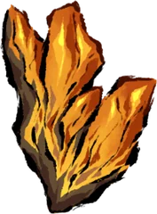

作为主材料可打造出令牌法宝。

### 【各版本（境界 / 品质）】

姜黄晶·筑基：深藏在地底，据说是大地精华凝结而成。；获取途径 常见的地点材料，可以在凝土墟搜索出来；用〔土〕灵气可以炼制获得；用途：作为主材料可炼制出令牌法宝：玄黄灵符

龙髓晶·结丹：深藏在地底，据说是地龙的脊髓。；获取途径 常见的地点材料，可以在凝土墟搜索出来；用〔土〕灵气可以炼制获得；用途：作为主材料可炼制出令牌法宝：玄黄灵符

神髓晶·元婴：深藏在地底，据说是地龙的脊髓。

---

## 57. 地心磁石

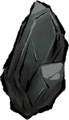

地核深处孕生的奇矿，蕴纳先天磁元且控磁镇灵，能引聚灵脉、吸附金属灵能

---

## 58. 九天息壤

九天之上孕生的上古灵土，蕴纳混沌生机与稳固本源之力，生生不息且能滋养万灵

### 【获取途径】

击败〔土〕妖王后有5%概率获得

用途：作为主材料可炼制出所有〔土〕法宝（容器法宝除外）

---

## 59. 九幽魂玉

自九幽寒渊深处，蕴纳无尽阴魂本源与幽冥真意，温润却藏寒煞

### 【获取途径】

击败〔阴〕妖王后有5%概率获得

用途：作为主材料可炼制出所有〔阴〕法宝（容器法宝除外）

---

## 60. 昊阳金石

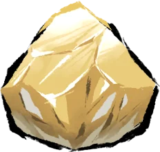

昊阳真火淬炼的烈日岩脉，蕴纳极致阳刚本源与焚天热力，坚不可摧且能破邪驱阴

### 【获取途径】

极难获得的材料

用途：作为主材料可炼制出所有〔阳〕法宝（容器法宝除外）

---

## 61. 剑魂残魄

击败剑冢内的**妖剑**获得的剑魄。

是制作**无双剑匣**的重要材料。

也可用于修炼，获得**感悟：剑意**

### 【获取途径】

击败妖王「妖剑」后有20%概率获得，炼化妖剑的眼大概率获得

用途：作为主材料可炼制出所有剑法宝

用于修炼可以获得感悟卡：剑意

---

## 62. 魂蛊丝

作为主材料可打造出笛子法宝。

### 【获取途径】

击败妖王「金蝉蛊」后有20%概率获得，炼化金蝉蛊的内丹大概率获得

用途：作为主材料可炼制出笛子法宝：驭秽

---

## 63. 裂石赤角

作为主材料可打造出剑法宝。

### 【获取途径】

击败妖王「狰」后有20%概率获得，炼化狰的内丹大概率获得

用途：作为主材料可炼制出剑法宝：碎星

---

## 64. 五色妖尾

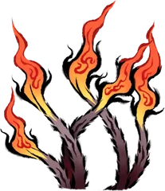

作为主材料可打造出鞭（索）法宝。

### 【获取途径】

击败妖王「狰」后有20%概率获得，炼化狰的内丹大概率获得

用途：作为主材料可炼制出索法宝：缚妖

---

## 65. 血藤蔓

击败**血藤古树**后有概率获得。

作为主材料可以打造瓶子法宝。

### 【获取途径】

击败妖王「血藤古树」后有20%概率获得，炼化血藤古树的内丹大概率获得

用途：作为主材料可炼制出瓶子法宝：血祭

---

## 66. 血藤毒刺

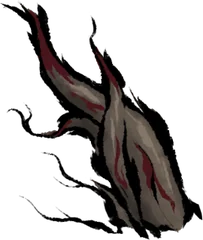

击败**血藤古树**后有概率获得。

作为主材料可以打造双刀法宝。

### 【获取途径】

击败妖王「血藤古树」后有20%概率获得，炼化血藤古树的内丹大概率获得

用途：作为主材料可炼制出双刀法宝：剜骨

---

## 67. 旱火蛇鳞

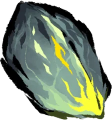

击败**肥遗**后有概率获得。

作为主材料可以打造剑法宝。

### 【获取途径】

击败妖王「肥遗」后有20%概率获得，炼化肥遗的内丹大概率获得

用途：作为主材料可炼制出剑法宝：春蘅

---

## 68. 旱火丹

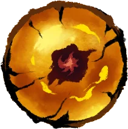

击败**肥遗**后有概率获得。

作为主材料可以打造珠子法宝。

### 【获取途径】

击败妖王「肥遗」后有20%概率获得，炼化肥遗的内丹大概率获得

用途：作为主材料可炼制出珠子法宝：朱坻

---

## 69. 夔雷核

击败**夔牛**后有概率获得。

作为主材料可以打造钟法宝。

### 【获取途径】

击败妖王「夔牛」后有20%概率获得，炼化夔牛的内丹大概率获得

用途：作为主材料可炼制出铃铛法宝：震霄

---

## 70. 风雨精魄

击败**夔牛**后有概率获得。

作为主材料可以打造珠子法宝。

### 【获取途径】

击败妖王「夔牛」后有20%概率获得，炼化夔牛的内丹大概率获得

用途：作为主材料可炼制出珠子法宝：定海

---

## 71. 巨妖触须

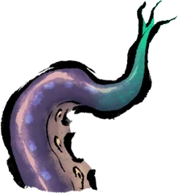

击败**北海巨妖**后有概率获得。

作为主材料可以打造鞭（索）法宝。

### 【获取途径】

击败妖王「北海巨妖」后有20%概率获得，炼化北海巨妖的内丹大概率获得

用途：作为主材料可炼制出索法宝：缠魂

---

## 72. 风暴之瞳

击败**北海巨妖**后有概率获得。

作为主材料可以打造镜子法宝。

### 【获取途径】

击败妖王「北海巨妖」后有20%概率获得，炼化北海巨妖的内丹大概率获得

用途：作为主材料可炼制出镜子法宝：蜃楼

---

## 73. 赤喙锐骨

击败**文鳐鱼**后有概率获得。

作为主材料可以打造剑法宝。

### 【获取途径】

击败妖王「文鳐鱼」后有20%概率获得，炼化文鳐鱼的内丹大概率获得

用途：作为主材料可炼制出剑法宝：寒月

---

## 74. 苍文瑞鳞

击败**文鳐鱼**后有概率获得。

作为主材料可以打造令牌法宝。

### 【获取途径】

击败妖王「文鳐鱼」后有20%概率获得，炼化文鳐鱼的内丹大概率获得

用途：作为主材料可炼制出令牌法宝：福缘

---

## 75. 九阳火种

击败**祸斗**后有概率获得。

作为主材料可以打造扇子法宝。

### 【获取途径】

击败妖王「祸斗」后有20%概率获得，炼化祸斗的内丹大概率获得

用途：作为主材料可炼制出扇子法宝：不灭

---

## 76. 灾焰爪

击败**祸斗**后有概率获得。

作为主材料可以打造灯法宝。

### 【获取途径】

击败妖王「祸斗」后有20%概率获得，炼化祸斗的内丹大概率获得

用途：作为主材料可炼制出灯法宝：灵烛

---

## 77. 黑焰

击败**黑焰虎**后有概率获得。

作为主材料可以打造扇子法宝。

### 【获取途径】

击败妖王「黑焰虎」后有20%概率获得，炼化黑焰虎的内丹大概率获得

用途：作为主材料可炼制出扇子法宝：乌炎

---

## 78. 火云翼

击败**火云雀**后有概率获得。

作为主材料可以打造剑法宝。

### 【获取途径】

击败妖王「火云雀」后有20%概率获得，炼化火云雀的内丹大概率获得

用途：作为主材料可炼制出剑法宝：流火

---

## 79. 烈象巨齿

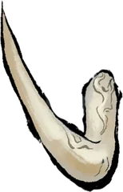

击败**巨灵烈象**后有概率获得。

作为主材料可以打造号角（类型属于笛子）法宝。

### 【获取途径】

击败妖王「巨灵烈象」后有20%概率获得，炼化巨灵烈象的内丹大概率获得

用途：作为主材料可炼制出笛子法宝：号令

---

## 80. 玄铁战骨

击败**铁骨熊**后有概率获得。

作为主材料可以打造斧头（类型属于刀）法宝。

### 【获取途径】

击败妖王「铁骨熊」后有20%概率获得，炼化铁骨熊的内丹大概率获得

用途：作为主材料可炼制出刀法宝：裂地

---

## 81. 千岳脊骨

击败**石魈**后有概率获得。

作为主材料可以打造剑法宝。

### 【获取途径】

击败妖王「石魈」后有20%概率获得，炼化石魈的内丹大概率获得

用途：作为主材料可炼制出剑法宝：镇元

---

## 82. 阴坟骨

击败**坟蛊鸪**后有概率获得。

作为主材料可以打造令牌法宝。

### 【获取途径】

击败妖王「坟蛊鸪」后有20%概率获得，炼化坟蛊鸪的内丹大概率获得

用途：作为主材料可炼制出令牌法宝：拘尸

---

## 83. 腐羽蛊翎

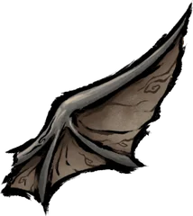

击败**坟蛊鸪**后有概率获得。

作为主材料可以打造琴（（类型属于琵琶））法宝。

### 【获取途径】

击败妖王「坟蛊鸪」后有20%概率获得，炼化坟蛊鸪的内丹大概率获得

用途：作为主材料可炼制出琵琶法宝：安魂

---

## 84. 鬼面毒丝

击败**鬼面蛛**后有概率获得。

作为主材料可以打造袋子法宝。

### 【获取途径】

击败妖王「鬼面蛛」后有20%概率获得，炼化鬼面蛛的内丹大概率获得

用途：作为主材料可炼制出袋子法宝：瘟疫

---

## 85. 摄魂音囊

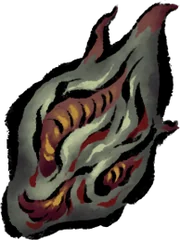

击败**青翼蝠王**后有概率获得。

作为主材料可以打造铃铛法宝。

### 【获取途径】

击败妖王「青翼蝠王」后有20%概率获得，炼化青翼蝠王的内丹大概率获得

用途：作为主材料可炼制出铃铛法宝：惑音

---

## 86. 九幽魂火

击败**九幽骨魅**后有概率获得。

作为主材料可以打造阴五行法宝。

### 【获取途径】

击败妖王「九幽骨魅」后有20%概率获得，炼化九幽骨魅的内丹大概率获得

用途：作为主材料可炼制出所有〔阴〕法宝

---

## 87. 幽魂骨

击败**九幽骨魅**后有概率获得。

作为主材料可以打造剑法宝。

### 【获取途径】

击败妖王「九幽骨魅」后有20%概率获得，炼化九幽骨魅的内丹大概率获得

用途：作为主材料可炼制出剑法宝：冥刃

---

## 88. 混沌灵气（图鉴未收录）

我在修炼时将两种相克灵气结合后产生的混沌灵气。它没有五行属性，也可以说它拥有全部五行属性

（混沌灵气对所有属性灵气，均是相生关系）

### 【获取途径】

修炼混元功可获得

修炼时有极小概率获得

完美炼化神品内丹有15%概率获得

炼化绝品内丹有20%概率获得

调查混沌之地必定获得

---

## 89. 金灵气（图鉴未收录）

### 【各版本（境界 / 品质）】

金灵气·练气：灵气凝聚后发出淡淡的金光，光芒时而锐利耀眼，时而柔和坚固。

兑金·筑基：在兑位凝聚的金灵气，纯度更高。

太乙精金·结丹：将兑金进行提炼后，形态已变为金属。

### 【获取途径】

独自修炼有20%概率获得

灵气充沛年份部分地点会生成

炼化对应属性的内丹大概率获得

把兽血通过恢复工作台消除必定获得

调查灵气异常之地必定获得

探索地点灵气源必定获得

---

## 90. 木灵气（图鉴未收录）

### 【各版本（境界 / 品质）】

木灵气·练气：灵气凝聚后发出淡淡的翠绿光，在光芒笼罩的下，周围环境似乎散发着不一样的生机。

震木·筑基：在震位凝聚的木灵气，纯度更高。

青阳木精·结丹：将震木进行提炼后，化为一颗种子。

### 【获取途径】

独自修炼有20%概率获得

灵气充沛年份部分地点会生成

炼化对应属性的内丹大概率获得

把兽血通过恢复工作台消除必定获得

调查灵气异常之地必定获得

探索地点灵气源必定获得

---

## 91. 水灵气（图鉴未收录）

### 【各版本（境界 / 品质）】

水灵气·练气：灵气凝聚后发出淡淡的蓝光，它清澈透明，和自然融合在一体，净化着四周。

坎水·筑基：在坎位凝聚的水灵气，纯度更高。

九阴黑水·结丹：将坎水进行提炼后，凝聚成一股黑色的水。

### 【获取途径】

独自修炼有20%概率获得

灵气充沛年份部分地点会生成

炼化对应属性的内丹大概率获得

把兽血通过恢复工作台消除必定获得

调查灵气异常之地必定获得

探索地点灵气源必定获得

---

## 92. 火灵气（图鉴未收录）

### 【各版本（境界 / 品质）】

火灵气·练气：灵气凝聚后发出淡淡的红光，红光如火焰般跳动，炽热的能量不时地向外逃逸。

离火·筑基：在离位凝聚的火灵气，纯度更高。

三昧真火·结丹：将离火进行提炼后，出现了三种不同颜色的火焰。

### 【获取途径】

独自修炼有20%概率获得

灵气充沛年份部分地点会生成

炼化对应属性的内丹大概率获得

把兽血通过恢复工作台消除必定获得

调查灵气异常之地必定获得

探索地点灵气源必定获得

---

## 93. 土灵气（图鉴未收录）

### 【各版本（境界 / 品质）】

土灵气·练气：灵气凝聚后发出淡淡的深黄光，黄色的光浓缩成一团，流动极其缓慢。

艮土·筑基：在艮位凝聚的土灵气，纯度更高。

镇地黄土·结丹：将艮土进行提炼后，泥土变得更加肥沃。

### 【获取途径】

独自修炼有20%概率获得

灵气充沛年份部分地点会生成

炼化对应属性的内丹大概率获得

把兽血通过恢复工作台消除必定获得

调查灵气异常之地必定获得

探索地点灵气源必定获得

---
