# 【卡牌修仙传】图鉴攻略 — 卡牌 / 材料

- 收录总数：167（已获得 135 / 🔒 未获得 32）
- 更新时间：2026-11-17 14:40

---

## 1. 紫金铜

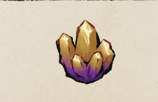

常见的法宝材料，只需要加入一丁点，就能让法宝变得坚硬。作为主材料可打造出剑法宝。

### 【获取途径】

常见的地点材料，可以在金芒矿搜索出来：用〔金〕灵气可以炼制获得；

用于炼制主材料可炼制剑法宝：飞虹剑，破光灵剑（筑基期）

---

## 2. 黑金铜

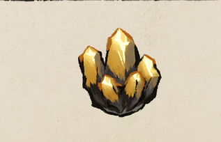

金属的颜色愈发的幽黑，也显得更加的珍贵难得。作为主材料可打造出剑法宝。

### 【获取途径】

常见的地点材料，可以在金芒矿搜索出来；用〔金〕灵气可以炼制获得；

用于炼制主材料可炼制剑法宝：飞虹剑，破光灵剑（筑基期）

---

## 3. 墨金

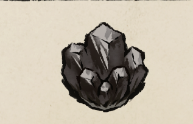

金属外表被一大片墨黑色物体覆盖着，很难分辨里面的物质。作为主材料可打造出剑法宝。

### 【获取途径】

常见的地点材料，可以在金芒矿搜索出来：用〔金〕灵气可以炼制获得；

用于炼制主材料可炼制剑法宝：飞虹剑，破光灵剑（筑基期）

---

## 4. 墨魄金（🔒 未获得）

> 尚未获得此卡牌，以下为图鉴中可见的部分信息。

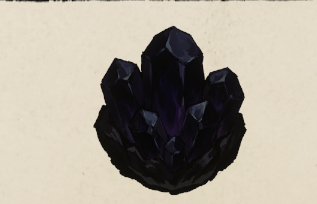

孕于幽冥地脉深处的金属，通体幽紫，内蕴魄气流转。作为主材料可打造出剑法宝。

### 【获取途径】

首次获得卡牌后解锁：

---

## 5. 星辉晶

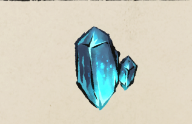

不知为何，星星的亮光都存储在晶体内，在夜晚时，便能照亮附近的区域。作为主材料可打造出刀法宝。

### 【获取途径】

常见的地点材料，可以在金芒矿搜索出来：用〔金〕灵气可以炼制获得；

用于炼制主材料可炼制刀法宝：金光刀，斩月妖刀（筑基期）

---

## 6. 曜明晶

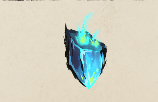

亮度是星辉晶的好几倍，但体型缺只有一半。作为主材料可打造出刀法宝。

### 【获取途径】

常见的地点材料，可以在金芒矿搜索出来；用〔金〕灵气可以炼制获得；

用于炼制主材料可炼制刀法宝：金光刀，斩月妖刀（筑基期）

---

## 7. 炫目晶

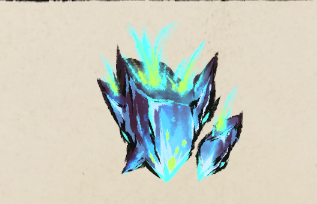

晶体发出的光芒过于刺眼，寻常人无法直视。

作为主材料可打造出刀法宝。

### 【获取途径】

常见的地点材料，可以在金芒矿搜索出来；用〔金〕灵气可以炼制获得；

用于炼制主材料可炼制刀法宝：金光刀，斩月妖刀（筑基期）

---

## 8. 神霄晶（🔒 未获得）

> 尚未获得此卡牌，以下为图鉴中可见的部分信息。

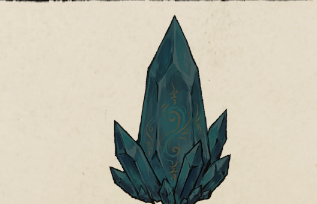

神霄雷光凝结而成的灵晶，通体青蓝，晶身隐现金色雷纹。作为主材料可打造出刀法宝。

### 【获取途径】

首次获得卡牌后解锁：

---

## 9. 蓝光铁

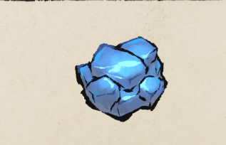

铁的表面偶尔会泛起一丝的蓝光。作为主材料可打造出双刀法宝。

### 【获取途径】

常见的地点材料，可以在金芒矿搜索出来：用〔金〕灵气可以炼制获得；

用于炼制主材料可炼制双刀法宝：金蝶刺

---

## 10. 星纹铁

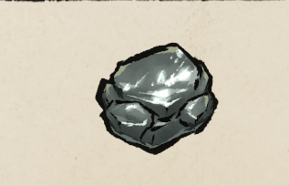

类似星星的花纹分布在铁的表面，但不知道是怎样形成的。作为主材料可打造出双刀法宝。

### 【获取途径】

常见的地点材料，可以在金芒矿搜索出来：用〔金〕灵气可以炼制获得；

用于炼制主材料可炼制双刀法宝：金蝶刺

---

## 11. 流纹钢

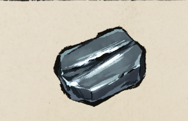

经过灵水冲刷的钢铁，表面有一道道深沟。作为主材料可打造出双刀法宝。

### 【获取途径】

常见的地点材料，可以在金芒矿搜索出来：用〔金〕灵气可以炼制获得；

用于炼制主材料可炼制双刀法宝：金蝶刺

---

## 12. 星辰钢（🔒 未获得）

> 尚未获得此卡牌，以下为图鉴中可见的部分信息。

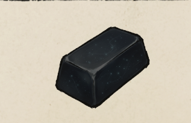

以星辰之力反复锻打而成的灵钢，钢体内星光流转如星河，质地坚韧且蕴含星力；作为主材料可打造出双刀法宝。

### 【获取途径】

首次获得卡牌后解锁：

---

## 13. 黑尾毛

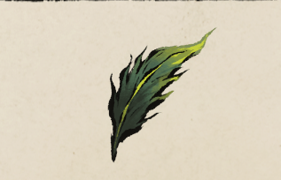

每只鸣鸟都只有一根的纯黑羽毛，是鸣鸟修为的关键。作为主材料可打造出铃铛法宝。

### 【获取途径】

击败鸣鸟后有极小概率掉落：炼制〔金〕内丹有较大概率获得；

用于炼制主材料可炼制铃铛法宝：金芒铃，合欢魔铃（筑基）

---

## 14. 黑尾毛

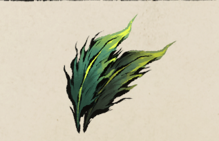

鸣坟鸠的修为提升，黑尾毛的数量也逐渐增加作为主材料可打造出铃铛法宝。

### 【获取途径】

击败鸣坟鸠后有极小概率掉落：炼制〔金〕内丹有较大概率获得；

用于炼制主材料可炼制铃铛法宝：金芒铃，合欢魔铃（筑基）

---

## 15. 尸黑羽毛

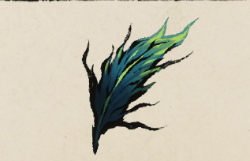

一根散发尸气的羽毛，哪怕是尸鸠，也只有一根。作为主材料可打造出铃铛法宝。

### 【获取途径】

击败尸鸠后有极小概率掉落：炼制〔金〕内丹有较大概率获得；

用于炼制主材料可炼制铃铛法宝：金芒铃，合欢魔铃（筑基）

---

## 16. 毒囊

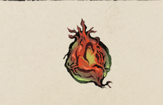

一个充满毒素的囊袋，小心处理，否则会中毒身亡。作为主材料可打造出袋子法宝。

### 【获取途径】

击败毒蟾后有极小概率掉落：炼制〔金〕内丹有较大概率获得；

用于炼制主材料可炼制袋子法宝：锁尘袋

---

## 17. 金色毒囊

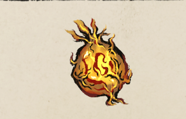

毒囊因为长期浸泡剧毒，已然成为了金色。作为主材料可打造出袋子法宝。

### 【获取途径】

击败金毒蟾后有极小概率掉落：炼制〔金〕内丹有较大概率获得；

用于炼制主材料可炼制袋子法宝：锁尘袋

---

## 18. 金色毒囊

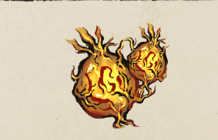

随着毒蟾的修为提高，毒囊的数量也随之提高作为主材料可打造出袋子法宝。

### 【获取途径】

击败三足金毒蟾后有极小概率掉落：炼制〔金〕内丹有较大概率获得；

用于炼制主材料可炼制袋子法宝：锁尘袋

---

## 19. 琉光珠

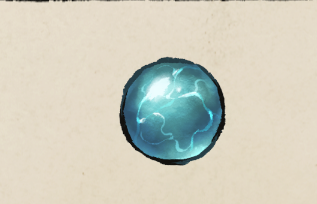

透明无暇的珠子的表面有琉光流动。作为主材料可打造出镜子法宝。

### 【获取途径】

常见的地点材料，可以在金芒矿搜索出来：用〔金〕灵气可以炼制获得；

用于炼制主材料可炼制镜子法宝：凝光宝镜（筑基期）

---

## 20. 金光宝珠

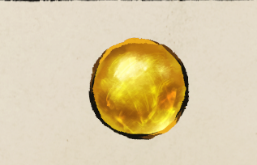

珠子里蕴含着金光，靠近甚至能感受到一丝热量。作为主材料可打造出镜子法宝。

### 【获取途径】

常见的地点材料，可以在金芒矿搜索出来：用〔金〕灵气可以炼制获得；

用于炼制主材料可炼制镜子法宝：凝光宝镜（筑基期）

---

## 21. 紫曜神珠（🔒 未获得）

> 尚未获得此卡牌，以下为图鉴中可见的部分信息。

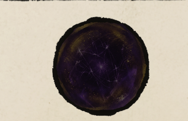

紫曜精气凝化而成的灵珠，珠身紫光流溢，内蕴星芒神纹。

### 【获取途径】

首次获得卡牌后解锁：

---

## 22. 獠牙

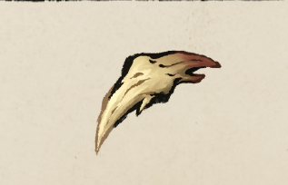

青口兽的獠牙，看似粗糙但又锋利无比。作为主材料可打造出笛子法宝。

### 【获取途径】

击败青口兽后有极小概率掉落：炼制〔金〕内丹有较大概率获得；

用于炼制主材料可炼制笛子法宝：破风古笛（筑基）

---

## 23. 滴血獠牙

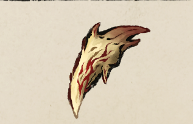

獠牙上的血并不是猎物的，而是从牙里渗出来作为主材料可打造出笛子法宝。

### 【获取途径】

击败獠牙烈兽后有极小概率掉落：炼制〔金〕内丹有较大概率获得；

用于炼制主材料可炼制笛子法宝：破风古笛（筑基）

---

## 24. 银精

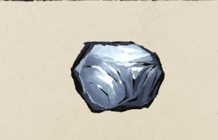

在银矿石中经受常年压力后才会形成。作为主材料可打造出令牌法宝。

### 【获取途径】

击败剑冢的灵剑（筑基期）后有掉落：炼制〔金〕内丹有较大概率获得；

用于炼制主材料可炼制令牌法宝：银霄天令（筑基）

---

## 25. 皇极银

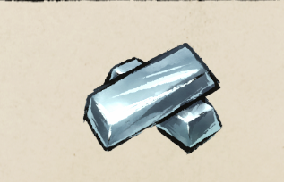

大量银精经过提纯后才会形成。

### 【获取途径】

击败剑冢的灵剑（结丹期）后有掉落：炼制〔金〕内丹有较大概率获得：

用于炼制主材料可炼制令牌法宝：银雪天令（筑基）

---

## 26. 九劫赤金（🔒 未获得）

> 尚未获得此卡牌，以下为图鉴中可见的部分信息。

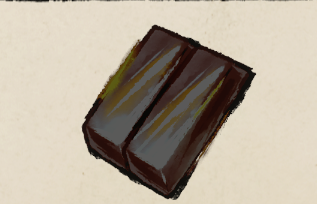

经九重天劫淬炼而生，赤芒灼目且内蕴劫火神威，是铸就弑神兵器的万古奇材

### 【获取途径】

首次获得卡牌后解锁：

---

## 27. 太白玄金

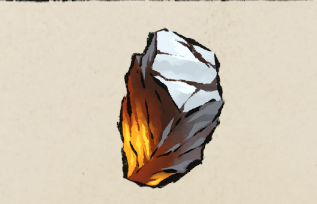

太白玄金采自九天太白星核质坚逾万钢且天生蕴纳星辰清辉，是锻造顶级法宝与破障法器的无上神材

### 【获取途径】

击败〔金〕妖王后有5%概率获得；

用于炼制主材料可炼制所有〔金〕法宝（容器法宝除外）

---

## 28. 幽残木

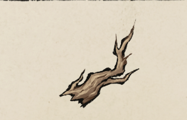

被煞气影响而接近枯萎的残木，有毒。作为主材料可打造出剑法宝。

### 【获取途径】

常见的地点材料，可以在青灵木搜索出来；用〔木〕灵气可以炼制获得；

用于炼制主材料可炼制剑法宝：枯木剑，桃木神剑（筑基期）

---

## 29. 龙葵木

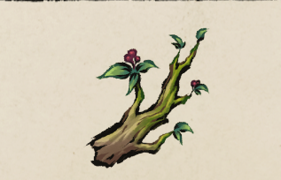

葵木的香气怡然，能吸引龙在树上休息，从而吸收龙身上的灵气。作为主材料可打造出剑法宝。

### 【获取途径】

常见的地点材料，可以在青灵木搜索出来；用〔木〕灵气可以炼制获得；

用于炼制主材料可炼制剑法宝：枯木剑，桃木神剑（筑基期）

---

## 30. 养魂木

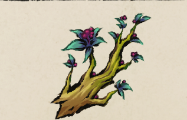

养魂木有奇特的芳香，能镇魂定魄。作为主材料可打造出剑法宝。

### 【获取途径】

常见的地点材料，可以在青灵木搜索出来；用〔木〕灵气可以炼制获得：

用于炼制主材料可炼制剑法宝：枯木剑，桃木神剑（筑基期）

---

## 31. 凝婴木（🔒 未获得）

> 尚未获得此卡牌，以下为图鉴中可见的部分信息。

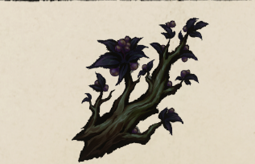

生长于灵气充沛之地的千年灵木，木性温润，结紫华灵实。作为主材料可打造出剑法宝。

### 【获取途径】

首次获得卡牌后解锁：

---

## 32. 紫叶树

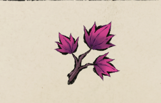

一种奇树，无论什么东西长在这种树的身上，都会变成紫色。作为主材料可打造出葫芦法宝。

### 【获取途径】

常见的地点材料，可以在青灵木搜索出来；用〔木〕灵气可以炼制获得；

用于炼制主材料可炼制葫芦法宝：翠竹葫芦

---

## 33. 滴血树

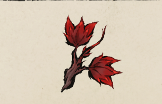

这种树会捕食灵兽，灵兽的血淋在叶子上，把叶子都染红了。

作为主材料可打造出葫芦法宝。

### 【获取途径】

常见的地点材料，可以在青灵木搜索出来；用〔木〕灵气可以炼制获得：

用于炼制主材料可炼制葫芦法宝：翠竹葫芦

---

## 34. 血纹树

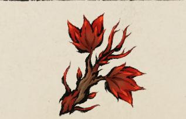

生长了千年的树，不知多少猎杀了多少灵兽。作为主材料可打造出葫芦法宝。

### 【获取途径】

常见的地点材料，可以在青灵木搜索出来；用〔木〕灵气可以炼制获得；

用于炼制主材料可炼制葫芦法宝：翠竹葫芦

---

## 35. 泣血树（🔒 未获得）

> 尚未获得此卡牌，以下为图鉴中可见的部分信息。

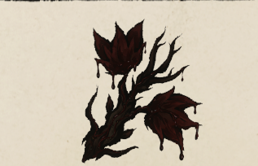

捕食生灵的数量太多已让树木都渗出了血液，像极了在哭泣一样；作为主材料可打造出葫芦法宝。

### 【获取途径】

首次获得卡牌后解锁：

---

## 36. 缠灵根

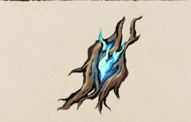

树根能把灵气实体化，并牢牢的缠住。作为主材料可打造出双刀法宝。

### 【获取途径】

常见的地点材料，可以在青灵木搜索出来；用〔木〕灵气可以炼制获得；

用于炼制主材料可炼制双刀法宝：幽芒刺

---

## 37. 醉心藤

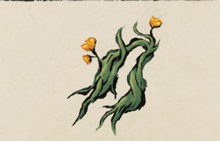

藤蔓会趁灵兽不注意将其缠住，然后把灵兽心脏麻痹了。作为主材料可打造出双刀法宝。

### 【获取途径】

常见的地点材料，可以在青灵木搜索出来；用〔木〕灵气可以炼制获得；

用于炼制主材料可炼制双刀法宝：幽芒刺

---

## 38. 绕骨藤

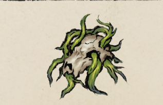

醉心藤把灵兽吸收干净后，就变成了缠绕在骨架上的藤蔓。作为主材料可打造出双刀法宝。

### 【获取途径】

常见的地点材料，可以在青灵木搜索出来：用〔木〕灵气可以炼制获得；

用于炼制主材料可炼制双刀法宝：幽芒刺

---

## 39. 缚魂藤（🔒 未获得）

> 尚未获得此卡牌，以下为图鉴中可见的部分信息。

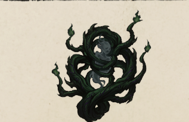

### 【获取途径】

首次获得卡牌后解锁：

---

## 40. 血灵竹

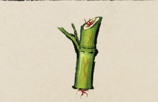

在表面就能看出竹子内分布着“血管”

作为主材料可打造出刀法宝。

### 【获取途径】

常见的地点材料，可以在青灵木搜索出来；用〔木〕灵气可以炼制获得：

用于炼制主材料可炼制刀法宝：碧影刀

---

## 41. 血纹竹

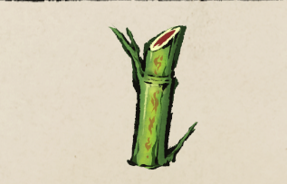

和人血管不同的是，竹子上更像是一种符文。作为主材料可打造出刀法宝。

### 【获取途径】

常见的地点材料，可以在青灵木搜索出来；用〔木〕灵气可以炼制获得：

用于炼制主材料可炼制刀法宝：碧影刀

---

## 42. 赤纹竹

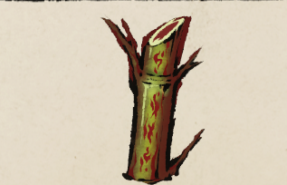

血的颜色更加深，纹路也愈发的清晰。作为主材料可打造出刀法宝。

### 【获取途径】

常见的地点材料，可以在青灵木搜索出来；用〔木〕灵气可以炼制获得：

用于炼制主材料可炼制刀法宝：碧影刀

---

## 43. 朱魂竹（🔒 未获得）

> 尚未获得此卡牌，以下为图鉴中可见的部分信息。

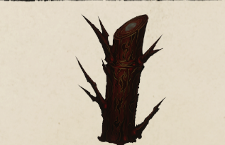

竹子已经孕育出魂珠；作为主材料可打造出刀法宝。

### 【获取途径】

首次获得卡牌后解锁：

---

## 44. 青蛇鱗片

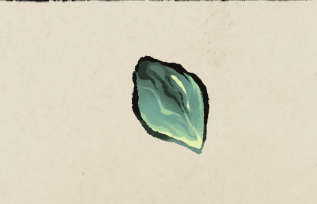

蛇原本是没有鳞片的，不知道这蛇有何不同。作为主材料可打造出扇子法宝。

### 【获取途径】

击败青蛇后有极小概率掉落：炼制〔木〕内丹有较大概率获得；

用于炼制主材料可炼制扇子法宝：青岚扇

---

## 45. 青蛇鱗片

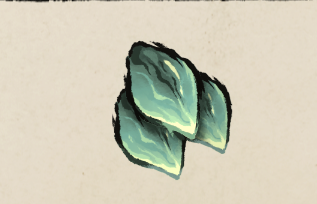

从蛇身上整块剥下来的鳞片，较为完整所以才更有价值。作为主材料可打造出扇子法宝。

### 【获取途径】

击败长蛇后有极小概率掉落：炼制〔木〕内丹有较大概率获得；

用于炼制主材料可炼制扇子法宝：青岚扇

---

## 46. 小根兽骨

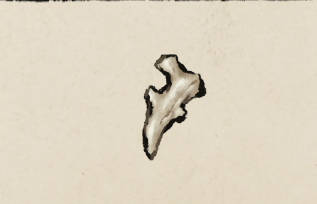

小型灵兽的骨头作为主材料可打造出笛子法宝。

### 【获取途径】

击败耳鼠后有极小概率掉落：炼制〔木〕内丹有较大概率获得；

用于炼制主材料可炼制笛子法宝：紫藤笛

---

## 47. 扇耳

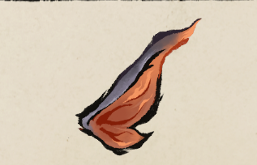

耳鼠的完整大耳朵作为主材料可打造出琵琶法宝。

### 【获取途径】

击败飞鼠后有极小概率掉落：炼制〔木〕内丹有较大概率获得；

用于炼制主材料可炼制琵琶法宝：妙音琵琶

---

## 48. 骨爪

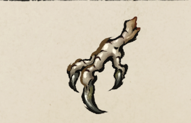

化蛇下半部分的爪子，异常的大。作为主材料可打造出笛子法宝。

### 【获取途径】

击败化蛇后有极小概率掉落：炼制〔木〕内丹有较大概率获得；

用于炼制主材料可炼制笛子法宝：紫藤笛

---

## 49. 骨脸

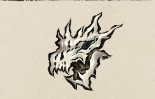

修炼至筑基后，脸部慢慢骨化。作为主材料可打造出笛子法宝。

### 【获取途径】

击败鬼脸飞蛇后有极小概率掉落；炼制〔木〕内丹有较大概率获得；

用于炼制主材料可炼制笛子法宝：紫藤笛

---

## 50. 辟虫灵木

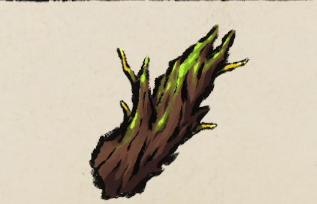

这种树木连剧毒的虫子也不敢靠近。作为主材料可打造出琵琶法宝。

### 【获取途径】

常见的地点材料，可以在青灵木搜索出来；用〔木〕灵气可以炼制获得；

用于炼制主材料可炼制琵琶法宝：妙音琵琶

---

## 51. 青莹灵木（🔒 未获得）

> 尚未获得此卡牌，以下为图鉴中可见的部分信息。

在经过多年的修炼后，曾经辟虫的灵木开始吸引灵虫；作为主材料可打造出琵琶法宝。

### 【获取途径】

首次获得卡牌后解锁：

---

## 52. 凝阴树叶

树叶会散发出阴气，经常看到有毒虫尸体在树叶上被冰冻着。作为主材料可打造出扇子法宝。

### 【获取途径】

常见的地点材料，可以在青灵木搜索出来；用〔木〕灵气可以炼制获得：

用于炼制主材料可炼制扇子法宝：青岚扇

---

## 53. 九幽寒叶（🔒 未获得）

> 尚未获得此卡牌，以下为图鉴中可见的部分信息。

叶身凝有千年冰晶，蕴含极阴寒气。作为主材料可打造出扇子法宝。

### 【获取途径】

首次获得卡牌后解锁：

---

## 54. 千棘藤心

凝萃千棘藤妖千年木灵本源与噬灵妖力，坚韧无比且暗藏尖刺玄机

### 【获取途径】

击败千棘藤妖后有极小概率掉落：炼制〔木〕内丹有较大概率获得；

用于炼制主材料可炼制袋子法宝：千棘袋

---

## 55. 紫电雷竹（🔒 未获得）

> 尚未获得此卡牌，以下为图鉴中可见的部分信息。

紫电雷竹生于九霄雷泽秘境，竿蕴先天紫电、节藏雷霆真意，坚韧且能引动天雷之力

### 【获取途径】

首次获得卡牌后解锁：

---

## 56. 血凤木

木质朱红如血且蕴纳涅槃真火本源，坚韧不朽还能滋养灵脉

### 【获取途径】

击败〔木〕妖王后有5%概率获得；

用于炼制主材料可炼制所有〔木〕法宝（容器法宝除外）

---

## 57. 月泉水

当满月照射在泉水时，如果出现灵气异常，灵气和月光都会被存储在泉水中。作为主材料可打造出瓶子法宝。

### 【获取途径】

常见的地点材料，可以在愈魂池搜索出来；用〔水〕灵气可以炼制获得：

用于炼制主材料可炼制瓶子法宝：雨露瓶

---

## 58. 月泉灵乳

月泉水吸收的灵气越多，就会逐渐变得浓稠。作为主材料可打造出瓶子法宝。

### 【获取途径】

常见的地点材料，可以在愈魂池搜索出来；用〔水〕灵气可以炼制获得；

用于炼制主材料可炼制瓶子法宝：雨露瓶

---

## 59. 月泉晶

浓缩了千年月亮精华的泉乳，充满灵气。作为主材料可打造出瓶子法宝。

### 【获取途径】

常见的地点材料，可以在愈魂池搜索出来；用〔水〕灵气可以炼制获得；

用于炼制主材料可炼制瓶子法宝：雨露瓶

---

## 60. 月泉神晶（🔒 未获得）

> 尚未获得此卡牌，以下为图鉴中可见的部分信息。

### 【获取途径】

首次获得卡牌后解锁：

---

## 61. 海波晶

汹涌的灵气波浪无时无刻的拍打着岸边后形成的特殊结晶。作为主材料可打造出剑法宝。

### 【获取途径】

常见的地点材料，可以在愈魂池搜索出来；用〔水〕灵气可以炼制获得；

用于炼制主材料可炼制剑法宝：寒光剑，玄阴魂剑（筑基期）

---

## 62. 冥河水晶

世上有一条河流，没有固定的位置，称之为冥河。这便是从冥河流过之处剩下的结晶。作为主材料可打造出剑法宝。

### 【获取途径】

常见的地点材料，可以在愈魂池搜索出来；用〔水〕灵气可以炼制获得；

用于炼制主材料可炼制剑法宝：寒光剑，玄阴魂剑（筑基期）

---

## 63. 幽冥寒晶

之所以叫寒晶，是因为连火焰也无法驱走来自幽冥地界的寒意。作为主材料可打造出剑法宝。

### 【获取途径】

常见的地点材料，可以在愈魂池搜索出来；用〔水〕灵气可以炼制获得；

用于炼制主材料可炼制剑法宝：寒光剑，玄阴魂剑（筑基期）

---

## 64. 九幽魂晶（🔒 未获得）

> 尚未获得此卡牌，以下为图鉴中可见的部分信息。

九幽深处阴气凝结而成的魂晶，晶身幽紫斑斓，内蕴魂息流转。作为主材料可打造出剑法宝。

### 【获取途径】

首次获得卡牌后解锁：

---

## 65. 凝魄冰

在极寒地区死亡的生命，有时候魂魄都被冻住了。作为主材料可打造出刀法宝。

### 【获取途径】

常见的地点材料，可以在愈魂池搜索出来；用〔水〕灵气可以炼制获得：

用于炼制主材料可炼制刀法宝：凝水刀

---

## 66. 黑魄寒冰

寒冰里的魂魄数量太多，以至于显露出黑色。作为主材料可打造出刀法宝。

### 【获取途径】

常见的地点材料，可以在愈魂池搜索出来；用〔水〕灵气可以炼制获得；

用于炼制主材料可炼制刀法宝：凝水刀

---

## 67. 万年黑魄冰

经过万年沉淀的寒冰，在炼制时要注意魂魄的反击。作为主材料可打造出刀法宝。

### 【获取途径】

常见的地点材料，可以在愈魂池搜索出来；用〔水〕灵气可以炼制获得：

用于炼制主材料可炼制刀法宝：凝水刀

---

## 68. 玄魄冰髓（🔒 未获得）

> 尚未获得此卡牌，以下为图鉴中可见的部分信息。

万年黑魄冰与阴魄之气交融孕育的冰髓，外层冰寒彻骨，内蕴幽紫魄息。

### 【获取途径】

首次获得卡牌后解锁：

---

## 69. 鱼鳞片

鱼类灵兽的普通鳞片。作为主材料可打造出笛子法宝。

### 【获取途径】

击败飞鱼后有极小概率掉落：炼制〔水〕内丹有较大概率获得；

用于炼制主材料可炼制笛子法宝：琉璃笛

---

## 70. 水囊

哪怕脱离了宿主，囊袋依然可以渗出水分。作为主材料可打造出袋子法宝。

### 【获取途径】

击败花臂章鱼后有极小概率掉落：炼制〔水〕内丹有较大概率获得；

用于炼制主材料可炼制袋子法宝：冰心袋

---

## 71. 巨大水囊

哪怕脱离了宿主，囊袋依然可以渗出水分。作为主材料可打造出袋子法宝。

### 【获取途径】

击败北海巨妖（小）后有极小概率掉落；炼制〔水〕内丹有较大概率获得；

用于炼制主材料可炼制袋子法宝：冰心袋

---

## 72. 玄灵液

富含灵气的灵液，用于培养灵草的好材料。作为主材料可打造出袋子法宝。

### 【获取途径】

常见的地点材料，可以在愈魂池搜索出来；用〔水〕灵气可以炼制获得；

用于炼制主材料可炼制袋子法宝：冰心袋

---

## 73. 天元灵液

富含灵气的灵液，用于培养灵草的好材料。作为主材料可打造出袋子法宝。

### 【获取途径】

常见的地点材料，可以在愈魂池搜索出来；用〔水〕灵气可以炼制获得；

用于炼制主材料可炼制袋子法宝：冰心袋

---

## 74. 天元神液（🔒 未获得）

> 尚未获得此卡牌，以下为图鉴中可见的部分信息。

富含灵气的灵液，用于培养灵药的好材料。

作为主材料可打造出袋子法宝。

### 【获取途径】

首次获得卡牌后解锁：

---

## 75. 水玉

不知道如何形成的，玉里有流动的水。作为主材料可打造出伞法宝。

### 【获取途径】

常见的地点材料，可以在愈魂池搜索出来；用〔水〕灵气可以炼制获得：

用于炼制主材料可炼制伞法宝：避水纸伞

---

## 76. 泪玉

玉的形状像一滴泪，也许里面装着的的确就是泪水。作为主材料可打造出伞法宝。

### 【获取途径】

常见的地点材料，可以在愈魂池搜索出来；用〔水〕灵气可以炼制获得；

用于炼制主材料可炼制伞法宝：避水纸伞

---

## 77. 冰勾玉（🔒 未获得）

> 尚未获得此卡牌，以下为图鉴中可见的部分信息。

以千年寒冰雕琢而成的勾玉。通体冰蓝通透，触手生凉。作为主材料可打造出伞法宝。

### 【获取途径】

首次获得卡牌后解锁：

---

## 78. 蛟鳞片

蛟龙的大块鳞片，每一片都是坚韧无比。作为主材料可打造出扇子法宝。

### 【获取途径】

击败入水蛟后有极小概率掉落；炼制〔水〕内丹有较大概率获得；

用于炼制主材料可炼制扇子法宝：游龙古扇

---

## 79. 流水鳞片

鳞片可以轻易的切割水流，虽然只能维持一小段时间。作为主材料可打造出扇子法宝。

### 【获取途径】

击败凶蛟后有极小概率掉落：炼制〔水〕内丹有较大概率获得；

用于炼制主材料可炼制扇子法宝：游龙古扇

---

## 80. 冰蝉

蝉身如同冰块般晶莹剔透作为主材料可打造出笛子法宝。

### 【获取途径】

常见的地点材料，可以在愈魂池搜索出来；用〔水〕灵气可以炼制获得；

用于炼制主材料可炼制笛子法宝：琉璃笛

---

## 81. 冰晶蝉

蝉身如同冰块般晶莹剔透作为主材料可打造出笛子法宝。

### 【获取途径】

常见的地点材料，可以在愈魂池搜索出来；用〔水〕灵气可以炼制获得；

用于炼制主材料可炼制笛子法宝：琉璃笛

---

## 82. 千年冰晶蝉（🔒 未获得）

> 尚未获得此卡牌，以下为图鉴中可见的部分信息。

蝉身如同冰块般晶莹剔透作为主材料可打造出笛子法宝。

### 【获取途径】

首次获得卡牌后解锁：

---

## 83. 龙鲤血

凝萃彩鳞龙鲤本源与锦鲤祥瑞之力，殷红如霞且蕴含澎湃生机

### 【获取途径】

击败彩鳞龙鲤后有极小概率掉落：炼制〔水〕内丹有较大概率获得；

用于炼制主材料可炼制葫芦法宝：幻海葫芦

---

## 84. 星海灵波（🔒 未获得）

> 尚未获得此卡牌，以下为图鉴中可见的部分信息。

弥散于星海深处的无形灵韵。凝萃亿万星辰潮汐之力与空间真意

### 【获取途径】

首次获得卡牌后解锁：

---

## 85. 幻雾琉璃

由天地间最纯净的水雾凝结千年而成的半透明晶体，能随光线变换七种水色

### 【获取途径】

击败〔水〕妖王后有5%概率获得：

用于炼制主材料可炼制所有〔水〕法宝（容器法宝除外）

---

## 86. 火魂石

当吸附了死亡灵兽的魂魄后又被地火焚烧了数十年才能形成火魂石。作为主材料可打造出袋子法宝。

### 【获取途径】

常见的地点材料，可以在火云树搜索出来；用〔火〕灵气可以炼制获得：

用于炼制主材料可炼制袋子法宝：御火袋

---

## 87. 燃魄石

当吸附了死亡灵兽的魂魄后又被地火焚烧了数十年才能形成火魂石。作为主材料可打造出袋子法宝。

### 【获取途径】

常见的地点材料，可以在火云树搜索出来：用〔火〕灵气可以炼制获得：

用于炼制主材料可炼制袋子法宝：御火袋

---

## 88. 焚城石

原本只是普通的城墙石头，被焚烧后吸引大量冤魂而变得不凡。作为主材料可打造出袋子法宝。

### 【获取途径】

常见的地点材料，可以在火云树搜索出来；用〔火〕灵气可以炼制获得：

用于炼制主材料可炼制袋子法宝：御火袋

---

## 89. 焚天石（🔒 未获得）

> 尚未获得此卡牌，以下为图鉴中可见的部分信息。

上古火域深处孕育的异石，内含焚天烈焰，触之灼骨熔金作为主材料可打造出袋子法宝。

### 【获取途径】

首次获得卡牌后解锁：

---

## 90. 地心之火

从地底深处采集的地火。作为主材料可打造出葫芦法宝。

### 【获取途径】

常见的地点材料，可以在火云树搜索出来；用〔火〕灵气可以炼制获得：

用于炼制主材料可炼制葫芦法宝：炽焰葫芦

---

## 91. 天外之火

从天上坠落的无名之火。作为主材料可打造出葫芦法宝。

### 【获取途径】

常见的地点材料，可以在火云树搜索出来；用〔火〕灵气可以炼制获得：

用于炼制主材料可炼制葫芦法宝：炽焰葫芦

---

## 92. 天地之火

融合了地火和天火的混合火焰，温度极高。作为主材料可打造出葫芦法宝。

### 【获取途径】

常见的地点材料，可以在火云树搜索出来；用〔火〕灵气可以炼制获得；

用于炼制主材料可炼制葫芦法宝：炽焰葫芦

---

## 93. 混沌灵焰（🔒 未获得）

> 尚未获得此卡牌，以下为图鉴中可见的部分信息。

天地初开时混沌之气所化的本源灵火，藏于熔岩石胎之中。

### 【获取途径】

首次获得卡牌后解锁：

---

## 94. 赤阳石

像太阳般的石头，自身会发出热和红光。作为主材料可打造出令牌法宝。

### 【获取途径】

常见的地点材料，可以在火云树搜索出来；用〔火〕灵气可以炼制获得；

用于炼制主材料可炼制令牌法宝：焚石令

---

## 95. 落阳石

会在燃烧熄灭之间无限循环的神奇火石。作为主材料可打造出令牌法宝。

### 【获取途径】

常见的地点材料，可以在火云树搜索出来；用〔火〕灵气可以炼制获得；

用于炼制主材料可炼制令牌法宝：焚石令

---

## 96. 赤日石

燃烧的火焰已经能和正午的太阳媲美。

作为主材料可打造出令牌法宝。

### 【获取途径】

常见的地点材料，可以在火云树搜索出来；用〔火〕灵气可以炼制获得；

用于炼制主材料可炼制令牌法宝：焚石令

---

## 97. 曜阳石（🔒 未获得）

> 尚未获得此卡牌，以下为图鉴中可见的部分信息。

燃烧的火焰已经能和正午的太阳媲美。

作为主材料可打造出令牌法宝。

### 【获取途径】

首次获得卡牌后解锁：

---

## 98. 利爪

兽类灵兽的锋利爪子。作为主材料可打造出刀法宝。

### 【获取途径】

击败山豹后有极小概率掉落：炼制〔火〕内丹有较大概率获得：

用于炼制主材料可炼制刀法宝：赤焰刀

---

## 99. 赤红利爪

爪子因为捕杀猎物太多已经染成了红色。作为主材料可打造出刀法宝。

### 【获取途径】

击败赤红豹后有极小概率掉落：炼制〔火〕内丹有较大概率获得；

用于炼制主材料可炼制刀法宝：赤焰刀

---

## 100. 赤红角

赤豹会先用独角将猎物击倒。有时候一击便能贯穿心脏。作为主材料可打造出刀法宝。

### 【获取途径】

击败独角赤豹后有极小概率掉落：炼制〔火〕内丹有较大概率获得；

用于炼制主材料可炼制刀法宝：赤焰刀

---

## 101. 红蛇鳞片

鳞片整个都是红色的，似血。作为主材料可打造出剑法宝。

### 【获取途径】

击败积首蛇后有极小概率掉落；炼制〔火〕内丹有较大概率获得：

用于炼制主材料可炼制剑法宝：烈火剑，三炎神剑（筑基期）

---

## 102. 红蛇鳞片

一片完整的血红鳞片，较为珍贵。作为主材料可打造出剑法宝。

### 【获取途径】

击败三头积首蛇后有极小概率掉落；炼制〔火〕内丹有较大概率获得；

用于炼制主材料可炼制剑法宝：烈火剑，三炎神剑（筑基期）

---

## 103. 鲜红蛇鳞片

鲜红的鳞片上偶尔还能自燃起来。作为主材料可打造出剑法宝。

### 【获取途径】

击败六头积首蛇后有极小概率掉落：炼制〔火〕内丹有较大概率获得；

用于炼制主材料可炼制剑法宝：烈火剑，三炎神剑（筑基期）

---

## 104. 火珊瑚

在海底的依然能燃烧的珊瑚。作为主材料可打造出灯法宝。

### 【获取途径】

常见的地点材料，可以在火云树搜索出来；用〔火〕灵气可以炼制获得；

用于炼制主材料可炼制灯法宝：冥火提灯

---

## 105. 千年火珊瑚

已经在海底燃烧了千年，却仍未烧尽的千年珊瑚。作为主材料可打造出灯法宝。

### 【获取途径】

常见的地点材料，可以在火云树搜索出来；用〔火〕灵气可以炼制获得：

用于炼制主材料可炼制灯法宝：冥火提灯

---

## 106. 万年火珊瑚（🔒 未获得）

> 尚未获得此卡牌，以下为图鉴中可见的部分信息。

生于深海火山裂隙中的奇珍吸纳地火万年方得成形作为主材料可打造出灯法宝。

### 【获取途径】

首次获得卡牌后解锁：

---

## 107. 青火晶

偶有外火从天上坠落，把附近之物燃烧殆尽后形成的结晶。作为主材料可打造出瓶子法宝。

### 【获取途径】

常见的地点材料，可以在火云树搜索出来；用〔火〕灵气可以炼制获得；

用于炼制主材料可炼制瓶子法宝：红莲极瓶

---

## 108. 冥火晶

不待落下的外火燃烧殆尽便将其收集保存，才有着外火本源的能量。作为主材料可打造出瓶子法宝。

### 【获取途径】

常见的地点材料，可以在火云树搜索出来：用〔火〕灵气可以炼制获得：

用于炼制主材料可炼制瓶子法宝：红莲极瓶

---

## 109. 幽冥晶石（🔒 未获得）

> 尚未获得此卡牌，以下为图鉴中可见的部分信息。

产自幽冥深渊的阴寒灵晶，晶身萦绕紫色幽焰，内含金纹冥火

### 【获取途径】

首次获得卡牌后解锁：

---

## 110. 噬金甲

噬金甲是噬金狂蚣蜕化的本命甲壳，坚不可摧且能吞噬金属之力淬炼自身

### 【获取途径】

击败噬金狂蚣后有极小概率掉落：炼制〔火〕内丹有较大概率获得；

用于炼制主材料可炼制瓶子法宝：红莲极瓶

---

## 111. 炎龙碎骨（🔒 未获得）

> 尚未获得此卡牌，以下为图鉴中可见的部分信息。

上古炎龙陨落后遗存的骨骼碎片，凝萃火龙本源之力与霸道龙威，坚硬耐高温且火韵绵长

### 【获取途径】

首次获得卡牌后解锁：

---

## 112. 火莲晶核

表面有太阳黑子般的纹路，燃烧时释放亿万道金芒，能照亮九幽地府

### 【获取途径】

击败〔火〕妖王后有5%概率获得：

用于炼制主材料可炼制所有〔火〕法宝（容器法宝除外）

---

## 113. 玉髓石

在地底里被大地挤压成玉的石头。作为主材料可打造出剑法宝。

### 【获取途径】

常见的地点材料，可以在凝土墟搜索出来：用〔土〕灵气可以炼制获得：

用于炼制主材料可炼制剑法宝：黄泉剑，白玉刚剑（筑基期）

---

## 114. 玉芯石

形成的玉髓石会缓慢吞噬附近的石头，最终形成子午岩。作为主材料可打造出剑法宝。

### 【获取途径】

常见的地点材料，可以在凝土墟搜索出来；用〔土〕灵气可以炼制获得；

用于炼制主材料可炼制剑法宝：黄泉剑，白玉刚剑（筑基期）

---

## 115. 血玉石

玉芯被挤压出血状的物质，所以名曰血玉石。作为主材料可打造出剑法宝。

### 【获取途径】

常见的地点材料，可以在凝土墟搜索出来：用〔土〕灵气可以炼制获得；

用于炼制主材料可炼制剑法宝：黄泉剑，白玉刚剑（筑基期）

---

## 116. 血髓玉（🔒 未获得）

> 尚未获得此卡牌，以下为图鉴中可见的部分信息。

### 【获取途径】

首次获得卡牌后解锁：

---

## 117. 铁精砂

异常锋利的砂子，收集的过程可谓是痛苦至极。作为主材料可打造出葫芦法宝。

### 【获取途径】

常见的地点材料，可以在凝土墟搜索出来：用〔土〕灵气可以炼制获得；

用于炼制主材料可炼制葫芦法宝：黄砂葫芦

---

## 118. 银精砂

砂里混杂着细小的银精，比铁更加的锋利。作为主材料可打造出葫芦法宝。

### 【获取途径】

常见的地点材料，可以在凝土墟搜索出来：用〔土〕灵气可以炼制获得；

用于炼制主材料可炼制葫芦法宝：黄砂葫芦

---

## 119. 黑金砂

哪怕一颗小小的砂粒，在空中也能闪出黑色金光。作为主材料可打造出葫芦法宝。

### 【获取途径】

常见的地点材料，可以在凝土墟搜索出来：用〔土〕灵气可以炼制获得；

用于炼制主材料可炼制葫芦法宝：黄砂葫芦

---

## 121. 藏灵土

泥土里蕴含着大量的灵气，但外表又和普通泥土一样作为主材料可打造出扇子法宝。

### 【获取途径】

常见的地点材料，可以在凝土墟搜索出来：用〔土〕灵气可以炼制获得；

用于炼制主材料可炼制扇子法宝：山河扇

---

## 122. 叱灵土

灵土里的灵气因为过于饱满，有时候会爆发出一声巨响。作为主材料可打造出扇子法宝。

### 【获取途径】

常见的地点材料，可以在凝土墟搜索出来：用〔土〕灵气可以炼制获得；

用于炼制主材料可炼制扇子法宝：山河扇

---

## 123. 散灵土

泥土的质地较为松软，更有灵气从中散发而出作为主材料可打造出扇子法宝。

### 【获取途径】

常见的地点材料，可以在凝土墟搜索出来：用〔土〕灵气可以炼制获得；

用于炼制主材料可炼制扇子法宝：山河扇

---

## 124. 灵土息壤（🔒 未获得）

> 尚未获得此卡牌，以下为图鉴中可见的部分信息。

泥土的质地较为松软，更有灵气从中散发而出作为主材料可打造出扇子法宝。

### 【获取途径】

首次获得卡牌后解锁：

---

## 125. 长兽骨

灵长类妖兽的骨头，比一般家畜要长得多。作为主材料可打造出刀法宝。

### 【获取途径】

击败长臂猴后有极小概率掉落：炼制〔土〕内丹有较大概率获得；

用于炼制主材料可炼制刀法宝：碎石刀

---

## 126. 长兽骨

这个灵兽绝对是灵长类里长得最高的。作为主材料可打造出刀法宝。

### 【获取途径】

击败鬼脸长臂猴后有极小概率掉落；炼制〔土〕内丹有较大概率获得；

用于炼制主材料可炼制刀法宝：碎石刀

---

## 127. 大兽骨

粗壮的兽骨，也只有巨象能长这么大了。作为主材料可打造出瓶子法宝。

### 【获取途径】

击败巨象后有极小概率掉落：炼制〔土〕内丹有较大概率获得；

用于炼制主材料可炼制瓶子法宝：星华瓶

---

## 128. 迷天岩

岩石非常难寻找，不是因为太小，而是人们根本看不见它。作为主材料可打造出印法宝。

### 【获取途径】

常见的地点材料，可以在凝土墟搜索出来；用〔土〕灵气可以炼制获得；

用于炼制主材料可炼制印法宝：混土神印

---

## 129. 镇妖岩

镇压在灵兽身上的石头，包含戾气。作为主材料可打造出印法宝。

### 【获取途径】

常见的地点材料，可以在凝土墟搜索出来；用〔土〕灵气可以炼制获得：

用于炼制主材料可炼制印法宝：混土神印

---

## 130. 凌霄岩（🔒 未获得）

> 尚未获得此卡牌，以下为图鉴中可见的部分信息。

### 【获取途径】

首次获得卡牌后解锁：

---

## 131. 百年妖骨

在戈壁地区经过百年时间风干的妖骨，灵力还未散尽，反而更加的浓郁。作为主材料可打造出双刀法宝。

### 【获取途径】

常见的地点材料，可以在凝土墟搜索出来；用〔土〕灵气可以炼制获得：

用于炼制主材料可炼制双刀法宝：雌雄双刺

---

## 132. 千年妖骨

在戈壁地区经过千年时间风干的妖骨，灵力还未散尽，反而更加的浓郁。作为主材料可打造出双刀法宝。

### 【获取途径】

常见的地点材料，可以在凝土墟搜索出来；用〔土〕灵气可以炼制获得：

用于炼制主材料可炼制双刀法宝：雌雄双刺

---

## 133. 万年妖骨（🔒 未获得）

> 尚未获得此卡牌，以下为图鉴中可见的部分信息。

在戈壁地区经过千年时间风干的妖骨，灵力还未散尽，反而更加的浓郁。作为主材料可打造出双刀法宝。

### 【获取途径】

首次获得卡牌后解锁：

---

## 134. 墨翠玉

墨绿色的翡翠玉石，绿色得非常深邃。

作为主材料可打造出瓶子法宝。

### 【获取途径】

常见的地点材料，可以在凝土墟搜索出来：用〔土〕灵气可以炼制获得；

用于炼制主材料可炼制瓶子法宝：星华瓶

---

## 135. 薑黃晶

深藏在地底，据说是大地精华凝结而成。作为主材料可打造出令牌法宝。

### 【获取途径】

常见的地点材料，可以在凝土墟搜索出来：用〔土〕灵气可以炼制获得；

用于炼制主材料可炼制令牌法宝：玄黄灵符

---

## 136. 龙髓晶

深藏在地底，据说是地龙的脊髓。作为主材料可打造出令牌法宝。

### 【获取途径】

常见的地点材料，可以在凝土墟搜索出来：用〔土〕灵气可以炼制获得；

用于炼制主材料可炼制令牌法宝：玄黄灵符

---

## 137. 神髓晶（🔒 未获得）

> 尚未获得此卡牌，以下为图鉴中可见的部分信息。

深藏在地底，据说是地龙的脊髓。作为主材料可打造出令牌法宝。

### 【获取途径】

首次获得卡牌后解锁：

---

## 138. 地心磁石（🔒 未获得）

> 尚未获得此卡牌，以下为图鉴中可见的部分信息。

地核深处孕生的奇矿，蕴纳先天磁元且控磁镇灵，能引聚灵脉、吸附金属灵能

### 【获取途径】

首次获得卡牌后解锁：

---

## 139. 九天息壤

九天之上孕生的上古灵土，蕴纳混沌生机与稳固本源之力，生生不息且能滋养万灵

### 【获取途径】

击败〔土〕妖王后有5%概率获得：

用于炼制主材料可炼制所有〔土〕法宝（容器法宝除外）

---

## 140. 九幽魂玉

自九幽寒渊深处，蕴纳无尽阴魂本源与幽冥真意，温润却藏寒煞

### 【获取途径】

击败〔阴〕妖王后有5%概率获得：

用于炼制主材料可炼制所有〔阴〕法宝（容器法宝除外）

---

## 141. 昊阳金石（🔒 未获得）

> 尚未获得此卡牌，以下为图鉴中可见的部分信息。

昊阳真火淬炼的烈日岩脉，蕴纳极致阳刚本源与焚天热力，坚不可摧且能破邪驱阴

### 【获取途径】

首次获得卡牌后解锁：

---

## 142. 剑魂残魄

击败剑冢内的妖剑获得的剑魄。是制作无双剑匣的重要材料。也可用于修炼，获得感悟：剑意

### 【获取途径】

击败妖王：妖剑后有20%概率获得，炼化其内丹大概率获得：

用于炼制主材料可炼制出所有剑法宝；

用于修炼可以获得感悟卡：剑意

---

## 143. 魂蛊丝

击败妖王金蝉蛊后有概率获得。作为主材料可打造出笛子法宝。

### 【获取途径】

击败妖王：金蝉蛊后有20%概率获得，炼化其内丹大概率获得；

用于炼制主材料可炼制出笛子法宝：驭秽

---

## 144. 裂石赤角

击败妖王狰后有概率获得。作为主材料可打造出剑法宝。

### 【获取途径】

击败妖王：狰后有20%概率获得，炼化其内丹大概率获得；

用于炼制主材料可炼制出剑法宝：碎星

---

## 145. 五色妖尾

击败妖王狰后有概率获得。作为主材料可打造出鞭（索）法宝。

### 【获取途径】

击败妖王：狰后有20%概率获得，炼化其内丹大概率获得；

用于炼制主材料可炼制出索法宝：缚妖

---

## 146. 血藤蔓

击败血藤古树后有概率获得。作为主材料可以打造瓶子法宝。

### 【获取途径】

击败妖王：血藤古树后有20%概率获得，炼化其内丹大概率获得；

用于炼制主材料可炼制出瓶子法宝：血祭

---

## 147. 血藤毒刺

击败血藤古树后有概率获得。作为主材料可以打造双刀法宝。

### 【获取途径】

击败妖王：血藤古树后有20%概率获得，炼化其内丹大概率获得；

用于炼制主材料可炼制出双刀法宝：剜骨

---

## 148. 旱火蛇鳞

击败肥遗后有概率获得作为主材料可以打造剑法宝。

### 【获取途径】

击败妖王：肥遗后有20%概率获得，炼化其内丹大概率获得；

用于炼制主材料可炼制出剑法宝：春蘅

---

## 149. 旱火丹

击败肥遗后有概率获得作为主材料可以打造珠子法宝。

### 【获取途径】

击败妖王：肥遗后有20%概率获得，炼化其内丹大概率获得；

用于炼制主材料可炼制出珠子法宝：朱坻

---

## 150. 夔雷核

击败夔牛后有概率获得作为主材料可以打造钟法宝。

### 【获取途径】

击败妖王：夔牛后有20%概率获得，炼化其内丹大概率获得；

用于炼制主材料可炼制出铃铛法宝：震霄

---

## 151. 风雨精魄

击败夔牛后有概率获得作为主材料可以打造珠子法宝。

### 【获取途径】

击败妖王：夔牛后有20%概率获得，炼化其内丹大概率获得；

用于炼制主材料可炼制出珠子法宝：定海

---

## 152. 巨妖触须

击败北海巨妖后有概率获得作为主材料可以打造鞭（索）法宝。

### 【获取途径】

击败妖王：北海巨妖后有20%概率获得，炼化其内丹大概率获得；

用于炼制主材料可炼制出索法宝：缠魂

---

## 153. 风暴之瞳

击败北海巨妖后有概率获得。作为主材料可以打造镜子法宝。

### 【获取途径】

击败妖王：北海巨妖后有20%概率获得，炼化其内丹大概率获得；

用于炼制主材料可炼制出镜子法宝：蜃楼

---

## 154. 赤喙锐骨

击败文鳐鱼后有概率获得作为主材料可以打造剑法宝。

### 【获取途径】

击败妖王：文鳐鱼后有20%概率获得，炼化其内丹大概率获得：

用于炼制主材料可炼制出剑法宝：寒月

---

## 155. 苍文瑞鳞

击败文鳐鱼后有概率获得。作为主材料可以打造令牌法宝。

### 【获取途径】

击败妖王：文鳐鱼后有20%概率获得，炼化其内丹大概率获得；

用于炼制主材料可炼制出令牌法宝：福缘

---

## 156. 九阳火种

击败祸斗后有概率获得作为主材料可以打造扇子法宝。

### 【获取途径】

击败妖王：祸斗后有20%概率获得，炼化其内丹大概率获得；

用于炼制主材料可炼制出扇子法宝：不灭

---

## 157. 灾焰爪

击败祸斗后有概率获得作为主材料可以打造灯法宝。

### 【获取途径】

击败妖王：祸斗后有20%概率获得，炼化其内丹大概率获得；

用于炼制主材料可炼制出灯法宝：灵烛

---

## 158. 黑焰

击败黑焰虎后有概率获得。作为主材料可以打造扇子法宝。

### 【获取途径】

击败妖王：黑焰虎后有20%概率获得，炼化其内丹大概率获得；

用于炼制主材料可炼制出扇子法宝：乌炎

---

## 159. 火云翼

击败火云雀后有概率获得作为主材料可以打造剑法宝。

### 【获取途径】

击败妖王：火云雀后有20%概率获得，炼化其内丹大概率获得：

用于炼制主材料可炼制出剑法宝：流火

---

## 160. 烈象巨齿

击败巨灵烈象后有概率获得。作为主材料可以打造号角（类型属于笛子）法宝。

### 【获取途径】

击败妖王：巨灵烈象后有20%概率获得，炼化其内丹大概率获得；

用于炼制主材料可炼制出笛子法宝：号令

---

## 161. 玄铁战骨

击败铁骨熊后有概率获得。作为主材料可以打造斧头（类型属于刀）法宝。

### 【获取途径】

击败妖王：铁骨熊后有20%概率获得，炼化其内丹大概率获得；

用于炼制主材料可炼制出刀法宝：裂地

---

## 162. 千岳脊骨

击败石魈后有概率获得作为主材料可以打造剑法宝。

### 【获取途径】

击败妖王：石魈后有20%概率获得，炼化其内丹大概率获得；

用于炼制主材料可炼制出剑法宝：镇元

---

## 163. 阴坟骨

击败坟蛊鸪后有概率获得。作为主材料可以打造令牌法宝。

### 【获取途径】

击败妖王：坟蛊鸪后有20%概率获得，炼化其内丹大概率获得；

用于炼制主材料可炼制出令牌法宝：拘尸

---

## 164. 腐羽蛊翎

击败坟蛊鸪后有概率获得作为主材料可以打造琴(（类型属于琵琶）法宝。

### 【获取途径】

击败妖王：坟蛊鸪后有20%概率获得，炼化其内丹大概率获得；

用于炼制主材料可炼制出琵琶法宝：安魂

---

## 165. 鬼面毒丝

击败鬼面蛛后有概率获得。作为主材料可以打造袋子法宝。

### 【获取途径】

击败妖王：鬼面蛛后有20%概率获得，炼化其内丹大概率获得；

用于炼制主材料可炼制出袋子法宝：瘟疫

---

## 166. 摄魂音囊

击败青翼蝠王后有概率获得。作为主材料可以打造铃铛法宝。

### 【获取途径】

击败妖王：青翼蝠王后有20%概率获得，炼化其内丹大概率获得；

用于炼制主材料可炼制出铃铛法宝：惑音

---

## 167. 九幽魂火

击败九幽骨魅后有概率获得。作为主材料可以打造阴五行法宝。

### 【获取途径】

击败妖王：九幽骨魅后有20%概率获得，炼化其内丹大概率获得；

用于炼制主材料可炼制出所有〔阴〕法宝

---

## 168. 幽魂骨

击败九幽骨魅后有概率获得。作为主材料可以打造剑法宝。

### 【获取途径】

击败妖王：九幽骨魅后有20%概率获得，炼化其内丹大概率获得；

用于炼制主材料可炼制出剑法宝：冥刃

---
