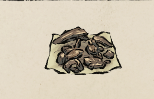
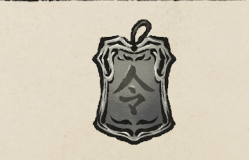
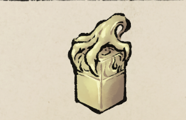
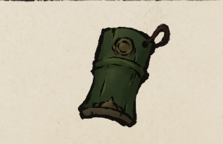
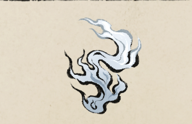
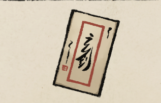
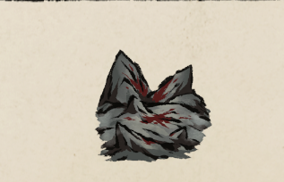
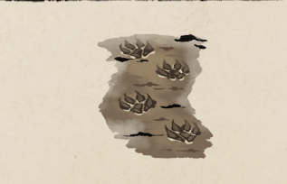

# 【卡牌修仙传】图鉴攻略 — 卡牌 / 道具&传闻

- 收录总数：50（已获得 43 / 🔒 未获得 7）
- 更新时间：2026-11-17 10:01

---

## 1. 不朽玉骨

可以用于制作骨龙傀儡

### 【获取途径】

击败妖王：九幽骨魅后有20%概率获得，炼化其内丹大概率获得；

用于炼制主材料可炼制出骨龙傀儡

---

## 2. 不朽蜕壳

击败妖王金蝉蛊后有概率获得，可以炼制成替身。

### 【获取途径】

击败妖王：金蝉蛊后有20%概率获得，炼化其内丹大概率获得；

用于炼制主材料可炼制出替身；

---

## 3. 血肉根

击败妖王血肉灵芝后有概率获得，可以炼制成替身。是制作灵宝：万魂幡的材料之

### 【获取途径】

击败妖王：血肉灵芝后有20%概率获得，炼化其内丹大概率获得；

用于炼制主材料可炼制出替身；

---

## 4. 夜飞双翼（🔒 未获得）

> 尚未获得此卡牌，以下为图鉴中可见的部分信息。

击败妖王文鳐鱼后有概率获得，可以炼制成飞行载具：霄流筝

### 【获取途径】

首次获得卡牌后解锁：

---

## 5. 涅槃火羽

击败妖王火云雀后有概率获得，可以炼制成飞行载具：霓凰羽毯

### 【获取途径】

击败妖王：火云雀后有20%概率获得，炼化其内丹大概率获得；

用于炼制主材料可炼制出载具：霓凰羽毯

---

## 6. 巨大象皮

击败妖王巨灵烈象后有概率获得，十分的值钱

### 【获取途径】

击败妖王：巨灵烈象后有20%概率获得，炼化其内丹大概率获得：

无法炼制

---

## 7. 青翼影膜

击败妖王青翼蝠王后有概率获得，可以炼制成飞行载具：青翅竹筏

### 【获取途径】

击败妖王：青翼蝠王后有20%概率获得，炼化其内丹大概率获得；

用于炼制主材料可炼制出载具：青翅竹筏

---

## 8. 药渣

炼药失败后剩余的药渣，除了当灵草的肥料以外，并没有其他作用；

### 【获取途径】

炼药失败的产物

---

## 9. 兽血

击杀妖兽后收集的血液，可用于炼化兽核！

### 【获取途径】

击败妖兽时有20%概率获得；

---

## 10. 兽皮

击杀妖兽后收集的所得，出售可以获得灵石！

### 【获取途径】

击败妖兽时有20%概率获得；

---

## 11. 巨兽皮

击杀妖王后收集的所得，无法用于炼制法宝。出售可以获得大量灵石！

### 【获取途径】

击败妖王时有20%概率获得：

---

## 12. 灵草种子

一颗普通的灵草种子，随着时间的流逝会生长成灵草。可以在培养工作台加快成长速度。

### 【获取途径】

炼气期时探索山脚和青灵木（小）有概率获得；

---

## 13. 静心草

静心草的生存时间极短，在洞天之地才能发现，是炼制筑基丹的核心材料。

### 【获取途径】

无名村庄附近的山顶每年会刷新一株；

救助无名村庄的农夫后，可以用内丹与他交易一株：

位于无名村庄附近的药田可以用机缘探索一株：

炼气期时，在无名村庄遇到的贪玩年车轻天时有10%获得

---

## 14. 玄铁令

玄剑阁的信物，将其出示给玄剑门弟子后，可调遣之。

### 【获取途径】

在修士战场有20%概率探索获得；

调查危险之地有30%概率获得；

调查藏宝地点有15%概率获得；

---

## 15. 六瓣冰莲（🔒 未获得）

> 尚未获得此卡牌，以下为图鉴中可见的部分信息。

雪隐宗的信物，将其出示给雪隐宗弟子后，可调遣之。

### 【获取途径】

首次获得卡牌后解锁：

---

## 16. 龙爪印

兽王府的信物，将其出示给兽王府弟子后，可调遣之。

### 【获取途径】

在修士战场有20%概率探索获得；

调查危险之地有30%概率获得；

调查藏宝地点有15%概率获得；

---

## 17. 青竹片（🔒 未获得）

> 尚未获得此卡牌，以下为图鉴中可见的部分信息。

清虚谷的信物，将其出示给清虚谷弟子后，可调遣之。

### 【获取途径】

首次获得卡牌后解锁：

---

## 18. 武极符（🔒 未获得）

> 尚未获得此卡牌，以下为图鉴中可见的部分信息。

武极门的信物，将其出示给武极门弟子后，可调遣之。

### 【获取途径】

首次获得卡牌后解锁：

---

## 19. 灵纹戒

这是可以收纳物品的戒指法宝；具体如何使用，需要调查一番便知！

### 【获取途径】

在玄机阁商店可以购买：

调查藏宝地点有15%概率获得；

地火深洞宝箱有15%概率获得；

---

## 20. 九霄神气

来自传说中的神域：九霄的灵气。能将一个练气期的法宝提升至下一品质。

### 【获取途径】

练气期时使用机缘探索金芒矿，青灵木，愈魂池，火云树凝土墟获得

---

## 21. 赤霄神气

来自传说中的神域：赤霄的灵气。能将一个筑基期的法宝提升至下一品质。

### 【获取途径】

筑基期时使用机缘探索金芒矿，青灵木，愈魂池，火云树凝土墟获得

---

## 22. 碧霄神气

来自传说中的神域：碧霄的灵气。能将一个结丹期的法宝提升至下一品质。

### 【获取途径】

结丹期时使用机缘探索金芒矿，青灵木，愈魂池，火云树凝土墟获得

---

## 23. 灵兽神魄

灵兽的神魄：灵兽残存于天地间的仅剩灵识，它在慢慢的吸收灵气复活；可以在“炼制”工作台加速炼制成灵兽。

### 【获取途径】

在山脚使用机缘探索必定能获得；

兽王府弟子交易物有45%概率出现；

---

## 24. 灵兽神魄

灵兽的神魄：灵兽残存于天地间的仅剩灵识，它在慢慢的吸收灵气复活；可以在“炼制”工作台加速炼制成灵兽。

### 【获取途径】

兽王府弟子交易物有45%概率出现；

击败中立灵兽有20%概率获得；

击败妖王有10%概率获得；

---

## 25. 灵兽神魄

灵兽的神魄：灵兽残存于天地间的仅剩灵识，它在慢慢的吸收灵气复活；可以在“炼制”工作台加速炼制成灵兽。

### 【获取途径】

兽王府弟子交易物有45%概率出现；

击败中立灵兽有20%概率获得；

击败妖王有10%概率获得；

---

## 26. 本源兽魄

强大妖王的一丝神魄，只有修炼至高境界的妖王才会激活：可以将灵兽提升至绝品

### 【获取途径】

把机缘给4只圣兽可以获得；

遇到曦和白猁后对话可获得（需完成哭泣妖王的任务）

战胜镇妖塔最高层可获得：

---

## 27. 雷劫之力（🔒 未获得）

> 尚未获得此卡牌，以下为图鉴中可见的部分信息。

成功渡劫后留下的残余雷劫之力！将雷劫之力拖至金丹破丹化婴！

### 【获取途径】

首次获得卡牌后解锁：

---

## 28. 玄剑阁推荐信

这是加入玄剑阁的推荐信，把推荐信交给玄剑阁广场的执事，我可直接加入玄剑阁。

### 【获取途径】

完美完成支线任务：赵子义的志向后获得：

---

## 29. 筑基丹

突破境界时方可服用

### 【获取途径】

通过筑基丹图纸炼制：

---

## 30. 灵气异常之地

我发现了有一处灵气异常的地方。我可以深入调查，也可以到客栈询问线索；

### 【获取途径】

主角/神识探索世界的时候有5%概率获得；

玄机阁有概率出售；

筑基期雪隐宗弟子有10%概率携带，有较大概率生成交易物

---

## 31. 危险之地

这里的环境显示这是一处危险的地方。我可以深入调查，也可以到客栈询问线索；

### 【获取途径】

主角/神识探索世界的时候有5%概率获得；

玄机阁有概率出售；

筑基期雪隐宗弟子有10%概率携带，有较大概率生成交易物

---

## 32. 宁静之地

来到此处，我感觉到十分宁静。我可以深入调查，也可以到客栈询问线索；

### 【获取途径】

主角/神识探索世界的时候有5%概率获得；

玄机阁有概率出售；

筑基期雪隐宗弟子有10%概率携带，有较大概率生成交易物

---

## 33. 混沌之地

这里的灵气明显的五行区分，是一个处于混沌状态的地方我可以深入调查，也可以到客栈询问线索；

### 【获取途径】

主角/神识探索世界的时候有5%概率获得；

玄机阁有概率出售；

筑基期雪隐宗弟子有10%概率携带，有较大概率生成交易物

---

## 34. 血煞之地

此处的煞气显示这里曾有过大战。我可以深入调查，也可以到客栈询问线索；

### 【获取途径】

主角/神识探索世界的时候有5%概率获得；

玄机阁有概率出售；

筑基期雪隐宗弟子有10%概率携带，有较大概率生成交易物

---

## 35. 灵脉之地

我看到灵气喷涌而出，这里有灵脉！我可以深入调查，也可以到客栈询问线索；

### 【获取途径】

主角/神识探索世界的时候有5%概率获得；

玄机阁有概率出售；

筑基期雪隐宗弟子有10%概率携带，有较大概率生成交易物

---

## 36. 藏宝之地（练气）

这是一条可能藏有宝物的地图

### 【获取途径】

主角/神识探索世界的时候。有5%概率获得；

玄机阁有概率出售：

筑基期雪隐宗弟子有10%概率携带，有较大概率生成交易物

---

## 37. 深山山顶路线

在山顶处似乎有大量妖兽盘踞着，实力较弱的妖兽被赶往山脚骚扰村庄！

### 【获取途径】

完成无名村庄的村长任务后，提交坟蛊鸪的头颅后获得；

---

## 38. 月照之地传闻

传闻在某个时间，天上月亮会将湖月城附近的一块地方照亮，而被照亮的物品，品质都会提升！

### 【获取途径】

在湖月城的东边或北边的客栈调查传闻：灵脉之地获得；

完美完成战场血衣支线任务后获得：

炼制因果有小概率获得；

---

## 39. 古木幽森传闻

传闻古木幽森其实是有一个入口，只不过是森林边缘的树木将人吞噬后带入森林内部。

### 【获取途径】

在湖月城北边的客栈调查传闻：危险之地获得：

完成无名村庄大妈任务后在金陵城遇见小女孩，对话有30%概率获得：

炼制因果有小概率获得；

---

## 40. 碧潭瀑布传闻

传闻在沿海的某个小岛里，有着一座有强大治愈能力的瀑布，可以恢复法宝的耐久！

### 【获取途径】

在湖月城东边或金陵城北边的客栈调查传闻：宁静之地获得；

炼制因果有小概率获得：

---

## 41. 地火深洞传闻

传闻在大陆的某处，有一个直通地底的深洞，偶有火焰从中喷出，附近的灵树都修炼成火云树了。

### 【获取途径】

在金陵城北边的客栈调查传闻：危险之地获得：

完成无名村庄大妈任务后在金陵城遇见小女孩，对话有30%概率获得

在醉仙阁请神秘高手喝酒（灵泉酿除外）后获得

---

## 42. 无字玉璧传闻

传闻在北方延绵的山脉里，有一座无字的玉璧，据说曾有前辈在玉璧前领悟出合体期的心法。

### 【获取途径】

在雪山中央或雁荡城东北侧的客栈调查传闻：宁静之地获得；

炼制因果有小概率获得：

---

## 43. 灵兽谷传闻

传闻在大陆某处，有一隐秘峡谷，在峡谷内常有灵兽出没。不少修士为了捕捉灵兽而寻觅整个大洲

### 【获取途径】

在湖月城北边的客栈调查传闻：混沌之地获得：

在湖月城管家处开启悦宣儿任务后获得：

炼制因果有小概率获得；

---

## 44. 镇妖塔传闻

传闻上古时期妖王肆虐，一位练虚老祖不忍苍生受苦，于是把整个大洲的妖王都抓进塔内镇压。

### 【获取途径】

在雪山中央的客栈调查传闻：血煞之地获得：

完成庄兰台支线任务后获得：

炼制因果有小概率获得；

---

## 45. 剑冢传闻

传闻上古时期两位剑仙在某处决生死，在打断了无数仙剑后的战场成为了剑意凌然的地方，许多踏上剑修之道的修士都想前往感受。

### 【获取途径】

在无名村庄附近的客栈调查传闻：血煞之地获得；

完成无名村庄大妈任务后在金陵城遇见小女孩，对话有30%概率获得；

巴成赵子的任务线赵子义的志向）可以获得

---

## 46. 天地熔炉传闻（🔒 未获得）

> 尚未获得此卡牌，以下为图鉴中可见的部分信息。

传闻在火山的火山口，可以当做熔炉炼制法宝法器，但具体是哪一个，便要仔细寻找了

### 【获取途径】

首次获得卡牌后解锁：

---

## 47. 宗门遗迹传闻（🔒 未获得）

> 尚未获得此卡牌，以下为图鉴中可见的部分信息。

相传千年前的修仙界之首：天衍宗的遗迹在此大洲的某处平原里，但竟然在城里小孩处得到了线索

### 【获取途径】

首次获得卡牌后解锁：

---

## 48. 人影

一道人影，他似乎正朝我走来。

### 【获取途径】

主角/神识探索世界的时候有30%概率获得；

---

## 49. 妖兽踪迹

偶然发现的踪迹。我可以不管它，又或者调查此踪迹

### 【获取途径】

主角/神识探索世界的时候有20%概率获得；

---

## 50. "神秘人"

传闻有位神秘人在附近出没，根据此线索可以找到他！

### 【获取途径】

主角/神识在客栈探索时，累计一定次数后必定获得：

---
