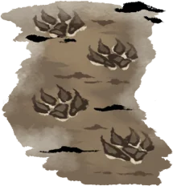
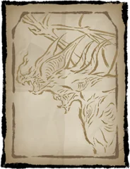
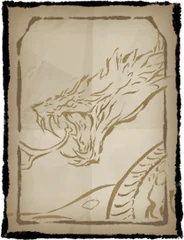
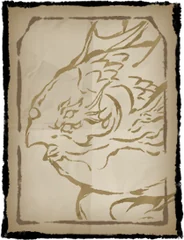

# 【卡牌修仙传】图鉴攻略 — 卡牌 / 道具&传闻

- 收录总数：64（游戏官方数据，其中图鉴未收录 18 条）
- 更新时间：2026-11-20 22:37

---

## 1. 不朽玉骨

可以用于制作骨龙傀儡

### 【获取途径】

击败妖王「九幽骨魅」后有20%概率获得，炼化九幽骨魅的内丹大概率获得

用途：作为主材料可炼制出骨龙傀儡

---

## 2. 不朽蜕壳

可以炼制成替身。

### 【获取途径】

击败妖王「金蝉蛊」后有20%概率获得，炼化金蝉蛊的内丹大概率获得

用途：作为主材料可炼制出替身

结丹期：和「金蝉蛊」对话（在「月照之地」），有概率获得

---

## 3. 血肉根

可以炼制成替身。

是制作**灵宝：万魂幡**的材料之一

### 【获取途径】

击败妖王「血肉灵芝」后有20%概率获得，炼化血肉灵芝的内丹大概率获得

用途：作为主材料可炼制出替身

---

## 4. 夜飞双翼

可以炼制成飞行载具：霄流筝

### 【获取途径】

击败妖王「文鳐鱼」后有20%概率获得，炼化文鳐鱼的内丹大概率获得

用途：作为主材料可炼制出载具：霄流筝

---

## 5. 涅槃火羽

可以炼制成飞行载具：霓凰羽毯

### 【获取途径】

击败妖王「火云雀」后有20%概率获得，炼化火云雀的内丹大概率获得

用途：作为主材料可炼制出载具：霓凰羽毯

---

## 6. 巨大象皮

十分的值钱

### 【获取途径】

击败妖王「巨灵烈象」后有20%概率获得，炼化巨灵烈象的内丹大概率获得

无法炼制

---

## 7. 青翼影膜

可以炼制成飞行载具：青翅竹筏

### 【获取途径】

击败妖王「青翼蝠王」后有20%概率获得，炼化青翼蝠王的内丹大概率获得

用途：作为主材料可炼制出载具：青翅竹筏

---

## 8. 药渣

炼药失败后剩余的药渣，除了当灵草的肥料以外，并没有其他作用

### 【获取途径】

炼药失败的产物

带着〈任意灵草（练气后期）〉和「慕容绛璃」对话，获得

---

## 9. 兽血

击杀妖兽后收集的血液，可用于炼化兽核！

### 【获取途径】

击败妖兽时有20%概率获得

和「祸斗」对话（在「深洞内部」），获得

击败妖王「坟蛊鸪」有概率掉落

---

## 10. 兽皮

### 【各版本（境界 / 品质）】

绝品：击杀妖兽后收集的所得。出售可以获得较多灵石！

### 【获取途径】

击败妖兽时有20%概率获得

---

## 11. 巨兽皮

击杀妖王后收集的所得，无法用于炼制法宝。

出售可以获得大量灵石！

### 【获取途径】

击败妖王时有20%概率获得

---

## 12. 灵草种子

一颗普通的灵草种子，随着时间的流逝会生长成灵草。

### 【各版本（境界 / 品质）】

筑基·仙品：从妖王身上发现的灵草种子，随着时间的流逝会成长出仙品以上的灵草。；可以在**培养**工作台加快成长速度。

结丹·仙品：从妖王身上发现的灵草种子，随着时间的流逝会成长出仙品以上的灵草。；可以在**培养**工作台加快成长速度。

### 【获取途径】

练气期时探索山脚和青灵木（小）有概率获得

练气期：在「山脚下」探索、或在「客栈」拜访时，可能遇到凡人「贪玩的年轻人」：他 120 日后消失时，有20%概率送你一张

练气期：在「山脚下」/「青灵木(小)」探索，有概率获得

筑基～结丹期：在「青灵木」探索，有概率获得

筑基～元婴期：击败妖王「血藤古树」有概率掉落

---

## 13. 静心草

静心草的生存时间极短，在洞天之地才能发现，是炼制筑基丹的核心材料。

### 【获取途径】

无名村庄附近的山顶每年会刷新一株

救助无名村庄的农夫后，可以用内丹与他交易一株

位于无名村庄附近的药田，可以用机缘探索一株

练气期时，在无名村庄遇到的贪玩年轻人消失时有10%概率获得

---

## 14. 玄铁令

玄剑阁的信物，将其出示给玄剑门弟子后，可调遣之。

### 【获取途径】

在修士战场有20%概率探索获得

调查危险之地有30%概率获得

调查藏宝地点有15%概率获得

---

## 15. 六瓣冰莲

雪隐宗的信物，将其出示给雪隐宗弟子后，可调遣之。

### 【获取途径】

在修士战场有20%概率探索获得

调查危险之地有30%概率获得

调查藏宝地点有15%概率获得

---

## 16. 龙爪印

兽王府的信物，将其出示给兽王府弟子后，可调遣之。

### 【获取途径】

在修士战场有20%概率探索获得

调查危险之地有30%概率获得

调查藏宝地点有15%概率获得

---

## 17. 青竹片

清虚谷的信物，将其出示给清虚谷弟子后，可调遣之。

### 【获取途径】

在修士战场有20%概率探索获得

调查危险之地有30%概率获得

调查藏宝地点有15%概率获得

---

## 18. 武极符

武极门的信物，将其出示给武极门弟子后，可调遣之。

### 【获取途径】

在修士战场有20%概率探索获得

调查危险之地有30%概率获得

调查藏宝地点有15%概率获得

---

## 19. 灵纹戒

这是可以收纳物品的戒指法宝；具体如何使用，需要**调查**一番便知！

### 【各版本（境界 / 品质）】

天品：获得方式 在「无名村庄」向「商人」花 2000 灵石购买

人品：普通的灵纹戒，**调查**后可使收纳空间上限提高。（收纳空间 +30）；获得方式 在「玄机阁」大堂花 2000 灵石购买（每 180 日补货）、把〈藏宝之地（练气）〉/〈藏宝之地（筑基）〉/〈藏宝之地（结丹）〉放进调查工作台「探索宝物」，有 15% 概率获得

地品：品质更高的灵纹戒，**调查**后可使收纳空间上限提高。（收纳空间 +50）；获得方式 在「玄机阁」筑基商品区花 3300 灵石购买（每 180 日补货）、调查〈危险之地〉，有 30% 概率获得

天品：品质更高的灵纹戒，**调查**后可使收纳空间上限提高。（收纳空间 +100）；获得方式 在「玄机阁」结丹商品区花 6500 灵石购买（每 180 日补货）、打开〈宝藏〉，有 20% 概率获得

仙品：品质更高的灵纹戒，**调查**后可使收纳空间上限提高。（收纳空间 +200）；获得方式 把灵石交给「神秘人」完成他的心愿（筑基期 5000～15000 灵石，结丹期 20000～36000 灵石），随机给一件奖励，可能是它、在秘境「天机棋盘」完成挑战后随机得到一件奖励，可能是它

神品：稀有的灵纹戒，**调查**后可使收纳空间上限提高。（收纳空间 +300）；获得方式 主角突破时「悦萱儿」送的贺礼：到结丹前期（好感 ≥ 30）

绝品：罕见的灵纹戒，**调查**后可使收纳空间上限大幅度提高。（收纳空间 +500）；获得方式 在雁荡城「药店」花 100000 灵石购买（每 30 日刷新）、炼制〈因果〉（主角筑基期起）：随机一件「因果之物」，可能是它

---

## 20. 九霄神气

### 【各版本（境界 / 品质）】

九霄神气·练气·神品：来自传说中的神域：九霄的灵气。能将一个练气期的法宝提升至下一品质。

赤霄神气·筑基·神品：来自传说中的神域：赤霄的灵气。能将一个筑基期的法宝提升至下一品质。

碧霄神气·结丹·神品：来自传说中的神域：碧霄的灵气。能将一个结丹期的法宝提升至下一品质。；也可以和〈金丹〉一起放进培养工作台「培养金丹？」：金丹吸收后，御物（放法宝耗的灵气）- 1（每个金丹只能吸收一次）。

### 【获取途径】

主角在练气期 / 筑基期 / 结丹期时，用机缘探索金芒矿、青灵木、愈魂池、火云树、凝土墟，获得当前境界的神气（练气期得九霄神气，筑基期得赤霄神气，结丹期得碧霄神气）

---

## 21. 灵兽神魄

灵兽的神魄：灵兽残存于天地间的仅剩灵识，它在慢慢的吸收灵气复活

可以在"炼制"工作台加速炼制成灵兽。

### 【各版本（境界 / 品质）】

练气·人品：获取途径 在「山脚下」「探索山脚」（主角）或「利用神识感知」（神识）时，再放入一张〈机缘〉（或〈善缘〉），必定获得；兽王府弟子交易物有45%概率出现

筑基·人品：获取途径 兽王府弟子交易物有45%概率出现；击败妖王有10%概率获得

结丹·人品：获取途径 兽王府弟子交易物有45%概率出现；击败妖王有10%概率获得

---

## 22. 本源兽魄

强大妖王的一丝神魄，只有修炼至高境界的妖王才会激活

可以将灵兽提升至绝品

### 【获取途径】

筑基期后，带着〈机缘〉/〈善缘〉和四只圣兽的分身（白龙 / 鲲 / 九尾天狐 / 三头凶蛟）对话，获得

【苏软软的支线】第 9 步「把清云猞猁交给哭泣的妖王」：完成后遇到「曦和白猁」，和它对话，获得

在〈培养工作台〉，〈灵兽神魄〉 + 〈灵兽神魄〉培养后**必定**获得（用时 60 秒）

---

## 23. 雷劫之力

成功渡劫后留下的残余雷劫之力！

将雷劫之力拖至金丹破丹化婴！

### 【获取途径】

成功渡雷劫后获得

---

## 24. 玄剑阁推荐信

这是加入玄剑阁的推荐信，把推荐信交给玄剑阁广场的执事，我可直接加入玄剑阁。

### 【获取途径】

【赵子义的支线】第 24 步「获得玄剑阁推荐信」：和「赵子义」对话，获得

---

## 25. 筑基丹

突破境界时方可服用

### 【获取途径】

第 1 步：突破「练气后期」时得到回忆剧情卡「初窥筑基」，点「完成事件」 → 师傅送你〈筑基丹图纸〉

第 2 步：准备材料：〈静心草〉1 株、任意一颗绝品内丹、任意一张灵气（混沌灵气或五行灵气）

第 3 步：把〈筑基丹图纸〉放进炼制工作台「炼制筑基丹」，再放入上面三样 → 炼成〈筑基丹〉（炼制时间很长，要提前准备）

用法：练气期修为满后突破「筑基！」时，把〈神识〉和〈筑基丹〉一起放进突破工作台

---

## 26. 灵气异常之地

我发现了有一处灵气异常的地方。

我可以深入**调查**，也可以到**客栈**询问线索

### 【各版本（境界 / 品质）】

异常之地·人品：老人说村子的附近有个地方很奇怪，让我帮忙**调查**。

### 【获取途径】

主角/神识探索世界的时候，有5%概率获得

玄机阁有概率出售

筑基期雪隐宗弟子有10%概率携带，有较大概率生成交易物

和「长寿的老人」对话（在「无名村庄」），获得

「赵子义」每年送的礼物（主角筑基 / 结丹期，好感 ≥ 10）

---

## 27. 危险之地

这里的环境显示这是一处危险的地方.

我可以深入**调查**，也可以到**客栈**询问线索

### 【获取途径】

主角/神识探索世界的时候，有5%概率获得

玄机阁有概率出售

筑基期雪隐宗弟子有10%概率携带，有较大概率生成交易物

---

## 28. 宁静之地

来到此处，我感觉到十分宁静。

我可以深入**调查**，也可以到**客栈**询问线索

### 【获取途径】

主角/神识探索世界的时候，有5%概率获得

玄机阁有概率出售

筑基期雪隐宗弟子有10%概率携带，有较大概率生成交易物

---

## 29. 混沌之地

这里的灵气明显的五行区分，是一个处于混沌状态的地方。

我可以深入**调查**，也可以到**客栈**询问线索

### 【获取途径】

主角/神识探索世界的时候，有5%概率获得

玄机阁有概率出售

筑基期雪隐宗弟子有10%概率携带，有较大概率生成交易物

「赵子义」每年送的礼物（主角筑基期，好感 ≥ 25，随机给一张）

---

## 30. 血煞之地

此处的煞气显示这里曾有过大战。

我可以深入**调查**，也可以到**客栈**询问线索

### 【获取途径】

主角/神识探索世界的时候，有5%概率获得

玄机阁有概率出售

筑基期雪隐宗弟子有10%概率携带，有较大概率生成交易物

「赵子义」每年送的礼物（主角筑基期，好感 ≥ 25，随机给一张）

---

## 31. 灵脉之地

我看到灵气喷涌而出，这里有灵脉！

我可以深入**调查**，也可以到**客栈**询问线索

### 【获取途径】

主角/神识探索世界的时候，有5%概率获得

玄机阁有概率出售

筑基期雪隐宗弟子有10%概率携带，有较大概率生成交易物

「赵子义」每年送的礼物（主角筑基期，好感 ≥ 25，随机给一张）

---

## 32. 藏宝之地(练气)

这是一条可能藏有宝物的地图

### 【获取途径】

主角/神识探索世界的时候，有5%概率获得

玄机阁有概率出售

筑基期雪隐宗弟子有10%概率携带，有较大概率生成交易物

带着〈神品的化瘀丹或血还丹〉和「受伤的修士」对话，获得

「赵子义」每年送的礼物（主角筑基 / 结丹期，好感 ≥ 25）

---

## 33. 深山山顶路线

在山顶处似乎有大量妖兽盘踞着，实力较弱的妖兽被赶往山脚骚扰村庄！

### 【获取途径】

完成无名村庄的村长任务后，提交坟蛊鸪的头颅后获得

---

## 34. 月照之地传闻

传闻在某个时间，天上月亮会将湖月城附近的一块地方照亮，而被照亮的物品，品质都会提升！

### 【获取途径】

在湖月城的东边或北边的客栈调查传闻：灵脉之地获得

和「无名灵体」对话（这是任务【江湖经历·请求】第 4 步「完美完成"战场灵体"的请求」），获得

炼制因果有小概率获得

练气期：和「无名灵体」对话，获得

---

## 35. 古木幽森传闻

传闻古木幽森其实是有一个入口，只不过是森林边缘的树木将人吞噬后带入森林内部。

### 【获取途径】

在湖月城北边的客栈调查传闻：危险之地获得

完成无名村庄大妈任务后，在金陵城遇见小女孩，对话有30%概率获得

炼制因果有小概率获得

带着〈任意神品灵草（筑基后期）〉和「慕容绛璃」对话，获得

---

## 36. 碧潭瀑布传闻

传闻在沿海的某个小岛里，有着一座有强大治愈能力的瀑布，可以恢复法宝的耐久！

### 【获取途径】

在湖月城东边或金陵城北边的客栈调查传闻：宁静之地获得

炼制因果有小概率获得

---

## 37. 地火深洞传闻

传闻在大陆的某处，有一个直通地底的深洞，偶有火焰从中喷出，附近的灵树都修炼成火云树了。

### 【获取途径】

在金陵城北边的客栈调查传闻：危险之地获得

完成无名村庄大妈任务后，在金陵城遇见小女孩，对话有30%概率获得

在醉仙阁请神秘高手喝酒（灵泉酿除外）后获得

---

## 38. 无字玉璧传闻

传闻在北方延绵的山脉里，有一座无字的玉璧，据说曾有前辈在玉璧前领悟出合体期的心法。

### 【获取途径】

在雪山中央或雁荡城东北侧的客栈调查传闻：宁静之地获得

炼制因果有小概率获得

---

## 39. 灵兽谷传闻

传闻在大陆某处，有一隐秘峡谷，在峡谷内常有灵兽出没，不少修士为了捕捉灵兽而寻觅整个大洲

### 【获取途径】

在湖月城北边的客栈调查传闻：混沌之地获得

在湖月城管家处开启悦萱儿任务后获得

炼制因果有小概率获得

---

## 40. 镇妖塔传闻

传闻上古时期妖王肆虐，一位练虚老祖不忍苍生受苦，于是把整个大洲的妖王都抓进塔内镇压。

### 【获取途径】

在雪山中央的客栈调查传闻：血煞之地获得

炼制因果有小概率获得

【江湖经历·请求】第 6 步「完成庄兰台的请求」：和「庄兰台之魂」对话，获得

---

## 41. 剑冢传闻

传闻上古时期两位剑仙在某处决生死，在打断了无数仙剑后的战场成为了剑意凌然的地方，许多踏上剑修之道的修士都想前往感受。

### 【获取途径】

在无名村庄附近的客栈调查传闻：血煞之地获得

完成无名村庄大妈任务后，在金陵城遇见小女孩，对话有30%概率获得

完美完成赵子义的任务线（赵子义的志向）后可以获得

把〈任意木属性神品灵兽〉交给「温明德」，获得

---

## 42. 天地熔炉传闻

传闻在火山的火山口，可以当做熔炉炼制法宝法器，但具体是哪一个，便要仔细寻找了

### 【获取途径】

在雁荡城东北侧的客栈调查传闻：混沌之地获得

炼制因果有小概率获得

---

## 43. 宗门遗迹传闻

相传千年前的修仙界之首：天衍宗的遗迹在此大洲的某处平原里，但竟然在城里小孩处得到了线索

### 【获取途径】

地图湖月城东南方向远处的客栈调查传闻：灵脉之地获得

在「镇妖塔」一层和「???」对话（这是任务【江湖经历·请求】第 5 步「完成"镇妖塔灵体"的请求」），获得

---

## 44. 人影

一道人影，他似乎正朝我走来。

### 【获取途径】

主角/神识探索世界的时候，有30%概率获得

---

## 45. 妖兽踪迹

偶然发现的踪迹。我可以不管它，又或者**调查**此踪迹

### 【获取途径】

主角/神识探索世界的时候，有20%概率获得

---

## 46. "神秘人"

传闻有位神秘人在附近出没，根据此线索可以找到他！

### 【获取途径】

主角/神识在客栈探索时，累计一定次数后必定获得

---

## 47. 血藤古树踪迹（图鉴未收录）

在灵兽谷和十万大山发现妖王：血藤古树的踪迹。

把传闻带进指定秘境即可触发讨伐战！

### 【带去哪里讨伐】

进入下面的秘境时把〈血藤古树踪迹〉放进卡槽（会消耗掉），就能找到血藤古树，它的境界和主角一样。

秘境 | 主角境界

「灵兽谷」 | 筑基期 / 结丹期

「十万大山」 | 筑基期 / 结丹期

### 【获取途径】

金陵城/湖月城/雁荡城每年均有概率刷新妖王踪迹

---

## 48. 夔牛踪迹（图鉴未收录）

在风暴妖巢和十万大山发现妖王：夔牛的踪迹。

把传闻带进指定秘境即可触发讨伐战！

### 【带去哪里讨伐】

进入下面的秘境时把〈夔牛踪迹〉放进卡槽（会消耗掉），就能找到夔牛，它的境界和主角一样。

秘境 | 主角境界

「十万大山」 | 筑基期 / 结丹期

「风暴妖巢」 | 筑基期 / 结丹期

### 【获取途径】

金陵城/湖月城/雁荡城每年均有概率刷新妖王踪迹

---

## 49. 祸斗踪迹（图鉴未收录）

在妖兽巢穴和十万大山发现妖王：祸斗的踪迹。

把传闻带进指定秘境即可触发讨伐战！

### 【带去哪里讨伐】

进入下面的秘境时把〈祸斗踪迹〉放进卡槽（会消耗掉），就能找到祸斗，它的境界和主角一样。

秘境 | 主角境界

「妖兽巢穴」 | 筑基期 / 结丹期

「十万大山」 | 筑基期 / 结丹期

### 【获取途径】

金陵城/湖月城/雁荡城每年均有概率刷新妖王踪迹

---

## 50. 巨灵烈象踪迹（图鉴未收录）

在灵兽谷和十万大山发现妖王：巨灵烈象的踪迹。

把传闻带进指定秘境即可触发讨伐战！

### 【带去哪里讨伐】

进入下面的秘境时把〈巨灵烈象踪迹〉放进卡槽（会消耗掉），就能找到巨灵烈象，它的境界和主角一样。

秘境 | 主角境界

「灵兽谷」 | 筑基期 / 结丹期

「十万大山」 | 筑基期 / 结丹期

### 【获取途径】

金陵城/湖月城/雁荡城每年均有概率刷新妖王踪迹

---

## 51. 鬼面蛛踪迹（图鉴未收录）

在妖兽巢穴和十万大山发现妖王：鬼面蛛的踪迹。

把传闻带进指定秘境即可触发讨伐战！

### 【带去哪里讨伐】

进入下面的秘境时把〈鬼面蛛踪迹〉放进卡槽（会消耗掉），就能找到鬼面蛛，它的境界和主角一样。

秘境 | 主角境界

「妖兽巢穴」 | 筑基期 / 结丹期

「十万大山」 | 筑基期 / 结丹期

### 【获取途径】

金陵城/湖月城/雁荡城每年均有概率刷新妖王踪迹

---

## 52. 金蝉蛊踪迹（图鉴未收录）

在灵兽谷和十万大山发现妖王：金蝉蛊的踪迹。

把传闻带进指定秘境即可触发讨伐战！

### 【带去哪里讨伐】

进入下面的秘境时把〈金蝉蛊踪迹〉放进卡槽（会消耗掉），就能找到金蝉蛊，它的境界和主角一样。

秘境 | 主角境界

「灵兽谷」 | 筑基期 / 结丹期

「十万大山」 | 筑基期 / 结丹期

### 【获取途径】

金陵城/湖月城/雁荡城每年均有概率刷新妖王踪迹

---

## 53. 血肉灵芝踪迹（图鉴未收录）

在灵兽谷和十万大山发现妖王：血肉灵芝的踪迹。

把传闻带进指定秘境即可触发讨伐战！

### 【带去哪里讨伐】

进入下面的秘境时把〈血肉灵芝踪迹〉放进卡槽（会消耗掉），就能找到血肉灵芝，它的境界和主角一样。

秘境 | 主角境界

「灵兽谷」 | 筑基期 / 结丹期

「十万大山」 | 筑基期 / 结丹期

### 【获取途径】

金陵城/湖月城/雁荡城每年均有概率刷新妖王踪迹

---

## 54. 北海巨妖踪迹（图鉴未收录）

在风暴妖巢和十万大山发现妖王：北海巨妖的踪迹。

把传闻带进指定秘境即可触发讨伐战！

### 【带去哪里讨伐】

进入下面的秘境时把〈北海巨妖踪迹〉放进卡槽（会消耗掉），就能找到北海巨妖，它的境界和主角一样。

秘境 | 主角境界

「十万大山」 | 筑基期 / 结丹期

「风暴妖巢」 | 筑基期 / 结丹期

### 【获取途径】

金陵城/湖月城/雁荡城每年均有概率刷新妖王踪迹

---

## 55. 黑焰虎踪迹（图鉴未收录）

在妖兽巢穴和十万大山发现妖王：黑焰虎的踪迹。

把传闻带进指定秘境即可触发讨伐战！

### 【带去哪里讨伐】

进入下面的秘境时把〈黑焰虎踪迹〉放进卡槽（会消耗掉），就能找到黑焰虎，它的境界和主角一样。

秘境 | 主角境界

「妖兽巢穴」 | 筑基期 / 结丹期

「十万大山」 | 筑基期 / 结丹期

### 【获取途径】

金陵城/湖月城/雁荡城每年均有概率刷新妖王踪迹

---

## 56. 铁骨熊踪迹（图鉴未收录）

在灵兽谷和十万大山发现妖王：铁骨熊的踪迹。

把传闻带进指定秘境即可触发讨伐战！

### 【带去哪里讨伐】

进入下面的秘境时把〈铁骨熊踪迹〉放进卡槽（会消耗掉），就能找到铁骨熊，它的境界和主角一样。

秘境 | 主角境界

「灵兽谷」 | 筑基期 / 结丹期

「十万大山」 | 筑基期 / 结丹期

### 【获取途径】

金陵城/湖月城/雁荡城每年均有概率刷新妖王踪迹

---

## 57. 青翼蝠王踪迹（图鉴未收录）

在妖兽巢穴和风暴妖巢和十万大山发现妖王：青翼蝠王的踪迹。

把传闻带进指定秘境即可触发讨伐战！

### 【带去哪里讨伐】

进入下面的秘境时把〈青翼蝠王踪迹〉放进卡槽（会消耗掉），就能找到青翼蝠王，它的境界和主角一样。

秘境 | 主角境界

「妖兽巢穴」 | 筑基期 / 结丹期

「十万大山」 | 筑基期 / 结丹期

「风暴妖巢」 | 筑基期 / 结丹期

### 【获取途径】

金陵城/湖月城/雁荡城每年均有概率刷新妖王踪迹

---

## 58. 坟蛊鸪踪迹（图鉴未收录）

在妖兽巢穴和十万大山发现妖王：坟蛊鸪的踪迹。

把传闻带进指定秘境即可触发讨伐战！

### 【带去哪里讨伐】

进入下面的秘境时把〈坟蛊鸪踪迹〉放进卡槽（会消耗掉），就能找到坟蛊鸪，它的境界和主角一样。

秘境 | 主角境界

「妖兽巢穴」 | 筑基期 / 结丹期

「十万大山」 | 筑基期 / 结丹期

### 【获取途径】

金陵城/湖月城/雁荡城每年均有概率刷新妖王踪迹

---

## 59. 狰踪迹（图鉴未收录）

在妖兽巢穴和十万大山发现妖王：狰的踪迹。

把传闻带进指定秘境即可触发讨伐战！

### 【带去哪里讨伐】

进入下面的秘境时把〈狰踪迹〉放进卡槽（会消耗掉），就能找到狰，它的境界和主角一样。

秘境 | 主角境界

「妖兽巢穴」 | 结丹期

「十万大山」 | 结丹期

### 【获取途径】

金陵城/湖月城/雁荡城每年均有概率刷新妖王踪迹（需主角达到结丹期）

---

## 60. 肥遗踪迹（图鉴未收录）

在灵兽谷和十万大山发现妖王：肥遗的踪迹。

把传闻带进指定秘境即可触发讨伐战！

### 【带去哪里讨伐】

进入下面的秘境时把〈肥遗踪迹〉放进卡槽（会消耗掉），就能找到肥遗，它的境界和主角一样。

秘境 | 主角境界

「灵兽谷」 | 结丹期

「十万大山」 | 结丹期

### 【获取途径】

金陵城/湖月城/雁荡城每年均有概率刷新妖王踪迹（需主角达到结丹期）

---

## 61. 文鳐鱼踪迹（图鉴未收录）

在风暴妖巢和十万大山发现妖王：文鳐鱼的踪迹。

把传闻带进指定秘境即可触发讨伐战！

### 【带去哪里讨伐】

进入下面的秘境时把〈文鳐鱼踪迹〉放进卡槽（会消耗掉），就能找到文鳐鱼，它的境界和主角一样。

秘境 | 主角境界

「十万大山」 | 结丹期

「风暴妖巢」 | 结丹期

### 【获取途径】

金陵城/湖月城/雁荡城每年均有概率刷新妖王踪迹（需主角达到结丹期）

---

## 62. 火云雀踪迹（图鉴未收录）

在风暴妖巢和十万大山发现妖王：火云雀的踪迹。

把传闻带进指定秘境即可触发讨伐战！

### 【带去哪里讨伐】

进入下面的秘境时把〈火云雀踪迹〉放进卡槽（会消耗掉），就能找到火云雀，它的境界和主角一样。

秘境 | 主角境界

「灵兽谷」 | 结丹期

「十万大山」 | 结丹期

「风暴妖巢」 | 结丹期

### 【获取途径】

金陵城/湖月城/雁荡城每年均有概率刷新妖王踪迹（需主角达到结丹期）

---

## 63. 石魈踪迹（图鉴未收录）

在灵兽谷和十万大山发现妖王：石魈的踪迹。

把传闻带进指定秘境即可触发讨伐战！

### 【带去哪里讨伐】

进入下面的秘境时把〈石魈踪迹〉放进卡槽（会消耗掉），就能找到石魈，它的境界和主角一样。

秘境 | 主角境界

「灵兽谷」 | 结丹期

「十万大山」 | 结丹期

### 【获取途径】

金陵城/湖月城/雁荡城每年均有概率刷新妖王踪迹（需主角达到结丹期）

---

## 64. 九幽骨魅踪迹（图鉴未收录）

在妖兽巢穴和十万大山发现妖王：九幽骨魅的踪迹。

把传闻带进指定秘境即可触发讨伐战！

### 【带去哪里讨伐】

进入下面的秘境时把〈九幽骨魅踪迹〉放进卡槽（会消耗掉），就能找到九幽骨魅，它的境界和主角一样。

秘境 | 主角境界

「妖兽巢穴」 | 结丹期

「十万大山」 | 结丹期

### 【获取途径】

金陵城/湖月城/雁荡城每年均有概率刷新妖王踪迹（需主角达到结丹期）

---
