# 【卡牌修仙传】图鉴攻略 — 卡牌 / 道途&金丹

- 收录总数：7（游戏官方数据）
- 更新时间：2026-11-18 15:34

---

## 1. 修道之路 / 我的道途

结丹并非易事，我需要寻找我的修道之路，方能顺利结丹。

（放入的道魂的**类型**（器/武/兽/丹/术）和**品质**（最高绝品）将决定结丹奖励）

我已经选择好修道之途，当大成之时，便可以结金丹！

### 【结丹流程】

① 突破「筑基后期」时获得「修道之路？」（卡槽：何种道?）。

② 把道魂（武道 / 器道 / 兽道 / 丹道 / 术道卡）放进去。每放入一张，弹出「功果圆成」：按这张道魂的【类型】和【品质】出现三个传承，只能择其一（具体有哪些见各道的【结丹奖励】）。

③ 放入的道魂组合决定「我的道途」称号（见下方【道途称号】）；道途大成后得到「我的道途」卡。

④ 突破「结丹！」：主角 + 神识 + 我的道途 → 结成金丹，同时获得〈本命物〉〈培养金丹〉两张指点。结丹后：〔攻击〕+26；〔血量〕+78；〔灵气〕+5；〔神识〕+1；寿命+100年。

⑤ 结丹后多余的道魂：放入修炼工作台「修炼道魂」→ 获得〈思绪〉；或者赠送给还没结丹的、有名字的人物（对方修为+25）。

### 【道途称号】

武道：1张 →「武之始」；2张 →「武道(专)」；3张 →「武道(极)·肉身成圣，以武证道」

器道：1张 →「器之始」；2张 →「器道(专)」；3张 →「器道(极)·人器合一，炼道成空」

兽道：1张 →「兽之始」；2张 →「兽道(专)」；3张 →「兽道(极)·返璞归真，万灵一体」

丹道：1张 →「丹之始」；2张 →「丹道(专)」；3张 →「丹道(极)·执掌造化，逆转生死」

术道：1张 →「术之始」；2张 →「术道(专)」；3张 →「术道(极)·洞悉本源，言出法随」

没有任何一种道达到2张（2张或3张都不同）→「平衡之道」：修仙之路并非只有专注某个道途，平衡亦是混沌，万象亦是归一！

（游戏表 card_tbcoresoulinfo 按「主要道的种类 + 张数 1~3」配置称号；(专)＝可再择一道辅助，或者继续专注）

### 【五种道途】

武道：乃是一条以肉身证道、追求凡躯成圣的修行之路。需以气血为基，历千锤百炼，将一身凡胎锻若神兵，直至肉身不坏！

器道：乃是修真界中绝大多数修士选择的道路。修士以神魂寄托于法宝，通过不断蕴养和锤炼，使法宝成为自身的延伸，最终达到人器合一的境界。

兽道：乃是修士将自身道途与灵兽性命交修、共生共长之道。修行者凭借契约秘法，与灵兽缔结共生之缘，或共享其力，或借形化兽，乃至最终人兽合一，共攀大道巅峰！

丹道：专注于炼制丹药，探寻草木金石之秘的修士，通过对药性的极致理解，将天地灵物淬炼成种种神丹，以此来辅助修炼！

术道：乃是以神魂感应天地法则，以灵气为笔墨勾勒大道真言，最终执掌乾坤造化之枢机。修行者需以自身为引，化灵气为万法，实现言出法随、术动乾坤的境界！

### 【获取途径】

突破「筑基后期」时获得「修道之路？」

放入道魂、道途大成后得到「我的道途」

---

## 2. 武道

武道：以肉身为舟，苦行为浆，不借外物，只求以力证道；追求力量的极致纯粹，将血肉凡胎历经千劫万淬，肉体成圣！

结丹后，可以把道卡牌赠予其他修士。

### 【各版本（境界 / 品质）】

人品：放入修道之路：「功果圆成」从人品武道传承中三选一（见下方【结丹奖励】）；获得方式 主角筑基期时，只用主角本体（体术）击杀筑基后期的妖兽

神品：放入修道之路：「功果圆成」从神品武道传承中三选一（见下方【结丹奖励】）；获得方式 主角筑基期时，只用主角本体（体术）击杀筑基后期的妖王

绝品：放入修道之路：「功果圆成」从绝品武道传承中三选一（见下方【结丹奖励】）；获得方式 在「镇妖塔七层」只用主角本体（体术）击杀筑基后期的妖王（只能获得一次）、在「比武：冠军赛」只用主角本体（体术）击杀修士（只能获得一次）、主角筑基期时，只用主角本体（体术）击杀结丹期或更高的修士、「因果」：主角筑基期时把〈因果〉放入修炼工作台，随机获得1张绝品道魂（五种之一；选了词条「强化因果」得双份）、把「无名灵体」（生前是武道修士的结丹期魂魄）放入修炼工作台，领悟武道（游戏数据表里没有找到无名灵体的固定产出，应该是剧情 / 事件脚本给的）、人物支线：身上有人品或神品的武道时与「神秘高手」/「袁白」对话，换得绝品武道

### 【结丹奖励 · 人品武道】

「功果圆成」：三道传承具现于前，只能择其一而悟。候选：

百炼钢躯（人品天赋）：我的〔攻击〕+5

百炼钢躯（人品天赋）：我的〔血量〕+50

回春圣体（人品天赋）：自己在恢复工作台的恢复速度提高（恢复系数+3）

洞虚灵眸（人品天赋）：神识值+1；但我的〔寿命〕-200

### 【结丹奖励 · 神品武道】

「功果圆成」：三道传承具现于前，只能择其一而悟。候选：

百炼钢躯（神品天赋）：我的〔攻击〕+10

百炼钢躯（神品天赋）：我的〔血量〕+100

回春圣体（神品天赋）：自己在恢复工作台的恢复速度小幅度提高（恢复系数+6）

金刚霸体（神品技能）：（被动）受到的所有伤害均减少10

血噬（神品技能）：每当有敌方卡牌被击败时，自身恢复35〔血量〕

洞虚灵眸（神品天赋）：神识值+1；但我的〔寿命〕-100

表里另一组候选（Prize）还会出现：

百炼钢躯（人品天赋）：我的〔攻击〕+5

百炼钢躯（人品天赋）：我的〔血量〕+50

回春圣体（人品天赋）：自己在恢复工作台的恢复速度提高（恢复系数+3）

虚境遥观（绝品天赋）：我的桌面范围变大10%

### 【结丹奖励 · 绝品武道】

「功果圆成」：三道传承具现于前，只能择其一而悟。候选：

百炼钢躯（绝品天赋）：我的〔攻击〕+20

百炼钢躯（绝品天赋）：我的〔血量〕+150

连击（绝品技能）：（被动）提高自身5〔攻击〕，每次行动会额外攻击一次

吸血（绝品技能）：攻击附带吸血效果：造成伤害有一定比例转化成自身血量；（练气期的吸血比例为10%；每提升一个境界，比例提高10%）

天窍（绝品天赋）：我可以额外装备一个技能

拳风（绝品技能）：攻击会对目标身旁卡牌造成30%伤害

回春圣体（绝品天赋）：自己在恢复工作台的恢复速度大幅提高（恢复系数+10）

洞虚灵眸（绝品天赋）：神识值+1

表里另一组候选（Prize）还会出现：

金刚霸体（神品技能）：（被动）受到的所有伤害均减少10

血噬（神品技能）：每当有敌方卡牌被击败时，自身恢复35〔血量〕

虚境遥观（绝品天赋）：我的桌面范围变大10%

### 【获取途径】

主角筑基期时，只用主角本体（体术）击杀敌人（这场战斗不能用法宝/傀儡/灵兽/口诀/丹药/同伴）：筑基后期妖兽 →人品，筑基后期妖王 →神品，结丹期或更高的修士 →绝品

绝品有三张：镇妖塔七层、比武冠军赛各一张（各只能获得一次），第三张来自击杀结丹修士 / 因果 / 人物支线等

---

## 3. 器道

器道：将神魂寄于法宝，将法宝修炼至与人为一，借助法宝放大自身力量的修炼之路

结丹后，可以把道卡牌赠予其他修士。

### 【各版本（境界 / 品质）】

人品：放入修道之路：「功果圆成」从人品器道传承中三选一（见下方【结丹奖励】）；获得方式 锻造法宝：把筑基后期的神品法宝锻造提升到绝品时获得（放入2张同属性的绝品材料，或〈玄霄神气〉）

神品：放入修道之路：「功果圆成」从神品器道传承中三选一（见下方【结丹奖励】）；获得方式 主角筑基期时，只用法宝或傀儡击杀筑基后期的妖王

绝品：放入修道之路：「功果圆成」从绝品器道传承中三选一（见下方【结丹奖励】）；获得方式 在「镇妖塔七层」只用法宝或傀儡击杀筑基后期的妖王（只能获得一次）、在「比武：冠军赛」只用法宝或傀儡击杀修士（只能获得一次）、主角筑基期时，只用法宝或傀儡击杀结丹期或更高的修士、击败「三头凶蛟的分身」、「虚弱的凶蛟」必定掉落、「因果」：主角筑基期时把〈因果〉放入修炼工作台，随机获得1张绝品道魂（五种之一；选了词条「强化因果」得双份）、把「无名灵体」（生前是器道修士的结丹期魂魄）放入修炼工作台，领悟器道（游戏数据表里没有找到无名灵体的固定产出，应该是剧情 / 事件脚本给的）、人物支线：身上有人品或神品的器道时与「金不换」对话，换得绝品器道

### 【结丹奖励 · 人品器道】

「功果圆成」：三道传承具现于前，只能择其一而悟。候选：

器心通明（人品天赋）：使用法宝/傀儡的〔灵气〕消耗-1；驭兽的〔灵气〕消耗+2

百炼钢躯（人品天赋）：我的〔攻击〕+5

百炼钢躯（人品天赋）：我的〔血量〕+50

洞虚灵眸（人品天赋）：神识值+1；但我的〔寿命〕-200

敛锋蕴气（人品天赋）：战斗结束后，从战斗中脱离的卡牌会恢复20〔血量〕（手动拿走的卡牌不会恢复）

### 【结丹奖励 · 神品器道】

「功果圆成」：三道传承具现于前，只能择其一而悟。候选：

器心通明（神品天赋）：使用法宝/傀儡的〔灵气〕消耗-1；驭兽的〔灵气〕消耗+1

百炼钢躯（神品天赋）：我的〔攻击〕+10

百炼钢躯（神品天赋）：我的〔血量〕+100

兵甲通玄（神品天赋）：战斗开始时，自己的法宝〔攻击〕+3；〔血量〕+5

洞虚灵眸（神品天赋）：神识值+1；但我的〔寿命〕-100

敛锋蕴气（神品天赋）：战斗结束后，从战斗中脱离的卡牌会恢复30〔血量〕（手动拿走的卡牌不会恢复）

表里另一组候选（Prize）还会出现：

器心通明（人品天赋）：使用法宝/傀儡的〔灵气〕消耗-1；驭兽的〔灵气〕消耗+2

百炼钢躯（人品天赋）：我的〔攻击〕+5

百炼钢躯（人品天赋）：我的〔血量〕+50

洞虚灵眸（人品天赋）：神识值+1；但我的〔寿命〕-200

虚境遥观（绝品天赋）：我的桌面范围变大10%

### 【结丹奖励 · 绝品器道】

「功果圆成」：三道传承具现于前，只能择其一而悟。候选：

器心通明（绝品天赋）：使用法宝/傀儡的〔灵气〕消耗-1

先发制人（绝品技能）：战斗开始时，使一个法宝先出手1次

唤剑诀（绝品口诀）：消耗50点〔灵气〕：借来1把剑；冷却 120 秒

兵甲通玄（绝品天赋）：战斗开始时，自己的法宝〔攻击〕+5；〔血量〕+10

剑魄通明（绝品技能）：战斗开始时，使自己的一把剑先出手1次；（元婴期后还会提高〔攻击〕）

器魂重塑（绝品技能）：自己第一个法宝战败时，使它满血复活

洞虚灵眸（绝品天赋）：神识值+1

敛锋蕴气（绝品天赋）：战斗结束后，从战斗中脱离的卡牌会恢复50〔血量〕（手动拿走的卡牌不会恢复）

表里另一组候选（Prize）还会出现：

虚境遥观（绝品天赋）：我的桌面范围变大10%

载天盾（绝品天赋）：（需主角在战场）战斗开始时，我方的〔土〕卡牌均获得10〔护甲〕

### 【获取途径】

主角筑基期时，只用法宝或傀儡击杀敌人（这场战斗不能用灵兽/口诀/丹药/同伴）：筑基后期妖王 →神品，结丹期或更高的修士 →绝品

人品器道来自锻造法宝（游戏指点说「只用法宝击败妖兽」也行，但数据表里器道没有配置击杀妖兽的奖励）

绝品有三张：镇妖塔七层、比武冠军赛各一张（各只能获得一次），第三张来自击杀结丹修士 / 因果 / 人物支线等

---

## 4. 兽道

兽道：以魂契灵兽，借其神通补己之短，可激发灵兽流淌的古老兽魂之力，觉醒血脉，继承洪荒神兽的宿命。

结丹后，可以把道卡牌赠予其他修士。

### 【各版本（境界 / 品质）】

人品：放入修道之路：「功果圆成」从人品兽道传承中三选一（见下方【结丹奖励】）；获得方式 培养灵兽：把筑基后期的神品灵兽培养提升到绝品时获得（放入〈本源兽魄〉等）

神品：放入修道之路：「功果圆成」从神品兽道传承中三选一（见下方【结丹奖励】）；获得方式 主角筑基期时，只用灵兽击杀筑基后期的妖王

绝品：放入修道之路：「功果圆成」从绝品兽道传承中三选一（见下方【结丹奖励】）；获得方式 在「镇妖塔七层」只用灵兽击杀筑基后期的妖王（只能获得一次）、在「比武：冠军赛」只用灵兽击杀修士（只能获得一次）、主角筑基期时，只用灵兽击杀结丹期或更高的修士、「因果」：主角筑基期时把〈因果〉放入修炼工作台，随机获得1张绝品道魂（五种之一；选了词条「强化因果」得双份）、把「无名灵体」（生前是兽道修士的结丹期魂魄）放入修炼工作台，领悟兽道（游戏数据表里没有找到无名灵体的固定产出，应该是剧情 / 事件脚本给的）

### 【结丹奖励 · 人品兽道】

「功果圆成」：三道传承具现于前，只能择其一而悟。候选：

驭兽之道（人品天赋）：驭兽的基础〔灵气〕消耗-1；御器（包括傀儡）的基础〔灵气〕消耗+1

生死契约（人品天赋）：我的灵兽在战败后，会保留5点〔血量〕

灵愈血契（人品天赋）：战斗结束后，从战斗中脱离的卡牌会恢复20〔血量〕（手动拿走的卡牌不会恢复）

洞虚灵眸（人品天赋）：神识值+1；但我的〔寿命〕-200

敛锋蕴气（人品天赋）：战斗结束后，从战斗中脱离的卡牌会恢复20〔血量〕（手动拿走的卡牌不会恢复）

磐石之躯（人品天赋）：前10回合开始时，主角获得7〔护甲〕；但我的〔攻击〕-3

与兽共舞（人品天赋）：主角在每回合受到的前3次攻击时，使友方随机灵兽的〔攻击〕+3

### 【结丹奖励 · 神品兽道】

「功果圆成」：三道传承具现于前，只能择其一而悟。候选：

驭兽之道（神品天赋）：驭兽的基础〔灵气〕消耗-2；御器（包括傀儡）的基础〔灵气〕消耗+1

生死契约（神品天赋）：我的灵兽在战败后，会保留10点〔血量〕

灵愈血契（神品天赋）：灵兽在恢复工作台的恢复速度小幅度提高（恢复系数+3）

洞虚灵眸（神品天赋）：神识值+1；但我的〔寿命〕-100

敛锋蕴气（神品天赋）：战斗结束后，从战斗中脱离的卡牌会恢复30〔血量〕（手动拿走的卡牌不会恢复）

磐石之躯（神品天赋）：前10回合开始时，主角获得13〔护甲〕；但我的〔攻击〕-6

与兽共舞（神品天赋）：主角在每回合受到的前3次攻击时，使友方随机灵兽的〔攻击〕+5；但我的〔攻击〕-8

表里另一组候选（Prize）还会出现：

驭兽之道（人品天赋）：驭兽的基础〔灵气〕消耗-1；御器（包括傀儡）的基础〔灵气〕消耗+1

生死契约（人品天赋）：我的灵兽在战败后，会保留5点〔血量〕

灵愈血契（人品天赋）：战斗结束后，从战斗中脱离的卡牌会恢复20〔血量〕（手动拿走的卡牌不会恢复）

洞虚灵眸（人品天赋）：神识值+1；但我的〔寿命〕-200

虚境遥观（绝品天赋）：我的桌面范围变大10%

磐石之躯（人品天赋）：前10回合开始时，主角获得7〔护甲〕；但我的〔攻击〕-3

与兽共舞（人品天赋）：主角在每回合受到的前3次攻击时，使友方随机灵兽的〔攻击〕+3

### 【结丹奖励 · 绝品兽道】

「功果圆成」：三道传承具现于前，只能择其一而悟。候选：

驭兽之道（绝品天赋）：驭兽的基础〔灵气〕消耗-3

驭兽诀（绝品口诀）：消耗50〔灵气〕：100%控制结丹期中立灵兽或妖兽；冷却 180 秒

生死契约（绝品天赋）：我的灵兽在战败后，会保留20点〔血量〕

灵愈血契（绝品天赋）：战斗结束后，从战斗中脱离的卡牌会恢复50〔血量〕（手动拿走的卡牌不会恢复）

兽魂重塑（绝品技能）：自己第一个灵兽战败时，使它满血复活

远古血脉（绝品天赋）：开启功能：我的灵兽可以吞噬1个**妖王内丹**以获得其属性（灵兽升阶后清除）

洞虚灵眸（绝品天赋）：神识值+1

敛锋蕴气（绝品天赋）：战斗结束后，从战斗中脱离的卡牌会恢复50〔血量〕（手动拿走的卡牌不会恢复）

百炼钢躯（绝品天赋）：我的〔血量〕+150

磐石之躯（绝品天赋）：前10回合开始时，主角获得18〔护甲〕

与兽共舞（绝品天赋）：主角在每回合受到的前3次攻击时，使友方随机灵兽的〔攻击〕+8

表里另一组候选（Prize）还会出现：

不动如山（绝品天赋）：我在战斗中受到兵器的伤害减少10点

载天盾（绝品天赋）：（需主角在战场）战斗开始时，我方的〔土〕卡牌均获得10〔护甲〕

### 【获取途径】

主角筑基期时，只用灵兽击杀敌人（这场战斗不能用法宝/傀儡/口诀/丹药/同伴）：筑基后期妖王 →神品，结丹期或更高的修士 →绝品

人品兽道来自培养灵兽（游戏指点说「只用灵兽击败妖兽」也行，但数据表里兽道没有配置击杀妖兽的奖励）

绝品有三张：镇妖塔七层、比武冠军赛各一张（各只能获得一次），第三张来自击杀结丹修士 / 因果 / 人物支线等

---

## 5. 丹道

丹道：以草木为媒，炉火为魂，经天地精华浓缩于丹。以丹窥探天道，逆天改命！。

结丹后，可以把道卡牌赠予其他修士。

### 【各版本（境界 / 品质）】

人品：放入修道之路：「功果圆成」从人品丹道传承中三选一（见下方【结丹奖励】）；获得方式 主角筑基期时，只用丹药击杀筑基后期的妖兽

神品：放入修道之路：「功果圆成」从神品丹道传承中三选一（见下方【结丹奖励】）；获得方式 主角筑基期时，只用丹药击杀筑基后期的妖王

绝品：放入修道之路：「功果圆成」从绝品丹道传承中三选一（见下方【结丹奖励】）；获得方式 主角筑基期时，整场战斗最多用3个丹药击杀筑基后期或更高的妖王（只能获得一次）、主角筑基期时，整场战斗最多用1个丹药击杀筑基期或更高的修士（只能获得一次）、主角筑基期时，只用丹药击杀结丹期或更高的修士、「因果」：主角筑基期时把〈因果〉放入修炼工作台，随机获得1张绝品道魂（五种之一；选了词条「强化因果」得双份）、把「无名灵体」（生前是丹道修士的结丹期魂魄）放入修炼工作台，领悟丹道（游戏数据表里没有找到无名灵体的固定产出，应该是剧情 / 事件脚本给的）、与「老夫人」对话获得

### 【结丹奖励 · 人品丹道】

「功果圆成」：三道传承具现于前，只能择其一而悟。候选：

千幻毒手（人品天赋）：使用丹药时，断脉的效果+6；（此效果不受境界衰减影响）

丹元催化（人品天赋）：炼制的丹药效果：断脉的效果值+5

万斛丹源（人品天赋）：炼制丹药时，最后一轮的产量会+1；自身的〔攻击〕-10

元殒毒术（人品天赋）：对满血的卡牌使用毒丹时，效果额外增加6点；自身的〔攻击〕-5

灵植之心（人品天赋）：在药田种植灵草的产量提高（上限和下限+1）；自身的〔攻击〕-10

花之魂（人品天赋）：在战斗中通过卡牌技能召唤其他〔木〕属性卡牌时，使自己所有的花灵的〔攻击〕+1

落叶归根（人品天赋）：在战斗中，每次〔木〕卡牌阵亡时，主角的〔攻击〕和〔血量〕+1

### 【结丹奖励 · 神品丹道】

「功果圆成」：三道传承具现于前，只能择其一而悟。候选：

千幻毒手（神品天赋）：使用丹药时，断脉的效果+9；（此效果不受境界衰减影响）

丹元催化（神品天赋）：炼制的丹药效果：断脉的效果值+10

万斛丹源（神品天赋）：炼制丹药时，最后一轮的产量会+1；自身的〔攻击〕-5

元殒毒术（神品天赋）：对满血的卡牌使用毒丹时，效果额外增加12点；自身的〔攻击〕-10

灵植之心（神品天赋）：在药田种植灵草的产量提高（上限和下限+1）

花之魂（神品天赋）：在战斗中通过卡牌技能召唤其他〔木〕属性卡牌时，使自己所有的花灵的〔攻击〕+6；但主角的〔攻击〕-2

落叶归根（神品天赋）：在战斗中，每次〔木〕卡牌阵亡时，主角的〔攻击〕和〔血量〕+4；当主角的〔攻击〕-6

表里另一组候选（Prize）还会出现：

千幻毒手（人品天赋）：使用丹药时，断脉的效果+6；（此效果不受境界衰减影响）

丹元催化（人品天赋）：炼制的丹药效果：断脉的效果值+5

万斛丹源（人品天赋）：炼制丹药时，最后一轮的产量会+1；自身的〔攻击〕-10

元殒毒术（人品天赋）：对满血的卡牌使用毒丹时，效果额外增加6点；自身的〔攻击〕-5

灵植之心（人品天赋）：在药田种植灵草的产量提高（上限和下限+1）；自身的〔攻击〕-10

虚境遥观（绝品天赋）：我的桌面范围变大10%

花之魂（人品天赋）：在战斗中通过卡牌技能召唤其他〔木〕属性卡牌时，使自己所有的花灵的〔攻击〕+1

落叶归根（人品天赋）：在战斗中，每次〔木〕卡牌阵亡时，主角的〔攻击〕和〔血量〕+1

### 【结丹奖励 · 绝品丹道】

「功果圆成」：三道传承具现于前，只能择其一而悟。候选：

千幻毒手（绝品天赋）：使用丹药时，断脉的效果+15；（此效果不受境界衰减影响）

丹元催化（绝品天赋）：炼制的丹药效果：断脉的效果值+15

万斛丹源（绝品天赋）：炼制丹药时，最后一轮的产量会+1

元殒毒术（绝品天赋）：对满血的卡牌使用毒丹时，效果额外增加18点

幻尘毒手（绝品天赋）：使用丹药时，断脉的效果+30；（此效果不受境界衰减影响）；但我可装备的技能数量-1

丹元通玄（绝品天赋）：炼制的丹药效果：活血，聚气和断脉的效果值+20；但我可装备的技能数量-1

灵植之心（绝品天赋）：在药田种植灵草的产量提高（上限和下限+2）

花之魂（绝品天赋）：在战斗中通过卡牌技能召唤其他〔木〕属性卡牌时，使自己所有的花灵的〔攻击〕+8

落叶归根（绝品天赋）：在战斗中，每次〔木〕卡牌阵亡时，主角的〔攻击〕和〔血量〕+5

表里另一组候选（Prize）还会出现：

洞虚灵眸（绝品天赋）：神识值+1

### 【获取途径】

主角筑基期时，只用丹药击杀敌人（这场战斗不能用法宝/傀儡/灵兽/口诀/同伴）：筑基后期妖兽 →人品，筑基后期妖王 →神品

限制丹药数量击杀妖王 / 修士、击杀结丹期修士 →绝品

绝品有三张：限3个丹药击杀妖王、限1个丹药击杀修士各一张（各只能获得一次），第三张来自击杀结丹修士 / 因果 / 人物对话等

---

## 6. 术道

术道：借天地之力号令地火水风，驱雷挚电；不信盲力，不假外物，唯尊知识与精神，以灵识和法力撬动大道！。

结丹后，可以把道卡牌赠予其他修士。

### 【各版本（境界 / 品质）】

人品：放入修道之路：「功果圆成」从人品术道传承中三选一（见下方【结丹奖励】）；获得方式 主角筑基期时，只用口诀击杀筑基后期的妖兽

神品：放入修道之路：「功果圆成」从神品术道传承中三选一（见下方【结丹奖励】）；获得方式 主角筑基期时，只用口诀击杀筑基后期的妖王

绝品：放入修道之路：「功果圆成」从绝品术道传承中三选一（见下方【结丹奖励】）；获得方式 在「镇妖塔七层」只用口诀击杀筑基后期的妖王（只能获得一次）、在「比武：冠军赛」只用口诀击杀修士（只能获得一次）、主角筑基期时，只用口诀击杀结丹期或更高的修士、击败「白龙的分身」、「虚弱的白龙」必定掉落、「因果」：主角筑基期时把〈因果〉放入修炼工作台，随机获得1张绝品道魂（五种之一；选了词条「强化因果」得双份）、把「无名灵体」（生前是术道修士的结丹期魂魄）放入修炼工作台，领悟术道（游戏数据表里没有找到无名灵体的固定产出，应该是剧情 / 事件脚本给的）

### 【结丹奖励 · 人品术道】

「功果圆成」：三道传承具现于前，只能择其一而悟。候选：

灵脉之躯（人品天赋）：我的〔灵气〕上限提高8

法术精通（人品天赋）：使用单体攻击的口诀时，〔伤害〕+5

灵力亲和（人品天赋）：吸收灵气卡恢复的灵气量+4

万法归流（人品天赋）：我使用口诀的〔灵气〕消耗-2

万法归流（人品天赋）：我使用口诀后的冷却时间-10日

生生不息（人品天赋）：（需主角在战场）前10回合结束时，为友方血量最少的卡牌恢复5点〔血量〕

无形冰（人品天赋）：（需主角在战场）回合开始时，对随机2名敌人造成2点〔伤害〕

### 【结丹奖励 · 神品术道】

「功果圆成」：三道传承具现于前，只能择其一而悟。候选：

灵脉之躯（神品天赋）：我的〔灵气〕上限提高15

法术精通（神品天赋）：使用单体攻击的口诀时，〔伤害〕+8

灵力亲和（神品天赋）：吸收灵气卡恢复的灵气量+7

万法归流（神品天赋）：我使用口诀的〔灵气〕消耗-5

万法归流（神品天赋）：我使用口诀后的冷却时间-20日

生生不息（神品天赋）：（需主角在战场）前10回合结束时，为友方血量最少的卡牌恢复15点〔血量〕，；但主角的〔血量〕-8

无形冰（神品天赋）：（需主角在战场）回合开始时，对随机2名敌人造成6点〔伤害〕，；但主角的〔血量〕-9

表里另一组候选（Prize）还会出现：

灵脉之躯（人品天赋）：我的〔灵气〕上限提高8

法术精通（人品天赋）：使用单体攻击的口诀时，〔伤害〕+5

灵力亲和（人品天赋）：吸收灵气卡恢复的灵气量+4

万法归流（人品天赋）：我使用口诀的〔灵气〕消耗-2

万法归流（人品天赋）：我使用口诀后的冷却时间-10日

虚境遥观（绝品天赋）：我的桌面范围变大10%

生生不息（人品天赋）：（需主角在战场）前10回合结束时，为友方血量最少的卡牌恢复5点〔血量〕

无形冰（人品天赋）：（需主角在战场）回合开始时，对随机2名敌人造成2点〔伤害〕

### 【结丹奖励 · 绝品术道】

「功果圆成」：三道传承具现于前，只能择其一而悟。候选：

灵脉之躯（绝品天赋）：我的〔灵气〕上限提高40

法术精通（绝品天赋）：使用单体攻击的口诀时，〔伤害〕+15

灵力亲和（绝品天赋）：吸收灵气卡恢复的灵气量+10

法术精通（绝品天赋）：使用单体攻击的口诀时，〔伤害〕+25；但我可装备的技能数量-1

夺灵（绝品天赋）：击败目标后，会恢复自身10点〔灵气〕

万法归流（绝品天赋）：我使用口诀的〔灵气〕消耗-8

万法归流（绝品天赋）：我使用口诀后的冷却时间-30日

生生不息（绝品天赋）：（需主角在战场）前10回合结束时，为友方血量最少的卡牌恢复25点〔血量〕

无形冰（绝品天赋）：（需主角在战场）回合开始时，对随机2名敌人造成10点〔伤害〕

表里另一组候选（Prize）还会出现：

虚境遥观（绝品天赋）：我的桌面范围变大10%

洞虚灵眸（绝品天赋）：神识值+1

### 【获取途径】

主角筑基期时，只用口诀击杀敌人（这场战斗不能用法宝/傀儡/灵兽/丹药/同伴）：筑基后期妖兽 →人品，筑基后期妖王 →神品，结丹期或更高的修士 →绝品

绝品有三张：镇妖塔七层、比武冠军赛各一张（各只能获得一次），第三张来自击杀结丹修士 / 因果 / 人物支线等

---

## 7. 金丹

这是我的金丹，它现在还很小，每当我满足金丹的需求，它都会长大一点，直到破丹成婴

（金丹的属性不会立刻生效，直到渡劫后破丹结婴）

### 【培养金丹（指点）】

恭喜你已结成金丹！！！

在结丹期内，培养金丹是本阶段的主要玩法之一：

1.获得的修为需要喂给金丹以增加修炼进度（点击金丹卡牌可打开培养界面）

2.完成金丹的培养任务可使金丹获得大量修为

3.在世界的各处秘境里，均可以培养金丹属性；（需要把金丹带入秘境且放入对应的秘境地点）或者向某些高于自己的修士请教（拖动金丹与之对话）

此前的修为无法支持突破，结丹后需要将金丹的修为充满，然后才能触发雷劫

金丹可以吞噬大成以获得修为

把思绪卡丢给金丹，可以重置金丹的修为任务

### 【金丹修炼（各地点 / 工作台）】

在「月照之地」修炼金丹：单体口诀的伤害+30→+20→+10（第1次 → 之后每次，越练越弱），代价：〔血量〕-80

在「血红树」修炼金丹：使用毒药的效果+30→+20→+10（第1次 → 之后每次，越练越弱），代价：〔攻击〕-15

在「碧潭瀑布」修炼金丹：〔灵气〕上限+40→+25→+10（第1次 → 之后每次，越练越弱），代价：〔御器〕消耗+1，〔御兽〕消耗+1，〔御傀〕消耗+1

在「地火」修炼金丹：〔血量〕+200→+150→+100（第1次 → 之后每次，越练越弱），代价：〔灵气〕上限-15

在「天地熔炉」修炼金丹：〔攻击〕+30→+20→+10（第1次 → 之后每次，越练越弱），代价：〔灵气〕上限-15

在「洗剑池」修炼金丹：〔御器〕消耗-1

培养工作台：放入〈本源灵气〉：金丹〔灵气〕上限+1

培养工作台：放入〈碧霄神气〉（只能一次）：金丹〔御器〕消耗-1

培养工作台：放入〈本源兽魂〉（只能一次）：金丹〔御兽〕消耗-1

炼制工作台：用金丹做引子炼化妖王内丹：金丹〔寿命〕+1

玄剑阁修炼：金丹〔御器〕消耗-1，〔御兽〕消耗+1

（金丹的属性不会立刻生效，渡劫破丹结婴后才生效）

### 【金丹任务】

普通任务：要求随机一张结丹期灵草（共29种）、随机一张结丹期灵草（共26种）、随机一张结丹期灵草（共21种）、随机一张结丹期灵草（共16种）、随机一张结丹期灵草（共10种）、随机一张结丹期内丹（共21种）、随机一张结丹期内丹（共23种）、随机一张结丹期内丹（共22种）等 9 种；完成后金丹获得〈修为〉×15~20（冷却 60 日）

进阶任务：要求悟道、心境、剑意、凝聚、生长、包容、释放、承载等 14 种；完成后金丹获得〈修为〉×20~45（冷却 120 日）

高级任务：要求机缘/善缘神品（随机一种）、本源兽魄；完成后金丹获得〈修为〉×45~90（冷却 180 日）

### 【金丹外观】

结丹初期：修为达到 500 / 1000 时金丹外观变大

结丹后期：修为达到 850 / 1750 / 2500 时金丹外观变大

### 【获取途径】

突破「结丹！」时获得（需要「我的道途」）

---
