# 【卡牌修仙传】图鉴攻略 — 卡牌 / 感悟&心法

- 收录总数：150（游戏官方数据，其中图鉴未收录 9 条）
- 更新时间：2026-11-20 15:04

---

## 1. 思绪

修炼过程中有感而发的想法，不成文章。如若是整理整理思绪，或许能化作有用感悟。

思绪是感悟卡中最基础的卡牌，它可以在修炼工作台中逐渐"升级"至更细化的感悟。

### 【获取途径】

主角/神识修炼时有10%概率获得

修炼时加入灵气，有15%概率获得，且累计一定修炼次数后必定获得

加入〈混沌灵气〉修炼，有20%概率获得

加入兽血炼制神品内丹，累计一定炼制次数后必定获得

炼制妖王内丹结束轮有25%概率获得

在碑地点中祭拜有25%概率获得

调查宁静之地时，最后奖励有50%概率获得

结丹期后，修炼人〈武道〉/〈器道〉/〈兽道〉/〈丹道〉/〈术道〉必定获得

修炼〈心法残卷〉获得

带着〈血衣〉和「老人」对话（在「金陵城」），获得

服用〈醉龙果〉/〈菩提果〉/〈劫尘醉〉/〈乱神觞〉：得到 1 张

服用〈醉心露〉/〈真悟丹〉：得到 2 张

---

## 2. 悟道

可以在修炼工作台悟道，从而获得心法。

### 【各版本（境界 / 品质）】

人品：偶有一丝想法缠绕在脑中，花些许时间悟道，会得到感悟卡。

### 【获取途径】

主角/神识在修炼时加入混沌灵气，累计一定次数后必定获得

思绪+任意感悟卡修炼后，累计一定次数必定获得

**〈思绪〉 + 〈心境〉** 修炼后必定获得

在碑地点中祭拜有10%概率获得

调查混沌之地时，最后奖励有50%概率获得

结丹期后，修炼神〈武道〉/〈器道〉/〈兽道〉/〈丹道〉/〈术道〉必定获得

修炼〈春蚕诀〉/〈春蚕诀(二)〉/〈春蚕诀(三)〉获得

带着〈思绪〉和「打坐中的修士」对话，获得

---

## 3. 心境

一种平静的状态，无喜无悲，无物无我。能够安抚心里的情绪，抵消心魔的侵扰。

可以在恢复工作台消除心魔；和思绪卡结合成悟道

### 【获取途径】

主角/神识修炼时加入灵气，有10%概率获得

加入混沌灵气修炼，有20%概率获得

在凝土墟掩埋骸骨后必定获得

在碑地点中祭拜有20%概率获得

调查宁静之地时，最后奖励有50%概率获得

带着任意心法和「求道者」对话，获得

修炼〈心法残卷〉获得

---

## 4. 顿悟

坐忘三载，不如一瞬通明

顿悟是更高级的"悟道"，使用顿悟，可以获得品质更高的心法

### 【悟道多少次必得顿悟】

修炼工作台「悟道」用下面「会累计的组合」时，每次有几率得到〈顿悟〉：第 1 次 0.1%，每次加 2%，第 51 次必定得到（得到后重新算，每个境界分开算）。

会累计的组合

境界 | 第一张 | 第二张（任选一张）

筑基期 | 〈御灵〉 | 〈御灵〉 / 〈采木〉 / 〈引水〉 / 〈控火〉 / 〈御土〉 / 〈剑芒〉 / 〈身法〉 / 〈药理〉 / 〈心境〉

| 〈御物〉 | 〈御物〉 / 〈试金〉 / 〈引水〉 / 〈控火〉 / 〈御土〉 / 〈身法〉 / 〈药理〉 / 〈心境〉

| 〈杀意〉 | 〈杀意〉 / 〈采木〉 / 〈引水〉 / 〈控火〉 / 〈御土〉 / 〈身法〉 / 〈药理〉 / 〈心境〉

| 〈剑意〉 | 〈剑意〉 / 〈试金〉 / 〈引水〉 / 〈控火〉 / 〈剑芒〉 / 〈心境〉

| 〈丹道〉 | 〈丹道〉 / 〈试金〉 / 〈采木〉 / 〈引水〉 / 〈药理〉 / 〈心境〉

结丹期 |  | 筑基期的全部组合，再加下面这些

| 〈凝聚〉 | 〈凝聚〉 / 〈御物〉 / 〈御灵〉 / 〈剑意〉 / 〈杀意〉 / 〈心境〉 / 〈顿悟〉

| 〈生长〉 | 〈生长〉 / 〈御物〉 / 〈御灵〉 / 〈丹道〉 / 〈杀意〉 / 〈顿悟〉

| 〈包容〉 | 〈包容〉 / 〈御物〉 / 〈御灵〉 / 〈剑意〉 / 〈丹道〉 / 〈杀意〉 / 〈心境〉 / 〈顿悟〉

| 〈释放〉 | 〈释放〉 / 〈御物〉 / 〈御灵〉 / 〈杀意〉 / 〈心境〉 / 〈顿悟〉

| 〈承载〉 | 〈承载〉 / 〈御物〉 / 〈御灵〉 / 〈丹道〉 / 〈顿悟〉

元婴期 |  | 和结丹期完全一样

不会累计的组合（用了也不算次数）

境界 | 组合

筑基期 | 只放一张感悟／练气期感悟互相组合／〈御灵〉 + 〈试金〉／〈御物〉 + 〈采木〉 / 〈剑芒〉／〈杀意〉 + 〈试金〉 / 〈剑芒〉／〈剑意〉 + 〈采木〉 / 〈御土〉 / 〈身法〉 / 〈药理〉／〈丹道〉 + 〈控火〉 / 〈御土〉 / 〈剑芒〉 / 〈身法〉

结丹期 | 筑基期的全部组合（包括只放顿悟）／〈凝聚〉 + 〈丹道〉／〈生长〉 + 〈剑意〉 / 〈心境〉／〈释放〉 + 〈剑意〉 / 〈丹道〉／〈承载〉 + 〈剑意〉 / 〈杀意〉 / 〈心境〉

元婴期 | 结丹期的全部组合／归一的组合（〈归一〉 + 〈归一〉、〈归一〉 + 〈顿悟〉）

### 【获取途径】

筑基期起，修炼工作台用两张感悟「悟道」：有几率得到，第 51 次必定得到（几率一次比一次高；哪些组合算数见下面【悟道多少次必得顿悟】）

筑基期起，修炼工作台「整理思绪」放〈思绪〉+〈心境〉：有几率得到（保底规则和悟道一样）

秘境「无字玉璧」：「顿悟」工作台修炼 10% 几率，放〈思绪〉「整理思绪」筑基期 5% / 结丹期 10% 几率

大地图稀有地块「忘忧井」（主角筑基～元婴期）：必定得到一张

在「无名墓碑」或「庄&顾合墓」「祭拜亡人」：5% 几率

妖王「金蝉蛊」（在「月照之地」）对话「触碰」：约 14% 几率（5/35）

任务【赵子义的支线】第 35 步「击败山豹后，对话赵子义」：赵子义送一张

鬼市里花 200 寿元换〈一瞬明悟〉：之后 500 日内每 60 日给一张（共 8 张）

炼制〈因果〉（主角筑基期起）：随机一件「因果之物」，可能是〈顿悟〉

自由模式开局词条「强化因果」：炼制因果多抽一份额外奖励，其中约 7% 是〈顿悟〉

---

## 5. 剑意

我已凝聚剑意，可我的剑应该为何而使呢?

也许，在某些地点，我才能真正领悟自己的剑道所向。

### 【获取途径】

修炼剑魂残魄后有50%概率获得

击败剑冢中的剑灵后必定掉落

在剑冢中自己拔剑有10%概率获得

筑基期及以上的玄剑阁修士交易物有10%概率生成

筑基期后，**〈思绪〉 + 〈剑芒〉** 修炼后获得

结丹期后，**〈思绪〉 + 〈思绪〉** 修炼后可自选

「赵子义」自己突破到结丹前期时送你（好感 ≥ 15）

把〈任意木属性灵兽〉交给「温明德」，获得

---

## 6. 招式

在日复一日的战斗中，我的战斗技巧已得到提升。

可将**技能卡**提升一个境界

### 【怎么积累】

做下表里的事，每做一次都有几率直接得到；第 1 次 0.1%，没得到时下次几率变高，得到后重新从头算。

每一行分开计数，跨境界不清零；得到哪张感悟按得到时主角的境界。

做什么 | 主角境界 | 之后每次加 | 最多几次必得

培养工作台「精炼材料」，主材料是土属性 | 结丹期 | +2.5% | 第 41 次

### 【获取途径】

修炼金刚拳法（二），混元破障拳后获得

筑基期后，**〈思绪〉 + 〈身法〉** 修炼后必定获得

修炼**〈顿悟〉**后可自选

在「金芒矿」/「凝土墟中」，修炼**〈御物〉**后必定获得

在剑冢拔剑有10%概率获得

击败剑冢中的绝品小妖剑必定获得

结丹期后，**〈思绪〉 + 〈思绪〉** 修炼后可自选

修炼剑魂残魄后有50%概率获得

主角突破到结丹前期时「赵子义」送的贺礼（好感 ≥ 30）

带着〈思绪〉和「打坐中的修士」对话，获得

带着〈灵兽神魄〉或〈任意木属性重要物品卡〉和「温明德」对话，获得

结丹期：培养工作台「精炼材料」，主材料是土属性 → 每次有几率得到，没得到时下次几率变高，最多 41 次必得

---

## 7. 用术

使用口诀的次数多了，我对此有一些感悟。

可将**口诀卡**提升一个境界

### 【怎么积累】

做下表里的事，每做一次都有几率直接得到；第 1 次 0.1%，没得到时下次几率变高，得到后重新从头算。

每一行分开计数，跨境界不清零；得到哪张感悟按得到时主角的境界。

做什么 | 主角境界 | 之后每次加 | 最多几次必得

培养工作台「精炼材料」，主材料是水属性 | 结丹期 | +2.5% | 第 41 次

### 【获取途径】

修炼愈心术（二），栖梧功（二），回春典（二）后可获得（游戏原文把「愈心术」误写成「愈心诀」，游戏里没有愈心诀这张卡）

筑基期后，**〈思绪〉 + 〈引水〉** 修炼后必定获得

修炼**〈顿悟〉**后可自选

在「青灵木」/「愈魂池」，修炼**〈御灵〉**后必定获得

结丹期后，**〈思绪〉 + 〈思绪〉** 修炼后可自选

带着〈思绪〉和「打坐中的修士」对话，获得

结丹期：培养工作台「精炼材料」，主材料是水属性 → 每次有几率得到，没得到时下次几率变高，最多 41 次必得

---

## 8. 五行吐纳术

五行相生相克，如果同时吸收五种灵气，便会互相湮灭；但在湮灭的一瞬间，会有产生一丝混沌灵气。

### 【获取途径】

仅在主线中获得

---

## 9. 试金

金属坚硬且锋利，用作武器能攻击敌人，用做防具又能抵御攻击。

### 【怎么积累】

做下表里的事，每做一次都有几率直接得到；第 1 次 0.1%，没得到时下次几率变高，得到后重新从头算。

每一行分开计数，跨境界不清零；得到哪张感悟按得到时主角的境界。

做什么 | 主角境界 | 之后每次加 | 最多几次必得

培养工作台「精炼材料」，主材料是金属性 | 练气期 | +3.5% | 第 30 次

培养工作台「精炼材料」，主材料是金属性 | 筑基期 | +2.5% | 第 41 次

### 【获取途径】

仅练气期时，**〈思绪〉 + 〈思绪〉** 修炼后有20%概率获得

在「金芒矿」（小），**〈思绪〉 + 〈思绪〉** 修炼后必定获得

筑基期后，只放 1 张**〈思绪〉**修炼后可自选

练气 / 筑基期：培养工作台「精炼材料」，主材料是金属性 → 每次有几率得到，没得到时下次几率变高，练气期最多 30 次、筑基期最多 41 次必得

---

## 10. 采木

木是植物的统称，拔起采集之，看似失去生命，重新种植却又能存活。

### 【怎么积累】

做下表里的事，每做一次都有几率直接得到；第 1 次 0.1%，没得到时下次几率变高，得到后重新从头算。

每一行分开计数，跨境界不清零；得到哪张感悟按得到时主角的境界。

做什么 | 主角境界 | 之后每次加 | 最多几次必得

培养工作台「精炼材料」，主材料是木属性 | 练气期 | +3.5% | 第 30 次

培养工作台「精炼材料」，主材料是木属性 | 筑基期 | +2.5% | 第 41 次

### 【获取途径】

仅练气期时，**〈思绪〉 + 〈思绪〉** 修炼后有20%概率获得

在「青灵木」（小），**〈思绪〉 + 〈思绪〉** 修炼后必定获得

筑基期后，只放 1 张**〈思绪〉**修炼后可自选

练气 / 筑基期：培养工作台「精炼材料」，主材料是木属性 → 每次有几率得到，没得到时下次几率变高，练气期最多 30 次、筑基期最多 41 次必得

---

## 11. 引水

水川流不息，虽无法拿起，但通过外物又能引导水的流向。

### 【怎么积累】

做下表里的事，每做一次都有几率直接得到；第 1 次 0.1%，没得到时下次几率变高，得到后重新从头算。

每一行分开计数，跨境界不清零；得到哪张感悟按得到时主角的境界。

做什么 | 主角境界 | 之后每次加 | 最多几次必得

培养工作台「精炼材料」，主材料是水属性 | 练气期 | +3.5% | 第 30 次

培养工作台「精炼材料」，主材料是水属性 | 筑基期 | +2.5% | 第 41 次

### 【获取途径】

仅练气期时，**〈思绪〉 + 〈思绪〉** 修炼后有20%概率获得

在「愈魂池」（小），**〈思绪〉 + 〈思绪〉** 修炼后必定获得

筑基期后，只放 1 张**〈思绪〉**修炼后可自选

练气 / 筑基期：培养工作台「精炼材料」，主材料是水属性 → 每次有几率得到，没得到时下次几率变高，练气期最多 30 次、筑基期最多 41 次必得

---

## 12. 控火

火焰看似无序，仔细观察便能发现，火焰的燃烧离不开燃物。

### 【怎么积累】

做下表里的事，每做一次都有几率直接得到；第 1 次 0.1%，没得到时下次几率变高，得到后重新从头算。

每一行分开计数，跨境界不清零；得到哪张感悟按得到时主角的境界。

做什么 | 主角境界 | 之后每次加 | 最多几次必得

培养工作台「精炼材料」，主材料是火属性 | 练气期 | +3.5% | 第 30 次

培养工作台「精炼材料」，主材料是火属性 | 筑基期 | +2.5% | 第 41 次

### 【获取途径】

仅练气期时，**〈思绪〉 + 〈思绪〉** 修炼后有20%概率获得

在「火云树」（小），**〈思绪〉 + 〈思绪〉** 修炼后必定获得

筑基期后，只放 1 张**〈思绪〉**修炼后可自选

练气 / 筑基期：培养工作台「精炼材料」，主材料是火属性 → 每次有几率得到，没得到时下次几率变高，练气期最多 30 次、筑基期最多 41 次必得

---

## 13. 御土

土是很容易就能驱使的物体，只是无论如何改造，它都依然那么如一。

### 【怎么积累】

做下表里的事，每做一次都有几率直接得到；第 1 次 0.1%，没得到时下次几率变高，得到后重新从头算。

每一行分开计数，跨境界不清零；得到哪张感悟按得到时主角的境界。

做什么 | 主角境界 | 之后每次加 | 最多几次必得

培养工作台「精炼材料」，主材料是土属性 | 练气期 | +3.5% | 第 30 次

培养工作台「精炼材料」，主材料是土属性 | 筑基期 | +2.5% | 第 41 次

### 【获取途径】

仅练气期时，**〈思绪〉 + 〈思绪〉** 修炼后有20%概率获得

在「凝土墟」（小），**〈思绪〉 + 〈思绪〉** 修炼后必定获得

筑基期后，只放 1 张**〈思绪〉**修炼后可自选

练气 / 筑基期：培养工作台「精炼材料」，主材料是土属性 → 每次有几率得到，没得到时下次几率变高，练气期最多 30 次、筑基期最多 41 次必得

---

## 14. 剑芒

似乎有一种拔剑的冲动。只是为何而拔剑？

### 【注意】

图鉴里写的「每次使用剑法宝会积累获得概率」当前版本不会触发：战斗结束时给的奖励表是空的。

### 【获取途径】

仅练气期时，**〈思绪〉 + 〈试金〉** 修炼后必定获得〈剑芒〉

在「金芒矿」（小），修炼**〈试金〉**后必定获得〈剑芒〉

练气期的玄剑阁修士交易物有10%概率生成

筑基期后，只放 1 张**〈思绪〉**修炼后可获得

---

## 15. 身法

在战斗中躲避攻击慢慢形成身体本能。

### 【注意】

图鉴里写的「每战斗一次，均会积累概率获得」当前版本不会触发：战斗结束时给的奖励表是空的。

### 【获取途径】

仅练气期时，**〈思绪〉 + 〈控火〉/〈御土〉** 修炼后必定获得

在「火云树」（小），修炼**〈控火〉**后必定获得

在「凝土墟」（小），修炼**〈御土〉**后必定获得

筑基期后，只放 1 张**〈思绪〉**修炼后可获得

---

## 16. 药理

世间的各种天材地宝，都需要理解其构造，才能以此炼药。

### 【怎么积累】

做下表里的事，每做一次都有几率直接得到；第 1 次 0.1%，没得到时下次几率变高，得到后重新从头算。

每一行分开计数，跨境界不清零；得到哪张感悟按得到时主角的境界。

做什么 | 主角境界 | 之后每次加 | 最多几次必得

炼制工作台炼制丹药 | 练气～筑基期 | +2% | 第 51 次

### 【获取途径】

仅练气期时，**〈思绪〉 + 〈采木〉/〈引水〉** 修炼后必定获得

在「青灵木」（小），修炼**〈采木〉**后必定获得

在「愈魂池」（小），修炼**〈引水〉**后必定获得

筑基期后，只放 1 张**〈思绪〉**修炼后可获得

练气 / 筑基期：炼制工作台炼制丹药 → 每次有几率得到，没得到时下次几率变高，最多 51 次必得

---

## 17. 御灵

或许可以将其与相似的感悟相结合，以探索更多样的道路，亦可尝试与五行相合……

### 【怎么积累】

做下表里的事，每做一次都有几率直接得到；第 1 次 0.1%，没得到时下次几率变高，得到后重新从头算。

每一行分开计数，跨境界不清零；得到哪张感悟按得到时主角的境界。

做什么 | 主角境界 | 之后每次加 | 最多几次必得

培养工作台「精炼材料」，主材料是木属性 | 结丹期 | +2.5% | 第 41 次

### 【获取途径】

筑基期后，**〈思绪〉 + 〈思绪〉** 修炼后有25%概率获得

修炼**〈顿悟〉**后可自选

在「青灵木」/「愈魂池」，**〈思绪〉 + 〈思绪〉** 修炼后必定获得

筑基期后，**〈思绪〉 + 〈采木〉** 修炼后必定获得

结丹期后，**〈思绪〉 + 〈思绪〉** 修炼后可自选

结丹期：培养工作台「精炼材料」，主材料是木属性 → 每次有几率得到，没得到时下次几率变高，最多 41 次必得

---

## 18. 御物

或许可以将其与相似的感悟相结合，以探索更多样的道路，亦可尝试与五行相合……

### 【怎么积累】

做下表里的事，每做一次都有几率直接得到；第 1 次 0.1%，没得到时下次几率变高，得到后重新从头算。

每一行分开计数，跨境界不清零；得到哪张感悟按得到时主角的境界。

做什么 | 主角境界 | 之后每次加 | 最多几次必得

培养工作台「精炼材料」，主材料是金属性 | 结丹期 | +2.5% | 第 41 次

炼制工作台用图纸制作〈镇魂伞〉/〈银霄天令〉 | 筑基～元婴期 | +0.5% | 第 201 次

### 【获取途径】

筑基期后，**〈思绪〉 + 〈思绪〉** 修炼后有25%概率获得

修炼**〈顿悟〉**后可自选

在「金芒矿」/「凝土墟」，**〈思绪〉 + 〈思绪〉** 修炼后必定获得

筑基期后，**〈思绪〉 + 〈试金〉** 修炼后必定获得

结丹期后，**〈思绪〉 + 〈思绪〉** 修炼后可自选

结丹期：培养工作台「精炼材料」，主材料是金属性 → 每次有几率得到，没得到时下次几率变高，最多 41 次必得

筑基期起：在炼制工作台用图纸制作〈镇魂伞〉/〈银霄天令〉 → 每次有几率得到，没得到时下次几率变高，最多 201 次必得

---

## 19. 杀意

心中似乎升起了一丝杀戮的念头。

### 【怎么积累】

做下表里的事，每做一次都有几率直接得到；第 1 次 0.1%，没得到时下次几率变高，得到后重新从头算。

每一行分开计数，跨境界不清零；得到哪张感悟按得到时主角的境界。

做什么 | 主角境界 | 之后每次加 | 最多几次必得

培养工作台「精炼材料」，主材料是火属性 | 结丹期 | +2.5% | 第 41 次

### 【注意】

图鉴里写的「筑基后，主角的死亡有概率获得」当前版本不会触发：游戏数据里没有任何地方会触发它。

### 【获取途径】

筑基期后，**〈思绪〉 + 〈思绪〉** 修炼后有25%概率获得

修炼**〈顿悟〉**后可自选

在「火云树」，**〈思绪〉 + 〈思绪〉** 修炼后必定获得

在剑冢拔剑有10%概率获得

筑基期后，**〈思绪〉 + 〈控火〉** 修炼后必定获得

结丹期后，**〈思绪〉 + 〈思绪〉** 修炼后可自选

结丹期：培养工作台「精炼材料」，主材料是火属性 → 每次有几率得到，没得到时下次几率变高，最多 41 次必得

---

## 20. 丹道

以身为炉，以心为火，百脉归元，凝结黍米。

### 【怎么积累】

做下表里的事，每做一次都有几率直接得到；第 1 次 0.1%，没得到时下次几率变高，得到后重新从头算。

每一行分开计数，跨境界不清零；得到哪张感悟按得到时主角的境界。

做什么 | 主角境界 | 之后每次加 | 最多几次必得

炼制工作台炼制丹药 | 结丹～元婴期 | +2% | 第 51 次

### 【获取途径】

筑基期后，**〈思绪〉 + 〈思绪〉** 修炼后有25%概率获得

筑基期后，**〈思绪〉 + 〈药理〉** 修炼后必定获得

修炼**〈顿悟〉**后可自选

结丹期后，**〈思绪〉 + 〈思绪〉** 修炼后可自选

结丹 / 元婴期：炼制工作台炼制丹药 → 每次有几率得到，没得到时下次几率变高，最多 51 次必得

---

## 21. 凝聚

金可以层塑形态，或为兵器，或为光芒；但都需历经凝聚的过程！

### 【怎么积累】

做下表里的事，每做一次都有几率直接得到；第 1 次 0.1%，没得到时下次几率变高，得到后重新从头算。

每一行分开计数，跨境界不清零；得到哪张感悟按得到时主角的境界。

做什么 | 主角境界 | 之后每次加 | 最多几次必得

培养工作台「精炼材料」，主材料是金属性 | 元婴期 | +2.5% | 第 41 次

### 【获取途径】

结丹期后，修炼**〈顿悟〉**后可自选

在玄机阁结丹商品区有概率可购买

结丹期后，在月照之地修炼必定获得

结丹期后，修炼绝〈器道〉必定获得

结丹期后，**〈思绪〉 + 〈剑意〉** 修炼后必定获得

元婴期后，**〈思绪〉 + 〈思绪〉 + 〈思绪〉** 修炼后可自选

结丹期：和「金蝉蛊」对话（在「月照之地」），获得

元婴期：培养工作台「精炼材料」，主材料是金属性 → 每次有几率得到，没得到时下次几率变高，最多 41 次必得

---

## 22. 生长

木象征生命力：在生长的过程中，遇阻挡可穿透而行，也可绕开而过，能屈能伸。

### 【怎么积累】

做下表里的事，每做一次都有几率直接得到；第 1 次 0.1%，没得到时下次几率变高，得到后重新从头算。

每一行分开计数，跨境界不清零；得到哪张感悟按得到时主角的境界。

做什么 | 主角境界 | 之后每次加 | 最多几次必得

培养工作台「精炼材料」，主材料是木属性 | 元婴期 | +2.5% | 第 41 次

### 【获取途径】

结丹期后，修炼**〈顿悟〉**后可自选

在玄机阁结丹商品区有概率可购买

结丹期后，在古木幽森的副本里有概率捡到，在最深处的血红树修炼必定获得

结丹期后，修炼绝〈丹道〉必定获得

结丹期后，**〈思绪〉 + 〈丹道〉** 修炼后必定获得

元婴期后，**〈思绪〉 + 〈思绪〉 + 〈思绪〉** 修炼后可自选

主角突破到结丹前期时「慕容绛璃」送的贺礼（好感 ≥ 30）

「慕容绛璃」自己突破到结丹前期时送你（好感 ≥ 15）

元婴期：培养工作台「精炼材料」，主材料是木属性 → 每次有几率得到，没得到时下次几率变高，最多 41 次必得

---

## 23. 包容

水乃无形之物，柔韧两性：可包容滋润万物，亦可蓄力穿石

### 【怎么积累】

做下表里的事，每做一次都有几率直接得到；第 1 次 0.1%，没得到时下次几率变高，得到后重新从头算。

每一行分开计数，跨境界不清零；得到哪张感悟按得到时主角的境界。

做什么 | 主角境界 | 之后每次加 | 最多几次必得

培养工作台「精炼材料」，主材料是水属性 | 元婴期 | +2.5% | 第 41 次

### 【获取途径】

结丹期后，修炼**〈顿悟〉**后可自选

在玄机阁结丹商品区有概率可购买

结丹期后，在碧潭瀑布修炼必定获得

结丹期后，修炼绝〈术道〉必定获得

结丹期后，**〈思绪〉 + 〈御灵〉** 修炼后必定获得

元婴期后，**〈思绪〉 + 〈思绪〉 + 〈思绪〉** 修炼后可自选

元婴期：培养工作台「精炼材料」，主材料是水属性 → 每次有几率得到，没得到时下次几率变高，最多 41 次必得

---

## 24. 释放

火的功能便是将万物升腾转化，将其能量释放而出。

### 【怎么积累】

做下表里的事，每做一次都有几率直接得到；第 1 次 0.1%，没得到时下次几率变高，得到后重新从头算。

每一行分开计数，跨境界不清零；得到哪张感悟按得到时主角的境界。

做什么 | 主角境界 | 之后每次加 | 最多几次必得

培养工作台「精炼材料」，主材料是火属性 | 元婴期 | +2.5% | 第 41 次

### 【获取途径】

结丹期后，修炼**〈顿悟〉**后可自选

在玄机阁结丹商品区有概率可购买

结丹期后，在地火深洞/天地熔炉修炼必定获得

结丹期后，修炼绝〈武道〉必定获得

结丹期后，**〈思绪〉 + 〈杀意〉** 修炼后必定获得

元婴期后，**〈思绪〉 + 〈思绪〉 + 〈思绪〉** 修炼后可自选

主角突破到结丹前期时「武破岳」送的贺礼（好感 ≥ 30）

元婴期：培养工作台「精炼材料」，主材料是火属性 → 每次有几率得到，没得到时下次几率变高，最多 41 次必得

---

## 25. 承载

土以稳固特性，一直承载着压力，并孕育着新事物。

### 【怎么积累】

做下表里的事，每做一次都有几率直接得到；第 1 次 0.1%，没得到时下次几率变高，得到后重新从头算。

每一行分开计数，跨境界不清零；得到哪张感悟按得到时主角的境界。

做什么 | 主角境界 | 之后每次加 | 最多几次必得

培养工作台「精炼材料」，主材料是土属性 | 元婴期 | +2.5% | 第 41 次

### 【获取途径】

结丹期后，修炼**〈顿悟〉**后可自选

在玄机阁结丹商品区有概率可购买

结丹期后，在无字玉璧修炼必定获得

结丹期后，修炼绝〈兽道〉必定获得

结丹期后，**〈思绪〉 + 〈御物〉** 修炼后必定获得

元婴期后，**〈思绪〉 + 〈思绪〉 + 〈思绪〉** 修炼后可自选

主角突破到结丹前期时「苏软软」送的贺礼（好感 ≥ 30）

元婴期：培养工作台「精炼材料」，主材料是土属性 → 每次有几率得到，没得到时下次几率变高，最多 41 次必得

---

## 26. 归一

万法归宗，万象归元，终返混沌本一。

### 【获取途径】

元婴期后，**〈思绪〉 + 任意结丹感悟 + 任意结丹感悟** 修炼后获得

---

## 27. 贪

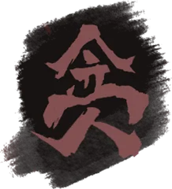

这种己无求有，己有求多的想法最初只是细微，刹那生灭的念头，一旦过度的追求变会陷入无休止的欲望循环。

### 【心魔是什么】

心魔共 7 种：〈贪〉/〈嗔〉/〈痴〉/〈恶〉/〈悲〉/〈色〉/〈邪〉。入魔前很好消除，入魔后大多只能击败它或等它自己消失，看到心魔就先处理。

### 【入魔后果】

计时：〈贪〉出现后 60 秒内没消除，就会入魔

入魔：变成**贪念**：会吞噬触碰到的材料等卡牌

持续：约 6个月～1年 后自动消失（难度越高越久）

同时：获得任务卡「对立」

### 【消除方法】

恢复：恢复工作台「平静心魔」：心魔 + 〈心境〉（用时 30 秒）

恢复：恢复工作台「平静心魔」：只放心魔（用时 180 秒）

自由模式：开局词条「灵台清明」：恢复工作台不用〈心境〉（用时 30 秒）

秘境：「碧潭瀑布」：不用〈心境〉（用时 30 秒）

地点：庙宇「忘尘庙」/「无名庙宇」：放入心魔（用时 30 秒）

### 【入魔之后】

注意：**贪念**清除不了，只能等约 6个月～1年 后自动消失

### 【获取途径】

修炼时，如果不加入灵气/混沌灵气，有15%的概率获得

修炼心法累计一定次数后获得

在碑地点祭拜时有10%概率获得

调查混沌之地时，最后奖励有50%概率获得

修炼〈噬魂秘法〉必定获得

比武中触发犯规获得

---

## 28. 嗔

不如意事常八九，如果无法接受之，则会带来无尽的痛苦和不安。反之，则可实现内在的平和。

### 【心魔是什么】

心魔共 7 种：〈贪〉/〈嗔〉/〈痴〉/〈恶〉/〈悲〉/〈色〉/〈邪〉。入魔前很好消除，入魔后大多只能击败它或等它自己消失，看到心魔就先处理。

### 【入魔后果】

计时：〈嗔〉出现后 60 秒内没消除，就会入魔

入魔：变成**嗔念**：除非将它击败，否则心魔不会消失

同时：获得任务卡「为何修炼？」

### 【消除方法】

恢复：恢复工作台「平静心魔」：心魔 + 〈心境〉（用时 30 秒）

恢复：恢复工作台「平静心魔」：只放心魔（用时 180 秒）

自由模式：开局词条「灵台清明」：恢复工作台不用〈心境〉（用时 30 秒）

秘境：「碧潭瀑布」：不用〈心境〉（用时 30 秒）

地点：庙宇「忘尘庙」/「无名庙宇」：放入心魔（用时 30 秒）

### 【入魔之后】

击败：**嗔念**只能击败它，否则不会消失

### 【获取途径】

修炼时，如果不加入灵气/混沌灵气，有15%的概率获得

修炼心法累计一定次数后获得

在碑地点祭拜时有10%概率获得

调查混沌之地时，最后奖励有50%概率获得

---

## 29. 痴

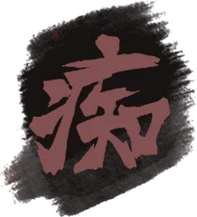

越是追求修道，越是发现自己的无知。偶尔的无知无伤大雅，若是长久如此，恐怕会酿成大祸。

### 【心魔是什么】

心魔共 7 种：〈贪〉/〈嗔〉/〈痴〉/〈恶〉/〈悲〉/〈色〉/〈邪〉。入魔前很好消除，入魔后大多只能击败它或等它自己消失，看到心魔就先处理。

### 【入魔后果】

计时：〈痴〉出现后 60 秒内没消除，就会入魔

入魔：变成**愚钝**：**修炼**工作台的运行时间翻倍

持续：约 6个月～1年 后自动消失（难度越高越久）

### 【消除方法】

恢复：恢复工作台「平静心魔」：心魔 + 〈心境〉（用时 30 秒）

恢复：恢复工作台「平静心魔」：只放心魔（用时 180 秒）

自由模式：开局词条「灵台清明」：恢复工作台不用〈心境〉（用时 30 秒）

秘境：「碧潭瀑布」：不用〈心境〉（用时 30 秒）

地点：庙宇「忘尘庙」/「无名庙宇」：放入心魔（用时 30 秒）

### 【入魔之后】

注意：**愚钝**清除不了，只能等约 6个月～1年 后自动消失

### 【获取途径】

修炼时，如果不加入灵气/混沌灵气，有15%的概率获得

修炼心法累计一定次数后获得

在碑地点祭拜时有10%概率获得

调查混沌之地时，最后奖励有50%概率获得

---

## 30. 恶

人的一生可以有许多选择，但如果主动造成他人不必要的伤害。那离邪恶也就不远了。

### 【心魔是什么】

心魔共 7 种：〈贪〉/〈嗔〉/〈痴〉/〈恶〉/〈悲〉/〈色〉/〈邪〉。入魔前很好消除，入魔后大多只能击败它或等它自己消失，看到心魔就先处理。

### 【入魔后果】

计时：〈恶〉出现后 60 秒内没消除，就会入魔

追杀：和主角同境界的宗门修士前来追杀（练气～元婴期） —— 宗门：兽王府、武极门、清虚谷、玄剑阁、紫霄殿、蚀月教、雪隐宗（元婴期没有紫霄殿）

### 【消除方法】

恢复：恢复工作台「平静心魔」：心魔 + 〈心境〉（用时 30 秒）

恢复：恢复工作台「平静心魔」：只放心魔（用时 180 秒）

自由模式：开局词条「灵台清明」：恢复工作台不用〈心境〉（用时 30 秒）

秘境：「碧潭瀑布」：不用〈心境〉（用时 30 秒）

地点：庙宇「忘尘庙」/「无名庙宇」：放入心魔（用时 30 秒）

### 【获取途径】

修炼〈七杀经〉必定获得

在碑/山脚下掩埋尸体有概率获得

主动击杀商人/凡人必定获得

主动击杀修士有30%概率获得

---

## 31. 悲

通常由于外部事件引起的情感反应，它是一种消极的情绪。任由悲伤发展，会让人感受到十分的折磨。

### 【心魔是什么】

心魔共 7 种：〈贪〉/〈嗔〉/〈痴〉/〈恶〉/〈悲〉/〈色〉/〈邪〉。入魔前很好消除，入魔后大多只能击败它或等它自己消失，看到心魔就先处理。

### 【入魔后果】

计时：〈悲〉出现后 60 秒内没消除，就会入魔

入魔：变成**悲伤**：**炼制**与**培养**工作台的运行时间翻倍

持续：约 6个月～1年 后自动消失（难度越高越久）

### 【消除方法】

恢复：恢复工作台「平静心魔」：心魔 + 〈心境〉（用时 30 秒）

恢复：恢复工作台「平静心魔」：只放心魔（用时 180 秒）

自由模式：开局词条「灵台清明」：恢复工作台不用〈心境〉（用时 30 秒）

秘境：「碧潭瀑布」：不用〈心境〉（用时 30 秒）

地点：庙宇「忘尘庙」/「无名庙宇」：放入心魔（用时 30 秒）

### 【入魔之后】

注意：**悲伤**清除不了，只能等约 6个月～1年 后自动消失

### 【获取途径】

在某些任务中获得

凡人被击杀时有30%概率获得

修炼时，如果不加入灵气/混沌灵气，有15%的概率获得

修炼心法累计一定次数后获得

在碑地点祭拜时有10%概率获得

---

## 32. 色

色是人与生俱来的本能。对美好色相的追求，本是人性的自然流露。

### 【心魔是什么】

心魔共 7 种：〈贪〉/〈嗔〉/〈痴〉/〈恶〉/〈悲〉/〈色〉/〈邪〉。入魔前很好消除，入魔后大多只能击败它或等它自己消失，看到心魔就先处理。

### 【入魔后果】

计时：〈色〉出现后 60 秒内没消除，就会入魔

入魔：变成**荒淫**：主角进入人类活动区域时，所有人都对主角避而远之

持续：约 3年～5年 后自动消失（难度越高越久）

### 【消除方法】

恢复：恢复工作台「平静心魔」：心魔 + 〈心境〉（用时 30 秒）

恢复：恢复工作台「平静心魔」：只放心魔（用时 180 秒）

自由模式：开局词条「灵台清明」：恢复工作台不用〈心境〉（用时 30 秒）

秘境：「碧潭瀑布」：不用〈心境〉（用时 30 秒）

地点：庙宇「忘尘庙」/「无名庙宇」：放入心魔（用时 30 秒）

### 【入魔之后】

地点：庙宇「忘尘庙」/「无名庙宇」：放入〈因果〉（用时 30 秒）

注意：恢复工作台、「碧潭瀑布」都清除不了；不处理的话约 3年～5年 后自动消失

### 【获取途径】

修炼〈阴姹玄功〉必定获得

---

## 33. 邪

品性与行为偏离了公理道义，往往以损害他人或天地秩序为代价获取力量，是为邪。

### 【心魔是什么】

心魔共 7 种：〈贪〉/〈嗔〉/〈痴〉/〈恶〉/〈悲〉/〈色〉/〈邪〉。入魔前很好消除，入魔后大多只能击败它或等它自己消失，看到心魔就先处理。

### 【入魔后果】

计时：〈邪〉出现后 60 秒内没消除，就会入魔

入魔：变成**邪祟**：主角进入人类活动区域时，所有人都对主角避而远之

持续：约 2年～4年 后自动消失（难度越高越久）

### 【消除方法】

恢复：恢复工作台「平静心魔」：心魔 + 〈心境〉（用时 30 秒）

恢复：恢复工作台「平静心魔」：只放心魔（用时 180 秒）

自由模式：开局词条「灵台清明」：恢复工作台不用〈心境〉（用时 30 秒）

秘境：「碧潭瀑布」：不用〈心境〉（用时 30 秒）

地点：庙宇「忘尘庙」/「无名庙宇」：放入心魔（用时 30 秒）

### 【入魔之后】

恢复：恢复工作台「平静心魔」：放入〈善缘〉或〈因果〉（用时 15 秒）

秘境：「碧潭瀑布」（用时 15 秒）

地点：庙宇「忘尘庙」/「无名庙宇」：放入〈善缘〉（用时 30 秒）

注意：不处理的话约 2年～4年 后自动消失

### 【获取途径】

修炼〈锁魂术〉必定获得

炼制骸骨傀儡必定获得

---

## 34. 吐纳之法

里面讲述了一种吐纳修炼的口诀，可将天地间的灵气通过呼吸存储于体内：

静心守一

调息绵长

灵台清明

引气归元

气海温养

呼浊纳清

心神守中

灵气化修

### 【各版本（境界 / 品质）】

人品：老人让我按照心法上描述的吐纳方法进行修炼。（打开"修炼"工作台界面，放入"小孩"卡后，再放入此卡牌）；获得方式 开局剧情（师傅的试炼第 1 步）：师傅教你「感气」「引气」后，和「师傅」对话，得到心法〈吐纳之法〉和〈修炼〉工作台（把主角和心法放进修炼工作台修炼）

### 【获取途径】

仅在主线中获得

---

## 35. 混元功

修炼后可领悟**天赋：灵力亲和**

### 【各版本（境界 / 品质）】

化神·神品：修炼限制 条件：无（放入修炼工作台即可）；修炼限制 太过简单：主角**筑基期**起再修炼，不再获得修为，只直接领悟其中的技能 / 口诀 / 天赋

混元功(二)·化神·神品：此功最是奇特，能兼容五行灵气，令修士于吐纳之间，同步吸纳金木水火土五气入体。；隐约可见，所创者：**广尘**。；心法第二层，需达到**练气中期**后方可继续修炼；修炼后可领悟**技能：聚灵化盾**；修炼限制 境界：主角**筑基期**及以上；修炼限制 条件：无（放入修炼工作台即可）；修炼限制 太过简单：主角**筑基期**起再修炼，不再获得修为，只直接领悟其中的技能 / 口诀 / 天赋；获得方式 修炼〈混元功〉

混元功(三)·化神·神品：此功最是奇特，能兼容五行灵气，令修士于吐纳之间，同步吸纳金木水火土五气入体。；隐约可见，所创者：**广尘**。；心法第三层，需达到**筑基期**后方可继续修炼；修炼后可领悟**天赋：敛锋蕴气**；修炼限制 境界：主角**筑基期**及以上；修炼限制 条件：无（放入修炼工作台即可）；获得方式 修炼〈混元功〉

混元功(四)·化神·神品：混元功第四层，需要达到结丹期后，我才能继续修炼；修炼限制 条件：无（放入修炼工作台即可）；获得方式 修炼〈混元功〉

混元功(五)·化神·神品：混元功第五层，需要达到元婴期后，我才能继续修炼

### 【获取途径】

仅在主线中获得

---

## 36. 机关术

此书并非是讲述修炼方法，而是传授机关术的基础理论，各种傀儡的制作和改进方法

无法修炼此心法，但利用心法可将仙品傀儡**培养**至神品

### 【各版本（境界 / 品质）】

仙品：修炼限制 条件：不能修炼（只是记载傀儡的制作方法）

### 【用途】

培养：培养工作台「精制傀儡」：仙品傀儡 + 〈机关术〉，45 秒后变成神品

适用：〈机关傀儡〉〈骸骨傀儡〉〈骨龙〉〈熔岩傀儡〉〈血木傀儡〉都一样

注意：机关术不能修炼，只用来培养傀儡

### 【获取途径】

筑基期后，**〈悟道〉 + 〈御物〉 + 〈试金〉** 修炼后领悟

在神秘人中有10%概率出现

---

## 37. 金灵术

练气阶段金系心法。修炼之法重在凝气如金，淬炼经脉、稳固道基，虽无惊世威能，却能培元固本，令灵气凝而不散、锐而不躁。

修炼后可领悟**技能：天罡体**

### 【各版本（境界 / 品质）】

地品：修炼限制 境界：主角**练气期**及以上；修炼限制 条件：无（放入修炼工作台即可）；修炼限制 太过简单：主角**筑基期**起再修炼，不再获得修为，只直接领悟其中的技能 / 口诀 / 天赋

### 【获取途径】

修炼试金后领悟

在玄机阁中有概率刷出

无名村庄商人有概率出售

把〈试金〉送给打坐中的修士，必定获得

把心境赠送给入魔的修士有概率获得

---

## 38. 御剑术

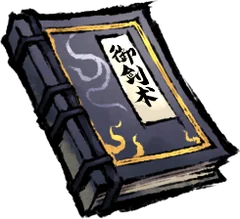

### 【各版本（境界 / 品质）】

练气·天品：修炼限制 境界：主角**练气期**及以上；修炼限制 需要：一把仙品或神品的**剑**；修炼限制 太过简单：主角**筑基期**起再修炼，不再获得修为，只直接领悟其中的技能 / 口诀 / 天赋

御剑术(二)·筑基·地品：御剑术修炼核心离不开金属性武器的依托，剑只是这类武器中最具代表性的一种形态，并非唯一选择。；心法第二层，需达到**筑基期**后方可继续修炼；修炼后可领悟**天赋：剑术精通**；修炼限制 境界：主角**筑基期**及以上；修炼限制 需要：一把筑基期仙品或神品的**剑**；修炼限制 太过简单：主角**结丹期**起再修炼，不再获得修为，只直接领悟其中的技能 / 口诀 / 天赋；获得方式 修炼〈御剑术〉

### 【获取途径】

**〈悟道〉 + 〈剑芒〉** 修炼后领悟

在玄机阁中有概率刷出

无名村庄商人有概率出售

把〈剑芒〉送给打坐中的修士，必定获得

把心境赠送给入魔的修士有概率获得

---

## 39. 千芒术

千芒，乃化光为刃的藏锋之道；以心念催发万千芒刃，隐如雾豹，现若雷蛇

修炼后可领悟**口诀：金芒咒**

### 【各版本（境界 / 品质）】

地品：修炼限制 境界：主角**筑基期**及以上；修炼限制 需要：两张**灵气卡：兑金**；修炼限制 太过简单：主角**结丹期**起再修炼，不再获得修为，只直接领悟其中的技能 / 口诀 / 天赋

### 【获取途径】

筑基期后，**〈悟道〉 + 〈试金〉** 修炼后领悟

把〈御物〉送给打坐中的修士，50% 概率获得

把心境赠送给入魔的修士有概率获得

在玄机阁中有概率刷出

筑基期时使用机缘探索宗门遗迹有概率获得

筑基期时，修炼**〈悟道〉**后有概率获得

---

## 40. 初尘剑谱

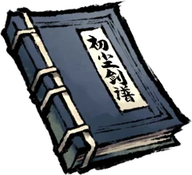

剑谱乃初尘道人所创，以“藏锋”“点露”“卷云”三式为根基串联而成的连携杀招。

修炼后可领悟**技能：初尘三式**

### 【各版本（境界 / 品质）】

天品：修炼限制 境界：主角**筑基期**及以上；修炼限制 需要：一把筑基期神品或以上的剑；修炼限制 太过简单：主角**结丹期**起再修炼，不再获得修为，只直接领悟其中的技能 / 口诀 / 天赋

### 【获取途径】

筑基期后，**〈悟道〉 + 〈剑意〉 + 〈剑芒〉** 修炼后领悟

在玄机阁中有概率刷出

可在玄剑阁的藏经阁中兑换

把心境赠送给入魔的修士（筑基期）有概率获得

筑基期时使用机缘探索宗门遗迹有概率获得

---

## 41. 破煞剑谱

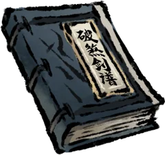

### 【各版本（境界 / 品质）】

筑基·神品：修炼限制 境界：主角**筑基期**及以上；修炼限制 需要：捕捉到的**一只妖兽**；修炼限制 太过简单：主角**结丹期**起再修炼，不再获得修为，只直接领悟其中的技能 / 口诀 / 天赋

破煞剑谱(二)·结丹·仙品：此剑谱的招式自始便凝练着磅礴杀伐之气。这股凛然杀意专为克制凶煞邪祟而生，剑锋所及之处，邪佞无所遁形、辟易退散。；心法第二层，需达到**结丹期**后方可继续修炼；修炼后可领悟**天赋：断邪斩**；修炼限制 境界：主角**结丹期**及以上；修炼限制 需要：捕捉到的**一只妖兽**；修炼限制 太过简单：主角**元婴期**起再修炼，不再获得修为，只直接领悟其中的技能 / 口诀 / 天赋；获得方式 修炼〈破煞剑谱〉、把〈宝藏〉放进调查工作台「打开宝箱」，有概率获得

破煞剑谱(三)·元婴·天品：此剑谱的招式自始便凝练着磅礴杀伐之气。这股凛然杀意专为克制凶煞邪祟而生，剑锋所及之处，邪佞无所遁形、辟易退散。；心法第三层，需达到**元婴期**后方可继续修炼；修炼后可领悟**天赋：断邪斩**；修炼限制 境界：主角**元婴期**及以上；修炼限制 需要：捕捉到的**一只妖兽**；获得方式 修炼〈破煞剑谱〉

### 【获取途径】

筑基期后，**〈悟道〉 + 〈剑意〉 + 〈剑意〉** 修炼后领悟

在玄机阁中有概率刷出

可在玄剑阁的藏经阁中兑换

把心境赠送给入魔的修士（筑基期）有概率获得

筑基期时使用机缘探索宗门遗迹有概率获得

---

## 42. 阴阳两仪剑

### 【各版本（境界 / 品质）】

筑基·仙品：修炼限制 境界：主角**筑基期**及以上；修炼限制 需要：一把筑基期〔水〕剑＋一把筑基期〔火〕剑；修炼限制 太过简单：主角**结丹期**起再修炼，不再获得修为，只直接领悟其中的技能 / 口诀 / 天赋

阴阳两仪剑(二)·结丹·天品：两仪生四象，阴阳定乾坤。纳天地阴阳二气入剑，刚则裂穹，柔则缠丝，阴阳相济时，剑势无穷无尽。；心法第二层，需达到**结丹期**后方可继续修炼；修炼后可领悟**天赋：御剑无锋**；修炼限制 境界：主角**结丹期**及以上；修炼限制 需要：太极阴阳分混沌，剑气相生衍太虚；可世间已无阴剑与阳剑。我只能以水为阴，以火为阳模拟阴阳相济之理。我还需要一把结丹期的〔水〕剑和另一把结丹期的〔火〕剑；修炼限制 太过简单：主角**元婴期**起再修炼，不再获得修为，只直接领悟其中的技能 / 口诀 / 天赋；获得方式 修炼〈阴阳两仪剑〉

阴阳两仪剑(三)·元婴·地品：两仪生四象，阴阳定乾坤。纳天地阴阳二气入剑，刚则裂穹，柔则缠丝，阴阳相济时，剑势无穷无尽。；心法第三层，需达到**元婴期**后方可继续修炼；修炼后可领悟**天赋：御剑无锋**；修炼限制 境界：主角**元婴期**及以上；修炼限制 需要：太极阴阳分混沌，剑气相生衍太虚；可世间已无阴剑与阳剑。我只能以水为阴，以火为阳模拟阴阳相济之理。我还需要一把元婴期的〔水〕剑和另一把元婴期的〔火〕剑；获得方式 修炼〈阴阳两仪剑〉

### 【获取途径】

筑基期后，**〈悟道〉 + 〈剑意〉 + 〈试金〉** 修炼后领悟

在玄机阁中有概率刷出

可在玄剑阁的藏经阁中兑换

把心境赠送给入魔的修士（筑基期）有概率获得

筑基期时使用机缘探索宗门遗迹有概率获得

---

## 43. 无相剑典

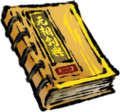

### 【各版本（境界 / 品质）】

筑基·仙品：修炼限制 境界：主角**筑基期**及以上；修炼限制 需要：**心境卡**＋**剑意卡**；修炼限制 太过简单：主角**结丹期**起再修炼，不再获得修为，只直接领悟其中的技能 / 口诀 / 天赋

无相剑典(二)·结丹·天品：凡所有相，皆是虚妄！剑出无形无质，不执于招、不困于形。；心法第二层，需达到**结丹期**后方可继续修炼；修炼后可领悟**天赋：剑气四射**；修炼限制 境界：主角**结丹期**及以上；修炼限制 需要：**心境卡**＋**剑意卡**；修炼限制 太过简单：主角**元婴期**起再修炼，不再获得修为，只直接领悟其中的技能 / 口诀 / 天赋；获得方式 修炼〈无相剑典〉

无相剑典(三)·元婴·地品：凡所有相，皆是虚妄！剑出无形无质，不执于招、不困于形。；心法第三层，需达到**元婴期**后方可继续修炼；修炼后可领悟**天赋：剑气四射**；修炼限制 境界：主角**元婴期**及以上；修炼限制 条件：无（放入修炼工作台即可）；获得方式 修炼〈无相剑典〉

### 【获取途径】

筑基期后，**〈悟道〉 + 〈剑意〉 + 〈心境〉** 修炼后领悟

在玄机阁中有概率刷出

可在玄剑阁的藏经阁中兑换

把心境赠送给入魔的修士（筑基期）有概率获得

筑基期时使用机缘探索宗门遗迹有概率获得

---

## 44. 归流剑经

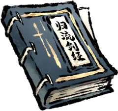

### 【各版本（境界 / 品质）】

筑基·仙品：修炼限制 境界：主角**筑基期**及以上；修炼限制 需要：一把筑基期仙品〔水〕剑；修炼限制 太过简单：主角**结丹期**起再修炼，不再获得修为，只直接领悟其中的技能 / 口诀 / 天赋

归流剑经(二)·结丹·天品：归形如川流入海，归气似云雾聚散，归神若星斗归垣；万流汇一，剑出星河！；心法第二层，需达到**结丹期**后方可继续修炼；修炼后可领悟**天赋：剑术精通**；修炼限制 境界：主角**结丹期**及以上；修炼限制 需要：一把结丹期的神品〔水〕剑；修炼限制 太过简单：主角**元婴期**起再修炼，不再获得修为，只直接领悟其中的技能 / 口诀 / 天赋；获得方式 修炼〈归流剑经〉

归流剑经(三)·元婴·地品：归形如川流入海，归气似云雾聚散，归神若星斗归垣；万流汇一，剑出星河！；心法第三层，需达到**元婴期**后方可继续修炼；修炼后可领悟**天赋：剑术精通**；修炼限制 境界：主角**元婴期**及以上；修炼限制 需要：一把元婴期的神品〔水〕剑；获得方式 修炼〈归流剑经〉

### 【实际领悟的天赋】

游戏描述里写的是「剑术精通」，实际修炼后领悟的是天赋「御剑无锋」（按游戏修炼配方核对）

### 【获取途径】

筑基期后，**〈悟道〉 + 〈剑意〉 + 〈引水〉** 修炼后领悟

在玄机阁中有概率刷出

可在玄剑阁的藏经阁中兑换

把心境赠送给入魔的修士（筑基期）有概率获得

筑基期时使用机缘探索宗门遗迹有概率获得

---

## 45. 口繺剑奤诀

这本心法被人用秘法封印了，我无法解读里面内容，只能依稀可见**玄剑**二字。

有谁能解开此封印吗？

或者待我达到结丹期后，把此封印摧毁！

### 【各版本（境界 / 品质）】

筑基·绝品：修炼限制 境界：主角**筑基期**及以上；修炼限制 条件：心法被封印（隐约可见**玄剑**二字）：找人解开封印，或主角达到结丹期后自行摧毁封印

### 【获取途径】

第一次修炼剑魂残魄后领悟

---

## 46. 血煞剑魄

### 【各版本（境界 / 品质）】

筑基·绝品：修炼限制 境界：主角**筑基期**及以上；修炼限制 条件：无（放入修炼工作台即可）；修炼限制 太过简单：主角**结丹期**起再修炼，不再获得修为，只直接领悟其中的技能 / 口诀 / 天赋

血煞剑魄(二)·筑基·绝品：血煞剑魄，此心法乃玄剑阁前辈领悟，但前辈修炼后入魔而亡！；修炼后可领悟**技能：贯云双星**；（如果你已拥有技能：贯云双星，则修炼不会再掉落）；修炼限制 境界：主角**筑基期**及以上；修炼限制 条件：无（放入修炼工作台即可）；修炼限制 太过简单：主角**结丹期**起再修炼，不再获得修为，只直接领悟其中的技能 / 口诀 / 天赋；获得方式 把〈血煞剑魄（封）〉放进修炼工作台「领悟心法」（再放入〈顿悟〉），获得

血煞剑魄(二)·结丹·绝品：血煞剑魄，此心法乃玄剑阁前辈领悟，但前辈修炼后入魔而亡！；心法第二层，需达到**结丹期**后方可继续修炼；修炼后可领悟**技能：贯云双星**；修炼限制 境界：主角**结丹期**及以上；修炼限制 条件：无（放入修炼工作台即可）；修炼限制 太过简单：主角**元婴期**起再修炼，不再获得修为，只直接领悟其中的技能 / 口诀 / 天赋；获得方式 修炼〈血煞剑魄（封）〉

血煞剑魄(三)·元婴·绝品：血煞剑魄，此心法乃玄剑阁前辈领悟，但前辈修炼后入魔而亡！；心法第二层，需达到**元婴期**后方可继续修炼；修炼后可领悟**技能：贯云双星**；修炼限制 境界：主角**元婴期**及以上；修炼限制 条件：无（放入修炼工作台即可）

### 【获取途径】

把被封印的心法〈口繺剑奤诀〉交给「玄剑阁长老」（在「金陵城」）解开封印后获得

---

## 47. 剑魄诀

修炼后可领悟**技能：玄机剑魄****天赋：器心通明**

### 【各版本（境界 / 品质）】

筑基·绝品：修炼限制 境界：主角**筑基期**及以上；修炼限制 需要：**剑意卡**＋一把筑基期神品或以上的剑；修炼限制 太过简单：主角**结丹期**起再修炼，不再获得修为，只直接领悟其中的技能 / 口诀 / 天赋

剑魄诀(二)·结丹·绝品：玄剑阁筑基心法《剑魄诀》，以气养魄，以魄御剑，于丹田筑基之初凝练本命“剑魄”，是为一切无上剑道之根基。；心法第二层，需达到**结丹期**后方可继续修炼；修炼后可领悟**天赋：器心通明**；修炼限制 境界：主角**结丹期**及以上；修炼限制 需要：一张**剑意卡**和一把结丹期神品以上剑；修炼限制 太过简单：主角**元婴期**起再修炼，不再获得修为，只直接领悟其中的技能 / 口诀 / 天赋；获得方式 修炼〈剑魄诀〉

### 【获取途径】

在玄剑阁的藏经阁中兑换

---

## 48. 金锋谱

金气凝锋，锐不可当，锋芒一出如金戈裂空，破甲裂阵无坚不摧。

修炼后可领悟**天赋：金锋破**

### 【各版本（境界 / 品质）】

结丹·神品：修炼限制 境界：主角**结丹期**及以上；修炼限制 需要：一把结丹期绝品剑＋一个目标（**妖兽**、**尸体**或**活人**）；修炼限制 太过简单：主角**元婴期**起再修炼，不再获得修为，只直接领悟其中的技能 / 口诀 / 天赋

金锋谱(二)·元婴·仙品：修炼限制 境界：主角**元婴期**及以上；修炼限制 需要：一把元婴期绝品的剑，以及一个目标，**妖兽，尸体**....亦或者**活人**！；获得方式 修炼〈金锋谱〉

### 【获取途径】

结丹期后，**〈悟道〉 + 〈凝聚〉 + 〈剑意〉** 修炼后领悟

可在玄剑阁的藏经阁中兑换

把心境赠送给入魔的修士（结丹期）有概率获得

结丹期时使用机缘探索宗门遗迹有概率获得

---

## 49. 心剑诀

心为万法源，剑为心之锋，以心为炉炼剑魄，以念为引驭剑炁，修至深处可心剑离体。

修炼后可领悟**技能：凝剑术**

### 【各版本（境界 / 品质）】

结丹·仙品：修炼限制 境界：主角**结丹期**及以上；修炼限制 需要：**感悟卡：凝聚**；修炼限制 太过简单：主角**元婴期**起再修炼，不再获得修为，只直接领悟其中的技能 / 口诀 / 天赋

心剑诀(二)·元婴·天品：修炼限制 境界：主角**元婴期**及以上；修炼限制 条件：无（放入修炼工作台即可）；获得方式 修炼〈心剑诀〉

### 【获取途径】

结丹期后，**〈悟道〉 + 〈凝聚〉 + 〈凝聚〉** 修炼后领悟

可在玄剑阁的藏经阁中兑换

把心境赠送给入魔的修士（结丹期）有概率获得

结丹期时使用机缘探索宗门遗迹有概率获得

---

## 50. 神剑谱

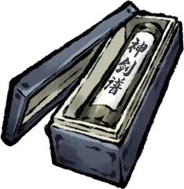

这是一本收录了神兵利器的剑谱，上古仙人遍访九州名匠、踏遍三山五岳而辑成。所载诸刃或淬雷泽之精，削铁如泥；或沐月华之韵，吹毛可断。

修炼后可领悟**口诀：借剑诀**

### 【各版本（境界 / 品质）】

结丹·绝品：修炼限制 境界：主角**结丹期**及以上；修炼限制 条件：无（放入修炼工作台即可）；修炼限制 太过简单：主角**元婴期**起再修炼，不再获得修为，只直接领悟其中的技能 / 口诀 / 天赋

### 【获取途径】

结丹期后，**〈悟道〉 + 〈凝聚〉 + 〈顿悟〉** 修炼后领悟

在玄剑阁的藏经阁中兑换

结丹期：带着〈心境〉和「入魔的修士」对话，有概率获得

结丹期：带着〈任意内丹（结丹后期）〉和「古碑龟」对话，有概率获得

---

## 51. 藏锋诀

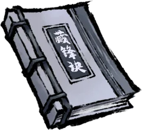

锋芒内敛，藏巧于拙，藏锋于内则气脉沉厚，敛气于形则不露圭角。

修炼后可领悟**天赋：笑里藏锋**

### 【各版本（境界 / 品质）】

结丹·仙品：修炼限制 境界：主角**结丹期**及以上；修炼限制 需要：一把结丹期绝品扇子＋**心境卡**；修炼限制 太过简单：主角**元婴期**起再修炼，不再获得修为，只直接领悟其中的技能 / 口诀 / 天赋

藏锋诀(二)·元婴·天品：修炼限制 境界：主角**元婴期**及以上；修炼限制 需要：一把元婴期绝品的扇子以及一张**心境卡**；获得方式 修炼〈藏锋诀〉

### 【获取途径】

结丹期后，**〈悟道〉 + 〈凝聚〉 + 〈杀意〉** 修炼后领悟

可在玄剑阁的藏经阁中兑换

把心境赠送给入魔的修士（结丹期）有概率获得

结丹期时使用机缘探索宗门遗迹有概率获得

---

## 52. 凝光心法

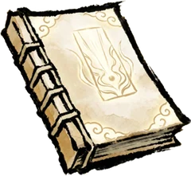

修炼后可领悟**技能：剑盾式**

### 【各版本（境界 / 品质）】

结丹·天品：修炼限制 境界：主角**结丹期**及以上；修炼限制 需要：**感悟卡：凝聚**；修炼限制 太过简单：主角**元婴期**起再修炼，不再获得修为，只直接领悟其中的技能 / 口诀 / 天赋

凝光心法(二)·元婴·地品：以吐纳导引之法引天地清辉、日月精光入体，缓缓凝练丹田气海，修至深处可化灵气为凝光；修炼后可领悟**感悟：招式**；修炼限制 境界：主角**元婴期**及以上；修炼限制 条件：无（放入修炼工作台即可）；获得方式 修炼〈凝光心法〉

### 【获取途径】

结丹期后，**〈悟道〉 + 〈凝聚〉 + 〈御灵〉** 修炼后领悟

结丹期时使用机缘探索宗门遗迹有概率获得

---

## 53. 分光剑法

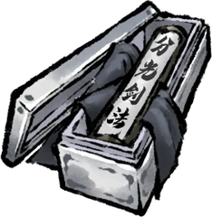

需修炼剑魄诀后方可修炼：本命剑魄为根，分化剑光为用，一剑斩出，虚实相生，万法难辨

修炼后可领悟**技能：剑魄通明**

（如果你已拥有技能：剑魄通明，则修炼不在掉落）

### 【各版本（境界 / 品质）】

结丹·绝品：修炼限制 境界：主角**结丹期**及以上；修炼限制 需要：一把结丹期或以上的绝品剑；修炼限制 太过简单：主角**元婴期**起再修炼，不再获得修为，只直接领悟其中的技能 / 口诀 / 天赋

### 【获取途径】

在玄剑阁的藏经阁中兑换

---

## 54. 裂金诀

出招可附金行破甲之力，能裂金断石、直破护体罡气，尤擅增幅兵刃法宝的锋锐之性

修炼后可领悟**技能：饮血剑**

### 【各版本（境界 / 品质）】

元婴·神品：修炼限制 境界：主角**元婴期**及以上；修炼限制 需要：一件元婴期仙品或以上的〔金〕法宝（注意：修炼会**摧毁**这件法宝）

### 【获取途径】

元婴期后，**〈悟道〉 + 〈归一〉 + 〈归一〉/〈顿悟〉** 修炼后可自选

---

## 55. 金锋两仪诀

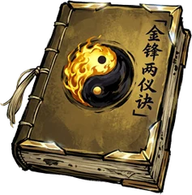

修至深处可阴阳轮转、金气生生不息，非但杀伐锋锐不输纯攻心法，更能补全金行修士守御薄弱之弊，是极为上乘的金行正统法门

修炼后可领悟**技能：凝刃技**

### 【各版本（境界 / 品质）】

元婴·神品：修炼限制 境界：主角**元婴期**及以上；修炼限制 条件：主角手持**本命剑**

### 【获取途径】

元婴期后，**〈悟道〉 + 〈归一〉 + 〈归一〉/〈顿悟〉** 修炼后可自选

---

## 56. 木心术

练气阶段木系心法。功法浅显易懂、运转温和，循序渐进感悟木系灵力的滋养与运转之妙

修炼后可领悟**口诀：唤木诀**

### 【各版本（境界 / 品质）】

地品：修炼限制 境界：主角**练气期**及以上；修炼限制 条件：无（放入修炼工作台即可）；修炼限制 太过简单：主角**筑基期**起再修炼，不再获得修为，只直接领悟其中的技能 / 口诀 / 天赋

### 【获取途径】

修炼采木后领悟

在玄机阁中有概率刷出

无名村庄商人有概率出售

把〈采木〉送给打坐中的修士，必定获得

把心境赠送给入魔的修士有概率获得

---

## 57. 百药谱

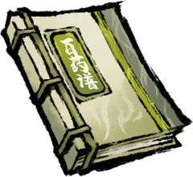

### 【各版本（境界 / 品质）】

练气·天品：修炼限制 境界：主角**练气期**及以上；修炼限制 需要：仙品或神品的**灵草**；修炼限制 太过简单：主角**筑基期**起再修炼，不再获得修为，只直接领悟其中的技能 / 口诀 / 天赋

百药谱(二)·筑基·地品：谱内详载各类常见草药，从性味归经、生长习性，到采集时机、炮制之法，皆记录得周全细致、条理分明。；心法第二层，需达到**筑基期**后方可继续修炼；修炼后可领悟**天赋：丹元催化**；修炼限制 境界：主角**筑基期**及以上；修炼限制 需要：准备仙品或神品的**筑基期灵草**；修炼限制 太过简单：主角**结丹期**起再修炼，不再获得修为，只直接领悟其中的技能 / 口诀 / 天赋；获得方式 修炼〈百药谱〉

### 【获取途径】

筑基后，**〈悟道〉 + 〈药理〉** 修炼后有50%概率领悟

**〈悟道〉 + 〈丹道〉 + 〈药理〉** 修炼后领悟

在玄机阁中有概率刷出

无名村庄商人有概率出售

把〈药理〉送给打坐中的修士，50% 概率获得

把心境赠送给入魔的修士有概率获得

---

## 58. 长生录

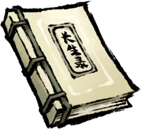

古往今来，世人对长生之念深植于心、执念难消，这本《长生录》便是由此执念淬炼而生的木系长生法门。

修炼后可领悟**天赋：长生术**

### 【各版本（境界 / 品质）】

地品：修炼限制 境界：主角**筑基期**及以上；修炼限制 需要：两张**灵气卡：震木**；修炼限制 太过简单：主角**结丹期**起再修炼，不再获得修为，只直接领悟其中的技能 / 口诀 / 天赋

### 【实际领悟的天赋】

游戏描述里写的是「长生术」，实际修炼后领悟的是天赋「长生之法」（按游戏修炼配方核对）

### 【获取途径】

筑基期后，**〈悟道〉 + 〈采木〉** 修炼后领悟

把〈御灵〉送给打坐中的修士，50% 概率获得

把心境赠送给入魔的修士（筑基期）有概率获得

在玄机阁中有概率刷出

筑基期时使用机缘探索宗门遗迹有概率获得

---

## 59. 百毒谱

### 【各版本（境界 / 品质）】

筑基·天品：修炼限制 境界：主角**筑基期**及以上；修炼限制 需要：一张筑基期神品毒丹药；修炼限制 太过简单：主角**结丹期**起再修炼，不再获得修为，只直接领悟其中的技能 / 口诀 / 天赋

百毒谱(二)·结丹·地品：迥异于《百药谱》济世救人、调和百草的宗旨，此心法专攻毒术一道，所载皆为世间各类剧毒之法。；心法第二层，需达到**结丹期**后方可继续修炼；修炼后可领悟**天赋：丹元催化**；修炼限制 境界：主角**结丹期**及以上；修炼限制 需要：小毒可腐蚀法器，麻痹神识；大毒则是夺取生机之力。但毒不分敌我，我需以身试之，才能掌握万物枯荣。我还需要一张结丹期的神品毒丹药卡；修炼限制 太过简单：主角**元婴期**起再修炼，不再获得修为，只直接领悟其中的技能 / 口诀 / 天赋；获得方式 修炼〈百毒谱〉

### 【获取途径】

**〈悟道〉 + 〈丹道〉 + 〈药理〉** 修炼后领悟

在玄机阁中有概率刷出

把心境赠送给入魔的修士（筑基期）有概率获得

筑基期时使用机缘探索宗门遗迹有概率获得

---

## 60. 幽兰录

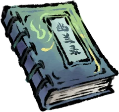

### 【各版本（境界 / 品质）】

筑基·神品：修炼限制 境界：主角**筑基期**及以上；修炼限制 条件：无（放入修炼工作台即可）

幽兰录(二)·结丹·神品：幽兰性洁，隐于深谷而不争，蕴藉天地清灵之气，融贯自然之道与精神修行于一体，沉心体悟草木与天地的共生之韵，于自然吐纳间契合万物节律。；每次修炼均能随机获得一株**结丹期灵草**；修炼限制 境界：主角**结丹期**及以上；修炼限制 条件：无（放入修炼工作台即可）；修炼限制 太过简单：主角**元婴期**起再修炼，不再获得修为，只直接领悟其中的技能 / 口诀 / 天赋；获得方式 修炼〈幽兰录〉、把〈幽兰录〉放进修炼工作台「领悟心法」（再放入〈生长〉），获得

幽兰录(三)·元婴·神品：修炼限制 境界：主角**元婴期**及以上；修炼限制 条件：无（放入修炼工作台即可）；获得方式 修炼〈幽兰录〉

### 【获取途径】

筑基期后，**〈悟道〉 + 〈丹道〉 + 〈丹道〉** 修炼后领悟

在玄机阁中有概率刷出

把心境赠送给入魔的修士（筑基期）有概率获得

筑基期时使用机缘探索宗门遗迹有概率获得

---

## 61. 断肠经

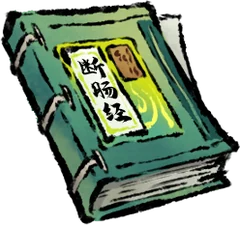

### 【各版本（境界 / 品质）】

筑基·仙品：修炼限制 境界：主角**筑基期**及以上；修炼限制 需要：**一具尸体**（**活人**也可以）；修炼限制 太过简单：主角**结丹期**起再修炼，不再获得修为，只直接领悟其中的技能 / 口诀 / 天赋

断肠经(二)·结丹·天品：某药师观断肠草的毒性所创，开创以毒入道，生死轮转的修行体系。；心法第二层，需达到**结丹期**后方可继续修炼；修炼后可领悟**天赋：千幻毒手**；修炼限制 境界：主角**结丹期**及以上；修炼限制 需要：**一具尸体**（**活人**也可以）；修炼限制 太过简单：主角**元婴期**起再修炼，不再获得修为，只直接领悟其中的技能 / 口诀 / 天赋；获得方式 修炼〈断肠经〉

断肠经(三)·元婴·地品：某药师观断肠草的毒性所创，开创以毒入道，生死轮转的修行体系。；心法第三层，需达到**元婴期**后方可继续修炼；修炼后可领悟**天赋：千幻毒手**；修炼限制 境界：主角**元婴期**及以上；修炼限制 需要：**一具尸体**（**活人**也可以）；获得方式 修炼〈断肠经〉

### 【获取途径】

筑基期后，**〈悟道〉 + 〈御物〉 + 〈药理〉** 修炼后领悟

在玄机阁中有概率刷出

把心境赠送给入魔的修士（筑基期）有概率获得

筑基期时使用机缘探索宗门遗迹有概率获得

---

## 62. 春蚕诀

修炼后可领悟**技能：荆棘**和**天赋：丹元催化**

### 【各版本（境界 / 品质）】

筑基·仙品：修炼限制 境界：主角**筑基期**及以上；修炼限制 条件：无（放入修炼工作台即可）；修炼限制 太过简单：主角**结丹期**起再修炼，不再获得修为，只直接领悟其中的技能 / 口诀 / 天赋

春蚕诀(二)·结丹·天品：通过吐纳与天地灵气交融，春蚕破茧可成蝶，以此生灭循环，褪凡化灵的过程创造的一本心法；心法第二层，需达到**结丹期**后方可继续修炼；修炼后可领悟**天赋：丹元催化**；修炼限制 境界：主角**结丹期**及以上；修炼限制 条件：无（放入修炼工作台即可）；修炼限制 太过简单：主角**元婴期**起再修炼，不再获得修为，只直接领悟其中的技能 / 口诀 / 天赋；获得方式 修炼〈春蚕诀〉

春蚕诀(三)·元婴·地品：通过吐纳与天地灵气交融，春蚕破茧可成蝶，以此生灭循环，褪凡化灵的过程创造的一本心法；心法第三层，需达到**元婴期**后方可继续修炼；修炼后可领悟**天赋：丹元催化**；修炼限制 境界：主角**元婴期**及以上；修炼限制 条件：无（放入修炼工作台即可）；获得方式 修炼〈春蚕诀〉

### 【获取途径】

筑基期后，**〈悟道〉 + 〈丹道〉 + 〈心境〉** 修炼后领悟

在玄机阁中有概率刷出

把心境赠送给入魔的修士（筑基期）有概率获得

筑基期时使用机缘探索宗门遗迹有概率获得

---

## 63. 栖梧功

修炼后可领悟**口诀：唤灵诀**

### 【各版本（境界 / 品质）】

筑基·仙品：修炼限制 境界：主角**筑基期**及以上；修炼限制 需要：一只**筑基期**仙品或以上的〔木〕灵兽；修炼限制 太过简单：主角**结丹期**起再修炼，不再获得修为，只直接领悟其中的技能 / 口诀 / 天赋

栖梧功(二)·结丹·天品：修炼者需向凤凰涅槃般，栖息于灵树梧桐中，感受生生不息的天地灵气。；心法第二层，需达到**结丹期**后方可继续修炼；修炼后可领悟**感悟卡：用术**；修炼限制 境界：主角**结丹期**及以上；修炼限制 需要：一只**结丹期**神品以上〔木〕灵兽；修炼限制 太过简单：主角**元婴期**起再修炼，不再获得修为，只直接领悟其中的技能 / 口诀 / 天赋；获得方式 修炼〈栖梧功〉

栖梧功(三)·元婴·地品：修炼者需向凤凰涅槃般，栖息于灵树梧桐中，感受生生不息的天地灵气。；心法第三层，需达到**元婴期**后方可继续修炼；修炼后可领悟**感悟卡：用术**；修炼限制 境界：主角**元婴期**及以上；修炼限制 需要：一只**元婴期**神品以上〔木〕灵兽；获得方式 修炼〈栖梧功〉

### 【获取途径】

筑基期后，**〈悟道〉 + 〈丹道〉 + 〈采木〉** 修炼后领悟

在玄机阁中有概率刷出

把心境赠送给入魔的修士（筑基期）有概率获得

筑基期时使用机缘探索宗门遗迹有概率获得

---

## 64. 花衍诀

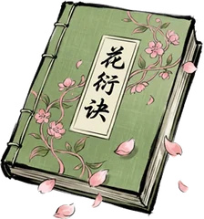

以天地花木生息衍化之道为旨，引草木菁华灵气入体，如花开次第般缓缓衍化丹田气海

修炼后可领悟**技能：唤灵**

### 【各版本（境界 / 品质）】

筑基·地品：修炼限制 境界：主角**筑基期**及以上；修炼限制 条件：在〔木〕地点（「青灵木」 / 「血红树」）修炼；修炼限制 太过简单：主角**结丹期**起再修炼，不再获得修为，只直接领悟其中的技能 / 口诀 / 天赋；修炼限制 自由模式开局词条「先天道种」：无视以上条件，直接修炼

### 【获取途径】

筑基期后，**〈悟道〉 + 〈御灵〉 + 〈采木〉** 修炼后领悟

在玄机阁中有概率刷出

把心境赠送给入魔的修士（筑基期）有概率获得

筑基期时使用机缘探索宗门遗迹有概率获得

---

## 65. 落樱诀

修炼后可领悟**技能：落花**

### 【各版本（境界 / 品质）】

筑基·天品：修炼限制 境界：主角**筑基期**及以上；修炼限制 条件：在〔木〕地点（「青灵木」 / 「血红树」）修炼；修炼限制 太过简单：主角**结丹期**起再修炼，不再获得修为，只直接领悟其中的技能 / 口诀 / 天赋；修炼限制 自由模式开局词条「先天道种」：无视以上条件，直接修炼

落樱诀(二)·结丹·地品：以樱花荣枯循环之理入道，借花木生生不息之道重聚灵元；修炼后可领悟**感悟卡：招式**；修炼限制 境界：主角**结丹期**及以上；修炼限制 条件：在〔木〕地点（「青灵木」 / 「血红树」）修炼；修炼限制 太过简单：主角**元婴期**起再修炼，不再获得修为，只直接领悟其中的技能 / 口诀 / 天赋；修炼限制 自由模式开局词条「先天道种」：无视以上条件，直接修炼；获得方式 修炼〈落樱诀〉

### 【获取途径】

筑基期后，**〈悟道〉 + 〈杀意〉 + 〈采木〉** 修炼后领悟

在玄机阁中有概率刷出

把心境赠送给入魔的修士（筑基期）有概率获得

筑基期时使用机缘探索宗门遗迹有概率获得

---

## 66. 毒心经

### 【各版本（境界 / 品质）】

结丹·绝品：修炼限制 境界：主角**结丹期**及以上；修炼限制 需要：一瓶**结丹期毒药**＋一个**活物**作实验目标；修炼限制 太过简单：主角**元婴期**起再修炼，不再获得修为，只直接领悟其中的技能 / 口诀 / 天赋

毒心经(二)·元婴·仙品：纳天下草木之毒，融于己身灵力之中，一念之间便可执掌生死：；心法第二层，需达到**元婴期**后方可继续修炼；修炼后可领悟**天赋：元殒毒术**；修炼限制 境界：主角**元婴期**及以上；修炼限制 需要：一瓶**元婴期的毒药**以及一个**实验目标（活物）**。；获得方式 修炼〈毒心经〉

### 【获取途径】

结丹期后，**〈悟道〉 + 〈生长〉 + 〈顿悟〉** 修炼后领悟

---

## 67. 蕴灵诀

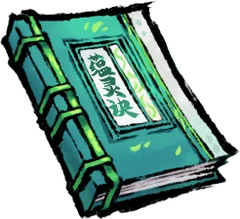

### 【各版本（境界 / 品质）】

结丹·仙品：修炼限制 境界：主角**结丹期**及以上；修炼限制 需要：绝品**灵草**；修炼限制 太过简单：主角**元婴期**起再修炼，不再获得修为，只直接领悟其中的技能 / 口诀 / 天赋

蕴灵诀(二)·元婴·天品：承天地灵脉，蕴万物精元，修炼者以身为鼎引天地灵气孕育灵物。；心法第二层，需达到**元婴期**后方可继续修炼；修炼后可领悟**天赋：灵植之心**；修炼限制 境界：主角**元婴期**及以上；修炼限制 需要：绝品**灵草**；获得方式 修炼〈蕴灵诀〉

### 【获取途径】

结丹期后，**〈悟道〉 + 〈生长〉 + 〈生长〉** 修炼后领悟

把心境赠送给入魔的修士（结丹期）有概率获得

结丹期时使用机缘探索宗门遗迹有概率获得

---

## 68. 青冥真解

### 【各版本（境界 / 品质）】

结丹·仙品：修炼限制 境界：主角**结丹期**及以上；修炼限制 条件：无（放入修炼工作台即可）；修炼限制 太过简单：主角**元婴期**起再修炼，不再获得修为，只直接领悟其中的技能 / 口诀 / 天赋

青冥真解(二)·元婴·天品：此功法暗合自然生灭之道，洞悉草木枯荣的本源法理，契合自然大道，能与世间草木生灵同频共振；心法第二层，需达到**元婴期**后方可继续修炼；修炼后可领悟**天赋：青冥引**；修炼限制 境界：主角**元婴期**及以上；修炼限制 条件：无（放入修炼工作台即可）；获得方式 修炼〈青冥真解〉

### 【获取途径】

结丹期后，**〈悟道〉 + 〈生长〉 + 〈杀意〉** 修炼后领悟

把心境赠送给入魔的修士（结丹期）有概率获得

结丹期时使用机缘探索宗门遗迹有概率获得

---

## 69. 黄庭内景

### 【各版本（境界 / 品质）】

结丹·仙品：修炼限制 境界：主角**结丹期**及以上；修炼限制 需要：**神识卡**；修炼限制 太过简单：主角**元婴期**起再修炼，不再获得修为，只直接领悟其中的技能 / 口诀 / 天赋

黄庭内景(二)·元婴·天品：借心法妙韵滋养本命元机，调和气血、稳固灵根，令道基如磐石般不可撼动。为炼养脏腑无上内修心法；心法第二层，需达到**元婴期**后方可继续修炼；修炼后可领悟**天赋：丹元催化**；修炼限制 境界：主角**元婴期**及以上；修炼限制 需要：**神识卡**；获得方式 修炼〈黄庭内景〉

### 【获取途径】

结丹期后，**〈悟道〉 + 〈生长〉 + 〈丹道〉** 修炼后领悟

把心境赠送给入魔的修士（结丹期）有概率获得

结丹期时使用机缘探索宗门遗迹有概率获得

---

## 70. 花栖木

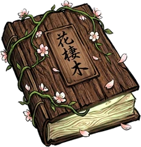

行功时花木相生相养，凝灵韵作花魂栖于气海

修炼后可领悟**天赋：花之魂**

### 【各版本（境界 / 品质）】

结丹·仙品：修炼限制 境界：主角**结丹期**及以上；修炼限制 需要：**感悟卡：生长**；修炼限制 太过简单：主角**元婴期**起再修炼，不再获得修为，只直接领悟其中的技能 / 口诀 / 天赋

花栖木(二)·元婴·天品：修炼限制 境界：主角**元婴期**及以上；修炼限制 条件：无（放入修炼工作台即可）；获得方式 修炼〈花栖木〉

### 【获取途径】

结丹期后，**〈悟道〉 + 〈生长〉 + 〈御物〉** 修炼后领悟

把心境赠送给入魔的修士（结丹期）有概率获得

结丹期时使用机缘探索宗门遗迹有概率获得

---

## 71. 归根护元法

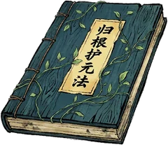

以「落叶归根、元息守一」为道旨，行功时将周身散逸灵气敛归丹田本源，凝作护元罡气覆于心脉气海

修炼后可领悟**天赋：落叶归根**

### 【各版本（境界 / 品质）】

结丹·仙品：修炼限制 境界：主角**结丹期**及以上；修炼限制 需要：〔木〕**本命物**；修炼限制 太过简单：主角**元婴期**起再修炼，不再获得修为，只直接领悟其中的技能 / 口诀 / 天赋

归根护元法(二)·元婴·天品：修炼限制 境界：主角**元婴期**及以上；修炼限制 条件：无（放入修炼工作台即可）；获得方式 修炼〈归根护元法〉

### 【获取途径】

结丹期后，**〈悟道〉 + 〈生长〉 + 〈御灵〉** 修炼后领悟

把心境赠送给入魔的修士（结丹期）有概率获得

结丹期时使用机缘探索宗门遗迹有概率获得

---

## 72. 万木归灵术

修炼者可借草木共鸣感知周遭生机，催动心法时经脉如古树盘根，生生不息

修炼后可领悟**技能：葬花术**

### 【各版本（境界 / 品质）】

元婴·神品：修炼限制 境界：主角**元婴期**及以上；修炼限制 需要：**元婴期**仙品〔木〕的**法宝**或**灵兽**（注意：这张卡会被**摧毁**）

### 【获取途径】

元婴期后，**〈悟道〉 + 〈归一〉 + 〈归一〉/〈顿悟〉** 修炼后可自选

---

## 73. 血灵经

以自身血脉为壤，取精血饲木灵。

修炼后可领悟**技能：孕灵术**

### 【各版本（境界 / 品质）】

元婴·神品：修炼限制 境界：主角**元婴期**及以上；修炼限制 条件：在**血红树**修炼；修炼限制 自由模式开局词条「先天道种」：无视以上条件，直接修炼

### 【获取途径】

元婴期后，**〈悟道〉 + 〈归一〉 + 〈归一〉/〈顿悟〉** 修炼后可自选

---

## 74. 涤尘术

练气阶段水系心法。以水系灵力洗练周身杂质、净化灵根，在吐纳间契合水性柔润之韵。

修炼后可领悟**技能：星图术**

### 【各版本（境界 / 品质）】

地品：修炼限制 境界：主角**练气期**及以上；修炼限制 条件：无（放入修炼工作台即可）；修炼限制 太过简单：主角**筑基期**起再修炼，不再获得修为，只直接领悟其中的技能 / 口诀 / 天赋

### 【获取途径】

修炼引水后领悟

在玄机阁中有概率刷出

无名村庄商人有概率出售

把〈引水〉送给打坐中的修士，必定获得

把心境赠送给入魔的修士有概率获得

---

## 75. 愈心术

修炼后可领悟**口诀：治愈诀**

### 【各版本（境界 / 品质）】

练气·天品：修炼限制 境界：主角**练气期**及以上；修炼限制 需要：一张**水灵气**；修炼限制 太过简单：主角**筑基期**起再修炼，不再获得修为，只直接领悟其中的技能 / 口诀 / 天赋

愈心术(二)·筑基·地品：此心法专司济世救疗之途，内中收录了海量前人躬身实践的治疗心得，条理分明、底蕴深厚。；心法第二层，需达到**筑基期**后方可继续修炼；修炼后可领悟**感悟卡：用术**；修炼限制 境界：主角**筑基期**及以上；修炼限制 需要：使用一张**坎水**；修炼限制 太过简单：主角**结丹期**起再修炼，不再获得修为，只直接领悟其中的技能 / 口诀 / 天赋；获得方式 修炼〈愈心术〉

### 【获取途径】

**〈悟道〉 + 〈药理〉** 修炼后有50%概率领悟

**〈悟道〉 + 〈药理〉 + 〈引水〉** 修炼后领悟

在玄机阁中有概率刷出

无名村庄商人有概率出售

把〈药理〉送给打坐中的修士，50% 概率获得

把心境赠送给入魔的修士有概率获得

---

## 76. 止水功

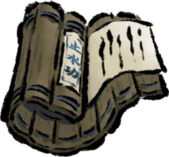

静渊无波，止水照神

修炼后可领悟**技能：卸力**

### 【各版本（境界 / 品质）】

地品：修炼限制 境界：主角**筑基期**及以上；修炼限制 需要：两张**灵气卡：坎水**；修炼限制 太过简单：主角**结丹期**起再修炼，不再获得修为，只直接领悟其中的技能 / 口诀 / 天赋

### 【获取途径】

筑基期后，**〈悟道〉 + 〈引水〉** 修炼后领悟

把〈御灵〉送给打坐中的修士，50% 概率获得

把心境赠送给入魔的修士有概率获得

在玄机阁中有概率刷出

筑基期时使用机缘探索宗门遗迹有概率获得

---

## 77. 回春典

修炼后可领悟**口诀：疗愈阵**

### 【各版本（境界 / 品质）】

筑基·天品：修炼限制 境界：主角**筑基期**及以上；修炼限制 需要：一张〔血量〕受损的卡牌；修炼限制 太过简单：主角**结丹期**起再修炼，不再获得修为，只直接领悟其中的技能 / 口诀 / 天赋

回春典(二)·结丹·地品：引天地间精纯生息入体，循功法玄奥脉络流转周身，将体内积淀的伤痕如融雪般逐一消融。；心法第二层，需达到**结丹期**后方可继续修炼；修炼后可领悟**用术**；修炼限制 境界：主角**结丹期**及以上；修炼限制 需要：一张〔血量〕受损的卡牌；修炼限制 太过简单：主角**元婴期**起再修炼，不再获得修为，只直接领悟其中的技能 / 口诀 / 天赋；获得方式 修炼〈回春典〉

### 【获取途径】

**〈悟道〉 + 〈御灵〉 + 〈药理〉** 修炼后领悟

把心境赠送给入魔的修士（筑基期）有概率获得

---

## 78. 续脉经

### 【各版本（境界 / 品质）】

筑基·神品：修炼限制 境界：主角**筑基期**及以上；修炼限制 条件：主角**濒死状态**时才能修炼；修炼限制 太过简单：主角**结丹期**起再修炼，不再获得修为，只直接领悟其中的技能 / 口诀 / 天赋

结丹·神品：唯有身临濒死之境，经脉欲断、生机将绝、命悬一线之际，方能引动功法内蕴的玄妙机理。；修炼后可领悟**技能：涤尘**；修炼后可领悟**天赋：灵脉之躯**；修炼限制 境界：主角**结丹期**及以上；修炼限制 条件：主角**濒死状态**时才能修炼；修炼限制 太过简单：主角**元婴期**起再修炼，不再获得修为，只直接领悟其中的技能 / 口诀 / 天赋；获得方式 修炼〈续脉经〉

元婴·神品：修炼限制 境界：主角**元婴期**及以上；修炼限制 条件：主角**濒死状态**时才能修炼；获得方式 修炼〈续脉经〉

### 【获取途径】

筑基期后，**〈悟道〉 + 〈御灵〉 + 〈御灵〉** 修炼后领悟

在玄机阁中有概率刷出

把心境赠送给入魔的修士（筑基期）有概率获得

---

## 79. 引气经

### 【各版本（境界 / 品质）】

筑基·仙品：修炼限制 境界：主角**筑基期**及以上；修炼限制 需要：两张**灵气卡：混沌灵气**；修炼限制 太过简单：主角**结丹期**起再修炼，不再获得修为，只直接领悟其中的技能 / 口诀 / 天赋

引气经(二)·结丹·天品：摒弃了基础吐纳的粗浅法门，以更玄奥的呼吸节律与灵力运转之法，每一次呼吸皆能牵引更磅礴的天地灵气入体。；心法第二层，需达到**结丹期**后方可继续修炼；修炼后可领悟**天赋：灵力亲和**；修炼限制 境界：主角**结丹期**及以上；修炼限制 需要：两张**灵气卡：混沌灵气**；修炼限制 太过简单：主角**元婴期**起再修炼，不再获得修为，只直接领悟其中的技能 / 口诀 / 天赋；获得方式 修炼〈引气经〉

引气经(三)·元婴·地品：摒弃了基础吐纳的粗浅法门，以更玄奥的呼吸节律与灵力运转之法，每一次呼吸皆能牵引更磅礴的天地灵气入体。；心法第三层，需达到**元婴期**后方可继续修炼；修炼后可领悟**天赋：灵力亲和**；修炼限制 境界：主角**元婴期**及以上；修炼限制 需要：两张**灵气卡：混沌灵气**；获得方式 修炼〈引气经〉

### 【获取途径】

筑基期后，**〈悟道〉 + 〈御灵〉 + 〈心境〉** 修炼后领悟

在玄机阁中有概率刷出

把心境赠送给入魔的修士（筑基期）有概率获得

---

## 80. 水元诀

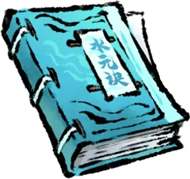

### 【各版本（境界 / 品质）】

筑基·仙品：修炼限制 境界：主角**筑基期**及以上；修炼限制 需要：一个筑基期神品瓶子；修炼限制 太过简单：主角**结丹期**起再修炼，不再获得修为，只直接领悟其中的技能 / 口诀 / 天赋

水元诀(二)·结丹·天品：学习江河不争之性，融月华至柔之韵，柔中藏韧，化浊气为清露；心法第二层，需达到**结丹期**后方可继续修炼；修炼后可领悟**天赋：万法归流**；修炼限制 境界：主角**结丹期**及以上；修炼限制 需要：一把结丹期的神品瓶子；修炼限制 太过简单：主角**元婴期**起再修炼，不再获得修为，只直接领悟其中的技能 / 口诀 / 天赋；获得方式 修炼〈水元诀〉

水元诀(三)·元婴·地品：学习江河不争之性，融月华至柔之韵，柔中藏韧，化浊气为清露；心法第三层，需达到**元婴期**后方可继续修炼；修炼后可领悟**天赋：万法归流**；修炼限制 境界：主角**元婴期**及以上；修炼限制 需要：一把元婴期的神品瓶子；获得方式 修炼〈水元诀〉

### 【获取途径】

筑基期后，**〈悟道〉 + 〈御灵〉 + 〈身法〉** 修炼后领悟

在玄机阁中有概率刷出

把心境赠送给入魔的修士（筑基期）有概率获得

---

## 81. 引潮法

### 【各版本（境界 / 品质）】

筑基·仙品：修炼限制 境界：主角**筑基期**及以上；修炼限制 条件：在〔水〕地点（「愈魂池」）修炼（把主角和心法一起放进该地点）；修炼限制 太过简单：主角**结丹期**起再修炼，不再获得修为，只直接领悟其中的技能 / 口诀 / 天赋

引潮法(二)·结丹·天品：引潮法直指天人合一至理，将浩瀚海洋潮汐之力纳入方寸之躯；心法第二层，需达到**结丹期**后方可继续修炼；修炼后可领悟**天赋：万法归流**；修炼限制 境界：主角**结丹期**及以上；修炼限制 需要：可潮汐涨落需要找到一处〔水〕秘境点，才可修炼。[（找到地点后，把主角和心法放入地点修炼心法）]；获得方式 修炼〈引潮法〉

引潮法(三)·元婴·地品：引潮法直指天人合一至理，将浩瀚海洋潮汐之力纳入方寸之躯；心法第三层，需达到**元婴期**后方可继续修炼；修炼后可领悟**天赋：万法归流**；修炼限制 境界：主角**元婴期**及以上；修炼限制 需要：可潮汐涨落需要找到一处〔水〕秘境点，才可修炼。[（找到地点后，把主角和心法放入地点修炼心法）]；修炼限制 自由模式开局词条「先天道种」：无视以上条件，直接修炼；获得方式 修炼〈引潮法〉

### 【获取途径】

筑基期后，**〈悟道〉 + 〈御灵〉 + 〈引水〉** 修炼后领悟

在玄机阁中有概率刷出

把心境赠送给入魔的修士（筑基期）有概率获得

---

## 82. 归藏术

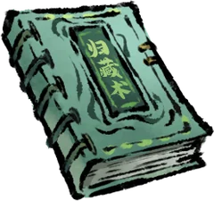

### 【各版本（境界 / 品质）】

筑基·仙品：修炼限制 境界：主角**筑基期**及以上；修炼限制 需要：一个**单体伤害口诀**＋一个练习目标（**尸体**或**妖兽**）；修炼限制 太过简单：主角**结丹期**起再修炼，不再获得修为，只直接领悟其中的技能 / 口诀 / 天赋

归藏术(二)·结丹·天品：气合太虚，行随造化，身若山河芥子。；心法第二层，需达到**结丹期**后方可继续修炼；修炼后可领悟**天赋：法术精通**；修炼限制 境界：主角**结丹期**及以上；修炼限制 需要：一个**单体伤害口诀**＋一个练习目标（**尸体**或**妖兽**）；修炼限制 太过简单：主角**元婴期**起再修炼，不再获得修为，只直接领悟其中的技能 / 口诀 / 天赋；获得方式 修炼〈归藏术〉

归藏术(三)·元婴·地品：气合太虚，行随造化，身若山河芥子。；心法第三层，需达到**元婴期**后方可继续修炼；修炼后可领悟**天赋：法术精通**；修炼限制 境界：主角**元婴期**及以上；修炼限制 需要：一个**单体伤害口诀**＋一个练习目标（**尸体**或**妖兽**）；获得方式 修炼〈归藏术〉

### 【获取途径】

筑基期后，**〈悟道〉 + 〈御灵〉 + 〈御土〉** 修炼后领悟

在玄机阁中有概率刷出

把心境赠送给入魔的修士（筑基期）有概率获得

---

## 83. 润元心法

以灵水化气，缓缓浸润经脉丹田，温养本源、涤荡浊息。

修炼后可领悟**天赋：生生不息**

### 【各版本（境界 / 品质）】

筑基·仙品：修炼限制 境界：主角**筑基期**及以上；修炼限制 需要：一颗筑基期神品或以上的**补血丹药**；修炼限制 太过简单：主角**结丹期**起再修炼，不再获得修为，只直接领悟其中的技能 / 口诀 / 天赋

润元心法(二)·结丹·天品：修炼限制 境界：主角**结丹期**及以上；修炼限制 需要：一颗**结丹期**神品以上的**补血丹药**；修炼限制 太过简单：主角**元婴期**起再修炼，不再获得修为，只直接领悟其中的技能 / 口诀 / 天赋；获得方式 修炼〈润元心法〉

润元心法(三)·元婴·地品：修炼限制 境界：主角**元婴期**及以上；修炼限制 需要：一颗元婴期神品以上的补血丹药；获得方式 修炼〈润元心法〉

### 【获取途径】

筑基期后，**〈悟道〉 + 〈丹道〉 + 〈引水〉** 修炼后领悟

在玄机阁中有概率刷出

把心境赠送给入魔的修士（筑基期）有概率获得

---

## 84. 寒影追魂录

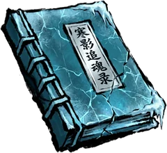

修者以寒淬脉，凝影藏形，出手时化气为冰、影随念动，敌未觉而冰已侵骨。

修炼后可领悟**天赋：无形冰**

### 【各版本（境界 / 品质）】

筑基·仙品：修炼限制 境界：主角**筑基期**及以上；修炼限制 需要：一把筑基期或以上的神品**双刀**；修炼限制 太过简单：主角**结丹期**起再修炼，不再获得修为，只直接领悟其中的技能 / 口诀 / 天赋

寒影追魂录(二)·结丹·天品：修炼限制 境界：主角**结丹期**及以上；修炼限制 需要：一把**结丹期**以上神品的**双刀**；修炼限制 太过简单：主角**元婴期**起再修炼，不再获得修为，只直接领悟其中的技能 / 口诀 / 天赋；获得方式 修炼〈寒影追魂录〉

寒影追魂录(三)·元婴·地品：修炼限制 境界：主角**元婴期**及以上；修炼限制 需要：一把**元婴期**以上神品的**双刀**；获得方式 修炼〈寒影追魂录〉

### 【获取途径】

筑基期后，**〈悟道〉 + 〈御灵〉 + 〈剑芒〉** 修炼后领悟

在玄机阁中有概率刷出

把心境赠送给入魔的修士（筑基期）有概率获得

---

## 85. 凝尘诀

以引天地微尘入脉，凝尘为气，于微末之间炼就道体。

修炼后可领悟**口诀：凝气诀**

### 【各版本（境界 / 品质）】

结丹·绝品：修炼限制 境界：主角**结丹期**及以上；修炼限制 需要：**心境卡**；修炼限制 太过简单：主角**元婴期**起再修炼，不再获得修为，只直接领悟其中的技能 / 口诀 / 天赋

### 【获取途径】

结丹期后，**〈悟道〉 + 〈包容〉 + 〈顿悟〉** 修炼后领悟

结丹期：带着〈心境〉和「入魔的修士」对话，有概率获得

结丹期：带着〈任意内丹（结丹后期）〉和「古碑龟」对话，有概率获得

---

## 86. 沧溟诀

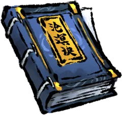

### 【各版本（境界 / 品质）】

结丹·神品：修炼限制 境界：主角**结丹期**及以上；修炼限制 需要：一件结丹期绝品〔水〕法宝＋**九阴黑水**；修炼限制 太过简单：主角**元婴期**起再修炼，不再获得修为，只直接领悟其中的技能 / 口诀 / 天赋

沧溟诀(二)·元婴·仙品：引天地水元之气入体，化为绵绵不绝的柔韧内力，如大海般浩瀚深邃。；心法第二层，需达到**元婴期**后方可继续修炼；修炼后可领悟**天赋：灵脉之躯**；修炼限制 境界：主角**元婴期**及以上；修炼限制 需要：借用法宝，将水元之力源源不断的吸收。我还需要一把结丹期的绝品〔水〕法宝和**混沌灵气**；获得方式 修炼〈沧溟诀〉

### 【获取途径】

结丹期后，**〈悟道〉 + 〈包容〉 + 〈心境〉** 修炼后领悟

把心境赠送给入魔的修士（结丹期）有概率获得

结丹期时使用机缘探索宗门遗迹有概率获得

---

## 87. 汐残照

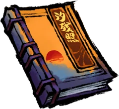

### 【各版本（境界 / 品质）】

结丹·仙品：修炼限制 境界：主角**结丹期**及以上；修炼限制 需要：一件损坏的〔水〕法宝；修炼限制 太过简单：主角**元婴期**起再修炼，不再获得修为，只直接领悟其中的技能 / 口诀 / 天赋

汐残照(二)·元婴·天品：残照之韵，落日熔金、霞染海天，于绚烂极致中藏尽决绝之势。；心法第二层，需达到**元婴期**后方可继续修炼；修炼后可领悟**天赋：落珠回春**；修炼限制 境界：主角**元婴期**及以上；修炼限制 需要：一件损坏的元婴期〔水〕法宝；获得方式 修炼〈汐残照〉

### 【获取途径】

结丹期后，**〈悟道〉 + 〈包容〉 + 〈御灵〉** 修炼后领悟

把心境赠送给入魔的修士（结丹期）有概率获得

结丹期时使用机缘探索宗门遗迹有概率获得

---

## 88. 溟吸术

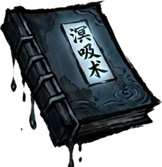

修炼后可领悟**技能：斗转星移**

### 【各版本（境界 / 品质）】

结丹·仙品：修炼限制 境界：主角**结丹期**及以上；修炼限制 需要：一把结丹期**本命兵器**（剑 / 刀 / 双刀 / 扇子 / 暗器 / 枪 / 锤）；修炼限制 太过简单：主角**元婴期**起再修炼，不再获得修为，只直接领悟其中的技能 / 口诀 / 天赋

溟吸术(二)·元婴·天品：化灵力为无形吸力，可抽取他人修为、生机纳入己身；修炼后可领悟**感悟：招式**；修炼限制 境界：主角**元婴期**及以上；修炼限制 需要：一把[元婴期的本命兵器（剑/刀/双刀/扇子/暗器/枪/锤）]；获得方式 修炼〈溟吸术〉

### 【获取途径】

结丹期后，**〈悟道〉 + 〈包容〉 + 〈御物〉** 修炼后领悟

把心境赠送给入魔的修士（结丹期）有概率获得

结丹期时使用机缘探索宗门遗迹有概率获得

---

## 89. 回光心诀

修炼后可领悟**技能：神佑**

### 【各版本（境界 / 品质）】

结丹·仙品：修炼限制 境界：主角**结丹期**及以上；修炼限制 条件：在**秘境：碧潭瀑布**修炼；修炼限制 太过简单：主角**元婴期**起再修炼，不再获得修为，只直接领悟其中的技能 / 口诀 / 天赋；修炼限制 自由模式开局词条「先天道种」：无视以上条件，直接修炼

回光心诀(二)·元婴·天品：以水之澄静涤荡神识，令心神内照、观照己身，可稳道心、破迷障、清杂念。；修炼后可领悟**感悟：招式**；修炼限制 境界：主角**元婴期**及以上；修炼限制 条件：在**秘境：碧潭瀑布**修炼；修炼限制 自由模式开局词条「先天道种」：无视以上条件，直接修炼；获得方式 修炼〈回光心诀〉

### 【获取途径】

结丹期后，**〈悟道〉 + 〈包容〉 + 〈包容〉** 修炼后领悟

把心境赠送给入魔的修士（结丹期）有概率获得

结丹期时使用机缘探索宗门遗迹有概率获得

---

## 90. 同心典

修炼后可领悟**口诀：灵源咒**

### 【各版本（境界 / 品质）】

结丹·仙品：修炼限制 境界：主角**结丹期**及以上；修炼限制 条件：在**秘境：碧潭瀑布**修炼；修炼限制 太过简单：主角**元婴期**起再修炼，不再获得修为，只直接领悟其中的技能 / 口诀 / 天赋；修炼限制 自由模式开局词条「先天道种」：无视以上条件，直接修炼

同心典(二)·元婴·天品：修者可借契约之桥，将自身生机灵力渡予契约灵兽；修炼后可领悟**感悟：用术**；修炼限制 境界：主角**元婴期**及以上；修炼限制 条件：在**秘境：碧潭瀑布**修炼；修炼限制 自由模式开局词条「先天道种」：无视以上条件，直接修炼；获得方式 修炼〈同心典〉

### 【获取途径】

结丹期后，**〈悟道〉 + 〈包容〉 + 〈丹道〉** 修炼后领悟

把心境赠送给入魔的修士（结丹期）有概率获得

结丹期时使用机缘探索宗门遗迹有概率获得

---

## 91. 守一诀

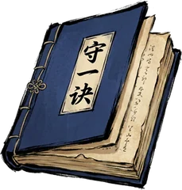

只要守住那一点本源一息，万般强攻、邪扰都难以破开你的防线

修炼后可领悟**技能：无量障**

### 【各版本（境界 / 品质）】

元婴·神品：修炼限制 境界：主角**元婴期**及以上；修炼限制 条件：主角**濒死状态**时才能修炼

### 【获取途径】

元婴期后，**〈悟道〉 + 〈归一〉 + 〈归一〉/〈顿悟〉** 修炼后可自选

---

## 92. 焚炎经

练气阶段火系心法。此法核心在于引动天地间散逸的火灵之气，点燃体内火源根基，在吐纳间体悟火系灵力的炽烈之威

修炼后可领悟**口诀：唤火诀**

### 【各版本（境界 / 品质）】

地品：修炼限制 境界：主角**练气期**及以上；修炼限制 条件：无（放入修炼工作台即可）；修炼限制 太过简单：主角**筑基期**起再修炼，不再获得修为，只直接领悟其中的技能 / 口诀 / 天赋

### 【获取途径】

修炼〈控火〉后领悟

在玄机阁中有概率刷出

无名村庄商人有概率出售

把〈控火〉送给打坐中的修士，必定获得

把心境赠送给入魔的修士有概率获得

---

## 93. 淬骨功

### 【各版本（境界 / 品质）】

练气·天品：修炼限制 境界：主角**练气期**及以上；修炼限制 需要：神品〔火〕内丹；修炼限制 太过简单：主角**筑基期**起再修炼，不再获得修为，只直接领悟其中的技能 / 口诀 / 天赋

淬骨功(二)·筑基·地品：所载是一套以火焰淬炼筋骨的系统法门，，以温和却持久的火焰之力烘烤骨骼、锻打筋肉，逐层褪去肉身杂质，强化骨骼坚韧度。；心法第二层，需达到**筑基期**后方可继续修炼；修炼后可领悟**天赋：百炼钢驱**；修炼限制 境界：主角**筑基期**及以上；修炼限制 需要：使用筑基期神品〔火〕内丹；修炼限制 太过简单：主角**结丹期**起再修炼，不再获得修为，只直接领悟其中的技能 / 口诀 / 天赋；获得方式 修炼〈淬骨功〉

### 【实际领悟的天赋】

游戏描述里写的是「百炼钢驱」，实际修炼后领悟的是天赋「百炼钢躯」（按游戏修炼配方核对）

### 【获取途径】

**〈悟道〉 + 〈身法〉** 修炼后有50%概率领悟

**〈悟道〉 + 〈身法〉 + 〈控火〉** 修炼后领悟

在玄机阁中有概率刷出

无名村庄商人有概率出售

把〈身法〉送给打坐中的修士，50% 概率获得

把心境赠送给入魔的修士有概率获得

---

## 94. 焚天诀

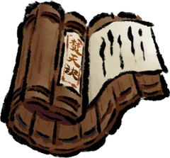

上古火修秘典，以火证道，焚天煮海。

修炼后可领悟**口诀：聚火诀**

### 【各版本（境界 / 品质）】

筑基·地品：修炼限制 境界：主角**筑基期**及以上；修炼限制 需要：两张**灵气卡：离火**；修炼限制 太过简单：主角**结丹期**起再修炼，不再获得修为，只直接领悟其中的技能 / 口诀 / 天赋

### 【获取途径】

筑基期后，**〈悟道〉 + 〈控火〉** 修炼后领悟

把〈杀意〉送给打坐中的修士，必定获得

把心境赠送给入魔的修士（筑基期）有概率获得

在玄机阁中有概率刷出

筑基期时使用机缘探索宗门遗迹有概率获得

---

## 95. 玄火锻骨录

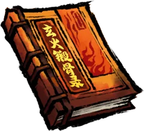

以秘法引玄阳真火入体，循功法脉络流转周身，让真火之力缓缓渗透骨骼脏腑；**此心法需要在火属性地点修炼**

### 【各版本（境界 / 品质）】

筑基·天品：修炼限制 境界：主角**筑基期**及以上；修炼限制 条件：在〔火〕地点（「火云树」 / 「地火」）修炼（把主角和心法一起放进该地点）；修炼限制 太过简单：主角**结丹期**起再修炼，不再获得修为，只直接领悟其中的技能 / 口诀 / 天赋；修炼限制 自由模式开局词条「先天道种」：无视以上条件，直接修炼

玄火锻骨录(二)·结丹·地品：心法第二层，需达到**结丹期**后方可继续修炼；**此心法需要在火属性地点修炼**；修炼后可领悟**天赋：百炼钢驱**；修炼限制 境界：主角**结丹期**及以上；修炼限制 条件：在〔火〕地点（「火云树」 / 「地火」）修炼（把主角和心法一起放进该地点）；修炼限制 太过简单：主角**元婴期**起再修炼，不再获得修为，只直接领悟其中的技能 / 口诀 / 天赋；修炼限制 自由模式开局词条「先天道种」：无视以上条件，直接修炼；获得方式 修炼〈玄火锻骨录〉

### 【实际领悟的天赋】

游戏描述里写的是「百炼钢驱」，实际修炼后领悟的是天赋「百炼钢躯」（按游戏修炼配方核对）

### 【获取途径】

**〈悟道〉 + 〈杀意〉 + 〈身法〉** 修炼后领悟

在玄机阁中有概率刷出

把心境赠送给入魔的修士（筑基期）有概率获得

筑基期时使用机缘探索宗门遗迹有概率获得

---

## 96. 血髓功

以自身精血为媒，冲破体内三十六处玄关隘口；**此心法需要在火属性地点修炼**

### 【各版本（境界 / 品质）】

筑基·神品：修炼限制 境界：主角**筑基期**及以上；修炼限制 需要：**兽血**，在〔火〕地点（「火云树」 / 「地火」）修炼（把主角和心法一起放进该地点）；修炼限制 太过简单：主角**结丹期**起再修炼，不再获得修为，只直接领悟其中的技能 / 口诀 / 天赋；修炼限制 自由模式开局词条「先天道种」：无视以上条件，直接修炼

血髓功(二)·结丹·神品：心法第二层，需达到**结丹期**后方可继续修炼；**此心法需要在火属性地点修炼**；修炼后可领悟**天赋：神魂锻体**；修炼限制 境界：主角**结丹期**及以上；修炼限制 需要：**兽血**，在〔火〕地点（「火云树」 / 「地火」）修炼（把主角和心法一起放进该地点）；修炼限制 太过简单：主角**元婴期**起再修炼，不再获得修为，只直接领悟其中的技能 / 口诀 / 天赋；修炼限制 自由模式开局词条「先天道种」：无视以上条件，直接修炼；获得方式 修炼〈血髓功〉、「武破岳」自己突破时送你：到结丹前期（好感 ≥ 15）、到元婴前期（好感 ≥ 45）（随机给一张）

血髓功(三)·元婴·神品：心法第三层，需达到**元婴期**后方可继续修炼；**此心法需要在火属性地点修炼**；修炼后可领悟**天赋：神魂锻体**；修炼限制 境界：主角**元婴期**及以上；修炼限制 需要：找到**地火深洞**或**天地熔炉**后；修炼限制 自由模式开局词条「先天道种」：无视以上条件，直接修炼；获得方式 修炼〈血髓功〉

### 【获取途径】

筑基期后，**〈悟道〉 + 〈杀意〉 + 〈杀意〉** 修炼后领悟

在玄机阁中有概率刷出

把心境赠送给入魔的修士（筑基期）有概率获得

筑基期时使用机缘探索宗门遗迹有概率获得

---

## 97. 焚心剑谱

引心火入剑，以剑焚心，斩断七情六欲；**此心法需要在火属性地点修炼**

### 【各版本（境界 / 品质）】

筑基·仙品：修炼限制 境界：主角**筑基期**及以上；修炼限制 需要：一把筑基期〔火〕剑，在〔火〕地点（「火云树」 / 「地火」）修炼（把主角和心法一起放进该地点）；修炼限制 太过简单：主角**结丹期**起再修炼，不再获得修为，只直接领悟其中的技能 / 口诀 / 天赋；修炼限制 自由模式开局词条「先天道种」：无视以上条件，直接修炼

焚心剑谱(二)·结丹·天品：心法第二层，需达到**结丹期**后方可继续修炼；**此心法需要在火属性地点修炼**；修炼后可领悟**天赋：百炼钢躯和天赋：剑术精通**；修炼限制 境界：主角**结丹期**及以上；修炼限制 太过简单：主角**元婴期**起再修炼，不再获得修为，只直接领悟其中的技能 / 口诀 / 天赋；获得方式 修炼〈焚心剑谱〉

焚心剑谱(三)·元婴·地品：心法第三层，需达到**元婴期**后方可继续修炼；**此心法需要在火属性地点修炼**；修炼后可领悟**天赋：百炼钢驱和天赋：剑术精通**；修炼限制 境界：主角**元婴期**及以上；修炼限制 需要：剑谱里记载的招式，竟需要在离火之炎中修炼。我需要找到**地火深洞**或**天地熔炉**后；修炼限制 自由模式开局词条「先天道种」：无视以上条件，直接修炼；获得方式 修炼〈焚心剑谱〉

### 【实际领悟的天赋】

游戏描述里写的是「百炼钢驱」，实际修炼后领悟的是天赋「剑术精通」、天赋「百炼钢躯」（按游戏修炼配方核对）

游戏描述里写的是「百炼钢驱」，实际修炼后领悟的是天赋「百炼钢躯」、天赋「御剑无锋」（按游戏修炼配方核对）

### 【获取途径】

筑基期后，**〈悟道〉 + 〈剑意〉 + 〈控火〉** 修炼后领悟

在玄机阁中有概率刷出

把心境赠送给入魔的修士（筑基期）有概率获得

筑基期时使用机缘探索宗门遗迹有概率获得

---

## 98. 焚脉法

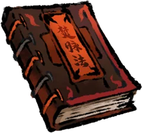

以火为媒，引天地之火入体焚脉。**此心法需要在火属性地点修炼**

### 【各版本（境界 / 品质）】

筑基·仙品：修炼限制 境界：主角**筑基期**及以上；修炼限制 条件：在〔火〕地点（「火云树」 / 「地火」）修炼（把主角和心法一起放进该地点）；修炼限制 太过简单：主角**结丹期**起再修炼，不再获得修为，只直接领悟其中的技能 / 口诀 / 天赋；修炼限制 自由模式开局词条「先天道种」：无视以上条件，直接修炼

焚脉法(二)·结丹·天品：心法第二层，需达到**结丹期**后方可继续修炼；**此心法需要在火属性地点修炼**；修炼后可领悟**天赋：百炼钢躯**；修炼限制 境界：主角**结丹期**及以上；修炼限制 条件：在〔火〕地点（「火云树」 / 「地火」）修炼（把主角和心法一起放进该地点）；修炼限制 太过简单：主角**元婴期**起再修炼，不再获得修为，只直接领悟其中的技能 / 口诀 / 天赋；修炼限制 自由模式开局词条「先天道种」：无视以上条件，直接修炼；获得方式 修炼〈焚脉法〉

焚脉法(三)·元婴·地品：心法第三层，需达到**元婴期**后方可继续修炼；**此心法需要在火属性地点修炼**；修炼后可领悟**天赋：百炼钢驱**；修炼限制 境界：主角**元婴期**及以上；修炼限制 需要：需要在离火之势中，将筋脉焚烧一遍。我需要找到**地火深洞**或**天地熔炉**后；修炼限制 自由模式开局词条「先天道种」：无视以上条件，直接修炼；获得方式 修炼〈焚脉法〉

### 【实际领悟的天赋】

游戏描述里写的是「百炼钢驱」，实际修炼后领悟的是天赋「百炼钢躯」（按游戏修炼配方核对）

### 【获取途径】

筑基期后，**〈悟道〉 + 〈杀意〉 + 〈控火〉** 修炼后领悟

在玄机阁中有概率刷出

把心境赠送给入魔的修士（筑基期）有概率获得

筑基期时使用机缘探索宗门遗迹有概率获得

---

## 99. 燃血术

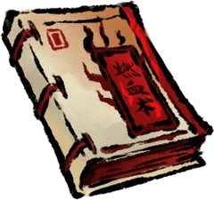

以血为薪，焚命为焰，燃周身之血以激发潜能。**此心法需要在火属性地点修炼**

### 【各版本（境界 / 品质）】

筑基·仙品：修炼限制 境界：主角**筑基期**及以上；修炼限制 条件：在〔火〕地点（「火云树」 / 「地火」）修炼（把主角和心法一起放进该地点）；修炼限制 太过简单：主角**结丹期**起再修炼，不再获得修为，只直接领悟其中的技能 / 口诀 / 天赋；修炼限制 自由模式开局词条「先天道种」：无视以上条件，直接修炼

燃血术(二)·结丹·天品：心法第二层，需达到**结丹期**后方可继续修炼；**此心法需要在火属性地点修炼**；修炼后可领悟**天赋：百炼钢躯**；修炼限制 境界：主角**结丹期**及以上；修炼限制 条件：在〔火〕地点（「火云树」 / 「地火」）修炼（把主角和心法一起放进该地点）；修炼限制 太过简单：主角**元婴期**起再修炼，不再获得修为，只直接领悟其中的技能 / 口诀 / 天赋；修炼限制 自由模式开局词条「先天道种」：无视以上条件，直接修炼；获得方式 修炼〈燃血术〉

燃血术(三)·元婴·地品：心法第三层，需达到**元婴期**后方可继续修炼；**此心法需要在火属性地点修炼**；修炼后可领悟**天赋：百炼钢驱**；修炼限制 境界：主角**元婴期**及以上；修炼限制 需要：需要在离火之势中，蒸发自身的气血。我需要找到**地火深洞**或**天地熔炉**后；修炼限制 自由模式开局词条「先天道种」：无视以上条件，直接修炼；获得方式 修炼〈燃血术〉

### 【实际领悟的天赋】

游戏描述里写的是「百炼钢驱」，实际修炼后领悟的是天赋「百炼钢躯」（按游戏修炼配方核对）

### 【获取途径】

筑基期后，**〈悟道〉 + 〈杀意〉 + 〈引水〉** 修炼后领悟

在玄机阁中有概率刷出

把心境赠送给入魔的修士（筑基期）有概率获得

筑基期时使用机缘探索宗门遗迹有概率获得

---

## 100. 连锋诀

修炼后可领悟**技能：乘胜**

### 【各版本（境界 / 品质）】

筑基·天品：修炼限制 境界：主角**筑基期**及以上；修炼限制 需要：一件筑基期仙品〔火〕法宝；修炼限制 太过简单：主角**结丹期**起再修炼，不再获得修为，只直接领悟其中的技能 / 口诀 / 天赋

连锋诀(二)·结丹·地品：火脉战攻之法，以心火炼锋刃之意，融火势于刀兵之中。；修炼后可领悟**感悟：招式**；修炼限制 境界：主角**结丹期**及以上；修炼限制 需要：一把结丹期〔火〕仙品法宝；修炼限制 太过简单：主角**元婴期**起再修炼，不再获得修为，只直接领悟其中的技能 / 口诀 / 天赋；获得方式 修炼〈连锋诀〉

### 【获取途径】

筑基期后，**〈悟道〉 + 〈御物〉 + 〈控火〉** 修炼后领悟

在玄机阁中有概率刷出

把心境赠送给入魔的修士（筑基期）有概率获得

筑基期时使用机缘探索宗门遗迹有概率获得

---

## 101. 爆炎诀

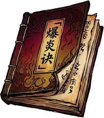

修炼后可领悟**技能：爆袭**

### 【各版本（境界 / 品质）】

筑基·天品：修炼限制 境界：主角**筑基期**及以上；修炼限制 需要：**感悟卡：控火**或**感悟卡：杀意**；修炼限制 太过简单：主角**结丹期**起再修炼，不再获得修为，只直接领悟其中的技能 / 口诀 / 天赋

爆炎诀(二)·结丹·地品：将火属性灵力高度凝聚后骤然释放，形成炸裂般的毁灭性冲击。；修炼后可领悟**感悟：招式**；修炼限制 境界：主角**结丹期**及以上；修炼限制 需要：**感悟卡：释放**；修炼限制 太过简单：主角**元婴期**起再修炼，不再获得修为，只直接领悟其中的技能 / 口诀 / 天赋；获得方式 修炼〈爆炎诀〉

### 【获取途径】

筑基期后，**〈悟道〉 + 〈御灵〉 + 〈控火〉** 修炼后领悟

在玄机阁中有概率刷出

把心境赠送给入魔的修士（筑基期）有概率获得

筑基期时使用机缘探索宗门遗迹有概率获得

---

## 102. 焚霄诀

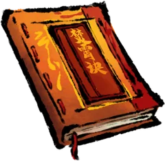

### 【各版本（境界 / 品质）】

结丹·仙品：修炼限制 境界：主角**结丹期**及以上；修炼限制 条件：在**地火深洞**或**天地熔炉**修炼；修炼限制 太过简单：主角**元婴期**起再修炼，不再获得修为，只直接领悟其中的技能 / 口诀 / 天赋；修炼限制 自由模式开局词条「先天道种」：无视以上条件，直接修炼

焚霄诀(二)·元婴·天品：火系至刚至烈的顶尖攻伐心法，需引地火、融天火、炼心火，三火合一筑就根基。；心法第二层，需达到**元婴期**后方可继续修炼；修炼后可领悟**天赋：真炎道**；修炼限制 境界：主角**元婴期**及以上；修炼限制 条件：在**地火深洞**或**天地熔炉**修炼；修炼限制 自由模式开局词条「先天道种」：无视以上条件，直接修炼；获得方式 修炼〈焚霄诀〉

### 【获取途径】

结丹期后，**〈悟道〉 + 〈释放〉 + 〈心境〉** 修炼后领悟

把心境赠送给入魔的修士（结丹期）有概率获得

结丹期时使用机缘探索宗门遗迹有概率获得

---

## 103. 燃神诀

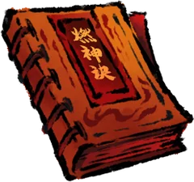

### 【各版本（境界 / 品质）】

结丹·仙品：修炼限制 境界：主角**结丹期**及以上；修炼限制 条件：在**地火深洞**或**天地熔炉**修炼；修炼限制 太过简单：主角**元婴期**起再修炼，不再获得修为，只直接领悟其中的技能 / 口诀 / 天赋；修炼限制 自由模式开局词条「先天道种」：无视以上条件，直接修炼

燃神诀(二)·元婴·天品：火系禁忌心法，以神识为薪，是舍神识换力量的诡道火系心法。；心法第二层，需达到**元婴期**后方可继续修炼；修炼后可领悟**天赋：神魂锻体**；修炼限制 境界：主角**元婴期**及以上；修炼限制 条件：在**地火深洞**或**天地熔炉**修炼；修炼限制 自由模式开局词条「先天道种」：无视以上条件，直接修炼；获得方式 修炼〈燃神诀〉

### 【获取途径】

结丹期后，**〈悟道〉 + 〈释放〉 + 〈杀意〉** 修炼后领悟

把心境赠送给入魔的修士（结丹期）有概率获得

结丹期时使用机缘探索宗门遗迹有概率获得

---

## 104. 燃魄诀

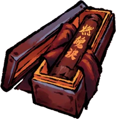

### 【各版本（境界 / 品质）】

结丹·仙品：修炼限制 境界：主角**结丹期**及以上；修炼限制 条件：在**地火深洞**或**天地熔炉**修炼；修炼限制 太过简单：主角**元婴期**起再修炼，不再获得修为，只直接领悟其中的技能 / 口诀 / 天赋；修炼限制 自由模式开局词条「先天道种」：无视以上条件，直接修炼

燃魄诀(二)·元婴·天品：火系邪异心法，以寿元为薪，是舍身取力的的诡道火系心法。；心法第二层，需达到**元婴期**后方可继续修炼；修炼后可领悟**天赋：太素炼形**；修炼限制 境界：主角**元婴期**及以上；修炼限制 条件：在**地火深洞**或**天地熔炉**修炼；修炼限制 自由模式开局词条「先天道种」：无视以上条件，直接修炼；获得方式 修炼〈燃魄诀〉

### 【获取途径】

结丹期后，**〈悟道〉 + 〈释放〉 + 〈释放〉** 修炼后领悟

把心境赠送给入魔的修士（结丹期）有概率获得

结丹期时使用机缘探索宗门遗迹有概率获得

---

## 105. 化龙功

修炼后可领悟**技能：炎龙之力**

### 【各版本（境界 / 品质）】

结丹·天品：修炼限制 境界：主角**结丹期**及以上；修炼限制 条件：在**地火深洞**或**天地熔炉**修炼；修炼限制 太过简单：主角**元婴期**起再修炼，不再获得修为，只直接领悟其中的技能 / 口诀 / 天赋；修炼限制 自由模式开局词条「先天道种」：无视以上条件，直接修炼

化龙功(二)·元婴·地品：以龙形火意淬炼经脉骨骼，日积月累，肉身蜕变、气血如龙，举手投足皆有龙威；修炼后可领悟**感悟：招式**；修炼限制 境界：主角**元婴期**及以上；修炼限制 条件：在**地火深洞**或**天地熔炉**修炼；修炼限制 自由模式开局词条「先天道种」：无视以上条件，直接修炼；获得方式 修炼〈化龙功〉

### 【获取途径】

结丹期后，**〈悟道〉 + 〈释放〉 + 〈御物〉** 修炼后领悟

把心境赠送给入魔的修士（结丹期）有概率获得

结丹期时使用机缘探索宗门遗迹有概率获得

---

## 106. 炎息心法

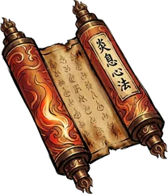

以吐纳调息为根基，令呼吸与火意相合，一呼一吸皆带炎气。

修炼后可领悟**天赋：浴火之躯**

### 【各版本（境界 / 品质）】

结丹·仙品：修炼限制 境界：主角**结丹期**及以上；修炼限制 条件：在**地火深洞**或**天地熔炉**修炼；修炼限制 太过简单：主角**元婴期**起再修炼，不再获得修为，只直接领悟其中的技能 / 口诀 / 天赋；修炼限制 自由模式开局词条「先天道种」：无视以上条件，直接修炼

炎息心法(二)·元婴·天品：修炼限制 境界：主角**元婴期**及以上；修炼限制 条件：在**地火深洞**或**天地熔炉**修炼；修炼限制 自由模式开局词条「先天道种」：无视以上条件，直接修炼；获得方式 修炼〈炎息心法〉

### 【获取途径】

结丹期后，**〈悟道〉 + 〈释放〉 + 〈御灵〉** 修炼后领悟

把心境赠送给入魔的修士（结丹期）有概率获得

结丹期时使用机缘探索宗门遗迹有概率获得

---

## 107. 九死功

需在生死边缘突破，以焚身之火淬体炼神，死一次，进一层。

修炼后可领悟**技能：浴火雷劫**

### 【各版本（境界 / 品质）】

神品：修炼限制 境界：主角**元婴期**及以上；修炼限制 条件：主角**濒死状态**时才能修炼；修炼限制 自由模式开局词条「先天道种」：无视以上条件，直接修炼

### 【获取途径】

元婴期后，**〈悟道〉 + 〈归一〉 + 〈归一〉/〈顿悟〉** 修炼后可自选

带着〈神秘高手的肉体〉和「神秘高手的元婴」对话（在「地火深洞」），有概率获得

---

## 108. 烬身诀

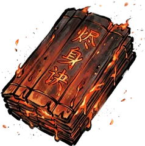

以自身气血精元为薪柴，换取远超常态的战力。

修炼后可领悟**技能：烬身三式**

### 【各版本（境界 / 品质）】

神品：修炼限制 境界：主角**元婴期**及以上；修炼限制 条件：主角**濒死状态**时才能修炼；修炼限制 自由模式开局词条「先天道种」：无视以上条件，直接修炼

### 【获取途径】

元婴期后，**〈悟道〉 + 〈归一〉 + 〈归一〉/〈顿悟〉** 修炼后可自选

带着〈神秘高手的肉体〉和「神秘高手的元婴」对话（在「地火深洞」），有概率获得

---

## 109. 岩息术

练气阶段土系心法。以吐纳之术吸纳天地间的土灵之气，夯实肉身与灵根根基，掌握土系灵力最基础的凝聚、运转之法。

修炼后可领悟**技能：岩肤体**

### 【各版本（境界 / 品质）】

地品：修炼限制 境界：主角**练气期**及以上；修炼限制 条件：无（放入修炼工作台即可）；修炼限制 太过简单：主角**筑基期**起再修炼，不再获得修为，只直接领悟其中的技能 / 口诀 / 天赋

### 【获取途径】

修炼御土后领悟

在玄机阁中有概率刷出

无名村庄商人有概率出售

把〈御土〉送给打坐中的修士，必定获得

把心境赠送给入魔的修士有概率获得

---

## 110. 金刚拳

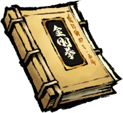

修炼后可领悟**技能：反击式**

### 【各版本（境界 / 品质）】

练气·天品：修炼限制 境界：主角**练气期**及以上；修炼限制 需要：一份仙品或神品的〔土〕**材料**（修炼时消耗）；修炼限制 太过简单：主角**筑基期**起再修炼，不再获得修为，只直接领悟其中的技能 / 口诀 / 天赋

金刚拳(二)·筑基·地品：记载了一套以守御为核心的拳法体系——遇袭时如何借土系灵力的厚重之性卸力、抗冲击，剖析得细致入微。；心法第二层，需达到**筑基期**后方可继续修炼；修炼后可领悟**感悟：招式**；修炼限制 境界：主角**筑基期**及以上；修炼限制 条件：无（放入修炼工作台即可）；修炼限制 太过简单：主角**结丹期**起再修炼，不再获得修为，只直接领悟其中的技能 / 口诀 / 天赋；获得方式 修炼〈金刚拳〉

### 【获取途径】

**〈悟道〉 + 〈身法〉** 修炼后有50%概率领悟

**〈悟道〉 + 〈身法〉 + 〈御土〉** 修炼后领悟

在玄机阁中有概率刷出

无名村庄商人有概率出售

把〈身法〉送给打坐中的修士，50% 概率获得

把心境赠送给入魔的修士有概率获得

---

## 111. 镇岳诀

以山为魂，以岳为魄，纳天地浑厚之气，炼筋骨不动之基

修炼后可领悟**技能：嘲讽体**

### 【各版本（境界 / 品质）】

地品：修炼限制 境界：主角**筑基期**及以上；修炼限制 条件：无（放入修炼工作台即可）；修炼限制 太过简单：主角**结丹期**起再修炼，不再获得修为，只直接领悟其中的技能 / 口诀 / 天赋

### 【获取途径】

筑基期后，**〈悟道〉 + 〈御土〉** 修炼后领悟

把〈御物〉送给打坐中的修士，50% 概率获得

把心境赠送给入魔的修士（筑基期）有概率获得

在玄机阁中有概率刷出

筑基期时使用机缘探索宗门遗迹有概率获得

筑基期时，修炼**〈悟道〉**后有概率获得

---

## 112. 混元破障拳

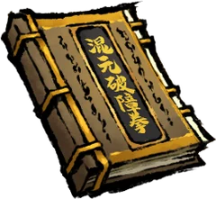

修炼后可领悟**技能：反击式贰**

### 【各版本（境界 / 品质）】

筑基·天品：修炼限制 境界：主角**筑基期**及以上；修炼限制 条件：无（放入修炼工作台即可）；修炼限制 太过简单：主角**结丹期**起再修炼，不再获得修为，只直接领悟其中的技能 / 口诀 / 天赋

混元破障拳(二)·结丹·地品：混沌归一，阴阳交泰，融六合劲力于拳意，破万法桎梏于方寸。；心法第二层，需达到**结丹期**后方可继续修炼；修炼后可领悟**感悟卡：招式**；修炼限制 境界：主角**结丹期**及以上；修炼限制 条件：无（放入修炼工作台即可）；修炼限制 太过简单：主角**元婴期**起再修炼，不再获得修为，只直接领悟其中的技能 / 口诀 / 天赋；获得方式 修炼〈混元破障拳〉

### 【获取途径】

**〈悟道〉 + 〈御物〉 + 〈身法〉** 修炼后领悟

在玄机阁中有概率刷出

把心境赠送给入魔的修士（筑基期）有概率获得

筑基期时使用机缘探索宗门遗迹有概率获得

---

## 113. 不动经

修炼后可领悟**天赋：不动如山和口诀：玄甲咒**

### 【各版本（境界 / 品质）】

筑基·神品：修炼限制 境界：主角**筑基期**及以上；修炼限制 条件：无（放入修炼工作台即可）；修炼限制 太过简单：主角**结丹期**起再修炼，不再获得修为，只直接领悟其中的技能 / 口诀 / 天赋

不动经(二)·结丹·神品：以静制动，以守为攻；心不动则道不动，身不动则万法不侵；心法第二层，需达到**结丹期**后方可继续修炼；修炼限制 境界：主角**结丹期**及以上；修炼限制 条件：无（放入修炼工作台即可）；修炼限制 太过简单：主角**元婴期**起再修炼，不再获得修为，只直接领悟其中的技能 / 口诀 / 天赋；获得方式 修炼〈不动经〉

不动经(三)·元婴·神品：以静制动，以守为攻；心不动则道不动，身不动则万法不侵；心法第三层，需达到**元婴期**后方可继续修炼；修炼限制 境界：主角**元婴期**及以上；修炼限制 条件：无（放入修炼工作台即可）；获得方式 修炼〈不动经〉

### 【获取途径】

筑基期后，**〈悟道〉 + 〈御物〉 + 〈御物〉** 修炼后领悟

在玄机阁中有概率刷出

把心境赠送给入魔的修士（筑基期）有概率获得

筑基期时使用机缘探索宗门遗迹有概率获得

---

## 114. 轮回经

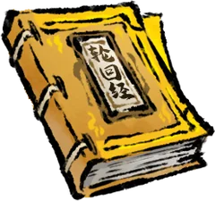

### 【各版本（境界 / 品质）】

筑基·仙品：修炼限制 境界：主角**筑基期**及以上；修炼限制 条件：无（放入修炼工作台即可）；修炼限制 太过简单：主角**结丹期**起再修炼，不再获得修为，只直接领悟其中的技能 / 口诀 / 天赋

轮回经(二)·结丹·天品：渡轮回之劫，掌因果之秤；以轮回为道，破生死之桎梏；心法第二层，需达到**结丹期**后方可继续修炼；修炼后可领悟**天赋：生死契约**；修炼限制 境界：主角**结丹期**及以上；修炼限制 条件：无（放入修炼工作台即可）；修炼限制 太过简单：主角**元婴期**起再修炼，不再获得修为，只直接领悟其中的技能 / 口诀 / 天赋；获得方式 修炼〈轮回经〉

轮回经(三)·元婴·地品：渡轮回之劫，掌因果之秤；以轮回为道，破生死之桎梏；心法第三层，需达到**元婴期**后方可继续修炼；修炼后可领悟**天赋：生死契约**；修炼限制 境界：主角**元婴期**及以上；修炼限制 条件：无（放入修炼工作台即可）；获得方式 修炼〈轮回经〉

### 【获取途径】

筑基期后，**〈悟道〉 + 〈御物〉 + 〈心境〉** 修炼后领悟

在玄机阁中有概率刷出

把心境赠送给入魔的修士（筑基期）有概率获得

筑基期时使用机缘探索宗门遗迹有概率获得

---

## 115. 驭兽决

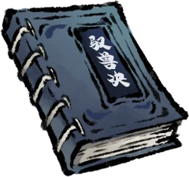

### 【各版本（境界 / 品质）】

筑基·仙品：修炼限制 境界：主角**筑基期**及以上；修炼限制 条件：无（放入修炼工作台即可）；修炼限制 太过简单：主角**结丹期**起再修炼，不再获得修为，只直接领悟其中的技能 / 口诀 / 天赋

驭兽决(二)·结丹·天品：观万兽习性、融兽灵真意；借万兽之力，证无上大道；心法第二层，需达到**结丹期**后方可继续修炼；修炼后可领悟**天赋：驭兽之道**；修炼限制 境界：主角**结丹期**及以上；修炼限制 条件：无（放入修炼工作台即可）；修炼限制 太过简单：主角**元婴期**起再修炼，不再获得修为，只直接领悟其中的技能 / 口诀 / 天赋；获得方式 修炼〈驭兽决〉

驭兽决(三)·元婴·地品：观万兽习性、融兽灵真意；借万兽之力，证无上大道；心法第三层，需达到**元婴期**后方可继续修炼；修炼后可领悟**天赋：驭兽之道**；修炼限制 境界：主角**元婴期**及以上；修炼限制 条件：无（放入修炼工作台即可）；获得方式 修炼〈驭兽决〉

### 【获取途径】

筑基期后，**〈悟道〉 + 〈御物〉 + 〈御土〉** 修炼后领悟

在玄机阁中有概率刷出

把心境赠送给入魔的修士（筑基期）有概率获得

筑基期时使用机缘探索宗门遗迹有概率获得

---

## 116. 鱼龙变

### 【各版本（境界 / 品质）】

筑基·仙品：修炼限制 境界：主角**筑基期**及以上；修炼限制 条件：无（放入修炼工作台即可）；修炼限制 太过简单：主角**结丹期**起再修炼，不再获得修为，只直接领悟其中的技能 / 口诀 / 天赋

鱼龙变(二)·结丹·天品：观鱼跃龙门之景、历千劫而化龙，破万法而成圣；心法第二层，需达到**结丹期**后方可继续修炼；修炼后可领悟**天赋：生死契约**；修炼限制 境界：主角**结丹期**及以上；修炼限制 条件：无（放入修炼工作台即可）；修炼限制 太过简单：主角**元婴期**起再修炼，不再获得修为，只直接领悟其中的技能 / 口诀 / 天赋；获得方式 修炼〈鱼龙变〉

鱼龙变(三)·元婴·地品：观鱼跃龙门之景、历千劫而化龙，破万法而成圣；心法第三层，需达到**元婴期**后方可继续修炼；修炼后可领悟**天赋：生死契约**；修炼限制 境界：主角**元婴期**及以上；修炼限制 条件：无（放入修炼工作台即可）；获得方式 修炼〈鱼龙变〉

### 【获取途径】

筑基期后，**〈悟道〉 + 〈御物〉 + 〈引水〉** 修炼后领悟

在玄机阁中有概率刷出

把心境赠送给入魔的修士（筑基期）有概率获得

筑基期时使用机缘探索宗门遗迹有概率获得

---

## 117. 荒古诀

### 【各版本（境界 / 品质）】

筑基·绝品：修炼限制 境界：主角**筑基期**及以上；修炼限制 条件：无（放入修炼工作台即可）；修炼限制 太过简单：主角**结丹期**起再修炼，不再获得修为，只直接领悟其中的技能 / 口诀 / 天赋

筑基·绝品：白龙的鳞片，里面隐含着圣兽的一丝记忆，曾经记载着它从小龙开始修炼的一些片段；修炼后可领悟**天赋：兽魂觉醒**；修炼限制 境界：主角**筑基期**及以上；修炼限制 条件：无（放入修炼工作台即可）；修炼限制 太过简单：主角**结丹期**起再修炼，不再获得修为，只直接领悟其中的技能 / 口诀 / 天赋；获得方式 带着〈悦萱儿〉和「白龙的分身」对话（在「十万大山深处」）（这是任务【悦萱儿的支线】第 11 步「协助悦萱儿接触白龙」），获得

结丹·绝品：三头凶蛟的一缕胡须，里面隐含着圣兽的一丝记忆，曾经记载着它从蛇开始修炼的一些片段；修炼后可领悟**天赋：远古血脉**；修炼限制 境界：主角**结丹期**及以上；修炼限制 条件：无（放入修炼工作台即可）；修炼限制 太过简单：主角**元婴期**起再修炼，不再获得修为，只直接领悟其中的技能 / 口诀 / 天赋；获得方式 带着〈悦萱儿〉和「三头凶蛟的分身」对话（在「凶兽：三头凶蛟」）（这是任务【悦萱儿的支线】第 17 步「协助悦萱儿接触凶蛟」），获得

元婴·绝品：鲲的一层皮肤，里面隐含着圣兽的一丝记忆，曾经记载着它从小鱼开始修炼的一些片段；修炼后可领悟**天赋：远古血脉**；修炼限制 境界：主角**元婴期**及以上；修炼限制 条件：无（放入修炼工作台即可）；获得方式 带着〈悦萱儿〉和「鲲的分身」对话（在「圣兽：鲲」）（这是任务【悦萱儿的支线】第 14 步「协助悦萱儿接触鲲」），获得

---

## 118. 磐石功

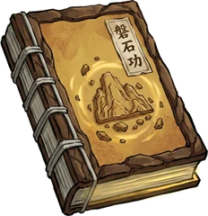

以厚重土气淬炼筋骨皮肉。修者肉身坚如顽石，防御强横。

修炼后可领悟**天赋：磐石之躯**

### 【各版本（境界 / 品质）】

筑基·仙品：修炼限制 境界：主角**筑基期**及以上；修炼限制 条件：无（放入修炼工作台即可）；修炼限制 太过简单：主角**结丹期**起再修炼，不再获得修为，只直接领悟其中的技能 / 口诀 / 天赋

磐石功(二)·结丹·天品：修炼限制 境界：主角**结丹期**及以上；修炼限制 条件：无（放入修炼工作台即可）；修炼限制 太过简单：主角**元婴期**起再修炼，不再获得修为，只直接领悟其中的技能 / 口诀 / 天赋；获得方式 修炼〈磐石功〉

磐石功(三)·元婴·地品：修炼限制 境界：主角**元婴期**及以上；修炼限制 条件：无（放入修炼工作台即可）；获得方式 修炼〈磐石功〉

### 【获取途径】

筑基期后，**〈悟道〉 + 〈杀意〉 + 〈御土〉** 修炼后领悟

在玄机阁中有概率刷出

把心境赠送给入魔的修士（筑基期）有概率获得

筑基期时使用机缘探索宗门遗迹有概率获得

---

## 119. 契兽诀

以神识为引、灵力为媒，与妖兽缔结灵魂契约

修炼后可领悟**天赋：与兽共舞**

### 【各版本（境界 / 品质）】

筑基·仙品：修炼限制 境界：主角**筑基期**及以上；修炼限制 条件：无（放入修炼工作台即可）；修炼限制 太过简单：主角**结丹期**起再修炼，不再获得修为，只直接领悟其中的技能 / 口诀 / 天赋

契兽诀(二)·结丹·天品：修炼限制 境界：主角**结丹期**及以上；修炼限制 条件：无（放入修炼工作台即可）；修炼限制 太过简单：主角**元婴期**起再修炼，不再获得修为，只直接领悟其中的技能 / 口诀 / 天赋；获得方式 修炼〈契兽诀〉

契兽诀(三)·元婴·地品：修炼限制 境界：主角**元婴期**及以上；修炼限制 条件：无（放入修炼工作台即可）；获得方式 修炼〈契兽诀〉

### 【获取途径】

筑基期后，**〈悟道〉 + 〈杀意〉 + 〈心境〉** 修炼后领悟

在玄机阁中有概率刷出

把心境赠送给入魔的修士（筑基期）有概率获得

筑基期时使用机缘探索宗门遗迹有概率获得

---

## 120. 缚龙真法

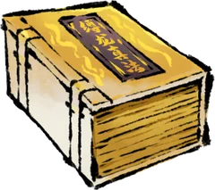

### 【各版本（境界 / 品质）】

结丹·绝品：修炼限制 境界：主角**结丹期**及以上；修炼限制 条件：无（放入修炼工作台即可）；修炼限制 太过简单：主角**元婴期**起再修炼，不再获得修为，只直接领悟其中的技能 / 口诀 / 天赋

缚龙真法(二)·元婴·仙品：以法为链，以道为锁；缚龙族为仆，驭万灵为奴；心法第二层，需达到**元婴期**后方可继续修炼；修炼后可领悟**口诀：驭兽决**；修炼限制 境界：主角**元婴期**及以上；修炼限制 条件：无（放入修炼工作台即可）

### 【获取途径】

结丹期后，**〈悟道〉 + 〈承载〉 + 〈顿悟〉** 修炼后领悟

---

## 121. 同魂经

### 【各版本（境界 / 品质）】

结丹·仙品：修炼限制 境界：主角**结丹期**及以上；修炼限制 条件：无（放入修炼工作台即可）；修炼限制 太过简单：主角**元婴期**起再修炼，不再获得修为，只直接领悟其中的技能 / 口诀 / 天赋

同魂经(二)·元婴·天品：以魂为桥，异体同心；同魂共振，万力归一；心法第二层，需达到**元婴期**后方可继续修炼；修炼后可领悟**天赋：灵愈血契**；修炼限制 境界：主角**元婴期**及以上；修炼限制 条件：无（放入修炼工作台即可）；获得方式 修炼〈同魂经〉

### 【获取途径】

结丹期后，**〈悟道〉 + 〈承载〉 + 〈丹道〉** 修炼后领悟

把心境赠送给入魔的修士（结丹期）有概率获得

结丹期时使用机缘探索宗门遗迹有概率获得

---

## 122. 苍壁经

### 【各版本（境界 / 品质）】

结丹·仙品：修炼限制 境界：主角**结丹期**及以上；修炼限制 条件：无（放入修炼工作台即可）；修炼限制 太过简单：主角**元婴期**起再修炼，不再获得修为，只直接领悟其中的技能 / 口诀 / 天赋

苍壁经(二)·元婴·天品：以壁为基，蕴道藏锋；苍冥为盾，玉蕴长生；心法第二层，需达到**元婴期**后方可继续修炼；修炼后可领悟**天赋：载天盾**；修炼限制 境界：主角**元婴期**及以上；修炼限制 条件：无（放入修炼工作台即可）；获得方式 修炼〈苍壁经〉

### 【获取途径】

结丹期后，**〈悟道〉 + 〈承载〉 + 〈承载〉** 修炼后领悟

把心境赠送给入魔的修士（结丹期）有概率获得

结丹期时使用机缘探索宗门遗迹有概率获得

---

## 123. 分神诀

修炼后可领悟**技能：分神**

### 【各版本（境界 / 品质）】

结丹·仙品：修炼限制 境界：主角**结丹期**及以上；修炼限制 条件：无（放入修炼工作台即可）；修炼限制 太过简单：主角**元婴期**起再修炼，不再获得修为，只直接领悟其中的技能 / 口诀 / 天赋

分神诀(二)·元婴·天品：修神之法，以分裂神念为核心，令一份神识化作数份，各司其职。；修炼后可领悟**感悟：招式**；修炼限制 境界：主角**元婴期**及以上；修炼限制 条件：无（放入修炼工作台即可）；获得方式 修炼〈分神诀〉

### 【获取途径】

结丹期后，**〈悟道〉 + 〈承载〉 + 〈御灵〉** 修炼后领悟

把心境赠送给入魔的修士（结丹期）有概率获得

结丹期时使用机缘探索宗门遗迹有概率获得

---

## 124. 土影诀

修炼后可领悟**技能：土影卫**

### 【各版本（境界 / 品质）】

结丹·仙品：修炼限制 境界：主角**结丹期**及以上；修炼限制 条件：无（放入修炼工作台即可）；修炼限制 太过简单：主角**元婴期**起再修炼，不再获得修为，只直接领悟其中的技能 / 口诀 / 天赋

土影诀(二)·元婴·天品：借大地土气凝聚为兽形虚影，随心意攻防。；修炼后可领悟**感悟：招式**；修炼限制 境界：主角**元婴期**及以上；修炼限制 条件：无（放入修炼工作台即可）；获得方式 修炼〈土影诀〉

### 【获取途径】

结丹期后，**〈悟道〉 + 〈承载〉 + 〈御物〉** 修炼后领悟

把心境赠送给入魔的修士（结丹期）有概率获得

结丹期时使用机缘探索宗门遗迹有概率获得

---

## 125. 噬魂秘法

一念绝杀，噬尽三魂七魄为已用，唯余枯骨证道

修炼后可领悟**天赋：噬魂**

### 【各版本（境界 / 品质）】

筑基·神品：修炼限制 境界：主角**筑基期**及以上；修炼限制 条件：无（放入修炼工作台即可）；修炼限制 太过简单：主角**元婴期**起再修炼，不再获得修为，只直接领悟其中的技能 / 口诀 / 天赋；修炼限制 心魔：每轮修炼都会产生心魔「恶」；修炼限制 心魔：每轮修炼都会产生心魔「贪」

### 【获取途径】

可在魔修神秘人处兑换

在玄机阁中有概率刷出

把心境赠送给入魔的修士（筑基期）有概率获得

筑基期时使用机缘探索宗门遗迹有概率获得

筑基期：和「蒙面人」对话（在「金陵城」），获得

---

## 126. 阴姹玄功

以阴阳交泰为枢，采月魄玄阴为媒。

**需要一名异性角色方可修炼此心法**。

此心法为特殊心法，不会因修炼而消失，但每次修炼必定获得心魔：色。

修炼后可领悟**口诀：奴心咒**

### 【各版本（境界 / 品质）】

筑基·神品：修炼限制 境界：主角**筑基期**及以上；修炼限制 需要：**一名异性**角色共同修炼（修炼后对方会**死亡**）；修炼限制 太过简单：主角**元婴期**起再修炼，不再获得修为，只直接领悟其中的技能 / 口诀 / 天赋；修炼限制 心魔：修炼完成时产生心魔「色」

### 【获取途径】

可在魔修神秘人处兑换

在玄机阁中有概率刷出

把心境赠送给入魔的修士（筑基期）有概率获得

筑基期时使用机缘探索宗门遗迹有概率获得

筑基期：和「蒙面人」对话（在「金陵城」），获得

---

## 127. 七杀经

承七杀星宿肃杀之气，以杀伐证道，以血煞通玄

修炼后可领悟**天赋：杀戮证道**

### 【各版本（境界 / 品质）】

筑基·神品：修炼限制 境界：主角**筑基期**及以上；修炼限制 需要：**一名角色**作为祭品；修炼限制 太过简单：主角**元婴期**起再修炼，不再获得修为，只直接领悟其中的技能 / 口诀 / 天赋；修炼限制 心魔：每轮修炼都会产生心魔「恶」

### 【实际领悟的天赋】

游戏描述里写的是「杀戮证道」，实际修炼后领悟的是天赋「杀戮」（按游戏修炼配方核对）

### 【获取途径】

可在魔修神秘人处兑换

在玄机阁中有概率刷出

把心境赠送给入魔的修士（筑基期）有概率获得

筑基期时使用机缘探索宗门遗迹有概率获得

筑基期：和「蒙面人」对话（在「金陵城」），获得

---

## 128. 锁魂术

此术暗合幽冥至阴法则，大成时可召鬼将阴兵、驱万魂成阵

修炼后可领悟**天赋：拘魂**

### 【各版本（境界 / 品质）】

筑基·神品：修炼限制 境界：主角**筑基期**及以上；修炼限制 需要：**一具尸体**或**一名活人**；修炼限制 太过简单：主角**元婴期**起再修炼，不再获得修为，只直接领悟其中的技能 / 口诀 / 天赋；修炼限制 心魔：每轮修炼都会产生心魔「邪」

### 【获取途径】

可在魔修神秘人处兑换

在玄机阁中有概率刷出

把心境赠送给入魔的修士（筑基期）有概率获得

筑基期时使用机缘探索宗门遗迹有概率获得

筑基期：和「蒙面人」对话（在「金陵城」），获得

---

## 129. 逆生劫典

本是用于治疗的灵气，但只需稍稍逆转，便转化成杀人的利器

修炼后可领悟**技能：蚀脉**

### 【各版本（境界 / 品质）】

筑基·神品：修炼限制 境界：主角**筑基期**及以上；修炼限制 需要：一张〔血量〕受损的卡牌；修炼限制 太过简单：主角**结丹期**起再修炼，不再获得修为，只直接领悟其中的技能 / 口诀 / 天赋

### 【获取途径】

筑基期后，**〈悟道〉 + 〈杀意〉 + 〈药理〉** 修炼后领悟

在玄机阁中有概率刷出

筑基期：带着〈心境〉和「入魔的修士」对话，有概率获得

筑基期：在「宗门遗迹」探索，有概率获得

---

## 130. 夺灵天卷

夺天地之造化，侵万物之灵机

修炼后可领悟**天赋：夺灵**

### 【各版本（境界 / 品质）】

结丹·神品：修炼限制 境界：主角**结丹期**及以上；修炼限制 条件：无（放入修炼工作台即可）；修炼限制 太过简单：主角**元婴期**起再修炼，不再获得修为，只直接领悟其中的技能 / 口诀 / 天赋

### 【获取途径】

**〈悟道〉 + 〈包容〉 + 〈杀意〉** 修炼后领悟

把心境赠送给入魔的修士（结丹期）有概率获得

结丹期时使用机缘探索宗门遗迹有概率获得

结丹期：带着〈任意内丹（结丹后期）〉和「古碑龟」对话，有概率获得

结丹期：和「无名骸骨」对话（在「冥狱地下十层」），有概率获得

结丹期：带着〈包容〉和「打坐中的修士」对话，有概率获得

---

## 131. 无障诀

遁行无声无迹，最擅潜行刺探、脱身避战。

修炼后可领悟**技能：暗杀**

### 【各版本（境界 / 品质）】

元婴·神品：修炼限制 境界：主角**元婴期**及以上；修炼限制 需要：**恶名**（积累暗杀经验来证明）

### 【获取途径】

元婴期后，**〈悟道〉 + 〈归一〉 + 〈归一〉/〈顿悟〉** 修炼后可自选

---

## 132. 七星宝典

### 【各版本（境界 / 品质）】

练气·天品：修炼限制 境界：主角**练气期**及以上；修炼限制 条件：无（放入修炼工作台即可）；修炼限制 太过简单：主角**筑基期**起再修炼，不再获得修为，只直接领悟其中的技能 / 口诀 / 天赋

七星宝典(二)·筑基·天品：引北斗星辰之力淬炼七窍，化周天灵气为本命星灯，点亮一星便可破一层天关，七灯齐燃则与星同寿。；心法第二层，需达到**筑基期**后方可继续修炼；修炼后获得大量修为，且自身灵气值将恢复满。；此卡牌由内测玩家：**星光**设计；修炼限制 境界：主角**筑基期**及以上；修炼限制 条件：无（放入修炼工作台即可）；修炼限制 太过简单：主角**结丹期**起再修炼，不再获得修为，只直接领悟其中的技能 / 口诀 / 天赋；获得方式 修炼〈七星宝典〉

七星宝典(三)·结丹·天品：引北斗星辰之力淬炼七窍，化周天灵气为本命星灯，点亮一星便可破一层天关，七灯齐燃则与星同寿。；心法第二层，需达到**结丹期**后方可继续修炼；修炼后获得大量修为，且自身灵气值将恢复满。；此卡牌由内测玩家：**星光**设计；修炼限制 境界：主角**结丹期**及以上；修炼限制 条件：无（放入修炼工作台即可）；修炼限制 太过简单：主角**元婴期**起再修炼，不再获得修为，只直接领悟其中的技能 / 口诀 / 天赋

七星宝典(四)·元婴·天品：引北斗星辰之力淬炼七窍，化周天灵气为本命星灯，点亮一星便可破一层天关，七灯齐燃则与星同寿。；心法第四层，需达到**元婴期**后方可继续修炼；修炼后获得大量修为，且自身灵气值将恢复满。；此卡牌由内测玩家：**星光**设计；修炼限制 境界：主角**元婴期**及以上；修炼限制 条件：无（放入修炼工作台即可）

### 【获取途径】

完成无名村庄村长的任务后，在村长的房子里获得

---

## 133. 观星术

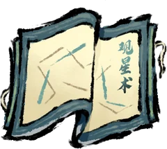

无名人士写就得一夜观星象的方法，也不知道有什么用。

### 【各版本（境界 / 品质）】

练气·绝品：修炼限制 境界：主角**练气期**及以上；修炼限制 条件：无（放入修炼工作台即可）；修炼限制 太过简单：主角**筑基期**起再修炼，不再获得修为，只直接领悟其中的技能 / 口诀 / 天赋

筑基·神品：修炼限制 境界：主角**筑基期**及以上；修炼限制 条件：无（放入修炼工作台即可）

观星术(二)·筑基·绝品：修炼限制 境界：主角**筑基期**及以上；修炼限制 条件：无（放入修炼工作台即可）；获得方式 修炼〈观星术〉

观星术(二)·元婴·绝品：修炼限制 境界：主角**元婴期**及以上；修炼限制 条件：无（放入修炼工作台即可）；获得方式 修炼〈观星术〉

观星术(三)·结丹·绝品：修炼限制 境界：主角**结丹期**及以上；修炼限制 条件：无（放入修炼工作台即可）；获得方式 修炼〈观星术〉

### 【获取途径】

在自由模式里，选择词条：观星者后获得

---

## 134. 固本经

修者修成后，体内自成一套温润气机：一旦脱离战阵、杀意平息，无需刻意运功调息，本源之气便会自行流转

修炼后可领悟**天赋：敛锋蕴气**

### 【各版本（境界 / 品质）】

筑基·仙品：修炼限制 境界：主角**筑基期**及以上；修炼限制 条件：无（放入修炼工作台即可）；修炼限制 太过简单：主角**结丹期**起再修炼，不再获得修为，只直接领悟其中的技能 / 口诀 / 天赋

固本经(二)·结丹·天品：修炼限制 境界：主角**结丹期**及以上；修炼限制 条件：无（放入修炼工作台即可）；修炼限制 太过简单：主角**元婴期**起再修炼，不再获得修为，只直接领悟其中的技能 / 口诀 / 天赋；获得方式 修炼〈固本经〉、修炼〈调息诀〉

固本经(三)·元婴·地品：修炼限制 境界：主角**元婴期**及以上；修炼限制 条件：无（放入修炼工作台即可）；获得方式 修炼〈固本经〉

### 【获取途径】

**〈悟道〉 + 〈丹道〉 + 〈试金〉** 修炼后领悟

---

## 135. 调息诀

以规整呼吸节奏为引，带动周身灵气循经脉运转。

修炼后可领悟**天赋：回春圣体**

### 【各版本（境界 / 品质）】

筑基·仙品：修炼限制 境界：主角**筑基期**及以上；修炼限制 条件：无（放入修炼工作台即可）

调息诀(二)·结丹·天品：修炼限制 境界：主角**结丹期**及以上；修炼限制 条件：无（放入修炼工作台即可）；修炼限制 太过简单：主角**元婴期**起再修炼，不再获得修为，只直接领悟其中的技能 / 口诀 / 天赋；获得方式 修炼〈调息诀〉

调息诀(三)·元婴·地品：修炼限制 境界：主角**元婴期**及以上；修炼限制 条件：无（放入修炼工作台即可）；获得方式 修炼〈调息诀〉

### 【获取途径】

**〈悟道〉 + 〈丹道〉 + 〈身法〉** 修炼后领悟

---

## 136. 炼元宝鉴

修练者可借自身元力炼化材料杂质，大幅提升天材地宝的灵气利用率

修炼后可领悟**天赋：灵犀巧手**

### 【各版本（境界 / 品质）】

筑基·神品：修炼限制 境界：主角**筑基期**及以上；修炼限制 条件：无（放入修炼工作台即可）；修炼限制 太过简单：主角**结丹期**起再修炼，不再获得修为，只直接领悟其中的技能 / 口诀 / 天赋

### 【获取途径】

**〈悟道〉 + 〈丹道〉 + 〈剑芒〉** 修炼后领悟

筑基期：带着〈心境〉和「入魔的修士」对话，有概率获得

筑基期：在「宗门遗迹」探索，有概率获得

---

## 137. 天衍诀

以身为器，以神为筹，推演万物，穷究天机。窃一线生机，衍无尽可能。

修炼后可领悟**天赋：窥天机**

### 【各版本（境界 / 品质）】

结丹·绝品：修炼限制 境界：主角**结丹期**及以上；修炼限制 条件：无（放入修炼工作台即可）；修炼限制 太过简单：主角**元婴期**起再修炼，不再获得修为，只直接领悟其中的技能 / 口诀 / 天赋

### 【获取途径】

完成镇妖塔的萧清钰任务后获得

---

## 138. 炼心诀

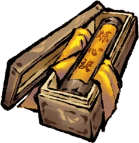

### 【各版本（境界 / 品质）】

结丹·神品：修炼限制 境界：主角**结丹期**及以上；修炼限制 条件：无（放入修炼工作台即可）；修炼限制 太过简单：主角**元婴期**起再修炼，不再获得修为，只直接领悟其中的技能 / 口诀 / 天赋

炼心诀(二)·元婴·绝品：为辅助类顶尖心法，取心定如磐、神魂无尘为道基，是专攻心境淬炼的正统秘法，与直接攻伐的功法截然不同，素有“炼心千劫，道心不灭”的美名。；心法第二层，需达到**元婴期**后方可继续修炼；修炼后可领悟**天赋：天窍**；修炼限制 境界：主角**元婴期**及以上；修炼限制 条件：无（放入修炼工作台即可）；获得方式 修炼〈炼心诀〉

### 【获取途径】

结丹期后，**〈悟道〉 + 〈释放〉 + 〈顿悟〉** 修炼后领悟

---

## 139. 敛神术

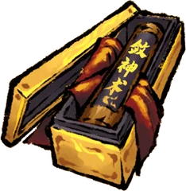

神魂类顶尖心法，取敛神归窍、神魂如渊为道基，是融隐匿、防御、修神于一体的特殊秘法，素有"敛神一出，万识皆盲"的盛名。

修炼后可领悟**天赋：洞虚灵眸**

### 【各版本（境界 / 品质）】

结丹·绝品：修炼限制 境界：主角**结丹期**及以上；修炼限制 条件：无（放入修炼工作台即可）

### 【获取途径】

结丹期后，**〈悟道〉 + 〈凝聚〉 + 〈心境〉** 修炼后领悟

结丹期：带着〈心境〉和「入魔的修士」对话，有概率获得

结丹期：带着〈任意内丹（结丹后期）〉和「古碑龟」对话，有概率获得

---

## 140. 归元宝鉴

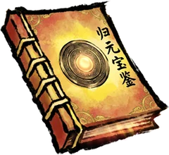

修炼后可领悟**口诀：还灵咒**

### 【各版本（境界 / 品质）】

结丹·天品：修炼限制 境界：主角**结丹期**及以上；修炼限制 条件：无（放入修炼工作台即可）；修炼限制 太过简单：主角**元婴期**起再修炼，不再获得修为，只直接领悟其中的技能 / 口诀 / 天赋

归元宝鉴(二)·元婴·地品：修者以神念为引、自身灵气为媒，可探入法宝肌理，弥合器身裂痕、重续断裂灵脉、补全缺损禁制。；修炼后可领悟**感悟：用术**；修炼限制 境界：主角**元婴期**及以上；修炼限制 条件：无（放入修炼工作台即可）；获得方式 修炼〈归元宝鉴〉

### 【获取途径】

**〈悟道〉 + 〈包容〉 + 〈剑意〉** 修炼后领悟

---

## 141. 天工经

### 【各版本（境界 / 品质）】

结丹·神品：修炼限制 境界：主角**结丹期**及以上；修炼限制 条件：无（放入修炼工作台即可）；修炼限制 太过简单：主角**元婴期**起再修炼，不再获得修为，只直接领悟其中的技能 / 口诀 / 天赋

天工经(二)·元婴·仙品：为器修一脉的正统顶尖心法，取天工造物、器灵共生为道基，是融炼器、御器、融器于一体的特殊秘法，素有“天工一出，万器通灵”的盛誉。；心法第三层，需达到**元婴期**后方可继续修炼；修炼后可领悟**天赋：兵甲通玄**；修炼限制 境界：主角**元婴期**及以上；修炼限制 条件：无（放入修炼工作台即可）；获得方式 修炼〈天工经〉

### 【获取途径】

结丹期后，**〈悟道〉 + 〈凝聚〉 + 〈御物〉** 修炼后领悟

---

## 142. 心法残卷（图鉴未收录）

只有半篇的残卷，阅读一次或许有所收获。

### 【各版本（境界 / 品质）】

练气·人品：修炼限制 境界：主角**练气期**及以上；修炼限制 条件：无（放入修炼工作台即可）

### 【获取途径】

在「山脚下」探索、或在「客栈」拜访时，可能遇到凡人〈年迈的老人〉：保护好他，等他寿元耗尽、消失回村时会送你一张卡，20% 是〈心法残卷〉

---

## 143. 神机百炼（残）（图鉴未收录）

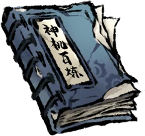

一本残篇，但里面记载的炼制方法，竟可将练气期的傀儡提升至**筑基期**。

### 【各版本（境界 / 品质）】

神机百炼(残)·筑基·神品：修炼限制 境界：主角**筑基期**及以上；修炼限制 需要：此心法无法用于修炼，可在**炼制工作台**将傀儡从**练气期**提升至**筑基期**；获得方式 把〈损坏的机关傀儡〉放进恢复工作台「修复傀儡」（再放入〈傀儡零件〉），获得

---

## 144. 血煞剑魄（封）（图鉴未收录）

血煞剑魄，此心法乃玄剑阁前辈领悟，但前辈修炼后入魔而亡！

在我修炼过后，我发现心法还有第二层，但以我现在的境界还无法领悟！

### 【各版本（境界 / 品质）】

血煞剑魄(封)·筑基·绝品：修炼限制 境界：主角**筑基期**及以上；修炼限制 需要：血煞剑魄：心法已无法修炼. 我要如何才能解开心法的封印呢？或者有什么地方可以让我领悟心法？；获得方式 修炼〈血煞剑魄〉、带着〈血煞剑魄（封）〉和「玄剑阁长老」对话（在「金陵城」），获得

---

## 145. 空明无相诀（图鉴未收录）

### 【各版本（境界 / 品质）】

筑基·绝品：修炼限制 境界：主角**筑基期**及以上；修炼限制 条件：无（放入修炼工作台即可）；修炼限制 太过简单：主角**结丹期**起再修炼，不再获得修为，只直接领悟其中的技能 / 口诀 / 天赋

空明无相诀(二)·结丹·绝品：为神魂与空间法则类顶尖心法，取空而明，无而相；空明一体，无相即万相为道基，是融合神识修炼与空间法则领悟的特殊秘法。；心法第二层，需达到**结丹期**后方可继续修炼；修炼后可领悟**天赋：虚境遥观**；修炼限制 境界：主角**结丹期**及以上；修炼限制 条件：无（放入修炼工作台即可）；修炼限制 太过简单：主角**元婴期**起再修炼，不再获得修为，只直接领悟其中的技能 / 口诀 / 天赋；获得方式 修炼〈空明无相诀〉

空明无相诀(三)·元婴·绝品：为神魂与空间法则类顶尖心法，取空而明，无而相；空明一体，无相即万相为道基，是融合神识修炼与空间法则领悟的特殊秘法。；心法第三层，需达到**元婴期**后方可继续修炼；修炼后可领悟**天赋：虚境遥观**；获得方式 修炼〈空明无相诀〉

---

## 146. 归墟剑法（图鉴未收录）

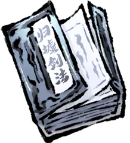

需修炼分光剑法后方可修炼：玄剑阁镇派绝学《归墟剑法》，剑出如万物终焉，引动寂灭之意，令一切层归虚无。

修炼后可领悟**技能：人剑合一**

### 【各版本（境界 / 品质）】

元婴·绝品：修炼限制 境界：主角**元婴期**及以上；修炼限制 需要：一把**本命仙剑**，方能修此心法；获得方式 在「藏经阁」（筑基）里直接摆着这张卡

---

## 147. 血戮剑法（图鉴未收录）

需修炼分光剑法后方可修炼：玄剑阁禁忌秘传《血戮剑法》，以战养剑，以血砺锋，剑出必饮血，乃是一门于杀戮中淬炼无上锋芒的霸道剑诀。

修炼后可领悟**技能：血戮剑意**

### 【各版本（境界 / 品质）】

元婴·绝品：修炼限制 境界：主角**元婴期**及以上；修炼限制 需要：一份**妖王精血**

---

## 148. 失去色泽的羽毛（图鉴未收录）

当我修炼完荒古诀后，羽毛变失去的颜色

也许有其他办法能让其层绘其彩？

### 【各版本（境界 / 品质）】

人品：修炼限制 需要：可能是我把记忆抽取的原因，羽毛已经失去了色泽；或许，我能在其他妖王处获得额外的记忆？

---

## 149. 归元诀（图鉴未收录）

隐约可见：归元诀，可将冥狱的阴气转化为灵气的功法

### 【各版本（境界 / 品质）】

绝品：获得方式 打开包袱〈包袱〉、打开包袱

---

## 150. 凝阴诀（图鉴未收录）

隐约可见：凝阴诀，可将体内的阴气引导出体外，化为灵气而用！

### 【各版本（境界 / 品质）】

绝品：获得方式 打开包袱〈包袱〉、打开包袱

---
