# 【卡牌修仙传】图鉴攻略 — 卡牌 / 感悟&心法

- 收录总数：141（游戏官方数据）
- 更新时间：2026-11-18 12:43

---

## 1. 思绪

修炼过程中有感而发的想法，不成文章。如若是整理整理思绪，或许能化作有用感悟。

思绪是感悟卡中最基础的卡牌，它可以在修炼工作台中逐渐"升级"至更细化的感悟。

### 【获取途径】

主角/神识修炼时有10%概率获得

修炼时加入灵气，有15%概率获得，且累计一定修炼次数后必定获得

加入混沌灵气的修炼，有20%概率获得

加入兽血炼制神品内丹，累计一定炼制次数后必定获得

炼制妖王内丹结束轮有25%概率获得

在碑地点中祭拜有25%概率获得

调查宁静之地时，最后奖励有50%概率获得

---

## 2. 悟道

偶有一丝想法缠绕在脑中，花些许时间悟道，会得到心法。

可以在修炼工作台悟道，从而获得心法。

### 【各版本（境界 / 品质）】

人品：偶有一丝想法缠绕在脑中，花些许时间悟道，会得到感悟卡。

### 【获取途径】

主角/神识在修炼时加入混沌灵气，累计一定次数后必定获得

思绪+任意感悟卡修炼后，累计一定次数必定获得

思绪+心境修炼后必定获得

在碑地点中祭拜有10%概率获得

调查混沌之地时，最后奖励有50%概率获得

---

## 3. 心境

一种平静的状态，无喜无悲，无物无我。能够安抚心里的情绪，抵消心魔的侵扰。

可以在恢复工作台消除心魔；和思绪卡结合成悟道

### 【获取途径】

主角/神识修炼时加入灵气，有10%概率获得

加入混沌灵气修炼，有20%概率获得

在凝土墟掩埋骸骨后必定获得

在碑地点中祭拜有20%概率获得

调查宁静之地时，最后奖励有50%概率获得

---

## 4. 顿悟

坐忘三载，不如一瞬通明

顿悟是更高级的"悟道"，使用顿悟，可以获得品质更高的心法

### 【获取途径】

筑基期后，通过感悟合成心法累计一定次数后必定获得

---

## 5. 剑意

我已凝聚剑意，可我的剑应该为何而使呢?

也许，在某些地点，我才能真正领悟自己的剑道所向。

### 【获取途径】

修炼剑魂残魄后有50%概率获得

击败剑冢中的剑灵后必定掉落

在剑冢中自己拔剑有10%概率获得

筑基期及以上的玄剑阁修士交易物有10%概率生成

筑基期后，修炼思绪+剑芒获得

结丹期后，修炼思绪+思绪可自选

---

## 6. 招式

在日复一日的战斗中，我的战斗技巧已得到提升。

可将**技能卡**提升一个境界

### 【获取途径】

修炼金刚拳法（二），混元破障拳后获得

筑基期后，思绪+身法修炼后必定获得

修炼顿悟后可自选

在金芒矿/凝土墟中修炼御物必定获得

在剑冢拔剑有10%概率获得

击败剑冢中的绝品小妖剑必定获得

结丹期后，修炼思绪+思绪可自选

修炼剑魂残魄后有50%概率获得

---

## 7. 用术

使用口诀的次数多了，我对此有一些感悟。

可将**口诀卡**提升一个境界

### 【获取途径】

修炼愈心诀（二），栖梧功（二），回春典（二）后可获得

筑基期后，修炼思绪+引水后必定获得

修炼顿悟后可自选

在青灵木/愈魂池修炼御灵必定获得

结丹期后，修炼思绪+思绪可自选

---

## 8. 五行吐纳术

五行相生相克，如果同时吸收五种灵气，便会互相湮灭；但在湮灭的一瞬间，会有产生一丝混沌灵气。

### 【获取途径】

仅在主线中获得

---

## 9. 试金

金属坚硬且锋利，用作武器能攻击敌人，用做防具又能抵御攻击。

### 【获取途径】

仅练气期时，修炼思绪+思绪20%概率获得

在金芒矿（小）修炼思绪+思绪必定获得

仅练气&筑基期，培养提升〔金〕材料品质一定次数后必定获得

筑基期后，修炼思绪（1个）可自选

---

## 10. 采木

木是植物的统称，拔起采集之，看似失去生命，重新种植却又能存活。

### 【获取途径】

仅练气期时，修炼思绪+思绪20%概率获得

在青灵木（小）修炼思绪+思绪必定获得

仅练气&筑基期，培养提升〔木〕材料品质一定次数后必定获得

筑基期后，修炼思绪（1个）可自选

---

## 11. 引水

水川流不息，虽无法拿起，但通过外物又能引导水的流向。

### 【获取途径】

仅练气期时，修炼思绪+思绪20%概率获得

在愈魂池（小）修炼思绪+思绪必定获得

仅练气&筑基期，培养提升〔水〕材料品质一定次数后必定获得

筑基期后，修炼思绪（1个）可自选

---

## 12. 控火

火焰看似无序，仔细观察便能发现，火焰的燃烧离不开燃物。

### 【获取途径】

仅练气期时，修炼思绪+思绪20%概率获得

在火云树（小）修炼思绪+思绪必定获得

仅练气&筑基期，培养提升〔火〕材料品质一定次数后必定获得

筑基期后，修炼思绪（1个）可自选

---

## 13. 御土

土是很容易就能驱使的物体，只是无论如何改造，它都依然那么如一。

### 【获取途径】

仅练气期时，修炼思绪+思绪20%概率获得

在凝土墟（小）修炼思绪+思绪必定获得

仅练气&筑基期，培养提升〔土〕材料品质一定次数后必定获得

筑基期后，修炼思绪（1个）可自选

---

## 14. 剑芒

似乎有一种拔剑的冲动。只是为何而拔剑？

### 【获取途径】

仅练气期时，修炼思绪+试金必定获得剑芒

在金芒矿（小）修炼试金必定获得剑芒

练气期的玄剑阁修士交易物有10%概率生成

仅练气&筑基期，每次使用剑法宝会积累获得概率

筑基期后，修炼思绪（1个）可获得

---

## 15. 身法

在战斗中躲避攻击慢慢形成身体本能。

### 【获取途径】

仅练气期时，修炼思绪+控火/御土必定获得

在火云树（小）修炼控火必定获得

在凝土墟（小）修炼御土必定获得

每战斗一次，均会积累概率获得

筑基期后，修炼思绪（1个）可获得

---

## 16. 药理

世间的各种天材地宝，都需要理解其构造，才能以此炼药。

### 【获取途径】

仅练气期时，修炼思绪+采木/引水必定获得

在青灵木（小）修炼采木必定获得

在愈魂池（小）修炼引水必定获得

仅练气&筑基期时，每炼制一次丹药会积累获得概率

筑基期后，修炼思绪（1个）可获得

---

## 17. 御灵

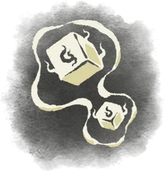

或许可以将其与相似的感悟相结合，以探索更多样的道路，亦可尝试与五行相合……

### 【获取途径】

筑基期后，修炼思绪+思绪有25%概率获得

修炼顿悟后可自选

仅结丹&元婴期时，培养提升〔木〕材料品质一定次数后必定获得

在青灵木/愈魂池修炼思绪+思绪必定获得

筑基期后，修炼思绪+采木必定获得

结丹期后，修炼思绪+思绪可自选

---

## 18. 御物

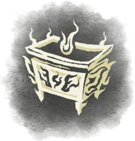

或许可以将其与相似的感悟相结合，以探索更多样的道路，亦可尝试与五行相合……

### 【获取途径】

筑基期后，修炼思绪+思绪有25%概率获得

修炼顿悟后可自选

仅结丹&元婴期时，培养提升〔金〕材料品质一定次数后必定获得

在金芒矿/凝土墟修炼思绪+思绪必定获得

筑基期后，修炼思绪+试金必定获得

每一次放入法宝战斗，会积累获得概率

结丹期后，修炼思绪+思绪可自选

---

## 19. 杀意

心中似乎升起了一丝杀戮的念头。

### 【获取途径】

筑基期后，修炼思绪+思绪有25%概率获得

修炼顿悟后可自选

仅结丹&元婴期时，培养提升〔火〕材料品质一定次数后必定获得

在火云树修炼思绪+思绪必定获得

在剑冢拔剑有10%概率获得

筑基期后，修炼思绪+控火必定获得

筑基后，主角的死亡有概率获得

结丹期后，修炼思绪+思绪可自选

---

## 20. 丹道

以身为炉，以心为火，百脉归元，凝结黍米。

### 【获取途径】

筑基期后，修炼思绪+思绪有25%概率获得

筑基期后，修炼思绪+药理必定获得

结丹&元婴期时，炼制丹药会积累获得概率

修炼顿悟后可自选

结丹期后，修炼思绪+思绪可自选

---

## 21. 凝聚

金可以层塑形态，或为兵器，或为光芒；但都需历经凝聚的过程！

### 【获取途径】

结丹期后，修炼顿悟后可自选

在玄机阁结丹商品区有概率可购买

结丹期后，在月照之地修炼必定获得

结丹期后，修炼器道（红）必定获得

结丹期后，修炼思绪+剑意必定获得

元婴期后，修炼思绪+思绪+思绪后可自选

---

## 22. 生长

木象征生命力：在生长的过程中，遇阻挡可穿透而行，也可绕开而过，能屈能伸。

### 【获取途径】

结丹期后，修炼顿悟后可自选

在玄机阁结丹商品区有概率可购买

结丹期后，在古木幽森的副本里有概率捡到，在最深处的血红树修炼必定获得

结丹期后，修炼丹道（红）必定获得

结丹期后，修炼思绪+丹道必定获得

元婴期后，修炼思绪+思绪+思绪后可自选

---

## 23. 包容

水乃无形之物，柔韧两性：可包容滋润万物，亦可蓄力穿石

### 【获取途径】

结丹期后，修炼顿悟后可自选

在玄机阁结丹商品区有概率可购买

结丹期后，在碧潭瀑布修炼必定获得

结丹期后，修炼术道（红）必定获得

结丹期后，修炼思绪+御灵必定获得

元婴期后，修炼思绪+思绪+思绪后可自选

---

## 24. 释放

火的功能便是将万物升腾转化，将其能量释放而出。

### 【获取途径】

结丹期后，修炼顿悟后可自选

在玄机阁结丹商品区有概率可购买

结丹期后，在地火深洞/天地熔炉修炼必定获得

结丹期后，修炼武道（红）必定获得

结丹期后，修炼思绪+杀意必定获得

元婴期后，修炼思绪+思绪+思绪后可自选

---

## 25. 承载

土以稳固特性，一直承载着压力，并孕育着新事物。

### 【获取途径】

结丹期后，修炼顿悟后可自选

在玄机阁结丹商品区有概率可购买

结丹期后，在无字玉璧修炼必定获得

结丹期后，修炼兽道（红）必定获得

结丹期后，修炼思绪+御物必定获得

元婴期后，修炼思绪+思绪+思绪后可自选

---

## 26. 归一

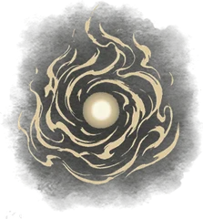

万法归宗，万象归元，终返混沌本一。

### 【获取途径】

元婴期后，修炼思绪+任意结丹感悟+任意结丹感悟后获得

---

## 27. 贪

这种己无求有，己有求多的想法最初只是细微，刹那生灭的念头，一旦过度的追求变会陷入无休止的欲望循环。

### 【入魔后果】

心魔积累（合成）后会「入魔」：出现**贪念**计时（60），计时结束后心魔化成心魔挑战卡，效果如下：

「对某样东西的需求越发的不满足，就形成了贪。任由贪心发展，就会导致对更多东西的不满足。如此循环，当如何打破？」

化成**贪念**：贪心魔具现化后，会吞噬触碰到的材料等卡牌。（持续时间：体验180 / 正常270 / 挑战270 / 真仙360，约 6个月～1年，到时自动消失）

同时获得任务卡「对立」

### 【消除方法】

恢复工作台：心魔＋「心境」，用时 30

恢复工作台：只放心魔，用时 180（游戏提示：通常需要一年的时间；加入“心境”卡可以大幅度减少消除时间）

开局词条「灵台清明」：无需心境，恢复工作台用时 30

秘境「碧潭瀑布」：无需心境，用时 30

庙宇「忘尘庙」：心魔随之消散，用时 30

庙宇「无名庙宇」：心魔随之消散，用时 30

**贪念**：无法提前清除，只能等待持续时间结束

### 【获取途径】

修炼时，如果不加入灵气/混沌灵气，有15%的概率获得

修炼心法累计一定次数后获得

在碑地点祭拜时有10%概率获得

调查混沌之地时，最后奖励有50%概率获得

修炼〈噬魂秘法〉必定获得

比武中触发犯规获得

---

## 28. 嗔

不如意事常八九，如果无法接受之，则会带来无尽的痛苦和不安。反之，则可实现内在的平和。

### 【入魔后果】

心魔积累（合成）后会「入魔」：出现**嗔念**计时（60），计时结束后心魔化成心魔挑战卡，效果如下：

「在逆境而生，小小的怒火积蓄待发，无处释放。当无法压抑之后，爆发出的嗔到底会是什么样子？」

化成**嗔念**：具现化后的心魔，除非将它击败，否则心魔不会消失。

同时获得任务卡「为何修炼？」

### 【消除方法】

恢复工作台：心魔＋「心境」，用时 30

恢复工作台：只放心魔，用时 180（游戏提示：通常需要一年的时间；加入“心境”卡可以大幅度减少消除时间）

开局词条「灵台清明」：无需心境，恢复工作台用时 30

秘境「碧潭瀑布」：无需心境，用时 30

庙宇「忘尘庙」：心魔随之消散，用时 30

庙宇「无名庙宇」：心魔随之消散，用时 30

**嗔念**：只能将它击败，否则不会消失

### 【获取途径】

修炼时，如果不加入灵气/混沌灵气，有15%的概率获得

修炼心法累计一定次数后获得

在碑地点祭拜时有10%概率获得

调查混沌之地时，最后奖励有50%概率获得

---

## 29. 痴

越是追求修道，越是发现自己的无知。偶尔的无知无伤大雅，若是长久如此，恐怕会酿成大祸。

### 【入魔后果】

心魔积累（合成）后会「入魔」：出现**痴念**计时（60），计时结束后心魔化成心魔挑战卡，效果如下：

「任由愚钝，无明的心态发展，那么人将愚昧一生。」

化成**愚钝**：受到心魔影响，**修炼**工作台的运行时间翻倍。（持续时间：体验180 / 正常270 / 挑战270 / 真仙360，约 6个月～1年，到时自动消失）

### 【消除方法】

恢复工作台：心魔＋「心境」，用时 30

恢复工作台：只放心魔，用时 180（游戏提示：通常需要一年的时间；加入“心境”卡可以大幅度减少消除时间）

开局词条「灵台清明」：无需心境，恢复工作台用时 30

秘境「碧潭瀑布」：无需心境，用时 30

庙宇「忘尘庙」：心魔随之消散，用时 30

庙宇「无名庙宇」：心魔随之消散，用时 30

**愚钝**：无法提前清除，只能等待持续时间结束

### 【获取途径】

修炼时，如果不加入灵气/混沌灵气，有15%的概率获得

修炼心法累计一定次数后获得

在碑地点祭拜时有10%概率获得

调查混沌之地时，最后奖励有50%概率获得

---

## 30. 恶

人的一生可以有许多选择，但如果主动造成他人不必要的伤害。那离邪恶也就不远了。

### 【入魔后果】

心魔积累（合成）后会「入魔」：出现**除魔**计时（60），计时结束后心魔化成心魔挑战卡，效果如下：

「世人似乎认为我是邪恶的，于是有人来追杀我！」

主角练气期：**练气期**的宗门修士（兽王府、武极门、清虚谷、玄剑阁、紫霄殿、蚀月教、雪隐宗）前来追杀

主角筑基期：**筑基期**的宗门修士（兽王府、武极门、清虚谷、玄剑阁、紫霄殿、蚀月教、雪隐宗）前来追杀

主角结丹期：**结丹期**的宗门修士（兽王府、武极门、清虚谷、玄剑阁、紫霄殿、蚀月教、雪隐宗）前来追杀

主角元婴期及以上：**元婴期**的宗门修士（兽王府、武极门、清虚谷、玄剑阁、蚀月教、雪隐宗）前来追杀

### 【消除方法】

恢复工作台：心魔＋「心境」，用时 30

恢复工作台：只放心魔，用时 180（游戏提示：通常需要一年的时间；加入“心境”卡可以大幅度减少消除时间）

开局词条「灵台清明」：无需心境，恢复工作台用时 30

秘境「碧潭瀑布」：无需心境，用时 30

庙宇「忘尘庙」：心魔随之消散，用时 30

庙宇「无名庙宇」：心魔随之消散，用时 30

### 【获取途径】

修炼〈七杀经〉必定获得

在碑/山脚下掩埋尸体有概率获得

主动击杀商人/凡人必定获得

主动击杀修士有30%概率获得

---

## 31. 悲

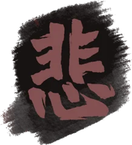

通常由于外部事件引起的情感反应，它是一种消极的情绪。任由悲伤发展，会让人感受到十分的折磨。

### 【入魔后果】

心魔积累（合成）后会「入魔」：出现**悲伤**计时（60），计时结束后心魔化成心魔挑战卡，效果如下：

「过度忧伤会使我对生活失去应有的兴趣。」

化成**悲伤**：受到心魔影响，**炼制**与**培养**工作台的运行时间翻倍。（持续时间：体验180 / 正常270 / 挑战270 / 真仙360，约 6个月～1年，到时自动消失）

### 【消除方法】

恢复工作台：心魔＋「心境」，用时 30

恢复工作台：只放心魔，用时 180（游戏提示：通常需要一年的时间；加入“心境”卡可以大幅度减少消除时间）

开局词条「灵台清明」：无需心境，恢复工作台用时 30

秘境「碧潭瀑布」：无需心境，用时 30

庙宇「忘尘庙」：心魔随之消散，用时 30

庙宇「无名庙宇」：心魔随之消散，用时 30

**悲伤**：无法提前清除，只能等待持续时间结束

### 【获取途径】

在某些任务中获得

凡人被击杀时有30%概率获得

修炼时，如果不加入灵气/混沌灵气，有15%的概率获得

修炼心法累计一定次数后获得

在碑地点祭拜时有10%概率获得

---

## 32. 色

色是人与生俱来的本能。对美好色相的追求，本是人性的自然流露。

### 【入魔后果】

心魔积累（合成）后会「入魔」：出现**荒淫**计时（60），计时结束后心魔化成心魔挑战卡，效果如下：

「沉溺色欲导致我的本性丧失！」

化成**荒淫**：受心魔影响，当我进入人类活动区域时，所有人都对我避而远之。（持续时间：体验1080 / 正常1440 / 挑战1440 / 真仙1800，约 3年～5年，到时自动消失）

### 【消除方法】

恢复工作台：心魔＋「心境」，用时 30

恢复工作台：只放心魔，用时 180（游戏提示：通常需要一年的时间；加入“心境”卡可以大幅度减少消除时间）

开局词条「灵台清明」：无需心境，恢复工作台用时 30

秘境「碧潭瀑布」：无需心境，用时 30

庙宇「忘尘庙」：心魔随之消散，用时 30

庙宇「无名庙宇」：心魔随之消散，用时 30

**荒淫**：无法在恢复工作台清除

**荒淫**：无法在秘境「碧潭瀑布」清除

**荒淫**：庙宇「忘尘庙」放入「因果」，用时 30

**荒淫**：庙宇「无名庙宇」放入「因果」，用时 30

**荒淫**：或等待持续时间结束自动消失

### 【获取途径】

修炼〈阴姹玄功〉必定获得

---

## 33. 邪

品性与行为偏离了公理道义，往往以损害他人或天地秩序为代价获取力量，是为邪。

### 【入魔后果】

心魔积累（合成）后会「入魔」：出现**邪恶**计时（60），计时结束后心魔化成心魔挑战卡，效果如下：

「沉迷旁门左道，以至于世人看待我的眼光发生了变化」

化成**邪祟**：受心魔影响，当我进入人类活动区域时，所有人都对我避而远之。（持续时间：体验720 / 正常1080 / 挑战1080 / 真仙1440，约 2年～4年，到时自动消失）

### 【消除方法】

恢复工作台：心魔＋「心境」，用时 30

恢复工作台：只放心魔，用时 180（游戏提示：通常需要一年的时间；加入“心境”卡可以大幅度减少消除时间）

开局词条「灵台清明」：无需心境，恢复工作台用时 30

秘境「碧潭瀑布」：无需心境，用时 30

庙宇「忘尘庙」：心魔随之消散，用时 30

庙宇「无名庙宇」：心魔随之消散，用时 30

**邪祟**：恢复工作台放入「善缘」，用时 15

**邪祟**：恢复工作台放入「因果」，用时 15

**邪祟**：秘境「碧潭瀑布」，用时 15

**邪祟**：庙宇「忘尘庙」放入「善缘」，用时 30

**邪祟**：庙宇「无名庙宇」放入「善缘」，用时 30

**邪祟**：或等待持续时间结束自动消失

### 【获取途径】

修炼〈锁魂术〉必定获得

炼制骸骨傀儡必定获得

使用修士尸体培养灵药必定获得

---

## 34. 吐纳之法

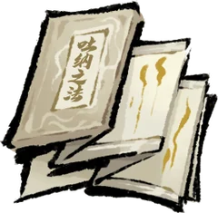

里面讲述了一种吐纳修炼的口诀，可将天地间的灵气通过呼吸存储于体内：

静心守一

调息绵长

灵台清明

引气归元

气海温养

呼浊纳清

心神守中

灵气化修

### 【获取途径】

仅在主线中获得

---

## 35. 混元功

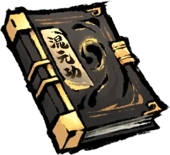

此功最是奇特，能兼容五行灵气，令修士于吐纳之间，同步吸纳金木水火土五气入体。

隐约可见，所创者：**广尘**。

修炼后可领悟**天赋：灵力亲和**

### 【各版本（境界 / 品质）】

神品：修炼限制 条件：无（放入修炼工作台即可）；修炼限制 太过简单：主角**筑基期**起再修炼，不再获得修为，只直接领悟其中的技能 / 口诀 / 天赋

### 【获取途径】

仅在主线中获得

---

## 36. 机关术

此书并非是讲述修炼方法，而是传授机关术的基础理论，各种傀儡的制作和改进方法

无法修炼此心法，但利用心法可将仙品傀儡**培养**至神品

### 【各版本（境界 / 品质）】

仙品：修炼限制 条件：不能修炼（只是记载傀儡的制作方法）

### 【获取途径】

筑基期后，修炼悟道+御物+试金后领悟

在神秘人中有10%概率出现

---

## 37. 金灵术

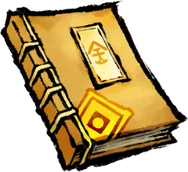

练气阶段金系心法。修炼之法重在凝气如金，淬炼经脉、稳固道基，虽无惊世威能，却能培元固本，令灵气凝而不散、锐而不躁。

修炼后可领悟**技能：天罡体**

### 【各版本（境界 / 品质）】

地品：修炼限制 境界：主角**练气期**及以上；修炼限制 条件：无（放入修炼工作台即可）；修炼限制 太过简单：主角**筑基期**起再修炼，不再获得修为，只直接领悟其中的技能 / 口诀 / 天赋

### 【获取途径】

修炼试金后领悟

在玄机阁中有概率刷出

无名村庄商人有概率出售

把试金赠送给打坐中的修士必定获得

把心境赠送给入魔的修士有概率获得

---

## 38. 御剑术

御剑术修炼核心离不开金属性武器的依托，剑只是这类武器中最具代表性的一种形态，并非唯一选择。

修炼后可领悟**天赋：剑术精通**

### 【各版本（境界 / 品质）】

练气·天品：修炼限制 境界：主角**练气期**及以上；修炼限制 需要：一把仙品或神品的**剑**；修炼限制 太过简单：主角**筑基期**起再修炼，不再获得修为，只直接领悟其中的技能 / 口诀 / 天赋

### 【获取途径】

修炼悟道+剑芒后领悟

在玄机阁中有概率刷出

无名村庄商人有概率出售

把剑芒赠送给打坐中的修士必定获得

把心境赠送给入魔的修士有概率获得

---

## 39. 千芒术

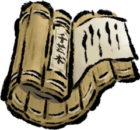

千芒，乃化光为刃的藏锋之道；以心念催发万千芒刃，隐如雾豹，现若雷蛇

修炼后可领悟**口诀：金芒咒**

### 【各版本（境界 / 品质）】

地品：修炼限制 境界：主角**筑基期**及以上；修炼限制 需要：两张**灵气卡：兑金**；修炼限制 太过简单：主角**结丹期**起再修炼，不再获得修为，只直接领悟其中的技能 / 口诀 / 天赋

### 【获取途径】

筑基期后，修炼后悟道+试金后领悟

把御物赠送给打坐中的修士有50%概率获得

把心境赠送给入魔的修士有概率获得

在玄机阁中有概率刷出

筑基期时使用机缘探索宗门遗迹有概率获得

筑基期时，修炼悟道有概率获得

---

## 40. 初尘剑谱

剑谱乃初尘道人所创，以“藏锋”“点露”“卷云”三式为根基串联而成的连携杀招。

修炼后可领悟**技能：初尘三式**

### 【各版本（境界 / 品质）】

天品：修炼限制 境界：主角**筑基期**及以上；修炼限制 需要：一把筑基期神品或以上的剑；修炼限制 太过简单：主角**结丹期**起再修炼，不再获得修为，只直接领悟其中的技能 / 口诀 / 天赋

### 【获取途径】

筑基期后，修炼悟道+剑意+剑芒后领悟

在玄机阁中有概率刷出

可在玄剑阁的藏经阁中兑换

把心境赠送给入魔的修士（筑基期）有概率获得

筑基期时使用机缘探索宗门遗迹有概率获得

---

## 41. 破煞剑谱

此剑谱的招式自始便凝练着磅礴杀伐之气。这股凛然杀意专为克制凶煞邪祟而生，剑锋所及之处，邪佞无所遁形、辟易退散。

修炼后可领悟**天赋：断邪斩**

### 【各版本（境界 / 品质）】

筑基·神品：修炼限制 境界：主角**筑基期**及以上；修炼限制 需要：捕捉到的**一只妖兽**；修炼限制 太过简单：主角**结丹期**起再修炼，不再获得修为，只直接领悟其中的技能 / 口诀 / 天赋

### 【获取途径】

筑基期后，修炼悟道+剑意+剑意后领悟

在玄机阁中有概率刷出

可在玄剑阁的藏经阁中兑换

把心境赠送给入魔的修士（筑基期）有概率获得

筑基期时使用机缘探索宗门遗迹有概率获得

---

## 42. 阴阳两仪剑

两仪生四象，阴阳定乾坤。纳天地阴阳二气入剑，刚则裂穹，柔则缠丝，阴阳相济时，剑势无穷无尽。

修炼后可领悟**天赋：御剑无锋**

### 【各版本（境界 / 品质）】

筑基·仙品：修炼限制 境界：主角**筑基期**及以上；修炼限制 需要：一把筑基期〔水〕剑＋一把筑基期〔火〕剑；修炼限制 太过简单：主角**结丹期**起再修炼，不再获得修为，只直接领悟其中的技能 / 口诀 / 天赋

### 【获取途径】

筑基期后，修炼悟道+剑意+试金后领悟

在玄机阁中有概率刷出

可在玄剑阁的藏经阁中兑换

把心境赠送给入魔的修士（筑基期）有概率获得

筑基期时使用机缘探索宗门遗迹有概率获得

---

## 43. 无相剑典

凡所有相，皆是虚妄！剑出无形无质，不执于招、不困于形。

修炼后可领悟**天赋：剑气四射**

### 【各版本（境界 / 品质）】

筑基·仙品：修炼限制 境界：主角**筑基期**及以上；修炼限制 需要：**心境卡**＋**剑意卡**；修炼限制 太过简单：主角**结丹期**起再修炼，不再获得修为，只直接领悟其中的技能 / 口诀 / 天赋

### 【获取途径】

筑基期后，修炼悟道+剑意+心境后领悟

在玄机阁中有概率刷出

可在玄剑阁的藏经阁中兑换

把心境赠送给入魔的修士（筑基期）有概率获得

筑基期时使用机缘探索宗门遗迹有概率获得

---

## 44. 归流剑经

归形如川流入海，归气似云雾聚散，归神若星斗归垣；万流汇一，剑出星河！

修炼后可领悟**天赋：剑术精通**

### 【各版本（境界 / 品质）】

筑基·仙品：修炼限制 境界：主角**筑基期**及以上；修炼限制 需要：一把筑基期仙品〔水〕剑；修炼限制 太过简单：主角**结丹期**起再修炼，不再获得修为，只直接领悟其中的技能 / 口诀 / 天赋

### 【获取途径】

筑基期后，修炼悟道+剑意+引水后领悟

在玄机阁中有概率刷出

可在玄剑阁的藏经阁中兑换

把心境赠送给入魔的修士（筑基期）有概率获得

筑基期时使用机缘探索宗门遗迹有概率获得

---

## 45. 口繺剑奤诀

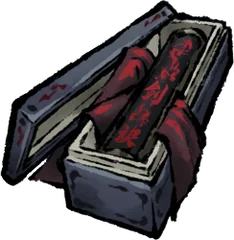

这本心法被人用秘法封印了，我无法解读里面内容，只能依稀可见**玄剑**二字。

有谁能解开此封印吗？

或者待我达到结丹期后，把此封印摧毁！

### 【各版本（境界 / 品质）】

筑基·绝品：修炼限制 境界：主角**筑基期**及以上；修炼限制 条件：心法被封印（隐约可见**玄剑**二字）：找人解开封印，或主角达到结丹期后自行摧毁封印

### 【获取途径】

第一次修炼剑魂残魄后领悟

---

## 46. 血煞剑魄

血煞剑魄，此心法乃玄剑阁前辈领悟，但前辈修炼后入魔而亡！

修炼后可领悟**技能：瞬影双闪**

### 【各版本（境界 / 品质）】

筑基·绝品：修炼限制 境界：主角**筑基期**及以上；修炼限制 条件：无（放入修炼工作台即可）；修炼限制 太过简单：主角**结丹期**起再修炼，不再获得修为，只直接领悟其中的技能 / 口诀 / 天赋

### 【获取途径】

把心法：䆷繺剑奤诀交给玄剑阁长老解封后获得

---

## 47. 剑魄诀

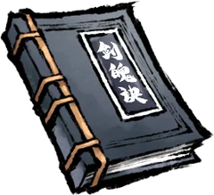

玄剑阁筑基心法《剑魄诀》，以气养魄，以魄御剑，于丹田筑基之初凝练本命“剑魄”，是为一切无上剑道之根基。

修炼后可领悟**技能：玄机剑魄****天赋：器心通明**

### 【各版本（境界 / 品质）】

筑基·绝品：修炼限制 境界：主角**筑基期**及以上；修炼限制 需要：**剑意卡**＋一把筑基期神品或以上的剑；修炼限制 太过简单：主角**结丹期**起再修炼，不再获得修为，只直接领悟其中的技能 / 口诀 / 天赋

### 【获取途径】

在玄剑阁的藏经阁中兑换

---

## 48. 金锋谱

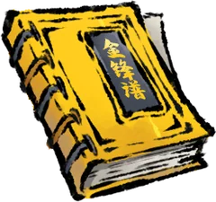

金气凝锋，锐不可当，锋芒一出如金戈裂空，破甲裂阵无坚不摧。

修炼后可领悟**天赋：金锋破**

### 【各版本（境界 / 品质）】

结丹·神品：修炼限制 境界：主角**结丹期**及以上；修炼限制 需要：一把结丹期绝品剑＋一个目标（**妖兽**、**尸体**或**活人**）；修炼限制 太过简单：主角**元婴期**起再修炼，不再获得修为，只直接领悟其中的技能 / 口诀 / 天赋

### 【获取途径】

结丹期后，修炼悟道+凝聚+剑意后领悟

可在玄剑阁的藏经阁中兑换

把心境赠送给入魔的修士（结丹期）有概率获得

结丹期时使用机缘探索宗门遗迹有概率获得

---

## 49. 心剑诀

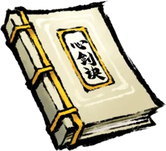

心为万法源，剑为心之锋，以心为炉炼剑魄，以念为引驭剑炁，修至深处可心剑离体。

修炼后可领悟**技能：凝剑术**

### 【各版本（境界 / 品质）】

结丹·仙品：修炼限制 境界：主角**结丹期**及以上；修炼限制 需要：**感悟卡：凝聚**；修炼限制 太过简单：主角**元婴期**起再修炼，不再获得修为，只直接领悟其中的技能 / 口诀 / 天赋

### 【获取途径】

结丹期后，修炼悟道+凝聚+凝聚后领悟

可在玄剑阁的藏经阁中兑换

把心境赠送给入魔的修士（结丹期）有概率获得

结丹期时使用机缘探索宗门遗迹有概率获得

---

## 50. 神剑谱

这是一本收录了神兵利器的剑谱，上古仙人遍访九州名匠、踏遍三山五岳而辑成。所载诸刃或淬雷泽之精，削铁如泥；或沐月华之韵，吹毛可断。

修炼后可领悟**口诀：借剑诀**

### 【各版本（境界 / 品质）】

结丹·绝品：修炼限制 境界：主角**结丹期**及以上；修炼限制 条件：无（放入修炼工作台即可）；修炼限制 太过简单：主角**元婴期**起再修炼，不再获得修为，只直接领悟其中的技能 / 口诀 / 天赋

### 【获取途径】

结丹期后，修炼悟道+凝聚+顿悟后领悟

在玄剑阁的藏经阁中兑换

---

## 51. 藏锋诀

锋芒内敛，藏巧于拙，藏锋于内则气脉沉厚，敛气于形则不露圭角。

修炼后可领悟**天赋：笑里藏锋**

### 【各版本（境界 / 品质）】

结丹·仙品：修炼限制 境界：主角**结丹期**及以上；修炼限制 需要：一把结丹期绝品扇子＋**心境卡**；修炼限制 太过简单：主角**元婴期**起再修炼，不再获得修为，只直接领悟其中的技能 / 口诀 / 天赋

### 【获取途径】

结丹期后，修炼悟道+凝聚+杀意后领悟

可在玄剑阁的藏经阁中兑换

把心境赠送给入魔的修士（结丹期）有概率获得

结丹期时使用机缘探索宗门遗迹有概率获得

---

## 52. 凝光心法

以吐纳导引之法引天地清辉、日月精光入体，缓缓凝练丹田气海，修至深处可化灵气为凝光

修炼后可领悟**技能：剑盾式**

### 【各版本（境界 / 品质）】

结丹·天品：修炼限制 境界：主角**结丹期**及以上；修炼限制 需要：**感悟卡：凝聚**；修炼限制 太过简单：主角**元婴期**起再修炼，不再获得修为，只直接领悟其中的技能 / 口诀 / 天赋

### 【获取途径】

结丹期后，修炼悟道+凝聚+御灵后领悟

结丹期时使用机缘探索宗门遗迹有概率获得

---

## 53. 分光剑法

需修炼剑魄诀后方可修炼：本命剑魄为根，分化剑光为用，一剑斩出，虚实相生，万法难辨

修炼后可领悟**技能：剑魄通明**

（如果你已拥有技能：剑魄通明，则修炼不在掉落）

### 【各版本（境界 / 品质）】

结丹·绝品：修炼限制 境界：主角**结丹期**及以上；修炼限制 需要：一把结丹期或以上的绝品剑；修炼限制 太过简单：主角**元婴期**起再修炼，不再获得修为，只直接领悟其中的技能 / 口诀 / 天赋

### 【获取途径】

在玄剑阁的藏经阁中兑换

---

## 54. 裂金诀

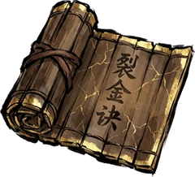

出招可附金行破甲之力，能裂金断石、直破护体罡气，尤擅增幅兵刃法宝的锋锐之性

修炼后可领悟**技能：饮血剑**

### 【各版本（境界 / 品质）】

元婴·神品：修炼限制 境界：主角**元婴期**及以上；修炼限制 需要：一件元婴期仙品或以上的〔金〕法宝（注意：修炼会**摧毁**这件法宝）

### 【获取途径】

元婴期后，修炼悟道+归一+归一/顿悟后可自选

---

## 55. 金锋两仪诀

修至深处可阴阳轮转、金气生生不息，非但杀伐锋锐不输纯攻心法，更能补全金行修士守御薄弱之弊，是极为上乘的金行正统法门

修炼后可领悟**技能：凝刃技**

### 【各版本（境界 / 品质）】

元婴·神品：修炼限制 境界：主角**元婴期**及以上；修炼限制 条件：主角手持**本命剑**

### 【获取途径】

元婴期后，修炼悟道+归一+归一/顿悟后可自选

---

## 56. 木心术

练气阶段木系心法。功法浅显易懂、运转温和，循序渐进感悟木系灵力的滋养与运转之妙

修炼后可领悟**口诀：唤木诀**

### 【各版本（境界 / 品质）】

地品：修炼限制 境界：主角**练气期**及以上；修炼限制 条件：无（放入修炼工作台即可）；修炼限制 太过简单：主角**筑基期**起再修炼，不再获得修为，只直接领悟其中的技能 / 口诀 / 天赋

### 【获取途径】

修炼采木后领悟

在玄机阁中有概率刷出

无名村庄商人有概率出售

把采木赠送给打坐中的修士必定获得

把心境赠送给入魔的修士有概率获得

---

## 57. 百药谱

谱内详载各类常见草药，从性味归经、生长习性，到采集时机、炮制之法，皆记录得周全细致、条理分明。

修炼后可领悟**天赋：丹元催化**

### 【各版本（境界 / 品质）】

练气·天品：修炼限制 境界：主角**练气期**及以上；修炼限制 需要：仙品或神品的**灵草**；修炼限制 太过简单：主角**筑基期**起再修炼，不再获得修为，只直接领悟其中的技能 / 口诀 / 天赋

### 【获取途径】

筑基后，修炼悟道+药理有50%概率领悟

修炼悟道+丹道+药理后领悟

在玄机阁中有概率刷出

无名村庄商人有概率出售

把药理赠送给打坐中的修士有50%概率获得

把心境赠送给入魔的修士有概率获得

---

## 58. 长生录

古往今来，世人对长生之念深植于心、执念难消，这本《长生录》便是由此执念淬炼而生的木系长生法门。

修炼后可领悟**天赋：长生术**

### 【各版本（境界 / 品质）】

地品：修炼限制 境界：主角**筑基期**及以上；修炼限制 需要：两张**灵气卡：震木**；修炼限制 太过简单：主角**结丹期**起再修炼，不再获得修为，只直接领悟其中的技能 / 口诀 / 天赋

### 【获取途径】

筑基期后，修炼悟道+采木后领悟

把御灵赠送给打坐中的修士有50%概率获得

把心境赠送给入魔的修士（筑基期）有概率获得

在玄机阁中有概率刷出

筑基期时使用机缘探索宗门遗迹有概率获得

---

## 59. 百毒谱

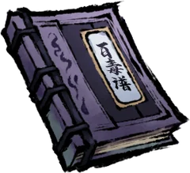

迥异于《百药谱》济世救人、调和百草的宗旨，此心法专攻毒术一道，所载皆为世间各类剧毒之法。

修炼后可领悟**天赋：丹元催化**

### 【各版本（境界 / 品质）】

天品：修炼限制 境界：主角**筑基期**及以上；修炼限制 需要：一张筑基期神品毒丹药；修炼限制 太过简单：主角**结丹期**起再修炼，不再获得修为，只直接领悟其中的技能 / 口诀 / 天赋

### 【获取途径】

修炼悟道+丹道+药理后领悟

在玄机阁中有概率刷出

把心境赠送给入魔的修士（筑基期）有概率获得

筑基期时使用机缘探索宗门遗迹有概率获得

---

## 60. 幽兰录

幽兰性洁，隐于深谷而不争，蕴藉天地清灵之气，融贯自然之道与精神修行于一体，沉心体悟草木与天地的共生之韵，于自然吐纳间契合万物节律。

每次修炼均能随机获得一株**筑基期灵草**

### 【各版本（境界 / 品质）】

筑基·神品：修炼限制 境界：主角**筑基期**及以上；修炼限制 条件：无（放入修炼工作台即可）

### 【获取途径】

筑基期后，修炼悟道+丹道+丹道后领悟

在玄机阁中有概率刷出

把心境赠送给入魔的修士（筑基期）有概率获得

筑基期时使用机缘探索宗门遗迹有概率获得

---

## 61. 断肠经

某药师观断肠草的毒性所创，开创以毒入道，生死轮转的修行体系。

修炼后可领悟**天赋：千幻毒手**

### 【各版本（境界 / 品质）】

筑基·仙品：修炼限制 境界：主角**筑基期**及以上；修炼限制 需要：**一具尸体**（**活人**也可以）；修炼限制 太过简单：主角**结丹期**起再修炼，不再获得修为，只直接领悟其中的技能 / 口诀 / 天赋

### 【获取途径】

筑基期后，修炼悟道+御物+药理后领悟

在玄机阁中有概率刷出

把心境赠送给入魔的修士（筑基期）有概率获得

筑基期时使用机缘探索宗门遗迹有概率获得

---

## 62. 春蚕诀

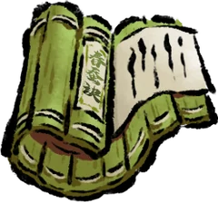

通过吐纳与天地灵气交融，春蚕破茧可成蝶，以此生灭循环，褪凡化灵的过程创造的一本心法

修炼后可领悟**技能：荆棘**和**天赋：丹元催化**

### 【各版本（境界 / 品质）】

筑基·仙品：修炼限制 境界：主角**筑基期**及以上；修炼限制 条件：无（放入修炼工作台即可）；修炼限制 太过简单：主角**结丹期**起再修炼，不再获得修为，只直接领悟其中的技能 / 口诀 / 天赋

### 【获取途径】

筑基期后，修炼悟道+丹道+心境后领悟

在玄机阁中有概率刷出

把心境赠送给入魔的修士（筑基期）有概率获得

筑基期时使用机缘探索宗门遗迹有概率获得

---

## 63. 栖梧功

修炼者需向凤凰涅槃般，栖息于灵树梧桐中，感受生生不息的天地灵气。

修炼后可领悟**口诀：唤灵诀**

### 【各版本（境界 / 品质）】

筑基·仙品：修炼限制 境界：主角**筑基期**及以上；修炼限制 需要：一只**筑基期**仙品或以上的〔木〕灵兽；修炼限制 太过简单：主角**结丹期**起再修炼，不再获得修为，只直接领悟其中的技能 / 口诀 / 天赋

### 【获取途径】

筑基期后，修炼悟道+丹道+采木后领悟

在玄机阁中有概率刷出

把心境赠送给入魔的修士（筑基期）有概率获得

筑基期时使用机缘探索宗门遗迹有概率获得

---

## 64. 花衍诀

以天地花木生息衍化之道为旨，引草木菁华灵气入体，如花开次第般缓缓衍化丹田气海

修炼后可领悟**技能：唤灵**

### 【各版本（境界 / 品质）】

筑基·地品：修炼限制 境界：主角**筑基期**及以上；修炼限制 条件：在〔木〕地点修炼；修炼限制 太过简单：主角**结丹期**起再修炼，不再获得修为，只直接领悟其中的技能 / 口诀 / 天赋；修炼限制 开局词条「先天道种」：无视以上条件，直接修炼

### 【获取途径】

筑基期后，修炼悟道+御灵+采木后领悟

在玄机阁中有概率刷出

把心境赠送给入魔的修士（筑基期）有概率获得

筑基期时使用机缘探索宗门遗迹有概率获得

---

## 65. 落樱诀

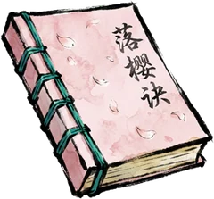

以樱花荣枯循环之理入道，借花木生生不息之道重聚灵元

修炼后可领悟**技能：落花**

### 【各版本（境界 / 品质）】

筑基·天品：修炼限制 境界：主角**筑基期**及以上；修炼限制 条件：在〔木〕地点修炼；修炼限制 太过简单：主角**结丹期**起再修炼，不再获得修为，只直接领悟其中的技能 / 口诀 / 天赋；修炼限制 开局词条「先天道种」：无视以上条件，直接修炼

### 【获取途径】

筑基期后，修炼悟道+杀意+采木后领悟

在玄机阁中有概率刷出

把心境赠送给入魔的修士（筑基期）有概率获得

筑基期时使用机缘探索宗门遗迹有概率获得

---

## 66. 毒心经

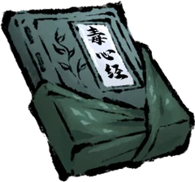

纳天下草木之毒，融于己身灵力之中，一念之间便可执掌生死：

修炼后可领悟**天赋：元殒毒术**

### 【各版本（境界 / 品质）】

结丹·绝品：修炼限制 境界：主角**结丹期**及以上；修炼限制 需要：一瓶**结丹期毒药**＋一个**活物**作实验目标；修炼限制 太过简单：主角**元婴期**起再修炼，不再获得修为，只直接领悟其中的技能 / 口诀 / 天赋

### 【获取途径】

结丹期后，修炼悟道+生长+顿悟后领悟

---

## 67. 蕴灵诀

承天地灵脉，蕴万物精元，修炼者以身为鼎引天地灵气孕育灵物。

修炼后可领悟**天赋：灵植之心**

### 【各版本（境界 / 品质）】

结丹·仙品：修炼限制 境界：主角**结丹期**及以上；修炼限制 需要：绝品**灵草**；修炼限制 太过简单：主角**元婴期**起再修炼，不再获得修为，只直接领悟其中的技能 / 口诀 / 天赋

### 【获取途径】

结丹期后，修炼悟道+生长+生长后领悟

把心境赠送给入魔的修士（结丹期）有概率获得

结丹期时使用机缘探索宗门遗迹有概率获得

---

## 68. 青冥真解

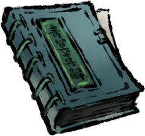

此功法暗合自然生灭之道，洞悉草木枯荣的本源法理，契合自然大道，能与世间草木生灵同频共振

修炼后可领悟**天赋：青冥引**

### 【各版本（境界 / 品质）】

结丹·仙品：修炼限制 境界：主角**结丹期**及以上；修炼限制 条件：无（放入修炼工作台即可）；修炼限制 太过简单：主角**元婴期**起再修炼，不再获得修为，只直接领悟其中的技能 / 口诀 / 天赋

### 【获取途径】

结丹期后，修炼悟道+生长+杀意后领悟

把心境赠送给入魔的修士（结丹期）有概率获得

结丹期时使用机缘探索宗门遗迹有概率获得

---

## 69. 黄庭内景

借心法妙韵滋养本命元机，调和气血、稳固灵根，令道基如磐石般不可撼动。为炼养脏腑无上内修心法

修炼后可领悟**天赋：丹元催化**

### 【各版本（境界 / 品质）】

结丹·仙品：修炼限制 境界：主角**结丹期**及以上；修炼限制 需要：**神识卡**；修炼限制 太过简单：主角**元婴期**起再修炼，不再获得修为，只直接领悟其中的技能 / 口诀 / 天赋

### 【获取途径】

结丹期后，修炼悟道+生长+丹道后领悟

把心境赠送给入魔的修士（结丹期）有概率获得

结丹期时使用机缘探索宗门遗迹有概率获得

---

## 70. 花栖木

行功时花木相生相养，凝灵韵作花魂栖于气海

修炼后可领悟**天赋：花之魂**

### 【各版本（境界 / 品质）】

结丹·仙品：修炼限制 境界：主角**结丹期**及以上；修炼限制 需要：**感悟卡：生长**；修炼限制 太过简单：主角**元婴期**起再修炼，不再获得修为，只直接领悟其中的技能 / 口诀 / 天赋

### 【获取途径】

结丹期后，修炼悟道+生长+御物后领悟

把心境赠送给入魔的修士（结丹期）有概率获得

结丹期时使用机缘探索宗门遗迹有概率获得

---

## 71. 归根护元法

以「落叶归根、元息守一」为道旨，行功时将周身散逸灵气敛归丹田本源，凝作护元罡气覆于心脉气海

修炼后可领悟**天赋：落叶归根**

### 【各版本（境界 / 品质）】

结丹·仙品：修炼限制 境界：主角**结丹期**及以上；修炼限制 需要：〔木〕**本命物**；修炼限制 太过简单：主角**元婴期**起再修炼，不再获得修为，只直接领悟其中的技能 / 口诀 / 天赋

### 【获取途径】

结丹期后，修炼悟道+生长+御灵后领悟

把心境赠送给入魔的修士（结丹期）有概率获得

结丹期时使用机缘探索宗门遗迹有概率获得

---

## 72. 万木归灵术

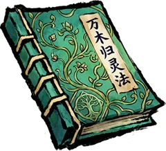

修炼者可借草木共鸣感知周遭生机，催动心法时经脉如古树盘根，生生不息

修炼后可领悟**技能：葬花术**

### 【各版本（境界 / 品质）】

元婴·神品：修炼限制 境界：主角**元婴期**及以上；修炼限制 需要：**元婴期**仙品〔木〕的**法宝**或**灵兽**（注意：这张卡会被**摧毁**）

### 【获取途径】

元婴期后，修炼悟道+归一+归一/顿悟后可自选

---

## 73. 血灵经

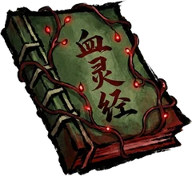

以自身血脉为壤，取精血饲木灵。

修炼后可领悟**技能：孕灵术**

### 【各版本（境界 / 品质）】

元婴·神品：修炼限制 境界：主角**元婴期**及以上；修炼限制 条件：在**血红树**修炼；修炼限制 开局词条「先天道种」：无视以上条件，直接修炼

### 【获取途径】

元婴期后，修炼悟道+归一+归一/顿悟后可自选

---

## 74. 涤尘术

练气阶段水系心法。以水系灵力洗练周身杂质、净化灵根，在吐纳间契合水性柔润之韵。

修炼后可领悟**技能：星图术**

### 【各版本（境界 / 品质）】

地品：修炼限制 境界：主角**练气期**及以上；修炼限制 条件：无（放入修炼工作台即可）；修炼限制 太过简单：主角**筑基期**起再修炼，不再获得修为，只直接领悟其中的技能 / 口诀 / 天赋

### 【获取途径】

修炼引水后领悟

在玄机阁中有概率刷出

无名村庄商人有概率出售

把引水赠送给打坐中的修士必定获得

把心境赠送给入魔的修士有概率获得

---

## 75. 愈心术

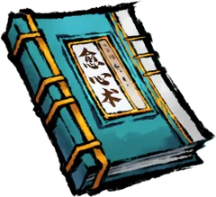

此心法专司济世救疗之途，内中收录了海量前人躬身实践的治疗心得，条理分明、底蕴深厚。

修炼后可领悟**口诀：治愈诀**

### 【各版本（境界 / 品质）】

练气·天品：修炼限制 境界：主角**练气期**及以上；修炼限制 需要：一张**水灵气**；修炼限制 太过简单：主角**筑基期**起再修炼，不再获得修为，只直接领悟其中的技能 / 口诀 / 天赋

### 【获取途径】

修炼悟道+药理有50%概率领悟

修炼悟道+药理+引水后领悟

在玄机阁中有概率刷出

无名村庄商人有概率出售

把药理赠送给打坐中的修士有50%概率获得

把心境赠送给入魔的修士有概率获得

---

## 76. 止水功

静渊无波，止水照神

修炼后可领悟**技能：卸力**

### 【各版本（境界 / 品质）】

地品：修炼限制 境界：主角**筑基期**及以上；修炼限制 需要：两张**灵气卡：坎水**；修炼限制 太过简单：主角**结丹期**起再修炼，不再获得修为，只直接领悟其中的技能 / 口诀 / 天赋

### 【获取途径】

筑基期后，修炼悟道+引水后领悟

把御灵赠送给打坐中的修士有50%概率获得

把心境赠送给入魔的修士有概率获得

在玄机阁中有概率刷出

筑基期时使用机缘探索宗门遗迹有概率获得

---

## 77. 回春典

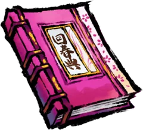

引天地间精纯生息入体，循功法玄奥脉络流转周身，将体内积淀的伤痕如融雪般逐一消融。

修炼后可领悟**口诀：疗愈阵**

### 【各版本（境界 / 品质）】

天品：修炼限制 境界：主角**筑基期**及以上；修炼限制 需要：一张〔血量〕受损的卡牌；修炼限制 太过简单：主角**结丹期**起再修炼，不再获得修为，只直接领悟其中的技能 / 口诀 / 天赋

### 【获取途径】

修炼悟道+御灵+药理后领悟

把心境赠送给入魔的修士（筑基期）有概率获得

---

## 78. 续脉经

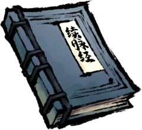

唯有身临濒死之境，经脉欲断、生机将绝、命悬一线之际，方能引动功法内蕴的玄妙机理。

修炼后可领悟**技能：保命**

修炼后可领悟**天赋：灵脉之躯**

### 【各版本（境界 / 品质）】

筑基·神品：修炼限制 境界：主角**筑基期**及以上；修炼限制 条件：主角**濒死状态**时才能修炼；修炼限制 太过简单：主角**结丹期**起再修炼，不再获得修为，只直接领悟其中的技能 / 口诀 / 天赋

### 【获取途径】

筑基期后，修炼悟道+御灵+御灵后领悟

在玄机阁中有概率刷出

把心境赠送给入魔的修士（筑基期）有概率获得

---

## 79. 引气经

摒弃了基础吐纳的粗浅法门，以更玄奥的呼吸节律与灵力运转之法，每一次呼吸皆能牵引更磅礴的天地灵气入体。

修炼后可领悟**天赋：灵力亲和**

### 【各版本（境界 / 品质）】

筑基·仙品：修炼限制 境界：主角**筑基期**及以上；修炼限制 需要：两张**灵气卡：混沌灵气**；修炼限制 太过简单：主角**结丹期**起再修炼，不再获得修为，只直接领悟其中的技能 / 口诀 / 天赋

### 【获取途径】

筑基期后，修炼悟道+御灵+心境后领悟

在玄机阁中有概率刷出

把心境赠送给入魔的修士（筑基期）有概率获得

---

## 80. 水元诀

学习江河不争之性，融月华至柔之韵，柔中藏韧，化浊气为清露

修炼后可领悟**天赋：万法归流**

### 【各版本（境界 / 品质）】

筑基·仙品：修炼限制 境界：主角**筑基期**及以上；修炼限制 需要：一个筑基期神品瓶子；修炼限制 太过简单：主角**结丹期**起再修炼，不再获得修为，只直接领悟其中的技能 / 口诀 / 天赋

### 【获取途径】

筑基期后，修炼悟道+御灵+身法后领悟

在玄机阁中有概率刷出

把心境赠送给入魔的修士（筑基期）有概率获得

---

## 81. 引潮法

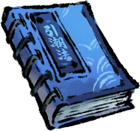

引潮法直指天人合一至理，将浩瀚海洋潮汐之力纳入方寸之躯

修炼后可领悟**天赋：万法归流**

### 【各版本（境界 / 品质）】

筑基·仙品：修炼限制 境界：主角**筑基期**及以上；修炼限制 条件：在〔水〕地点修炼（把主角和心法一起放进该地点）；修炼限制 太过简单：主角**结丹期**起再修炼，不再获得修为，只直接领悟其中的技能 / 口诀 / 天赋

### 【获取途径】

筑基期后，修炼悟道+御灵+引水后领悟

在玄机阁中有概率刷出

把心境赠送给入魔的修士（筑基期）有概率获得

---

## 82. 归藏术

气合太虚，行随造化，身若山河芥子。

修炼后可领悟**天赋：法术精通**

### 【各版本（境界 / 品质）】

筑基·仙品：修炼限制 境界：主角**筑基期**及以上；修炼限制 需要：一个**单体伤害口诀**＋一个练习目标（**尸体**或**妖兽**）；修炼限制 太过简单：主角**结丹期**起再修炼，不再获得修为，只直接领悟其中的技能 / 口诀 / 天赋

### 【获取途径】

筑基期后，修炼悟道+御灵+御土后领悟

在玄机阁中有概率刷出

把心境赠送给入魔的修士（筑基期）有概率获得

---

## 83. 润元心法

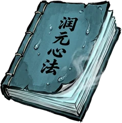

以灵水化气，缓缓浸润经脉丹田，温养本源、涤荡浊息。

修炼后可领悟**天赋：生生不息**

### 【各版本（境界 / 品质）】

筑基·仙品：修炼限制 境界：主角**筑基期**及以上；修炼限制 需要：一颗筑基期神品或以上的**补血丹药**；修炼限制 太过简单：主角**结丹期**起再修炼，不再获得修为，只直接领悟其中的技能 / 口诀 / 天赋

### 【获取途径】

筑基期后，修炼悟道+丹道+引水后领悟

在玄机阁中有概率刷出

把心境赠送给入魔的修士（筑基期）有概率获得

---

## 84. 寒影追魂录

修者以寒淬脉，凝影藏形，出手时化气为冰、影随念动，敌未觉而冰已侵骨。

修炼后可领悟**天赋：无形冰**

### 【各版本（境界 / 品质）】

筑基·仙品：修炼限制 境界：主角**筑基期**及以上；修炼限制 需要：一把筑基期或以上的神品**双刀**；修炼限制 太过简单：主角**结丹期**起再修炼，不再获得修为，只直接领悟其中的技能 / 口诀 / 天赋

### 【获取途径】

筑基期后，修炼悟道+御灵+剑芒后领悟

在玄机阁中有概率刷出

把心境赠送给入魔的修士（筑基期）有概率获得

---

## 85. 凝尘诀

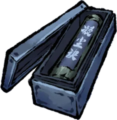

以引天地微尘入脉，凝尘为气，于微末之间炼就道体。

修炼后可领悟**口诀：凝气诀**

### 【各版本（境界 / 品质）】

结丹·绝品：修炼限制 境界：主角**结丹期**及以上；修炼限制 需要：**心境卡**；修炼限制 太过简单：主角**元婴期**起再修炼，不再获得修为，只直接领悟其中的技能 / 口诀 / 天赋

### 【获取途径】

结丹期后，修炼悟道+包容+顿悟后领悟

---

## 86. 沧溟诀

引天地水元之气入体，化为绵绵不绝的柔韧内力，如大海般浩瀚深邃。

修炼后可领悟**天赋：灵脉之躯**

### 【各版本（境界 / 品质）】

神品：修炼限制 境界：主角**结丹期**及以上；修炼限制 需要：一件结丹期绝品〔水〕法宝＋**九阴黑水**；修炼限制 太过简单：主角**元婴期**起再修炼，不再获得修为，只直接领悟其中的技能 / 口诀 / 天赋

### 【获取途径】

结丹期后，修炼悟道+包容+心境后领悟

把心境赠送给入魔的修士（结丹期）有概率获得

结丹期时使用机缘探索宗门遗迹有概率获得

---

## 87. 汐残照

残照之韵，落日熔金、霞染海天，于绚烂极致中藏尽决绝之势。

修炼后可领悟**天赋：落珠回春**

### 【各版本（境界 / 品质）】

仙品：修炼限制 境界：主角**结丹期**及以上；修炼限制 需要：一件损坏的〔水〕法宝；修炼限制 太过简单：主角**元婴期**起再修炼，不再获得修为，只直接领悟其中的技能 / 口诀 / 天赋

### 【获取途径】

结丹期后，修炼悟道+包容+御灵后领悟

把心境赠送给入魔的修士（结丹期）有概率获得

结丹期时使用机缘探索宗门遗迹有概率获得

---

## 88. 溟吸术

化灵力为无形吸力，可抽取他人修为、生机纳入己身

修炼后可领悟**技能：斗转星移**

### 【各版本（境界 / 品质）】

结丹·仙品：修炼限制 境界：主角**结丹期**及以上；修炼限制 需要：一把结丹期**本命兵器**（剑 / 刀 / 双刀 / 扇子 / 暗器 / 枪 / 锤）；修炼限制 太过简单：主角**元婴期**起再修炼，不再获得修为，只直接领悟其中的技能 / 口诀 / 天赋

### 【获取途径】

结丹期后，修炼悟道+包容+御物后领悟

把心境赠送给入魔的修士（结丹期）有概率获得

结丹期时使用机缘探索宗门遗迹有概率获得

---

## 89. 回光心诀

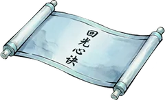

以水之澄静涤荡神识，令心神内照、观照己身，可稳道心、破迷障、清杂念。

修炼后可领悟**技能：神佑**

### 【各版本（境界 / 品质）】

结丹·仙品：修炼限制 境界：主角**结丹期**及以上；修炼限制 条件：在**秘境：碧潭瀑布**修炼；修炼限制 太过简单：主角**元婴期**起再修炼，不再获得修为，只直接领悟其中的技能 / 口诀 / 天赋；修炼限制 开局词条「先天道种」：无视以上条件，直接修炼

### 【获取途径】

结丹期后，修炼悟道+包容+包容后领悟

把心境赠送给入魔的修士（结丹期）有概率获得

结丹期时使用机缘探索宗门遗迹有概率获得

---

## 90. 同心典

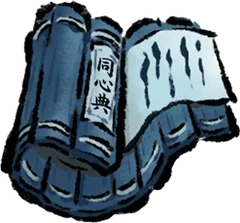

修练者可借契约之桥，将自身生机灵力渡予契约灵兽

修炼后可领悟**口诀：灵源咒**

### 【各版本（境界 / 品质）】

结丹·仙品：修炼限制 境界：主角**结丹期**及以上；修炼限制 条件：在**秘境：碧潭瀑布**修炼；修炼限制 太过简单：主角**元婴期**起再修炼，不再获得修为，只直接领悟其中的技能 / 口诀 / 天赋；修炼限制 开局词条「先天道种」：无视以上条件，直接修炼

### 【获取途径】

结丹期后，修炼悟道+包容+丹道后领悟

把心境赠送给入魔的修士（结丹期）有概率获得

结丹期时使用机缘探索宗门遗迹有概率获得

---

## 91. 守一诀

只要守住那一点本源一息，万般强攻、邪扰都难以破开你的防线

修炼后可领悟**技能：无量障**

### 【各版本（境界 / 品质）】

元婴·神品：修炼限制 境界：主角**元婴期**及以上；修炼限制 条件：主角**濒死状态**时才能修炼

### 【获取途径】

元婴期后，修炼悟道+归一+归一/顿悟后可自选

---

## 92. 焚炎经

练气阶段火系心法。此法核心在于引动天地间散逸的火灵之气，点燃体内火源根基，在吐纳间体悟火系灵力的炽烈之威

修炼后可领悟**口诀：唤火诀**

### 【各版本（境界 / 品质）】

地品：修炼限制 境界：主角**练气期**及以上；修炼限制 条件：无（放入修炼工作台即可）；修炼限制 太过简单：主角**筑基期**起再修炼，不再获得修为，只直接领悟其中的技能 / 口诀 / 天赋

### 【获取途径】

控火必定获得

在玄机阁中有概率刷出

无名村庄商人有概率出售

把控火赠送给打坐中的修士必定获得

把心境赠送给入魔的修士有概率获得

---

## 93. 淬骨功

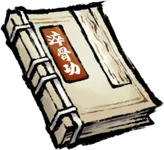

所载是一套以火焰淬炼筋骨的系统法门，以温和却持久的火焰之力烘烤骨骼、锻打筋肉，逐层褪去肉身杂质，强化骨骼坚韧度。

修炼后可领悟**天赋：百炼钢躯**

### 【各版本（境界 / 品质）】

练气·天品：修炼限制 境界：主角**练气期**及以上；修炼限制 需要：神品〔火〕内丹；修炼限制 太过简单：主角**筑基期**起再修炼，不再获得修为，只直接领悟其中的技能 / 口诀 / 天赋

### 【获取途径】

修炼悟道+身法有50%概率领悟

修炼悟道+身法+控火后领悟

在玄机阁中有概率刷出

无名村庄商人有概率出售

把身法赠送给打坐中的修士有50%概率获得

把心境赠送给入魔的修士有概率获得

---

## 94. 焚天诀

上古火修秘典，以火证道，焚天煮海。

修炼后可领悟**口诀：聚火诀**

### 【各版本（境界 / 品质）】

筑基·地品：修炼限制 境界：主角**筑基期**及以上；修炼限制 需要：两张**灵气卡：离火**；修炼限制 太过简单：主角**结丹期**起再修炼，不再获得修为，只直接领悟其中的技能 / 口诀 / 天赋

### 【获取途径】

筑基期后，修炼悟道+控火后领悟

把杀意赠送给打坐中的修士必定获得

把心境赠送给入魔的修士（筑基期）有概率获得

在玄机阁中有概率刷出

筑基期时使用机缘探索宗门遗迹有概率获得

---

## 95. 玄火锻骨录

以秘法引玄阳真火入体，循功法脉络流转周身，让真火之力缓缓渗透骨骼脏腑；**此心法需要在火属性地点修炼**

修炼后可领悟**天赋：百炼钢躯**

### 【各版本（境界 / 品质）】

天品：修炼限制 境界：主角**筑基期**及以上；修炼限制 条件：在〔火〕地点修炼（把主角和心法一起放进该地点）；修炼限制 太过简单：主角**结丹期**起再修炼，不再获得修为，只直接领悟其中的技能 / 口诀 / 天赋；修炼限制 开局词条「先天道种」：无视以上条件，直接修炼

### 【获取途径】

修炼悟道+杀意+身法后领悟

在玄机阁中有概率刷出

把心境赠送给入魔的修士（筑基期）有概率获得

筑基期时使用机缘探索宗门遗迹有概率获得

---

## 96. 血髓功

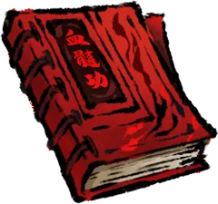

以自身精血为媒，冲破体内三十六处玄关隘口；**此心法需要在火属性地点修炼**

修炼后可领悟**天赋：神魂锻体**

### 【各版本（境界 / 品质）】

筑基·神品：修炼限制 境界：主角**筑基期**及以上；修炼限制 需要：**兽血**，在〔火〕地点修炼（把主角和心法一起放进该地点）；修炼限制 太过简单：主角**结丹期**起再修炼，不再获得修为，只直接领悟其中的技能 / 口诀 / 天赋；修炼限制 开局词条「先天道种」：无视以上条件，直接修炼

### 【获取途径】

筑基期后，修炼悟道+杀意+杀意后领悟

在玄机阁中有概率刷出

把心境赠送给入魔的修士（筑基期）有概率获得

筑基期时使用机缘探索宗门遗迹有概率获得

---

## 97. 焚心剑谱

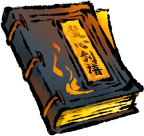

引心火入剑，以剑焚心，斩断七情六欲；**此心法需要在火属性地点修炼**

修炼后可领悟**天赋：百炼钢驱和天赋：剑术精通**

### 【各版本（境界 / 品质）】

筑基·仙品：修炼限制 境界：主角**筑基期**及以上；修炼限制 需要：一把筑基期〔火〕剑，在〔火〕地点修炼（把主角和心法一起放进该地点）；修炼限制 太过简单：主角**结丹期**起再修炼，不再获得修为，只直接领悟其中的技能 / 口诀 / 天赋；修炼限制 开局词条「先天道种」：无视以上条件，直接修炼

### 【获取途径】

筑基期后，修炼悟道+剑意+控火后领悟

在玄机阁中有概率刷出

把心境赠送给入魔的修士（筑基期）有概率获得

筑基期时使用机缘探索宗门遗迹有概率获得

---

## 98. 焚脉法

以火为媒，引天地之火入体焚脉。**此心法需要在火属性地点修炼**

修炼后可领悟**天赋：百炼钢驱**

### 【各版本（境界 / 品质）】

筑基·仙品：修炼限制 境界：主角**筑基期**及以上；修炼限制 条件：在〔火〕地点修炼（把主角和心法一起放进该地点）；修炼限制 太过简单：主角**结丹期**起再修炼，不再获得修为，只直接领悟其中的技能 / 口诀 / 天赋；修炼限制 开局词条「先天道种」：无视以上条件，直接修炼

### 【获取途径】

筑基期后，修炼悟道+杀意+控火后领悟

在玄机阁中有概率刷出

把心境赠送给入魔的修士（筑基期）有概率获得

筑基期时使用机缘探索宗门遗迹有概率获得

---

## 99. 燃血术

以血为薪，焚命为焰，燃周身之血以激发潜能。**此心法需要在火属性地点修炼**

修炼后可领悟**天赋：百炼钢驱**

### 【各版本（境界 / 品质）】

筑基·仙品：修炼限制 境界：主角**筑基期**及以上；修炼限制 条件：在〔火〕地点修炼（把主角和心法一起放进该地点）；修炼限制 太过简单：主角**结丹期**起再修炼，不再获得修为，只直接领悟其中的技能 / 口诀 / 天赋；修炼限制 开局词条「先天道种」：无视以上条件，直接修炼

### 【获取途径】

筑基期后，修炼悟道+杀意+引水后领悟

在玄机阁中有概率刷出

把心境赠送给入魔的修士（筑基期）有概率获得

筑基期时使用机缘探索宗门遗迹有概率获得

---

## 100. 连锋诀

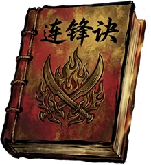

火脉战攻之法，以心火炼锋刃之意，融火势于刀兵之中。

修炼后可领悟**技能：乘胜**

### 【各版本（境界 / 品质）】

筑基·天品：修炼限制 境界：主角**筑基期**及以上；修炼限制 需要：一件筑基期仙品〔火〕法宝；修炼限制 太过简单：主角**结丹期**起再修炼，不再获得修为，只直接领悟其中的技能 / 口诀 / 天赋

### 【获取途径】

筑基期后，修炼悟道+御物+控火后领悟

在玄机阁中有概率刷出

把心境赠送给入魔的修士（筑基期）有概率获得

筑基期时使用机缘探索宗门遗迹有概率获得

---

## 101. 爆炎诀

将火属性灵力高度凝聚后骤然释放，形成炸裂般的毁灭性冲击。

修炼后可领悟**技能：爆袭**

### 【各版本（境界 / 品质）】

筑基·天品：修炼限制 境界：主角**筑基期**及以上；修炼限制 需要：**感悟卡：控火**或**感悟卡：杀意**；修炼限制 太过简单：主角**结丹期**起再修炼，不再获得修为，只直接领悟其中的技能 / 口诀 / 天赋

### 【获取途径】

筑基期后，修炼悟道+御灵+控火后领悟

在玄机阁中有概率刷出

把心境赠送给入魔的修士（筑基期）有概率获得

筑基期时使用机缘探索宗门遗迹有概率获得

---

## 102. 焚霄诀

火系至刚至烈的顶尖攻伐心法，需引地火、融天火、炼心火，三火合一筑就根基。

修炼后可领悟**天赋：真炎道**

### 【各版本（境界 / 品质）】

仙品：修炼限制 境界：主角**结丹期**及以上；修炼限制 条件：在**地火深洞**或**天地熔炉**修炼；修炼限制 太过简单：主角**元婴期**起再修炼，不再获得修为，只直接领悟其中的技能 / 口诀 / 天赋；修炼限制 开局词条「先天道种」：无视以上条件，直接修炼

### 【获取途径】

结丹期后，修炼悟道+释放+心境后领悟

把心境赠送给入魔的修士（结丹期）有概率获得

结丹期时使用机缘探索宗门遗迹有概率获得

---

## 103. 燃神诀

火系禁忌心法，以神识为薪，是舍神识换力量的诡道火系心法。

修炼后可领悟**天赋：神魂锻体**

### 【各版本（境界 / 品质）】

仙品：修炼限制 境界：主角**结丹期**及以上；修炼限制 条件：在**地火深洞**或**天地熔炉**修炼；修炼限制 太过简单：主角**元婴期**起再修炼，不再获得修为，只直接领悟其中的技能 / 口诀 / 天赋；修炼限制 开局词条「先天道种」：无视以上条件，直接修炼

### 【获取途径】

结丹期后，修炼悟道+释放+杀意后领悟

把心境赠送给入魔的修士（结丹期）有概率获得

结丹期时使用机缘探索宗门遗迹有概率获得

---

## 104. 燃魄诀

火系邪异心法，以寿元为薪，是舍身取力的的诡道火系心法。

修炼后可领悟**天赋：太素炼形**

### 【各版本（境界 / 品质）】

仙品：修炼限制 境界：主角**结丹期**及以上；修炼限制 条件：在**地火深洞**或**天地熔炉**修炼；修炼限制 太过简单：主角**元婴期**起再修炼，不再获得修为，只直接领悟其中的技能 / 口诀 / 天赋；修炼限制 开局词条「先天道种」：无视以上条件，直接修炼

### 【获取途径】

结丹期后，修炼悟道+释放+释放后领悟

把心境赠送给入魔的修士（结丹期）有概率获得

结丹期时使用机缘探索宗门遗迹有概率获得

---

## 105. 化龙功

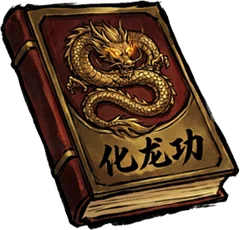

以龙形火意淬炼经脉骨骼，日积月累，肉身蜕变、气血如龙，举手投足皆有龙威

修炼后可领悟**技能：炎龙之力**

### 【各版本（境界 / 品质）】

天品：修炼限制 境界：主角**结丹期**及以上；修炼限制 条件：在**地火深洞**或**天地熔炉**修炼；修炼限制 太过简单：主角**元婴期**起再修炼，不再获得修为，只直接领悟其中的技能 / 口诀 / 天赋；修炼限制 开局词条「先天道种」：无视以上条件，直接修炼

### 【获取途径】

结丹期后，修炼悟道+释放+御物后领悟

把心境赠送给入魔的修士（结丹期）有概率获得

结丹期时使用机缘探索宗门遗迹有概率获得

---

## 106. 炎息心法

以吐纳调息为根基，令呼吸与火意相合，一呼一吸皆带炎气。

修炼后可领悟**天赋：浴火之躯**

### 【各版本（境界 / 品质）】

仙品：修炼限制 境界：主角**结丹期**及以上；修炼限制 条件：在**地火深洞**或**天地熔炉**修炼；修炼限制 太过简单：主角**元婴期**起再修炼，不再获得修为，只直接领悟其中的技能 / 口诀 / 天赋；修炼限制 开局词条「先天道种」：无视以上条件，直接修炼

### 【获取途径】

结丹期后，修炼悟道+释放+御灵后领悟

把心境赠送给入魔的修士（结丹期）有概率获得

结丹期时使用机缘探索宗门遗迹有概率获得

---

## 107. 九死功

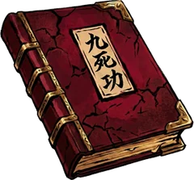

需在生死边缘突破，以焚身之火淬体炼神，死一次，进一层。

修炼后可领悟**技能：浴火雷劫**

### 【各版本（境界 / 品质）】

神品：修炼限制 境界：主角**元婴期**及以上；修炼限制 条件：主角**濒死状态**时才能修炼；修炼限制 开局词条「先天道种」：无视以上条件，直接修炼

### 【获取途径】

元婴期后，修炼悟道+归一+归一/顿悟后可自选

---

## 108. 烬身诀

以自身气血精元为薪柴，换取远超常态的战力。

修炼后可领悟**技能：烬身三式**

### 【各版本（境界 / 品质）】

神品：修炼限制 境界：主角**元婴期**及以上；修炼限制 条件：主角**濒死状态**时才能修炼；修炼限制 开局词条「先天道种」：无视以上条件，直接修炼

### 【获取途径】

元婴期后，修炼悟道+归一+归一/顿悟后可自选

---

## 109. 岩息术

练气阶段土系心法。以吐纳之术吸纳天地间的土灵之气，夯实肉身与灵根根基，掌握土系灵力最基础的凝聚、运转之法。

修炼后可领悟**技能：岩肤体**

### 【各版本（境界 / 品质）】

地品：修炼限制 境界：主角**练气期**及以上；修炼限制 条件：无（放入修炼工作台即可）；修炼限制 太过简单：主角**筑基期**起再修炼，不再获得修为，只直接领悟其中的技能 / 口诀 / 天赋

### 【获取途径】

修炼御土后领悟

在玄机阁中有概率刷出

无名村庄商人有概率出售

把御土赠送给打坐中的修士必定获得

把心境赠送给入魔的修士有概率获得

---

## 110. 金刚拳

记载了一套以守御为核心的拳法体系——遇袭时如何借土系灵力的厚重之性卸力、抗冲击，剖析得细致入微。

修炼后可领悟**技能：反击式**

### 【各版本（境界 / 品质）】

练气·天品：修炼限制 境界：主角**练气期**及以上；修炼限制 需要：一份仙品或神品的〔土〕**材料**（修炼时消耗）；修炼限制 太过简单：主角**筑基期**起再修炼，不再获得修为，只直接领悟其中的技能 / 口诀 / 天赋

### 【获取途径】

修炼悟道+身法有50%概率领悟

修炼悟道+身法+御土后领悟

在玄机阁中有概率刷出

无名村庄商人有概率出售

把身法赠送给打坐中的修士有50%概率获得

把心境赠送给入魔的修士有概率获得

---

## 111. 镇岳诀

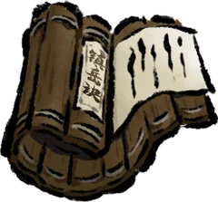

以山为魂，以岳为魄，纳天地浑厚之气，炼筋骨不动之基

修炼后可领悟**技能：嘲讽体**

### 【各版本（境界 / 品质）】

地品：修炼限制 境界：主角**筑基期**及以上；修炼限制 条件：无（放入修炼工作台即可）；修炼限制 太过简单：主角**结丹期**起再修炼，不再获得修为，只直接领悟其中的技能 / 口诀 / 天赋

### 【获取途径】

筑基期后，修炼悟道+御土后领悟

把御物赠送给打坐中的修士有50%概率获得

把心境赠送给入魔的修士（筑基期）有概率获得

在玄机阁中有概率刷出

筑基期时使用机缘探索宗门遗迹有概率获得

筑基期时，修炼悟道有概率获得

---

## 112. 混元破障拳

混沌归一，阴阳交泰，融六合劲力于拳意，破万法桎梏于方寸。

修炼后可领悟**技能：反击式贰**

### 【各版本（境界 / 品质）】

天品：修炼限制 境界：主角**筑基期**及以上；修炼限制 条件：无（放入修炼工作台即可）；修炼限制 太过简单：主角**结丹期**起再修炼，不再获得修为，只直接领悟其中的技能 / 口诀 / 天赋

### 【获取途径】

修炼悟道+御物+身法后领悟

在玄机阁中有概率刷出

把心境赠送给入魔的修士（筑基期）有概率获得

筑基期时使用机缘探索宗门遗迹有概率获得

---

## 113. 不动经

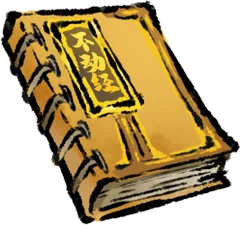

以静制动，以守为攻；心不动则道不动，身不动则万法不侵

修炼后可领悟**天赋：不动如山和口诀：玄甲咒**

### 【各版本（境界 / 品质）】

筑基·神品：修炼限制 境界：主角**筑基期**及以上；修炼限制 条件：无（放入修炼工作台即可）；修炼限制 太过简单：主角**结丹期**起再修炼，不再获得修为，只直接领悟其中的技能 / 口诀 / 天赋

### 【获取途径】

筑基期后，修炼悟道+御物+御物后领悟

在玄机阁中有概率刷出

把心境赠送给入魔的修士（筑基期）有概率获得

筑基期时使用机缘探索宗门遗迹有概率获得

---

## 114. 轮回经

渡轮回之劫，掌因果之秤；以轮回为道，破生死之桎梏

修炼后可领悟**天赋：生死契约**

### 【各版本（境界 / 品质）】

筑基·仙品：修炼限制 境界：主角**筑基期**及以上；修炼限制 条件：无（放入修炼工作台即可）；修炼限制 太过简单：主角**结丹期**起再修炼，不再获得修为，只直接领悟其中的技能 / 口诀 / 天赋

### 【获取途径】

筑基期后，修炼悟道+御物+心境后领悟

在玄机阁中有概率刷出

把心境赠送给入魔的修士（筑基期）有概率获得

筑基期时使用机缘探索宗门遗迹有概率获得

---

## 115. 驭兽决

观万兽习性、融兽灵真意；借万兽之力，证无上大道

修炼后可领悟**天赋：驭兽之道**

### 【各版本（境界 / 品质）】

筑基·仙品：修炼限制 境界：主角**筑基期**及以上；修炼限制 条件：无（放入修炼工作台即可）；修炼限制 太过简单：主角**结丹期**起再修炼，不再获得修为，只直接领悟其中的技能 / 口诀 / 天赋

### 【获取途径】

筑基期后，修炼悟道+御物+御土后领悟

在玄机阁中有概率刷出

把心境赠送给入魔的修士（筑基期）有概率获得

筑基期时使用机缘探索宗门遗迹有概率获得

---

## 116. 鱼龙变

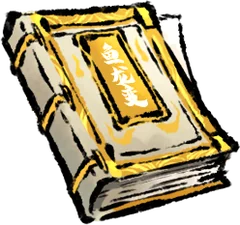

观鱼跃龙门之景、历千劫而化龙，破万法而成圣

修炼后可领悟**天赋：生死契约**

### 【各版本（境界 / 品质）】

筑基·仙品：修炼限制 境界：主角**筑基期**及以上；修炼限制 条件：无（放入修炼工作台即可）；修炼限制 太过简单：主角**结丹期**起再修炼，不再获得修为，只直接领悟其中的技能 / 口诀 / 天赋

### 【获取途径】

筑基期后，修炼悟道+御物+引水后领悟

在玄机阁中有概率刷出

把心境赠送给入魔的修士（筑基期）有概率获得

筑基期时使用机缘探索宗门遗迹有概率获得

---

## 117. 荒古诀

九尾天狐的一缕记忆，曾经记载着它从灵狐开始修炼的一些片段

修炼后可领悟**天赋：远古血脉**

### 【各版本（境界 / 品质）】

筑基·绝品：修炼限制 境界：主角**筑基期**及以上；修炼限制 条件：无（放入修炼工作台即可）；修炼限制 太过简单：主角**结丹期**起再修炼，不再获得修为，只直接领悟其中的技能 / 口诀 / 天赋

### 【获取途径】

完成悦宣儿的四圣兽支线任务获得

---

## 118. 磐石功

以厚重土气淬炼筋骨皮肉。修者肉身坚如顽石，防御强横。

修炼后可领悟**天赋：磐石之躯**

### 【各版本（境界 / 品质）】

筑基·仙品：修炼限制 境界：主角**筑基期**及以上；修炼限制 条件：无（放入修炼工作台即可）；修炼限制 太过简单：主角**结丹期**起再修炼，不再获得修为，只直接领悟其中的技能 / 口诀 / 天赋

### 【获取途径】

筑基期后，修炼悟道+杀意+御土后领悟

在玄机阁中有概率刷出

把心境赠送给入魔的修士（筑基期）有概率获得

筑基期时使用机缘探索宗门遗迹有概率获得

---

## 119. 契兽诀

以神识为引、灵力为媒，与妖兽缔结灵魂契约

修炼后可领悟**天赋：与兽共舞**

### 【各版本（境界 / 品质）】

筑基·仙品：修炼限制 境界：主角**筑基期**及以上；修炼限制 条件：无（放入修炼工作台即可）；修炼限制 太过简单：主角**结丹期**起再修炼，不再获得修为，只直接领悟其中的技能 / 口诀 / 天赋

### 【获取途径】

筑基期后，修炼悟道+杀意+心境后领悟

在玄机阁中有概率刷出

把心境赠送给入魔的修士（筑基期）有概率获得

筑基期时使用机缘探索宗门遗迹有概率获得

---

## 120. 缚龙真法

以法为链，以道为锁；缚龙族为仆，驭万灵为奴

修炼后可领悟**口诀：驭兽决**

### 【各版本（境界 / 品质）】

结丹·绝品：修炼限制 境界：主角**结丹期**及以上；修炼限制 条件：无（放入修炼工作台即可）；修炼限制 太过简单：主角**元婴期**起再修炼，不再获得修为，只直接领悟其中的技能 / 口诀 / 天赋

### 【获取途径】

结丹期后，修炼悟道+承载+顿悟后领悟

---

## 121. 同魂经

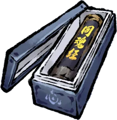

以魂为桥，异体同心；同魂共振，万力归一

修炼后可领悟**天赋：灵愈血契**

### 【各版本（境界 / 品质）】

仙品：修炼限制 境界：主角**结丹期**及以上；修炼限制 条件：无（放入修炼工作台即可）；修炼限制 太过简单：主角**元婴期**起再修炼，不再获得修为，只直接领悟其中的技能 / 口诀 / 天赋

### 【获取途径】

结丹期后，修炼悟道+承载+丹道后领悟

把心境赠送给入魔的修士（结丹期）有概率获得

结丹期时使用机缘探索宗门遗迹有概率获得

---

## 122. 苍壁经

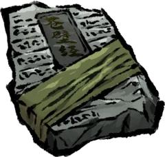

以壁为基，蕴道藏锋；苍冥为盾，玉蕴长生

修炼后可领悟**天赋：载天盾**

### 【各版本（境界 / 品质）】

仙品：修炼限制 境界：主角**结丹期**及以上；修炼限制 条件：无（放入修炼工作台即可）；修炼限制 太过简单：主角**元婴期**起再修炼，不再获得修为，只直接领悟其中的技能 / 口诀 / 天赋

### 【获取途径】

结丹期后，修炼悟道+承载+承载后领悟

把心境赠送给入魔的修士（结丹期）有概率获得

结丹期时使用机缘探索宗门遗迹有概率获得

---

## 123. 分神诀

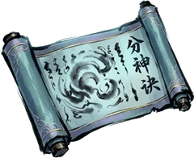

修神之法，以分裂神念为核心，令一份神识化作数份，各司其职。

修炼后可领悟**技能：分神**

### 【各版本（境界 / 品质）】

仙品：修炼限制 境界：主角**结丹期**及以上；修炼限制 条件：无（放入修炼工作台即可）；修炼限制 太过简单：主角**元婴期**起再修炼，不再获得修为，只直接领悟其中的技能 / 口诀 / 天赋

### 【获取途径】

结丹期后，修炼悟道+承载+御灵后领悟

把心境赠送给入魔的修士（结丹期）有概率获得

结丹期时使用机缘探索宗门遗迹有概率获得

---

## 124. 土影诀

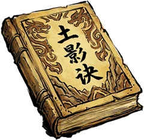

借大地土气凝聚为兽形虚影，随心意攻防。

修炼后可领悟**技能：土影卫**

### 【各版本（境界 / 品质）】

仙品：修炼限制 境界：主角**结丹期**及以上；修炼限制 条件：无（放入修炼工作台即可）；修炼限制 太过简单：主角**元婴期**起再修炼，不再获得修为，只直接领悟其中的技能 / 口诀 / 天赋

### 【获取途径】

结丹期后，修炼悟道+承载+御物后领悟

把心境赠送给入魔的修士（结丹期）有概率获得

结丹期时使用机缘探索宗门遗迹有概率获得

---

## 125. 噬魂秘法

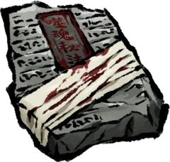

一念绝杀，噬尽三魂七魄为已用，唯余枯骨证道

修炼后可领悟**天赋：噬魂**

### 【各版本（境界 / 品质）】

筑基·神品：修炼限制 境界：主角**筑基期**及以上；修炼限制 条件：无（放入修炼工作台即可）；修炼限制 太过简单：主角**元婴期**起再修炼，不再获得修为，只直接领悟其中的技能 / 口诀 / 天赋；修炼限制 心魔：每轮修炼都会产生心魔「恶」；修炼限制 心魔：每轮修炼都会产生心魔「贪」

### 【获取途径】

可在魔修神秘人处兑换

在玄机阁中有概率刷出

把心境赠送给入魔的修士（筑基期）有概率获得

筑基期时使用机缘探索宗门遗迹有概率获得

---

## 126. 阴姹玄功

以阴阳交泰为枢，采月魄玄阴为媒。

**需要一名异性角色方可修炼此心法**。

此心法为特殊心法，不会因修炼而消失，但每次修炼必定获得心魔：色。

修炼后可领悟**口诀：奴心咒**

### 【各版本（境界 / 品质）】

筑基·神品：修炼限制 境界：主角**筑基期**及以上；修炼限制 需要：**一名异性**角色共同修炼（修炼后对方会**死亡**）；修炼限制 太过简单：主角**元婴期**起再修炼，不再获得修为，只直接领悟其中的技能 / 口诀 / 天赋；修炼限制 心魔：修炼完成时产生心魔「色」

### 【获取途径】

可在魔修神秘人处兑换

在玄机阁中有概率刷出

把心境赠送给入魔的修士（筑基期）有概率获得

筑基期时使用机缘探索宗门遗迹有概率获得

---

## 127. 七杀经

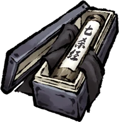

承七杀星宿肃杀之气，以杀伐证道，以血煞通玄

修炼后可领悟**天赋：杀戮证道**

### 【各版本（境界 / 品质）】

筑基·神品：修炼限制 境界：主角**筑基期**及以上；修炼限制 需要：**一名角色**作为祭品；修炼限制 太过简单：主角**元婴期**起再修炼，不再获得修为，只直接领悟其中的技能 / 口诀 / 天赋；修炼限制 心魔：每轮修炼都会产生心魔「恶」

### 【获取途径】

可在魔修神秘人处兑换

在玄机阁中有概率刷出

把心境赠送给入魔的修士（筑基期）有概率获得

筑基期时使用机缘探索宗门遗迹有概率获得

---

## 128. 锁魂术

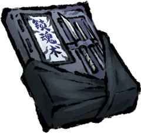

此术暗合幽冥至阴法则，大成时可召鬼将阴兵、驱万魂成阵

修炼后可领悟**天赋：拘魂**

### 【各版本（境界 / 品质）】

筑基·神品：修炼限制 境界：主角**筑基期**及以上；修炼限制 需要：**一具尸体**或**一名活人**；修炼限制 太过简单：主角**元婴期**起再修炼，不再获得修为，只直接领悟其中的技能 / 口诀 / 天赋；修炼限制 心魔：每轮修炼都会产生心魔「邪」

### 【获取途径】

可在魔修神秘人处兑换

在玄机阁中有概率刷出

把心境赠送给入魔的修士（筑基期）有概率获得

筑基期时使用机缘探索宗门遗迹有概率获得

---

## 129. 逆生劫典

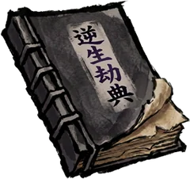

本是用于治疗的灵气，但只需稍稍逆转，便转化成杀人的利器

修炼后可领悟**技能：蚀脉**

### 【各版本（境界 / 品质）】

筑基·神品：修炼限制 境界：主角**筑基期**及以上；修炼限制 需要：一张〔血量〕受损的卡牌；修炼限制 太过简单：主角**结丹期**起再修炼，不再获得修为，只直接领悟其中的技能 / 口诀 / 天赋

### 【获取途径】

筑基期后，修炼悟道+杀意+药理后领悟

在玄机阁中有概率刷出

---

## 130. 夺灵天卷

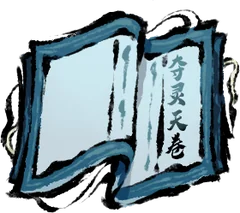

夺天地之造化，侵万物之灵机

修炼后可领悟**天赋：夺灵**

### 【各版本（境界 / 品质）】

结丹·神品：修炼限制 境界：主角**结丹期**及以上；修炼限制 条件：无（放入修炼工作台即可）；修炼限制 太过简单：主角**元婴期**起再修炼，不再获得修为，只直接领悟其中的技能 / 口诀 / 天赋

### 【获取途径】

修炼悟道+包容+杀意后领悟

把心境赠送给入魔的修士（结丹期）有概率获得

结丹期时使用机缘探索宗门遗迹有概率获得

---

## 131. 无障诀

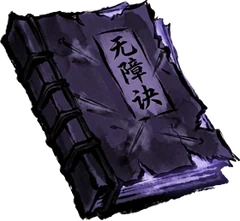

遁行无声无迹，最擅潜行刺探、脱身避战。

修炼后可领悟**技能：暗杀**

### 【各版本（境界 / 品质）】

元婴·神品：修炼限制 境界：主角**元婴期**及以上；修炼限制 需要：**恶名**（积累暗杀经验来证明）

### 【获取途径】

元婴期后，修炼悟道+归一+归一/顿悟后可自选

---

## 132. 七星宝典

引北斗星辰之力淬炼七窍，化周天灵气为本命星灯，点亮一星便可破一层天关，七灯齐燃则与星同寿。

修炼后获得大量修为，且自身灵气值将恢复满。

此卡牌由内测玩家：**星光**设计

### 【各版本（境界 / 品质）】

练气·天品：修炼限制 境界：主角**练气期**及以上；修炼限制 条件：无（放入修炼工作台即可）；修炼限制 太过简单：主角**筑基期**起再修炼，不再获得修为，只直接领悟其中的技能 / 口诀 / 天赋

### 【获取途径】

完成无名村庄村长的任务后，在村长的房子里获得

---

## 133. 观星术

无名人士写就得一夜观星象的方法，也不知道有什么用。

### 【各版本（境界 / 品质）】

筑基·神品：修炼限制 境界：主角**筑基期**及以上；修炼限制 条件：无（放入修炼工作台即可）

### 【获取途径】

在自由模式里，选择词条：观星者后获得

---

## 134. 固本经

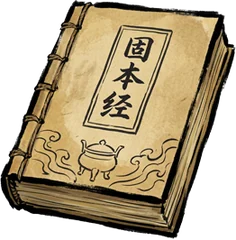

修者修成后，体内自成一套温润气机：一旦脱离战阵、杀意平息，无需刻意运功调息，本源之气便会自行流转

修炼后可领悟**天赋：敛锋蕴气**

### 【各版本（境界 / 品质）】

筑基·仙品：修炼限制 境界：主角**筑基期**及以上；修炼限制 条件：无（放入修炼工作台即可）；修炼限制 太过简单：主角**结丹期**起再修炼，不再获得修为，只直接领悟其中的技能 / 口诀 / 天赋

### 【获取途径】

修炼悟道+丹道+试金后领悟

---

## 135. 调息诀

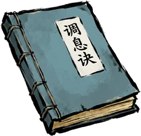

以规整呼吸节奏为引，带动周身灵气循经脉运转。

修炼后可领悟**天赋：回春圣体**

### 【各版本（境界 / 品质）】

筑基·仙品：修炼限制 境界：主角**筑基期**及以上；修炼限制 条件：无（放入修炼工作台即可）

### 【获取途径】

修炼悟道+丹道+身法后领悟

---

## 136. 炼元宝鉴

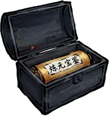

修练者可借自身元力炼化材料杂质，大幅提升天材地宝的灵气利用率

修炼后可领悟**天赋：灵犀巧手**

### 【各版本（境界 / 品质）】

筑基·神品：修炼限制 境界：主角**筑基期**及以上；修炼限制 条件：无（放入修炼工作台即可）；修炼限制 太过简单：主角**结丹期**起再修炼，不再获得修为，只直接领悟其中的技能 / 口诀 / 天赋

### 【获取途径】

修炼悟道+丹道+剑芒后领悟

---

## 137. 天衍诀

以身为器，以神为筹，推演万物，穷究天机。窃一线生机，衍无尽可能。

修炼后可领悟**天赋：窥天机**

### 【各版本（境界 / 品质）】

结丹·绝品：修炼限制 境界：主角**结丹期**及以上；修炼限制 条件：无（放入修炼工作台即可）；修炼限制 太过简单：主角**元婴期**起再修炼，不再获得修为，只直接领悟其中的技能 / 口诀 / 天赋

### 【获取途径】

完成镇妖塔的萧清钰任务后获得

---

## 138. 炼心诀

为辅助类顶尖心法，取心定如磐、神魂无尘为道基，是专攻心境淬炼的正统秘法，与直接攻伐的功法截然不同，素有“炼心千劫，道心不灭”的美名。

修炼后可领悟**天赋：天窍**

### 【各版本（境界 / 品质）】

结丹·神品：修炼限制 境界：主角**结丹期**及以上；修炼限制 条件：无（放入修炼工作台即可）；修炼限制 太过简单：主角**元婴期**起再修炼，不再获得修为，只直接领悟其中的技能 / 口诀 / 天赋

### 【获取途径】

结丹期后，修炼悟道+释放+顿悟后领悟

---

## 139. 敛神术

神魂类顶尖心法，取敛神归窍、神魂如渊为道基，是融隐匿、防御、修神于一体的特殊秘法，素有"敛神一出，万识皆盲"的盛名。

修炼后可领悟**天赋：洞虚灵眸**

### 【各版本（境界 / 品质）】

结丹·绝品：修炼限制 境界：主角**结丹期**及以上；修炼限制 条件：无（放入修炼工作台即可）

### 【获取途径】

结丹期后，修炼悟道+凝聚+心境后领悟

---

## 140. 归元宝鉴

修者以神念为引、自身灵气为媒，可探入法宝肌理，弥合器身裂痕、重续断裂灵脉、补全缺损禁制。

修炼后可领悟**口诀：还灵咒**

### 【各版本（境界 / 品质）】

结丹·天品：修炼限制 境界：主角**结丹期**及以上；修炼限制 条件：无（放入修炼工作台即可）；修炼限制 太过简单：主角**元婴期**起再修炼，不再获得修为，只直接领悟其中的技能 / 口诀 / 天赋

### 【获取途径】

修炼悟道+包容+剑意后领悟

---

## 141. 天工经

为器修一脉的正统顶尖心法，取天工造物、器灵共生为道基，是融炼器、御器、融器于一体的特殊秘法，素有“天工一出，万器通灵”的盛誉。

修炼后可领悟**天赋：兵甲通玄**

### 【各版本（境界 / 品质）】

结丹·神品：修炼限制 境界：主角**结丹期**及以上；修炼限制 条件：无（放入修炼工作台即可）；修炼限制 太过简单：主角**元婴期**起再修炼，不再获得修为，只直接领悟其中的技能 / 口诀 / 天赋

### 【获取途径】

结丹期后，修炼悟道+凝聚+御物后领悟

---
