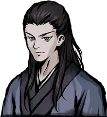

# 【卡牌修仙传】图鉴攻略 — 卡牌 / 魂体

- 收录总数：25（游戏官方数据，其中图鉴未收录 25 条）
- 更新时间：2026-11-20 22:37

---

## 1. 玄剑阁弟子（图鉴未收录）

本身已无灵识，仅是修士生前的一丝执念，所以可任由我驱使。

### 【各境界技能与数值】

攻击 / 血量（「a～b」= 在这个范围里随机），男女一样

数值 | 体验难度 | 正常难度 | 挑战难度 | 真仙难度

〔攻击〕 | 4~6 | 4~7 | 4~7 | 4~7

〔血量〕 | 6~10 | 6~13 | 6~13 | 6~14

随机带其中一个技能（概率相同） | 这个境界的效果

玄剑·攻势(初) | 己方的剑在攻击前，〔攻击〕+1

玄剑·备势(初) | 战斗开始时，使自己的剑〔攻击〕和〔血量〕+1

玄剑·档势(初) | 战斗开始时，使自己随机一把剑获得光盾

玄剑·先发势 | 战斗开始时，使自己的一把剑先攻击一次

浴血战意(初) | 自己受到伤害时，使自己的一把剑的〔攻击〕和〔血量〕+1

破釜战意(初) | 自己的剑被摧毁时，使自己的〔攻击〕+1；〔血量〕+2

攻击 / 血量（「a～b」= 在这个范围里随机），男女一样

数值 | 体验难度 | 正常难度 | 挑战难度 | 真仙难度

〔攻击〕 | 6~8 | 6~10 | 6~10 | 6~11

〔血量〕 | 10~16 | 10~20 | 10~20 | 10~22

随机带其中一个技能（概率相同） | 这个境界的效果

玄剑·攻势(初) | 己方的剑在攻击前，〔攻击〕+1

玄剑·备势(初) | 战斗开始时，使自己的剑〔攻击〕和〔血量〕+1

玄剑·档势(初) | 战斗开始时，使自己随机一把剑获得光盾

玄剑·先发势 | 战斗开始时，使自己的一把剑先攻击一次

浴血战意(初) | 自己受到伤害时，使自己的一把剑的〔攻击〕和〔血量〕+1

破釜战意(初) | 自己的剑被摧毁时，使自己的〔攻击〕+1；〔血量〕+2

攻击 / 血量（「a～b」= 在这个范围里随机），男女一样

数值 | 体验难度 | 正常难度 | 挑战难度 | 真仙难度

〔攻击〕 | 7~11 | 7~13 | 7~13 | 7~14

〔血量〕 | 13~19 | 13~24 | 13~24 | 13~26

| 随机带其中一组技能（每组概率相同）

1 | 玄剑·攻势(初)

2 | 玄剑·备势(初)

3 | 玄剑·档势(初)

4 | 玄剑·先发势

5 | 浴血战意(初)

6 | 破釜战意(初)

7 | 玄剑·备势(初) ＋ 玄剑·档势(初)

8 | 玄剑·档势(初) ＋ 玄剑·爆发势(初)

9 | 浴血战意(初) ＋ 破釜战意(初)

10 | 玄剑·先发势 ＋ 玄剑·攻势(初) ＋ 玄剑·备势(初)

11 | 玄剑·备势(初) ＋ 玄剑·档势(初) ＋ 玄剑·爆发势(初)

技能 | 这个境界的效果

玄剑·攻势(初) | 己方的剑在攻击前，〔攻击〕+1

玄剑·备势(初) | 战斗开始时，使自己的剑〔攻击〕和〔血量〕+1

玄剑·档势(初) | 战斗开始时，使自己随机一把剑获得光盾

玄剑·先发势 | 战斗开始时，使自己的一把剑先攻击一次

浴血战意(初) | 自己受到伤害时，使自己的一把剑的〔攻击〕和〔血量〕+1

破釜战意(初) | 自己的剑被摧毁时，使自己的〔攻击〕+1；〔血量〕+2

玄剑·爆发势(初) | 战斗开始时，使自己的一把剑获得3增伤（一次性）

攻击 / 血量（「a～b」= 在这个范围里随机），男女一样

数值 | 体验难度 | 正常难度 | 挑战难度 | 真仙难度

〔攻击〕 | 14~22 | 14~26 | 14~26 | 14~27

〔血量〕 | 26~40 | 26~50 | 26~50 | 26~55

随机带其中一个技能（概率相同） | 这个境界的效果

玄剑·攻势(初) | 己方的剑在攻击前，〔攻击〕+3

玄剑·备势(初) | 战斗开始时，使自己的剑〔攻击〕和〔血量〕+2

玄剑·档势(初) | 战斗开始时，使自己随机一把剑获得光盾

玄剑·先发势 | 战斗开始时，使自己的一把剑先攻击一次

浴血战意(初) | 自己受到伤害时，使自己的一把剑的〔攻击〕和〔血量〕+2

破釜战意(初) | 自己的剑被摧毁时，使自己的〔攻击〕+3；〔血量〕+5

攻击 / 血量（「a～b」= 在这个范围里随机），男女一样

数值 | 体验难度 | 正常难度 | 挑战难度 | 真仙难度

〔攻击〕 | 17~25 | 17~30 | 17~30 | 17~32

〔血量〕 | 31~47 | 31~59 | 31~59 | 31~65

| 随机带其中一组技能（每组概率相同）

1 | 玄剑·攻势(初)

2 | 玄剑·备势(初)

3 | 玄剑·档势(初)

4 | 玄剑·先发势

5 | 浴血战意(初)

6 | 破釜战意(初)

7 | 玄剑·备势(初) ＋ 玄剑·档势(初)

8 | 玄剑·档势(初) ＋ 玄剑·爆发势(初)

9 | 浴血战意(初) ＋ 破釜战意(初)

10 | 玄剑·备势(初) ＋ 浴血战意(初)

技能 | 这个境界的效果

玄剑·攻势(初) | 己方的剑在攻击前，〔攻击〕+3

玄剑·备势(初) | 战斗开始时，使自己的剑〔攻击〕和〔血量〕+2

玄剑·档势(初) | 战斗开始时，使自己随机一把剑获得光盾

玄剑·先发势 | 战斗开始时，使自己的一把剑先攻击一次

浴血战意(初) | 自己受到伤害时，使自己的一把剑的〔攻击〕和〔血量〕+2

破釜战意(初) | 自己的剑被摧毁时，使自己的〔攻击〕+3；〔血量〕+5

玄剑·爆发势(初) | 战斗开始时，使自己的一把剑获得9增伤（一次性）

攻击 / 血量（「a～b」= 在这个范围里随机），男女一样

数值 | 体验难度 | 正常难度 | 挑战难度 | 真仙难度

〔攻击〕 | 19~29 | 19~35 | 19~35 | 19~37

〔血量〕 | 36~54 | 36~68 | 36~68 | 36~75

| 随机带其中一组技能（每组概率相同）

1 | 玄剑·备势(初) ＋ 玄剑·档势(初)

2 | 玄剑·档势(初) ＋ 玄剑·爆发势(初)

3 | 浴血战意(初) ＋ 破釜战意(初)

4 | 玄剑·备势(初) ＋ 浴血战意(初)

5 | 玄剑·先发势 ＋ 玄剑·攻势(初) ＋ 玄剑·备势(初)

6 | 玄剑·备势(初) ＋ 玄剑·档势(初) ＋ 玄剑·爆发势(初)

技能 | 这个境界的效果

玄剑·备势(初) | 战斗开始时，使自己的剑〔攻击〕和〔血量〕+2

玄剑·档势(初) | 战斗开始时，使自己随机一把剑获得光盾

玄剑·爆发势(初) | 战斗开始时，使自己的一把剑获得9增伤（一次性）

浴血战意(初) | 自己受到伤害时，使自己的一把剑的〔攻击〕和〔血量〕+2

破釜战意(初) | 自己的剑被摧毁时，使自己的〔攻击〕+3；〔血量〕+5

玄剑·先发势 | 战斗开始时，使自己的一把剑先攻击一次

玄剑·攻势(初) | 己方的剑在攻击前，〔攻击〕+3

### 【获取途径】

修炼〈七杀经〉领悟天赋〈杀戮〉后，击杀「玄剑阁弟子」时获得它的魂体卡（保留生前的属性、技能，但不保留生前的法宝 / 灵兽 / 傀儡）

修炼〈锁魂术〉领悟天赋〈拘魂〉后，把「玄剑阁弟子」放进炼制工作台「炼化修士」，炼成魂体（实力比生前更强，但要承受杀人的因果）

在资源点「聚魂」放入〈聚魂台〉（消耗 5 年寿命），随机得到一个当前境界的〔金〕属性魂体，可能是它（练气、筑基期）

筑基期：击败妖王「坟蛊鸪」/「黑焰虎」/「青翼蝠王」有概率掉落一张同境界的随机魂体，可能是它

---

## 2. 玄剑阁高手（图鉴未收录）

本身已无灵识，仅是修士生前的一丝执念，所以可任由我驱使。

### 【各境界技能与数值】

攻击 / 血量（「a～b」= 在这个范围里随机），男女一样

数值 | 体验难度 | 正常难度 | 挑战难度 | 真仙难度

〔攻击〕 | 10~14 | 10~17 | 10~17 | 10~18

〔血量〕 | 17~25 | 17~31 | 17~31 | 17~34

| 随机带其中一组技能（每组概率相同）

1 | 玄剑·备势(中) ＋ 玄剑·档势(中)

2 | 玄剑·档势(中) ＋ 玄剑·爆发势(中)

3 | 浴血战意(中) ＋ 破釜战意(中)

4 | 玄剑·备势(中) ＋ 浴血战意(中)

技能 | 这个境界的效果

玄剑·备势(中) | 战斗开始时，使自己的剑〔攻击〕和〔血量〕+1

玄剑·档势(中) | 战斗开始时，使自己随机两把剑获得光盾

玄剑·爆发势(中) | 战斗开始时，使自己的一把剑获得3增伤（一次性）

浴血战意(中) | 自己受到伤害时，使自己的两把剑的〔攻击〕和〔血量〕+1

破釜战意(中) | 自己的剑被摧毁时，使自己的〔攻击〕+2；〔血量〕+4

攻击 / 血量（「a～b」= 在这个范围里随机），男女一样

数值 | 体验难度 | 正常难度 | 挑战难度 | 真仙难度

〔攻击〕 | 26~38 | 26~46 | 26~46 | 26~48

〔血量〕 | 47~71 | 47~89 | 47~89 | 47~98

| 随机带其中一组技能（每组概率相同）

1 | 玄剑·备势(中) ＋ 玄剑·档势(中)

2 | 玄剑·档势(中) ＋ 玄剑·爆发势(中)

3 | 浴血战意(中) ＋ 破釜战意(中)

4 | 玄剑·备势(中) ＋ 浴血战意(中)

5 | 玄剑·先发势 ＋ 玄剑·攻势(中) ＋ 玄剑·备势(中)

6 | 玄剑·备势(中) ＋ 玄剑·档势(中) ＋ 玄剑·爆发势(中)

技能 | 这个境界的效果

玄剑·备势(中) | 战斗开始时，使自己的剑〔攻击〕和〔血量〕+4

玄剑·档势(中) | 战斗开始时，使自己随机两把剑获得光盾

玄剑·爆发势(中) | 战斗开始时，使自己的一把剑获得9增伤（一次性）

浴血战意(中) | 自己受到伤害时，使自己的两把剑的〔攻击〕和〔血量〕+2

破釜战意(中) | 自己的剑被摧毁时，使自己的〔攻击〕+5；〔血量〕+10

玄剑·先发势 | 战斗开始时，使自己的一把剑先攻击一次

玄剑·攻势(中) | 己方的剑在攻击前，〔攻击〕和〔血量〕+3

攻击 / 血量（「a～b」= 在这个范围里随机），男女一样

数值 | 体验难度 | 正常难度 | 挑战难度 | 真仙难度

〔攻击〕 | 38~58 | 38~70 | 38~70 | 38~74

〔血量〕 | 100~150 | 100~188 | 100~188 | 100~207

| 随机带其中一组技能（每组概率相同）

1 | 玄剑·备势(初) ＋ 玄剑·档势(初)

2 | 玄剑·档势(初) ＋ 玄剑·爆发势(初)

3 | 浴血战意(初) ＋ 破釜战意(初)

4 | 玄剑·备势(初) ＋ 浴血战意(初)

5 | 玄剑·先发势 ＋ 玄剑·攻势(初) ＋ 玄剑·备势(初)

6 | 玄剑·备势(初) ＋ 玄剑·档势(初) ＋ 玄剑·爆发势(初)

技能 | 这个境界的效果

玄剑·备势(初) | 战斗开始时，使自己的剑〔攻击〕和〔血量〕+5

玄剑·档势(初) | 战斗开始时，使自己随机一把剑获得光盾

玄剑·爆发势(初) | 战斗开始时，使自己的一把剑获得25增伤（一次性）

浴血战意(初) | 自己受到伤害时，使自己的一把剑的〔攻击〕和〔血量〕+5

破釜战意(初) | 自己的剑被摧毁时，使自己的〔攻击〕+7；〔血量〕+14

玄剑·先发势 | 战斗开始时，使自己的一把剑先攻击一次

玄剑·攻势(初) | 己方的剑在攻击前，〔攻击〕+5

攻击 / 血量（「a～b」= 在这个范围里随机），男女一样

数值 | 体验难度 | 正常难度 | 挑战难度 | 真仙难度

〔攻击〕 | 54~80 | 54~96 | 54~96 | 54~101

〔血量〕 | 155~233 | 155~291 | 155~291 | 155~320

| 随机带其中一组技能（每组概率相同）

1 | 玄剑·备势(初) ＋ 玄剑·档势(初)

2 | 玄剑·档势(初) ＋ 玄剑·爆发势(初)

3 | 浴血战意(初) ＋ 破釜战意(初)

4 | 玄剑·备势(初) ＋ 浴血战意(初)

5 | 玄剑·先发势 ＋ 玄剑·攻势(初) ＋ 玄剑·备势(初)

6 | 玄剑·备势(初) ＋ 玄剑·档势(初) ＋ 玄剑·爆发势(初)

技能 | 这个境界的效果

玄剑·备势(初) | 战斗开始时，使自己的剑〔攻击〕和〔血量〕+5

玄剑·档势(初) | 战斗开始时，使自己随机一把剑获得光盾

玄剑·爆发势(初) | 战斗开始时，使自己的一把剑获得25增伤（一次性）

浴血战意(初) | 自己受到伤害时，使自己的一把剑的〔攻击〕和〔血量〕+5

破釜战意(初) | 自己的剑被摧毁时，使自己的〔攻击〕+7；〔血量〕+14

玄剑·先发势 | 战斗开始时，使自己的一把剑先攻击一次

玄剑·攻势(初) | 己方的剑在攻击前，〔攻击〕+5

### 【获取途径】

修炼〈七杀经〉领悟天赋〈杀戮〉后，击杀「玄剑阁高手」时获得它的魂体卡（保留生前的属性、技能，但不保留生前的法宝 / 灵兽 / 傀儡）

修炼〈锁魂术〉领悟天赋〈拘魂〉后，把「玄剑阁高手」放进炼制工作台「炼化修士」，炼成魂体（实力比生前更强，但要承受杀人的因果）

在资源点「聚魂」放入〈聚魂台〉（消耗 5 年寿命），随机得到一个当前境界的〔金〕属性魂体，可能是它（练气、筑基、结丹期）

筑基～结丹期：击败妖王「坟蛊鸪」/「黑焰虎」/「青翼蝠王」有概率掉落一张同境界的随机魂体，可能是它

结丹期：击败妖王「九幽骨魅」有概率掉落一张同境界的随机魂体，可能是它

---

## 3. 玄剑阁精英（图鉴未收录）

本身已无灵识，仅是修士生前的一丝执念，所以可任由我驱使。

### 【各境界技能与数值】

攻击 / 血量（「a～b」= 在这个范围里随机）

数值 | 体验难度 | 正常难度 | 挑战难度 | 真仙难度

〔攻击〕 | 70~106 | 70~127 | 70~127 | 70~133

〔血量〕 | 186~280 | 186~350 | 186~350 | 186~385

| 随机带其中一组技能（每组概率相同）

1 | 玄剑·备势(中) ＋ 玄剑·档势(中)

2 | 玄剑·档势(中) ＋ 玄剑·爆发势(中)

3 | 浴血战意(中) ＋ 破釜战意(中)

4 | 玄剑·备势(中) ＋ 浴血战意(中)

5 | 玄剑·先发势 ＋ 玄剑·攻势(中) ＋ 玄剑·备势(中)

6 | 玄剑·备势(中) ＋ 玄剑·档势(中) ＋ 玄剑·爆发势(中)

技能 | 这个境界的效果

玄剑·备势(中) | 战斗开始时，使自己的剑〔攻击〕和〔血量〕+10

玄剑·档势(中) | 战斗开始时，使自己随机两把剑获得光盾

玄剑·爆发势(中) | 战斗开始时，使自己的一把剑获得25增伤（一次性）

浴血战意(中) | 自己受到伤害时，使自己的两把剑的〔攻击〕和〔血量〕+5

破釜战意(中) | 自己的剑被摧毁时，使自己的〔攻击〕+14；〔血量〕+29

玄剑·先发势 | 战斗开始时，使自己的一把剑先攻击一次

玄剑·攻势(中) | 己方的剑在攻击前，〔攻击〕和〔血量〕+5

攻击 / 血量（「a～b」= 在这个范围里随机）

数值 | 体验难度 | 正常难度 | 挑战难度 | 真仙难度

〔攻击〕 | 193~289 | 193~347 | 193~347 | 193~364

〔血量〕 | 582~874 | 582~1093 | 582~1093 | 582~1202

| 随机带其中一组技能（每组概率相同）

1 | 玄剑·备势(中) ＋ 玄剑·档势(中)

2 | 玄剑·档势(中) ＋ 玄剑·爆发势(中)

3 | 浴血战意(中) ＋ 破釜战意(中)

4 | 玄剑·备势(中) ＋ 浴血战意(中)

5 | 玄剑·先发势 ＋ 玄剑·攻势(中) ＋ 玄剑·备势(中)

6 | 玄剑·备势(中) ＋ 玄剑·档势(中) ＋ 玄剑·爆发势(中)

技能 | 这个境界的效果

玄剑·备势(中) | 战斗开始时，使自己的剑〔攻击〕和〔血量〕+27

玄剑·档势(中) | 战斗开始时，使自己随机两把剑获得光盾

玄剑·爆发势(中) | 战斗开始时，使自己的一把剑获得67增伤（一次性）

浴血战意(中) | 自己受到伤害时，使自己的两把剑的〔攻击〕和〔血量〕+12

破釜战意(中) | 自己的剑被摧毁时，使自己的〔攻击〕+40；〔血量〕+77

玄剑·先发势 | 战斗开始时，使自己的一把剑先攻击一次

玄剑·攻势(中) | 己方的剑在攻击前，〔攻击〕和〔血量〕+10

### 【获取途径】

修炼〈七杀经〉领悟天赋〈杀戮〉后，击杀「玄剑阁精英」时获得它的魂体卡（保留生前的属性、技能，但不保留生前的法宝 / 灵兽 / 傀儡）

修炼〈锁魂术〉领悟天赋〈拘魂〉后，把「玄剑阁精英」放进炼制工作台「炼化修士」，炼成魂体（实力比生前更强，但要承受杀人的因果）

在资源点「聚魂」放入〈聚魂台〉（消耗 5 年寿命），随机得到一个当前境界的〔阴〕属性魂体，可能是它（结丹、元婴期）

元婴期：击败「玄剑阁精英」必定掉落

结丹～元婴期：击败妖王「坟蛊鸪」/「黑焰虎」/「青翼蝠王」/「九幽骨魅」有概率掉落一张同境界的随机魂体，可能是它

---

## 4. 玄剑阁护法（图鉴未收录）

本身已无灵识，仅是修士生前的一丝执念，所以可任由我驱使。

### 【各境界技能与数值】

攻击 / 血量（「a～b」= 在这个范围里随机），男女一样

数值 | 体验难度 | 正常难度 | 挑战难度 | 真仙难度

〔攻击〕 | 141~211 | 141~253 | 141~253 | 141~266

〔血量〕 | 373~559 | 373~699 | 373~699 | 373~769

| 随机带其中一组技能（每组概率相同）

1 | 剑术精通(天赋) ＋ 玄剑·先发势 ＋ 瞬影双闪

2 | 剑术精通(天赋) ＋ 玄剑·爆发势(中) ＋ 瞬影双闪

3 | 剑术精通(天赋) ＋ 玄剑·先发势 ＋ 玄剑·爆发势(中)

4 | 御剑无锋(天赋) ＋ 玄剑·先发势 ＋ 瞬影双闪

5 | 御剑无锋(天赋) ＋ 玄剑·爆发势(中) ＋ 瞬影双闪

6 | 御剑无锋(天赋) ＋ 玄剑·先发势 ＋ 玄剑·爆发势(中)

7 | 御剑无锋(天赋) ＋ 玄剑·档势(中) ＋ 玄剑·聚光(高)

8 | 御剑无锋(天赋) ＋ 浴血战意(高) ＋ 破釜战意(高)

9 | 剑气四射(天赋) ＋ 玄剑·先发势 ＋ 瞬影双闪

10 | 剑气四射(天赋) ＋ 玄剑·爆发势(中) ＋ 瞬影双闪

11 | 剑气四射(天赋) ＋ 玄剑·先发势 ＋ 玄剑·爆发势(中)

12 | 辉刃诀(天赋) ＋ 玄剑·档势(中) ＋ 玄剑·聚光(高)

13 | 辉刃诀(天赋) ＋ 浴血战意(高) ＋ 破釜战意(高)

14 | 唤剑术(天赋) ＋ 浴血战意(高) ＋ 破釜战意(高)

15 | 唤剑术(天赋) ＋ 御剑无锋(天赋) ＋ 破釜战意(高)

16 | 唤剑术(天赋) ＋ 血戮剑意 ＋ 破釜战意(高)

17 | 唤剑术(天赋) ＋ 噬魂剑意 ＋ 破釜战意(高)

技能 | 这个境界的效果

剑术精通(天赋) | 自己的剑攻击前，〔攻击〕+36；〔血量〕+75

玄剑·先发势 | 战斗开始时，使自己的一把剑先攻击一次

瞬影双闪 | 每回合，使自己的随机一把剑攻击3次

玄剑·爆发势(中) | 战斗开始时，使自己的一把剑获得67增伤（一次性）

御剑无锋(天赋) | 自己的剑攻击后，使目标获得12**易伤**

玄剑·档势(中) | 战斗开始时，使自己随机两把剑获得光盾

玄剑·聚光(高) | 当自己的剑失去**光盾**时，使它再次获得；（每回合只触发两次）

浴血战意(高) | 自己受到伤害时，使自己的两把剑的〔攻击〕和〔血量〕+25

破釜战意(高) | 自己的剑被摧毁时，使自己的〔攻击〕+67；〔血量〕+129

剑气四射(天赋) | 自己的剑攻击前，先对目标造成35〔伤害〕

辉刃诀(天赋) | 前5回合，每回合使自己一把随机的剑获得**光盾**

唤剑术(天赋) | 前5回合，每回合随机召唤一把剑

血戮剑意 | 战斗开始时，给自己所有的剑附加吸血效果（30%）

噬魂剑意 | 友方所有剑均具有噬魂能力（造成伤害后，吸收攻击力到自身）

攻击 / 血量（「a～b」= 在这个范围里随机），男女一样

数值 | 体验难度 | 正常难度 | 挑战难度 | 真仙难度

〔攻击〕 | 193~289 | 193~347 | 193~347 | 193~364

〔血量〕 | 582~874 | 582~1093 | 582~1093 | 582~1202

| 随机带其中一组技能（每组概率相同）

1 | 剑术精通(天赋) ＋ 玄剑·先发势 ＋ 瞬影双闪

2 | 剑术精通(天赋) ＋ 玄剑·爆发势(中) ＋ 瞬影双闪

3 | 剑术精通(天赋) ＋ 玄剑·先发势 ＋ 玄剑·爆发势(中)

4 | 御剑无锋(天赋) ＋ 玄剑·先发势 ＋ 瞬影双闪

5 | 御剑无锋(天赋) ＋ 玄剑·爆发势(中) ＋ 瞬影双闪

6 | 御剑无锋(天赋) ＋ 玄剑·先发势 ＋ 玄剑·爆发势(中)

7 | 御剑无锋(天赋) ＋ 玄剑·档势(中) ＋ 玄剑·聚光(高)

8 | 御剑无锋(天赋) ＋ 浴血战意(高) ＋ 破釜战意(高)

9 | 剑气四射(天赋) ＋ 玄剑·先发势 ＋ 瞬影双闪

10 | 剑气四射(天赋) ＋ 玄剑·爆发势(中) ＋ 瞬影双闪

11 | 剑气四射(天赋) ＋ 玄剑·先发势 ＋ 玄剑·爆发势(中)

12 | 辉刃诀(天赋) ＋ 玄剑·档势(中) ＋ 玄剑·聚光(高)

13 | 辉刃诀(天赋) ＋ 浴血战意(高) ＋ 破釜战意(高)

14 | 唤剑术(天赋) ＋ 浴血战意(高) ＋ 破釜战意(高)

15 | 唤剑术(天赋) ＋ 御剑无锋(天赋) ＋ 破釜战意(高)

16 | 唤剑术(天赋) ＋ 血戮剑意 ＋ 破釜战意(高)

17 | 唤剑术(天赋) ＋ 噬魂剑意 ＋ 破釜战意(高)

技能 | 这个境界的效果

剑术精通(天赋) | 自己的剑攻击前，〔攻击〕+36；〔血量〕+75

玄剑·先发势 | 战斗开始时，使自己的一把剑先攻击一次

瞬影双闪 | 每回合，使自己的随机一把剑攻击3次

玄剑·爆发势(中) | 战斗开始时，使自己的一把剑获得67增伤（一次性）

御剑无锋(天赋) | 自己的剑攻击后，使目标获得12**易伤**

玄剑·档势(中) | 战斗开始时，使自己随机两把剑获得光盾

玄剑·聚光(高) | 当自己的剑失去**光盾**时，使它再次获得；（每回合只触发两次）

浴血战意(高) | 自己受到伤害时，使自己的两把剑的〔攻击〕和〔血量〕+25

破釜战意(高) | 自己的剑被摧毁时，使自己的〔攻击〕+67；〔血量〕+129

剑气四射(天赋) | 自己的剑攻击前，先对目标造成35〔伤害〕

辉刃诀(天赋) | 前5回合，每回合使自己一把随机的剑获得**光盾**

唤剑术(天赋) | 前5回合，每回合随机召唤一把剑

血戮剑意 | 战斗开始时，给自己所有的剑附加吸血效果（30%）

噬魂剑意 | 友方所有剑均具有噬魂能力（造成伤害后，吸收攻击力到自身）

### 【护法的元婴】

第 1 步：击败元婴期的「玄剑阁护法」：战场上会留下「玄剑阁护法元婴」（60 日后消失）

第 2 步：把主角或神识拖到「玄剑阁护法元婴」上（「我把元婴拘拿」）→ 得到「玄剑阁护法元婴」卡

用途：把「玄剑阁护法元婴」交给〈古碑龟〉→ 古碑龟化成人形「石铭」

### 【获取途径】

修炼〈七杀经〉领悟天赋〈杀戮〉后，击杀「玄剑阁护法」时获得它的魂体卡（保留生前的属性、技能，但不保留生前的法宝 / 灵兽 / 傀儡）

修炼〈锁魂术〉领悟天赋〈拘魂〉后，把「玄剑阁护法」放进炼制工作台「炼化修士」，炼成魂体（实力比生前更强，但要承受杀人的因果）

在资源点「聚魂」放入〈聚魂台〉（消耗 5 年寿命），随机得到一个当前境界的〔金〕属性魂体，可能是它（元婴期）

【秘境】鬼市的「集市」：有 50% 概率出售五大宗门的护法魂体

元婴期：击败妖王「坟蛊鸪」/「黑焰虎」/「青翼蝠王」/「九幽骨魅」有概率掉落一张同境界的随机魂体，可能是它

---

## 5. 清虚谷弟子（图鉴未收录）

本身已无灵识，仅是修士生前的一丝执念，所以可任由我驱使。

### 【各境界技能与数值】

攻击 / 血量（「a～b」= 在这个范围里随机），男女一样

数值 | 体验难度 | 正常难度 | 挑战难度 | 真仙难度

〔攻击〕 | 2~4 | 2~5 | 2~5 | 2~5

〔血量〕 | 8~12 | 8~15 | 8~15 | 8~17

随机带其中一个技能（概率相同） | 这个境界的效果

丹术·毒心(初) | 每回合开始时，使随机敌方卡牌获得中毒

丹术·黄泉(初) | 当友方木属性卡牌被摧毁时，对随机敌人造成2点伤害

唤木咒(初) | 每次攻击后，召唤一张花妖卡

唤木咒贰(初) | 战斗开始时，召唤两张花妖卡

化生咒(初) | 回合结束时，为血量最少友方单位恢复4血量，超过的恢复额会转为护甲。

丹术·封魔(初) | 回合开始时，使随机一名敌人的技能本回合无效

丹术·禁锢(初) | 战斗开始时，禁锢一名随机敌人

攻击 / 血量（「a～b」= 在这个范围里随机），男女一样

数值 | 体验难度 | 正常难度 | 挑战难度 | 真仙难度

〔攻击〕 | 3~5 | 3~6 | 3~6 | 3~6

〔血量〕 | 12~18 | 12~23 | 12~23 | 12~25

随机带其中一个技能（概率相同） | 这个境界的效果

丹术·毒心(初) | 每回合开始时，使随机敌方卡牌获得中毒

丹术·黄泉(初) | 当友方木属性卡牌被摧毁时，对随机敌人造成2点伤害

唤木咒(初) | 每次攻击后，召唤一张花妖卡

唤木咒贰(初) | 战斗开始时，召唤两张花妖卡

化生咒(初) | 回合结束时，为血量最少友方单位恢复4血量，超过的恢复额会转为护甲。

丹术·封魔(初) | 回合开始时，使随机一名敌人的技能本回合无效

丹术·禁锢(初) | 战斗开始时，禁锢一名随机敌人

攻击 / 血量（「a～b」= 在这个范围里随机），男女一样

数值 | 体验难度 | 正常难度 | 挑战难度 | 真仙难度

〔攻击〕 | 4~6 | 4~7 | 4~7 | 4~7

〔血量〕 | 16~24 | 16~30 | 16~30 | 16~33

| 随机带其中一组技能（每组概率相同）

1 | 丹术·毒心(初)

2 | 丹术·黄泉(初)

3 | 唤木咒(初)

4 | 唤木咒贰(初)

5 | 化生咒(初)

6 | 丹术·封魔(初)

7 | 丹术·禁锢(初)

8 | 丹术·黄泉(初) ＋ 唤木咒(初)

9 | 丹术·黄泉(初) ＋ 唤木咒贰(初)

10 | 丹术·封魔(初) ＋ 丹术·禁锢(初)

11 | 丹术·毒心(初) ＋ 丹术·禁锢(初)

12 | 唤木咒(初) ＋ 连根咒(初) ＋ 丹术·毒心(初)

13 | 丹术·毒心(初) ＋ 唤木咒贰(初) ＋ 丹术·封魔(初)

14 | 丹术·毒心(初) ＋ 丹术·禁锢(初) ＋ 丹术·封魔(初)

技能 | 这个境界的效果

丹术·毒心(初) | 每回合开始时，使随机敌方卡牌获得中毒

丹术·黄泉(初) | 当友方木属性卡牌被摧毁时，对随机敌人造成2点伤害

唤木咒(初) | 每次攻击后，召唤一张花妖卡

唤木咒贰(初) | 战斗开始时，召唤两张花妖卡

化生咒(初) | 回合结束时，为血量最少友方单位恢复4血量，超过的恢复额会转为护甲。

丹术·封魔(初) | 回合开始时，使随机一名敌人的技能本回合无效

丹术·禁锢(初) | 战斗开始时，禁锢一名随机敌人

连根咒(初) | 战斗开始时，场上每有一张木属性卡牌，〔攻击〕提高1点

攻击 / 血量（「a～b」= 在这个范围里随机），男女一样

数值 | 体验难度 | 正常难度 | 挑战难度 | 真仙难度

〔攻击〕 | 8~12 | 8~14 | 8~14 | 8~15

〔血量〕 | 32~48 | 32~60 | 32~60 | 32~66

随机带其中一个技能（概率相同） | 这个境界的效果

丹术·毒心(初) | 每回合开始时，使随机敌方卡牌获得中毒

丹术·黄泉(初) | 当友方木属性卡牌被摧毁时，对随机敌人造成7点伤害

唤木咒(初) | 每次攻击后，召唤一张花妖卡

唤木咒贰(初) | 战斗开始时，召唤两张花妖卡

化生咒(初) | 回合结束时，为血量最少友方单位恢复11血量，超过的恢复额会转为护甲。

丹术·封魔(初) | 回合开始时，使随机一名敌人的技能本回合无效

丹术·禁锢(初) | 战斗开始时，禁锢一名随机敌人

连根咒(初) | 战斗开始时，场上每有一张木属性卡牌，〔攻击〕提高1点

攻击 / 血量（「a～b」= 在这个范围里随机），男女一样

数值 | 体验难度 | 正常难度 | 挑战难度 | 真仙难度

〔攻击〕 | 10~14 | 10~17 | 10~17 | 10~18

〔血量〕 | 38~58 | 38~73 | 38~73 | 38~80

| 随机带其中一组技能（每组概率相同）

1 | 丹术·毒心(初)

2 | 丹术·黄泉(初)

3 | 唤木咒(初)

4 | 唤木咒贰(初)

5 | 化生咒(初)

6 | 丹术·封魔(初)

7 | 丹术·禁锢(初)

8 | 连根咒(初)

9 | 丹术·黄泉(初) ＋ 唤木咒(初)

10 | 丹术·黄泉(初) ＋ 唤木咒贰(初)

11 | 丹术·封魔(初) ＋ 丹术·禁锢(初)

12 | 丹术·毒心(初) ＋ 丹术·禁锢(初)

技能 | 这个境界的效果

丹术·毒心(初) | 每回合开始时，使随机敌方卡牌获得中毒

丹术·黄泉(初) | 当友方木属性卡牌被摧毁时，对随机敌人造成7点伤害

唤木咒(初) | 每次攻击后，召唤一张花妖卡

唤木咒贰(初) | 战斗开始时，召唤两张花妖卡

化生咒(初) | 回合结束时，为血量最少友方单位恢复11血量，超过的恢复额会转为护甲。

丹术·封魔(初) | 回合开始时，使随机一名敌人的技能本回合无效

丹术·禁锢(初) | 战斗开始时，禁锢一名随机敌人

连根咒(初) | 战斗开始时，场上每有一张木属性卡牌，〔攻击〕提高1点

攻击 / 血量（「a～b」= 在这个范围里随机），男女一样

数值 | 体验难度 | 正常难度 | 挑战难度 | 真仙难度

〔攻击〕 | 11~17 | 11~20 | 11~20 | 11~21

〔血量〕 | 44~66 | 44~83 | 44~83 | 44~91

| 随机带其中一组技能（每组概率相同）

1 | 丹术·黄泉(初) ＋ 唤木咒(初)

2 | 丹术·黄泉(初) ＋ 唤木咒贰(初)

3 | 丹术·封魔(初) ＋ 丹术·禁锢(初)

4 | 丹术·毒心(初) ＋ 丹术·禁锢(初)

5 | 唤木咒(初) ＋ 连根咒(初) ＋ 丹术·毒心(初)

6 | 丹术·毒心(初) ＋ 唤木咒贰(初) ＋ 丹术·封魔(初)

7 | 丹术·毒心(初) ＋ 丹术·禁锢(初) ＋ 丹术·封魔(初)

技能 | 这个境界的效果

丹术·黄泉(初) | 当友方木属性卡牌被摧毁时，对随机敌人造成7点伤害

唤木咒(初) | 每次攻击后，召唤一张花妖卡

唤木咒贰(初) | 战斗开始时，召唤两张花妖卡

丹术·封魔(初) | 回合开始时，使随机一名敌人的技能本回合无效

丹术·禁锢(初) | 战斗开始时，禁锢一名随机敌人

丹术·毒心(初) | 每回合开始时，使随机敌方卡牌获得中毒

连根咒(初) | 战斗开始时，场上每有一张木属性卡牌，〔攻击〕提高1点

### 【获取途径】

修炼〈七杀经〉领悟天赋〈杀戮〉后，击杀「清虚谷弟子」时获得它的魂体卡（保留生前的属性、技能，但不保留生前的法宝 / 灵兽 / 傀儡）

修炼〈锁魂术〉领悟天赋〈拘魂〉后，把「清虚谷弟子」放进炼制工作台「炼化修士」，炼成魂体（实力比生前更强，但要承受杀人的因果）

在资源点「聚魂」放入〈聚魂台〉（消耗 5 年寿命），随机得到一个当前境界的〔木〕属性魂体，可能是它（练气、筑基期）

筑基期：击败妖王「坟蛊鸪」/「黑焰虎」/「青翼蝠王」有概率掉落一张同境界的随机魂体，可能是它

---

## 6. 清虚谷高手（图鉴未收录）

本身已无灵识，仅是修士生前的一丝执念，所以可任由我驱使。

### 【各境界技能与数值】

攻击 / 血量（「a～b」= 在这个范围里随机）

数值 | 体验难度 | 正常难度 | 挑战难度 | 真仙难度

男：〔攻击〕 | 6~8 | 6~10 | 6~10 | 6~11

男：〔血量〕 | 21~31 | 21~39 | 21~39 | 21~43

女：〔攻击〕 | 6~8 | 6~10 | 6~10 | 6~11

女：〔血量〕 | 13~19 | 13~24 | 13~24 | 13~26

| 随机带其中一组技能（男）（每组概率相同）

1 | 丹术·黄泉(中) ＋ 唤木咒(中)

2 | 丹术·黄泉(中) ＋ 唤木咒贰(中)

3 | 丹术·封魔(中) ＋ 丹术·禁锢(中)

4 | 丹术·毒心(中) ＋ 丹术·禁锢(中)

技能 | 这个境界的效果

丹术·黄泉(中) | 当友方木属性卡牌被摧毁时，对随机敌人造成2点伤害

唤木咒(中) | 每次攻击后，召唤两张花妖卡

唤木咒贰(中) | 战斗开始时，召唤三张花妖卡

丹术·封魔(中) | 回合开始时，使随机两名敌人的技能本回合无效

丹术·禁锢(中) | 战斗开始时，禁锢两名随机敌人

丹术·毒心(中) | 每回合开始时，使随机两个敌方卡牌获得中毒

| 随机带其中一组技能（女）（每组概率相同）

1 | 丹术·黄泉(中) ＋ 唤木咒(中)

2 | 丹术·黄泉(中) ＋ 唤木咒贰(中)

3 | 丹术·封魔(中) ＋ 丹术·禁锢(中)

4 | 丹术·毒心(中) ＋ 丹术·禁锢(中)

技能 | 这个境界的效果

丹术·黄泉(中) | 当友方木属性卡牌被摧毁时，对随机敌人造成2点伤害

唤木咒(中) | 每次攻击后，召唤两张花妖卡

唤木咒贰(中) | 战斗开始时，召唤三张花妖卡

丹术·封魔(中) | 回合开始时，使随机两名敌人的技能本回合无效

丹术·禁锢(中) | 战斗开始时，禁锢两名随机敌人

丹术·毒心(中) | 每回合开始时，使随机两个敌方卡牌获得中毒

攻击 / 血量（「a～b」= 在这个范围里随机），男女一样

数值 | 体验难度 | 正常难度 | 挑战难度 | 真仙难度

〔攻击〕 | 14~22 | 14~26 | 14~26 | 14~27

〔血量〕 | 58~88 | 58~110 | 58~110 | 58~121

| 随机带其中一组技能（每组概率相同）

1 | 丹术·黄泉(中) ＋ 唤木咒(中)

2 | 丹术·黄泉(中) ＋ 唤木咒贰(中)

3 | 丹术·封魔(中) ＋ 丹术·禁锢(中)

4 | 丹术·毒心(中) ＋ 丹术·禁锢(中)

5 | 唤木咒(中) ＋ 连根咒(初) ＋ 丹术·毒心(中)

6 | 丹术·毒心(中) ＋ 唤木咒贰(中) ＋ 丹术·封魔(中)

7 | 丹术·毒心(中) ＋ 丹术·禁锢(中) ＋ 丹术·封魔(中)

技能 | 这个境界的效果

丹术·黄泉(中) | 当友方木属性卡牌被摧毁时，对随机敌人造成8点伤害

唤木咒(中) | 每次攻击后，召唤两张花妖卡

唤木咒贰(中) | 战斗开始时，召唤三张花妖卡

丹术·封魔(中) | 回合开始时，使随机两名敌人的技能本回合无效

丹术·禁锢(中) | 战斗开始时，禁锢两名随机敌人

丹术·毒心(中) | 每回合开始时，使随机两个敌方卡牌获得中毒

连根咒(初) | 战斗开始时，场上每有一张木属性卡牌，〔攻击〕提高2点

攻击 / 血量（「a～b」= 在这个范围里随机），男女一样

数值 | 体验难度 | 正常难度 | 挑战难度 | 真仙难度

〔攻击〕 | 22~34 | 22~41 | 22~41 | 22~43

〔血量〕 | 116~174 | 116~218 | 116~218 | 116~240

| 随机带其中一组技能（每组概率相同）

1 | 丹术·黄泉(初) ＋ 唤木咒(初)

2 | 丹术·黄泉(初) ＋ 唤木咒贰(初)

3 | 丹术·封魔(初) ＋ 丹术·禁锢(初)

4 | 丹术·毒心(初) ＋ 丹术·禁锢(初)

5 | 唤木咒(初) ＋ 连根咒(初) ＋ 丹术·毒心(初)

6 | 丹术·毒心(初) ＋ 唤木咒贰(初) ＋ 丹术·封魔(初)

7 | 丹术·毒心(初) ＋ 丹术·禁锢(初) ＋ 丹术·封魔(初)

技能 | 这个境界的效果

丹术·黄泉(初) | 当友方木属性卡牌被摧毁时，对随机敌人造成17点伤害

唤木咒(初) | 每次攻击后，召唤一张花妖卡

唤木咒贰(初) | 战斗开始时，召唤两张花妖卡

丹术·封魔(初) | 回合开始时，使随机一名敌人的技能本回合无效

丹术·禁锢(初) | 战斗开始时，禁锢一名随机敌人

丹术·毒心(初) | 每回合开始时，使随机敌方卡牌获得中毒

连根咒(初) | 战斗开始时，场上每有一张木属性卡牌，〔攻击〕提高2点

攻击 / 血量（「a～b」= 在这个范围里随机），男女一样

数值 | 体验难度 | 正常难度 | 挑战难度 | 真仙难度

〔攻击〕 | 30~46 | 30~55 | 30~55 | 30~58

〔血量〕 | 178~266 | 178~333 | 178~333 | 178~366

| 随机带其中一组技能（每组概率相同）

1 | 丹术·黄泉(初) ＋ 唤木咒(初)

2 | 丹术·黄泉(初) ＋ 唤木咒贰(初)

3 | 丹术·封魔(初) ＋ 丹术·禁锢(初)

4 | 丹术·毒心(初) ＋ 丹术·禁锢(初)

5 | 唤木咒(初) ＋ 连根咒(初) ＋ 丹术·毒心(初)

6 | 丹术·毒心(初) ＋ 唤木咒贰(初) ＋ 丹术·封魔(初)

7 | 丹术·毒心(初) ＋ 丹术·禁锢(初) ＋ 丹术·封魔(初)

技能 | 这个境界的效果

丹术·黄泉(初) | 当友方木属性卡牌被摧毁时，对随机敌人造成17点伤害

唤木咒(初) | 每次攻击后，召唤一张花妖卡

唤木咒贰(初) | 战斗开始时，召唤两张花妖卡

丹术·封魔(初) | 回合开始时，使随机一名敌人的技能本回合无效

丹术·禁锢(初) | 战斗开始时，禁锢一名随机敌人

丹术·毒心(初) | 每回合开始时，使随机敌方卡牌获得中毒

连根咒(初) | 战斗开始时，场上每有一张木属性卡牌，〔攻击〕提高2点

### 【获取途径】

修炼〈七杀经〉领悟天赋〈杀戮〉后，击杀「清虚谷高手」时获得它的魂体卡（保留生前的属性、技能，但不保留生前的法宝 / 灵兽 / 傀儡）

修炼〈锁魂术〉领悟天赋〈拘魂〉后，把「清虚谷高手」放进炼制工作台「炼化修士」，炼成魂体（实力比生前更强，但要承受杀人的因果）

在资源点「聚魂」放入〈聚魂台〉（消耗 5 年寿命），随机得到一个当前境界的〔木〕属性魂体，可能是它（练气、筑基、结丹期）

筑基～结丹期：击败妖王「坟蛊鸪」/「黑焰虎」/「青翼蝠王」有概率掉落一张同境界的随机魂体，可能是它

结丹期：击败妖王「九幽骨魅」有概率掉落一张同境界的随机魂体，可能是它

---

## 7. 清虚谷精英（图鉴未收录）

本身已无灵识，仅是修士生前的一丝执念，所以可任由我驱使。

### 【各境界技能与数值】

攻击 / 血量（「a～b」= 在这个范围里随机）

数值 | 体验难度 | 正常难度 | 挑战难度 | 真仙难度

〔攻击〕 | 40~60 | 40~72 | 40~72 | 40~76

〔血量〕 | 217~325 | 217~406 | 217~406 | 217~447

| 随机带其中一组技能（每组概率相同）

1 | 丹术·黄泉(中) ＋ 唤木咒(中)

2 | 丹术·黄泉(中) ＋ 唤木咒贰(中)

3 | 丹术·封魔(中) ＋ 丹术·禁锢(中)

4 | 丹术·毒心(中) ＋ 丹术·禁锢(中)

5 | 唤木咒(中) ＋ 连根咒(初) ＋ 丹术·毒心(中)

6 | 丹术·毒心(中) ＋ 唤木咒贰(中) ＋ 丹术·封魔(中)

7 | 丹术·毒心(中) ＋ 丹术·禁锢(中) ＋ 丹术·封魔(中)

技能 | 这个境界的效果

丹术·黄泉(中) | 当友方木属性卡牌被摧毁时，对随机敌人造成20点伤害

唤木咒(中) | 每次攻击后，召唤两张花妖卡

唤木咒贰(中) | 战斗开始时，召唤三张花妖卡

丹术·封魔(中) | 回合开始时，使随机两名敌人的技能本回合无效

丹术·禁锢(中) | 战斗开始时，禁锢两名随机敌人

丹术·毒心(中) | 每回合开始时，使随机两个敌方卡牌获得中毒

连根咒(初) | 战斗开始时，场上每有一张木属性卡牌，〔攻击〕提高4点

攻击 / 血量（「a～b」= 在这个范围里随机）

数值 | 体验难度 | 正常难度 | 挑战难度 | 真仙难度

〔攻击〕 | 110~166 | 110~199 | 110~199 | 110~209

〔血量〕 | 665~997 | 665~1246 | 665~1246 | 665~1371

| 随机带其中一组技能（每组概率相同）

1 | 丹术·黄泉(中) ＋ 唤木咒(中)

2 | 丹术·黄泉(中) ＋ 唤木咒贰(中)

3 | 丹术·封魔(中) ＋ 丹术·禁锢(中)

4 | 丹术·毒心(中) ＋ 丹术·禁锢(中)

5 | 唤木咒(中) ＋ 连根咒(初) ＋ 丹术·毒心(中)

6 | 丹术·毒心(中) ＋ 唤木咒贰(中) ＋ 丹术·封魔(中)

7 | 丹术·毒心(中) ＋ 丹术·禁锢(中) ＋ 丹术·封魔(中)

技能 | 这个境界的效果

丹术·黄泉(中) | 当友方木属性卡牌被摧毁时，对随机敌人造成56点伤害

唤木咒(中) | 每次攻击后，召唤两张花妖卡

唤木咒贰(中) | 战斗开始时，召唤三张花妖卡

丹术·封魔(中) | 回合开始时，使随机两名敌人的技能本回合无效

丹术·禁锢(中) | 战斗开始时，禁锢两名随机敌人

丹术·毒心(中) | 每回合开始时，使随机两个敌方卡牌获得中毒

连根咒(初) | 战斗开始时，场上每有一张木属性卡牌，〔攻击〕提高8点

### 【获取途径】

修炼〈七杀经〉领悟天赋〈杀戮〉后，击杀「清虚谷精英」时获得它的魂体卡（保留生前的属性、技能，但不保留生前的法宝 / 灵兽 / 傀儡）

修炼〈锁魂术〉领悟天赋〈拘魂〉后，把「清虚谷精英」放进炼制工作台「炼化修士」，炼成魂体（实力比生前更强，但要承受杀人的因果）

在资源点「聚魂」放入〈聚魂台〉（消耗 5 年寿命），随机得到一个当前境界的〔阴〕属性魂体，可能是它（结丹、元婴期）

元婴期：击败「清虚谷精英」必定掉落

结丹～元婴期：击败妖王「坟蛊鸪」/「黑焰虎」/「青翼蝠王」/「九幽骨魅」有概率掉落一张同境界的随机魂体，可能是它

---

## 8. 清虚谷护法（图鉴未收录）

本身已无灵识，仅是修士生前的一丝执念，所以可任由我驱使。

### 【各境界技能与数值】

攻击 / 血量（「a～b」= 在这个范围里随机），男女一样

数值 | 体验难度 | 正常难度 | 挑战难度 | 真仙难度

〔攻击〕 | 80~120 | 80~144 | 80~144 | 80~151

〔血量〕 | 434~650 | 434~813 | 434~813 | 434~894

| 随机带其中一组技能（每组概率相同）

1 | 连根术(天赋) ＋ 丹术·封魔(中) ＋ 唤木咒(中)

2 | 连根术(天赋) ＋ 丹术·封魔(中) ＋ 唤木咒贰(中)

3 | 连根术(天赋) ＋ 丹术·禁锢(中) ＋ 唤木咒(中)

4 | 连根术(天赋) ＋ 丹术·禁锢(中) ＋ 唤木咒贰(中)

5 | 连根术(天赋) ＋ 丹术·封魔(中) ＋ 丹术·禁锢(中)

6 | 引毒术(天赋) ＋ 丹术·毒心(中) ＋ 丹术·瘟疫

7 | 困木术(天赋) ＋ 丹术·封魔(中) ＋ 丹术·毒心(中)

8 | 困木术(天赋) ＋ 丹术·禁锢(中) ＋ 丹术·毒心(中)

9 | 困木术(天赋) ＋ 丹术·封魔(中) ＋ 唤木咒(中)

10 | 困木术(天赋) ＋ 丹术·封魔(中) ＋ 唤木咒贰(中)

11 | 困木术(天赋) ＋ 丹术·禁锢(中) ＋ 唤木咒(中)

12 | 困木术(天赋) ＋ 丹术·禁锢(中) ＋ 唤木咒贰(中)

13 | 化灵术(天赋) ＋ 唤木咒(中) ＋ 丹术·黄泉(高)

14 | 化灵术(天赋) ＋ 唤木咒贰(中) ＋ 丹术·黄泉(高)

15 | 化灵术(天赋) ＋ 唤木咒(中) ＋ 唤木咒贰(中)

技能 | 这个境界的效果

连根术(天赋) | 前5回合，场上每有一张〔木〕卡牌，自己的〔攻击〕+5；〔血量〕+10；

丹术·封魔(中) | 回合开始时，使随机两名敌人的技能本回合无效

唤木咒(中) | 每次攻击后，召唤两张花妖卡

唤木咒贰(中) | 战斗开始时，召唤三张花妖卡

丹术·禁锢(中) | 战斗开始时，禁锢两名随机敌人

引毒术(天赋) | 回合开始时，如果场上有**中毒**的敌对卡牌，中毒伤害提前生效，使目标旁边随机卡牌受到毒伤的50%伤害

丹术·毒心(中) | 每回合开始时，使随机两个敌方卡牌获得中毒

丹术·瘟疫 | 己方的卡牌阵亡时，使随机的敌人获得**中毒**（每回合最多触发3次）

困木术(天赋) | 己方的卡牌战败时，随机禁锢一名敌人2回合；（每回合只触发2次）

化灵术(天赋) | 每回合开始时，召唤一只拥有随机队友50%属性的**花灵**

丹术·黄泉(高) | 当友方木属性卡牌被摧毁时，对随机敌人造成84点伤害

攻击 / 血量（「a～b」= 在这个范围里随机），男女一样

数值 | 体验难度 | 正常难度 | 挑战难度 | 真仙难度

〔攻击〕 | 110~166 | 110~199 | 110~199 | 110~209

〔血量〕 | 665~997 | 665~1246 | 665~1246 | 665~1371

| 随机带其中一组技能（每组概率相同）

1 | 连根术(天赋) ＋ 丹术·封魔(中) ＋ 唤木咒(中)

2 | 连根术(天赋) ＋ 丹术·封魔(中) ＋ 唤木咒贰(中)

3 | 连根术(天赋) ＋ 丹术·禁锢(中) ＋ 唤木咒(中)

4 | 连根术(天赋) ＋ 丹术·禁锢(中) ＋ 唤木咒贰(中)

5 | 连根术(天赋) ＋ 丹术·封魔(中) ＋ 丹术·禁锢(中)

6 | 引毒术(天赋) ＋ 丹术·毒心(中) ＋ 丹术·瘟疫

7 | 困木术(天赋) ＋ 丹术·封魔(中) ＋ 丹术·毒心(中)

8 | 困木术(天赋) ＋ 丹术·禁锢(中) ＋ 丹术·毒心(中)

9 | 困木术(天赋) ＋ 丹术·封魔(中) ＋ 唤木咒(中)

10 | 困木术(天赋) ＋ 丹术·封魔(中) ＋ 唤木咒贰(中)

11 | 困木术(天赋) ＋ 丹术·禁锢(中) ＋ 唤木咒(中)

12 | 困木术(天赋) ＋ 丹术·禁锢(中) ＋ 唤木咒贰(中)

13 | 化灵术(天赋) ＋ 唤木咒(中) ＋ 丹术·黄泉(高)

14 | 化灵术(天赋) ＋ 唤木咒贰(中) ＋ 丹术·黄泉(高)

15 | 化灵术(天赋) ＋ 唤木咒(中) ＋ 唤木咒贰(中)

技能 | 这个境界的效果

连根术(天赋) | 前5回合，场上每有一张〔木〕卡牌，自己的〔攻击〕+5；〔血量〕+10；

丹术·封魔(中) | 回合开始时，使随机两名敌人的技能本回合无效

唤木咒(中) | 每次攻击后，召唤两张花妖卡

唤木咒贰(中) | 战斗开始时，召唤三张花妖卡

丹术·禁锢(中) | 战斗开始时，禁锢两名随机敌人

引毒术(天赋) | 回合开始时，如果场上有**中毒**的敌对卡牌，中毒伤害提前生效，使目标旁边随机卡牌受到毒伤的50%伤害

丹术·毒心(中) | 每回合开始时，使随机两个敌方卡牌获得中毒

丹术·瘟疫 | 己方的卡牌阵亡时，使随机的敌人获得**中毒**（每回合最多触发3次）

困木术(天赋) | 己方的卡牌战败时，随机禁锢一名敌人2回合；（每回合只触发2次）

化灵术(天赋) | 每回合开始时，召唤一只拥有随机队友50%属性的**花灵**

丹术·黄泉(高) | 当友方木属性卡牌被摧毁时，对随机敌人造成84点伤害

### 【护法的元婴】

第 1 步：击败元婴期的「清虚谷护法」：战场上会留下「清虚谷护法元婴」（60 日后消失）

第 2 步：把主角或神识拖到「清虚谷护法元婴」上（「我把元婴拘拿」）→ 得到「清虚谷护法元婴」卡

用途：把「清虚谷护法元婴」交给〈古碑龟〉→ 古碑龟化成人形「石铭」

### 【获取途径】

修炼〈七杀经〉领悟天赋〈杀戮〉后，击杀「清虚谷护法」时获得它的魂体卡（保留生前的属性、技能，但不保留生前的法宝 / 灵兽 / 傀儡）

修炼〈锁魂术〉领悟天赋〈拘魂〉后，把「清虚谷护法」放进炼制工作台「炼化修士」，炼成魂体（实力比生前更强，但要承受杀人的因果）

在资源点「聚魂」放入〈聚魂台〉（消耗 5 年寿命），随机得到一个当前境界的〔木〕属性魂体，可能是它（元婴期）

【秘境】鬼市的「集市」：有 50% 概率出售五大宗门的护法魂体

元婴期：击败妖王「坟蛊鸪」/「黑焰虎」/「青翼蝠王」/「九幽骨魅」有概率掉落一张同境界的随机魂体，可能是它

---

## 9. 雪隐宗弟子（图鉴未收录）

本身已无灵识，仅是修士生前的一丝执念，所以可任由我驱使。

### 【各境界技能与数值】

攻击 / 血量（「a～b」= 在这个范围里随机），男女一样

数值 | 体验难度 | 正常难度 | 挑战难度 | 真仙难度

〔攻击〕 | 3~5 | 3~6 | 3~6 | 3~6

〔血量〕 | 7~11 | 7~14 | 7~14 | 7~15

随机带其中一个技能（概率相同） | 这个境界的效果

隐技·献祭(初) | 自己的〔水〕法宝被摧毁时，使自己恢复5〔血量〕

隐技·重塑(初) | 自己战败时，恢复一定血量（每场战斗一次）

隐技·强化(初) | 友方卡牌恢复血量时，同时〔攻击〕+1；

隐技·卸力(初) | 攻击造成伤害后，使攻击者的〔攻击〕降低2

隐技·噬魂(初) | 攻击造成伤害后，吸取1〔攻击〕附加到自身

隐技·避伤(初) | 回合开始时，使此卡牌和随机友军获得4点**减伤**

攻击 / 血量（「a～b」= 在这个范围里随机），男女一样

数值 | 体验难度 | 正常难度 | 挑战难度 | 真仙难度

〔攻击〕 | 4~6 | 4~7 | 4~7 | 4~7

〔血量〕 | 11~17 | 11~21 | 11~21 | 11~23

随机带其中一个技能（概率相同） | 这个境界的效果

隐技·献祭(初) | 自己的〔水〕法宝被摧毁时，使自己恢复5〔血量〕

隐技·重塑(初) | 自己战败时，恢复一定血量（每场战斗一次）

隐技·强化(初) | 友方卡牌恢复血量时，同时〔攻击〕+1；

隐技·卸力(初) | 攻击造成伤害后，使攻击者的〔攻击〕降低2

隐技·噬魂(初) | 攻击造成伤害后，吸取1〔攻击〕附加到自身

隐技·避伤(初) | 回合开始时，使此卡牌和随机友军获得4点**减伤**

攻击 / 血量（「a～b」= 在这个范围里随机），男女一样

数值 | 体验难度 | 正常难度 | 挑战难度 | 真仙难度

〔攻击〕 | 6~8 | 6~10 | 6~10 | 6~11

〔血量〕 | 14~22 | 14~28 | 14~28 | 14~31

| 随机带其中一组技能（每组概率相同）

1 | 隐技·献祭(初)

2 | 隐技·重塑(初)

3 | 隐技·强化(初)

4 | 隐技·卸力(初)

5 | 隐技·噬魂(初)

6 | 隐技·避伤(初)

7 | 隐技·献祭(初) ＋ 隐技·噬魂(初)

8 | 隐技·避伤(初) ＋ 隐技·卸力(初)

9 | 隐技·重塑(初) ＋ 隐技·强化(初)

10 | 隐技·避伤(初) ＋ 隐技·噬魂(初)

11 | 隐技·强化(初) ＋ 隐技·献祭(初) ＋ 隐技·重塑(初)

技能 | 这个境界的效果

隐技·献祭(初) | 自己的〔水〕法宝被摧毁时，使自己恢复5〔血量〕

隐技·重塑(初) | 自己战败时，恢复一定血量（每场战斗一次）

隐技·强化(初) | 友方卡牌恢复血量时，同时〔攻击〕+1；

隐技·卸力(初) | 攻击造成伤害后，使攻击者的〔攻击〕降低2

隐技·噬魂(初) | 攻击造成伤害后，吸取1〔攻击〕附加到自身

隐技·避伤(初) | 回合开始时，使此卡牌和随机友军获得4点**减伤**

攻击 / 血量（「a～b」= 在这个范围里随机），男女一样

数值 | 体验难度 | 正常难度 | 挑战难度 | 真仙难度

〔攻击〕 | 11~17 | 11~20 | 11~20 | 11~21

〔血量〕 | 29~43 | 29~54 | 29~54 | 29~59

随机带其中一个技能（概率相同） | 这个境界的效果

隐技·献祭(初) | 自己的〔水〕法宝被摧毁时，使自己恢复15〔血量〕

隐技·重塑(初) | 自己战败时，恢复一定血量（每场战斗一次）

隐技·强化(初) | 友方卡牌恢复血量时，同时〔攻击〕+3；

隐技·卸力(初) | 攻击造成伤害后，使攻击者的〔攻击〕降低5

隐技·噬魂(初) | 攻击造成伤害后，吸取2〔攻击〕附加到自身

隐技·避伤(初) | 回合开始时，使此卡牌和随机友军获得11点**减伤**

攻击 / 血量（「a～b」= 在这个范围里随机），男女一样

数值 | 体验难度 | 正常难度 | 挑战难度 | 真仙难度

〔攻击〕 | 14~20 | 14~24 | 14~24 | 14~25

〔血量〕 | 34~52 | 34~65 | 34~65 | 34~72

| 随机带其中一组技能（每组概率相同）

1 | 隐技·献祭(初)

2 | 隐技·重塑(初)

3 | 隐技·强化(初)

4 | 隐技·卸力(初)

5 | 隐技·噬魂(初)

6 | 隐技·避伤(初)

7 | 隐技·献祭(初) ＋ 隐技·噬魂(初)

8 | 隐技·避伤(初) ＋ 隐技·卸力(初)

9 | 隐技·重塑(初) ＋ 隐技·强化(初)

10 | 隐技·避伤(初) ＋ 隐技·噬魂(初)

11 | 隐技·强化(初) ＋ 隐技·献祭(初) ＋ 隐技·重塑(初)

技能 | 这个境界的效果

隐技·献祭(初) | 自己的〔水〕法宝被摧毁时，使自己恢复15〔血量〕

隐技·重塑(初) | 自己战败时，恢复一定血量（每场战斗一次）

隐技·强化(初) | 友方卡牌恢复血量时，同时〔攻击〕+3；

隐技·卸力(初) | 攻击造成伤害后，使攻击者的〔攻击〕降低5

隐技·噬魂(初) | 攻击造成伤害后，吸取2〔攻击〕附加到自身

隐技·避伤(初) | 回合开始时，使此卡牌和随机友军获得11点**减伤**

攻击 / 血量（「a～b」= 在这个范围里随机），男女一样

数值 | 体验难度 | 正常难度 | 挑战难度 | 真仙难度

〔攻击〕 | 15~23 | 15~28 | 15~28 | 15~29

〔血量〕 | 40~60 | 40~75 | 40~75 | 40~83

| 随机带其中一组技能（每组概率相同）

1 | 隐技·献祭(初) ＋ 隐技·噬魂(初)

2 | 隐技·避伤(初) ＋ 隐技·卸力(初)

3 | 隐技·重塑(初) ＋ 隐技·强化(初)

4 | 隐技·避伤(初) ＋ 隐技·噬魂(初)

5 | 隐技·强化(初) ＋ 隐技·献祭(初) ＋ 隐技·重塑(初)

6 | 隐技·暗杀(初) ＋ 隐技·噬魂(初) ＋ 隐技·献祭(初)

7 | 隐技·暗杀(初) ＋ 隐技·卸力(初) ＋ 隐技·避伤(初)

技能 | 这个境界的效果

隐技·献祭(初) | 自己的〔水〕法宝被摧毁时，使自己恢复15〔血量〕

隐技·噬魂(初) | 攻击造成伤害后，吸取2〔攻击〕附加到自身

隐技·避伤(初) | 回合开始时，使此卡牌和随机友军获得11点**减伤**

隐技·卸力(初) | 攻击造成伤害后，使攻击者的〔攻击〕降低5

隐技·重塑(初) | 自己战败时，恢复一定血量（每场战斗一次）

隐技·强化(初) | 友方卡牌恢复血量时，同时〔攻击〕+3；

隐技·暗杀(初) | （被动）战斗开始时，先进行一次攻击

### 【获取途径】

修炼〈七杀经〉领悟天赋〈杀戮〉后，击杀「雪隐宗弟子」时获得它的魂体卡（保留生前的属性、技能，但不保留生前的法宝 / 灵兽 / 傀儡）

修炼〈锁魂术〉领悟天赋〈拘魂〉后，把「雪隐宗弟子」放进炼制工作台「炼化修士」，炼成魂体（实力比生前更强，但要承受杀人的因果）

在资源点「聚魂」放入〈聚魂台〉（消耗 5 年寿命），随机得到一个当前境界的〔水〕属性魂体，可能是它（练气、筑基期）

筑基期：击败妖王「坟蛊鸪」/「黑焰虎」/「青翼蝠王」有概率掉落一张同境界的随机魂体，可能是它

---

## 10. 雪隐宗高手（图鉴未收录）

本身已无灵识，仅是修士生前的一丝执念，所以可任由我驱使。

### 【各境界技能与数值】

攻击 / 血量（「a～b」= 在这个范围里随机），男女一样

数值 | 体验难度 | 正常难度 | 挑战难度 | 真仙难度

〔攻击〕 | 7~11 | 7~13 | 7~13 | 7~14

〔血量〕 | 19~29 | 19~36 | 19~36 | 19~40

| 随机带其中一组技能（每组概率相同）

1 | 隐技·献祭(中) ＋ 隐技·噬魂(中)

2 | 隐技·避伤(中) ＋ 隐技·卸力(中)

3 | 隐技·重塑(中) ＋ 隐技·强化(中)

4 | 隐技·避伤(中) ＋ 隐技·噬魂(中)

5 | 隐技·强化(中) ＋ 隐技·献祭(中) ＋ 隐技·重塑(中)

技能 | 这个境界的效果

隐技·献祭(中) | 自己的〔水〕法宝被摧毁时，使自己恢复7〔血量〕

隐技·噬魂(中) | 攻击造成伤害后，吸取1〔攻击〕附加到自身

隐技·避伤(中) | 回合开始时，使此卡牌和随机友军获得5点**减伤**

隐技·卸力(中) | 攻击造成伤害后，使攻击者的〔攻击〕降低2

隐技·重塑(中) | 自己战败时，恢复一定血量（每场战斗一次）

隐技·强化(中) | 友方卡牌恢复血量时，同时〔攻击〕+1；

攻击 / 血量（「a～b」= 在这个范围里随机），男女一样

数值 | 体验难度 | 正常难度 | 挑战难度 | 真仙难度

〔攻击〕 | 20~30 | 20~36 | 20~36 | 20~38

〔血量〕 | 53~79 | 53~99 | 53~99 | 53~109

| 随机带其中一组技能（每组概率相同）

1 | 隐技·献祭(中) ＋ 隐技·噬魂(中)

2 | 隐技·避伤(中) ＋ 隐技·卸力(中)

3 | 隐技·重塑(中) ＋ 隐技·强化(中)

4 | 隐技·避伤(中) ＋ 隐技·噬魂(中)

5 | 隐技·强化(中) ＋ 隐技·献祭(中) ＋ 隐技·重塑(中)

6 | 隐技·暗杀(初) ＋ 隐技·噬魂(中) ＋ 隐技·献祭(中)

7 | 隐技·暗杀(初) ＋ 隐技·卸力(中) ＋ 隐技·避伤(中)

技能 | 这个境界的效果

隐技·献祭(中) | 自己的〔水〕法宝被摧毁时，使自己恢复20〔血量〕

隐技·噬魂(中) | 攻击造成伤害后，吸取2〔攻击〕附加到自身

隐技·避伤(中) | 回合开始时，使此卡牌和随机友军获得15点**减伤**

隐技·卸力(中) | 攻击造成伤害后，使攻击者的〔攻击〕降低6

隐技·重塑(中) | 自己战败时，恢复一定血量（每场战斗一次）

隐技·强化(中) | 友方卡牌恢复血量时，同时〔攻击〕+4；

隐技·暗杀(初) | （被动）战斗开始时，先进行一次攻击

攻击 / 血量（「a～b」= 在这个范围里随机），男女一样

数值 | 体验难度 | 正常难度 | 挑战难度 | 真仙难度

〔攻击〕 | 31~47 | 31~56 | 31~56 | 31~59

〔血量〕 | 107~161 | 107~201 | 107~201 | 107~221

| 随机带其中一组技能（每组概率相同）

1 | 隐技·献祭(初) ＋ 隐技·噬魂(初)

2 | 隐技·避伤(初) ＋ 隐技·卸力(初)

3 | 隐技·重塑(初) ＋ 隐技·强化(初)

4 | 隐技·避伤(初) ＋ 隐技·噬魂(初)

5 | 隐技·强化(初) ＋ 隐技·献祭(初) ＋ 隐技·重塑(初)

6 | 隐技·暗杀(初) ＋ 隐技·噬魂(初) ＋ 隐技·献祭(初)

7 | 隐技·暗杀(初) ＋ 隐技·卸力(初) ＋ 隐技·避伤(初)

技能 | 这个境界的效果

隐技·献祭(初) | 自己的〔水〕法宝被摧毁时，使自己恢复41〔血量〕

隐技·噬魂(初) | 攻击造成伤害后，吸取3〔攻击〕附加到自身

隐技·避伤(初) | 回合开始时，使此卡牌和随机友军获得29点**减伤**

隐技·卸力(初) | 攻击造成伤害后，使攻击者的〔攻击〕降低12

隐技·重塑(初) | 自己战败时，恢复一定血量（每场战斗一次）

隐技·强化(初) | 友方卡牌恢复血量时，同时〔攻击〕+8；

隐技·暗杀(初) | （被动）战斗开始时，先进行一次攻击

攻击 / 血量（「a～b」= 在这个范围里随机），男女一样

数值 | 体验难度 | 正常难度 | 挑战难度 | 真仙难度

〔攻击〕 | 42~64 | 42~77 | 42~77 | 42~81

〔血量〕 | 166~248 | 166~310 | 166~310 | 166~341

| 随机带其中一组技能（每组概率相同）

1 | 隐技·献祭(初) ＋ 隐技·噬魂(初)

2 | 隐技·避伤(初) ＋ 隐技·卸力(初)

3 | 隐技·重塑(初) ＋ 隐技·强化(初)

4 | 隐技·避伤(初) ＋ 隐技·噬魂(初)

5 | 隐技·强化(初) ＋ 隐技·献祭(初) ＋ 隐技·重塑(初)

6 | 隐技·暗杀(初) ＋ 隐技·噬魂(初) ＋ 隐技·献祭(初)

7 | 隐技·暗杀(初) ＋ 隐技·卸力(初) ＋ 隐技·避伤(初)

技能 | 这个境界的效果

隐技·献祭(初) | 自己的〔水〕法宝被摧毁时，使自己恢复41〔血量〕

隐技·噬魂(初) | 攻击造成伤害后，吸取3〔攻击〕附加到自身

隐技·避伤(初) | 回合开始时，使此卡牌和随机友军获得29点**减伤**

隐技·卸力(初) | 攻击造成伤害后，使攻击者的〔攻击〕降低12

隐技·重塑(初) | 自己战败时，恢复一定血量（每场战斗一次）

隐技·强化(初) | 友方卡牌恢复血量时，同时〔攻击〕+8；

隐技·暗杀(初) | （被动）战斗开始时，先进行一次攻击

### 【获取途径】

修炼〈七杀经〉领悟天赋〈杀戮〉后，击杀「雪隐宗高手」时获得它的魂体卡（保留生前的属性、技能，但不保留生前的法宝 / 灵兽 / 傀儡）

修炼〈锁魂术〉领悟天赋〈拘魂〉后，把「雪隐宗高手」放进炼制工作台「炼化修士」，炼成魂体（实力比生前更强，但要承受杀人的因果）

在资源点「聚魂」放入〈聚魂台〉（消耗 5 年寿命），随机得到一个当前境界的〔水〕属性魂体，可能是它（练气、筑基、结丹期）

筑基～结丹期：击败妖王「坟蛊鸪」/「黑焰虎」/「青翼蝠王」有概率掉落一张同境界的随机魂体，可能是它

结丹期：击败妖王「九幽骨魅」有概率掉落一张同境界的随机魂体，可能是它

---

## 11. 雪隐宗精英（图鉴未收录）

本身已无灵识，仅是修士生前的一丝执念，所以可任由我驱使。

### 【各境界技能与数值】

攻击 / 血量（「a～b」= 在这个范围里随机）

数值 | 体验难度 | 正常难度 | 挑战难度 | 真仙难度

〔攻击〕 | 56~84 | 56~101 | 56~101 | 56~106

〔血量〕 | 201~301 | 201~376 | 201~376 | 201~414

| 随机带其中一组技能（每组概率相同）

1 | 隐技·献祭(中) ＋ 隐技·噬魂(中)

2 | 隐技·避伤(中) ＋ 隐技·卸力(中)

3 | 隐技·重塑(中) ＋ 隐技·强化(中)

4 | 隐技·避伤(中) ＋ 隐技·噬魂(中)

5 | 隐技·强化(中) ＋ 隐技·献祭(中) ＋ 隐技·重塑(中)

6 | 隐技·暗杀(初) ＋ 隐技·噬魂(中) ＋ 隐技·献祭(中)

7 | 隐技·暗杀(初) ＋ 隐技·卸力(中) ＋ 隐技·避伤(中)

技能 | 这个境界的效果

隐技·献祭(中) | 自己的〔水〕法宝被摧毁时，使自己恢复54〔血量〕

隐技·噬魂(中) | 攻击造成伤害后，吸取4〔攻击〕附加到自身

隐技·避伤(中) | 回合开始时，使此卡牌和随机友军获得41点**减伤**

隐技·卸力(中) | 攻击造成伤害后，使攻击者的〔攻击〕降低14

隐技·重塑(中) | 自己战败时，恢复一定血量（每场战斗一次）

隐技·强化(中) | 友方卡牌恢复血量时，同时〔攻击〕+10；

隐技·暗杀(初) | （被动）战斗开始时，先进行一次攻击

攻击 / 血量（「a～b」= 在这个范围里随机）

数值 | 体验难度 | 正常难度 | 挑战难度 | 真仙难度

〔攻击〕 | 154~232 | 154~278 | 154~278 | 154~292

〔血量〕 | 621~931 | 621~1164 | 621~1164 | 621~1280

| 随机带其中一组技能（每组概率相同）

1 | 隐技·献祭(中) ＋ 隐技·噬魂(中)

2 | 隐技·避伤(中) ＋ 隐技·卸力(中)

3 | 隐技·重塑(中) ＋ 隐技·强化(中)

4 | 隐技·避伤(中) ＋ 隐技·噬魂(中)

5 | 隐技·强化(中) ＋ 隐技·献祭(中) ＋ 隐技·重塑(中)

6 | 隐技·暗杀(初) ＋ 隐技·噬魂(中) ＋ 隐技·献祭(中)

7 | 隐技·暗杀(初) ＋ 隐技·卸力(中) ＋ 隐技·避伤(中)

技能 | 这个境界的效果

隐技·献祭(中) | 自己的〔水〕法宝被摧毁时，使自己恢复149〔血量〕

隐技·噬魂(中) | 攻击造成伤害后，吸取6〔攻击〕附加到自身

隐技·避伤(中) | 回合开始时，使此卡牌和随机友军获得111点**减伤**

隐技·卸力(中) | 攻击造成伤害后，使攻击者的〔攻击〕降低30

隐技·重塑(中) | 自己战败时，恢复一定血量（每场战斗一次）

隐技·强化(中) | 友方卡牌恢复血量时，同时〔攻击〕+29；

隐技·暗杀(初) | （被动）战斗开始时，先进行一次攻击

### 【获取途径】

修炼〈七杀经〉领悟天赋〈杀戮〉后，击杀「雪隐宗精英」时获得它的魂体卡（保留生前的属性、技能，但不保留生前的法宝 / 灵兽 / 傀儡）

修炼〈锁魂术〉领悟天赋〈拘魂〉后，把「雪隐宗精英」放进炼制工作台「炼化修士」，炼成魂体（实力比生前更强，但要承受杀人的因果）

在资源点「聚魂」放入〈聚魂台〉（消耗 5 年寿命），随机得到一个当前境界的〔阴〕属性魂体，可能是它（结丹、元婴期）

元婴期：击败「雪隐宗精英」必定掉落

结丹～元婴期：击败妖王「坟蛊鸪」/「黑焰虎」/「青翼蝠王」/「九幽骨魅」有概率掉落一张同境界的随机魂体，可能是它

---

## 12. 雪隐宗护法（图鉴未收录）

本身已无灵识，仅是修士生前的一丝执念，所以可任由我驱使。

### 【各境界技能与数值】

攻击 / 血量（「a～b」= 在这个范围里随机）

数值 | 体验难度 | 正常难度 | 挑战难度 | 真仙难度

〔攻击〕 | 113~169 | 113~203 | 113~203 | 113~213

〔血量〕 | 401~601 | 401~751 | 401~751 | 401~826

| 随机带其中一组技能（每组概率相同）

1 | 弱点标记(天赋) ＋ 隐技·先发(高) ＋ 隐技·刺杀

2 | 弱点标记(天赋) ＋ 隐技·先发(高) ＋ 隐技·暗杀(初)

3 | 弱点标记(天赋) ＋ 隐技·连发(高) ＋ 隐技·刺杀

4 | 弱点标记(天赋) ＋ 隐技·连发(高) ＋ 隐技·暗杀(初)

5 | 弱点标记(天赋) ＋ 隐技·先发(高) ＋ 隐技·连发(高)

6 | 弱点标记(天赋) ＋ 隐技·先发(高) ＋ 隐技·乱心(高)

7 | 弱点标记(天赋) ＋ 隐技·先发(高) ＋ 隐技·卸力(高)

8 | 弱点标记(天赋) ＋ 隐技·连发(高) ＋ 隐技·乱心(高)

9 | 弱点标记(天赋) ＋ 隐技·连发(高) ＋ 隐技·卸力(高)

10 | 力量献祭(天赋) ＋ 隐技·避伤(高) ＋ 隐技·噬魂(高)

11 | 力量献祭(天赋) ＋ 隐技·避伤(高) ＋ 隐技·刺杀

12 | 力量献祭(天赋) ＋ 隐技·乱心(高) ＋ 隐技·噬魂(高)

13 | 器解生元(天赋) ＋ 隐技·避伤(高) ＋ 隐技·强化(高)

14 | 器解生元(天赋) ＋ 生生不息(天赋) ＋ 隐技·避伤(高)

15 | 器解生元(天赋) ＋ 生生不息(天赋) ＋ 隐技·强化(高)

16 | 器解生元(天赋) ＋ 隐技·避伤(高) ＋ 隐技·乱心(高)

17 | 器解生元(天赋) ＋ 隐技·避伤(高) ＋ 隐技·卸力(高)

18 | 器解生元(天赋) ＋ 隐技·强化(高) ＋ 隐技·乱心(高)

19 | 器解生元(天赋) ＋ 隐技·强化(高) ＋ 隐技·卸力(高)

20 | 生生不息(天赋) ＋ 隐技·避伤(高) ＋ 隐技·强化(高)

21 | 生生不息(天赋) ＋ 隐技·避伤(高) ＋ 隐技·乱心(高)

22 | 生生不息(天赋) ＋ 隐技·避伤(高) ＋ 隐技·卸力(高)

23 | 生生不息(天赋) ＋ 隐技·强化(高) ＋ 隐技·乱心(高)

24 | 生生不息(天赋) ＋ 隐技·强化(高) ＋ 隐技·卸力(高)

25 | 灵魂转移(天赋) ＋ 生生不息(天赋) ＋ 隐技·卸力(高)

26 | 灵魂转移(天赋) ＋ 生生不息(天赋) ＋ 隐技·避伤(高)

27 | 灵魂转移(天赋) ＋ 器解生元(天赋) ＋ 隐技·卸力(高)

28 | 灵魂转移(天赋) ＋ 器解生元(天赋) ＋ 隐技·避伤(高)

29 | 灵魂转移(天赋) ＋ 力量献祭(天赋) ＋ 隐技·乱心(高)

30 | 灵魂转移(天赋) ＋ 弱点标记(天赋) ＋ 隐技·乱心(高)

31 | 灵魂转移(天赋) ＋ 隐技·乱心(高) ＋ 隐技·先发(高)

32 | 灵魂转移(天赋) ＋ 隐技·乱心(高) ＋ 隐技·连发(高)

33 | 灵魂转移(天赋) ＋ 隐技·卸力(高) ＋ 隐技·先发(高)

34 | 灵魂转移(天赋) ＋ 隐技·卸力(高) ＋ 隐技·连发(高)

技能 | 这个境界的效果

弱点标记(天赋) | 每回合开始时，为随机两名敌人增加6**易伤**

隐技·先发(高) | （被动）使己方随机两张卡牌获得先攻；

隐技·刺杀 | 使自己和随机友方获得效果：攻击无视护甲

隐技·暗杀(初) | （被动）战斗开始时，先进行一次攻击

隐技·连发(高) | 每回合开始时，使我方随机两张卡牌获得额外的攻击次数

隐技·乱心(高) | 每回合开始时，使随机两名敌人目标获得一回合混乱

隐技·卸力(高) | 攻击造成伤害后，使攻击者的〔攻击〕降低45

力量献祭(天赋) | 每当一张卡牌战败时，此卡牌的〔攻击〕提高8

隐技·避伤(高) | 回合开始时，使此卡牌和随机友军获得166点**减伤**

隐技·噬魂(高) | 攻击造成伤害后，吸取9〔攻击〕附加到自身

器解生元(天赋) | 友方卡牌战败时，为所有友方恢复30〔血量〕

隐技·强化(高) | 友方卡牌恢复血量时，同时〔攻击〕+45；

生生不息(天赋) | 每回合结束时，为血量最少的友方单位恢复80〔血量〕，超出部分转化为护甲；

灵魂转移(天赋) | 每回合开始时，随机吸收一名敌人的10〔攻击〕，附加与随机友军上；

攻击 / 血量（「a～b」= 在这个范围里随机）

数值 | 体验难度 | 正常难度 | 挑战难度 | 真仙难度

〔攻击〕 | 154~232 | 154~278 | 154~278 | 154~292

〔血量〕 | 621~931 | 621~1164 | 621~1164 | 621~1280

| 随机带其中一组技能（每组概率相同）

1 | 弱点标记(天赋) ＋ 隐技·先发(高) ＋ 隐技·刺杀

2 | 弱点标记(天赋) ＋ 隐技·先发(高) ＋ 隐技·暗杀(初)

3 | 弱点标记(天赋) ＋ 隐技·连发(高) ＋ 隐技·刺杀

4 | 弱点标记(天赋) ＋ 隐技·连发(高) ＋ 隐技·暗杀(初)

5 | 弱点标记(天赋) ＋ 隐技·先发(高) ＋ 隐技·连发(高)

6 | 弱点标记(天赋) ＋ 隐技·先发(高) ＋ 隐技·乱心(高)

7 | 弱点标记(天赋) ＋ 隐技·先发(高) ＋ 隐技·卸力(高)

8 | 弱点标记(天赋) ＋ 隐技·连发(高) ＋ 隐技·乱心(高)

9 | 弱点标记(天赋) ＋ 隐技·连发(高) ＋ 隐技·卸力(高)

10 | 力量献祭(天赋) ＋ 隐技·避伤(高) ＋ 隐技·噬魂(高)

11 | 力量献祭(天赋) ＋ 隐技·避伤(高) ＋ 隐技·刺杀

12 | 力量献祭(天赋) ＋ 隐技·乱心(高) ＋ 隐技·噬魂(高)

13 | 器解生元(天赋) ＋ 隐技·避伤(高) ＋ 隐技·强化(高)

14 | 器解生元(天赋) ＋ 生生不息(天赋) ＋ 隐技·避伤(高)

15 | 器解生元(天赋) ＋ 生生不息(天赋) ＋ 隐技·强化(高)

16 | 器解生元(天赋) ＋ 隐技·避伤(高) ＋ 隐技·乱心(高)

17 | 器解生元(天赋) ＋ 隐技·避伤(高) ＋ 隐技·卸力(高)

18 | 器解生元(天赋) ＋ 隐技·强化(高) ＋ 隐技·乱心(高)

19 | 器解生元(天赋) ＋ 隐技·强化(高) ＋ 隐技·卸力(高)

20 | 生生不息(天赋) ＋ 隐技·避伤(高) ＋ 隐技·强化(高)

21 | 生生不息(天赋) ＋ 隐技·避伤(高) ＋ 隐技·乱心(高)

22 | 生生不息(天赋) ＋ 隐技·避伤(高) ＋ 隐技·卸力(高)

23 | 生生不息(天赋) ＋ 隐技·强化(高) ＋ 隐技·乱心(高)

24 | 生生不息(天赋) ＋ 隐技·强化(高) ＋ 隐技·卸力(高)

25 | 灵魂转移(天赋) ＋ 生生不息(天赋) ＋ 隐技·卸力(高)

26 | 灵魂转移(天赋) ＋ 生生不息(天赋) ＋ 隐技·避伤(高)

27 | 灵魂转移(天赋) ＋ 器解生元(天赋) ＋ 隐技·卸力(高)

28 | 灵魂转移(天赋) ＋ 器解生元(天赋) ＋ 隐技·避伤(高)

29 | 灵魂转移(天赋) ＋ 力量献祭(天赋) ＋ 隐技·乱心(高)

30 | 灵魂转移(天赋) ＋ 弱点标记(天赋) ＋ 隐技·乱心(高)

31 | 灵魂转移(天赋) ＋ 隐技·乱心(高) ＋ 隐技·先发(高)

32 | 灵魂转移(天赋) ＋ 隐技·乱心(高) ＋ 隐技·连发(高)

33 | 灵魂转移(天赋) ＋ 隐技·卸力(高) ＋ 隐技·先发(高)

34 | 灵魂转移(天赋) ＋ 隐技·卸力(高) ＋ 隐技·连发(高)

技能 | 这个境界的效果

弱点标记(天赋) | 每回合开始时，为随机两名敌人增加6**易伤**

隐技·先发(高) | （被动）使己方随机两张卡牌获得先攻；

隐技·刺杀 | 使自己和随机友方获得效果：攻击无视护甲

隐技·暗杀(初) | （被动）战斗开始时，先进行一次攻击

隐技·连发(高) | 每回合开始时，使我方随机两张卡牌获得额外的攻击次数

隐技·乱心(高) | 每回合开始时，使随机两名敌人目标获得一回合混乱

隐技·卸力(高) | 攻击造成伤害后，使攻击者的〔攻击〕降低45

力量献祭(天赋) | 每当一张卡牌战败时，此卡牌的〔攻击〕提高8

隐技·避伤(高) | 回合开始时，使此卡牌和随机友军获得166点**减伤**

隐技·噬魂(高) | 攻击造成伤害后，吸取9〔攻击〕附加到自身

器解生元(天赋) | 友方卡牌战败时，为所有友方恢复30〔血量〕

隐技·强化(高) | 友方卡牌恢复血量时，同时〔攻击〕+45；

生生不息(天赋) | 每回合结束时，为血量最少的友方单位恢复80〔血量〕，超出部分转化为护甲；

灵魂转移(天赋) | 每回合开始时，随机吸收一名敌人的10〔攻击〕，附加与随机友军上；

### 【护法的元婴】

第 1 步：击败元婴期的「雪隐宗护法」：战场上会留下「雪隐宗护法元婴」（60 日后消失）

第 2 步：把主角或神识拖到「雪隐宗护法元婴」上（「我把元婴拘拿」）→ 得到「雪隐宗护法元婴」卡

用途：把「雪隐宗护法元婴」交给〈古碑龟〉→ 古碑龟化成人形「石铭」

### 【获取途径】

修炼〈七杀经〉领悟天赋〈杀戮〉后，击杀「雪隐宗护法」时获得它的魂体卡（保留生前的属性、技能，但不保留生前的法宝 / 灵兽 / 傀儡）

修炼〈锁魂术〉领悟天赋〈拘魂〉后，把「雪隐宗护法」放进炼制工作台「炼化修士」，炼成魂体（实力比生前更强，但要承受杀人的因果）

在资源点「聚魂」放入〈聚魂台〉（消耗 5 年寿命），随机得到一个当前境界的〔水〕属性魂体，可能是它（元婴期）

【秘境】鬼市的「集市」：有 50% 概率出售五大宗门的护法魂体

元婴期：击败妖王「坟蛊鸪」/「黑焰虎」/「青翼蝠王」/「九幽骨魅」有概率掉落一张同境界的随机魂体，可能是它

---

## 13. 武极门弟子（图鉴未收录）

本身已无灵识，仅是修士生前的一丝执念，所以可任由我驱使。

### 【各境界技能与数值】

攻击 / 血量（「a～b」= 在这个范围里随机），男女一样

数值 | 体验难度 | 正常难度 | 挑战难度 | 真仙难度

〔攻击〕 | 4~6 | 4~7 | 4~7 | 4~7

〔血量〕 | 22~32 | 22~40 | 22~40 | 22~44

| 随机带其中一组技能（每组概率相同）

1 | 守技·铁骨(初) ＋ 战技·反击(初)

2 | 守技·硬肤(初) ＋ 战技·拳风(初)

3 | 守技·忍耐(初) ＋ 战技·吸血(初)

4 | 守技·刚躯(初) ＋ 战技·破甲(初)

技能 | 这个境界的效果

守技·铁骨(初) | 受到兵器（剑/刀/双刀/扇子/暗器/枪/锤）的伤害减少25%

战技·反击(初) | （被动）受到近战攻击后，以30%攻击力反击攻击者

守技·硬肤(初) | （被动）战斗开始时，获得10〔护甲〕

战技·拳风(初) | （被动）此卡牌的攻击还会对目标身旁卡牌造成30%的伤害

守技·忍耐(初) | 受到攻击后，此卡牌的〔攻击〕+3

战技·吸血(初) | （被动）攻击后，造成的伤害的15%将恢复到自身血量

守技·刚躯(初) | （被动）受到远程攻击的伤害减少25%

战技·破甲(初) | （被动）对护甲造成2倍的伤害

攻击 / 血量（「a～b」= 在这个范围里随机），男女一样

数值 | 体验难度 | 正常难度 | 挑战难度 | 真仙难度

〔攻击〕 | 6~10 | 6~12 | 6~12 | 6~13

〔血量〕 | 34~50 | 34~63 | 34~63 | 34~69

| 随机带其中一组技能（每组概率相同）

1 | 守技·铁骨(初) ＋ 战技·反击(初)

2 | 守技·硬肤(初) ＋ 战技·拳风(初)

3 | 守技·忍耐(初) ＋ 战技·吸血(初)

4 | 守技·刚躯(初) ＋ 战技·破甲(初)

技能 | 这个境界的效果

守技·铁骨(初) | 受到兵器（剑/刀/双刀/扇子/暗器/枪/锤）的伤害减少25%

战技·反击(初) | （被动）受到近战攻击后，以30%攻击力反击攻击者

守技·硬肤(初) | （被动）战斗开始时，获得10〔护甲〕

战技·拳风(初) | （被动）此卡牌的攻击还会对目标身旁卡牌造成30%的伤害

守技·忍耐(初) | 受到攻击后，此卡牌的〔攻击〕+3

战技·吸血(初) | （被动）攻击后，造成的伤害的15%将恢复到自身血量

守技·刚躯(初) | （被动）受到远程攻击的伤害减少25%

战技·破甲(初) | （被动）对护甲造成2倍的伤害

攻击 / 血量（「a～b」= 在这个范围里随机），男女一样

数值 | 体验难度 | 正常难度 | 挑战难度 | 真仙难度

〔攻击〕 | 8~12 | 8~14 | 8~14 | 8~15

〔血量〕 | 42~64 | 42~80 | 42~80 | 42~88

| 随机带其中一组技能（每组概率相同）

1 | 守技·铁骨(初) ＋ 战技·反击(初)

2 | 守技·硬肤(初) ＋ 战技·拳风(初)

3 | 守技·忍耐(初) ＋ 战技·吸血(初)

4 | 守技·刚躯(初) ＋ 战技·破甲(初)

5 | 守技·铁骨(初) ＋ 守技·刚躯(初) ＋ 战技·拳风(初)

6 | 守技·硬肤(初) ＋ 守技·忍耐(初) ＋ 战技·吸血(初)

7 | 战技·反击(初) ＋ 战技·破甲(初) ＋ 守技·硬肤(初)

8 | 战技·吸血(初) ＋ 战技·拳风(初) ＋ 守技·铁骨(初)

技能 | 这个境界的效果

守技·铁骨(初) | 受到兵器（剑/刀/双刀/扇子/暗器/枪/锤）的伤害减少25%

战技·反击(初) | （被动）受到近战攻击后，以30%攻击力反击攻击者

守技·硬肤(初) | （被动）战斗开始时，获得10〔护甲〕

战技·拳风(初) | （被动）此卡牌的攻击还会对目标身旁卡牌造成30%的伤害

守技·忍耐(初) | 受到攻击后，此卡牌的〔攻击〕+3

战技·吸血(初) | （被动）攻击后，造成的伤害的15%将恢复到自身血量

守技·刚躯(初) | （被动）受到远程攻击的伤害减少25%

战技·破甲(初) | （被动）对护甲造成2倍的伤害

攻击 / 血量（「a～b」= 在这个范围里随机），男女一样

数值 | 体验难度 | 正常难度 | 挑战难度 | 真仙难度

〔攻击〕 | 16~24 | 16~29 | 16~29 | 16~30

〔血量〕 | 112~168 | 112~210 | 112~210 | 112~231

| 随机带其中一组技能（每组概率相同）

1 | 守技·铁骨(初) ＋ 战技·反击(初)

2 | 守技·硬肤(初) ＋ 战技·拳风(初)

3 | 守技·忍耐(初) ＋ 战技·吸血(初)

4 | 守技·刚躯(初) ＋ 战技·破甲(初)

5 | 战技·连击 ＋ 守技·忍耐(初)

6 | 战技·连击 ＋ 守技·铁骨(初)

技能 | 这个境界的效果

守技·铁骨(初) | 受到兵器（剑/刀/双刀/扇子/暗器/枪/锤）的伤害减少25%

战技·反击(初) | （被动）受到近战攻击后，以30%攻击力反击攻击者

守技·硬肤(初) | （被动）战斗开始时，获得25〔护甲〕

战技·拳风(初) | （被动）此卡牌的攻击还会对目标身旁卡牌造成30%的伤害

守技·忍耐(初) | 受到攻击后，此卡牌的〔攻击〕+7

战技·吸血(初) | （被动）攻击后，造成的伤害的15%将恢复到自身血量

守技·刚躯(初) | （被动）受到远程攻击的伤害减少25%

战技·破甲(初) | （被动）对护甲造成2倍的伤害

战技·连击 | （被动）每次行动会攻击2次

攻击 / 血量（「a～b」= 在这个范围里随机），男女一样

数值 | 体验难度 | 正常难度 | 挑战难度 | 真仙难度

〔攻击〕 | 18~28 | 18~34 | 18~34 | 18~36

〔血量〕 | 134~202 | 134~253 | 134~253 | 134~278

| 随机带其中一组技能（每组概率相同）

1 | 守技·铁骨(初) ＋ 战技·反击(初)

2 | 守技·硬肤(初) ＋ 战技·拳风(初)

3 | 守技·忍耐(初) ＋ 战技·吸血(初)

4 | 守技·刚躯(初) ＋ 战技·破甲(初)

5 | 战技·连击 ＋ 守技·忍耐(初)

6 | 战技·连击 ＋ 守技·铁骨(初)

7 | 守技·铁骨(初) ＋ 守技·刚躯(初) ＋ 战技·拳风(初)

8 | 守技·硬肤(初) ＋ 守技·忍耐(初) ＋ 战技·吸血(初)

9 | 战技·反击(初) ＋ 战技·破甲(初) ＋ 守技·硬肤(初)

10 | 战技·吸血(初) ＋ 战技·拳风(初) ＋ 守技·铁骨(初)

11 | 战技·连击 ＋ 战技·吸血(初) ＋ 战技·反击(初)

12 | 战技·连击 ＋ 守技·铁骨(初) ＋ 守技·刚躯(初)

13 | 战技·连击 ＋ 战技·反击(初) ＋ 守技·刚躯(初)

技能 | 这个境界的效果

守技·铁骨(初) | 受到兵器（剑/刀/双刀/扇子/暗器/枪/锤）的伤害减少25%

战技·反击(初) | （被动）受到近战攻击后，以30%攻击力反击攻击者

守技·硬肤(初) | （被动）战斗开始时，获得25〔护甲〕

战技·拳风(初) | （被动）此卡牌的攻击还会对目标身旁卡牌造成30%的伤害

守技·忍耐(初) | 受到攻击后，此卡牌的〔攻击〕+7

战技·吸血(初) | （被动）攻击后，造成的伤害的15%将恢复到自身血量

守技·刚躯(初) | （被动）受到远程攻击的伤害减少25%

战技·破甲(初) | （被动）对护甲造成2倍的伤害

战技·连击 | （被动）每次行动会攻击2次

攻击 / 血量（「a～b」= 在这个范围里随机），男女一样

数值 | 体验难度 | 正常难度 | 挑战难度 | 真仙难度

〔攻击〕 | 22~32 | 22~38 | 22~38 | 22~40

〔血量〕 | 154~230 | 154~288 | 154~288 | 154~317

| 随机带其中一组技能（每组概率相同）

1 | 守技·铁骨(初) ＋ 守技·刚躯(初) ＋ 战技·拳风(初)

2 | 守技·硬肤(初) ＋ 守技·忍耐(初) ＋ 战技·吸血(初)

3 | 战技·反击(初) ＋ 战技·破甲(初) ＋ 守技·硬肤(初)

4 | 战技·吸血(初) ＋ 战技·拳风(初) ＋ 守技·铁骨(初)

5 | 战技·连击 ＋ 战技·吸血(初) ＋ 战技·反击(初)

6 | 战技·连击 ＋ 守技·铁骨(初) ＋ 守技·刚躯(初)

7 | 战技·连击 ＋ 战技·反击(初) ＋ 守技·刚躯(初)

技能 | 这个境界的效果

守技·铁骨(初) | 受到兵器（剑/刀/双刀/扇子/暗器/枪/锤）的伤害减少25%

守技·刚躯(初) | （被动）受到远程攻击的伤害减少25%

战技·拳风(初) | （被动）此卡牌的攻击还会对目标身旁卡牌造成30%的伤害

守技·硬肤(初) | （被动）战斗开始时，获得25〔护甲〕

守技·忍耐(初) | 受到攻击后，此卡牌的〔攻击〕+7

战技·吸血(初) | （被动）攻击后，造成的伤害的15%将恢复到自身血量

战技·反击(初) | （被动）受到近战攻击后，以30%攻击力反击攻击者

战技·破甲(初) | （被动）对护甲造成2倍的伤害

战技·连击 | （被动）每次行动会攻击2次

### 【获取途径】

修炼〈七杀经〉领悟天赋〈杀戮〉后，击杀「武极门弟子」时获得它的魂体卡（保留生前的属性、技能，但不保留生前的法宝 / 灵兽 / 傀儡）

修炼〈锁魂术〉领悟天赋〈拘魂〉后，把「武极门弟子」放进炼制工作台「炼化修士」，炼成魂体（实力比生前更强，但要承受杀人的因果）

在资源点「聚魂」放入〈聚魂台〉（消耗 5 年寿命），随机得到一个当前境界的〔火〕属性魂体，可能是它（练气、筑基期）

筑基期：击败妖王「坟蛊鸪」/「黑焰虎」/「青翼蝠王」有概率掉落一张同境界的随机魂体，可能是它

---

## 14. 武极门高手（图鉴未收录）

本身已无灵识，仅是修士生前的一丝执念，所以可任由我驱使。

### 【各境界技能与数值】

攻击 / 血量（「a～b」= 在这个范围里随机），男女一样

数值 | 体验难度 | 正常难度 | 挑战难度 | 真仙难度

〔攻击〕 | 10~16 | 10~19 | 10~19 | 10~20

〔血量〕 | 55~83 | 55~104 | 55~104 | 55~114

| 随机带其中一组技能（每组概率相同）

1 | 守技·铁骨(中) ＋ 守技·刚躯(中) ＋ 战技·拳风(中)

2 | 守技·硬肤(中) ＋ 守技·忍耐(中) ＋ 战技·吸血(中)

3 | 战技·反击(中) ＋ 战技·破甲(中) ＋ 守技·硬肤(中)

4 | 战技·吸血(中) ＋ 战技·拳风(中) ＋ 守技·铁骨(中)

技能 | 这个境界的效果

守技·铁骨(中) | 受到兵器（剑/刀/双刀/扇子/暗器/枪/锤）的伤害减少50%

守技·刚躯(中) | （被动）受到远程攻击的伤害减少50%

战技·拳风(中) | （被动）此卡牌的攻击还会对目标身旁卡牌造成50%的伤害

守技·硬肤(中) | （被动）战斗开始时，获得15〔护甲〕

守技·忍耐(中) | 受到攻击后，此卡牌的〔攻击〕+4

战技·吸血(中) | （被动）攻击后，造成的伤害的15%将恢复到自身血量

战技·反击(中) | （被动）受到近战攻击后，以50%攻击力反击攻击者

战技·破甲(中) | （被动）对护甲造成3倍的伤害

攻击 / 血量（「a～b」= 在这个范围里随机），男女一样

数值 | 体验难度 | 正常难度 | 挑战难度 | 真仙难度

〔攻击〕 | 28~42 | 28~50 | 28~50 | 28~53

〔血量〕 | 205~307 | 205~384 | 205~384 | 205~422

| 随机带其中一组技能（每组概率相同）

1 | 守技·铁骨(中) ＋ 守技·刚躯(中) ＋ 战技·拳风(中)

2 | 守技·硬肤(中) ＋ 守技·忍耐(中) ＋ 战技·吸血(中)

3 | 战技·反击(中) ＋ 战技·破甲(中) ＋ 守技·硬肤(中)

4 | 战技·吸血(中) ＋ 战技·拳风(中) ＋ 守技·铁骨(中)

5 | 战技·连击 ＋ 战技·吸血(中) ＋ 战技·反击(中)

6 | 战技·连击 ＋ 守技·铁骨(中) ＋ 守技·刚躯(中)

7 | 战技·连击 ＋ 战技·反击(中) ＋ 守技·刚躯(中)

技能 | 这个境界的效果

守技·铁骨(中) | 受到兵器（剑/刀/双刀/扇子/暗器/枪/锤）的伤害减少50%

守技·刚躯(中) | （被动）受到远程攻击的伤害减少50%

战技·拳风(中) | （被动）此卡牌的攻击还会对目标身旁卡牌造成50%的伤害

守技·硬肤(中) | （被动）战斗开始时，获得38〔护甲〕

守技·忍耐(中) | 受到攻击后，此卡牌的〔攻击〕+8

战技·吸血(中) | （被动）攻击后，造成的伤害的15%将恢复到自身血量

战技·反击(中) | （被动）受到近战攻击后，以50%攻击力反击攻击者

战技·破甲(中) | （被动）对护甲造成3倍的伤害

战技·连击 | （被动）每次行动会攻击2次

攻击 / 血量（「a～b」= 在这个范围里随机），男女一样

数值 | 体验难度 | 正常难度 | 挑战难度 | 真仙难度

〔攻击〕 | 42~64 | 42~77 | 42~77 | 42~81

〔血量〕 | 388~582 | 388~728 | 388~728 | 388~801

| 随机带其中一组技能（每组概率相同）

1 | 守技·铁骨(初) ＋ 守技·刚躯(初) ＋ 战技·拳风(初)

2 | 守技·硬肤(初) ＋ 守技·忍耐(初) ＋ 战技·吸血(初)

3 | 战技·反击(初) ＋ 战技·破甲(初) ＋ 守技·硬肤(初)

4 | 战技·吸血(初) ＋ 战技·拳风(初) ＋ 守技·铁骨(初)

5 | 战技·连击 ＋ 战技·吸血(初) ＋ 战技·反击(初)

6 | 战技·连击 ＋ 守技·铁骨(初) ＋ 守技·刚躯(初)

7 | 战技·连击 ＋ 战技·反击(初) ＋ 守技·刚躯(初)

技能 | 这个境界的效果

守技·铁骨(初) | 受到兵器（剑/刀/双刀/扇子/暗器/枪/锤）的伤害减少25%

守技·刚躯(初) | （被动）受到远程攻击的伤害减少25%

战技·拳风(初) | （被动）此卡牌的攻击还会对目标身旁卡牌造成30%的伤害

守技·硬肤(初) | （被动）战斗开始时，获得50〔护甲〕

守技·忍耐(初) | 受到攻击后，此卡牌的〔攻击〕+15

战技·吸血(初) | （被动）攻击后，造成的伤害的15%将恢复到自身血量

战技·反击(初) | （被动）受到近战攻击后，以30%攻击力反击攻击者

战技·破甲(初) | （被动）对护甲造成2倍的伤害

战技·连击 | （被动）每次行动会攻击2次

攻击 / 血量（「a～b」= 在这个范围里随机），男女一样

数值 | 体验难度 | 正常难度 | 挑战难度 | 真仙难度

〔攻击〕 | 59~89 | 59~107 | 59~107 | 59~112

〔血量〕 | 532~798 | 532~998 | 532~998 | 532~1098

| 随机带其中一组技能（每组概率相同）

1 | 守技·铁骨(初) ＋ 守技·刚躯(初) ＋ 战技·拳风(初)

2 | 守技·硬肤(初) ＋ 守技·忍耐(初) ＋ 战技·吸血(初)

3 | 战技·反击(初) ＋ 战技·破甲(初) ＋ 守技·硬肤(初)

4 | 战技·吸血(初) ＋ 战技·拳风(初) ＋ 守技·铁骨(初)

5 | 战技·连击 ＋ 战技·吸血(初) ＋ 战技·反击(初)

6 | 战技·连击 ＋ 守技·铁骨(初) ＋ 守技·刚躯(初)

7 | 战技·连击 ＋ 战技·反击(初) ＋ 守技·刚躯(初)

技能 | 这个境界的效果

守技·铁骨(初) | 受到兵器（剑/刀/双刀/扇子/暗器/枪/锤）的伤害减少25%

守技·刚躯(初) | （被动）受到远程攻击的伤害减少25%

战技·拳风(初) | （被动）此卡牌的攻击还会对目标身旁卡牌造成30%的伤害

守技·硬肤(初) | （被动）战斗开始时，获得50〔护甲〕

守技·忍耐(初) | 受到攻击后，此卡牌的〔攻击〕+15

战技·吸血(初) | （被动）攻击后，造成的伤害的15%将恢复到自身血量

战技·反击(初) | （被动）受到近战攻击后，以30%攻击力反击攻击者

战技·破甲(初) | （被动）对护甲造成2倍的伤害

战技·连击 | （被动）每次行动会攻击2次

### 【获取途径】

修炼〈七杀经〉领悟天赋〈杀戮〉后，击杀「武极门高手」时获得它的魂体卡（保留生前的属性、技能，但不保留生前的法宝 / 灵兽 / 傀儡）

修炼〈锁魂术〉领悟天赋〈拘魂〉后，把「武极门高手」放进炼制工作台「炼化修士」，炼成魂体（实力比生前更强，但要承受杀人的因果）

在资源点「聚魂」放入〈聚魂台〉（消耗 5 年寿命），随机得到一个当前境界的〔火〕属性魂体，可能是它（练气、筑基、结丹期）

筑基～结丹期：击败妖王「坟蛊鸪」/「黑焰虎」/「青翼蝠王」有概率掉落一张同境界的随机魂体，可能是它

结丹期：击败妖王「九幽骨魅」有概率掉落一张同境界的随机魂体，可能是它

---

## 15. 武极门精英（图鉴未收录）

本身已无灵识，仅是修士生前的一丝执念，所以可任由我驱使。

### 【各境界技能与数值】

攻击 / 血量（「a～b」= 在这个范围里随机）

数值 | 体验难度 | 正常难度 | 挑战难度 | 真仙难度

〔攻击〕 | 78~118 | 78~142 | 78~142 | 78~149

〔血量〕 | 704~1056 | 704~1320 | 704~1320 | 704~1452

| 随机带其中一组技能（每组概率相同）

1 | 守技·铁骨(中) ＋ 守技·刚躯(中) ＋ 战技·拳风(中)

2 | 守技·硬肤(中) ＋ 守技·忍耐(中) ＋ 战技·吸血(中)

3 | 战技·反击(中) ＋ 战技·破甲(中) ＋ 守技·硬肤(中)

4 | 战技·吸血(中) ＋ 战技·拳风(中) ＋ 守技·铁骨(中)

5 | 战技·连击 ＋ 战技·吸血(中) ＋ 战技·反击(中)

6 | 战技·连击 ＋ 守技·铁骨(中) ＋ 守技·刚躯(中)

7 | 战技·连击 ＋ 战技·反击(中) ＋ 守技·刚躯(中)

技能 | 这个境界的效果

守技·铁骨(中) | 受到兵器（剑/刀/双刀/扇子/暗器/枪/锤）的伤害减少50%

守技·刚躯(中) | （被动）受到远程攻击的伤害减少50%

战技·拳风(中) | （被动）此卡牌的攻击还会对目标身旁卡牌造成50%的伤害

守技·硬肤(中) | （被动）战斗开始时，获得75〔护甲〕

守技·忍耐(中) | 受到攻击后，此卡牌的〔攻击〕+18

战技·吸血(中) | （被动）攻击后，造成的伤害的15%将恢复到自身血量

战技·反击(中) | （被动）受到近战攻击后，以50%攻击力反击攻击者

战技·破甲(中) | （被动）对护甲造成3倍的伤害

战技·连击 | （被动）每次行动会攻击2次

攻击 / 血量（「a～b」= 在这个范围里随机）

数值 | 体验难度 | 正常难度 | 挑战难度 | 真仙难度

〔攻击〕 | 215~323 | 215~388 | 215~388 | 215~407

〔血量〕 | 2314~3470 | 2314~4338 | 2314~4338 | 2314~4772

| 随机带其中一组技能（每组概率相同）

1 | 守技·铁骨(中) ＋ 守技·刚躯(中) ＋ 战技·拳风(中)

2 | 守技·硬肤(中) ＋ 守技·忍耐(中) ＋ 战技·吸血(中)

3 | 战技·反击(中) ＋ 战技·破甲(中) ＋ 守技·硬肤(中)

4 | 战技·吸血(中) ＋ 战技·拳风(中) ＋ 守技·铁骨(中)

5 | 战技·连击 ＋ 战技·吸血(中) ＋ 战技·反击(中)

6 | 战技·连击 ＋ 守技·铁骨(中) ＋ 守技·刚躯(中)

7 | 战技·连击 ＋ 战技·反击(中) ＋ 守技·刚躯(中)

技能 | 这个境界的效果

守技·铁骨(中) | 受到兵器（剑/刀/双刀/扇子/暗器/枪/锤）的伤害减少50%

守技·刚躯(中) | （被动）受到远程攻击的伤害减少50%

战技·拳风(中) | （被动）此卡牌的攻击还会对目标身旁卡牌造成50%的伤害

守技·硬肤(中) | （被动）战斗开始时，获得180〔护甲〕

守技·忍耐(中) | 受到攻击后，此卡牌的〔攻击〕+36

战技·吸血(中) | （被动）攻击后，造成的伤害的15%将恢复到自身血量

战技·反击(中) | （被动）受到近战攻击后，以50%攻击力反击攻击者

战技·破甲(中) | （被动）对护甲造成3倍的伤害

战技·连击 | （被动）每次行动会攻击2次

### 【获取途径】

修炼〈七杀经〉领悟天赋〈杀戮〉后，击杀「武极门精英」时获得它的魂体卡（保留生前的属性、技能，但不保留生前的法宝 / 灵兽 / 傀儡）

修炼〈锁魂术〉领悟天赋〈拘魂〉后，把「武极门精英」放进炼制工作台「炼化修士」，炼成魂体（实力比生前更强，但要承受杀人的因果）

在资源点「聚魂」放入〈聚魂台〉（消耗 5 年寿命），随机得到一个当前境界的〔阴〕属性魂体，可能是它（结丹、元婴期）

元婴期：击败「武极门精英」必定掉落

结丹～元婴期：击败妖王「坟蛊鸪」/「黑焰虎」/「青翼蝠王」/「九幽骨魅」有概率掉落一张同境界的随机魂体，可能是它

---

## 16. 武极门护法（图鉴未收录）

本身已无灵识，仅是修士生前的一丝执念，所以可任由我驱使。

### 【各境界技能与数值】

攻击 / 血量（「a～b」= 在这个范围里随机），男女一样

数值 | 体验难度 | 正常难度 | 挑战难度 | 真仙难度

〔攻击〕 | 157~235 | 157~282 | 157~282 | 157~296

〔血量〕 | 1685~2527 | 1685~3159 | 1685~3159 | 1685~3475

| 随机带其中一组技能（每组概率相同）

1 | 战技·连击 ＋ 战技·火焰拳(中) ＋ 战技·吸血(高) ＋ 战技·拳风(中)

2 | 战技·连击 ＋ 战技·火焰拳(中) ＋ 战技·拳风(中) ＋ 辅技·燃血(高)

3 | 战技·连击 ＋ 战技·火焰拳(中) ＋ 战技·拳风(中) ＋ 辅技·涤尘(中)

4 | 战技·反击(中) ＋ 守技·铁骨(高) ＋ 守技·硬肤(高) ＋ 守技·聚光

5 | 战技·反击(中) ＋ 守技·铁骨(高) ＋ 守技·硬肤(高) ＋ 辅技·燃血(高)

6 | 战技·反击(中) ＋ 守技·铁骨(高) ＋ 守技·硬肤(高) ＋ 辅技·涤尘(中)

7 | 守技·忍耐(高) ＋ 守技·硬肤(高) ＋ 战技·吸血(高) ＋ 守技·硬肤(高)

8 | 守技·忍耐(高) ＋ 守技·硬肤(高) ＋ 战技·吸血(高) ＋ 守技·铁骨(高)

9 | 守技·忍耐(高) ＋ 守技·硬肤(高) ＋ 战技·吸血(高) ＋ 守技·聚光

10 | 战技·分身(中) ＋ 辅技·分身不灭 ＋ 守技·硬肤(高) ＋ 战技·连击

11 | 战技·分身(中) ＋ 辅技·分身不灭 ＋ 守技·硬肤(高) ＋ 战技·拳风(中)

12 | 战技·分身(中) ＋ 辅技·分身不灭 ＋ 辅技·血噬(高) ＋ 辅技·燃血(高)

13 | 战技·分身(中) ＋ 辅技·分身不灭 ＋ 战技·拳风(中) ＋ 辅技·燃血(高)

14 | 战技·连击 ＋ 战技·吸血(高) ＋ 战技·分身(中) ＋ 辅技·燃血(高)

15 | 战技·连击 ＋ 战技·吸血(高) ＋ 战技·分身(中) ＋ 辅技·分身不灭

16 | 战技·连击 ＋ 战技·火焰拳(中) ＋ 守技·铁骨(高) ＋ 守技·硬肤(高)

17 | 战技·反击(中) ＋ 战技·吸血(高) ＋ 守技·硬肤(高) ＋ 辅技·巧劲(高)

18 | 战技·分身(中) ＋ 辅技·分身不灭 ＋ 守技·硬肤(高) ＋ 守技·铁骨(高)

技能 | 这个境界的效果

战技·连击 | （被动）每次行动会攻击2次

战技·火焰拳(中) | 攻击前，先挥出火球攻击目标，造成60〔伤害〕；

战技·吸血(高) | （被动）攻击后，造成的伤害的15%将恢复到自身血量

战技·拳风(中) | （被动）此卡牌的攻击还会对目标身旁卡牌造成50%的伤害

辅技·燃血(高) | （被动）攻击前，如果身上有负面效果，则激活燃血：消耗80血量，清除负面效果并增加45〔攻击〕

辅技·涤尘(中) | （被动）前5回合每回合开始时，清除自身的负面效果，并恢复40〔血量〕。

战技·反击(中) | （被动）受到近战攻击后，以50%攻击力反击攻击者

守技·铁骨(高) | 受到兵器（剑/刀/双刀/扇子/暗器/枪/锤）的伤害减少75%

守技·硬肤(高) | （被动）战斗开始时，获得240〔护甲〕

守技·聚光 | 当敌人获得**光盾**时，自身也获得**光盾**

守技·忍耐(高) | 受到攻击后，此卡牌的〔攻击〕+43

战技·分身(中) | （被动）战斗开始时，复制两个自己的分身（20%）属性

辅技·分身不灭 | 自身的分身死亡时，再召唤一个（每场战斗只触发1次）

辅技·血噬(高) | 每当有敌方卡牌被击败时，自身恢复135〔血量〕

辅技·巧劲(高) | 回合开始时，如果此卡牌有护甲，则获得等同于护甲值的伤害加成

攻击 / 血量（「a～b」= 在这个范围里随机），男女一样

数值 | 体验难度 | 正常难度 | 挑战难度 | 真仙难度

〔攻击〕 | 215~323 | 215~388 | 215~388 | 215~407

〔血量〕 | 2314~3470 | 2314~4338 | 2314~4338 | 2314~4772

| 随机带其中一组技能（每组概率相同）

1 | 战技·连击 ＋ 战技·火焰拳(中) ＋ 战技·吸血(高) ＋ 战技·拳风(中)

2 | 战技·连击 ＋ 战技·火焰拳(中) ＋ 战技·拳风(中) ＋ 辅技·燃血(高)

3 | 战技·连击 ＋ 战技·火焰拳(中) ＋ 战技·拳风(中) ＋ 辅技·涤尘(中)

4 | 战技·反击(中) ＋ 守技·铁骨(高) ＋ 守技·硬肤(高) ＋ 守技·聚光

5 | 战技·反击(中) ＋ 守技·铁骨(高) ＋ 守技·硬肤(高) ＋ 辅技·燃血(高)

6 | 战技·反击(中) ＋ 守技·铁骨(高) ＋ 守技·硬肤(高) ＋ 辅技·涤尘(中)

7 | 守技·忍耐(高) ＋ 守技·硬肤(高) ＋ 战技·吸血(高) ＋ 守技·硬肤(高)

8 | 守技·忍耐(高) ＋ 守技·硬肤(高) ＋ 战技·吸血(高) ＋ 守技·铁骨(高)

9 | 守技·忍耐(高) ＋ 守技·硬肤(高) ＋ 战技·吸血(高) ＋ 守技·聚光

10 | 战技·分身(中) ＋ 辅技·分身不灭 ＋ 守技·硬肤(高) ＋ 战技·连击

11 | 战技·分身(中) ＋ 辅技·分身不灭 ＋ 守技·硬肤(高) ＋ 战技·拳风(中)

12 | 战技·分身(中) ＋ 辅技·分身不灭 ＋ 辅技·血噬(高) ＋ 辅技·燃血(高)

13 | 战技·分身(中) ＋ 辅技·分身不灭 ＋ 战技·拳风(中) ＋ 辅技·燃血(高)

14 | 战技·连击 ＋ 战技·吸血(高) ＋ 战技·分身(中) ＋ 辅技·燃血(高)

15 | 战技·连击 ＋ 战技·吸血(高) ＋ 战技·分身(中) ＋ 辅技·分身不灭

16 | 战技·连击 ＋ 战技·火焰拳(中) ＋ 守技·铁骨(高) ＋ 守技·硬肤(高)

17 | 战技·反击(中) ＋ 战技·吸血(高) ＋ 守技·硬肤(高) ＋ 辅技·巧劲(高)

18 | 战技·分身(中) ＋ 辅技·分身不灭 ＋ 守技·硬肤(高) ＋ 守技·铁骨(高)

技能 | 这个境界的效果

战技·连击 | （被动）每次行动会攻击2次

战技·火焰拳(中) | 攻击前，先挥出火球攻击目标，造成60〔伤害〕；

战技·吸血(高) | （被动）攻击后，造成的伤害的15%将恢复到自身血量

战技·拳风(中) | （被动）此卡牌的攻击还会对目标身旁卡牌造成50%的伤害

辅技·燃血(高) | （被动）攻击前，如果身上有负面效果，则激活燃血：消耗80血量，清除负面效果并增加45〔攻击〕

辅技·涤尘(中) | （被动）前5回合每回合开始时，清除自身的负面效果，并恢复40〔血量〕。

战技·反击(中) | （被动）受到近战攻击后，以50%攻击力反击攻击者

守技·铁骨(高) | 受到兵器（剑/刀/双刀/扇子/暗器/枪/锤）的伤害减少75%

守技·硬肤(高) | （被动）战斗开始时，获得240〔护甲〕

守技·聚光 | 当敌人获得**光盾**时，自身也获得**光盾**

守技·忍耐(高) | 受到攻击后，此卡牌的〔攻击〕+43

战技·分身(中) | （被动）战斗开始时，复制两个自己的分身（20%）属性

辅技·分身不灭 | 自身的分身死亡时，再召唤一个（每场战斗只触发1次）

辅技·血噬(高) | 每当有敌方卡牌被击败时，自身恢复135〔血量〕

辅技·巧劲(高) | 回合开始时，如果此卡牌有护甲，则获得等同于护甲值的伤害加成

### 【护法的元婴】

第 1 步：击败元婴期的「武极门护法」：战场上会留下「武极门护法元婴」（60 日后消失）

第 2 步：把主角或神识拖到「武极门护法元婴」上（「我把元婴拘拿」）→ 得到「武极门护法元婴」卡

用途：把「武极门护法元婴」交给〈古碑龟〉→ 古碑龟化成人形「石铭」

### 【获取途径】

修炼〈七杀经〉领悟天赋〈杀戮〉后，击杀「武极门护法」时获得它的魂体卡（保留生前的属性、技能，但不保留生前的法宝 / 灵兽 / 傀儡）

修炼〈锁魂术〉领悟天赋〈拘魂〉后，把「武极门护法」放进炼制工作台「炼化修士」，炼成魂体（实力比生前更强，但要承受杀人的因果）

在资源点「聚魂」放入〈聚魂台〉（消耗 5 年寿命），随机得到一个当前境界的〔火〕属性魂体，可能是它（元婴期）

【秘境】鬼市的「集市」：有 50% 概率出售五大宗门的护法魂体

元婴期：击败妖王「坟蛊鸪」/「黑焰虎」/「青翼蝠王」/「九幽骨魅」有概率掉落一张同境界的随机魂体，可能是它

---

## 17. 兽王府弟子（图鉴未收录）

本身已无灵识，仅是修士生前的一丝执念，所以可任由我驱使。

### 【各境界技能与数值】

攻击 / 血量（「a～b」= 在这个范围里随机），男女一样

数值 | 体验难度 | 正常难度 | 挑战难度 | 真仙难度

〔攻击〕 | 2~3 | 2~4 | 2~4 | 2~4

〔血量〕 | 10~14 | 10~18 | 10~18 | 10~20

随机带其中一个技能（概率相同） | 这个境界的效果

兽舞·霸体(初) | 加入战场时，使随机己方灵兽获得持续一回合的3点减伤

兽舞·保命(初) | 当自己的灵兽即将战败时，使它保留1〔血量〕.（每场战斗触发1次）

兽舞·激励(初) | 自身受到伤害后，使自己的灵兽〔攻击〕+1

兽舞·反弹(初) | 将受到的攻击伤害反弹10%给攻击者

兽舞·嘲讽(初) | 战斗中，会优先受到攻击

兽舞·举盾(初) | 回合结束时，为自己所有灵兽增加2〔护甲〕

攻击 / 血量（「a～b」= 在这个范围里随机），男女一样

数值 | 体验难度 | 正常难度 | 挑战难度 | 真仙难度

〔攻击〕 | 2~3 | 2~4 | 2~4 | 2~4

〔血量〕 | 14~20 | 14~25 | 14~25 | 14~28

随机带其中一个技能（概率相同） | 这个境界的效果

兽舞·霸体(初) | 加入战场时，使随机己方灵兽获得持续一回合的3点减伤

兽舞·保命(初) | 当自己的灵兽即将战败时，使它保留1〔血量〕.（每场战斗触发1次）

兽舞·激励(初) | 自身受到伤害后，使自己的灵兽〔攻击〕+1

兽舞·反弹(初) | 将受到的攻击伤害反弹10%给攻击者

兽舞·嘲讽(初) | 战斗中，会优先受到攻击

兽舞·举盾(初) | 回合结束时，为自己所有灵兽增加2〔护甲〕

攻击 / 血量（「a～b」= 在这个范围里随机），男女一样

数值 | 体验难度 | 正常难度 | 挑战难度 | 真仙难度

〔攻击〕 | 2~4 | 2~5 | 2~5 | 2~5

〔血量〕 | 18~28 | 18~35 | 18~35 | 18~39

| 随机带其中一组技能（每组概率相同）

1 | 兽舞·霸体(初)

2 | 兽舞·保命(初)

3 | 兽舞·激励(初)

4 | 兽舞·反弹(初)

5 | 兽舞·嘲讽(初)

6 | 兽舞·举盾(初)

7 | 兽舞·嘲讽(初) ＋ 兽舞·霸体(初)

8 | 兽舞·激励(初) ＋ 兽舞·反弹(初)

9 | 兽舞·保命(初) ＋ 兽舞·举盾(初)

技能 | 这个境界的效果

兽舞·霸体(初) | 加入战场时，使随机己方灵兽获得持续一回合的3点减伤

兽舞·保命(初) | 当自己的灵兽即将战败时，使它保留1〔血量〕.（每场战斗触发1次）

兽舞·激励(初) | 自身受到伤害后，使自己的灵兽〔攻击〕+1

兽舞·反弹(初) | 将受到的攻击伤害反弹10%给攻击者

兽舞·嘲讽(初) | 战斗中，会优先受到攻击

兽舞·举盾(初) | 回合结束时，为自己所有灵兽增加2〔护甲〕

攻击 / 血量（「a～b」= 在这个范围里随机）

数值 | 体验难度 | 正常难度 | 挑战难度 | 真仙难度

男：〔攻击〕 | 4~6 | 4~7 | 4~7 | 4~7

男：〔血量〕 | 36~54 | 36~68 | 36~68 | 36~75

女：〔攻击〕 | 4~6 | 4~7 | 4~7 | 4~7

女：〔血量〕 | 46~54 | 46~68 | 46~68 | 46~75

随机带其中一个技能（男）（概率相同） | 这个境界的效果

兽舞·霸体(初) | 加入战场时，使随机己方灵兽获得持续一回合的8点减伤

兽舞·保命(初) | 当自己的灵兽即将战败时，使它保留1〔血量〕.（每场战斗触发1次）

兽舞·激励(初) | 自身受到伤害后，使自己的灵兽〔攻击〕+2

兽舞·反弹(初) | 将受到的攻击伤害反弹10%给攻击者

兽舞·嘲讽(初) | 战斗中，会优先受到攻击

兽舞·举盾(初) | 回合结束时，为自己所有灵兽增加4〔护甲〕

随机带其中一个技能（女）（概率相同） | 这个境界的效果

兽舞·霸体(初) | 加入战场时，使随机己方灵兽获得持续一回合的8点减伤

兽舞·保命(初) | 当自己的灵兽即将战败时，使它保留1〔血量〕.（每场战斗触发1次）

兽舞·激励(初) | 自身受到伤害后，使自己的灵兽〔攻击〕+2

兽舞·反弹(初) | 将受到的攻击伤害反弹10%给攻击者

兽舞·嘲讽(初) | 战斗中，会优先受到攻击

兽舞·举盾(初) | 回合结束时，为自己所有灵兽增加4〔护甲〕

攻击 / 血量（「a～b」= 在这个范围里随机），男女一样

数值 | 体验难度 | 正常难度 | 挑战难度 | 真仙难度

〔攻击〕 | 5~7 | 5~8 | 5~8 | 5~8

〔血量〕 | 43~65 | 43~81 | 43~81 | 43~89

| 随机带其中一组技能（每组概率相同）

1 | 兽舞·霸体(初)

2 | 兽舞·保命(初)

3 | 兽舞·激励(初)

4 | 兽舞·反弹(初)

5 | 兽舞·嘲讽(初)

6 | 兽舞·举盾(初)

7 | 兽舞·复活(中)

8 | 兽舞·嘲讽(初) ＋ 兽舞·霸体(初)

9 | 兽舞·激励(初) ＋ 兽舞·反弹(初)

10 | 兽舞·保命(初) ＋ 兽舞·举盾(初)

技能 | 这个境界的效果

兽舞·霸体(初) | 加入战场时，使随机己方灵兽获得持续一回合的8点减伤

兽舞·保命(初) | 当自己的灵兽即将战败时，使它保留1〔血量〕.（每场战斗触发1次）

兽舞·激励(初) | 自身受到伤害后，使自己的灵兽〔攻击〕+2

兽舞·反弹(初) | 将受到的攻击伤害反弹10%给攻击者

兽舞·嘲讽(初) | 战斗中，会优先受到攻击

兽舞·举盾(初) | 回合结束时，为自己所有灵兽增加4〔护甲〕

兽舞·复活(中) | 当自己的第一只灵兽死亡时，将其复活50%〔血量〕

攻击 / 血量（「a～b」= 在这个范围里随机），男女一样

数值 | 体验难度 | 正常难度 | 挑战难度 | 真仙难度

〔攻击〕 | 6~8 | 6~10 | 6~10 | 6~11

〔血量〕 | 50~74 | 50~93 | 50~93 | 50~102

| 随机带其中一组技能（每组概率相同）

1 | 兽舞·复活(中)

2 | 兽舞·嘲讽(初) ＋ 兽舞·霸体(初)

3 | 兽舞·激励(初) ＋ 兽舞·反弹(初)

4 | 兽舞·保命(初) ＋ 兽舞·举盾(初)

5 | 兽舞·复活(中) ＋ 兽舞·举盾(初)

6 | 兽舞·嘲讽(初) ＋ 兽舞·霸体(初) ＋ 兽舞·反弹(初)

7 | 兽舞·激励(初) ＋ 兽舞·反弹(初) ＋ 兽舞·保命(初)

技能 | 这个境界的效果

兽舞·复活(中) | 当自己的第一只灵兽死亡时，将其复活50%〔血量〕

兽舞·嘲讽(初) | 战斗中，会优先受到攻击

兽舞·霸体(初) | 加入战场时，使随机己方灵兽获得持续一回合的8点减伤

兽舞·激励(初) | 自身受到伤害后，使自己的灵兽〔攻击〕+2

兽舞·反弹(初) | 将受到的攻击伤害反弹10%给攻击者

兽舞·保命(初) | 当自己的灵兽即将战败时，使它保留1〔血量〕.（每场战斗触发1次）

兽舞·举盾(初) | 回合结束时，为自己所有灵兽增加4〔护甲〕

### 【获取途径】

修炼〈七杀经〉领悟天赋〈杀戮〉后，击杀「兽王府弟子」时获得它的魂体卡（保留生前的属性、技能，但不保留生前的法宝 / 灵兽 / 傀儡）

修炼〈锁魂术〉领悟天赋〈拘魂〉后，把「兽王府弟子」放进炼制工作台「炼化修士」，炼成魂体（实力比生前更强，但要承受杀人的因果）

在资源点「聚魂」放入〈聚魂台〉（消耗 5 年寿命），随机得到一个当前境界的〔土〕属性魂体，可能是它（练气、筑基期）

筑基期：击败妖王「坟蛊鸪」/「黑焰虎」/「青翼蝠王」有概率掉落一张同境界的随机魂体，可能是它

---

## 18. 兽王府高手（图鉴未收录）

本身已无灵识，仅是修士生前的一丝执念，所以可任由我驱使。

### 【各境界技能与数值】

攻击 / 血量（「a～b」= 在这个范围里随机），男女一样

数值 | 体验难度 | 正常难度 | 挑战难度 | 真仙难度

〔攻击〕 | 2~4 | 2~5 | 2~5 | 2~5

〔血量〕 | 24~36 | 24~45 | 24~45 | 24~50

| 随机带其中一组技能（每组概率相同）

1 | 兽舞·嘲讽(中) ＋ 兽舞·霸体(中)

2 | 兽舞·激励(中) ＋ 兽舞·反弹(中)

3 | 兽舞·保命(中) ＋ 兽舞·举盾(中)

4 | 兽舞·嘲讽(中) ＋ 兽舞·霸体(中) ＋ 兽舞·反弹(中)

5 | 兽舞·激励(中) ＋ 兽舞·反弹(中) ＋ 兽舞·保命(中)

技能 | 这个境界的效果

兽舞·嘲讽(中) | 战斗开始时获得10〔护甲〕；在战斗中，会优先受到攻击；

兽舞·霸体(中) | 前3回合，使随机己方灵兽获得持续一回合的6点减伤

兽舞·激励(中) | 自身受到伤害后，使自己的灵兽〔攻击〕+1

兽舞·反弹(中) | 将受到的攻击伤害反弹15%给攻击者

兽舞·保命(中) | 当自己的灵兽即将战败时，使它保留1〔血量〕.（每场战斗触发3次）

兽舞·举盾(中) | 回合结束时，为自己所有灵兽增加2〔护甲〕

攻击 / 血量（「a～b」= 在这个范围里随机），男女一样

数值 | 体验难度 | 正常难度 | 挑战难度 | 真仙难度

〔攻击〕 | 7~11 | 7~13 | 7~13 | 7~14

〔血量〕 | 66~98 | 66~123 | 66~123 | 66~135

| 随机带其中一组技能（每组概率相同）

1 | 兽舞·嘲讽(中) ＋ 兽舞·霸体(中)

2 | 兽舞·激励(中) ＋ 兽舞·反弹(中)

3 | 兽舞·保命(中) ＋ 兽舞·举盾(中)

4 | 兽舞·复活(中) ＋ 兽舞·举盾(中)

5 | 兽舞·嘲讽(中) ＋ 兽舞·霸体(中) ＋ 兽舞·反弹(中)

6 | 兽舞·激励(中) ＋ 兽舞·反弹(中) ＋ 兽舞·保命(中)

技能 | 这个境界的效果

兽舞·嘲讽(中) | 战斗开始时获得25〔护甲〕；在战斗中，会优先受到攻击；

兽舞·霸体(中) | 前3回合，使随机己方灵兽获得持续一回合的15点减伤

兽舞·激励(中) | 自身受到伤害后，使自己的灵兽〔攻击〕+2

兽舞·反弹(中) | 将受到的攻击伤害反弹15%给攻击者

兽舞·保命(中) | 当自己的灵兽即将战败时，使它保留1〔血量〕.（每场战斗触发3次）

兽舞·举盾(中) | 回合结束时，为自己所有灵兽增加5〔护甲〕

兽舞·复活(中) | 当自己的第一只灵兽死亡时，将其复活50%〔血量〕

攻击 / 血量（「a～b」= 在这个范围里随机），男女一样

数值 | 体验难度 | 正常难度 | 挑战难度 | 真仙难度

〔攻击〕 | 11~17 | 11~20 | 11~20 | 11~21

〔血量〕 | 127~191 | 127~239 | 127~239 | 127~263

| 随机带其中一组技能（每组概率相同）

1 | 兽舞·复活(中)

2 | 兽舞·嘲讽(初) ＋ 兽舞·霸体(初)

3 | 兽舞·激励(初) ＋ 兽舞·反弹(初)

4 | 兽舞·保命(初) ＋ 兽舞·举盾(初)

5 | 兽舞·复活(中) ＋ 兽舞·举盾(初)

6 | 兽舞·嘲讽(初) ＋ 兽舞·霸体(初) ＋ 兽舞·反弹(初)

7 | 兽舞·激励(初) ＋ 兽舞·反弹(初) ＋ 兽舞·保命(初)

技能 | 这个境界的效果

兽舞·复活(中) | 当自己的第一只灵兽死亡时，将其复活50%〔血量〕

兽舞·嘲讽(初) | 战斗中，会优先受到攻击

兽舞·霸体(初) | 加入战场时，使随机己方灵兽获得持续一回合的20点减伤

兽舞·激励(初) | 自身受到伤害后，使自己的灵兽〔攻击〕+5

兽舞·反弹(初) | 将受到的攻击伤害反弹10%给攻击者

兽舞·保命(初) | 当自己的灵兽即将战败时，使它保留1〔血量〕.（每场战斗触发1次）

兽舞·举盾(初) | 回合结束时，为自己所有灵兽增加11〔护甲〕

攻击 / 血量（「a～b」= 在这个范围里随机），男女一样

数值 | 体验难度 | 正常难度 | 挑战难度 | 真仙难度

〔攻击〕 | 15~23 | 15~28 | 15~28 | 15~29

〔血量〕 | 193~289 | 193~361 | 193~361 | 193~397

| 随机带其中一组技能（每组概率相同）

1 | 兽舞·复活(中)

2 | 兽舞·嘲讽(初) ＋ 兽舞·霸体(初)

3 | 兽舞·激励(初) ＋ 兽舞·反弹(初)

4 | 兽舞·保命(初) ＋ 兽舞·举盾(初)

5 | 兽舞·复活(中) ＋ 兽舞·举盾(初)

6 | 兽舞·嘲讽(初) ＋ 兽舞·霸体(初) ＋ 兽舞·反弹(初)

7 | 兽舞·激励(初) ＋ 兽舞·反弹(初) ＋ 兽舞·保命(初)

技能 | 这个境界的效果

兽舞·复活(中) | 当自己的第一只灵兽死亡时，将其复活50%〔血量〕

兽舞·嘲讽(初) | 战斗中，会优先受到攻击

兽舞·霸体(初) | 加入战场时，使随机己方灵兽获得持续一回合的20点减伤

兽舞·激励(初) | 自身受到伤害后，使自己的灵兽〔攻击〕+5

兽舞·反弹(初) | 将受到的攻击伤害反弹10%给攻击者

兽舞·保命(初) | 当自己的灵兽即将战败时，使它保留1〔血量〕.（每场战斗触发1次）

兽舞·举盾(初) | 回合结束时，为自己所有灵兽增加11〔护甲〕

### 【获取途径】

修炼〈七杀经〉领悟天赋〈杀戮〉后，击杀「兽王府高手」时获得它的魂体卡（保留生前的属性、技能，但不保留生前的法宝 / 灵兽 / 傀儡）

修炼〈锁魂术〉领悟天赋〈拘魂〉后，把「兽王府高手」放进炼制工作台「炼化修士」，炼成魂体（实力比生前更强，但要承受杀人的因果）

在资源点「聚魂」放入〈聚魂台〉（消耗 5 年寿命），随机得到一个当前境界的〔土〕属性魂体，可能是它（练气、筑基、结丹期）

筑基～结丹期：击败妖王「坟蛊鸪」/「黑焰虎」/「青翼蝠王」有概率掉落一张同境界的随机魂体，可能是它

结丹期：击败妖王「九幽骨魅」有概率掉落一张同境界的随机魂体，可能是它

---

## 19. 兽王府精英（图鉴未收录）

本身已无灵识，仅是修士生前的一丝执念，所以可任由我驱使。

### 【各境界技能与数值】

攻击 / 血量（「a～b」= 在这个范围里随机）

数值 | 体验难度 | 正常难度 | 挑战难度 | 真仙难度

〔攻击〕 | 20~30 | 20~36 | 20~36 | 20~38

〔血量〕 | 237~355 | 237~444 | 237~444 | 237~488

| 随机带其中一组技能（每组概率相同）

1 | 兽舞·嘲讽(中) ＋ 兽舞·霸体(中)

2 | 兽舞·激励(中) ＋ 兽舞·反弹(中)

3 | 兽舞·保命(中) ＋ 兽舞·举盾(中)

4 | 兽舞·复活(中) ＋ 兽舞·举盾(中)

5 | 兽舞·嘲讽(中) ＋ 兽舞·霸体(中) ＋ 兽舞·反弹(中)

6 | 兽舞·激励(中) ＋ 兽舞·反弹(中) ＋ 兽舞·保命(中)

技能 | 这个境界的效果

兽舞·嘲讽(中) | 战斗开始时获得50〔护甲〕；在战斗中，会优先受到攻击；

兽舞·霸体(中) | 前3回合，使随机己方灵兽获得持续一回合的40点减伤

兽舞·激励(中) | 自身受到伤害后，使自己的灵兽〔攻击〕+6

兽舞·反弹(中) | 将受到的攻击伤害反弹15%给攻击者

兽舞·保命(中) | 当自己的灵兽即将战败时，使它保留1〔血量〕.（每场战斗触发3次）

兽舞·举盾(中) | 回合结束时，为自己所有灵兽增加15〔护甲〕

兽舞·复活(中) | 当自己的第一只灵兽死亡时，将其复活50%〔血量〕

攻击 / 血量（「a～b」= 在这个范围里随机）

数值 | 体验难度 | 正常难度 | 挑战难度 | 真仙难度

〔攻击〕 | 55~83 | 55~100 | 55~100 | 55~105

〔血量〕 | 720~1080 | 720~1350 | 720~1350 | 720~1485

| 随机带其中一组技能（每组概率相同）

1 | 兽舞·嘲讽(中) ＋ 兽舞·霸体(中)

2 | 兽舞·激励(中) ＋ 兽舞·反弹(中)

3 | 兽舞·保命(中) ＋ 兽舞·举盾(中)

4 | 兽舞·复活(中) ＋ 兽舞·举盾(中)

5 | 兽舞·嘲讽(中) ＋ 兽舞·霸体(中) ＋ 兽舞·反弹(中)

6 | 兽舞·激励(中) ＋ 兽舞·反弹(中) ＋ 兽舞·保命(中)

技能 | 这个境界的效果

兽舞·嘲讽(中) | 战斗开始时获得120〔护甲〕；在战斗中，会优先受到攻击；

兽舞·霸体(中) | 前3回合，使随机己方灵兽获得持续一回合的125点减伤

兽舞·激励(中) | 自身受到伤害后，使自己的灵兽〔攻击〕+14

兽舞·反弹(中) | 将受到的攻击伤害反弹15%给攻击者

兽舞·保命(中) | 当自己的灵兽即将战败时，使它保留1〔血量〕.（每场战斗触发3次）

兽舞·举盾(中) | 回合结束时，为自己所有灵兽增加30〔护甲〕

兽舞·复活(中) | 当自己的第一只灵兽死亡时，将其复活50%〔血量〕

### 【获取途径】

修炼〈七杀经〉领悟天赋〈杀戮〉后，击杀「兽王府精英」时获得它的魂体卡（保留生前的属性、技能，但不保留生前的法宝 / 灵兽 / 傀儡）

修炼〈锁魂术〉领悟天赋〈拘魂〉后，把「兽王府精英」放进炼制工作台「炼化修士」，炼成魂体（实力比生前更强，但要承受杀人的因果）

在资源点「聚魂」放入〈聚魂台〉（消耗 5 年寿命），随机得到一个当前境界的〔阴〕属性魂体，可能是它（结丹、元婴期）

元婴期：击败「兽王府精英」必定掉落

结丹～元婴期：击败妖王「坟蛊鸪」/「黑焰虎」/「青翼蝠王」/「九幽骨魅」有概率掉落一张同境界的随机魂体，可能是它

---

## 20. 兽王府护法（图鉴未收录）

本身已无灵识，仅是修士生前的一丝执念，所以可任由我驱使。

### 【各境界技能与数值】

攻击 / 血量（「a～b」= 在这个范围里随机），男女一样

数值 | 体验难度 | 正常难度 | 挑战难度 | 真仙难度

〔攻击〕 | 40~60 | 40~72 | 40~72 | 40~76

〔血量〕 | 474~710 | 474~888 | 474~888 | 474~977

| 随机带其中一组技能（每组概率相同）

1 | 野性释放(天赋) ＋ 兽舞·嗜血(高) ＋ 兽舞·唤兽

2 | 野性释放(天赋) ＋ 兽舞·激励(高) ＋ 兽舞·兽威(高)

3 | 野性释放(天赋) ＋ 兽舞·激励(高) ＋ 兽舞·聚光(高)

4 | 铜墙铁壁(天赋) ＋ 兽舞·嘲讽(高) ＋ 兽舞·激励(高)

5 | 铜墙铁壁(天赋) ＋ 兽舞·嘲讽(高) ＋ 兽舞·反弹(高)

6 | 铜墙铁壁(天赋) ＋ 兽舞·嘲讽(高) ＋ 兽舞·唤兽

7 | 血契战意(天赋) ＋ 兽舞·霸体(高) ＋ 兽舞·聚光(高)

8 | 血契战意(天赋) ＋ 兽舞·霸体(高) ＋ 兽舞·嗜血(高)

9 | 血契战意(天赋) ＋ 兽舞·唤兽 ＋ 兽舞·保命(高)

10 | 血契战意(天赋) ＋ 兽舞·唤兽 ＋ 兽舞·举盾(高)

11 | 青息愈兽(天赋) ＋ 兽舞·霸体(高) ＋ 兽舞·嗜血(高)

12 | 青息愈兽(天赋) ＋ 兽舞·霸体(高) ＋ 兽舞·唤兽

13 | 青息愈兽(天赋) ＋ 兽舞·举盾(高) ＋ 兽舞·兽威(高)

14 | 青息愈兽(天赋) ＋ 兽舞·举盾(高) ＋ 兽舞·聚光(高)

15 | 青息愈兽(天赋) ＋ 兽舞·唤兽 ＋ 兽舞·霸体(高)

16 | 青息愈兽(天赋) ＋ 兽舞·唤兽 ＋ 兽舞·嗜血(高)

技能 | 这个境界的效果

野性释放(天赋) | 每回合开始时，鞭策（造成45伤害）一只灵兽使其获得额外的攻击次数；

兽舞·嗜血(高) | 战斗开始时，使自己随机两只灵兽获得**吸血**

兽舞·唤兽 | 战斗开始时，随机召唤一只灵兽；

兽舞·激励(高) | 自身受到伤害后，使自己的灵兽〔攻击〕+21

兽舞·兽威(高) | 战斗开始时，随机禁锢两名敌人一回合

兽舞·聚光(高) | 战斗开始时，使自己随机两只灵兽获得**光盾**

铜墙铁壁(天赋) | 每回合结束时，自己恢复120〔血量〕，超出部分转化为〔护甲〕

兽舞·嘲讽(高) | 战斗开始时获得240〔护甲〕；在战斗中，会优先受到攻击；

兽舞·反弹(高) | 将受到的攻击伤害反弹20%给攻击者

血契战意(天赋) | 当自己的灵兽受到攻击时，自己的〔攻击〕和〔血量〕获得一定的提升；

兽舞·霸体(高) | 前3回合，使随机己方灵兽获得持续一回合的188点减伤

兽舞·保命(高) | 当自己的灵兽即将战败时，使它保留1〔血量〕.（每场战斗触发3次）

兽舞·举盾(高) | 回合结束时，为自己所有灵兽增加45〔护甲〕

青息愈兽(天赋) | 每回合结束时，为自己的随机两只灵兽恢复40〔血量〕，超出部分转化为〔护甲〕；

攻击 / 血量（「a～b」= 在这个范围里随机），男女一样

数值 | 体验难度 | 正常难度 | 挑战难度 | 真仙难度

〔攻击〕 | 55~83 | 55~100 | 55~100 | 55~105

〔血量〕 | 720~1080 | 720~1350 | 720~1350 | 720~1485

| 随机带其中一组技能（每组概率相同）

1 | 野性释放(天赋) ＋ 兽舞·嗜血(高) ＋ 兽舞·唤兽

2 | 野性释放(天赋) ＋ 兽舞·激励(高) ＋ 兽舞·兽威(高)

3 | 野性释放(天赋) ＋ 兽舞·激励(高) ＋ 兽舞·聚光(高)

4 | 铜墙铁壁(天赋) ＋ 兽舞·嘲讽(高) ＋ 兽舞·激励(高)

5 | 铜墙铁壁(天赋) ＋ 兽舞·嘲讽(高) ＋ 兽舞·反弹(高)

6 | 铜墙铁壁(天赋) ＋ 兽舞·嘲讽(高) ＋ 兽舞·唤兽

7 | 血契战意(天赋) ＋ 兽舞·霸体(高) ＋ 兽舞·聚光(高)

8 | 血契战意(天赋) ＋ 兽舞·霸体(高) ＋ 兽舞·嗜血(高)

9 | 血契战意(天赋) ＋ 兽舞·唤兽 ＋ 兽舞·保命(高)

10 | 血契战意(天赋) ＋ 兽舞·唤兽 ＋ 兽舞·举盾(高)

11 | 青息愈兽(天赋) ＋ 兽舞·霸体(高) ＋ 兽舞·嗜血(高)

12 | 青息愈兽(天赋) ＋ 兽舞·霸体(高) ＋ 兽舞·唤兽

13 | 青息愈兽(天赋) ＋ 兽舞·举盾(高) ＋ 兽舞·兽威(高)

14 | 青息愈兽(天赋) ＋ 兽舞·举盾(高) ＋ 兽舞·聚光(高)

15 | 青息愈兽(天赋) ＋ 兽舞·唤兽 ＋ 兽舞·霸体(高)

16 | 青息愈兽(天赋) ＋ 兽舞·唤兽 ＋ 兽舞·嗜血(高)

技能 | 这个境界的效果

野性释放(天赋) | 每回合开始时，鞭策（造成45伤害）一只灵兽使其获得额外的攻击次数；

兽舞·嗜血(高) | 战斗开始时，使自己随机两只灵兽获得**吸血**

兽舞·唤兽 | 战斗开始时，随机召唤一只灵兽；

兽舞·激励(高) | 自身受到伤害后，使自己的灵兽〔攻击〕+21

兽舞·兽威(高) | 战斗开始时，随机禁锢两名敌人一回合

兽舞·聚光(高) | 战斗开始时，使自己随机两只灵兽获得**光盾**

铜墙铁壁(天赋) | 每回合结束时，自己恢复120〔血量〕，超出部分转化为〔护甲〕

兽舞·嘲讽(高) | 战斗开始时获得240〔护甲〕；在战斗中，会优先受到攻击；

兽舞·反弹(高) | 将受到的攻击伤害反弹20%给攻击者

血契战意(天赋) | 当自己的灵兽受到攻击时，自己的〔攻击〕和〔血量〕获得一定的提升；

兽舞·霸体(高) | 前3回合，使随机己方灵兽获得持续一回合的188点减伤

兽舞·保命(高) | 当自己的灵兽即将战败时，使它保留1〔血量〕.（每场战斗触发3次）

兽舞·举盾(高) | 回合结束时，为自己所有灵兽增加45〔护甲〕

青息愈兽(天赋) | 每回合结束时，为自己的随机两只灵兽恢复40〔血量〕，超出部分转化为〔护甲〕；

### 【护法的元婴】

第 1 步：击败元婴期的「兽王府护法」：战场上会留下「兽王府护法元婴」（60 日后消失）

第 2 步：把主角或神识拖到「兽王府护法元婴」上（「我把元婴拘拿」）→ 得到「兽王府护法元婴」卡

用途：把「兽王府护法元婴」交给〈古碑龟〉→ 古碑龟化成人形「石铭」

### 【获取途径】

修炼〈七杀经〉领悟天赋〈杀戮〉后，击杀「兽王府护法」时获得它的魂体卡（保留生前的属性、技能，但不保留生前的法宝 / 灵兽 / 傀儡）

修炼〈锁魂术〉领悟天赋〈拘魂〉后，把「兽王府护法」放进炼制工作台「炼化修士」，炼成魂体（实力比生前更强，但要承受杀人的因果）

在资源点「聚魂」放入〈聚魂台〉（消耗 5 年寿命），随机得到一个当前境界的〔土〕属性魂体，可能是它（元婴期）

【秘境】鬼市的「集市」：有 50% 概率出售五大宗门的护法魂体

元婴期：击败妖王「坟蛊鸪」/「黑焰虎」/「青翼蝠王」/「九幽骨魅」有概率掉落一张同境界的随机魂体，可能是它

---

## 21. 紫霄殿弟子（图鉴未收录）

本身已无灵识，仅是修士生前的一丝执念，所以可任由我驱使。

### 【各境界技能与数值】

攻击 / 血量（「a～b」= 在这个范围里随机），男女一样

数值 | 体验难度 | 正常难度 | 挑战难度 | 真仙难度

〔攻击〕 | 6~8 | 6~10 | 6~10 | 6~11

〔血量〕 | 13~19 | 13~24 | 13~24 | 13~26

| 随机带其中一组技能（每组概率相同）

1 | 紫霄·雷霆(初)

2 | 紫霄·麻痹(初)

3 | 紫霄·召雷(初)

4 | 紫霄·雷甲(初)

5 | 紫霄·雷霆(初) ＋ 紫霄·麻痹(初)

6 | 紫霄·召雷(初) ＋ 紫霄·雷甲(初)

技能 | 这个境界的效果

紫霄·雷霆(初) | 攻击目标前，先召唤落雷攻击受击者，造成1伤害

紫霄·麻痹(初) | 前3回合开始时，使一名角色无法行动一回合

紫霄·召雷(初) | 战斗开始时，召唤一张天雷卡

紫霄·雷甲(初) | 受到非兵器（笛，葫芦，铃铛，瓶子，袋子，令牌，灯，镜子，琵琶，伞，印）的伤害减少25%

攻击 / 血量（「a～b」= 在这个范围里随机），男女一样

数值 | 体验难度 | 正常难度 | 挑战难度 | 真仙难度

〔攻击〕 | 15~23 | 15~28 | 15~28 | 15~29

〔血量〕 | 36~54 | 36~68 | 36~68 | 36~75

| 随机带其中一组技能（每组概率相同）

1 | 紫霄·雷霆(初) ＋ 紫霄·麻痹(初)

2 | 紫霄·召雷(初) ＋ 紫霄·雷甲(初)

3 | 紫霄·雷霆(初) ＋ 紫霄·麻痹(初) ＋ 紫霄·先攻

4 | 紫霄·召雷(初) ＋ 紫霄·雷甲(初) ＋ 紫霄·先攻

5 | 紫霄·雷霆(初) ＋ 紫霄·召雷(初) ＋ 紫霄·先攻

技能 | 这个境界的效果

紫霄·雷霆(初) | 攻击目标前，先召唤落雷攻击受击者，造成3伤害

紫霄·麻痹(初) | 前3回合开始时，使一名角色无法行动一回合

紫霄·召雷(初) | 战斗开始时，召唤一张天雷卡

紫霄·雷甲(初) | 受到非兵器（笛，葫芦，铃铛，瓶子，袋子，令牌，灯，镜子，琵琶，伞，印）的伤害减少25%

紫霄·先攻 | （被动）战斗开始时，会先进行一次攻击

### 【获取途径】

修炼〈七杀经〉领悟天赋〈杀戮〉后，击杀「紫霄殿弟子」时获得它的魂体卡（保留生前的属性、技能，但不保留生前的法宝 / 灵兽 / 傀儡）

修炼〈锁魂术〉领悟天赋〈拘魂〉后，把「紫霄殿弟子」放进炼制工作台「炼化修士」，炼成魂体（实力比生前更强，但要承受杀人的因果）

在资源点「聚魂」放入〈聚魂台〉（消耗 5 年寿命），随机得到一个当前境界的〔阳〕属性魂体，可能是它（练气、筑基期）

筑基期：击败妖王「坟蛊鸪」/「黑焰虎」/「青翼蝠王」有概率掉落一张同境界的随机魂体，可能是它

---

## 22. 紫霄殿高手（图鉴未收录）

本身已无灵识，仅是修士生前的一丝执念，所以可任由我驱使。

### 【各境界技能与数值】

攻击 / 血量（「a～b」= 在这个范围里随机）

数值 | 体验难度 | 正常难度 | 挑战难度 | 真仙难度

男 / 女：〔攻击〕 | 42~64 | 42~77 | 42~77 | 42~81

男 / 女：〔血量〕 | 179~269 | 179~336 | 179~336 | 179~370

男 / 女：〔攻击〕 | 56~84 | 56~101 | 56~101 | 56~106

男 / 女：〔血量〕 | 210~316 | 210~395 | 210~395 | 210~435

| 随机带其中一组技能（男 / 女）（每组概率相同）

1 | 紫霄·雷霆(初) ＋ 紫霄·麻痹(初)

2 | 紫霄·召雷(初) ＋ 紫霄·雷甲(初)

3 | 紫霄·雷霆(初) ＋ 紫霄·麻痹(初) ＋ 紫霄·先攻

4 | 紫霄·召雷(初) ＋ 紫霄·雷甲(初) ＋ 紫霄·先攻

5 | 紫霄·雷霆(初) ＋ 紫霄·召雷(初) ＋ 紫霄·先攻

技能 | 这个境界的效果

紫霄·雷霆(初) | 攻击目标前，先召唤落雷攻击受击者，造成7伤害

紫霄·麻痹(初) | 前3回合开始时，使一名角色无法行动一回合

紫霄·召雷(初) | 战斗开始时，召唤一张天雷卡

紫霄·雷甲(初) | 受到非兵器（笛，葫芦，铃铛，瓶子，袋子，令牌，灯，镜子，琵琶，伞，印）的伤害减少25%

紫霄·先攻 | （被动）战斗开始时，会先进行一次攻击

| 随机带其中一组技能（男 / 女）（每组概率相同）

1 | 紫霄·雷霆(中) ＋ 紫霄·麻痹(初)

2 | 紫霄·召雷(初) ＋ 紫霄·雷甲(中)

3 | 紫霄·雷霆(中) ＋ 紫霄·麻痹(初) ＋ 紫霄·先攻

4 | 紫霄·召雷(初) ＋ 紫霄·雷甲(中) ＋ 紫霄·先攻

5 | 紫霄·雷霆(中) ＋ 紫霄·召雷(初) ＋ 紫霄·先攻

技能 | 这个境界的效果

紫霄·雷霆(中) | 攻击目标前，先召唤落雷攻击受击者，造成11伤害

紫霄·麻痹(初) | 前3回合开始时，使一名角色无法行动两回合

紫霄·召雷(初) | 战斗开始时，召唤两张天雷卡

紫霄·雷甲(中) | 受到非兵器（笛，葫芦，铃铛，瓶子，袋子，令牌，灯，镜子，琵琶，伞，印）的伤害减少50%

紫霄·先攻 | （被动）战斗开始时，会先进行一次攻击

### 【获取途径】

修炼〈七杀经〉领悟天赋〈杀戮〉后，击杀「紫霄殿高手」时获得它的魂体卡（保留生前的属性、技能，但不保留生前的法宝 / 灵兽 / 傀儡）

修炼〈锁魂术〉领悟天赋〈拘魂〉后，把「紫霄殿高手」放进炼制工作台「炼化修士」，炼成魂体（实力比生前更强，但要承受杀人的因果）

在资源点「聚魂」放入〈聚魂台〉（消耗 5 年寿命），随机得到一个当前境界的〔阳〕属性魂体，可能是它（结丹期）

结丹期：击败妖王「坟蛊鸪」/「黑焰虎」/「青翼蝠王」/「九幽骨魅」有概率掉落一张同境界的随机魂体，可能是它

---

## 23. 紫霄殿精英（图鉴未收录）

本身已无灵识，仅是修士生前的一丝执念，所以可任由我驱使。

### 【各境界技能与数值】

攻击 / 血量（「a～b」= 在这个范围里随机）

数值 | 体验难度 | 正常难度 | 挑战难度 | 真仙难度

〔攻击〕 | 154~232 | 154~278 | 154~278 | 154~292

〔血量〕 | 581~871 | 581~1089 | 581~1089 | 581~1198

| 随机带其中一组技能（每组概率相同）

1 | 紫霄·雷霆(中) ＋ 紫霄·麻痹(初)

2 | 紫霄·召雷(初) ＋ 紫霄·雷甲(中)

3 | 紫霄·雷霆(中) ＋ 紫霄·麻痹(初) ＋ 紫霄·先攻

4 | 紫霄·召雷(初) ＋ 紫霄·雷甲(中) ＋ 紫霄·先攻

5 | 紫霄·雷霆(中) ＋ 紫霄·召雷(初) ＋ 紫霄·先攻

技能 | 这个境界的效果

紫霄·雷霆(中) | 攻击目标前，先召唤落雷攻击受击者，造成30伤害

紫霄·麻痹(初) | 前3回合开始时，使一名角色无法行动两回合

紫霄·召雷(初) | 战斗开始时，召唤两张天雷卡

紫霄·雷甲(中) | 受到非兵器（笛，葫芦，铃铛，瓶子，袋子，令牌，灯，镜子，琵琶，伞，印）的伤害减少50%

紫霄·先攻 | （被动）战斗开始时，会先进行一次攻击

### 【获取途径】

修炼〈七杀经〉领悟天赋〈杀戮〉后，击杀「紫霄殿精英」时获得它的魂体卡（保留生前的属性、技能，但不保留生前的法宝 / 灵兽 / 傀儡）

修炼〈锁魂术〉领悟天赋〈拘魂〉后，把「紫霄殿精英」放进炼制工作台「炼化修士」，炼成魂体（实力比生前更强，但要承受杀人的因果）

在资源点「聚魂」放入〈聚魂台〉（消耗 5 年寿命），随机得到一个当前境界的〔阴〕属性魂体，可能是它（元婴期）

元婴期：击败妖王「坟蛊鸪」/「黑焰虎」/「青翼蝠王」/「九幽骨魅」有概率掉落一张同境界的随机魂体，可能是它

---

## 24. 蚀月教弟子（图鉴未收录）

本身已无灵识，仅是修士生前的一丝执念，所以可任由我驱使。

### 【各境界技能与数值】

攻击 / 血量（「a～b」= 在这个范围里随机），男女一样

数值 | 体验难度 | 正常难度 | 挑战难度 | 真仙难度

〔攻击〕 | 8~12 | 8~14 | 8~14 | 8~15

〔血量〕 | 17~19 | 17~24 | 17~24 | 17~26

随机带其中一个技能（概率相同） | 这个境界的效果

魔宗·吸血大法 | 友方所有卡牌均具有吸血能力

魔宗·噬魂大法 | 友方所有卡牌均具有噬魂能力（造成伤害后，吸收攻击力到自身）

魔宗·移魂大法 | 友方所有卡牌均具有复活能力（战败时，恢复一定生命值）

攻击 / 血量（「a～b」= 在这个范围里随机），男女一样

数值 | 体验难度 | 正常难度 | 挑战难度 | 真仙难度

〔攻击〕 | 22~32 | 22~38 | 22~38 | 22~40

〔血量〕 | 47~71 | 47~89 | 47~89 | 47~98

随机带其中一个技能（概率相同） | 这个境界的效果

魔宗·吸血大法 | 友方所有卡牌均具有吸血能力

魔宗·噬魂大法 | 友方所有卡牌均具有噬魂能力（造成伤害后，吸收攻击力到自身）

魔宗·移魂大法 | 友方所有卡牌均具有复活能力（战败时，恢复一定生命值）

攻击 / 血量（「a～b」= 在这个范围里随机），男女一样

数值 | 体验难度 | 正常难度 | 挑战难度 | 真仙难度

〔攻击〕 | 60~90 | 60~108 | 60~108 | 60~113

〔血量〕 | 210~316 | 210~395 | 210~395 | 210~435

随机带其中一个技能（概率相同） | 这个境界的效果

魔宗·吸血大法 | 友方所有卡牌均具有吸血能力

魔宗·噬魂大法 | 友方所有卡牌均具有噬魂能力（造成伤害后，吸收攻击力到自身）

魔宗·移魂大法 | 友方所有卡牌均具有复活能力（战败时，恢复一定生命值）

### 【获取途径】

修炼〈七杀经〉领悟天赋〈杀戮〉后，击杀「蚀月教弟子」时获得它的魂体卡（保留生前的属性、技能，但不保留生前的法宝 / 灵兽 / 傀儡）

修炼〈锁魂术〉领悟天赋〈拘魂〉后，把「蚀月教弟子」放进炼制工作台「炼化修士」，炼成魂体（实力比生前更强，但要承受杀人的因果）

在资源点「聚魂」放入〈聚魂台〉（消耗 5 年寿命），随机得到一个当前境界的〔阴〕属性魂体，可能是它（练气、筑基、结丹期）

筑基～结丹期：击败妖王「坟蛊鸪」/「黑焰虎」/「青翼蝠王」有概率掉落一张同境界的随机魂体，可能是它

结丹期：击败妖王「九幽骨魅」有概率掉落一张同境界的随机魂体，可能是它

---

## 25. 蚀月教精英（图鉴未收录）

本身已无灵识，仅是修士生前的一丝执念，所以可任由我驱使。

### 【各境界技能与数值】

攻击 / 血量（「a～b」= 在这个范围里随机）

数值 | 体验难度 | 正常难度 | 挑战难度 | 真仙难度

〔攻击〕 | 22~32 | 22~38 | 22~38 | 22~40

〔血量〕 | 47~71 | 47~89 | 47~89 | 47~98

随机带其中一个技能（概率相同） | 这个境界的效果

魔宗·吸血大法 | 友方所有卡牌均具有吸血能力

魔宗·噬魂大法 | 友方所有卡牌均具有噬魂能力（造成伤害后，吸收攻击力到自身）

魔宗·移魂大法 | 友方所有卡牌均具有复活能力（战败时，恢复一定生命值）

攻击 / 血量（「a～b」= 在这个范围里随机）

数值 | 体验难度 | 正常难度 | 挑战难度 | 真仙难度

〔攻击〕 | 60~90 | 60~108 | 60~108 | 60~113

〔血量〕 | 210~316 | 210~395 | 210~395 | 210~435

随机带其中一个技能（概率相同） | 这个境界的效果

魔宗·吸血大法 | 友方所有卡牌均具有吸血能力

魔宗·噬魂大法 | 友方所有卡牌均具有噬魂能力（造成伤害后，吸收攻击力到自身）

魔宗·移魂大法 | 友方所有卡牌均具有复活能力（战败时，恢复一定生命值）

### 【获取途径】

修炼〈七杀经〉领悟天赋〈杀戮〉后，击杀「蚀月教精英」时获得它的魂体卡（保留生前的属性、技能，但不保留生前的法宝 / 灵兽 / 傀儡）

修炼〈锁魂术〉领悟天赋〈拘魂〉后，把「蚀月教精英」放进炼制工作台「炼化修士」，炼成魂体（实力比生前更强，但要承受杀人的因果）

在资源点「聚魂」放入〈聚魂台〉（消耗 5 年寿命），随机得到一个当前境界的〔阴〕属性魂体，可能是它（筑基、结丹期）

筑基～结丹期：击败妖王「坟蛊鸪」/「黑焰虎」/「青翼蝠王」有概率掉落一张同境界的随机魂体，可能是它

结丹期：击败妖王「九幽骨魅」有概率掉落一张同境界的随机魂体，可能是它

---
