# 【卡牌修仙传】图鉴攻略 — 卡牌 / 技能&口诀

- 收录总数：175（已获得 25 / 🔒 未获得 150）
- 更新时间：2026-11-17 14:48

---

## 1. 光盾（🔒 未获得）

> 尚未获得此卡牌，以下为图鉴中可见的部分信息。

光盾：免疫一次任意伤害；

### 【获取途径】

首次获得卡牌后解锁：

---

## 2. 嘲讽（🔒 未获得）

> 尚未获得此卡牌，以下为图鉴中可见的部分信息。

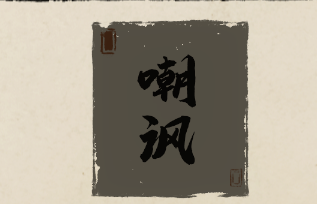

嘲讽：在战斗中会优先受到敌人的单体攻击；

### 【获取途径】

首次获得卡牌后解锁：

---

## 3. 易伤（🔒 未获得）

> 尚未获得此卡牌，以下为图鉴中可见的部分信息。

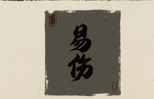

易伤：不可清除的状态；当拥有易伤的卡牌受到伤害时，伤害结果增加当前的易伤数值；

### 【获取途径】

首次获得卡牌后解锁：

---

## 4. 增伤（🔒 未获得）

> 尚未获得此卡牌，以下为图鉴中可见的部分信息。

增伤：攻击造成伤害时，会使伤害结果增加当前的增伤数值；根据技能不同，增伤有多种清除时机：

1.攻击后清除；

2.回合结束后清除；

3.战斗结束时清除；

### 【获取途径】

首次获得卡牌后解锁：

---

## 5. 减伤（🔒 未获得）

> 尚未获得此卡牌，以下为图鉴中可见的部分信息。

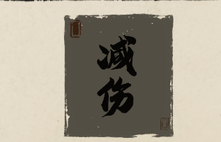

减伤：受到伤害时，会使伤害结果减少当前的减伤数值；根据技能不同，减伤有多种清除时机：

1.受伤后清除；

2.回合结束后清除；

3.战斗结束时清除；

### 【获取途径】

首次获得卡牌后解锁：

---

## 6. 真实伤害（🔒 未获得）

> 尚未获得此卡牌，以下为图鉴中可见的部分信息。

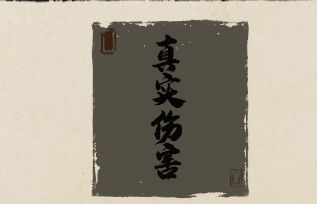

真实伤害：攻击无视护甲，直接对生命值造成伤害；

### 【获取途径】

首次获得卡牌后解锁：

---

## 7. 远程攻击（🔒 未获得）

> 尚未获得此卡牌，以下为图鉴中可见的部分信息。

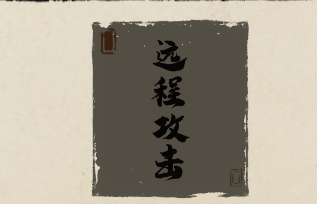

远程攻击：在战斗中，卡牌表现为原地释放攻击效果（不会撞击卡牌），远程攻击不会触发反击；

### 【获取途径】

首次获得卡牌后解锁：

---

## 8. 护甲（🔒 未获得）

> 尚未获得此卡牌，以下为图鉴中可见的部分信息。

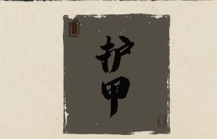

护甲：在受到伤害时，如果卡牌有护甲，会优先扣除护甲值；当护甲值为0时，再扣除卡牌的生命值；

### 【获取途径】

首次获得卡牌后解锁：

---

## 9. 中毒（🔒 未获得）

> 尚未获得此卡牌，以下为图鉴中可见的部分信息。

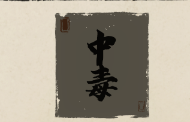

中毒：使目标获得延迟伤害，伤害值等于技能释放者的攻击力；当拥有中毒的卡牌攻击前，会先触发中毒伤害；

### 【获取途径】

首次获得卡牌后解锁：

---

## 10. 召唤（🔒 未获得）

> 尚未获得此卡牌，以下为图鉴中可见的部分信息。

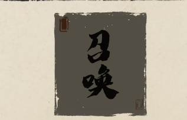

召唤：在战斗中生成指定属性的卡牌（包含预设的技能）

### 【获取途径】

首次获得卡牌后解锁：

---

## 11. 混乱（🔒 未获得）

> 尚未获得此卡牌，以下为图鉴中可见的部分信息。

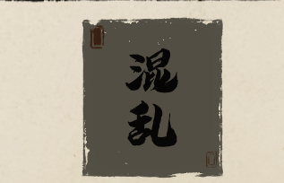

混乱：拥有混乱的卡牌在攻击挑选目标时，会从场上所有目标中挑选；

### 【获取途径】

首次获得卡牌后解锁：

---

## 12. 禁锢（🔒 未获得）

> 尚未获得此卡牌，以下为图鉴中可见的部分信息。

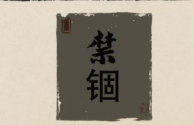

禁锢：使目标卡牌无法攻击。但仍然可以触发其技能；

### 【获取途径】

首次获得卡牌后解锁：

---

## 13. 封印（🔒 未获得）

> 尚未获得此卡牌，以下为图鉴中可见的部分信息。

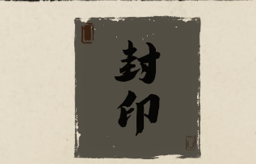

封印：使目标卡牌的技能失效，但仍然可以攻击；

### 【获取途径】

首次获得卡牌后解锁：

---

## 14. 复制（🔒 未获得）

> 尚未获得此卡牌，以下为图鉴中可见的部分信息。

复制：在战斗中生成卡牌，此卡牌的属性以某个卡牌的属性为基准计算生成（但不会复制该卡牌的技能）

### 【获取途径】

首次获得卡牌后解锁：

---

## 15. 复活（🔒 未获得）

> 尚未获得此卡牌，以下为图鉴中可见的部分信息。

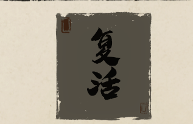

复活：卡牌在战斗中血量为0时触发，触发后恢复一定的血量；

### 【获取途径】

首次获得卡牌后解锁

---

## 16. 吸血（🔒 未获得）

> 尚未获得此卡牌，以下为图鉴中可见的部分信息。

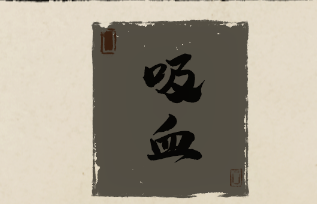

吸血：将攻击造成伤害的一定比例转化为自身的血量；

### 【获取途径】

首次获得卡牌后解锁：

---

## 17. 负面状态（🔒 未获得）

> 尚未获得此卡牌，以下为图鉴中可见的部分信息。

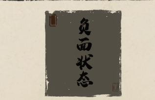

负面状态：当卡牌拥有中毒，禁锢，封印，混乱中的任意状态时，视为存在负面状态；

### 【获取途径】

首次获得卡牌后解锁：

---

## 18. 被动（🔒 未获得）

> 尚未获得此卡牌，以下为图鉴中可见的部分信息。

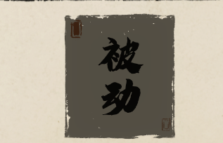

被动：此技能无法被封印；

### 【获取途径】

首次获得卡牌后解锁：

---

## 19. 选择目标（🔒 未获得）

> 尚未获得此卡牌，以下为图鉴中可见的部分信息。

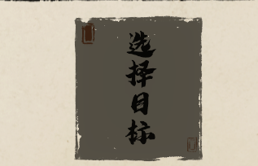

我方/我军：目标队列包含技能释放者在内；友方/友军：目标队列不包含技能释放者；

### 【获取途径】

首次获得卡牌后解锁：

---

## 20. 锁定技（🔒 未获得）

> 尚未获得此卡牌，以下为图鉴中可见的部分信息。

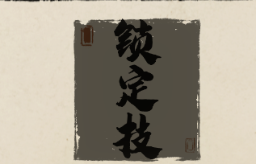

锁定技：此技能效果会一直生效；（不受品质影响）

### 【获取途径】

首次获得卡牌后解锁：

---

## 21. 本命技（🔒 未获得）

> 尚未获得此卡牌，以下为图鉴中可见的部分信息。

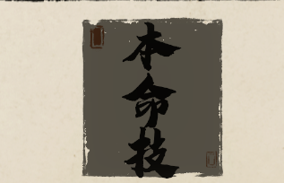

本命技：通过炼化本命物获得的技能（带有本命·XXX字样）。无法被封印；

### 【获取途径】

首次获得卡牌后解锁：

---

## 22. 金芒咒

口诀效果：对一张牌造成伤害（无视护甲）

### 【获取途径】

修炼筑基期心法：千芒术后获得

---

## 23. 唤剑诀（🔒 未获得）

> 尚未获得此卡牌，以下为图鉴中可见的部分信息。

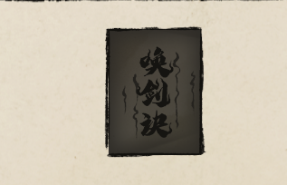

口诀效果：随机借来一把神品剑

### 【获取途径】

首次获得卡牌后解锁：

---

## 24. 唤木诀

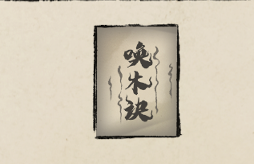

口诀效果：随机生成一张灵草卡（绝品灵草无法生成）

### 【获取途径】

修炼练气期心法：木心决后获得；

---

## 25. 唤灵诀

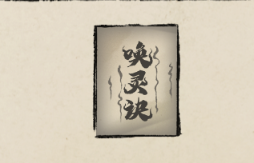

口诀效果：召唤一个花灵（除非战死，否则不消失）

### 【获取途径】

修炼筑基期心法：栖梧功后获得；

---

## 26. 治愈诀

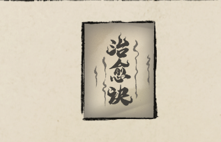

口诀效果：恢复一张卡牌的〔血量〕

### 【获取途径】

修炼练气期心法：愈心术后获得；

---

## 27. 还灵咒（🔒 未获得）

> 尚未获得此卡牌，以下为图鉴中可见的部分信息。

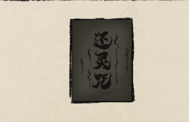

口诀效果：修复一张已损坏的卡牌；

### 【获取途径】

首次获得卡牌后解锁：

---

## 28. 疗愈阵

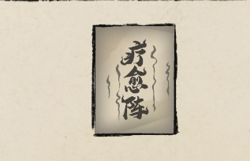

口诀效果：在桌面上生成一个阵法，持续恢复友军的〔血量〕

### 【获取途径】

修炼筑基期心法：回春典后获得；

---

## 29. 寒冰咒（🔒 未获得）

> 尚未获得此卡牌，以下为图鉴中可见的部分信息。

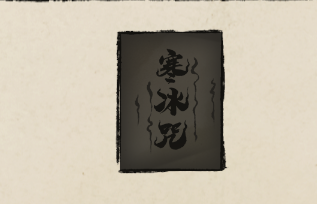

口诀效果：对一个敌人造成伤害，并降低其大〔攻击〕（仅1次）

### 【获取途径】

首次获得卡牌后解锁：

---

## 30. 凝气咒

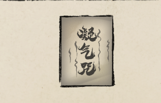

口诀效果：对自己使用，消耗〔血量〕，恢复大量〔灵气〕

### 【获取途径】

修炼结丹期心法：凝尘诀后获得；

---

## 31. 灵源咒（🔒 未获得）

> 尚未获得此卡牌，以下为图鉴中可见的部分信息。

口诀效果：只能对灵兽使用。恢复满灵兽的所有有〔血量〕；此口诀的冷却时间较长；

### 【获取途径】

首次获得卡牌后解锁：

---

## 32. 唤火诀

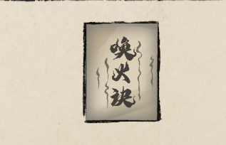

口诀效果：唤出火球对一张卡牌造成伤害

### 【获取途径】

修炼练气期心法：焚炎经后获得；

---

## 33. 聚火诀（🔒 未获得）

> 尚未获得此卡牌，以下为图鉴中可见的部分信息。

口诀效果：在桌面上生成一个阵法，持续对范围内的卡牌造成伤害

### 【获取途径】

首次获得卡牌后解锁：

---

## 34. 玄甲咒（🔒 未获得）

> 尚未获得此卡牌，以下为图鉴中可见的部分信息。

口诀效果：为一张卡牌添加护甲

### 【获取途径】

首次获得卡牌后解锁：

---

## 35. 驭兽诀（🔒 未获得）

> 尚未获得此卡牌，以下为图鉴中可见的部分信息。

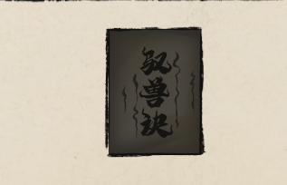

口诀效果：100%控制中立灵兽，或者敌对妖兽（如果可以控制）

### 【获取途径】

首次获得卡牌后解锁：

---

## 36. 奴心咒（🔒 未获得）

> 尚未获得此卡牌，以下为图鉴中可见的部分信息。

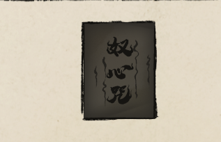

口诀效果：有一定概率控制一名中立NPC修士（无法对高于口诀境界的修士使用）。

### 【获取途径】

首次获得卡牌后解锁：

---

## 37. 天罡体

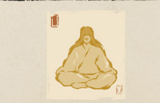

技能效果：回合开始前，自身的〔攻击〕提高

### 【获取途径】

修炼练气期心法：金灵术后获得；

---

## 38. 初尘一式

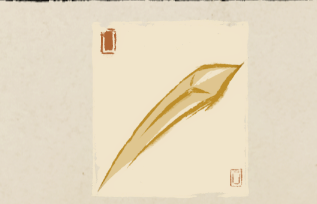

技能效果：攻击未出手的目标时，造成的伤害〔伤害〕提高

### 【获取途径】

修炼筑基期心法：初尘剑谱后获得；

---

## 39. 初尘二式

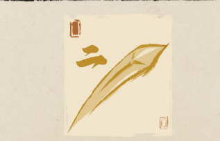

技能效果：加入战场的首个回合，获得光盾

### 【获取途径】

修炼筑基期心法：初尘剑谱后获得；

---

## 40. 初尘三式

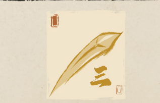

技能效果：场上卡牌失去光盾后，自己的〔攻击〕提高

### 【获取途径】

修炼筑基期心法：初尘剑谱后获得；

---

## 41. 瞬影双闪（🔒 未获得）

> 尚未获得此卡牌，以下为图鉴中可见的部分信息。

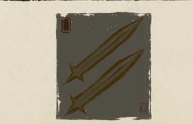

技能效果：使自己的随机一把剑，获得额外攻击次数

### 【获取途径】

首次获得卡牌后解锁：

---

## 42. 玄机剑魄（🔒 未获得）

> 尚未获得此卡牌，以下为图鉴中可见的部分信息。

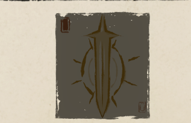

技能效果：战斗开始时，使自己随机2把剑获得光盾；（技能结丹期后还额外提高攻击力）

### 【获取途径】

首次获得卡牌后解锁：

---

## 43. 凝剑术（🔒 未获得）

> 尚未获得此卡牌，以下为图鉴中可见的部分信息。

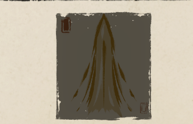

技能效果：战斗开始时，随机召唤一把剑

### 【获取途径】

首次获得卡牌后解锁：

---

## 44. 人剑合一（🔒 未获得）

> 尚未获得此卡牌，以下为图鉴中可见的部分信息。

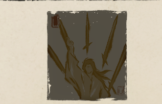

技能效果：自己的剑攻击后。获得一次攻击次数和光盾

### 【获取途径】

首次获得卡牌后解锁：

---

## 45. 剑盾式

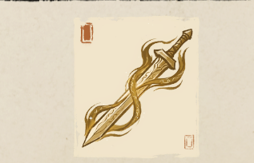

技能效果：当场上有光盾消失时，使自己的随机一把剑获得光盾。

### 【获取途径】

修炼结丹期心法：凝光心法后获得；

---

## 46. 饮血剑（🔒 未获得）

> 尚未获得此卡牌，以下为图鉴中可见的部分信息。

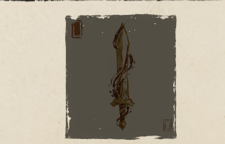

技能效果：当击败敌方目标时，使我方随机一把〔金〕法宝的〔攻击〕和〔血量〕获得提高；

### 【获取途径】

首次获得卡牌后解锁：

---

## 47. 凝刃技（🔒 未获得）

> 尚未获得此卡牌，以下为图鉴中可见的部分信息。

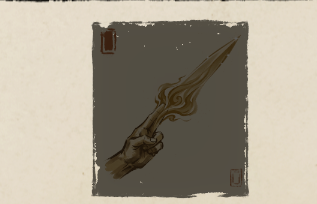

技能效果：当我方卡牌获得光盾时，使它同时提高〔攻击〕

### 【获取途径】

首次获得卡牌后解锁：

---

## 48. 贯云双星（🔒 未获得）

> 尚未获得此卡牌，以下为图鉴中可见的部分信息。

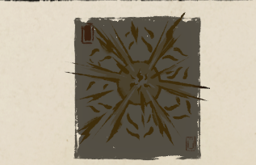

技能效果：使自己的随机一个法宝（包括本命物）获得额外攻击次数

### 【获取途径】

首次获得卡牌后解锁：

---

## 49. 先发制人（🔒 未获得）

> 尚未获得此卡牌，以下为图鉴中可见的部分信息。

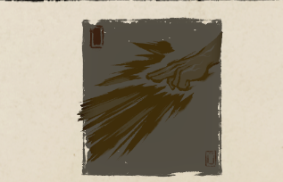

技能效果：战斗开始时，使一个法宝先攻击一次

### 【获取途径】

首次获得卡牌后解锁：

---

## 50. 剑魄通明（🔒 未获得）

> 尚未获得此卡牌，以下为图鉴中可见的部分信息。

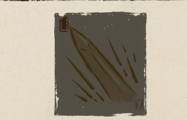

技能效果：战斗开始时，使一把剑先攻击一次

### 【获取途径】

首次获得卡牌后解锁：

---

## 51. 荆棘（🔒 未获得）

> 尚未获得此卡牌，以下为图鉴中可见的部分信息。

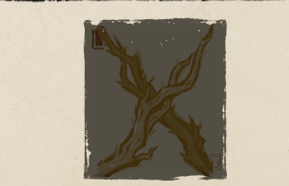

技能效果：每回合第一次收到攻击时，禁锢随机敌方卡牌并造成一定伤害

### 【获取途径】

首次获得卡牌后解锁：

---

## 52. 分身（🔒 未获得）

> 尚未获得此卡牌，以下为图鉴中可见的部分信息。

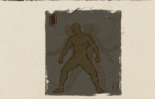

技能效果：战斗开始的第一回合，复制一个自己的分身（实力不完全）

### 【获取途径】

首次获得卡牌后解锁：

---

## 53. 分身不灭（🔒 未获得）

> 尚未获得此卡牌，以下为图鉴中可见的部分信息。

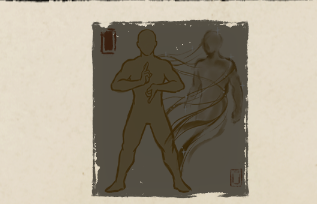

技能效果：自身的分身死亡时，再召唤一个（每场战斗只触发1次）

### 【获取途径】

首次获得卡牌后解锁：

---

## 54. 唤灵术

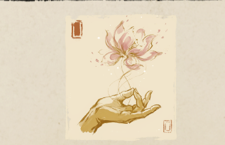

技能效果：友方〔木〕卡牌攻击后，召唤一个花灵（一场战斗只生效3次，升阶后增加次数）

### 【获取途径】

修炼筑基期心法：花衍诀后获得；

---

## 55. 落花术

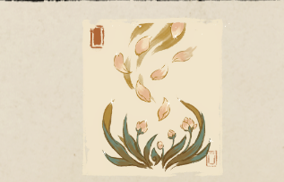

技能效果：当友方的花灵战败后，再召唤一只（一场战斗只生效3次，升阶后增加次数）

### 【获取途径】

修炼筑基期心法：落樱诀后获得；

---

## 56. 葬花术（🔒 未获得）

> 尚未获得此卡牌，以下为图鉴中可见的部分信息。

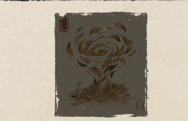

技能效果：当友方的〔木〕卡牌（非召唤卡）战败后，召唤一只花灵

### 【获取途径】

首次获得卡牌后解锁：

---

## 57. 孕灵术（🔒 未获得）

> 尚未获得此卡牌，以下为图鉴中可见的部分信息。

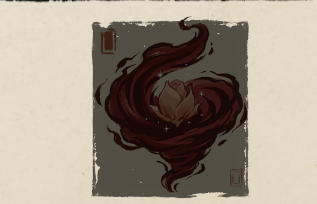

技能效果：当主角受到伤害时，召唤一只花灵；（一回合最多触发3次）

### 【获取途径】

首次获得卡牌后解锁：

---

## 58. 星图术（🔒 未获得）

> 尚未获得此卡牌，以下为图鉴中可见的部分信息。

技能效果：攻击后，为我方血量最少卡牌恢复〔血量〕

### 【获取途径】

首次获得卡牌后解锁：

---

## 59. 卸力

技能效果：攻击造成伤害后，降低目标的〔攻击〕

### 【获取途径】

修炼筑基期心法：止水功后获得；

---

## 60. 保命（🔒 未获得）

> 尚未获得此卡牌，以下为图鉴中可见的部分信息。

技能效果：在战斗中受到致命伤害后，会保持1点血量不死（每场战斗只触发一次）

### 【获取途径】

首次获得卡牌后解锁：

---

## 61. 涤尘（🔒 未获得）

> 尚未获得此卡牌，以下为图鉴中可见的部分信息。

技能效果：回合开始时，清除自身的负面效果，且恢复一定〔血量〕

### 【获取途径】

首次获得卡牌后解锁：

---

## 62. 燃血（🔒 未获得）

> 尚未获得此卡牌，以下为图鉴中可见的部分信息。

技能效果：攻击前，如果身上有负面效果，则激活燃血：清除负面效果，并增加一定攻击力

### 【获取途径】

首次获得卡牌后解锁：

---

## 63. 燃血贰（🔒 未获得）

> 尚未获得此卡牌，以下为图鉴中可见的部分信息。

技能效果：战斗开始时，消耗自身大量〔血量〕，临时提升〔攻击〕

### 【获取途径】

首次获得卡牌后解锁：

---

## 64. 斗转星移（🔒 未获得）

> 尚未获得此卡牌，以下为图鉴中可见的部分信息。

技能效果：使用兵器攻击后吸收目标一定的〔攻击〕附加于随机友军上；

### 【获取途径】

首次获得卡牌后解锁：

---

## 65. 神佑（🔒 未获得）

> 尚未获得此卡牌，以下为图鉴中可见的部分信息。

技能效果：友方第一张卡牌战败时，使它满血复活；

### 【获取途径】

首次获得卡牌后解锁：

---

## 66. 无量障（🔒 未获得）

> 尚未获得此卡牌，以下为图鉴中可见的部分信息。

技能效果：友方第一张卡牌战败时，使它保留一点血量，并获得嘲讽和大量减伤（一回合）

### 【获取途径】

首次获得卡牌后解锁：

---

## 67. 醉拳（🔒 未获得）

> 尚未获得此卡牌，以下为图鉴中可见的部分信息。

技能效果：（被动）提高自身〔攻击〕每次行动会攻击2次，但自身进入混乱状态（无法清除）；

### 【获取途径】

首次获得卡牌后解锁：

---

## 68. 火焰拳（🔒 未获得）

> 尚未获得此卡牌，以下为图鉴中可见的部分信息。

技能效果：（被动）攻击前，先挥出火球攻击目标；

### 【获取途径】

首次获得卡牌后解锁：

---

## 69. 乘胜

技能效果：自己的〔火〕卡牌击败敌人时，使随机友方卡牌获得额外攻击次数和增伤（一回合）

### 【获取途径】

修炼筑基期心法：连锋诀后获得；

---

## 70. 爆袭

技能效果：每回合开始时，给随机的友方〔火〕卡牌获得增伤（一回合）和额外攻击次数

### 【获取途径】

修炼筑基期心法：爆炎诀后获得；

---

## 71. 炎龙之力（🔒 未获得）

> 尚未获得此卡牌，以下为图鉴中可见的部分信息。

技能效果：战斗开始时，消耗自己〔血量〕，转化成〔攻击〕和减伤（整场战斗生效）；

### 【获取途径】

首次获得卡牌后解锁：

---

## 72. 浴火雷劫（🔒 未获得）

> 尚未获得此卡牌，以下为图鉴中可见的部分信息。

技能效果：在战斗中战败，会满血复活一次；但同时会为敌方召唤9张天雷卡；

### 【获取途径】

首次获得卡牌后解锁：

---

## 73. 烬身三式（🔒 未获得）

> 尚未获得此卡牌，以下为图鉴中可见的部分信息。

技能效果：战斗的第一回合。额外攻击2次，但第二回合无法行动（禁锢自身，无法清除）

### 【获取途径】

首次获得卡牌后解锁：

---

## 74. 连击（🔒 未获得）

> 尚未获得此卡牌，以下为图鉴中可见的部分信息。

技能效果：（被动）提高自身〔攻击〕每次行动会攻击2次

### 【获取途径】

首次获得卡牌后解锁：

---

## 75. 吸血

技能效果：装备后拥有吸血效果

### 【获取途径】

绝品武道结丹有概率获得；在天地宝库里可获得

---

## 76. 拳风（🔒 未获得）

> 尚未获得此卡牌，以下为图鉴中可见的部分信息。

技能效果：攻击会对目标身旁卡牌溅射伤害

### 【获取途径】

首次获得卡牌后解锁：

---

## 77. 金刚霸体（🔒 未获得）

> 尚未获得此卡牌，以下为图鉴中可见的部分信息。

技能效果：受到的所有伤害均减少

### 【获取途径】

首次获得卡牌后解锁：

---

## 78. 血噬

技能效果：每当有敌方卡牌被击败时，自身恢复〔血量〕

### 【获取途径】

神品/绝品武道结丹有概率获得；

---

## 79. 岩肤体

技能效果：加入战场后的首个回合，获得持续一回合的减伤

### 【获取途径】

修炼练气期心法：岩息术后获得；

---

## 80. 反击式

技能效果：受到近战攻击时。以一定攻击力反击攻击者

### 【获取途径】

修炼练气期心法：金刚拳法后获得；

---

## 81. 嘲讽体

技能效果：战斗中，获得减伤且会优先受到攻击

### 【获取途径】

修炼筑基期心法：镇岳诀后获得；

---

## 82. 反击式贰

技能效果：受到远程攻击时自身〔攻击〕提高

### 【获取途径】

修炼筑基期心法：混元破障拳后获得；

---

## 83. 不动（🔒 未获得）

> 尚未获得此卡牌，以下为图鉴中可见的部分信息。

技能效果：战斗开始时，禁锢自身2回合（无法清除），为自己增加大量护甲；

### 【获取途径】

首次获得卡牌后解锁：

---

## 84. 忍耐（🔒 未获得）

> 尚未获得此卡牌，以下为图鉴中可见的部分信息。

技能效果：处于禁锢状态下，受到攻击会增加自身攻击力；

### 【获取途径】

首次获得卡牌后解锁：

---

## 85. 分神（🔒 未获得）

> 尚未获得此卡牌，以下为图鉴中可见的部分信息。

技能效果：战斗开始的第一回合，召唤一个主角分身，该分身固定只有1〔攻击〕，但会保留一定比例的血量和自带嘲讽；（这个分身场上同时只能存在一个）

### 【获取途径】

首次获得卡牌后解锁：

---

## 86. 土影卫（🔒 未获得）

> 尚未获得此卡牌，以下为图鉴中可见的部分信息。

技能效果：战斗开始的第一回合，复制一个随机友方灵兽的分身，这个分身的〔血量〕固定为1。但会继承2倍的攻击力：（这个分身场上同时只能存在一个）

### 【获取途径】

首次获得卡牌后解锁：

---

## 87. 暗杀（🔒 未获得）

> 尚未获得此卡牌，以下为图鉴中可见的部分信息。

技能效果：使随机友方2把兵器获得无视护甲的效果

### 【获取途径】

首次获得卡牌后解锁：

---

## 88. 蚀脉（🔒 未获得）

> 尚未获得此卡牌，以下为图鉴中可见的部分信息。

技能效果：当敌方卡牌恢复生命值时，对它造成一次伤害；（每回合触发一次）

### 【获取途径】

首次获得卡牌后解锁：

---

## 89. 聚灵化盾

技能效果：进入战场时，获得〔护甲〕

### 【获取途径】

修炼练气期心法：混元功（二）后获得；

---

## 90. 刺杀术

技能效果：自己的双刀可额外攻击一次，但每回合受到的第一次伤害会提高

### 【获取途径】

修炼执黑筑基任务流程中的刺杀术后获得；

---

## 91. 器魂重塑（🔒 未获得）

> 尚未获得此卡牌，以下为图鉴中可见的部分信息。

技能效果：自己第一个法宝战败时，使它满血复活

### 【获取途径】

首次获得卡牌后解锁：

---

## 92. 兽魂重塑（🔒 未获得）

> 尚未获得此卡牌，以下为图鉴中可见的部分信息。

技能效果：自己第一个灵兽战败时，使它满血复活

### 【获取途径】

首次获得卡牌后解锁：

---

## 93. 聚光（🔒 未获得）

> 尚未获得此卡牌，以下为图鉴中可见的部分信息。

战斗开始后的第一回合，获得光盾

### 【获取途径】

首次获得卡牌后解锁：

---

## 94. 共鸣肆（🔒 未获得）

> 尚未获得此卡牌，以下为图鉴中可见的部分信息。

敌方卡牌失去光盾时，此卡牌获得光盾

### 【获取途径】

首次获得卡牌后解锁：

---

## 95. 光力肆（🔒 未获得）

> 尚未获得此卡牌，以下为图鉴中可见的部分信息。

当我方卡牌失去光盾时，使自己获得一次攻击次数和攻击力。

### 【获取途径】

首次获得卡牌后解锁：

---

## 96. 天罡（🔒 未获得）

> 尚未获得此卡牌，以下为图鉴中可见的部分信息。

回合开始时，此卡牌的〔攻击〕和〔血量〕均提高

### 【获取途径】

首次获得卡牌后解锁：

---

## 97. 天罡贰（🔒 未获得）

> 尚未获得此卡牌，以下为图鉴中可见的部分信息。

场上每有一张〔金〕卡牌，此卡牌的〔攻击〕获得一定提高

### 【获取途径】

首次获得卡牌后解锁：

---

## 98. 力拔（🔒 未获得）

> 尚未获得此卡牌，以下为图鉴中可见的部分信息。

此卡牌攻击后，〔攻击〕提高

### 【获取途径】

首次获得卡牌后解锁：

---

## 99. 共鸣（🔒 未获得）

> 尚未获得此卡牌，以下为图鉴中可见的部分信息。

我方其他〔金〕法宝攻击后，自身的〔攻击〕提高；

### 【获取途径】

首次获得卡牌后解锁：

---

## 100. 共鸣贰（🔒 未获得）

> 尚未获得此卡牌，以下为图鉴中可见的部分信息。

我方其他〔金〕法宝攻击前，使它的〔攻击〕提高；

### 【获取途径】

首次获得卡牌后解锁：

---

## 101. 聚光叁（🔒 未获得）

> 尚未获得此卡牌，以下为图鉴中可见的部分信息。

受到伤害时，使随机友军获得光盾

### 【获取途径】

首次获得卡牌后解锁：

---

## 102. 共鸣叁（🔒 未获得）

> 尚未获得此卡牌，以下为图鉴中可见的部分信息。

友方卡牌获得光盾时，此卡牌也获得光盾

### 【获取途径】

首次获得卡牌后解锁：

---

## 103. 光力伍（🔒 未获得）

> 尚未获得此卡牌，以下为图鉴中可见的部分信息。

当友军获得光盾时，此卡牌也获得光盾

### 【获取途径】

首次获得卡牌后解锁：

---

## 104. 光力贰（🔒 未获得）

> 尚未获得此卡牌，以下为图鉴中可见的部分信息。

当友军获得光盾时，此卡牌的〔攻击〕和〔血量〕均提高

### 【获取途径】

首次获得卡牌后解锁：

---

## 105. 聚光贰（🔒 未获得）

> 尚未获得此卡牌，以下为图鉴中可见的部分信息。

每回合结束时，使我方（除本卡牌外）随机卡牌获得光盾

### 【获取途径】

首次获得卡牌后解锁：

---

## 106. 光力（🔒 未获得）

> 尚未获得此卡牌，以下为图鉴中可见的部分信息。

当友军失去光盾时，此卡牌的〔攻击〕和〔血量〕均提高

### 【获取途径】

首次获得卡牌后解锁：

---

## 107. 光力叁（🔒 未获得）

> 尚未获得此卡牌，以下为图鉴中可见的部分信息。

当友军失去光盾时，使它的〔攻击〕提高

### 【获取途径】

首次获得卡牌后解锁：

---

## 109. 中毒叁（🔒 未获得）

> 尚未获得此卡牌，以下为图鉴中可见的部分信息。

当敌方卡牌失去中毒时，使随机敌方卡牌再次获得中毒（中毒伤害为攻击力的30%）（此技能每回合只触发一次）

### 【获取途径】

首次获得卡牌后解锁：

---

## 110. 聚光肆（🔒 未获得）

> 尚未获得此卡牌，以下为图鉴中可见的部分信息。

每回合一次，自己受到攻击时，为队伍里的任意角色施加光盾；

### 【获取途径】

首次获得卡牌后解锁：

---

## 111. 蝉甲（🔒 未获得）

> 尚未获得此卡牌，以下为图鉴中可见的部分信息。

当自己受到攻击后，获得一定减伤（持续一回合）

### 【获取途径】

首次获得卡牌后解锁：

---

## 112. 凝甲（🔒 未获得）

> 尚未获得此卡牌，以下为图鉴中可见的部分信息。

当我方卡牌失去光盾时，使它获得一定护甲〔护甲〕

### 【获取途径】

首次获得卡牌后解锁：

---

## 113. 聚光伍（🔒 未获得）

> 尚未获得此卡牌，以下为图鉴中可见的部分信息。

攻击后，使自己获得光盾

### 【获取途径】

首次获得卡牌后解锁：

---

## 114. 金粉（🔒 未获得）

> 尚未获得此卡牌，以下为图鉴中可见的部分信息。

当我方有卡牌获得光盾时，给随机敌人施加2回合混乱；

### 【获取途径】

首次获得卡牌后解锁：

---

## 115. 引路贰（🔒 未获得）

> 尚未获得此卡牌，以下为图鉴中可见的部分信息。

攻击的目标如果处于中毒，则将中毒伤害提前生效，使目标旁边随机卡牌受到毒伤害的{O:PO}

### 【获取途径】

首次获得卡牌后解锁：

---

## 116. 唤灵（🔒 未获得）

> 尚未获得此卡牌，以下为图鉴中可见的部分信息。

加入战场时，获得嘲讽且召唤毒藤

### 【获取途径】

首次获得卡牌后解锁：

---

## 117. 唤灵肆（🔒 未获得）

> 尚未获得此卡牌，以下为图鉴中可见的部分信息。

当战场的第一只花灵战败时，再召唤3只

### 【获取途径】

首次获得卡牌后解锁：

---

## 118. 封魔（🔒 未获得）

> 尚未获得此卡牌，以下为图鉴中可见的部分信息。

攻击前，使目标卡牌的技能在本回合失效，且属性恢复至战斗初。

### 【获取途径】

首次获得卡牌后解锁：

---

## 119. 中毒（🔒 未获得）

> 尚未获得此卡牌，以下为图鉴中可见的部分信息。

攻击后，使受击者中毒（中毒伤害为30%）

### 【获取途径】

首次获得卡牌后解锁：

---

## 120. 连根贰（🔒 未获得）

> 尚未获得此卡牌，以下为图鉴中可见的部分信息。

场上每有一张〔木〕卡牌，攻击造成的伤害结果〔伤害〕提高（每场战斗只触发一次）

### 【获取途径】

首次获得卡牌后解锁：

---

## 121. 中毒叁（🔒 未获得）

> 尚未获得此卡牌，以下为图鉴中可见的部分信息。

当敌方卡牌失去中毒时，使随机敌方卡牌再次获得中毒（中毒伤害为攻击力的30%）（此技能每回合只触发一次）

### 【获取途径】

首次获得卡牌后解锁：

---

## 122. 引路叁（🔒 未获得）

> 尚未获得此卡牌，以下为图鉴中可见的部分信息。

攻击后，随机使敌方一个中毒状态立即生效，并使目标旁边随机卡牌受到额外伤害

### 【获取途径】

首次获得卡牌后解锁：

---

## 123. 中毒贰（🔒 未获得）

> 尚未获得此卡牌，以下为图鉴中可见的部分信息。

回合开始时，使随机敌方卡牌获得中毒（中毒伤害为攻击力的30%）

### 【获取途径】

首次获得卡牌后解锁：

---

## 124. 滋养（🔒 未获得）

> 尚未获得此卡牌，以下为图鉴中可见的部分信息。

在战斗中召唤卡牌时，对随机敌人造成伤害〔伤害〕

### 【获取途径】

首次获得卡牌后解锁：

---

## 125. 唤灵叁（🔒 未获得）

> 尚未获得此卡牌，以下为图鉴中可见的部分信息。

受到攻击后，召唤一张小血肉灵芝

### 【获取途径】

首次获得卡牌后解锁：

---

## 126. 唤灵贰（🔒 未获得）

> 尚未获得此卡牌，以下为图鉴中可见的部分信息。

攻击后，召唤一张花灵

### 【获取途径】

首次获得卡牌后解锁：

---

## 127. 再攻（🔒 未获得）

> 尚未获得此卡牌，以下为图鉴中可见的部分信息。

如果攻击没有造成伤害，则使友方随机2个〔火〕卡牌获得额外攻击次数

### 【获取途径】

首次获得卡牌后解锁：

---

## 128. 弹射（🔒 未获得）

> 尚未获得此卡牌，以下为图鉴中可见的部分信息。

攻击的目标如果是〔木〕或〔阴〕，则可再攻击一次；（一回合最多触发2次）

### 【获取途径】

首次获得卡牌后解锁：

---

## 129. 先发（🔒 未获得）

> 尚未获得此卡牌，以下为图鉴中可见的部分信息。

攻击的目标如果本回合还未出手，则此卡牌会攻击两次

### 【获取途径】

首次获得卡牌后解锁：

---

## 130. 后发（🔒 未获得）

> 尚未获得此卡牌，以下为图鉴中可见的部分信息。

攻击的目标如果本回合已经出手，则此卡牌会攻击两次

### 【获取途径】

首次获得卡牌后解锁：

---

## 133. 地火领域（🔒 未获得）

> 尚未获得此卡牌，以下为图鉴中可见的部分信息。

（被动）每回合开始时，对场上所有的〔金〕，〔木〕，〔阴〕卡牌造成一定伤害〔伤害〕

### 【获取途径】

首次获得卡牌后解锁：

---

## 134. 狼嚎（🔒 未获得）

> 尚未获得此卡牌，以下为图鉴中可见的部分信息。

战斗中第一次攻击时，会使自己和随机友方获得一定增伤（本场战斗均生效）

### 【获取途径】

首次获得卡牌后解锁：

---

## 135. 淬焰（🔒 未获得）

> 尚未获得此卡牌，以下为图鉴中可见的部分信息。

受到〔金〕和〔火〕的伤害减少；但受到〔水〕的伤害增加：

### 【获取途径】

首次获得卡牌后解锁：

---

## 136. 反弹（🔒 未获得）

> 尚未获得此卡牌，以下为图鉴中可见的部分信息。

（被动）将受到的近战攻击伤害反弹50%给攻击者

### 【获取途径】

首次获得卡牌后解锁：

---

## 137. 遁甲贰（🔒 未获得）

> 尚未获得此卡牌，以下为图鉴中可见的部分信息。

造成伤害后，为我方卡牌增加〔护甲〕

### 【获取途径】

首次获得卡牌后解锁：

---

## 138. 护主叁（🔒 未获得）

> 尚未获得此卡牌，以下为图鉴中可见的部分信息。

当队伍里的角色卡牌受到伤害时，用剑气（固定伤害）反击攻击者

### 【获取途径】

首次获得卡牌后解锁：

---

## 139. 憾地贰（🔒 未获得）

> 尚未获得此卡牌，以下为图鉴中可见的部分信息。

攻击时，对目标身旁卡牌也造成伤害

### 【获取途径】

首次获得卡牌后解锁：

---

## 140. 护主（🔒 未获得）

> 尚未获得此卡牌，以下为图鉴中可见的部分信息。

当队伍里的角色卡牌受到伤害时，此卡牌的〔攻击〕提高

### 【获取途径】

首次获得卡牌后解锁：

---

## 141. 战鼓（🔒 未获得）

> 尚未获得此卡牌，以下为图鉴中可见的部分信息。

每回合开始时，使友方随机灵兽获得一次攻击机会。

### 【获取途径】

首次获得卡牌后解锁：

---

## 142. 遁甲（🔒 未获得）

> 尚未获得此卡牌，以下为图鉴中可见的部分信息。

嘲讽；加入战场的首个回合开始时，获得〔护甲〕

### 【获取途径】

首次获得卡牌后解锁：

---

## 143. 巧劲（🔒 未获得）

> 尚未获得此卡牌，以下为图鉴中可见的部分信息。

回合开始时，使一名拥有护甲的友方卡牌获得等同于护甲值的攻击力

### 【获取途径】

首次获得卡牌后解锁：

---

## 144. 反击贰（🔒 未获得）

> 尚未获得此卡牌，以下为图鉴中可见的部分信息。

受到近战攻击后，以50%攻击力反击攻击者

### 【获取途径】

首次获得卡牌后解锁：

---

## 145. 遁甲叁（🔒 未获得）

> 尚未获得此卡牌，以下为图鉴中可见的部分信息。

加入战场后的首个回合，为我方所有卡牌增加〔护甲〕

### 【获取途径】

首次获得卡牌后解锁：

---

## 146. 反击（🔒 未获得）

> 尚未获得此卡牌，以下为图鉴中可见的部分信息。

受到近战攻击后，以固定伤害反击敌方所有卡牌

### 【获取途径】

首次获得卡牌后解锁：

---

## 147. 忍耐（🔒 未获得）

> 尚未获得此卡牌，以下为图鉴中可见的部分信息。

嘲讽：受到攻击后，此卡牌的〔攻击〕提高

### 【获取途径】

首次获得卡牌后解锁：

---

## 148. 护主（🔒 未获得）

> 尚未获得此卡牌，以下为图鉴中可见的部分信息。

当队伍里的角色卡牌受到伤害时，此卡牌的〔攻击〕提高

### 【获取途径】

首次获得卡牌后解锁：

---

## 151. 憾地（🔒 未获得）

> 尚未获得此卡牌，以下为图鉴中可见的部分信息。

如果此卡牌有护甲，则回合结束时获得等同于护甲值的伤害加成

### 【获取途径】

首次获得卡牌后解锁：

---

## 153. 攻守平衡（🔒 未获得）

> 尚未获得此卡牌，以下为图鉴中可见的部分信息。

攻击的目标如果不是满血，则自己获得一回合嘲讽和减伤（持续一回合）

### 【获取途径】

首次获得卡牌后解锁：

---

## 154. 熊刃甲（🔒 未获得）

> 尚未获得此卡牌，以下为图鉴中可见的部分信息。

受到近战攻击会反弹伤害〔伤害〕

### 【获取途径】

首次获得卡牌后解锁：

---

## 155. 攻守平衡贰（🔒 未获得）

> 尚未获得此卡牌，以下为图鉴中可见的部分信息。

攻击造成伤害后，使自己和任意友方卡牌获得o护甲〔护甲〕

### 【获取途径】

首次获得卡牌后解锁：

---

## 156. 弱点标记（🔒 未获得）

> 尚未获得此卡牌，以下为图鉴中可见的部分信息。

友方角色造成伤害后，给目标附加易伤（攻击的目标境界越高，易伤数值越高）

### 【获取途径】

首次获得卡牌后解锁：

---

## 157. 裂脊（🔒 未获得）

> 尚未获得此卡牌，以下为图鉴中可见的部分信息。

攻击的目标如果是生物（角色/灵兽），则再攻击一次

### 【获取途径】

首次获得卡牌后解锁：

---

## 158. 使者（🔒 未获得）

> 尚未获得此卡牌，以下为图鉴中可见的部分信息。

每当战场有非召唤卡牌阵亡召唤一个骸骨傀儡（每回合最多触发5次）

### 【获取途径】

首次获得卡牌后解锁：

---

## 159. 刺杀（🔒 未获得）

> 尚未获得此卡牌，以下为图鉴中可见的部分信息。

此卡牌造成真实伤害，攻击前封印目标1回合；

### 【获取途径】

首次获得卡牌后解锁：

---

## 160. 使虫（🔒 未获得）

> 尚未获得此卡牌，以下为图鉴中可见的部分信息。

如果击伤灵兽类型卡牌，使其获得中毒。（中毒伤害为攻击力的50%）

### 【获取途径】

首次获得卡牌后解锁：

---

## 161. 分身（🔒 未获得）

> 尚未获得此卡牌，以下为图鉴中可见的部分信息。

加入战场时，复制两个假的惑音（属性为主角的15%）；（假惑音被击败后，使攻击者获得混乱）

### 【获取途径】

首次获得卡牌后解锁：

---

## 162. 噬魂贰（🔒 未获得）

> 尚未获得此卡牌，以下为图鉴中可见的部分信息。

攻击造成伤害后，吸取目标〔攻击〕附加到随机友军上

### 【获取途径】

首次获得卡牌后解锁：

---

## 163. 瘟疫（🔒 未获得）

> 尚未获得此卡牌，以下为图鉴中可见的部分信息。

每当有卡牌死亡时，使随机敌人获得中毒（中毒伤害为攻击力的20%）

### 【获取途径】

首次获得卡牌后解锁：

---

## 164. 尸诏（🔒 未获得）

> 尚未获得此卡牌，以下为图鉴中可见的部分信息。

每当战场的骸骨傀儡阵亡时。消耗自身{0}〔血量〕再次召唤一只

### 【获取途径】

首次获得卡牌后解锁：

---

## 165. 送行（🔒 未获得）

> 尚未获得此卡牌，以下为图鉴中可见的部分信息。

每当场上有卡牌战败时，对随机敌人造成一定伤害

### 【获取途径】

首次获得卡牌后解锁：

---

## 166. 安魂（🔒 未获得）

> 尚未获得此卡牌，以下为图鉴中可见的部分信息。

造成伤害时，会清除目标在战斗中临时增加的〔攻击〕

### 【获取途径】

首次获得卡牌后解锁：

---

## 167. 镇魂（🔒 未获得）

> 尚未获得此卡牌，以下为图鉴中可见的部分信息。

每当战场中有卡牌阵亡时，禁锢一名敌人2回合；（一场战斗最多触发3次）

### 【获取途径】

首次获得卡牌后解锁：

---

## 168. 黄泉（🔒 未获得）

> 尚未获得此卡牌，以下为图鉴中可见的部分信息。

每当战场中有卡牌阵亡时，此卡牌的〔攻击〕和〔血量〕提高

### 【获取途径】

首次获得卡牌后解锁：

---

## 169. 产卵（🔒 未获得）

> 尚未获得此卡牌，以下为图鉴中可见的部分信息。

每当战场中有生物卡牌阵亡（角色/灵兽，召唤卡除外）时，召唤一只毒蛛（每回合最多触发5次）

### 【获取途径】

首次获得卡牌后解锁：

---

## 170. 阴气（🔒 未获得）

> 尚未获得此卡牌，以下为图鉴中可见的部分信息。

场上每有一个〔阴〕卡牌，骸骨傀儡第一次造成的伤害提高

### 【获取途径】

首次获得卡牌后解锁：

---

## 171. 寄灵贰（🔒 未获得）

> 尚未获得此卡牌，以下为图鉴中可见的部分信息。

此卡牌的攻击方式：远程攻击；当友方的章鱼臂战败时自己的〔攻击〕提高以及获得一次攻击次数；

### 【获取途径】

首次获得卡牌后解锁：

---

## 172. 凶煞之力（🔒 未获得）

> 尚未获得此卡牌，以下为图鉴中可见的部分信息。

回合开始前，使随机一名友军（拥有护甲）获得等同于护甲值一半的增伤和减伤（独立计算，触发一次后移除）

### 【获取途径】

首次获得卡牌后解锁：

---

## 173. 收割（🔒 未获得）

> 尚未获得此卡牌，以下为图鉴中可见的部分信息。

攻击的目标如果是生物（角色/灵兽），则再召唤两个骸骨傀偶；

### 【获取途径】

首次获得卡牌后解锁：

---

## 174. 传薪（🔒 未获得）

> 尚未获得此卡牌，以下为图鉴中可见的部分信息。

当一个骸骨傀儡战败时，使随机友军获得额外一次攻击次数；（每回合只触发一次）

### 【获取途径】

首次获得卡牌后解锁：

---

## 175. 固骸（🔒 未获得）

> 尚未获得此卡牌，以下为图鉴中可见的部分信息。

当友方召唤卡牌后，使友方随机一个骸骨傀儡获得〔护甲〕：（每回合最多触发3次）

### 【获取途径】

首次获得卡牌后解锁：

---

## 176. 克邪（🔒 未获得）

> 尚未获得此卡牌，以下为图鉴中可见的部分信息。

（被动）对〔阴〕卡牌造成五倍伤害

### 【获取途径】

首次获得卡牌后解锁：

---

## 177. 燃魄贰（🔒 未获得）

> 尚未获得此卡牌，以下为图鉴中可见的部分信息。

（被动）对〔木〕卡牌造成叁倍伤害

### 【获取途径】

首次获得卡牌后解锁：

---

## 178. 福缘（🔒 未获得）

> 尚未获得此卡牌，以下为图鉴中可见的部分信息。

加入战斗的首个回合开始时。使自己获得复活：

### 【获取途径】

首次获得卡牌后解锁：

---

## 179. 幻觉（🔒 未获得）

> 尚未获得此卡牌，以下为图鉴中可见的部分信息。

造成伤害后，使目标获得两回合混乱

### 【获取途径】

首次获得卡牌后解锁：

---

## 180. 天罚（🔒 未获得）

> 尚未获得此卡牌，以下为图鉴中可见的部分信息。

加入战场的首个回合开始时，召唤两张天雷卡

### 【获取途径】

首次获得卡牌后解锁：

---

## 181. 噬力（🔒 未获得）

> 尚未获得此卡牌，以下为图鉴中可见的部分信息。

当我方有卡牌成功恢复血量时，随机吸取一名敌人的〔攻击〕（每回合只触发一次）

### 【获取途径】

首次获得卡牌后解锁：

---
