# 【卡牌修仙传】图鉴攻略 — 卡牌 / 技能&口诀

- 收录总数：229（游戏官方数据，其中图鉴未收录 55 条）
- 更新时间：2026-11-20 16:59

---

## 1. 光盾

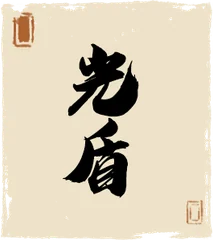

光盾：**免疫一次**任意伤害

---

## 2. 嘲讽

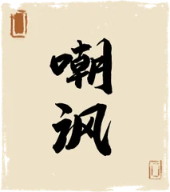

嘲讽：在战斗中会**优先受到**敌人的单体攻击

---

## 3. 易伤

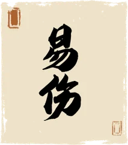

易伤：不可清除的状态；当拥有易伤的卡牌受到伤害时，伤害结果**增加**当前的易伤数值

---

## 4. 增伤

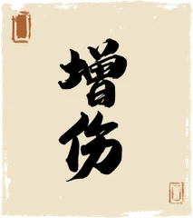

增伤：攻击造成伤害时，会使伤害结果**增加**当前的增伤数值

根据技能不同，增伤有多种清除时机：

1.攻击后清除

2.回合结束后清除

3.战斗结束时清除

---

## 5. 减伤

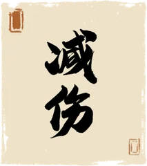

减伤：受到伤害时，会使伤害结果**减少**当前的减伤数值

根据技能不同，减伤有多种清除时机：

1.受伤后清除

2.回合结束后清除

3.战斗结束时清除

---

## 6. 真实伤害

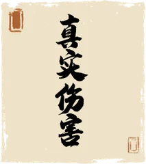

真实伤害：攻击**无视护甲**，直接对生命值造成伤害

---

## 7. 远程攻击

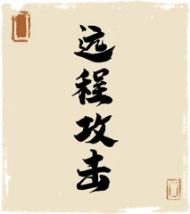

远程攻击：在战斗中，卡牌表现为原地释放攻击效果（不会撞击卡牌），远程攻击**不会触发反击**

---

## 8. 护甲

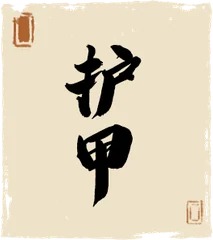

护甲：在受到伤害时，如果卡牌有护甲，会**优先扣除**护甲值；当护甲值为0时，再扣除卡牌的生命值

---

## 9. 中毒

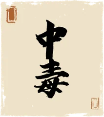

中毒：使目标获得**延迟伤害**，伤害值等于技能释放者的攻击力；当拥有中毒的卡牌攻击前，会先触发中毒伤害

---

## 10. 召唤

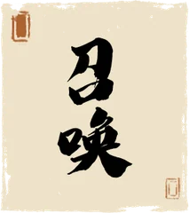

召唤：在战斗中生成**指定属性**的卡牌（包含预设的技能）

---

## 11. 混乱

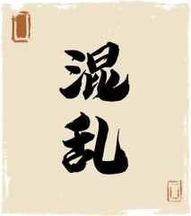

混乱：拥有混乱的卡牌在攻击挑选目标时，会从场上**所有目标**中挑选

---

## 12. 禁锢

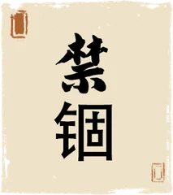

禁锢：使目标卡牌**无法攻击**，但仍然可以触发其技能

---

## 13. 封印

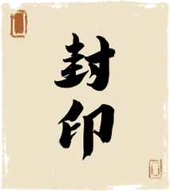

封印：使目标卡牌的技能**失效**，但仍然可以攻击

---

## 14. 复制

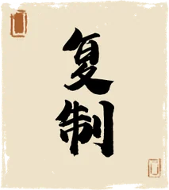

复制：在战斗中生成卡牌，此卡牌的属性以某个卡牌的属性为基准**计算生成**（但不会复制该卡牌的技能）

---

## 15. 复活

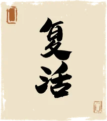

复活：卡牌在战斗中血量为0时触发，触发后恢复一定的血量

---

## 16. 吸血

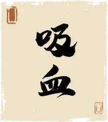

吸血：将攻击造成伤害的一定比例转化为自身的血量

---

## 17. 负面状态

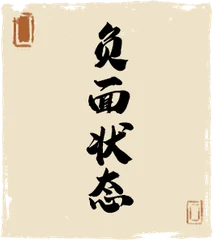

负面状态：当卡牌拥有中毒，禁锢，封印，混乱中的任意状态时，视为存在负面状态

---

## 18. 被动

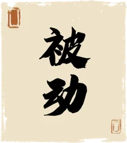

被动：此技能**无法**被封印

---

## 19. 选择目标

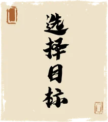

我方/我军：目标队列**包含**技能释放者在内

友方/友军：目标队列**不包含**技能释放者

---

## 20. 锁定技

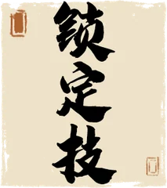

锁定技：此技能效果会一直生效；（不受品质影响）

---

## 21. 本命技

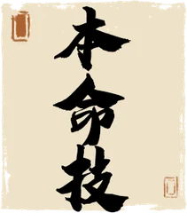

本命技：通过炼化本命物获得的技能（带有本命·XXX字样），无法被封印

---

## 22. 金芒咒

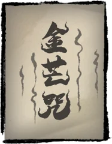

### 【各版本（境界 / 品质）】

练气·人品：口诀：消耗7点〔灵气〕：对一张卡牌造成6点〔伤害〕（无视护甲）；冷却 15 秒

筑基·人品：口诀：消耗12点〔灵气〕：对一张卡牌造成10点〔伤害〕（无视护甲）；冷却 15 秒

结丹·人品：口诀：消耗17点〔灵气〕：对一张卡牌造成27点〔伤害〕（无视护甲）；冷却 15 秒

元婴·人品：口诀：消耗22点〔灵气〕：对一张卡牌造成70点〔伤害〕（无视护甲）；冷却 15 秒

### 【获取途径】

修炼筑基期心法〈千芒术〉后获得

---

## 23. 唤剑诀

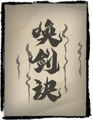

### 【各版本（境界 / 品质）】

练气·绝品：口诀：消耗15点〔灵气〕：借来1把剑；冷却 120 秒

筑基·绝品：口诀：消耗30点〔灵气〕：借来1把剑；冷却 120 秒

结丹·绝品：口诀：消耗50点〔灵气〕：借来1把剑；冷却 120 秒

元婴·绝品：口诀：消耗70点〔灵气〕：借来1把剑；冷却 120 秒

### 【获取途径】

修炼结丹期心法〈神剑谱〉后获得

绝品器道结丹有概率获得

---

## 24. 唤木诀

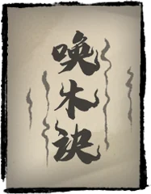

### 【各版本（境界 / 品质）】

练气·人品：口诀：消耗7点〔灵气〕：随机生成一张练气期的灵草卡（无法生成绝品灵草）；冷却 15 秒

筑基·人品：口诀：消耗12点〔灵气〕：随机生成一张筑基期的灵草卡（无法生成绝品灵草）；冷却 15 秒

结丹·人品：口诀：消耗17点〔灵气〕：随机生成一张结丹期的灵草卡（无法生成绝品灵草）；冷却 15 秒

元婴·人品：口诀：消耗22点〔灵气〕：随机生成一张元婴期的灵草卡（无法生成绝品灵草）；冷却 15 秒

### 【获取途径】

修炼练气期心法〈木心决〉后获得

---

## 25. 唤灵诀

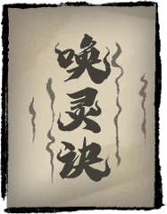

### 【各版本（境界 / 品质）】

练气·仙品：口诀：消耗7点〔灵气〕：召唤一只练气期的花灵（除非死亡，否则花灵不会消失）；冷却 15 秒

筑基·仙品：口诀：消耗12点〔灵气〕：召唤一只筑基期的花灵（除非死亡，否则花灵不会消失）；冷却 15 秒

结丹·仙品：口诀：消耗17点〔灵气〕：召唤一只结丹期的花灵（除非死亡，否则花灵不会消失）；冷却 15 秒

元婴·仙品：口诀：消耗22点〔灵气〕：召唤一只元婴期的花灵（除非死亡，否则花灵不会消失）；冷却 15 秒

### 【获取途径】

修炼筑基期心法〈栖梧功〉后获得

---

## 26. 治愈诀

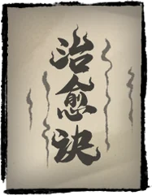

### 【各版本（境界 / 品质）】

练气·人品：口诀：消耗7点〔灵气〕：恢复一张卡牌12点〔血量〕（卡面描述写的数值不对，实际是 20）；冷却 15 秒

筑基·人品：口诀：消耗12点〔灵气〕：恢复一张卡牌60点〔血量〕；冷却 15 秒

结丹·人品：口诀：消耗17点〔灵气〕：恢复一张卡牌160点〔血量〕；冷却 15 秒

元婴·人品：口诀：消耗22点〔灵气〕：恢复一张卡牌430点〔血量〕；冷却 15 秒

### 【获取途径】

修炼练气期心法〈愈心术〉后获得

---

## 27. 还灵咒

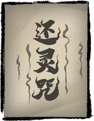

### 【各版本（境界 / 品质）】

练气·神品：口诀：消耗40点〔灵气〕：直接修复一张损坏的法宝；冷却 20 秒

筑基·神品：口诀：消耗35点〔灵气〕：直接修复一张损坏的法宝；冷却 20 秒

结丹·神品：口诀：消耗30点〔灵气〕：直接修复一张损坏的法宝；冷却 20 秒

元婴·神品：口诀：消耗25点〔灵气〕：直接修复一张损坏的法宝；冷却 20 秒

### 【获取途径】

修炼结丹期心法〈归元宝鉴〉后获得

---

## 28. 疗愈阵

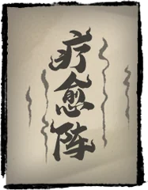

### 【各版本（境界 / 品质）】

练气·神品：口诀：消耗15点〔灵气〕：在地面上形成治疗阵法（持续15秒），治疗所有位于阵法内的卡牌（每3秒恢复6〔血量〕）；冷却 60 秒

筑基·神品：口诀：消耗30点〔灵气〕：在地面上形成治疗阵法（持续15秒），治疗所有位于阵法内的卡牌（每3秒恢复10〔血量〕）；冷却 60 秒

结丹·神品：口诀：消耗50点〔灵气〕：在地面上形成治疗阵法（持续15秒），治疗所有位于阵法内的卡牌（每3秒恢复27〔血量〕）；冷却 60 秒

元婴·神品：口诀：消耗70点〔灵气〕：在地面上形成治疗阵法（持续15秒），治疗所有位于阵法内的卡牌（每3秒恢复70〔血量〕）；冷却 60 秒

### 【获取途径】

修炼筑基期心法〈回春典〉后获得

---

## 29. 寒冰咒

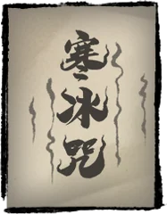

### 【各版本（境界 / 品质）】

练气·绝品：口诀：消耗7点〔灵气〕：对敌人造成4点〔伤害〕，并减少2〔攻击〕（减攻效果无法叠加）；冷却 15 秒

筑基·绝品：口诀：消耗12点〔灵气〕：对敌人造成6点〔伤害〕，并减少4〔攻击〕（减攻效果无法叠加）；冷却 15 秒

结丹·绝品：口诀：消耗17点〔灵气〕：对敌人造成18点〔伤害〕，并减少10〔攻击〕（减攻效果无法叠加）；冷却 15 秒

元婴·绝品：口诀：消耗22点〔灵气〕：对敌人造成46点〔伤害〕，并减少20〔攻击〕（减攻效果无法叠加）；冷却 15 秒

### 【获取途径】

【敖月的支线】第 6 步「敖月的身世」：带着〈傲月的请求〉和「敖月」对话，获得筑基期的版本

---

## 30. 凝气咒

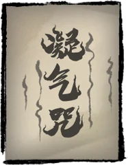

### 【各版本（境界 / 品质）】

练气·绝品：口诀：消耗1点〔灵气〕：对自己使用，消耗20点〔血量〕以恢复8〔灵气〕；冷却 10 秒

筑基·绝品：口诀：消耗1点〔灵气〕：对自己使用，消耗30点〔血量〕以恢复15〔灵气〕；冷却 10 秒

结丹·绝品：口诀：消耗1点〔灵气〕：对自己使用，消耗35点〔血量〕以恢复20〔灵气〕；冷却 10 秒

元婴·绝品：口诀：消耗1点〔灵气〕：对自己使用，消耗40点〔血量〕以恢复25〔灵气〕；冷却 10 秒

### 【获取途径】

修炼结丹期心法〈凝尘诀〉后获得

---

## 31. 灵源咒

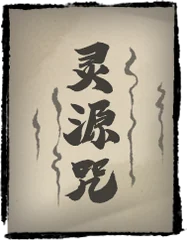

### 【各版本（境界 / 品质）】

练气·绝品：口诀：消耗35点〔灵气〕：恢复自己的一只灵兽所有〔血量〕；冷却 240 秒

筑基·绝品：口诀：消耗35点〔灵气〕：恢复自己的一只灵兽所有〔血量〕；冷却 210 秒

结丹·绝品：口诀：消耗35点〔灵气〕：恢复自己的一只灵兽所有〔血量〕；冷却 180 秒

元婴·绝品：口诀：消耗35点〔灵气〕：恢复自己的一只灵兽所有〔血量〕；冷却 150 秒

### 【获取途径】

修炼结丹期心法〈同心典〉后获得

---

## 32. 唤火诀

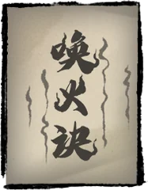

### 【各版本（境界 / 品质）】

练气·人品：口诀：消耗7点〔灵气〕：对一张卡牌造成10点〔伤害〕；冷却 15 秒

筑基·人品：口诀：消耗12点〔灵气〕：对一张卡牌造成16点〔伤害〕；冷却 15 秒

结丹·人品：口诀：消耗17点〔灵气〕：对一张卡牌造成45点〔伤害〕；冷却 15 秒

元婴·人品：口诀：消耗22点〔灵气〕：对一张卡牌造成115点〔伤害〕；冷却 15 秒

### 【什么时候升级（灵气性价比）】

冷却：15 秒，各境界都一样

升级：修炼工作台「提升口诀境界」：放入唤火诀 + 〈用术〉，30 秒升一个境界（不能跳级）

筑基期：不建议升级：筑基版多花 5 点灵气只多 6 点伤害，每点灵气 1.3 点，比练气版（1.4 点）还低，白白用掉一张〈用术〉

结丹期：这时再连升两次（练气 → 筑基 → 结丹）：结丹版每点灵气 2.6 点，差不多是练气版的 2 倍

元婴期：再升一次：元婴版每点灵气 5.2 点，是练气版的 3 倍多

境界 | 消耗灵气 | 伤害 | 每点灵气伤害

练气 | 7 | 10 | 1.4

筑基 | 12 | 16 | 1.3

结丹 | 17 | 45 | 2.6

元婴 | 22 | 115 | 5.2

### 【获取途径】

修炼练气期心法〈焚炎经〉后获得

---

## 33. 聚火诀

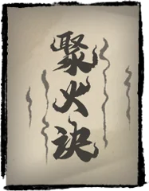

### 【各版本（境界 / 品质）】

练气·地品：口诀：消耗15点〔灵气〕：在地面上形成聚火阵法（持续15秒），所有位于阵法内的卡牌均受到伤害（每3秒造成6〔伤害〕）；冷却 120 秒

筑基·地品：口诀：消耗30点〔灵气〕：在地面上形成聚火阵法（持续15秒），所有位于阵法内的卡牌均受到伤害（每3秒造成10〔伤害〕）；冷却 120 秒

结丹·地品：口诀：消耗50点〔灵气〕：在地面上形成聚火阵法（持续15秒），所有位于阵法内的卡牌均受到伤害（每3秒造成27〔伤害〕）；冷却 120 秒

元婴·地品：口诀：消耗70点〔灵气〕：在地面上形成聚火阵法（持续15秒），所有位于阵法内的卡牌均受到伤害（每3秒造成69〔伤害〕）；冷却 120 秒

### 【获取途径】

修炼筑基期心法〈焚天诀〉后获得

---

## 34. 玄甲咒

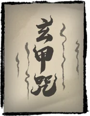

### 【各版本（境界 / 品质）】

练气·神品：口诀：消耗7点〔灵气〕：聚土灵气于身前，形成7〔护甲〕。；冷却 15 秒

筑基·神品：口诀：消耗12点〔灵气〕：聚土灵气于身前，形成20〔护甲〕。；冷却 15 秒

结丹·神品：口诀：消耗17点〔灵气〕：聚土灵气于身前，形成55〔护甲〕。；冷却 15 秒

元婴·神品：口诀：消耗22点〔灵气〕：聚土灵气于身前，形成155〔护甲〕。；冷却 15 秒

### 【获取途径】

修炼筑基期心法〈不动经〉后获得

---

## 35. 驭兽诀

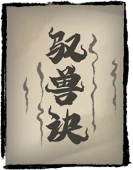

### 【各版本（境界 / 品质）】

练气·绝品：口诀：消耗15〔灵气〕：100%控制练气期中立灵兽或妖兽；冷却 180 秒

筑基·绝品：口诀：消耗30〔灵气〕：100%控制筑基期中立灵兽或妖兽；冷却 180 秒

结丹·绝品：口诀：消耗50〔灵气〕：100%控制结丹期中立灵兽或妖兽；冷却 180 秒

元婴·绝品：口诀：消耗70〔灵气〕：100%控制元婴期中立灵兽或妖兽；冷却 180 秒

### 【获取途径】

修炼结丹期心法〈缚龙真法〉后获得

绝品兽道结丹有概率获得

---

## 36. 奴心咒

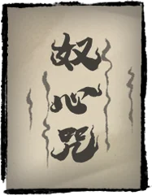

### 【各版本（境界 / 品质）】

练气·神品：口诀：消耗7点〔灵气〕：有50%概率可以控制中立NPC修士（无法对高于口诀境界的修士使用）。；冷却 15 秒

筑基·神品：口诀：消耗12点〔灵气〕：有50%概率可以控制中立NPC修士（无法对高于口诀境界的修士使用）。；冷却 15 秒

结丹·神品：口诀：消耗17点〔灵气〕：有50%概率可以控制中立NPC修士（无法对高于口诀境界的修士使用）。；冷却 15 秒

元婴·神品：口诀：消耗22点〔灵气〕：有50%概率可以控制中立NPC修士（无法对高于口诀境界的修士使用）。；冷却 15 秒

### 【获取途径】

修炼筑基期心法〈阴姹玄功〉后获得

---

## 37. 天罡体

### 【各版本（境界 / 品质）】

练气·人品：天罡体：回合开始前，自身的〔攻击〕+2

筑基·人品：天罡体：回合开始前，自身的〔攻击〕+4

结丹·人品：天罡体：回合开始前，自身的〔攻击〕+12

元婴·人品：天罡体：回合开始前，自身的〔攻击〕+32

### 【获取途径】

修炼练气期心法〈金灵术〉后获得

---

## 38. 初尘一式

### 【各版本（境界 / 品质）】

练气·地品：出尘一式:先发：攻击的目标如果未出手，则造成的〔伤害〕+3

筑基·地品：出尘一式:先发：攻击的目标如果未出手，则造成的〔伤害〕+9

结丹·地品：出尘一式:先发：攻击的目标如果未出手，则造成的〔伤害〕+25

元婴·地品：出尘一式:先发：攻击的目标如果未出手，则造成的〔伤害〕+67

### 【获取途径】

修炼筑基期心法〈初尘剑谱〉后获得

---

## 39. 初尘二式

### 【各版本（境界 / 品质）】

练气·地品：出尘二式:格挡：加入战场后的首个回合，获得**光盾**和1〔攻击〕

筑基·地品：出尘二式:格挡：加入战场后的首个回合，获得**光盾**和2〔攻击〕

结丹·地品：出尘二式:格挡：加入战场后的首个回合，获得**光盾**和6〔攻击〕

元婴·地品：出尘二式:格挡：加入战场后的首个回合，获得**光盾**和12〔攻击〕

### 【获取途径】

修炼筑基期心法〈初尘剑谱〉后获得

---

## 40. 初尘三式

### 【各版本（境界 / 品质）】

练气·地品：出尘三式:聚光：场上卡牌失去**光盾**后，〔攻击〕+2

筑基·地品：出尘三式:聚光：场上卡牌失去**光盾**后，〔攻击〕+4

结丹·地品：出尘三式:聚光：场上卡牌失去**光盾**后，〔攻击〕+12

元婴·地品：出尘三式:聚光：场上卡牌失去**光盾**后，〔攻击〕+32

### 【获取途径】

修炼筑基期心法〈初尘剑谱〉后获得

---

## 41. 瞬影双闪

### 【各版本（境界 / 品质）】

练气·绝品：瞬影双闪：每回合，使自己的随机一把剑攻击1次

筑基·绝品：瞬影双闪：每回合，使自己的随机一把剑攻击1次

结丹·绝品：瞬影双闪：每回合，使自己的随机一把剑攻击2次

元婴·绝品：瞬影双闪：每回合，使自己的随机一把剑攻击3次

### 【获取途径】

修炼筑基期心法〈血煞剑魄〉后获得

---

## 42. 玄机剑魄

### 【各版本（境界 / 品质）】

练气·绝品：玄机剑魄：战斗开始时，使自己随机两把剑获得**光盾**；（技能结丹期后还额外提高攻击力）

筑基·绝品：玄机剑魄：战斗开始时，使自己随机两把剑获得**光盾**；（技能结丹期后还额外提高攻击力）

结丹·绝品：玄机剑魄：战斗开始时，使自己随机两把剑获得**光盾**；（技能结丹期后还额外提高攻击力）

元婴·绝品：玄机剑魄：战斗开始时，使自己随机两把剑获得**光盾**；（技能结丹期后还额外提高攻击力）

### 【获取途径】

修炼筑基期心法〈剑魄诀〉后获得

---

## 43. 凝剑术

### 【各版本（境界 / 品质）】

练气·仙品：凝剑术：战斗开始第一回合，如果有携带剑战斗，则再召唤一把随机的相同品质的剑（剑的境界等于技能境界）

筑基·仙品：凝剑术：战斗开始第一回合，如果有携带剑战斗，则再召唤一把随机的相同品质的剑（剑的境界等于技能境界）

结丹·仙品：凝剑术：战斗开始第一回合，如果有携带剑战斗，则再召唤一把随机的相同品质的剑（剑的境界等于技能境界）

元婴·仙品：凝剑术：战斗开始第一回合，如果有携带剑战斗，则再召唤一把随机的相同品质的剑（剑的境界等于技能境界）

### 【获取途径】

修炼结丹期心法〈心剑诀〉后获得

---

## 44. 人剑合一

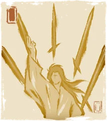

### 【各版本（境界 / 品质）】

练气·绝品：人剑合一：自己的剑攻击后，获得一次攻击次数和**光盾**

筑基·绝品：人剑合一：自己的剑攻击后，获得一次攻击次数和**光盾**

结丹·绝品：人剑合一：自己的剑攻击后，获得一次攻击次数和**光盾**

元婴·绝品：人剑合一：自己的剑攻击后，获得一次攻击次数和**光盾**

### 【获取途径】

修炼元婴期心法〈归墟剑法〉后获得

---

## 45. 剑盾式

### 【各版本（境界 / 品质）】

练气·天品：剑盾式：当场上有光盾消失时，使自己的随机一把剑获得**光盾**；（每回合触发1次，提升境界后提高触发次数）

筑基·天品：剑盾式：当场上有光盾消失时，使自己的随机一把剑获得**光盾**；（每回合触发1次，提升境界后提高触发次数）

结丹·天品：剑盾式：当场上有光盾消失时，使自己的随机一把剑获得**光盾**；（每回合触发1次，提升境界后提高触发次数）

元婴·天品：剑盾式：当场上有光盾消失时，使自己的随机一把剑获得**光盾**；（每回合触发1次，提升境界后提高触发次数）

### 【获取途径】

修炼结丹期心法〈凝光心法〉后获得

---

## 46. 饮血剑

### 【各版本（境界 / 品质）】

练气·神品：饮血剑：当击败敌方目标时，使我方随机一把剑的〔攻击〕和〔血量〕+2（每回合最多触发3次）

筑基·神品：饮血剑：当击败敌方目标时，使我方随机一把剑的〔攻击〕和〔血量〕+4（每回合最多触发3次）

结丹·神品：饮血剑：当击败敌方目标时，使我方随机一把剑的〔攻击〕和〔血量〕+12（每回合最多触发3次）

元婴·神品：饮血剑：当击败敌方目标时，使我方随机一把剑的〔攻击〕和〔血量〕+32（每回合最多触发3次）

### 【获取途径】

修炼元婴期心法〈裂金诀〉后获得

---

## 47. 凝刃技

### 【各版本（境界 / 品质）】

练气·神品：凝刃技：当我方卡牌获得**光盾**时，同时使它的〔攻击〕+4

筑基·神品：凝刃技：当我方卡牌获得**光盾**时，同时使它的〔攻击〕+8

结丹·神品：凝刃技：当我方卡牌获得**光盾**时，同时使它的〔攻击〕+24

元婴·神品：凝刃技：当我方卡牌获得**光盾**时，同时使它的〔攻击〕+64

### 【获取途径】

修炼元婴期心法〈金锋两仪诀〉后获得

---

## 48. 贯云双星

### 【各版本（境界 / 品质）】

练气·绝品：贯云双星：每回合使自己的一个法宝攻击1次

筑基·绝品：贯云双星：每回合使自己的一个法宝攻击1次

结丹·绝品：贯云双星：每回合使自己的一个法宝攻击2次

元婴·绝品：贯云双星：每回合使自己的一个法宝攻击3次

### 【获取途径】

修炼筑基期心法〈血煞剑魄（二）〉后获得

---

## 49. 先发制人

### 【各版本（境界 / 品质）】

练气·绝品：先发制人：战斗开始时，使一个法宝先出手1次

筑基·绝品：先发制人：战斗开始时，使一个法宝先出手1次

结丹·绝品：先发制人：战斗开始时，使一个法宝先出手1次

元婴·绝品：先发制人：战斗开始时，使一个法宝先出手1次

### 【获取途径】

绝品器道结丹有概率获得

---

## 50. 剑魄通明

### 【各版本（境界 / 品质）】

练气·绝品：剑魄通明：战斗开始时，使自己的一把剑先出手1次；（元婴期后还会提高〔攻击〕）

筑基·绝品：剑魄通明：战斗开始时，使自己的一把剑先出手1次；（元婴期后还会提高〔攻击〕）

结丹·绝品：剑魄通明：战斗开始时，使自己的一把剑先出手1次；（元婴期后还会提高〔攻击〕）

元婴·绝品：剑魄通明：战斗开始时，使自己的一把剑先出手1次；（元婴期后还会提高〔攻击〕）

### 【获取途径】

修炼结丹期心法〈分光剑法〉后获得

绝品器道结丹有概率获得

---

## 51. 荆棘

### 【各版本（境界 / 品质）】

练气·仙品：荆棘：每回合第一次受到攻击时，**禁锢**随机敌方卡牌并反弹1〔伤害〕

筑基·仙品：荆棘：每回合第一次受到攻击时，**禁锢**随机敌方卡牌并反弹3〔伤害〕

结丹·仙品：荆棘：每回合第一次受到攻击时，**禁锢**随机敌方卡牌并反弹7〔伤害〕

元婴·仙品：荆棘：每回合第一次受到攻击时，**禁锢**随机敌方卡牌并反弹19〔伤害〕

### 【获取途径】

修炼筑基期心法〈春蚕诀〉后获得

---

## 52. 分身

### 【各版本（境界 / 品质）】

练气·仙品：分身：战斗开始时，复制一个自己的〔火〕分身。属性为：（筑基：20%属性；结丹：30%属性；元婴：40%属性）

筑基·仙品：分身：战斗开始时，复制一个自己的〔火〕分身。属性为：（筑基：20%属性；结丹：30%属性；元婴：40%属性）

结丹·仙品：分身：战斗开始时，复制一个自己的〔火〕分身。属性为：（筑基：20%属性；结丹：30%属性；元婴：40%属性）

元婴·仙品：分身：战斗开始时，复制一个自己的〔火〕分身。属性为：（筑基：20%属性；结丹：30%属性；元婴：40%属性）

### 【获取途径】

完成地火深洞的神秘高人挑战可以获得

---

## 53. 分身不灭

### 【各版本（境界 / 品质）】

练气·仙品：分身不灭：自身的第一个分身死亡时，使它以50%的血量复活

筑基·仙品：分身不灭：自身的第一个分身死亡时，使它以50%的血量复活

结丹·仙品：分身不灭：自身的第一个分身死亡时，使它以50%的血量复活

元婴·仙品：分身不灭：自身的第一个分身死亡时，使它以50%的血量复活

### 【获取途径】

完成地火深洞的神秘高人挑战可以获得

---

## 54. 唤灵术

### 【各版本（境界 / 品质）】

练气·地品：唤灵术：友方〔木〕卡牌攻击后，召唤一个**花灵**；（一场战斗最多触发3次，提升技能境界增加触发次数）

筑基·地品：唤灵术：友方〔木〕卡牌攻击后，召唤一个**花灵**；（一场战斗最多触发3次，提升技能境界增加触发次数）

结丹·地品：唤灵术：友方〔木〕卡牌攻击后，召唤一个**花灵**；（一场战斗最多触发3次，提升技能境界增加触发次数）

元婴·地品：唤灵术：友方〔木〕卡牌攻击后，召唤一个**花灵**；（一场战斗最多触发3次，提升技能境界增加触发次数）

### 【获取途径】

修炼筑基期心法〈花衍诀〉后获得

---

## 55. 落花术

### 【各版本（境界 / 品质）】

练气·天品：落花术：友方的**花灵**战败后，再召唤一只；（一场战斗最多触发3次，提升技能境界增加触发次数）

筑基·天品：落花术：友方的**花灵**战败后，再召唤一只；（一场战斗最多触发3次，提升技能境界增加触发次数）

结丹·天品：落花术：友方的**花灵**战败后，再召唤一只；（一场战斗最多触发3次，提升技能境界增加触发次数）

元婴·天品：落花术：友方的**花灵**战败后，再召唤一只；（一场战斗最多触发3次，提升技能境界增加触发次数）

### 【获取途径】

修炼筑基期心法〈落樱诀〉后获得

---

## 56. 葬花术

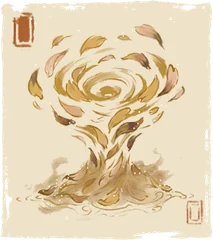

### 【各版本（境界 / 品质）】

练气·神品：葬花术：当自己的〔木〕卡牌（非召唤卡）战败后，召唤一只花灵

筑基·神品：葬花术：当自己的〔木〕卡牌（非召唤卡）战败后，召唤一只花灵

结丹·神品：葬花术：当自己的〔木〕卡牌（非召唤卡）战败后，召唤一只花灵

元婴·神品：葬花术：当自己的〔木〕卡牌（非召唤卡）战败后，召唤一只花灵

### 【获取途径】

修炼元婴期心法〈万木归灵法〉后获得

---

## 57. 孕灵术

### 【各版本（境界 / 品质）】

练气·神品：孕灵术：当主角受到伤害时，召唤一只花灵；（一回合最多触发3次）

筑基·神品：孕灵术：当主角受到伤害时，召唤一只花灵；（一回合最多触发3次）

结丹·神品：孕灵术：当主角受到伤害时，召唤一只花灵；（一回合最多触发3次）

元婴·神品：孕灵术：当主角受到伤害时，召唤一只花灵；（一回合最多触发3次）

### 【获取途径】

修炼元婴期心法〈血灵经〉后获得

---

## 58. 星图术

### 【各版本（境界 / 品质）】

荆棘·练气·仙品：荆棘：每回合第一次受到攻击时，**禁锢**随机敌方卡牌并反弹1〔伤害〕

荆棘·筑基·仙品：荆棘：每回合第一次受到攻击时，**禁锢**随机敌方卡牌并反弹3〔伤害〕

荆棘·结丹·仙品：荆棘：每回合第一次受到攻击时，**禁锢**随机敌方卡牌并反弹7〔伤害〕

荆棘·元婴·仙品：荆棘：每回合第一次受到攻击时，**禁锢**随机敌方卡牌并反弹19〔伤害〕

### 【获取途径】

修炼练气期心法〈涤尘术〉后获得

---

## 59. 卸力

### 【各版本（境界 / 品质）】

练气·地品：卸力：攻击造成伤害后，使目标的〔攻击〕-2；（一场战斗只会触发5次）

筑基·地品：卸力：攻击造成伤害后，使目标的〔攻击〕-5；（一场战斗只会触发5次）

结丹·地品：卸力：攻击造成伤害后，使目标的〔攻击〕-15；（一场战斗只会触发5次）

元婴·地品：卸力：攻击造成伤害后，使目标的〔攻击〕-40；（一场战斗只会触发5次）

### 【获取途径】

修炼筑基期心法〈止水功〉后获得

---

## 60. 保命

### 【各版本（境界 / 品质）】

练气·神品：保命：（被动）在战斗中受到致命伤害后，会保持1点血量不死（每场战斗只触发一次）

筑基·神品：保命：（被动）在战斗中受到致命伤害后，会保持1点血量不死（每场战斗只触发一次）

结丹·神品：保命：（被动）在战斗中受到致命伤害后，会保持1点血量不死（每场战斗只触发一次）

元婴·神品：保命：（被动）在战斗中受到致命伤害后，会保持1点血量不死（每场战斗只触发一次）

### 【获取途径】

修炼筑基期心法〈续脉经〉后获得

---

## 61. 涤尘

### 【各版本（境界 / 品质）】

练气·神品：涤尘：（被动）前5回合每回合开始时，清除自身的负面效果，并恢复2〔血量〕。

筑基·神品：涤尘：（被动）前5回合每回合开始时，清除自身的负面效果，并恢复6〔血量〕。

结丹·神品：涤尘：（被动）前5回合每回合开始时，清除自身的负面效果，并恢复15〔血量〕。

元婴·神品：涤尘：（被动）前5回合每回合开始时，清除自身的负面效果，并恢复40〔血量〕。

### 【获取途径】

修炼结丹期心法〈续脉经〉后获得

---

## 62. 燃血

### 【各版本（境界 / 品质）】

练气·仙品：燃血：（被动）回合开始后，如果身上有负面效果，则激活燃血：消耗4〔血量〕，清除负面效果并增加2〔攻击〕

筑基·仙品：燃血：（被动）回合开始后，如果身上有负面效果，则激活燃血：消耗10〔血量〕，清除负面效果并增加5〔攻击〕

结丹·仙品：燃血：（被动）回合开始后，如果身上有负面效果，则激活燃血：消耗28〔血量〕，清除负面效果并增加10〔攻击〕

元婴·仙品：燃血：（被动）回合开始后，如果身上有负面效果，则激活燃血：消耗80〔血量〕，清除负面效果并增加30〔攻击〕

### 【获取途径】

完成地火深洞的神秘高人挑战可以获得

---

## 63. 燃血贰

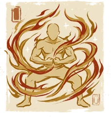

### 【各版本（境界 / 品质）】

练气·仙品：燃血贰：（被动）战斗开始时，消耗20自身〔血量〕，提升6〔攻击〕

筑基·仙品：燃血贰：（被动）战斗开始时，消耗50自身〔血量〕，提升15〔攻击〕

结丹·仙品：燃血贰：（被动）战斗开始时，消耗140自身〔血量〕，提升30〔攻击〕

元婴·仙品：燃血贰：（被动）战斗开始时，消耗400自身〔血量〕，提升90〔攻击〕

### 【获取途径】

完成地火深洞的神秘高人挑战可以获得

---

## 64. 斗转星移

### 【各版本（境界 / 品质）】

练气·仙品：斗转星移：使用兵器攻击后，吸收目标的1〔攻击〕附加于随机友军上；（一回合最多触发3次）

筑基·仙品：斗转星移：使用兵器攻击后，吸收目标的2〔攻击〕附加于随机友军上；（一回合最多触发3次）

结丹·仙品：斗转星移：使用兵器攻击后，吸收目标的3〔攻击〕附加于随机友军上；（一回合最多触发3次）

元婴·仙品：斗转星移：使用兵器攻击后，吸收目标的5〔攻击〕附加于随机友军上；（一回合最多触发3次）

### 【获取途径】

修炼结丹期心法〈溟吸术〉后获得

---

## 65. 神佑

### 【各版本（境界 / 品质）】

练气·仙品：神佑：友方第一张卡牌战败时，使它满血复活

筑基·仙品：神佑：友方第一张卡牌战败时，使它满血复活

结丹·仙品：神佑：友方第一张卡牌战败时，使它满血复活

元婴·仙品：神佑：友方第一张卡牌战败时，使它满血复活

### 【获取途径】

修炼结丹期心法〈回光心诀〉后获得

---

## 66. 无量障

### 【各版本（境界 / 品质）】

练气·神品：无量障：友方第一张卡牌战败时，使它保留一点血量，并获得嘲讽和24减伤（一回合）

筑基·神品：无量障：友方第一张卡牌战败时，使它保留一点血量，并获得嘲讽和60减伤（一回合）

结丹·神品：无量障：友方第一张卡牌战败时，使它保留一点血量，并获得嘲讽和160减伤（一回合）

元婴·神品：无量障：友方第一张卡牌战败时，使它保留一点血量，并获得嘲讽和500减伤（一回合）

### 【获取途径】

修炼元婴期心法〈守一诀〉后获得

---

## 67. 醉拳

### 【各版本（境界 / 品质）】

练气·仙品：醉拳：（被动）提高自身0〔攻击〕，每次行动会攻击2次，但自身陷入混乱状态（无法清除）

筑基·仙品：醉拳：（被动）提高自身1〔攻击〕，每次行动会攻击2次，但自身陷入混乱状态（无法清除）

结丹·仙品：醉拳：（被动）提高自身3〔攻击〕，每次行动会攻击2次，但自身陷入混乱状态（无法清除）

元婴·仙品：醉拳：（被动）提高自身8〔攻击〕，每次行动会攻击2次，但自身陷入混乱状态（无法清除）

### 【获取途径】

在自由模式里选择词条：醉中仙获得

---

## 68. 火焰拳

### 【各版本（境界 / 品质）】

练气·仙品：火焰拳：（被动）攻击前，先挥出火球攻击目标，造成2〔伤害〕

筑基·仙品：火焰拳：（被动）攻击前，先挥出火球攻击目标，造成5〔伤害〕

结丹·仙品：火焰拳：（被动）攻击前，先挥出火球攻击目标，造成14〔伤害〕

元婴·仙品：火焰拳：（被动）攻击前，先挥出火球攻击目标，造成40〔伤害〕

### 【获取途径】

完成地火深洞的神秘高人挑战可以获得

---

## 69. 乘胜

### 【各版本（境界 / 品质）】

练气·天品：乘胜：当友方〔火〕卡牌击败敌人时，使它获得2点增伤并再攻击一次；（一回合触发一次）

筑基·天品：乘胜：当友方〔火〕卡牌击败敌人时，使它获得4点增伤并再攻击一次；（一回合触发一次）

结丹·天品：乘胜：当友方〔火〕卡牌击败敌人时，使它获得10点增伤并再攻击一次；（一回合触发一次）

元婴·天品：乘胜：当友方〔火〕卡牌击败敌人时，使它获得27点增伤并再攻击一次；（一回合触发一次）

### 【获取途径】

修炼筑基期心法〈连锋诀〉后获得

---

## 70. 爆袭

### 【各版本（境界 / 品质）】

练气·天品：爆袭：每回合开始时，给随机的友方〔火〕卡牌获得2增伤（一回合）和额外攻击次数

筑基·天品：爆袭：每回合开始时，给随机的友方〔火〕卡牌获得4增伤（一回合）和额外攻击次数

结丹·天品：爆袭：每回合开始时，给随机的友方〔火〕卡牌获得10增伤（一回合）和额外攻击次数

元婴·天品：爆袭：每回合开始时，给随机的友方〔火〕卡牌获得27增伤（一回合）和额外攻击次数

### 【获取途径】

修炼筑基期心法〈爆炎诀〉后获得

---

## 71. 炎龙之力

### 【各版本（境界 / 品质）】

练气·天品：炎龙之力：（被动）战斗开始时，消耗自己20〔血量〕，转化为5点攻击力和减伤（整个战斗均生效）

筑基·天品：炎龙之力：（被动）战斗开始时，消耗自己35〔血量〕，转化为10点攻击力和减伤（整个战斗均生效）

结丹·天品：炎龙之力：（被动）战斗开始时，消耗自己75〔血量〕，转化为20点攻击力和减伤（整个战斗均生效）

元婴·天品：炎龙之力：（被动）战斗开始时，消耗自己150〔血量〕，转化为40点攻击力和减伤（整个战斗均生效）

### 【获取途径】

修炼结丹期心法〈化龙功〉后获得

---

## 72. 浴火雷劫

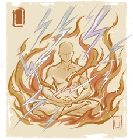

### 【各版本（境界 / 品质）】

练气·神品：浴火雷劫：（被动）在战斗中受到致命伤害会满血复活一次，但同时为敌方召唤9张天雷卡

筑基·神品：浴火雷劫：（被动）在战斗中受到致命伤害会满血复活一次，但同时为敌方召唤9张天雷卡

结丹·神品：浴火雷劫：（被动）在战斗中受到致命伤害会满血复活一次，但同时为敌方召唤9张天雷卡

元婴·神品：浴火雷劫：（被动）在战斗中受到致命伤害会满血复活一次，但同时为敌方召唤9张天雷卡

### 【获取途径】

修炼元婴期心法〈九死功〉后获得

---

## 73. 烬身三式

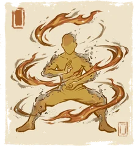

### 【各版本（境界 / 品质）】

练气·神品：烬身三式：（被动）战斗的第一回合，额外攻击2次，但第二回合无法行动（禁锢自身，无法清除）

筑基·神品：烬身三式：（被动）战斗的第一回合，额外攻击2次，但第二回合无法行动（禁锢自身，无法清除）

结丹·神品：烬身三式：（被动）战斗的第一回合，额外攻击2次，但第二回合无法行动（禁锢自身，无法清除）

元婴·神品：烬身三式：（被动）战斗的第一回合，额外攻击2次，但第二回合无法行动（禁锢自身，无法清除）

### 【获取途径】

修炼元婴期心法〈烬身诀〉后获得

---

## 74. 连击

### 【各版本（境界 / 品质）】

练气·绝品：连击：（被动）提高自身1〔攻击〕，每次行动会额外攻击一次

筑基·绝品：连击：（被动）提高自身2〔攻击〕，每次行动会额外攻击一次

结丹·绝品：连击：（被动）提高自身5〔攻击〕，每次行动会额外攻击一次

元婴·绝品：连击：（被动）提高自身15〔攻击〕，每次行动会额外攻击一次

### 【获取途径】

绝品武道结丹有概率获得

在天帝宝库里可获得

---

## 75. 吸血

### 【各版本（境界 / 品质）】

练气·绝品：吸血：攻击附带吸血效果：造成伤害有一定比例转化成自身血量；（练气期的吸血比例为10%；每提升一个境界，比例提高10%）

筑基·绝品：吸血：攻击附带吸血效果：造成伤害有一定比例转化成自身血量；（练气期的吸血比例为10%；每提升一个境界，比例提高10%）

结丹·绝品：吸血：攻击附带吸血效果：造成伤害有一定比例转化成自身血量；（练气期的吸血比例为10%；每提升一个境界，比例提高10%）

元婴·绝品：吸血：攻击附带吸血效果：造成伤害有一定比例转化成自身血量；（练气期的吸血比例为10%；每提升一个境界，比例提高10%）

### 【获取途径】

绝品武道结丹有概率获得

在天帝宝库里可获得

---

## 76. 拳风

### 【各版本（境界 / 品质）】

练气·绝品：拳风：攻击会对目标身旁卡牌造成30%伤害

筑基·绝品：拳风：攻击会对目标身旁卡牌造成30%伤害

结丹·绝品：拳风：攻击会对目标身旁卡牌造成30%伤害

元婴·绝品：拳风：攻击会对目标身旁卡牌造成40%伤害

### 【获取途径】

绝品武道结丹有概率获得

在天帝宝库里可获得

---

## 77. 金刚霸体

### 【各版本（境界 / 品质）】

练气·神品：金刚霸体：（被动）受到的所有伤害均减少1

筑基·神品：金刚霸体：（被动）受到的所有伤害均减少2

结丹·神品：金刚霸体：（被动）受到的所有伤害均减少10

元婴·神品：金刚霸体：（被动）受到的所有伤害均减少30

### 【获取途径】

神品/绝品武道结丹有概率获得

---

## 78. 血噬

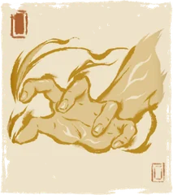

### 【各版本（境界 / 品质）】

练气·神品：血噬：每当有敌方卡牌被击败时，自身恢复5〔血量〕

筑基·神品：血噬：每当有敌方卡牌被击败时，自身恢复15〔血量〕

结丹·神品：血噬：每当有敌方卡牌被击败时，自身恢复35〔血量〕

元婴·神品：血噬：每当有敌方卡牌被击败时，自身恢复60〔血量〕

### 【获取途径】

神品/绝品武道结丹有概率获得

---

## 79. 岩肤体

### 【各版本（境界 / 品质）】

练气·人品：岩肤体：加入战场后的首个回合，获得持续一回合的3点**减伤**

筑基·人品：岩肤体：加入战场后的首个回合，获得持续一回合的8点**减伤**

结丹·人品：岩肤体：加入战场后的首个回合，获得持续一回合的20点**减伤**

元婴·人品：岩肤体：加入战场后的首个回合，获得持续一回合的60点**减伤**

### 【获取途径】

修炼练气期心法〈岩息术〉后获得

---

## 80. 反击式

### 【各版本（境界 / 品质）】

练气·人品：反击：受到近战攻击时，以20%攻击力反击攻击者

筑基·人品：反击：受到近战攻击时，以25%攻击力反击攻击者

结丹·人品：反击：受到近战攻击时，以30%攻击力反击攻击者

元婴·人品：反击：受到近战攻击时，以35%攻击力反击攻击者

### 【获取途径】

修炼练气期心法〈金刚拳法〉后获得

---

## 81. 嘲讽体

### 【各版本（境界 / 品质）】

练气·地品：嘲讽：（被动）战斗中，会优先受到攻击，且获得2点减伤

筑基·地品：嘲讽：（被动）战斗中，会优先受到攻击，且获得5点减伤

结丹·地品：嘲讽：（被动）战斗中，会优先受到攻击，且获得15点减伤

元婴·地品：嘲讽：（被动）战斗中，会优先受到攻击，且获得50点减伤

### 【获取途径】

修炼筑基期心法〈镇岳诀〉后获得

---

## 82. 反击式贰

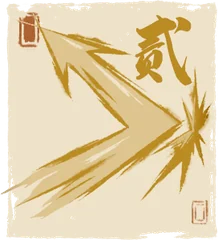

### 【各版本（境界 / 品质）】

练气·天品：反击贰：受到远程攻击时，自身〔攻击〕+2

筑基·天品：反击贰：受到远程攻击时，自身〔攻击〕+5

结丹·天品：反击贰：受到远程攻击时，自身〔攻击〕+10

元婴·天品：反击贰：受到远程攻击时，自身〔攻击〕+20

### 【获取途径】

修炼筑基期心法〈混元破障拳〉后获得

---

## 83. 不动

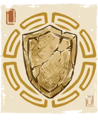

### 【各版本（境界 / 品质）】

练气·仙品：不动：（被动）战斗开始时，禁锢自身2回合（无法清除），为自己增加35〔护甲〕

筑基·仙品：不动：（被动）战斗开始时，禁锢自身2回合（无法清除），为自己增加120〔护甲〕

结丹·仙品：不动：（被动）战斗开始时，禁锢自身2回合（无法清除），为自己增加400〔护甲〕

元婴·仙品：不动：（被动）战斗开始时，禁锢自身2回合（无法清除），为自己增加1200〔护甲〕

### 【获取途径】

完成地火深洞的神秘高人挑战可以获得

---

## 84. 忍耐

### 【各版本（境界 / 品质）】

练气·仙品：忍耐：处于禁锢状态下，被攻击时会额外增加自身2〔攻击〕

筑基·仙品：忍耐：处于禁锢状态下，被攻击时会额外增加自身3〔攻击〕

结丹·仙品：忍耐：处于禁锢状态下，被攻击时会额外增加自身5〔攻击〕

元婴·仙品：忍耐：处于禁锢状态下，被攻击时会额外增加自身10〔攻击〕

### 【获取途径】

完成地火深洞的神秘高人挑战可以获得

---

## 85. 分神

### 【各版本（境界 / 品质）】

练气·仙品：分神：战斗开始的第一回合，召唤一个主角分身，该分身固定只有1〔攻击〕，但会保留一定比例的血量和自带**嘲讽**；（这个分身场上同时只能存在一个）

筑基·仙品：分神：战斗开始的第一回合，召唤一个主角分身，该分身固定只有1〔攻击〕，但会保留一定比例的血量和自带**嘲讽**；（这个分身场上同时只能存在一个）

结丹·仙品：分神：战斗开始的第一回合，召唤一个主角分身，该分身固定只有1〔攻击〕，但会保留一定比例的血量和自带**嘲讽**；（这个分身场上同时只能存在一个）

元婴·仙品：分神：战斗开始的第一回合，召唤一个主角分身，该分身固定只有1〔攻击〕，但会保留一定比例的血量和自带**嘲讽**；（这个分身场上同时只能存在一个）

### 【获取途径】

修炼结丹期心法〈分神诀〉后获得

---

## 86. 土影卫

### 【各版本（境界 / 品质）】

练气·仙品：土影卫：战斗开始的第一回合，复制一个随机友方灵兽的分身，这个分身的〔血量〕固定为1，但会继承2倍的攻击力；（这个分身场上同时只能存在一个）

筑基·仙品：土影卫：战斗开始的第一回合，复制一个随机友方灵兽的分身，这个分身的〔血量〕固定为1，但会继承2倍的攻击力；（这个分身场上同时只能存在一个）

结丹·仙品：土影卫：战斗开始的第一回合，复制一个随机友方灵兽的分身，这个分身的〔血量〕固定为1，但会继承2倍的攻击力；（这个分身场上同时只能存在一个）

元婴·仙品：土影卫：战斗开始的第一回合，复制一个随机友方灵兽的分身，这个分身的〔血量〕固定为1，但会继承2倍的攻击力；（这个分身场上同时只能存在一个）

### 【获取途径】

修炼结丹期心法〈土影诀〉后获得

---

## 87. 暗杀

### 【各版本（境界 / 品质）】

练气·神品：暗杀：（被动）战斗开始时，使随机两把兵器获得无视护甲的效果

筑基·神品：暗杀：（被动）战斗开始时，使随机两把兵器获得无视护甲的效果

结丹·神品：暗杀：（被动）战斗开始时，使随机两把兵器获得无视护甲的效果

元婴·神品：暗杀：（被动）战斗开始时，使随机两把兵器获得无视护甲的效果

### 【获取途径】

修炼元婴期心法〈无障诀〉后获得

---

## 88. 蚀脉

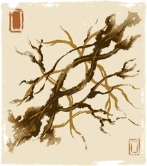

### 【各版本（境界 / 品质）】

练气·神品：蚀脉：当敌方卡牌恢复生命值时，对它造成一次5〔伤害〕；（每回合触发一次）

筑基·神品：蚀脉：当敌方卡牌恢复生命值时，对它造成一次18〔伤害〕；（每回合触发一次）

结丹·神品：蚀脉：当敌方卡牌恢复生命值时，对它造成一次50〔伤害〕；（每回合触发一次）

元婴·神品：蚀脉：当敌方卡牌恢复生命值时，对它造成一次120〔伤害〕；（每回合触发一次）

### 【获取途径】

修炼筑基期心法〈逆生劫典〉后获得

---

## 89. 聚灵化盾

### 【各版本（境界 / 品质）】

练气·神品：聚灵化盾：（被动）进入战场的首个回合开始时，获得5点〔护甲〕

筑基·神品：聚灵化盾：（被动）进入战场的首个回合开始时，获得12点〔护甲〕

结丹·神品：聚灵化盾：（被动）进入战场的首个回合开始时，获得25点〔护甲〕

元婴·神品：聚灵化盾：（被动）进入战场的首个回合开始时，获得60点〔护甲〕

### 【获取途径】

修炼练气期心法〈混元功（二）〉后获得

---

## 90. 刺杀术

### 【各版本（境界 / 品质）】

练气·绝品：刺杀术：自己的双刀可额外攻击一次，但每回合受到的第一次伤害会提高2（结丹后无负面效果）

筑基·绝品：刺杀术：自己的双刀可额外攻击一次，但每回合受到的第一次伤害会提高5（结丹后无负面效果）

结丹·绝品：刺杀术：自己的双刀可额外攻击一次，但每回合受到的第一次伤害会提高1（结丹后无负面效果）

元婴·绝品：刺杀术：自己的双刀可额外攻击一次，但每回合受到的第一次伤害会提高2（结丹后无负面效果）

### 【获取途径】

修炼执黑筑基任务流程中的刺杀术后获得

---

## 91. 器魂重塑

### 【各版本（境界 / 品质）】

练气·绝品：器魂重塑：自己第一个法宝战败时，使它满血复活

筑基·绝品：器魂重塑：自己第一个法宝战败时，使它满血复活

结丹·绝品：器魂重塑：自己第一个法宝战败时，使它满血复活

元婴·绝品：器魂重塑：自己第一个法宝战败时，使它满血复活

### 【获取途径】

绝品器道结丹有概率获得

---

## 92. 兽魂重塑

### 【各版本（境界 / 品质）】

练气·绝品：兽魂重塑：自己第一个灵兽战败时，使它满血复活

筑基·绝品：兽魂重塑：自己第一个灵兽战败时，使它满血复活

结丹·绝品：兽魂重塑：自己第一个灵兽战败时，使它满血复活

元婴·绝品：兽魂重塑：自己第一个灵兽战败时，使它满血复活

### 【获取途径】

绝品兽道结丹有概率获得

---

## 93. 聚光

在天地熔炉炼化本命物后获得的本命技能。

可以在**愈灵工作台或恢复工作台**将其还原成本命物

### 【各版本（境界 / 品质）】

练气·绝品：本命·聚光：战斗开始后的第一回合，获得**光盾**

筑基·绝品：本命·聚光：战斗开始后的第一回合，获得**光盾**

结丹·绝品：本命·聚光：战斗开始后的第一回合，获得**光盾**

元婴·绝品：本命·聚光：战斗开始后的第一回合，获得**光盾**

化神·绝品：本命·聚光：战斗开始后的第一回合，获得**光盾**

### 【获取途径】

第 1 步：主角结丹后，把绝品〈飞虹剑〉放进修炼工作台，炼成本命物（每人只能有一个；自由模式也可以用开局词条直接选练气期本命物）

第 2 步：带着本命物进入秘境「天地熔炉」，放进「熔炉」工作台的「炼化本命物」，获得本命技能〈聚光〉（技能境界和本命物相同）

第 3 步（可选）：在修炼工作台「提升本命技能境界」逐级提升

想换回本命物，放进愈灵工作台或恢复工作台还原（恢复工作台扣 5 年寿元）

---

## 94. 共鸣肆

在天地熔炉炼化本命物后获得的本命技能。

可以在**愈灵工作台或恢复工作台**将其还原成本命物

### 【各版本（境界 / 品质）】

练气·绝品：本命·共鸣肆：敌方卡牌失去**光盾**时，此卡牌获得**光盾**

筑基·绝品：本命·共鸣肆：敌方卡牌失去**光盾**时，此卡牌获得**光盾**

结丹·绝品：本命·共鸣肆：敌方卡牌失去**光盾**时，此卡牌获得**光盾**

元婴·绝品：本命·共鸣肆：敌方卡牌失去**光盾**时，此卡牌获得**光盾**

化神·绝品：本命·共鸣肆：敌方卡牌失去**光盾**时，此卡牌获得**光盾**

### 【获取途径】

第 1 步：主角结丹后，把绝品〈破光灵剑〉放进修炼工作台，炼成本命物（每人只能有一个；自由模式也可以用开局词条直接选练气期本命物）

第 2 步：带着本命物进入秘境「天地熔炉」，放进「熔炉」工作台的「炼化本命物」，获得本命技能〈共鸣肆〉（技能境界和本命物相同）

第 3 步（可选）：在修炼工作台「提升本命技能境界」逐级提升

想换回本命物，放进愈灵工作台或恢复工作台还原（恢复工作台扣 5 年寿元）

---

## 95. 光力肆

在天地熔炉炼化本命物后获得的本命技能。

可以在**愈灵工作台或恢复工作台**将其还原成本命物

### 【各版本（境界 / 品质）】

练气·绝品：本命·光力肆：当我方卡牌失去**光盾**时，使自己获得一次攻击次数和〔攻击〕+1。

筑基·绝品：本命·光力肆：当我方卡牌失去**光盾**时，使自己获得一次攻击次数和〔攻击〕+2。

结丹·绝品：本命·光力肆：当我方卡牌失去**光盾**时，使自己获得一次攻击次数和〔攻击〕+6。

元婴·绝品：本命·光力肆：当我方卡牌失去**光盾**时，使自己获得一次攻击次数和〔攻击〕+16。

化神·绝品：本命·光力肆：当我方卡牌失去**光盾**时，使自己获得一次攻击次数和〔攻击〕+45。

### 【获取途径】

第 1 步：主角结丹后，把绝品〈碎星〉放进修炼工作台，炼成本命物（每人只能有一个；自由模式也可以用开局词条直接选练气期本命物）

第 2 步：带着本命物进入秘境「天地熔炉」，放进「熔炉」工作台的「炼化本命物」，获得本命技能〈光力肆〉（技能境界和本命物相同）

第 3 步（可选）：在修炼工作台「提升本命技能境界」逐级提升

想换回本命物，放进愈灵工作台或恢复工作台还原（恢复工作台扣 5 年寿元）

---

## 96. 天罡

在天地熔炉炼化本命物后获得的本命技能。

可以在**愈灵工作台或恢复工作台**将其还原成本命物

### 【各版本（境界 / 品质）】

练气·绝品：本命·天罡：回合开始时，场上每有一张〔金〕卡牌，则此卡牌的〔攻击〕和〔血量〕均提高1

筑基·绝品：本命·天罡：回合开始时，场上每有一张〔金〕卡牌，则此卡牌的〔攻击〕和〔血量〕均提高2

结丹·绝品：本命·天罡：回合开始时，场上每有一张〔金〕卡牌，则此卡牌的〔攻击〕和〔血量〕均提高3

元婴·绝品：本命·天罡：回合开始时，场上每有一张〔金〕卡牌，则此卡牌的〔攻击〕和〔血量〕均提高5

化神·绝品：本命·天罡：回合开始时，场上每有一张〔金〕卡牌，则此卡牌的〔攻击〕和〔血量〕均提高10

### 【获取途径】

第 1 步：主角结丹后，把绝品〈金光刀〉放进修炼工作台，炼成本命物（每人只能有一个；自由模式也可以用开局词条直接选练气期本命物）

第 2 步：带着本命物进入秘境「天地熔炉」，放进「熔炉」工作台的「炼化本命物」，获得本命技能〈天罡〉（技能境界和本命物相同）

第 3 步（可选）：在修炼工作台「提升本命技能境界」逐级提升

想换回本命物，放进愈灵工作台或恢复工作台还原（恢复工作台扣 5 年寿元）

---

## 97. 天罡贰

场上每有一张〔金〕卡牌，此卡牌的〔攻击〕获得一定提高

在天地熔炉炼化本命物后获得的本命技能。

可以在**愈灵工作台或恢复工作台**将其还原成本命物

### 【各版本（境界 / 品质）】

练气·绝品：本命·天罡贰：回合开始时，场上每有一张〔金〕卡牌，此卡牌的〔攻击〕+2

筑基·绝品：本命·天罡贰：回合开始时，场上每有一张〔金〕卡牌，此卡牌的〔攻击〕+4

结丹·绝品：本命·天罡贰：回合开始时，场上每有一张〔金〕卡牌，此卡牌的〔攻击〕+6

元婴·绝品：本命·天罡贰：回合开始时，场上每有一张〔金〕卡牌，此卡牌的〔攻击〕+10

化神·绝品：本命·天罡贰：回合开始时，场上每有一张〔金〕卡牌，此卡牌的〔攻击〕+20

### 【获取途径】

第 1 步：主角结丹后，把绝品〈斩月妖刀〉放进修炼工作台，炼成本命物（每人只能有一个；自由模式也可以用开局词条直接选练气期本命物）

第 2 步：带着本命物进入秘境「天地熔炉」，放进「熔炉」工作台的「炼化本命物」，获得本命技能〈天罡贰〉（技能境界和本命物相同）

第 3 步（可选）：在修炼工作台「提升本命技能境界」逐级提升

想换回本命物，放进愈灵工作台或恢复工作台还原（恢复工作台扣 5 年寿元）

---

## 98. 力拔

在天地熔炉炼化本命物后获得的本命技能。

可以在**愈灵工作台或恢复工作台**将其还原成本命物

### 【各版本（境界 / 品质）】

练气·绝品：本命·力拔：此卡牌攻击后，〔攻击〕+1

筑基·绝品：本命·力拔：此卡牌攻击后，〔攻击〕+3

结丹·绝品：本命·力拔：此卡牌攻击后，〔攻击〕+8

元婴·绝品：本命·力拔：此卡牌攻击后，〔攻击〕+22

化神·绝品：本命·力拔：此卡牌攻击后，〔攻击〕+60

### 【获取途径】

第 1 步：主角结丹后，把绝品〈金蝶刺〉放进修炼工作台，炼成本命物（每人只能有一个；自由模式也可以用开局词条直接选练气期本命物）

第 2 步：带着本命物进入秘境「天地熔炉」，放进「熔炉」工作台的「炼化本命物」，获得本命技能〈力拔〉（技能境界和本命物相同）

第 3 步（可选）：在修炼工作台「提升本命技能境界」逐级提升

想换回本命物，放进愈灵工作台或恢复工作台还原（恢复工作台扣 5 年寿元）

---

## 99. 共鸣

在天地熔炉炼化本命物后获得的本命技能。

可以在**愈灵工作台或恢复工作台**将其还原成本命物

### 【各版本（境界 / 品质）】

练气·绝品：本命·共鸣：我方其他〔金〕卡牌攻击后，自身的〔攻击〕+1

筑基·绝品：本命·共鸣：我方其他〔金〕卡牌攻击后，自身的〔攻击〕+2

结丹·绝品：本命·共鸣：我方其他〔金〕卡牌攻击后，自身的〔攻击〕+4

元婴·绝品：本命·共鸣：我方其他〔金〕卡牌攻击后，自身的〔攻击〕+8

化神·绝品：本命·共鸣：我方其他〔金〕卡牌攻击后，自身的〔攻击〕+16

### 【获取途径】

第 1 步：主角结丹后，把绝品〈破风古笛〉放进修炼工作台，炼成本命物（每人只能有一个；自由模式也可以用开局词条直接选练气期本命物）

第 2 步：带着本命物进入秘境「天地熔炉」，放进「熔炉」工作台的「炼化本命物」，获得本命技能〈共鸣〉（技能境界和本命物相同）

第 3 步（可选）：在修炼工作台「提升本命技能境界」逐级提升

想换回本命物，放进愈灵工作台或恢复工作台还原（恢复工作台扣 5 年寿元）

---

## 100. 共鸣贰

在天地熔炉炼化本命物后获得的本命技能。

可以在**愈灵工作台或恢复工作台**将其还原成本命物

### 【各版本（境界 / 品质）】

练气·绝品：本命·共鸣贰：我方其他〔金〕卡牌攻击前，使它的〔攻击〕+1

筑基·绝品：本命·共鸣贰：我方其他〔金〕卡牌攻击前，使它的〔攻击〕+3

结丹·绝品：本命·共鸣贰：我方其他〔金〕卡牌攻击前，使它的〔攻击〕+10

元婴·绝品：本命·共鸣贰：我方其他〔金〕卡牌攻击前，使它的〔攻击〕+25

化神·绝品：本命·共鸣贰：我方其他〔金〕卡牌攻击前，使它的〔攻击〕+50

### 【获取途径】

第 1 步：主角结丹后，把绝品〈金芒铃〉放进修炼工作台，炼成本命物（每人只能有一个；自由模式也可以用开局词条直接选练气期本命物）

第 2 步：带着本命物进入秘境「天地熔炉」，放进「熔炉」工作台的「炼化本命物」，获得本命技能〈共鸣贰〉（技能境界和本命物相同）

第 3 步（可选）：在修炼工作台「提升本命技能境界」逐级提升

想换回本命物，放进愈灵工作台或恢复工作台还原（恢复工作台扣 5 年寿元）

---

## 101. 聚光叁

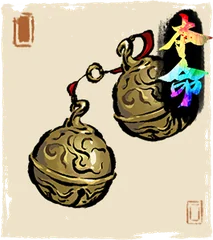

在天地熔炉炼化本命物后获得的本命技能。

可以在**愈灵工作台或恢复工作台**将其还原成本命物

### 【各版本（境界 / 品质）】

练气·绝品：本命·聚光叁：受到伤害时，使随机友军获得**光盾**

筑基·绝品：本命·聚光叁：受到伤害时，使随机友军获得**光盾**

结丹·绝品：本命·聚光叁：受到伤害时，使随机友军获得**光盾**

元婴·绝品：本命·聚光叁：受到伤害时，使随机友军获得**光盾**

化神·绝品：本命·聚光叁：受到伤害时，使随机友军获得**光盾**

### 【获取途径】

第 1 步：主角结丹后，把绝品〈合欢魔铃〉放进修炼工作台，炼成本命物（每人只能有一个；自由模式也可以用开局词条直接选练气期本命物）

第 2 步：带着本命物进入秘境「天地熔炉」，放进「熔炉」工作台的「炼化本命物」，获得本命技能〈聚光叁〉（技能境界和本命物相同）

第 3 步（可选）：在修炼工作台「提升本命技能境界」逐级提升

想换回本命物，放进愈灵工作台或恢复工作台还原（恢复工作台扣 5 年寿元）

---

## 102. 共鸣叁

在天地熔炉炼化本命物后获得的本命技能。

可以在**愈灵工作台或恢复工作台**将其还原成本命物

### 【各版本（境界 / 品质）】

练气·绝品：本命·共鸣叁：友方卡牌获得**光盾**时，此卡牌也获得**光盾**

筑基·绝品：本命·共鸣叁：友方卡牌获得**光盾**时，此卡牌也获得**光盾**

结丹·绝品：本命·共鸣叁：友方卡牌获得**光盾**时，此卡牌也获得**光盾**

元婴·绝品：本命·共鸣叁：友方卡牌获得**光盾**时，此卡牌也获得**光盾**

化神·绝品：本命·共鸣叁：友方卡牌获得**光盾**时，此卡牌也获得**光盾**

### 【获取途径】

第 1 步：主角结丹后，把绝品〈银霄天令〉放进修炼工作台，炼成本命物（每人只能有一个；自由模式也可以用开局词条直接选练气期本命物）

第 2 步：带着本命物进入秘境「天地熔炉」，放进「熔炉」工作台的「炼化本命物」，获得本命技能〈共鸣叁〉（技能境界和本命物相同）

第 3 步（可选）：在修炼工作台「提升本命技能境界」逐级提升

想换回本命物，放进愈灵工作台或恢复工作台还原（恢复工作台扣 5 年寿元）

---

## 103. 光力伍

在天地熔炉炼化本命物后获得的本命技能。

可以在**愈灵工作台或恢复工作台**将其还原成本命物

### 【各版本（境界 / 品质）】

练气·绝品：本命·光力伍：当友军获得**光盾**时，此卡牌也获得光盾

筑基·绝品：本命·光力伍：当友军获得**光盾**时，此卡牌也获得光盾

结丹·绝品：本命·光力伍：当友军获得**光盾**时，此卡牌也获得光盾

元婴·绝品：本命·光力伍：当友军获得**光盾**时，此卡牌也获得光盾

化神·绝品：本命·光力伍：当友军获得**光盾**时，此卡牌也获得光盾

### 【获取途径】

第 1 步：主角结丹后，把绝品〈凝光宝镜〉放进修炼工作台，炼成本命物（每人只能有一个；自由模式也可以用开局词条直接选练气期本命物）

第 2 步：带着本命物进入秘境「天地熔炉」，放进「熔炉」工作台的「炼化本命物」，获得本命技能〈光力伍〉（技能境界和本命物相同）

第 3 步（可选）：在修炼工作台「提升本命技能境界」逐级提升

想换回本命物，放进愈灵工作台或恢复工作台还原（恢复工作台扣 5 年寿元）

---

## 104. 光力贰

在天地熔炉炼化本命物后获得的本命技能。

可以在**愈灵工作台或恢复工作台**将其还原成本命物

### 【各版本（境界 / 品质）】

练气·绝品：本命·光力贰：当友军获得**光盾**时，此卡牌的〔攻击〕和〔血量〕均提高2

筑基·绝品：本命·光力贰：当友军获得**光盾**时，此卡牌的〔攻击〕和〔血量〕均提高4

结丹·绝品：本命·光力贰：当友军获得**光盾**时，此卡牌的〔攻击〕和〔血量〕均提高12

元婴·绝品：本命·光力贰：当友军获得**光盾**时，此卡牌的〔攻击〕和〔血量〕均提高32

化神·绝品：本命·光力贰：当友军获得**光盾**时，此卡牌的〔攻击〕和〔血量〕均提高90

### 【获取途径】

第 1 步：主角结丹后，把绝品〈缚妖〉放进修炼工作台，炼成本命物（每人只能有一个；自由模式也可以用开局词条直接选练气期本命物）

第 2 步：带着本命物进入秘境「天地熔炉」，放进「熔炉」工作台的「炼化本命物」，获得本命技能〈光力贰〉（技能境界和本命物相同）

第 3 步（可选）：在修炼工作台「提升本命技能境界」逐级提升

想换回本命物，放进愈灵工作台或恢复工作台还原（恢复工作台扣 5 年寿元）

---

## 105. 聚光贰

在天地熔炉炼化本命物后获得的本命技能。

可以在**愈灵工作台或恢复工作台**将其还原成本命物

### 【各版本（境界 / 品质）】

练气·绝品：本命·聚光贰：每回合结束时，使我方（除本卡牌外）随机卡牌获得**光盾**

筑基·绝品：本命·聚光贰：每回合结束时，使我方（除本卡牌外）随机卡牌获得**光盾**

结丹·绝品：本命·聚光贰：每回合结束时，使我方（除本卡牌外）随机卡牌获得**光盾**

元婴·绝品：本命·聚光贰：每回合结束时，使我方（除本卡牌外）随机卡牌获得**光盾**

化神·绝品：本命·聚光贰：每回合结束时，使我方（除本卡牌外）随机卡牌获得**光盾**

### 【获取途径】

第 1 步：主角结丹后，把绝品〈灵狐〉放进修炼工作台，炼成本命物（每人只能有一个；自由模式也可以用开局词条直接选练气期本命物）

第 2 步：带着本命物进入秘境「天地熔炉」，放进「熔炉」工作台的「炼化本命物」，获得本命技能〈聚光贰〉（技能境界和本命物相同）

第 3 步（可选）：在修炼工作台「提升本命技能境界」逐级提升

想换回本命物，放进愈灵工作台或恢复工作台还原（恢复工作台扣 5 年寿元）

---

## 106. 光力

在天地熔炉炼化本命物后获得的本命技能。

可以在**愈灵工作台或恢复工作台**将其还原成本命物

### 【各版本（境界 / 品质）】

练气·绝品：本命·光力：当友军失去**光盾**时，此卡牌的〔攻击〕和〔血量〕均提高2

筑基·绝品：本命·光力：当友军失去**光盾**时，此卡牌的〔攻击〕和〔血量〕均提高4

结丹·绝品：本命·光力：当友军失去**光盾**时，此卡牌的〔攻击〕和〔血量〕均提高12

元婴·绝品：本命·光力：当友军失去**光盾**时，此卡牌的〔攻击〕和〔血量〕均提高32

化神·绝品：本命·光力：当友军失去**光盾**时，此卡牌的〔攻击〕和〔血量〕均提高90

### 【获取途径】

第 1 步：主角结丹后，把绝品〈金瞳虎〉放进修炼工作台，炼成本命物（每人只能有一个；自由模式也可以用开局词条直接选练气期本命物）

第 2 步：带着本命物进入秘境「天地熔炉」，放进「熔炉」工作台的「炼化本命物」，获得本命技能〈光力〉（技能境界和本命物相同）

第 3 步（可选）：在修炼工作台「提升本命技能境界」逐级提升

想换回本命物，放进愈灵工作台或恢复工作台还原（恢复工作台扣 5 年寿元）

---

## 107. 光力叁

在天地熔炉炼化本命物后获得的本命技能。

可以在**愈灵工作台或恢复工作台**将其还原成本命物

### 【各版本（境界 / 品质）】

练气·绝品：本命·光力叁：当友军失去**光盾**时，使它的〔攻击〕和〔血量〕+2

筑基·绝品：本命·光力叁：当友军失去**光盾**时，使它的〔攻击〕和〔血量〕+4

结丹·绝品：本命·光力叁：当友军失去**光盾**时，使它的〔攻击〕和〔血量〕+12

元婴·绝品：本命·光力叁：当友军失去**光盾**时，使它的〔攻击〕和〔血量〕+32

化神·绝品：本命·光力叁：当友军失去**光盾**时，使它的〔攻击〕和〔血量〕+90

### 【获取途径】

第 1 步：主角结丹后，把绝品〈貔貅〉放进修炼工作台，炼成本命物（每人只能有一个；自由模式也可以用开局词条直接选练气期本命物）

第 2 步：带着本命物进入秘境「天地熔炉」，放进「熔炉」工作台的「炼化本命物」，获得本命技能〈光力叁〉（技能境界和本命物相同）

第 3 步（可选）：在修炼工作台「提升本命技能境界」逐级提升

想换回本命物，放进愈灵工作台或恢复工作台还原（恢复工作台扣 5 年寿元）

---

## 108. 聚光肆

在天地熔炉炼化本命物后获得的本命技能。

可以在**愈灵工作台或恢复工作台**将其还原成本命物

### 【各版本（境界 / 品质）】

练气·绝品：本命·聚光肆：每回合一次，自己受到攻击时，为队伍里的任意角色施加**光盾**

筑基·绝品：本命·聚光肆：每回合一次，自己受到攻击时，为队伍里的任意角色施加**光盾**

结丹·绝品：本命·聚光肆：每回合一次，自己受到攻击时，为队伍里的任意角色施加**光盾**

元婴·绝品：本命·聚光肆：每回合一次，自己受到攻击时，为队伍里的任意角色施加**光盾**

化神·绝品：本命·聚光肆：每回合一次，自己受到攻击时，为队伍里的任意角色施加**光盾**

### 【获取途径】

第 1 步：主角结丹后，把绝品〈幻纱伞〉放进修炼工作台，炼成本命物（每人只能有一个；自由模式也可以用开局词条直接选练气期本命物）

第 2 步：带着本命物进入秘境「天地熔炉」，放进「熔炉」工作台的「炼化本命物」，获得本命技能〈聚光肆〉（技能境界和本命物相同）

第 3 步（可选）：在修炼工作台「提升本命技能境界」逐级提升

想换回本命物，放进愈灵工作台或恢复工作台还原（恢复工作台扣 5 年寿元）

---

## 109. 蝉甲

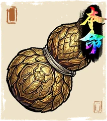

在天地熔炉炼化本命物后获得的本命技能。

可以在**愈灵工作台或恢复工作台**将其还原成本命物

### 【各版本（境界 / 品质）】

练气·绝品：本命·蝉甲：当自己受到攻击后，获得1减伤（持续一回合）

筑基·绝品：本命·蝉甲：当自己受到攻击后，获得3减伤（持续一回合）

结丹·绝品：本命·蝉甲：当自己受到攻击后，获得7减伤（持续一回合）

元婴·绝品：本命·蝉甲：当自己受到攻击后，获得17减伤（持续一回合）

化神·绝品：本命·蝉甲：当自己受到攻击后，获得50减伤（持续一回合）

### 【获取途径】

第 1 步：主角结丹后，把绝品〈鎏金葫芦〉放进修炼工作台，炼成本命物（每人只能有一个；自由模式也可以用开局词条直接选练气期本命物）

第 2 步：带着本命物进入秘境「天地熔炉」，放进「熔炉」工作台的「炼化本命物」，获得本命技能〈蝉甲〉（技能境界和本命物相同）

第 3 步（可选）：在修炼工作台「提升本命技能境界」逐级提升

想换回本命物，放进愈灵工作台或恢复工作台还原（恢复工作台扣 5 年寿元）

---

## 110. 凝甲

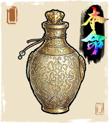

在天地熔炉炼化本命物后获得的本命技能。

可以在**愈灵工作台或恢复工作台**将其还原成本命物

### 【各版本（境界 / 品质）】

练气·绝品：本命·凝甲：当我方卡牌失去**光盾**时，使它获得2〔护甲〕

筑基·绝品：本命·凝甲：当我方卡牌失去**光盾**时，使它获得5〔护甲〕

结丹·绝品：本命·凝甲：当我方卡牌失去**光盾**时，使它获得14〔护甲〕

元婴·绝品：本命·凝甲：当我方卡牌失去**光盾**时，使它获得40〔护甲〕

化神·绝品：本命·凝甲：当我方卡牌失去**光盾**时，使它获得110〔护甲〕

### 【获取途径】

第 1 步：主角结丹后，把绝品〈千蝉净瓶〉放进修炼工作台，炼成本命物（每人只能有一个；自由模式也可以用开局词条直接选练气期本命物）

第 2 步：带着本命物进入秘境「天地熔炉」，放进「熔炉」工作台的「炼化本命物」，获得本命技能〈凝甲〉（技能境界和本命物相同）

第 3 步（可选）：在修炼工作台「提升本命技能境界」逐级提升

想换回本命物，放进愈灵工作台或恢复工作台还原（恢复工作台扣 5 年寿元）

---

## 111. 聚光伍

在天地熔炉炼化本命物后获得的本命技能。

可以在**愈灵工作台或恢复工作台**将其还原成本命物

### 【各版本（境界 / 品质）】

练气·绝品：本命·聚光伍：攻击后，使自己获得**光盾**

筑基·绝品：本命·聚光伍：攻击后，使自己获得**光盾**

结丹·绝品：本命·聚光伍：攻击后，使自己获得**光盾**

元婴·绝品：本命·聚光伍：攻击后，使自己获得**光盾**

化神·绝品：本命·聚光伍：攻击后，使自己获得**光盾**

### 【获取途径】

第 1 步：主角结丹后，把绝品〈蜕翼琴〉放进修炼工作台，炼成本命物（每人只能有一个；自由模式也可以用开局词条直接选练气期本命物）

第 2 步：带着本命物进入秘境「天地熔炉」，放进「熔炉」工作台的「炼化本命物」，获得本命技能〈聚光伍〉（技能境界和本命物相同）

第 3 步（可选）：在修炼工作台「提升本命技能境界」逐级提升

想换回本命物，放进愈灵工作台或恢复工作台还原（恢复工作台扣 5 年寿元）

---

## 112. 金粉

在天地熔炉炼化本命物后获得的本命技能。

可以在**愈灵工作台或恢复工作台**将其还原成本命物

### 【各版本（境界 / 品质）】

练气·绝品：本命·金粉：当我方有卡牌获得**光盾**时，给随机敌人施加2回合混乱

筑基·绝品：本命·金粉：当我方有卡牌获得**光盾**时，给随机敌人施加2回合混乱

结丹·绝品：本命·金粉：当我方有卡牌获得**光盾**时，给随机敌人施加2回合混乱

元婴·绝品：本命·金粉：当我方有卡牌获得**光盾**时，给随机敌人施加2回合混乱

化神·绝品：本命·金粉：当我方有卡牌获得**光盾**时，给随机敌人施加2回合混乱

### 【获取途径】

第 1 步：主角结丹后，把绝品〈金丝蛾〉放进修炼工作台，炼成本命物（每人只能有一个；自由模式也可以用开局词条直接选练气期本命物）

第 2 步：带着本命物进入秘境「天地熔炉」，放进「熔炉」工作台的「炼化本命物」，获得本命技能〈金粉〉（技能境界和本命物相同）

第 3 步（可选）：在修炼工作台「提升本命技能境界」逐级提升

想换回本命物，放进愈灵工作台或恢复工作台还原（恢复工作台扣 5 年寿元）

---

## 113. 引路贰

在天地熔炉炼化本命物后获得的本命技能。

可以在**愈灵工作台或恢复工作台**将其还原成本命物

### 【各版本（境界 / 品质）】

练气·绝品：本命·中毒肆：使攻击的目标属性回到战斗初且获得**中毒**

筑基·绝品：本命·中毒肆：使攻击的目标属性回到战斗初且获得**中毒**

结丹·绝品：本命·中毒肆：使攻击的目标属性回到战斗初且获得**中毒**

元婴·绝品：本命·中毒肆：使攻击的目标属性回到战斗初且获得**中毒**

化神·绝品：本命·中毒肆：使攻击的目标属性回到战斗初且获得**中毒**

### 【获取途径】

第 1 步：主角结丹后，把绝品〈枯木剑〉放进修炼工作台，炼成本命物（每人只能有一个；自由模式也可以用开局词条直接选练气期本命物）

第 2 步：带着本命物进入秘境「天地熔炉」，放进「熔炉」工作台的「炼化本命物」，获得本命技能〈引路贰〉（技能境界和本命物相同）

第 3 步（可选）：在修炼工作台「提升本命技能境界」逐级提升

想换回本命物，放进愈灵工作台或恢复工作台还原（恢复工作台扣 5 年寿元）

---

## 114. 唤灵

加入战场时，获得嘲讽且召唤**毒藤**

在天地熔炉炼化本命物后获得的本命技能。

可以在**愈灵工作台或恢复工作台**将其还原成本命物

### 【各版本（境界 / 品质）】

练气·绝品：本命·唤灵：加入战场后的第一回合开始时，召唤1张**毒藤**

筑基·绝品：本命·唤灵：加入战场后的第一回合开始时，召唤2张**毒藤**

结丹·绝品：本命·唤灵：加入战场后的第一回合开始时，召唤2张**毒藤**

元婴·绝品：本命·唤灵：加入战场后的第一回合开始时，召唤2张**毒藤**

化神·绝品：本命·唤灵：加入战场后的第一回合开始时，召唤2张**毒藤**

### 【获取途径】

第 1 步：主角结丹后，把绝品〈桃木神剑〉放进修炼工作台，炼成本命物（每人只能有一个；自由模式也可以用开局词条直接选练气期本命物）

第 2 步：带着本命物进入秘境「天地熔炉」，放进「熔炉」工作台的「炼化本命物」，获得本命技能〈唤灵〉（技能境界和本命物相同）

第 3 步（可选）：在修炼工作台「提升本命技能境界」逐级提升

想换回本命物，放进愈灵工作台或恢复工作台还原（恢复工作台扣 5 年寿元）

---

## 115. 唤灵肆

在天地熔炉炼化本命物后获得的本命技能。

可以在**愈灵工作台或恢复工作台**将其还原成本命物

### 【各版本（境界 / 品质）】

练气·绝品：本命·唤灵肆：当战场的第一只**花灵**战败时，再召唤3只

筑基·绝品：本命·唤灵肆：当战场的第一只**花灵**战败时，再召唤3只

结丹·绝品：本命·唤灵肆：当战场的第一只**花灵**战败时，再召唤3只

元婴·绝品：本命·唤灵肆：当战场的第一只**花灵**战败时，再召唤3只

化神·绝品：本命·唤灵肆：当战场的第一只**花灵**战败时，再召唤3只

### 【获取途径】

第 1 步：主角结丹后，把绝品〈春蘅〉放进修炼工作台，炼成本命物（每人只能有一个；自由模式也可以用开局词条直接选练气期本命物）

第 2 步：带着本命物进入秘境「天地熔炉」，放进「熔炉」工作台的「炼化本命物」，获得本命技能〈唤灵肆〉（技能境界和本命物相同）

第 3 步（可选）：在修炼工作台「提升本命技能境界」逐级提升

想换回本命物，放进愈灵工作台或恢复工作台还原（恢复工作台扣 5 年寿元）

---

## 116. 封魔

在天地熔炉炼化本命物后获得的本命技能。

可以在**愈灵工作台或恢复工作台**将其还原成本命物

### 【各版本（境界 / 品质）】

练气·绝品：本命·封魔：攻击前，使目标卡牌的技能在本回合失效，且属性恢复至战斗初。

筑基·绝品：本命·封魔：攻击前，使目标卡牌的技能在本回合失效，且属性恢复至战斗初。

结丹·绝品：本命·封魔：攻击前，使目标卡牌的技能在本回合失效，且属性恢复至战斗初。

元婴·绝品：本命·封魔：攻击前，使目标卡牌的技能在本回合失效，且属性恢复至战斗初。

化神·绝品：本命·封魔：攻击前，使目标卡牌的技能在本回合失效，且属性恢复至战斗初。

### 【获取途径】

第 1 步：主角结丹后，把绝品〈碧影刀〉放进修炼工作台，炼成本命物（每人只能有一个；自由模式也可以用开局词条直接选练气期本命物）

第 2 步：带着本命物进入秘境「天地熔炉」，放进「熔炉」工作台的「炼化本命物」，获得本命技能〈封魔〉（技能境界和本命物相同）

第 3 步（可选）：在修炼工作台「提升本命技能境界」逐级提升

想换回本命物，放进愈灵工作台或恢复工作台还原（恢复工作台扣 5 年寿元）

---

## 117. 中毒

在天地熔炉炼化本命物后获得的本命技能。

可以在**愈灵工作台或恢复工作台**将其还原成本命物

### 【各版本（境界 / 品质）】

练气·绝品：本命·中毒：攻击后，使受击者**中毒**（中毒伤害为30%）

筑基·绝品：本命·中毒：攻击后，使受击者**中毒**（中毒伤害为30%）

结丹·绝品：本命·中毒：攻击后，使受击者**中毒**（中毒伤害为30%）

元婴·绝品：本命·中毒：攻击后，使受击者**中毒**（中毒伤害为30%）

化神·绝品：本命·中毒：攻击后，使受击者**中毒**（中毒伤害为30%）

### 【获取途径】

第 1 步：主角结丹后，把绝品〈幽芒刺〉放进修炼工作台，炼成本命物（每人只能有一个；自由模式也可以用开局词条直接选练气期本命物）

第 2 步：带着本命物进入秘境「天地熔炉」，放进「熔炉」工作台的「炼化本命物」，获得本命技能〈中毒〉（技能境界和本命物相同）

第 3 步（可选）：在修炼工作台「提升本命技能境界」逐级提升

想换回本命物，放进愈灵工作台或恢复工作台还原（恢复工作台扣 5 年寿元）

---

## 118. 连根贰

在天地熔炉炼化本命物后获得的本命技能。

可以在**愈灵工作台或恢复工作台**将其还原成本命物

### 【各版本（境界 / 品质）】

练气·绝品：本命·连根贰：场上每有一张〔木〕卡牌，攻击造成的伤害结果〔伤害〕+1（每场战斗只触发一次）

筑基·绝品：本命·连根贰：场上每有一张〔木〕卡牌，攻击造成的伤害结果〔伤害〕+2（每场战斗只触发一次）

结丹·绝品：本命·连根贰：场上每有一张〔木〕卡牌，攻击造成的伤害结果〔伤害〕+4（每场战斗只触发一次）

元婴·绝品：本命·连根贰：场上每有一张〔木〕卡牌，攻击造成的伤害结果〔伤害〕+8（每场战斗只触发一次）

化神·绝品：本命·连根贰：场上每有一张〔木〕卡牌，攻击造成的伤害结果〔伤害〕+16（每场战斗只触发一次）

### 【获取途径】

第 1 步：主角结丹后，把绝品〈紫藤笛〉放进修炼工作台，炼成本命物（每人只能有一个；自由模式也可以用开局词条直接选练气期本命物）

第 2 步：带着本命物进入秘境「天地熔炉」，放进「熔炉」工作台的「炼化本命物」，获得本命技能〈连根贰〉（技能境界和本命物相同）

第 3 步（可选）：在修炼工作台「提升本命技能境界」逐级提升

想换回本命物，放进愈灵工作台或恢复工作台还原（恢复工作台扣 5 年寿元）

---

## 119. 中毒叁

在天地熔炉炼化本命物后获得的本命技能。

可以在**愈灵工作台或恢复工作台**将其还原成本命物

### 【各版本（境界 / 品质）】

练气·绝品：本命·中毒叁：当敌方卡牌失去**中毒**时，使随机敌方卡牌再次获得**中毒**（中毒伤害为攻击力的30%）（此技能每回合只触发一次）

筑基·绝品：本命·中毒叁：当敌方卡牌失去**中毒**时，使随机敌方卡牌再次获得**中毒**（中毒伤害为攻击力的30%）（此技能每回合只触发一次）

结丹·绝品：本命·中毒叁：当敌方卡牌失去**中毒**时，使随机敌方卡牌再次获得**中毒**（中毒伤害为攻击力的30%）（此技能每回合只触发一次）

元婴·绝品：本命·中毒叁：当敌方卡牌失去**中毒**时，使随机敌方卡牌再次获得**中毒**（中毒伤害为攻击力的30%）（此技能每回合只触发一次）

化神·绝品：本命·中毒叁：当敌方卡牌失去**中毒**时，使随机敌方卡牌再次获得**中毒**（中毒伤害为攻击力的30%）（此技能每回合只触发一次）

### 【获取途径】

第 1 步：主角结丹后，把绝品〈翠竹葫芦〉放进修炼工作台，炼成本命物（每人只能有一个；自由模式也可以用开局词条直接选练气期本命物）

第 2 步：带着本命物进入秘境「天地熔炉」，放进「熔炉」工作台的「炼化本命物」，获得本命技能〈中毒叁〉（技能境界和本命物相同）

第 3 步（可选）：在修炼工作台「提升本命技能境界」逐级提升

想换回本命物，放进愈灵工作台或恢复工作台还原（恢复工作台扣 5 年寿元）

---

## 120. 引路叁

在天地熔炉炼化本命物后获得的本命技能。

可以在**愈灵工作台或恢复工作台**将其还原成本命物

### 【各版本（境界 / 品质）】

练气·绝品：本命·引路叁：攻击后，随机使敌方一个**中毒**状态立即生效，并使目标旁边随机卡牌受到20%的伤害

筑基·绝品：本命·引路叁：攻击后，随机使敌方一个**中毒**状态立即生效，并使目标旁边随机卡牌受到30%的伤害

结丹·绝品：本命·引路叁：攻击后，随机使敌方一个**中毒**状态立即生效，并使目标旁边随机卡牌受到40%的伤害

元婴·绝品：本命·引路叁：攻击后，随机使敌方一个**中毒**状态立即生效，并使目标旁边随机卡牌受到50%的伤害

化神·绝品：本命·引路叁：攻击后，随机使敌方一个**中毒**状态立即生效，并使目标旁边随机卡牌受到60%的伤害

### 【获取途径】

第 1 步：主角结丹后，把绝品〈血祭〉放进修炼工作台，炼成本命物（每人只能有一个；自由模式也可以用开局词条直接选练气期本命物）

第 2 步：带着本命物进入秘境「天地熔炉」，放进「熔炉」工作台的「炼化本命物」，获得本命技能〈引路叁〉（技能境界和本命物相同）

第 3 步（可选）：在修炼工作台「提升本命技能境界」逐级提升

想换回本命物，放进愈灵工作台或恢复工作台还原（恢复工作台扣 5 年寿元）

---

## 121. 中毒贰

在天地熔炉炼化本命物后获得的本命技能。

可以在**愈灵工作台或恢复工作台**将其还原成本命物

### 【各版本（境界 / 品质）】

练气·绝品：本命·中毒贰：回合开始时，使随机敌方卡牌获得**中毒**（中毒伤害为攻击力的30%）

筑基·绝品：本命·中毒贰：回合开始时，使随机敌方卡牌获得**中毒**（中毒伤害为攻击力的30%）

结丹·绝品：本命·中毒贰：回合开始时，使随机敌方卡牌获得**中毒**（中毒伤害为攻击力的30%）

元婴·绝品：本命·中毒贰：回合开始时，使随机敌方卡牌获得**中毒**（中毒伤害为攻击力的30%）

化神·绝品：本命·中毒贰：回合开始时，使随机敌方卡牌获得**中毒**（中毒伤害为攻击力的30%）

### 【获取途径】

第 1 步：主角结丹后，把绝品〈青岚扇〉放进修炼工作台，炼成本命物（每人只能有一个；自由模式也可以用开局词条直接选练气期本命物）

第 2 步：带着本命物进入秘境「天地熔炉」，放进「熔炉」工作台的「炼化本命物」，获得本命技能〈中毒贰〉（技能境界和本命物相同）

第 3 步（可选）：在修炼工作台「提升本命技能境界」逐级提升

想换回本命物，放进愈灵工作台或恢复工作台还原（恢复工作台扣 5 年寿元）

---

## 122. 滋养

在天地熔炉炼化本命物后获得的本命技能。

可以在**愈灵工作台或恢复工作台**将其还原成本命物

### 【各版本（境界 / 品质）】

练气·绝品：本命·滋养：在战斗中召唤卡牌时，对随机敌人造成3〔伤害〕

筑基·绝品：本命·滋养：在战斗中召唤卡牌时，对随机敌人造成9〔伤害〕

结丹·绝品：本命·滋养：在战斗中召唤卡牌时，对随机敌人造成18〔伤害〕

元婴·绝品：本命·滋养：在战斗中召唤卡牌时，对随机敌人造成50〔伤害〕

化神·绝品：本命·滋养：在战斗中召唤卡牌时，对随机敌人造成150〔伤害〕

### 【获取途径】

第 1 步：主角结丹后，把绝品〈千棘袋〉放进修炼工作台，炼成本命物（每人只能有一个；自由模式也可以用开局词条直接选练气期本命物）

第 2 步：带着本命物进入秘境「天地熔炉」，放进「熔炉」工作台的「炼化本命物」，获得本命技能〈滋养〉（技能境界和本命物相同）

第 3 步（可选）：在修炼工作台「提升本命技能境界」逐级提升

想换回本命物，放进愈灵工作台或恢复工作台还原（恢复工作台扣 5 年寿元）

---

## 123. 唤灵叁

在天地熔炉炼化本命物后获得的本命技能。

可以在**愈灵工作台或恢复工作台**将其还原成本命物

### 【各版本（境界 / 品质）】

练气·绝品：本命·唤灵叁：受到攻击后，召唤一张**小血肉灵芝**

筑基·绝品：本命·唤灵叁：受到攻击后，召唤一张**小血肉灵芝**

结丹·绝品：本命·唤灵叁：受到攻击后，召唤一张**小血肉灵芝**

元婴·绝品：本命·唤灵叁：受到攻击后，召唤一张**小血肉灵芝**

化神·绝品：本命·唤灵叁：受到攻击后，召唤一张**小血肉灵芝**

### 【获取途径】

第 1 步：主角结丹后，把绝品〈黎诏〉放进修炼工作台，炼成本命物（每人只能有一个；自由模式也可以用开局词条直接选练气期本命物）

第 2 步：带着本命物进入秘境「天地熔炉」，放进「熔炉」工作台的「炼化本命物」，获得本命技能〈唤灵叁〉（技能境界和本命物相同）

第 3 步（可选）：在修炼工作台「提升本命技能境界」逐级提升

想换回本命物，放进愈灵工作台或恢复工作台还原（恢复工作台扣 5 年寿元）

---

## 124. 唤灵贰

在天地熔炉炼化本命物后获得的本命技能。

可以在**愈灵工作台或恢复工作台**将其还原成本命物

### 【各版本（境界 / 品质）】

练气·绝品：本命·唤灵贰：攻击后，召唤一张**花灵**

筑基·绝品：本命·唤灵贰：攻击后，召唤一张**花灵**

结丹·绝品：本命·唤灵贰：攻击后，召唤一张**花灵**

元婴·绝品：本命·唤灵贰：攻击后，召唤一张**花灵**

化神·绝品：本命·唤灵贰：攻击后，召唤一张**花灵**

### 【获取途径】

第 1 步：主角结丹后，把绝品〈青鹿〉放进修炼工作台，炼成本命物（每人只能有一个；自由模式也可以用开局词条直接选练气期本命物）

第 2 步：带着本命物进入秘境「天地熔炉」，放进「熔炉」工作台的「炼化本命物」，获得本命技能〈唤灵贰〉（技能境界和本命物相同）

第 3 步（可选）：在修炼工作台「提升本命技能境界」逐级提升

想换回本命物，放进愈灵工作台或恢复工作台还原（恢复工作台扣 5 年寿元）

---

## 125. 再攻

在天地熔炉炼化本命物后获得的本命技能。

可以在**愈灵工作台或恢复工作台**将其还原成本命物

### 【各版本（境界 / 品质）】

练气·绝品：本命·再攻：如果攻击没有造成伤害，则使友方随机2个〔火〕卡牌获得额外攻击次数

筑基·绝品：本命·再攻：如果攻击没有造成伤害，则使友方随机2个〔火〕卡牌获得额外攻击次数

结丹·绝品：本命·再攻：如果攻击没有造成伤害，则使友方随机2个〔火〕卡牌获得额外攻击次数

元婴·绝品：本命·再攻：如果攻击没有造成伤害，则使友方随机2个〔火〕卡牌获得额外攻击次数

化神·绝品：本命·再攻：如果攻击没有造成伤害，则使友方随机2个〔火〕卡牌获得额外攻击次数

### 【获取途径】

第 1 步：主角结丹后，把绝品〈冥火提灯〉放进修炼工作台，炼成本命物（每人只能有一个；自由模式也可以用开局词条直接选练气期本命物）

第 2 步：带着本命物进入秘境「天地熔炉」，放进「熔炉」工作台的「炼化本命物」，获得本命技能〈再攻〉（技能境界和本命物相同）

第 3 步（可选）：在修炼工作台「提升本命技能境界」逐级提升

想换回本命物，放进愈灵工作台或恢复工作台还原（恢复工作台扣 5 年寿元）

---

## 126. 弹射

在天地熔炉炼化本命物后获得的本命技能。

可以在**愈灵工作台或恢复工作台**将其还原成本命物

### 【各版本（境界 / 品质）】

练气·绝品：本命·弹射：攻击的目标如果是〔木〕或〔阴〕，则可再攻击一次；（一回合最多触发2次）

筑基·绝品：本命·弹射：攻击的目标如果是〔木〕或〔阴〕，则可再攻击一次；（一回合最多触发2次）

结丹·绝品：本命·弹射：攻击的目标如果是〔木〕或〔阴〕，则可再攻击一次；（一回合最多触发2次）

元婴·绝品：本命·弹射：攻击的目标如果是〔木〕或〔阴〕，则可再攻击一次；（一回合最多触发2次）

化神·绝品：本命·弹射：攻击的目标如果是〔木〕或〔阴〕，则可再攻击一次；（一回合最多触发2次）

### 【获取途径】

第 1 步：主角结丹后，把绝品〈朱坻〉放进修炼工作台，炼成本命物（每人只能有一个；自由模式也可以用开局词条直接选练气期本命物）

第 2 步：带着本命物进入秘境「天地熔炉」，放进「熔炉」工作台的「炼化本命物」，获得本命技能〈弹射〉（技能境界和本命物相同）

第 3 步（可选）：在修炼工作台「提升本命技能境界」逐级提升

想换回本命物，放进愈灵工作台或恢复工作台还原（恢复工作台扣 5 年寿元）

---

## 127. 先发

在天地熔炉炼化本命物后获得的本命技能。

可以在**愈灵工作台或恢复工作台**将其还原成本命物

### 【各版本（境界 / 品质）】

练气·绝品：本命·先发：攻击的目标如果本回合还未出手，则此卡牌会攻击两次

筑基·绝品：本命·先发：攻击的目标如果本回合还未出手，则此卡牌会攻击两次

结丹·绝品：本命·先发：攻击的目标如果本回合还未出手，则此卡牌会攻击两次

元婴·绝品：本命·先发：攻击的目标如果本回合还未出手，则此卡牌会攻击两次

化神·绝品：本命·先发：攻击的目标如果本回合还未出手，则此卡牌会攻击两次

### 【获取途径】

第 1 步：主角结丹后，把绝品〈炎狮〉放进修炼工作台，炼成本命物（每人只能有一个；自由模式也可以用开局词条直接选练气期本命物）

第 2 步：带着本命物进入秘境「天地熔炉」，放进「熔炉」工作台的「炼化本命物」，获得本命技能〈先发〉（技能境界和本命物相同）

第 3 步（可选）：在修炼工作台「提升本命技能境界」逐级提升

想换回本命物，放进愈灵工作台或恢复工作台还原（恢复工作台扣 5 年寿元）

---

## 128. 后发

在天地熔炉炼化本命物后获得的本命技能。

可以在**愈灵工作台或恢复工作台**将其还原成本命物

### 【各版本（境界 / 品质）】

练气·绝品：本命·后发：攻击的目标如果本回合已经出手，则此卡牌会攻击两次

筑基·绝品：本命·后发：攻击的目标如果本回合已经出手，则此卡牌会攻击两次

结丹·绝品：本命·后发：攻击的目标如果本回合已经出手，则此卡牌会攻击两次

元婴·绝品：本命·后发：攻击的目标如果本回合已经出手，则此卡牌会攻击两次

化神·绝品：本命·后发：攻击的目标如果本回合已经出手，则此卡牌会攻击两次

### 【获取途径】

第 1 步：主角结丹后，把绝品〈炽翎乌〉放进修炼工作台，炼成本命物（每人只能有一个；自由模式也可以用开局词条直接选练气期本命物）

第 2 步：带着本命物进入秘境「天地熔炉」，放进「熔炉」工作台的「炼化本命物」，获得本命技能〈后发〉（技能境界和本命物相同）

第 3 步（可选）：在修炼工作台「提升本命技能境界」逐级提升

想换回本命物，放进愈灵工作台或恢复工作台还原（恢复工作台扣 5 年寿元）

---

## 129. 地火领域

在天地熔炉炼化本命物后获得的本命技能。

可以在**愈灵工作台或恢复工作台**将其还原成本命物

### 【各版本（境界 / 品质）】

练气·绝品：本命·地火领域：（被动）每回合开始时，对场上所有的〔金〕，〔木〕，〔阴〕卡牌造成2〔伤害〕

筑基·绝品：本命·地火领域：（被动）每回合开始时，对场上所有的〔金〕，〔木〕，〔阴〕卡牌造成6〔伤害〕

结丹·绝品：本命·地火领域：（被动）每回合开始时，对场上所有的〔金〕，〔木〕，〔阴〕卡牌造成16〔伤害〕

元婴·绝品：本命·地火领域：（被动）每回合开始时，对场上所有的〔金〕，〔木〕，〔阴〕卡牌造成45〔伤害〕

化神·绝品：本命·地火领域：（被动）每回合开始时，对场上所有的〔金〕，〔木〕，〔阴〕卡牌造成123〔伤害〕

### 【获取途径】

第 1 步：主角结丹后，把绝品〈焚天灯〉放进修炼工作台，炼成本命物（每人只能有一个；自由模式也可以用开局词条直接选练气期本命物）

第 2 步：带着本命物进入秘境「天地熔炉」，放进「熔炉」工作台的「炼化本命物」，获得本命技能〈地火领域〉（技能境界和本命物相同）

第 3 步（可选）：在修炼工作台「提升本命技能境界」逐级提升

想换回本命物，放进愈灵工作台或恢复工作台还原（恢复工作台扣 5 年寿元）

---

## 130. 狼嚎

在天地熔炉炼化本命物后获得的本命技能。

可以在**愈灵工作台或恢复工作台**将其还原成本命物

### 【各版本（境界 / 品质）】

练气·绝品：本命·狼嚎：战斗中第一次攻击时，会使自己和随机友方获得1增伤（本场战斗均生效）

筑基·绝品：本命·狼嚎：战斗中第一次攻击时，会使自己和随机友方获得3增伤（本场战斗均生效）

结丹·绝品：本命·狼嚎：战斗中第一次攻击时，会使自己和随机友方获得7增伤（本场战斗均生效）

元婴·绝品：本命·狼嚎：战斗中第一次攻击时，会使自己和随机友方获得19增伤（本场战斗均生效）

化神·绝品：本命·狼嚎：战斗中第一次攻击时，会使自己和随机友方获得53增伤（本场战斗均生效）

### 【获取途径】

第 1 步：主角结丹后，把绝品〈狼嚎剑〉放进修炼工作台，炼成本命物（每人只能有一个；自由模式也可以用开局词条直接选练气期本命物）

第 2 步：带着本命物进入秘境「天地熔炉」，放进「熔炉」工作台的「炼化本命物」，获得本命技能〈狼嚎〉（技能境界和本命物相同）

第 3 步（可选）：在修炼工作台「提升本命技能境界」逐级提升

想换回本命物，放进愈灵工作台或恢复工作台还原（恢复工作台扣 5 年寿元）

---

## 131. 淬焰

在天地熔炉炼化本命物后获得的本命技能。

可以在**愈灵工作台或恢复工作台**将其还原成本命物

### 【各版本（境界 / 品质）】

练气·绝品：本命·淬焰：（被动）受到〔金〕和〔火〕的伤害减少0.5；但受到〔水〕的伤害增加0.5

筑基·绝品：本命·淬焰：（被动）受到〔金〕和〔火〕的伤害减少0.5；但受到〔水〕的伤害增加0.5

结丹·绝品：本命·淬焰：（被动）受到〔金〕和〔火〕的伤害减少0.5；但受到〔水〕的伤害增加0.5

元婴·绝品：本命·淬焰：（被动）受到〔金〕和〔火〕的伤害减少0.5；但受到〔水〕的伤害增加0.5

化神·绝品：本命·淬焰：（被动）受到〔金〕和〔火〕的伤害减少0.5；但受到〔水〕的伤害增加0.5

### 【获取途径】

第 1 步：主角结丹后，把绝品〈狼首甲〉放进修炼工作台，炼成本命物（每人只能有一个；自由模式也可以用开局词条直接选练气期本命物）

第 2 步：带着本命物进入秘境「天地熔炉」，放进「熔炉」工作台的「炼化本命物」，获得本命技能〈淬焰〉（技能境界和本命物相同）

第 3 步（可选）：在修炼工作台「提升本命技能境界」逐级提升

想换回本命物，放进愈灵工作台或恢复工作台还原（恢复工作台扣 5 年寿元）

---

## 132. 反弹

在天地熔炉炼化本命物后获得的本命技能。

可以在**愈灵工作台或恢复工作台**将其还原成本命物

### 【各版本（境界 / 品质）】

练气·绝品：本命·反弹：（被动）将受到的近战攻击伤害反弹50%给攻击者

筑基·绝品：本命·反弹：（被动）将受到的近战攻击伤害反弹50%给攻击者

结丹·绝品：本命·反弹：（被动）将受到的近战攻击伤害反弹50%给攻击者

元婴·绝品：本命·反弹：（被动）将受到的近战攻击伤害反弹50%给攻击者

化神·绝品：本命·反弹：（被动）将受到的近战攻击伤害反弹50%给攻击者

### 【获取途径】

第 1 步：主角结丹后，把绝品〈黄泉剑〉放进修炼工作台，炼成本命物（每人只能有一个；自由模式也可以用开局词条直接选练气期本命物）

第 2 步：带着本命物进入秘境「天地熔炉」，放进「熔炉」工作台的「炼化本命物」，获得本命技能〈反弹〉（技能境界和本命物相同）

第 3 步（可选）：在修炼工作台「提升本命技能境界」逐级提升

想换回本命物，放进愈灵工作台或恢复工作台还原（恢复工作台扣 5 年寿元）

---

## 133. 遁甲贰

在天地熔炉炼化本命物后获得的本命技能。

可以在**愈灵工作台或恢复工作台**将其还原成本命物

### 【各版本（境界 / 品质）】

练气·绝品：本命·遁甲贰：造成伤害后，为我方卡牌增加2点〔护甲〕

筑基·绝品：本命·遁甲贰：造成伤害后，为我方卡牌增加5点〔护甲〕

结丹·绝品：本命·遁甲贰：造成伤害后，为我方卡牌增加14点〔护甲〕

元婴·绝品：本命·遁甲贰：造成伤害后，为我方卡牌增加40点〔护甲〕

化神·绝品：本命·遁甲贰：造成伤害后，为我方卡牌增加110点〔护甲〕

### 【获取途径】

第 1 步：主角结丹后，把绝品〈白玉刚剑〉放进修炼工作台，炼成本命物（每人只能有一个；自由模式也可以用开局词条直接选练气期本命物）

第 2 步：带着本命物进入秘境「天地熔炉」，放进「熔炉」工作台的「炼化本命物」，获得本命技能〈遁甲贰〉（技能境界和本命物相同）

第 3 步（可选）：在修炼工作台「提升本命技能境界」逐级提升

想换回本命物，放进愈灵工作台或恢复工作台还原（恢复工作台扣 5 年寿元）

---

## 134. 护主叁

在天地熔炉炼化本命物后获得的本命技能。

可以在**愈灵工作台或恢复工作台**将其还原成本命物

### 【各版本（境界 / 品质）】

练气·绝品：本命·护主叁：当队伍里的角色卡牌受到伤害时，用剑气反击攻击者，造成2〔伤害〕

筑基·绝品：本命·护主叁：当队伍里的角色卡牌受到伤害时，用剑气反击攻击者，造成5〔伤害〕

结丹·绝品：本命·护主叁：当队伍里的角色卡牌受到伤害时，用剑气反击攻击者，造成14〔伤害〕

元婴·绝品：本命·护主叁：当队伍里的角色卡牌受到伤害时，用剑气反击攻击者，造成38〔伤害〕

化神·绝品：本命·护主叁：当队伍里的角色卡牌受到伤害时，用剑气反击攻击者，造成105〔伤害〕

### 【获取途径】

第 1 步：主角结丹后，把绝品〈镇元〉放进修炼工作台，炼成本命物（每人只能有一个；自由模式也可以用开局词条直接选练气期本命物）

第 2 步：带着本命物进入秘境「天地熔炉」，放进「熔炉」工作台的「炼化本命物」，获得本命技能〈护主叁〉（技能境界和本命物相同）

第 3 步（可选）：在修炼工作台「提升本命技能境界」逐级提升

想换回本命物，放进愈灵工作台或恢复工作台还原（恢复工作台扣 5 年寿元）

---

## 135. 憾地贰

在天地熔炉炼化本命物后获得的本命技能。

可以在**愈灵工作台或恢复工作台**将其还原成本命物

### 【各版本（境界 / 品质）】

练气·绝品：本命·憾地贰：攻击时，对目标身旁卡牌造成30%伤害

筑基·绝品：本命·憾地贰：攻击时，对目标身旁卡牌造成30%伤害

结丹·绝品：本命·憾地贰：攻击时，对目标身旁卡牌造成30%伤害

元婴·绝品：本命·憾地贰：攻击时，对目标身旁卡牌造成30%伤害

化神·绝品：本命·憾地贰：攻击时，对目标身旁卡牌造成30%伤害

### 【获取途径】

第 1 步：主角结丹后，把绝品〈裂地〉放进修炼工作台，炼成本命物（每人只能有一个；自由模式也可以用开局词条直接选练气期本命物）

第 2 步：带着本命物进入秘境「天地熔炉」，放进「熔炉」工作台的「炼化本命物」，获得本命技能〈憾地贰〉（技能境界和本命物相同）

第 3 步（可选）：在修炼工作台「提升本命技能境界」逐级提升

想换回本命物，放进愈灵工作台或恢复工作台还原（恢复工作台扣 5 年寿元）

---

## 136. 护主

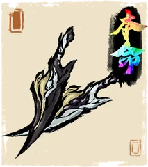

在天地熔炉炼化本命物后获得的本命技能。

可以在**愈灵工作台或恢复工作台**将其还原成本命物

### 【各版本（境界 / 品质）】

练气·绝品：本命·护主：当队伍里的角色卡牌受到伤害时，此卡牌的〔攻击〕+1

筑基·绝品：本命·护主：当队伍里的角色卡牌受到伤害时，此卡牌的〔攻击〕+2

结丹·绝品：本命·护主：当队伍里的角色卡牌受到伤害时，此卡牌的〔攻击〕+5

元婴·绝品：本命·护主：当队伍里的角色卡牌受到伤害时，此卡牌的〔攻击〕+12

化神·绝品：本命·护主：当队伍里的角色卡牌受到伤害时，此卡牌的〔攻击〕+25

### 【获取途径】

第 1 步：主角结丹后，把绝品〈雌雄双刺〉放进修炼工作台，炼成本命物（每人只能有一个；自由模式也可以用开局词条直接选练气期本命物）

第 2 步：带着本命物进入秘境「天地熔炉」，放进「熔炉」工作台的「炼化本命物」，获得本命技能〈护主〉（技能境界和本命物相同）

第 3 步（可选）：在修炼工作台「提升本命技能境界」逐级提升

想换回本命物，放进愈灵工作台或恢复工作台还原（恢复工作台扣 5 年寿元）

---

## 137. 战鼓

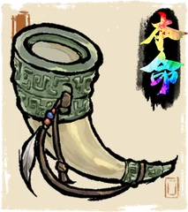

在天地熔炉炼化本命物后获得的本命技能。

可以在**愈灵工作台或恢复工作台**将其还原成本命物

### 【各版本（境界 / 品质）】

练气·绝品：本命·战鼓：每回合开始时，使友方随机灵兽获得一次攻击机会。

筑基·绝品：本命·战鼓：每回合开始时，使友方随机灵兽获得一次攻击机会。

结丹·绝品：本命·战鼓：每回合开始时，使友方随机灵兽获得一次攻击机会。

元婴·绝品：本命·战鼓：每回合开始时，使友方随机灵兽获得一次攻击机会。

化神·绝品：本命·战鼓：每回合开始时，使友方随机灵兽获得一次攻击机会。

### 【获取途径】

第 1 步：主角结丹后，把绝品〈号令〉放进修炼工作台，炼成本命物（每人只能有一个；自由模式也可以用开局词条直接选练气期本命物）

第 2 步：带着本命物进入秘境「天地熔炉」，放进「熔炉」工作台的「炼化本命物」，获得本命技能〈战鼓〉（技能境界和本命物相同）

第 3 步（可选）：在修炼工作台「提升本命技能境界」逐级提升

想换回本命物，放进愈灵工作台或恢复工作台还原（恢复工作台扣 5 年寿元）

---

## 138. 遁甲

在天地熔炉炼化本命物后获得的本命技能。

可以在**愈灵工作台或恢复工作台**将其还原成本命物

### 【各版本（境界 / 品质）】

练气·绝品：本命·遁甲：加入战场的首个回合开始时，〔护甲〕+10

筑基·绝品：本命·遁甲：加入战场的首个回合开始时，〔护甲〕+25

结丹·绝品：本命·遁甲：加入战场的首个回合开始时，〔护甲〕+50

元婴·绝品：本命·遁甲：加入战场的首个回合开始时，〔护甲〕+120

化神·绝品：本命·遁甲：加入战场的首个回合开始时，〔护甲〕+350

### 【获取途径】

第 1 步：主角结丹后，把绝品〈黄砂葫芦〉放进修炼工作台，炼成本命物（每人只能有一个；自由模式也可以用开局词条直接选练气期本命物）

第 2 步：带着本命物进入秘境「天地熔炉」，放进「熔炉」工作台的「炼化本命物」，获得本命技能〈遁甲〉（技能境界和本命物相同）

第 3 步（可选）：在修炼工作台「提升本命技能境界」逐级提升

想换回本命物，放进愈灵工作台或恢复工作台还原（恢复工作台扣 5 年寿元）

---

## 139. 巧劲

在天地熔炉炼化本命物后获得的本命技能。

可以在**愈灵工作台或恢复工作台**将其还原成本命物

### 【各版本（境界 / 品质）】

练气·绝品：本命·巧劲：回合开始时，使一名拥有护甲的友方卡牌获得等同于护甲值的攻击力

筑基·绝品：本命·巧劲：回合开始时，使一名拥有护甲的友方卡牌获得等同于护甲值的攻击力

结丹·绝品：本命·巧劲：回合开始时，使一名拥有护甲的友方卡牌获得等同于护甲值的攻击力

元婴·绝品：本命·巧劲：回合开始时，使一名拥有护甲的友方卡牌获得等同于护甲值的攻击力

化神·绝品：本命·巧劲：回合开始时，使一名拥有护甲的友方卡牌获得等同于护甲值的攻击力

### 【获取途径】

第 1 步：主角结丹后，把绝品〈星华瓶〉放进修炼工作台，炼成本命物（每人只能有一个；自由模式也可以用开局词条直接选练气期本命物）

第 2 步：带着本命物进入秘境「天地熔炉」，放进「熔炉」工作台的「炼化本命物」，获得本命技能〈巧劲〉（技能境界和本命物相同）

第 3 步（可选）：在修炼工作台「提升本命技能境界」逐级提升

想换回本命物，放进愈灵工作台或恢复工作台还原（恢复工作台扣 5 年寿元）

---

## 140. 反击贰

在天地熔炉炼化本命物后获得的本命技能。

可以在**愈灵工作台或恢复工作台**将其还原成本命物

### 【各版本（境界 / 品质）】

练气·绝品：本命·反击贰：受到近战攻击后，以50%的攻击力反击攻击者

筑基·绝品：本命·反击贰：受到近战攻击后，以50%的攻击力反击攻击者

结丹·绝品：本命·反击贰：受到近战攻击后，以50%的攻击力反击攻击者

元婴·绝品：本命·反击贰：受到近战攻击后，以50%的攻击力反击攻击者

化神·绝品：本命·反击贰：受到近战攻击后，以50%的攻击力反击攻击者

### 【获取途径】

第 1 步：主角结丹后，把绝品〈山河扇〉放进修炼工作台，炼成本命物（每人只能有一个；自由模式也可以用开局词条直接选练气期本命物）

第 2 步：带着本命物进入秘境「天地熔炉」，放进「熔炉」工作台的「炼化本命物」，获得本命技能〈反击贰〉（技能境界和本命物相同）

第 3 步（可选）：在修炼工作台「提升本命技能境界」逐级提升

想换回本命物，放进愈灵工作台或恢复工作台还原（恢复工作台扣 5 年寿元）

---

## 141. 遁甲叁

在天地熔炉炼化本命物后获得的本命技能。

可以在**愈灵工作台或恢复工作台**将其还原成本命物

### 【各版本（境界 / 品质）】

练气·绝品：本命·遁甲叁：加入战场后的首个回合，为我方所有卡牌增加3点〔护甲〕

筑基·绝品：本命·遁甲叁：加入战场后的首个回合，为我方所有卡牌增加7点〔护甲〕

结丹·绝品：本命·遁甲叁：加入战场后的首个回合，为我方所有卡牌增加21点〔护甲〕

元婴·绝品：本命·遁甲叁：加入战场后的首个回合，为我方所有卡牌增加60点〔护甲〕

化神·绝品：本命·遁甲叁：加入战场后的首个回合，为我方所有卡牌增加165点〔护甲〕

### 【获取途径】

第 1 步：主角结丹后，把绝品〈玄黄灵符〉放进修炼工作台，炼成本命物（每人只能有一个；自由模式也可以用开局词条直接选练气期本命物）

第 2 步：带着本命物进入秘境「天地熔炉」，放进「熔炉」工作台的「炼化本命物」，获得本命技能〈遁甲叁〉（技能境界和本命物相同）

第 3 步（可选）：在修炼工作台「提升本命技能境界」逐级提升

想换回本命物，放进愈灵工作台或恢复工作台还原（恢复工作台扣 5 年寿元）

---

## 142. 反击

在天地熔炉炼化本命物后获得的本命技能。

可以在**愈灵工作台或恢复工作台**将其还原成本命物

### 【各版本（境界 / 品质）】

练气·绝品：本命·反击：受到近战攻击后，反击敌方所有卡牌2点〔伤害〕

筑基·绝品：本命·反击：受到近战攻击后，反击敌方所有卡牌4点〔伤害〕

结丹·绝品：本命·反击：受到近战攻击后，反击敌方所有卡牌10点〔伤害〕

元婴·绝品：本命·反击：受到近战攻击后，反击敌方所有卡牌25点〔伤害〕

化神·绝品：本命·反击：受到近战攻击后，反击敌方所有卡牌70点〔伤害〕

### 【获取途径】

第 1 步：主角结丹后，把绝品〈混土神印〉放进修炼工作台，炼成本命物（每人只能有一个；自由模式也可以用开局词条直接选练气期本命物）

第 2 步：带着本命物进入秘境「天地熔炉」，放进「熔炉」工作台的「炼化本命物」，获得本命技能〈反击〉（技能境界和本命物相同）

第 3 步（可选）：在修炼工作台「提升本命技能境界」逐级提升

想换回本命物，放进愈灵工作台或恢复工作台还原（恢复工作台扣 5 年寿元）

---

## 143. 忍耐

在天地熔炉炼化本命物后获得的本命技能。

可以在**愈灵工作台或恢复工作台**将其还原成本命物

### 【各版本（境界 / 品质）】

练气·绝品：本命·忍耐：受到攻击后，此卡牌的〔攻击〕+3

筑基·绝品：本命·忍耐：受到攻击后，此卡牌的〔攻击〕+7

结丹·绝品：本命·忍耐：受到攻击后，此卡牌的〔攻击〕+15

元婴·绝品：本命·忍耐：受到攻击后，此卡牌的〔攻击〕+30

化神·绝品：本命·忍耐：受到攻击后，此卡牌的〔攻击〕+70

### 【获取途径】

第 1 步：主角结丹后，把绝品〈玄龟〉放进修炼工作台，炼成本命物（每人只能有一个；自由模式也可以用开局词条直接选练气期本命物）

第 2 步：带着本命物进入秘境「天地熔炉」，放进「熔炉」工作台的「炼化本命物」，获得本命技能〈忍耐〉（技能境界和本命物相同）

第 3 步（可选）：在修炼工作台「提升本命技能境界」逐级提升

想换回本命物，放进愈灵工作台或恢复工作台还原（恢复工作台扣 5 年寿元）

---

## 144. 护主

在天地熔炉炼化本命物后获得的本命技能。

可以在**愈灵工作台或恢复工作台**将其还原成本命物

### 【各版本（境界 / 品质）】

练气·绝品：本命·护主：当队伍里的角色卡牌受到伤害时，此卡牌的〔攻击〕+1

筑基·绝品：本命·护主：当队伍里的角色卡牌受到伤害时，此卡牌的〔攻击〕+2

结丹·绝品：本命·护主：当队伍里的角色卡牌受到伤害时，此卡牌的〔攻击〕+5

元婴·绝品：本命·护主：当队伍里的角色卡牌受到伤害时，此卡牌的〔攻击〕+12

化神·绝品：本命·护主：当队伍里的角色卡牌受到伤害时，此卡牌的〔攻击〕+25

### 【获取途径】

第 1 步：主角结丹后，把绝品〈裂地蚁〉放进修炼工作台，炼成本命物（每人只能有一个；自由模式也可以用开局词条直接选练气期本命物）

第 2 步：带着本命物进入秘境「天地熔炉」，放进「熔炉」工作台的「炼化本命物」，获得本命技能〈护主〉（技能境界和本命物相同）

第 3 步（可选）：在修炼工作台「提升本命技能境界」逐级提升

想换回本命物，放进愈灵工作台或恢复工作台还原（恢复工作台扣 5 年寿元）

---

## 145. 憾地

在天地熔炉炼化本命物后获得的本命技能。

可以在**愈灵工作台或恢复工作台**将其还原成本命物

### 【各版本（境界 / 品质）】

练气·绝品：本命·憾地：如果此卡牌有护甲，则回合结束时获得等同于护甲值的伤害加成

筑基·绝品：本命·憾地：如果此卡牌有护甲，则回合结束时获得等同于护甲值的伤害加成

结丹·绝品：本命·憾地：如果此卡牌有护甲，则回合结束时获得等同于护甲值的伤害加成

元婴·绝品：本命·憾地：如果此卡牌有护甲，则回合结束时获得等同于护甲值的伤害加成

化神·绝品：本命·憾地：如果此卡牌有护甲，则回合结束时获得等同于护甲值的伤害加成

### 【获取途径】

第 1 步：主角结丹后，把绝品〈岩甲蜥蜴〉放进修炼工作台，炼成本命物（每人只能有一个；自由模式也可以用开局词条直接选练气期本命物）

第 2 步：带着本命物进入秘境「天地熔炉」，放进「熔炉」工作台的「炼化本命物」，获得本命技能〈憾地〉（技能境界和本命物相同）

第 3 步（可选）：在修炼工作台「提升本命技能境界」逐级提升

想换回本命物，放进愈灵工作台或恢复工作台还原（恢复工作台扣 5 年寿元）

---

## 146. 攻守平衡

在天地熔炉炼化本命物后获得的本命技能。

可以在**愈灵工作台或恢复工作台**将其还原成本命物

### 【各版本（境界 / 品质）】

练气·绝品：本命·攻受平衡：攻击的目标如果不是满血，则自己获得一回合嘲讽和2减伤（持续一回合）

筑基·绝品：本命·攻受平衡：攻击的目标如果不是满血，则自己获得一回合嘲讽和4减伤（持续一回合）

结丹·绝品：本命·攻受平衡：攻击的目标如果不是满血，则自己获得一回合嘲讽和12减伤（持续一回合）

元婴·绝品：本命·攻受平衡：攻击的目标如果不是满血，则自己获得一回合嘲讽和32减伤（持续一回合）

化神·绝品：本命·攻受平衡：攻击的目标如果不是满血，则自己获得一回合嘲讽和88减伤（持续一回合）

### 【获取途径】

第 1 步：主角结丹后，把绝品〈破山重剑〉放进修炼工作台，炼成本命物（每人只能有一个；自由模式也可以用开局词条直接选练气期本命物）

第 2 步：带着本命物进入秘境「天地熔炉」，放进「熔炉」工作台的「炼化本命物」，获得本命技能〈攻守平衡〉（技能境界和本命物相同）

第 3 步（可选）：在修炼工作台「提升本命技能境界」逐级提升

想换回本命物，放进愈灵工作台或恢复工作台还原（恢复工作台扣 5 年寿元）

---

## 147. 熊刃甲

在天地熔炉炼化本命物后获得的本命技能。

可以在**愈灵工作台或恢复工作台**将其还原成本命物

### 【各版本（境界 / 品质）】

练气·绝品：本命·熊刃甲：受到近战攻击会反弹1〔伤害〕

筑基·绝品：本命·熊刃甲：受到近战攻击会反弹2〔伤害〕

结丹·绝品：本命·熊刃甲：受到近战攻击会反弹6〔伤害〕

元婴·绝品：本命·熊刃甲：受到近战攻击会反弹16〔伤害〕

化神·绝品：本命·熊刃甲：受到近战攻击会反弹44〔伤害〕

### 【获取途径】

第 1 步：主角结丹后，把绝品〈熊王甲〉放进修炼工作台，炼成本命物（每人只能有一个；自由模式也可以用开局词条直接选练气期本命物）

第 2 步：带着本命物进入秘境「天地熔炉」，放进「熔炉」工作台的「炼化本命物」，获得本命技能〈熊刃甲〉（技能境界和本命物相同）

第 3 步（可选）：在修炼工作台「提升本命技能境界」逐级提升

想换回本命物，放进愈灵工作台或恢复工作台还原（恢复工作台扣 5 年寿元）

---

## 148. 攻守平衡贰

在天地熔炉炼化本命物后获得的本命技能。

可以在**愈灵工作台或恢复工作台**将其还原成本命物

### 【各版本（境界 / 品质）】

练气·绝品：本命·攻守平衡贰：攻击造成伤害后，使自己和任意友方卡牌获得2〔护甲〕

筑基·绝品：本命·攻守平衡贰：攻击造成伤害后，使自己和任意友方卡牌获得4〔护甲〕

结丹·绝品：本命·攻守平衡贰：攻击造成伤害后，使自己和任意友方卡牌获得11〔护甲〕

元婴·绝品：本命·攻守平衡贰：攻击造成伤害后，使自己和任意友方卡牌获得29〔护甲〕

化神·绝品：本命·攻守平衡贰：攻击造成伤害后，使自己和任意友方卡牌获得78〔护甲〕

### 【获取途径】

第 1 步：主角结丹后，把绝品〈熊爪手套〉放进修炼工作台，炼成本命物（每人只能有一个；自由模式也可以用开局词条直接选练气期本命物）

第 2 步：带着本命物进入秘境「天地熔炉」，放进「熔炉」工作台的「炼化本命物」，获得本命技能〈攻守平衡贰〉（技能境界和本命物相同）

第 3 步（可选）：在修炼工作台「提升本命技能境界」逐级提升

想换回本命物，放进愈灵工作台或恢复工作台还原（恢复工作台扣 5 年寿元）

---

## 149. 弱点标记

在天地熔炉炼化本命物后获得的本命技能。

可以在**愈灵工作台或恢复工作台**将其还原成本命物

### 【各版本（境界 / 品质）】

练气·绝品：本命·弱点标记：友方角色造成伤害后，给目标附加易伤（攻击的目标境界越高，易伤数值越高）

筑基·绝品：本命·弱点标记：友方角色造成伤害后，给目标附加易伤（攻击的目标境界越高，易伤数值越高）

结丹·绝品：本命·弱点标记：友方角色造成伤害后，给目标附加易伤（攻击的目标境界越高，易伤数值越高）

元婴·绝品：本命·弱点标记：友方角色造成伤害后，给目标附加易伤（攻击的目标境界越高，易伤数值越高）

化神·绝品：本命·弱点标记：友方角色造成伤害后，给目标附加易伤（攻击的目标境界越高，易伤数值越高）

### 【获取途径】

第 1 步：主角结丹后，把绝品〈熊齿刺〉放进修炼工作台，炼成本命物（每人只能有一个；自由模式也可以用开局词条直接选练气期本命物）

第 2 步：带着本命物进入秘境「天地熔炉」，放进「熔炉」工作台的「炼化本命物」，获得本命技能〈弱点标记〉（技能境界和本命物相同）

第 3 步（可选）：在修炼工作台「提升本命技能境界」逐级提升

想换回本命物，放进愈灵工作台或恢复工作台还原（恢复工作台扣 5 年寿元）

---

## 150. 裂脊

在天地熔炉炼化本命物后获得的本命技能。

可以在**愈灵工作台或恢复工作台**将其还原成本命物

### 【各版本（境界 / 品质）】

练气·绝品：本命·裂脊：攻击的目标如果是生物（角色/灵兽），则再攻击一次

筑基·绝品：本命·裂脊：攻击的目标如果是生物（角色/灵兽），则再攻击一次

结丹·绝品：本命·裂脊：攻击的目标如果是生物（角色/灵兽），则再攻击一次

元婴·绝品：本命·裂脊：攻击的目标如果是生物（角色/灵兽），则再攻击一次

化神·绝品：本命·裂脊：攻击的目标如果是生物（角色/灵兽），则再攻击一次

### 【获取途径】

第 1 步：主角结丹后，把绝品〈熊脊枪〉放进修炼工作台，炼成本命物（每人只能有一个；自由模式也可以用开局词条直接选练气期本命物）

第 2 步：带着本命物进入秘境「天地熔炉」，放进「熔炉」工作台的「炼化本命物」，获得本命技能〈裂脊〉（技能境界和本命物相同）

第 3 步（可选）：在修炼工作台「提升本命技能境界」逐级提升

想换回本命物，放进愈灵工作台或恢复工作台还原（恢复工作台扣 5 年寿元）

---

## 151. 使者

在天地熔炉炼化本命物后获得的本命技能。

可以在**愈灵工作台或恢复工作台**将其还原成本命物

### 【各版本（境界 / 品质）】

练气·绝品：本命·使者：每当战场有非召唤卡牌阵亡，召唤一个骸骨傀儡（每回合最多触发5次）

筑基·绝品：本命·使者：每当战场有非召唤卡牌阵亡，召唤一个骸骨傀儡（每回合最多触发5次）

结丹·绝品：本命·使者：每当战场有非召唤卡牌阵亡，召唤一个骸骨傀儡（每回合最多触发5次）

元婴·绝品：本命·使者：每当战场有非召唤卡牌阵亡，召唤一个骸骨傀儡（每回合最多触发5次）

化神·绝品：本命·使者：每当战场有非召唤卡牌阵亡，召唤一个骸骨傀儡（每回合最多触发5次）

### 【获取途径】

第 1 步：主角结丹后，把绝品〈冥刃〉放进修炼工作台，炼成本命物（每人只能有一个；自由模式也可以用开局词条直接选练气期本命物）

第 2 步：带着本命物进入秘境「天地熔炉」，放进「熔炉」工作台的「炼化本命物」，获得本命技能〈使者〉（技能境界和本命物相同）

第 3 步（可选）：在修炼工作台「提升本命技能境界」逐级提升

想换回本命物，放进愈灵工作台或恢复工作台还原（恢复工作台扣 5 年寿元）

---

## 152. 刺杀

在天地熔炉炼化本命物后获得的本命技能。

可以在**愈灵工作台或恢复工作台**将其还原成本命物

### 【各版本（境界 / 品质）】

练气·绝品：本命·刺杀：此卡牌造成真实伤害，攻击前封印目标1回合

筑基·绝品：本命·刺杀：此卡牌造成真实伤害，攻击前封印目标1回合

结丹·绝品：本命·刺杀：此卡牌造成真实伤害，攻击前封印目标1回合

元婴·绝品：本命·刺杀：此卡牌造成真实伤害，攻击前封印目标1回合

化神·绝品：本命·刺杀：此卡牌造成真实伤害，攻击前封印目标1回合

### 【获取途径】

第 1 步：主角结丹后，把绝品〈剜骨〉放进修炼工作台，炼成本命物（每人只能有一个；自由模式也可以用开局词条直接选练气期本命物）

第 2 步：带着本命物进入秘境「天地熔炉」，放进「熔炉」工作台的「炼化本命物」，获得本命技能〈刺杀〉（技能境界和本命物相同）

第 3 步（可选）：在修炼工作台「提升本命技能境界」逐级提升

想换回本命物，放进愈灵工作台或恢复工作台还原（恢复工作台扣 5 年寿元）

---

## 153. 使虫

在天地熔炉炼化本命物后获得的本命技能。

可以在**愈灵工作台或恢复工作台**将其还原成本命物

### 【各版本（境界 / 品质）】

练气·绝品：本命·使虫：如果击伤灵兽类型卡牌，使其获得中毒。（中毒伤害为攻击力的50%）

筑基·绝品：本命·使虫：如果击伤灵兽类型卡牌，使其获得中毒。（中毒伤害为攻击力的50%）

结丹·绝品：本命·使虫：如果击伤灵兽类型卡牌，使其获得中毒。（中毒伤害为攻击力的50%）

元婴·绝品：本命·使虫：如果击伤灵兽类型卡牌，使其获得中毒。（中毒伤害为攻击力的50%）

化神·绝品：本命·使虫：如果击伤灵兽类型卡牌，使其获得中毒。（中毒伤害为攻击力的50%）

### 【获取途径】

第 1 步：主角结丹后，把绝品〈驭秽〉放进修炼工作台，炼成本命物（每人只能有一个；自由模式也可以用开局词条直接选练气期本命物）

第 2 步：带着本命物进入秘境「天地熔炉」，放进「熔炉」工作台的「炼化本命物」，获得本命技能〈使虫〉（技能境界和本命物相同）

第 3 步（可选）：在修炼工作台「提升本命技能境界」逐级提升

想换回本命物，放进愈灵工作台或恢复工作台还原（恢复工作台扣 5 年寿元）

---

## 154. 分身

在天地熔炉炼化本命物后获得的本命技能。

可以在**愈灵工作台或恢复工作台**将其还原成本命物

### 【各版本（境界 / 品质）】

练气·绝品：本命·分身：加入战场时，复制两个假的惑音（属性为主角的15%）；（假惑音被击败后，使攻击者获得混乱）

筑基·绝品：本命·分身：加入战场时，复制两个假的惑音（属性为主角的15%）；（假惑音被击败后，使攻击者获得混乱）

结丹·绝品：本命·分身：加入战场时，复制两个假的惑音（属性为主角的15%）；（假惑音被击败后，使攻击者获得混乱）

元婴·绝品：本命·分身：加入战场时，复制两个假的惑音（属性为主角的15%）；（假惑音被击败后，使攻击者获得混乱）

化神·绝品：本命·分身：加入战场时，复制两个假的惑音（属性为主角的15%）；（假惑音被击败后，使攻击者获得混乱）

### 【获取途径】

第 1 步：主角结丹后，把绝品〈惑音〉放进修炼工作台，炼成本命物（每人只能有一个；自由模式也可以用开局词条直接选练气期本命物）

第 2 步：带着本命物进入秘境「天地熔炉」，放进「熔炉」工作台的「炼化本命物」，获得本命技能〈分身〉（技能境界和本命物相同）

第 3 步（可选）：在修炼工作台「提升本命技能境界」逐级提升

想换回本命物，放进愈灵工作台或恢复工作台还原（恢复工作台扣 5 年寿元）

---

## 155. 噬魂贰

在天地熔炉炼化本命物后获得的本命技能。

可以在**愈灵工作台或恢复工作台**将其还原成本命物

### 【各版本（境界 / 品质）】

练气·绝品：本命·噬魂贰：攻击造成伤害后，吸取目标1〔攻击〕附加到随机友军上

筑基·绝品：本命·噬魂贰：攻击造成伤害后，吸取目标2〔攻击〕附加到随机友军上

结丹·绝品：本命·噬魂贰：攻击造成伤害后，吸取目标3〔攻击〕附加到随机友军上

元婴·绝品：本命·噬魂贰：攻击造成伤害后，吸取目标5〔攻击〕附加到随机友军上

化神·绝品：本命·噬魂贰：攻击造成伤害后，吸取目标10〔攻击〕附加到随机友军上

### 【获取途径】

第 1 步：主角结丹后，把绝品〈乌炎〉放进修炼工作台，炼成本命物（每人只能有一个；自由模式也可以用开局词条直接选练气期本命物）

第 2 步：带着本命物进入秘境「天地熔炉」，放进「熔炉」工作台的「炼化本命物」，获得本命技能〈噬魂贰〉（技能境界和本命物相同）

第 3 步（可选）：在修炼工作台「提升本命技能境界」逐级提升

想换回本命物，放进愈灵工作台或恢复工作台还原（恢复工作台扣 5 年寿元）

---

## 156. 瘟疫

在天地熔炉炼化本命物后获得的本命技能。

可以在**愈灵工作台或恢复工作台**将其还原成本命物

### 【各版本（境界 / 品质）】

练气·绝品：本命·瘟疫：每当有卡牌死亡时，使随机敌人获得中毒（中毒伤害为攻击力的20%）

筑基·绝品：本命·瘟疫：每当有卡牌死亡时，使随机敌人获得中毒（中毒伤害为攻击力的20%）

结丹·绝品：本命·瘟疫：每当有卡牌死亡时，使随机敌人获得中毒（中毒伤害为攻击力的20%）

元婴·绝品：本命·瘟疫：每当有卡牌死亡时，使随机敌人获得中毒（中毒伤害为攻击力的20%）

化神·绝品：本命·瘟疫：每当有卡牌死亡时，使随机敌人获得中毒（中毒伤害为攻击力的20%）

### 【获取途径】

第 1 步：主角结丹后，把绝品〈瘟疫〉放进修炼工作台，炼成本命物（每人只能有一个；自由模式也可以用开局词条直接选练气期本命物）

第 2 步：带着本命物进入秘境「天地熔炉」，放进「熔炉」工作台的「炼化本命物」，获得本命技能〈瘟疫〉（技能境界和本命物相同）

第 3 步（可选）：在修炼工作台「提升本命技能境界」逐级提升

想换回本命物，放进愈灵工作台或恢复工作台还原（恢复工作台扣 5 年寿元）

---

## 157. 尸诏

在天地熔炉炼化本命物后获得的本命技能。

可以在**愈灵工作台或恢复工作台**将其还原成本命物

### 【各版本（境界 / 品质）】

练气·绝品：本命·尸诏：每当战场的骸骨傀儡阵亡时，消耗自身5〔血量〕再次召唤一只

筑基·绝品：本命·尸诏：每当战场的骸骨傀儡阵亡时，消耗自身13〔血量〕再次召唤一只

结丹·绝品：本命·尸诏：每当战场的骸骨傀儡阵亡时，消耗自身35〔血量〕再次召唤一只

元婴·绝品：本命·尸诏：每当战场的骸骨傀儡阵亡时，消耗自身95〔血量〕再次召唤一只

化神·绝品：本命·尸诏：每当战场的骸骨傀儡阵亡时，消耗自身260〔血量〕再次召唤一只

### 【获取途径】

第 1 步：主角结丹后，把绝品〈拘尸〉放进修炼工作台，炼成本命物（每人只能有一个；自由模式也可以用开局词条直接选练气期本命物）

第 2 步：带着本命物进入秘境「天地熔炉」，放进「熔炉」工作台的「炼化本命物」，获得本命技能〈尸诏〉（技能境界和本命物相同）

第 3 步（可选）：在修炼工作台「提升本命技能境界」逐级提升

想换回本命物，放进愈灵工作台或恢复工作台还原（恢复工作台扣 5 年寿元）

---

## 158. 送行

在天地熔炉炼化本命物后获得的本命技能。

可以在**愈灵工作台或恢复工作台**将其还原成本命物

### 【各版本（境界 / 品质）】

练气·绝品：本命·送行：每当场上有卡牌战败时，对随机敌人造成3伤害

筑基·绝品：本命·送行：每当场上有卡牌战败时，对随机敌人造成11伤害

结丹·绝品：本命·送行：每当场上有卡牌战败时，对随机敌人造成26伤害

元婴·绝品：本命·送行：每当场上有卡牌战败时，对随机敌人造成71伤害

化神·绝品：本命·送行：每当场上有卡牌战败时，对随机敌人造成192伤害

### 【获取途径】

第 1 步：主角结丹后，把绝品〈灵烛〉放进修炼工作台，炼成本命物（每人只能有一个；自由模式也可以用开局词条直接选练气期本命物）

第 2 步：带着本命物进入秘境「天地熔炉」，放进「熔炉」工作台的「炼化本命物」，获得本命技能〈送行〉（技能境界和本命物相同）

第 3 步（可选）：在修炼工作台「提升本命技能境界」逐级提升

想换回本命物，放进愈灵工作台或恢复工作台还原（恢复工作台扣 5 年寿元）

---

## 159. 安魂

在天地熔炉炼化本命物后获得的本命技能。

可以在**愈灵工作台或恢复工作台**将其还原成本命物

### 【各版本（境界 / 品质）】

练气·绝品：本命·安魂：造成伤害时，会清除目标在战斗中临时增加的〔攻击〕

筑基·绝品：本命·安魂：造成伤害时，会清除目标在战斗中临时增加的〔攻击〕

结丹·绝品：本命·安魂：造成伤害时，会清除目标在战斗中临时增加的〔攻击〕

元婴·绝品：本命·安魂：造成伤害时，会清除目标在战斗中临时增加的〔攻击〕

化神·绝品：本命·安魂：造成伤害时，会清除目标在战斗中临时增加的〔攻击〕

### 【获取途径】

第 1 步：主角结丹后，把绝品〈安魂〉放进修炼工作台，炼成本命物（每人只能有一个；自由模式也可以用开局词条直接选练气期本命物）

第 2 步：带着本命物进入秘境「天地熔炉」，放进「熔炉」工作台的「炼化本命物」，获得本命技能〈安魂〉（技能境界和本命物相同）

第 3 步（可选）：在修炼工作台「提升本命技能境界」逐级提升

想换回本命物，放进愈灵工作台或恢复工作台还原（恢复工作台扣 5 年寿元）

---

## 160. 镇魂

在天地熔炉炼化本命物后获得的本命技能。

可以在**愈灵工作台或恢复工作台**将其还原成本命物

### 【各版本（境界 / 品质）】

练气·绝品：本命·镇魂：每当战场中有卡牌阵亡时，禁锢一名敌人2回合；（一场战斗最多触发3次）

筑基·绝品：本命·镇魂：每当战场中有卡牌阵亡时，禁锢一名敌人2回合；（一场战斗最多触发3次）

结丹·绝品：本命·镇魂：每当战场中有卡牌阵亡时，禁锢一名敌人2回合；（一场战斗最多触发3次）

元婴·绝品：本命·镇魂：每当战场中有卡牌阵亡时，禁锢一名敌人2回合；（一场战斗最多触发3次）

化神·绝品：本命·镇魂：每当战场中有卡牌阵亡时，禁锢一名敌人2回合；（一场战斗最多触发3次）

### 【获取途径】

第 1 步：主角结丹后，把绝品〈镇魂伞〉放进修炼工作台，炼成本命物（每人只能有一个；自由模式也可以用开局词条直接选练气期本命物）

第 2 步：带着本命物进入秘境「天地熔炉」，放进「熔炉」工作台的「炼化本命物」，获得本命技能〈镇魂〉（技能境界和本命物相同）

第 3 步（可选）：在修炼工作台「提升本命技能境界」逐级提升

想换回本命物，放进愈灵工作台或恢复工作台还原（恢复工作台扣 5 年寿元）

---

## 161. 黄泉

在天地熔炉炼化本命物后获得的本命技能。

可以在**愈灵工作台或恢复工作台**将其还原成本命物

### 【各版本（境界 / 品质）】

练气·绝品：本命·黄泉：每当战场中有卡牌阵亡时，此卡牌的〔攻击〕和〔血量〕+1

筑基·绝品：本命·黄泉：每当战场中有卡牌阵亡时，此卡牌的〔攻击〕和〔血量〕+2

结丹·绝品：本命·黄泉：每当战场中有卡牌阵亡时，此卡牌的〔攻击〕和〔血量〕+6

元婴·绝品：本命·黄泉：每当战场中有卡牌阵亡时，此卡牌的〔攻击〕和〔血量〕+16

化神·绝品：本命·黄泉：每当战场中有卡牌阵亡时，此卡牌的〔攻击〕和〔血量〕+45

### 【获取途径】

第 1 步：主角结丹后，把绝品〈黄泉蝎〉放进修炼工作台，炼成本命物（每人只能有一个；自由模式也可以用开局词条直接选练气期本命物）

第 2 步：带着本命物进入秘境「天地熔炉」，放进「熔炉」工作台的「炼化本命物」，获得本命技能〈黄泉〉（技能境界和本命物相同）

第 3 步（可选）：在修炼工作台「提升本命技能境界」逐级提升

想换回本命物，放进愈灵工作台或恢复工作台还原（恢复工作台扣 5 年寿元）

---

## 162. 产卵

在天地熔炉炼化本命物后获得的本命技能。

可以在**愈灵工作台或恢复工作台**将其还原成本命物

### 【各版本（境界 / 品质）】

练气·绝品：本命·产卵：每当战场中有生物卡牌阵亡（角色/灵兽，召唤卡除外）时，召唤一只**毒蛛**（每回合最多触发5次）

筑基·绝品：本命·产卵：每当战场中有生物卡牌阵亡（角色/灵兽，召唤卡除外）时，召唤一只**毒蛛**（每回合最多触发5次）

结丹·绝品：本命·产卵：每当战场中有生物卡牌阵亡（角色/灵兽，召唤卡除外）时，召唤一只**毒蛛**（每回合最多触发5次）

元婴·绝品：本命·产卵：每当战场中有生物卡牌阵亡（角色/灵兽，召唤卡除外）时，召唤一只**毒蛛**（每回合最多触发5次）

化神·绝品：本命·产卵：每当战场中有生物卡牌阵亡（角色/灵兽，召唤卡除外）时，召唤一只**毒蛛**（每回合最多触发5次）

### 【获取途径】

第 1 步：主角结丹后，把绝品〈血玉蜘蛛〉放进修炼工作台，炼成本命物（每人只能有一个；自由模式也可以用开局词条直接选练气期本命物）

第 2 步：带着本命物进入秘境「天地熔炉」，放进「熔炉」工作台的「炼化本命物」，获得本命技能〈产卵〉（技能境界和本命物相同）

第 3 步（可选）：在修炼工作台「提升本命技能境界」逐级提升

想换回本命物，放进愈灵工作台或恢复工作台还原（恢复工作台扣 5 年寿元）

---

## 163. 阴气

在天地熔炉炼化本命物后获得的本命技能。

可以在**愈灵工作台或恢复工作台**将其还原成本命物

### 【各版本（境界 / 品质）】

练气·绝品：本命·阴气：场上每有一个〔阴〕卡牌，骸骨傀儡第一次造成的伤害提高1

筑基·绝品：本命·阴气：场上每有一个〔阴〕卡牌，骸骨傀儡第一次造成的伤害提高2

结丹·绝品：本命·阴气：场上每有一个〔阴〕卡牌，骸骨傀儡第一次造成的伤害提高4

元婴·绝品：本命·阴气：场上每有一个〔阴〕卡牌，骸骨傀儡第一次造成的伤害提高8

化神·绝品：本命·阴气：场上每有一个〔阴〕卡牌，骸骨傀儡第一次造成的伤害提高16

### 【获取途径】

第 1 步：主角结丹后，把绝品〈骸骨傀儡〉放进修炼工作台，炼成本命物（每人只能有一个；自由模式也可以用开局词条直接选练气期本命物）

第 2 步：带着本命物进入秘境「天地熔炉」，放进「熔炉」工作台的「炼化本命物」，获得本命技能〈阴气〉（技能境界和本命物相同）

第 3 步（可选）：在修炼工作台「提升本命技能境界」逐级提升

想换回本命物，放进愈灵工作台或恢复工作台还原（恢复工作台扣 5 年寿元）

---

## 164. 寄灵贰

在天地熔炉炼化本命物后获得的本命技能。

可以在**愈灵工作台或恢复工作台**将其还原成本命物

### 【各版本（境界 / 品质）】

练气·绝品：本命·寄灵贰：当友方的章鱼臂战败时，自己的〔攻击〕+1以及获得一次攻击次数

筑基·绝品：本命·寄灵贰：当友方的章鱼臂战败时，自己的〔攻击〕+2以及获得一次攻击次数

结丹·绝品：本命·寄灵贰：当友方的章鱼臂战败时，自己的〔攻击〕+6以及获得一次攻击次数

元婴·绝品：本命·寄灵贰：当友方的章鱼臂战败时，自己的〔攻击〕+16以及获得一次攻击次数

化神·绝品：本命·寄灵贰：当友方的章鱼臂战败时，自己的〔攻击〕+45以及获得一次攻击次数

### 【获取途径】

第 1 步：主角结丹后，把绝品〈骸骨傀儡〉放进修炼工作台，炼成本命物（每人只能有一个；自由模式也可以用开局词条直接选练气期本命物）

第 2 步：带着本命物进入秘境「天地熔炉」，放进「熔炉」工作台的「炼化本命物」，获得本命技能〈寄灵贰〉（技能境界和本命物相同）

第 3 步（可选）：在修炼工作台「提升本命技能境界」逐级提升

想换回本命物，放进愈灵工作台或恢复工作台还原（恢复工作台扣 5 年寿元）

---

## 165. 凶煞之力

在天地熔炉炼化本命物后获得的本命技能。

可以在**愈灵工作台或恢复工作台**将其还原成本命物

### 【各版本（境界 / 品质）】

练气·绝品：本命·凶煞之力：回合开始前，使随机一名友军（拥有护甲）获得等同于护甲值一半的增伤和减伤（独立计算，触发一次后移除）

筑基·绝品：本命·凶煞之力：回合开始前，使随机一名友军（拥有护甲）获得等同于护甲值一半的增伤和减伤（独立计算，触发一次后移除）

结丹·绝品：本命·凶煞之力：回合开始前，使随机一名友军（拥有护甲）获得等同于护甲值一半的增伤和减伤（独立计算，触发一次后移除）

元婴·绝品：本命·凶煞之力：回合开始前，使随机一名友军（拥有护甲）获得等同于护甲值一半的增伤和减伤（独立计算，触发一次后移除）

化神·绝品：本命·凶煞之力：回合开始前，使随机一名友军（拥有护甲）获得等同于护甲值一半的增伤和减伤（独立计算，触发一次后移除）

### 【获取途径】

第 1 步：主角结丹后，把绝品〈凶煞骨印〉放进修炼工作台，炼成本命物（每人只能有一个；自由模式也可以用开局词条直接选练气期本命物）

第 2 步：带着本命物进入秘境「天地熔炉」，放进「熔炉」工作台的「炼化本命物」，获得本命技能〈凶煞之力〉（技能境界和本命物相同）

第 3 步（可选）：在修炼工作台「提升本命技能境界」逐级提升

想换回本命物，放进愈灵工作台或恢复工作台还原（恢复工作台扣 5 年寿元）

---

## 166. 收割

在天地熔炉炼化本命物后获得的本命技能。

可以在**愈灵工作台或恢复工作台**将其还原成本命物

### 【各版本（境界 / 品质）】

练气·绝品：本命·收割：攻击的目标如果是生物（角色/灵兽），则再召唤两个骸骨傀儡

筑基·绝品：本命·收割：攻击的目标如果是生物（角色/灵兽），则再召唤两个骸骨傀儡

结丹·绝品：本命·收割：攻击的目标如果是生物（角色/灵兽），则再召唤两个骸骨傀儡

元婴·绝品：本命·收割：攻击的目标如果是生物（角色/灵兽），则再召唤两个骸骨傀儡

化神·绝品：本命·收割：攻击的目标如果是生物（角色/灵兽），则再召唤两个骸骨傀儡

### 【获取途径】

第 1 步：主角结丹后，把绝品〈勾魂焰镰〉放进修炼工作台，炼成本命物（每人只能有一个；自由模式也可以用开局词条直接选练气期本命物）

第 2 步：带着本命物进入秘境「天地熔炉」，放进「熔炉」工作台的「炼化本命物」，获得本命技能〈收割〉（技能境界和本命物相同）

第 3 步（可选）：在修炼工作台「提升本命技能境界」逐级提升

想换回本命物，放进愈灵工作台或恢复工作台还原（恢复工作台扣 5 年寿元）

---

## 167. 传薪

在天地熔炉炼化本命物后获得的本命技能。

可以在**愈灵工作台或恢复工作台**将其还原成本命物

### 【各版本（境界 / 品质）】

练气·绝品：本命·传薪：当一个骸骨傀儡战败时，使随机友军获得额外一次攻击次数；（每回合只触发一次）

筑基·绝品：本命·传薪：当一个骸骨傀儡战败时，使随机友军获得额外一次攻击次数；（每回合只触发一次）

结丹·绝品：本命·传薪：当一个骸骨傀儡战败时，使随机友军获得额外一次攻击次数；（每回合只触发一次）

元婴·绝品：本命·传薪：当一个骸骨傀儡战败时，使随机友军获得额外一次攻击次数；（每回合只触发一次）

化神·绝品：本命·传薪：当一个骸骨傀儡战败时，使随机友军获得额外一次攻击次数；（每回合只触发一次）

### 【获取途径】

第 1 步：主角结丹后，把绝品〈骨煞鞭〉放进修炼工作台，炼成本命物（每人只能有一个；自由模式也可以用开局词条直接选练气期本命物）

第 2 步：带着本命物进入秘境「天地熔炉」，放进「熔炉」工作台的「炼化本命物」，获得本命技能〈传薪〉（技能境界和本命物相同）

第 3 步（可选）：在修炼工作台「提升本命技能境界」逐级提升

想换回本命物，放进愈灵工作台或恢复工作台还原（恢复工作台扣 5 年寿元）

---

## 168. 固骸

在天地熔炉炼化本命物后获得的本命技能。

可以在**愈灵工作台或恢复工作台**将其还原成本命物

### 【各版本（境界 / 品质）】

练气·绝品：本命·固骸：当友方召唤卡牌后，使友方随机一个骸骨傀儡获得10〔护甲〕；（每回合最多触发3次）

筑基·绝品：本命·固骸：当友方召唤卡牌后，使友方随机一个骸骨傀儡获得30〔护甲〕；（每回合最多触发3次）

结丹·绝品：本命·固骸：当友方召唤卡牌后，使友方随机一个骸骨傀儡获得80〔护甲〕；（每回合最多触发3次）

元婴·绝品：本命·固骸：当友方召唤卡牌后，使友方随机一个骸骨傀儡获得230〔护甲〕；（每回合最多触发3次）

化神·绝品：本命·固骸：当友方召唤卡牌后，使友方随机一个骸骨傀儡获得630〔护甲〕；（每回合最多触发3次）

### 【获取途径】

第 1 步：主角结丹后，把绝品〈噬魂骨杖〉放进修炼工作台，炼成本命物（每人只能有一个；自由模式也可以用开局词条直接选练气期本命物）

第 2 步：带着本命物进入秘境「天地熔炉」，放进「熔炉」工作台的「炼化本命物」，获得本命技能〈固骸〉（技能境界和本命物相同）

第 3 步（可选）：在修炼工作台「提升本命技能境界」逐级提升

想换回本命物，放进愈灵工作台或恢复工作台还原（恢复工作台扣 5 年寿元）

---

## 169. 克邪

在天地熔炉炼化本命物后获得的本命技能。

可以在**愈灵工作台或恢复工作台**将其还原成本命物

### 【各版本（境界 / 品质）】

练气·绝品：本命·克邪：（被动）对〔阴〕卡牌造成五倍伤害

筑基·绝品：本命·克邪：（被动）对〔阴〕卡牌造成五倍伤害

结丹·绝品：本命·克邪：（被动）对〔阴〕卡牌造成五倍伤害

元婴·绝品：本命·克邪：（被动）对〔阴〕卡牌造成五倍伤害

化神·绝品：本命·克邪：（被动）对〔阴〕卡牌造成五倍伤害

### 【获取途径】

第 1 步：主角结丹后，把绝品〈元曦〉放进修炼工作台，炼成本命物（每人只能有一个；自由模式也可以用开局词条直接选练气期本命物）

第 2 步：带着本命物进入秘境「天地熔炉」，放进「熔炉」工作台的「炼化本命物」，获得本命技能〈克邪〉（技能境界和本命物相同）

第 3 步（可选）：在修炼工作台「提升本命技能境界」逐级提升

想换回本命物，放进愈灵工作台或恢复工作台还原（恢复工作台扣 5 年寿元）

---

## 170. 燃魄贰

在天地熔炉炼化本命物后获得的本命技能。

可以在**愈灵工作台或恢复工作台**将其还原成本命物

### 【各版本（境界 / 品质）】

练气·绝品：本命·燃魄贰：（被动）对〔木〕卡牌造成叁倍伤害

筑基·绝品：本命·燃魄贰：（被动）对〔木〕卡牌造成叁倍伤害

结丹·绝品：本命·燃魄贰：（被动）对〔木〕卡牌造成叁倍伤害

元婴·绝品：本命·燃魄贰：（被动）对〔木〕卡牌造成叁倍伤害

化神·绝品：本命·燃魄贰：（被动）对〔木〕卡牌造成叁倍伤害

### 【获取途径】

第 1 步：主角结丹后，把绝品〈不灭〉放进修炼工作台，炼成本命物（每人只能有一个；自由模式也可以用开局词条直接选练气期本命物）

第 2 步：带着本命物进入秘境「天地熔炉」，放进「熔炉」工作台的「炼化本命物」，获得本命技能〈燃魄贰〉（技能境界和本命物相同）

第 3 步（可选）：在修炼工作台「提升本命技能境界」逐级提升

想换回本命物，放进愈灵工作台或恢复工作台还原（恢复工作台扣 5 年寿元）

---

## 171. 福缘

在天地熔炉炼化本命物后获得的本命技能。

可以在**愈灵工作台或恢复工作台**将其还原成本命物

### 【各版本（境界 / 品质）】

练气·绝品：本命·福缘：加入战斗的首个回合开始时，使自己获得复活

筑基·绝品：本命·福缘：加入战斗的首个回合开始时，使自己获得复活

结丹·绝品：本命·福缘：加入战斗的首个回合开始时，使自己获得复活

元婴·绝品：本命·福缘：加入战斗的首个回合开始时，使自己获得复活

化神·绝品：本命·福缘：加入战斗的首个回合开始时，使自己获得复活

### 【获取途径】

第 1 步：主角结丹后，把绝品〈福缘〉放进修炼工作台，炼成本命物（每人只能有一个；自由模式也可以用开局词条直接选练气期本命物）

第 2 步：带着本命物进入秘境「天地熔炉」，放进「熔炉」工作台的「炼化本命物」，获得本命技能〈福缘〉（技能境界和本命物相同）

第 3 步（可选）：在修炼工作台「提升本命技能境界」逐级提升

想换回本命物，放进愈灵工作台或恢复工作台还原（恢复工作台扣 5 年寿元）

---

## 172. 幻觉

在天地熔炉炼化本命物后获得的本命技能。

可以在**愈灵工作台或恢复工作台**将其还原成本命物

### 【各版本（境界 / 品质）】

练气·绝品：本命·幻觉：造成伤害后，使目标获得两回合**混乱**

筑基·绝品：本命·幻觉：造成伤害后，使目标获得两回合**混乱**

结丹·绝品：本命·幻觉：造成伤害后，使目标获得两回合**混乱**

元婴·绝品：本命·幻觉：造成伤害后，使目标获得两回合**混乱**

化神·绝品：本命·幻觉：造成伤害后，使目标获得两回合**混乱**

### 【获取途径】

第 1 步：主角结丹后，把绝品〈幻音蝶〉放进修炼工作台，炼成本命物（每人只能有一个；自由模式也可以用开局词条直接选练气期本命物）

第 2 步：带着本命物进入秘境「天地熔炉」，放进「熔炉」工作台的「炼化本命物」，获得本命技能〈幻觉〉（技能境界和本命物相同）

第 3 步（可选）：在修炼工作台「提升本命技能境界」逐级提升

想换回本命物，放进愈灵工作台或恢复工作台还原（恢复工作台扣 5 年寿元）

---

## 173. 天罚

在天地熔炉炼化本命物后获得的本命技能。

可以在**愈灵工作台或恢复工作台**将其还原成本命物

### 【各版本（境界 / 品质）】

练气·绝品：本命·天罚：加入战场的首个回合开始时，召唤两张**天雷卡**

筑基·绝品：本命·天罚：加入战场的首个回合开始时，召唤两张**天雷卡**

结丹·绝品：本命·天罚：加入战场的首个回合开始时，召唤两张**天雷卡**

元婴·绝品：本命·天罚：加入战场的首个回合开始时，召唤两张**天雷卡**

化神·绝品：本命·天罚：加入战场的首个回合开始时，召唤两张**天雷卡**

### 【获取途径】

第 1 步：主角结丹后，把绝品〈紫极麒麟〉放进修炼工作台，炼成本命物（每人只能有一个；自由模式也可以用开局词条直接选练气期本命物）

第 2 步：带着本命物进入秘境「天地熔炉」，放进「熔炉」工作台的「炼化本命物」，获得本命技能〈天罚〉（技能境界和本命物相同）

第 3 步（可选）：在修炼工作台「提升本命技能境界」逐级提升

想换回本命物，放进愈灵工作台或恢复工作台还原（恢复工作台扣 5 年寿元）

---

## 174. 噬力

在天地熔炉炼化本命物后获得的本命技能。

可以在**愈灵工作台或恢复工作台**将其还原成本命物

### 【各版本（境界 / 品质）】

练气·绝品：本命·噬力：当我方有卡牌成功恢复血量时，随机吸取一名敌人的1〔攻击〕；（每回合只触发一次）

筑基·绝品：本命·噬力：当我方有卡牌成功恢复血量时，随机吸取一名敌人的2〔攻击〕；（每回合只触发一次）

结丹·绝品：本命·噬力：当我方有卡牌成功恢复血量时，随机吸取一名敌人的3〔攻击〕；（每回合只触发一次）

元婴·绝品：本命·噬力：当我方有卡牌成功恢复血量时，随机吸取一名敌人的5〔攻击〕；（每回合只触发一次）

化神·绝品：本命·噬力：当我方有卡牌成功恢复血量时，随机吸取一名敌人的10〔攻击〕；（每回合只触发一次）

### 【获取途径】

第 1 步：主角结丹后，把绝品〈六翼鳐〉放进修炼工作台，炼成本命物（每人只能有一个；自由模式也可以用开局词条直接选练气期本命物）

第 2 步：带着本命物进入秘境「天地熔炉」，放进「熔炉」工作台的「炼化本命物」，获得本命技能〈噬力〉（技能境界和本命物相同）

第 3 步（可选）：在修炼工作台「提升本命技能境界」逐级提升

想换回本命物，放进愈灵工作台或恢复工作台还原（恢复工作台扣 5 年寿元）

---

## 175. 鹰击（图鉴未收录）

在天地熔炉炼化本命物后获得的本命技能。

可以在**愈灵工作台或恢复工作台**将其还原成本命物

### 【各版本（境界 / 品质）】

练气·绝品：本命·鹰击：每次行动会额外攻击一次

筑基·绝品：本命·鹰击：每次行动会额外攻击一次

结丹·绝品：本命·鹰击：每次行动会额外攻击一次

元婴·绝品：本命·鹰击：每次行动会额外攻击一次

化神·绝品：本命·鹰击：每次行动会额外攻击一次

### 【获取途径】

第 1 步：主角结丹后，把绝品〈青锋隼〉放进修炼工作台，炼成本命物（每人只能有一个；自由模式也可以用开局词条直接选练气期本命物）

第 2 步：带着本命物进入秘境「天地熔炉」，放进「熔炉」工作台的「炼化本命物」，获得本命技能〈鹰击〉（技能境界和本命物相同）

第 3 步（可选）：在修炼工作台「提升本命技能境界」逐级提升

想换回本命物，放进愈灵工作台或恢复工作台还原（恢复工作台扣 5 年寿元）

---

## 176. 天罡叁（图鉴未收录）

在天地熔炉炼化本命物后获得的本命技能。

可以在**愈灵工作台或恢复工作台**将其还原成本命物

### 【各版本（境界 / 品质）】

练气·绝品：本命·天罡叁：每回合开始时，使我方卡牌的〔攻击〕+1

筑基·绝品：本命·天罡叁：每回合开始时，使我方卡牌的〔攻击〕+2

结丹·绝品：本命·天罡叁：每回合开始时，使我方卡牌的〔攻击〕+6

元婴·绝品：本命·天罡叁：每回合开始时，使我方卡牌的〔攻击〕+16

化神·绝品：本命·天罡叁：每回合开始时，使我方卡牌的〔攻击〕+45

### 【获取途径】

第 1 步：主角结丹后，把绝品〈戮法金猊〉放进修炼工作台，炼成本命物（每人只能有一个；自由模式也可以用开局词条直接选练气期本命物）

第 2 步：带着本命物进入秘境「天地熔炉」，放进「熔炉」工作台的「炼化本命物」，获得本命技能〈天罡叁〉（技能境界和本命物相同）

第 3 步（可选）：在修炼工作台「提升本命技能境界」逐级提升

想换回本命物，放进愈灵工作台或恢复工作台还原（恢复工作台扣 5 年寿元）

---

## 177. 引路（图鉴未收录）

在天地熔炉炼化本命物后获得的本命技能。

可以在**愈灵工作台或恢复工作台**将其还原成本命物

### 【各版本（境界 / 品质）】

练气·绝品：本命·引路：攻击的目标如果有负面状态，则伤害结果〔伤害〕+3

筑基·绝品：本命·引路：攻击的目标如果有负面状态，则伤害结果〔伤害〕+5

结丹·绝品：本命·引路：攻击的目标如果有负面状态，则伤害结果〔伤害〕+13

元婴·绝品：本命·引路：攻击的目标如果有负面状态，则伤害结果〔伤害〕+37

化神·绝品：本命·引路：攻击的目标如果有负面状态，则伤害结果〔伤害〕+102

### 【获取途径】

第 1 步：主角结丹后，把绝品〈青霄鹤〉放进修炼工作台，炼成本命物（每人只能有一个；自由模式也可以用开局词条直接选练气期本命物）

第 2 步：带着本命物进入秘境「天地熔炉」，放进「熔炉」工作台的「炼化本命物」，获得本命技能〈引路〉（技能境界和本命物相同）

第 3 步（可选）：在修炼工作台「提升本命技能境界」逐级提升

想换回本命物，放进愈灵工作台或恢复工作台还原（恢复工作台扣 5 年寿元）

---

## 178. 荆棘（图鉴未收录）

在天地熔炉炼化本命物后获得的本命技能。

可以在**愈灵工作台或恢复工作台**将其还原成本命物

### 【各版本（境界 / 品质）】

练气·绝品：本命·荆棘：每回合第一次受到攻击时，**禁锢**随机敌方卡牌

筑基·绝品：本命·荆棘：每回合第一次受到攻击时，**禁锢**随机敌方卡牌

结丹·绝品：本命·荆棘：每回合第一次受到攻击时，**禁锢**随机敌方卡牌

元婴·绝品：本命·荆棘：每回合第一次受到攻击时，**禁锢**随机敌方卡牌

化神·绝品：本命·荆棘：每回合第一次受到攻击时，**禁锢**随机敌方卡牌

### 【获取途径】

第 1 步：主角结丹后，把绝品〈空桑兽〉放进修炼工作台，炼成本命物（每人只能有一个；自由模式也可以用开局词条直接选练气期本命物）

第 2 步：带着本命物进入秘境「天地熔炉」，放进「熔炉」工作台的「炼化本命物」，获得本命技能〈荆棘〉（技能境界和本命物相同）

第 3 步（可选）：在修炼工作台「提升本命技能境界」逐级提升

想换回本命物，放进愈灵工作台或恢复工作台还原（恢复工作台扣 5 年寿元）

---

## 179. 分身（图鉴未收录）

在天地熔炉炼化本命物后获得的本命技能。

可以在**愈灵工作台或恢复工作台**将其还原成本命物

### 【各版本（境界 / 品质）】

练气·绝品：本命·分身：加入战场的首个回合开始时，召唤一个属性为自身50%的〔木〕分身，该分身战败后，会再召唤2个属性为15%的分身

筑基·绝品：本命·分身：加入战场的首个回合开始时，召唤一个属性为自身50%的〔木〕分身，该分身战败后，会再召唤2个属性为15%的分身

结丹·绝品：本命·分身：加入战场的首个回合开始时，召唤一个属性为自身50%的〔木〕分身，该分身战败后，会再召唤2个属性为15%的分身

元婴·绝品：本命·分身：加入战场的首个回合开始时，召唤一个属性为自身50%的〔木〕分身，该分身战败后，会再召唤2个属性为15%的分身

化神·绝品：本命·分身：加入战场的首个回合开始时，召唤一个属性为自身50%的〔木〕分身，该分身战败后，会再召唤2个属性为15%的分身

### 【获取途径】

第 1 步：主角结丹后，把绝品〈蓬茸兔〉放进修炼工作台，炼成本命物（每人只能有一个；自由模式也可以用开局词条直接选练气期本命物）

第 2 步：带着本命物进入秘境「天地熔炉」，放进「熔炉」工作台的「炼化本命物」，获得本命技能〈分身〉（技能境界和本命物相同）

第 3 步（可选）：在修炼工作台「提升本命技能境界」逐级提升

想换回本命物，放进愈灵工作台或恢复工作台还原（恢复工作台扣 5 年寿元）

---

## 180. 封魔贰（图鉴未收录）

在天地熔炉炼化本命物后获得的本命技能。

可以在**愈灵工作台或恢复工作台**将其还原成本命物

### 【各版本（境界 / 品质）】

练气·绝品：本命·封魔贰：回合开始前，使随机敌方卡牌的技能无效，且属性恢复至战斗初。

筑基·绝品：本命·封魔贰：回合开始前，使随机敌方卡牌的技能无效，且属性恢复至战斗初。

结丹·绝品：本命·封魔贰：回合开始前，使随机敌方卡牌的技能无效，且属性恢复至战斗初。

元婴·绝品：本命·封魔贰：回合开始前，使随机敌方卡牌的技能无效，且属性恢复至战斗初。

化神·绝品：本命·封魔贰：回合开始前，使随机敌方卡牌的技能无效，且属性恢复至战斗初。

### 【获取途径】

第 1 步：主角结丹后，把绝品〈青羽神鸟〉放进修炼工作台，炼成本命物（每人只能有一个；自由模式也可以用开局词条直接选练气期本命物）

第 2 步：带着本命物进入秘境「天地熔炉」，放进「熔炉」工作台的「炼化本命物」，获得本命技能〈封魔贰〉（技能境界和本命物相同）

第 3 步（可选）：在修炼工作台「提升本命技能境界」逐级提升

想换回本命物，放进愈灵工作台或恢复工作台还原（恢复工作台扣 5 年寿元）

---

## 181. 木殒（图鉴未收录）

在天地熔炉炼化本命物后获得的本命技能。

可以在**愈灵工作台或恢复工作台**将其还原成本命物

### 【各版本（境界 / 品质）】

练气·绝品：本命·木殒：当我方〔木〕卡牌战败时，**召唤**一只具有自身25%属性的毒藤；（每回合触发一次）

筑基·绝品：本命·木殒：当我方〔木〕卡牌战败时，**召唤**一只具有自身25%属性的毒藤；（每回合触发一次）

结丹·绝品：本命·木殒：当我方〔木〕卡牌战败时，**召唤**一只具有自身25%属性的毒藤；（每回合触发一次）

元婴·绝品：本命·木殒：当我方〔木〕卡牌战败时，**召唤**一只具有自身25%属性的毒藤；（每回合触发一次）

化神·绝品：本命·木殒：当我方〔木〕卡牌战败时，**召唤**一只具有自身25%属性的毒藤；（每回合触发一次）

### 【获取途径】

第 1 步：主角结丹后，把绝品〈古藤伞〉放进修炼工作台，炼成本命物（每人只能有一个；自由模式也可以用开局词条直接选练气期本命物）

第 2 步：带着本命物进入秘境「天地熔炉」，放进「熔炉」工作台的「炼化本命物」，获得本命技能〈木殒〉（技能境界和本命物相同）

第 3 步（可选）：在修炼工作台「提升本命技能境界」逐级提升

想换回本命物，放进愈灵工作台或恢复工作台还原（恢复工作台扣 5 年寿元）

---

## 182. 血引叁（图鉴未收录）

在天地熔炉炼化本命物后获得的本命技能。

可以在**愈灵工作台或恢复工作台**将其还原成本命物

### 【各版本（境界 / 品质）】

练气·绝品：本命·血引叁：当我方卡牌成功恢复〔血量〕时，自己也会恢复2〔血量〕（超出部分转为〔护甲〕）

筑基·绝品：本命·血引叁：当我方卡牌成功恢复〔血量〕时，自己也会恢复6〔血量〕（超出部分转为〔护甲〕）

结丹·绝品：本命·血引叁：当我方卡牌成功恢复〔血量〕时，自己也会恢复17〔血量〕（超出部分转为〔护甲〕）

元婴·绝品：本命·血引叁：当我方卡牌成功恢复〔血量〕时，自己也会恢复45〔血量〕（超出部分转为〔护甲〕）

化神·绝品：本命·血引叁：当我方卡牌成功恢复〔血量〕时，自己也会恢复123〔血量〕（超出部分转为〔护甲〕）

### 【获取途径】

第 1 步：主角结丹后，把绝品〈万藤甲〉放进修炼工作台，炼成本命物（每人只能有一个；自由模式也可以用开局词条直接选练气期本命物）

第 2 步：带着本命物进入秘境「天地熔炉」，放进「熔炉」工作台的「炼化本命物」，获得本命技能〈血引叁〉（技能境界和本命物相同）

第 3 步（可选）：在修炼工作台「提升本命技能境界」逐级提升

想换回本命物，放进愈灵工作台或恢复工作台还原（恢复工作台扣 5 年寿元）

---

## 183. 唤灵陆（图鉴未收录）

当我方在战斗中召唤卡牌时，召唤一只拥有自身属性30%的分身；（该技能召唤的分身场上只存在一个）

在天地熔炉炼化本命物后获得的本命技能。

可以在**愈灵工作台或恢复工作台**将其还原成本命物

### 【各版本（境界 / 品质）】

练气·绝品：本命·唤灵陆：当我方在战斗中召唤卡牌时，召唤一只拥有自身属性30%的青蛇；（每回合只触发一次）

筑基·绝品：本命·唤灵陆：当我方在战斗中召唤卡牌时，召唤一只拥有自身属性30%的青蛇；（每回合只触发一次）

结丹·绝品：本命·唤灵陆：当我方在战斗中召唤卡牌时，召唤一只拥有自身属性30%的青蛇；（每回合只触发一次）

元婴·绝品：本命·唤灵陆：当我方在战斗中召唤卡牌时，召唤一只拥有自身属性30%的青蛇；（每回合只触发一次）

化神·绝品：本命·唤灵陆：当我方在战斗中召唤卡牌时，召唤一只拥有自身属性30%的青蛇；（每回合只触发一次）

### 【获取途径】

第 1 步：主角结丹后，把绝品〈枯木蟒〉放进修炼工作台，炼成本命物（每人只能有一个；自由模式也可以用开局词条直接选练气期本命物）

第 2 步：带着本命物进入秘境「天地熔炉」，放进「熔炉」工作台的「炼化本命物」，获得本命技能〈唤灵陆〉（技能境界和本命物相同）

第 3 步（可选）：在修炼工作台「提升本命技能境界」逐级提升

想换回本命物，放进愈灵工作台或恢复工作台还原（恢复工作台扣 5 年寿元）

---

## 184. 寒冰（图鉴未收录）

在天地熔炉炼化本命物后获得的本命技能。

可以在**愈灵工作台或恢复工作台**将其还原成本命物

### 【各版本（境界 / 品质）】

练气·绝品：本命·寒冰：回合开始时，使此卡牌和随机友军获得5点**减伤**

筑基·绝品：本命·寒冰：回合开始时，使此卡牌和随机友军获得13点**减伤**

结丹·绝品：本命·寒冰：回合开始时，使此卡牌和随机友军获得35点**减伤**

元婴·绝品：本命·寒冰：回合开始时，使此卡牌和随机友军获得95点**减伤**

化神·绝品：本命·寒冰：回合开始时，使此卡牌和随机友军获得263点**减伤**

### 【获取途径】

第 1 步：主角结丹后，把绝品〈寒光剑〉放进修炼工作台，炼成本命物（每人只能有一个；自由模式也可以用开局词条直接选练气期本命物）

第 2 步：带着本命物进入秘境「天地熔炉」，放进「熔炉」工作台的「炼化本命物」，获得本命技能〈寒冰〉（技能境界和本命物相同）

第 3 步（可选）：在修炼工作台「提升本命技能境界」逐级提升

想换回本命物，放进愈灵工作台或恢复工作台还原（恢复工作台扣 5 年寿元）

---

## 185. 欺弱（图鉴未收录）

在天地熔炉炼化本命物后获得的本命技能。

可以在**愈灵工作台或恢复工作台**将其还原成本命物

### 【各版本（境界 / 品质）】

练气·绝品：本命·欺弱：攻击时，如果此卡牌的攻击力比目标要高，则伤害结果〔伤害〕将增加两者的差值的25%

筑基·绝品：本命·欺弱：攻击时，如果此卡牌的攻击力比目标要高，则伤害结果〔伤害〕将增加两者的差值的25%

结丹·绝品：本命·欺弱：攻击时，如果此卡牌的攻击力比目标要高，则伤害结果〔伤害〕将增加两者的差值的25%

元婴·绝品：本命·欺弱：攻击时，如果此卡牌的攻击力比目标要高，则伤害结果〔伤害〕将增加两者的差值的25%

化神·绝品：本命·欺弱：攻击时，如果此卡牌的攻击力比目标要高，则伤害结果〔伤害〕将增加两者的差值的25%

### 【获取途径】

第 1 步：主角结丹后，把绝品〈玄阴魂剑〉放进修炼工作台，炼成本命物（每人只能有一个；自由模式也可以用开局词条直接选练气期本命物）

第 2 步：带着本命物进入秘境「天地熔炉」，放进「熔炉」工作台的「炼化本命物」，获得本命技能〈欺弱〉（技能境界和本命物相同）

第 3 步（可选）：在修炼工作台「提升本命技能境界」逐级提升

想换回本命物，放进愈灵工作台或恢复工作台还原（恢复工作台扣 5 年寿元）

---

## 186. 寒冰叁（图鉴未收录）

在天地熔炉炼化本命物后获得的本命技能。

可以在**愈灵工作台或恢复工作台**将其还原成本命物

### 【各版本（境界 / 品质）】

练气·绝品：本命·寒冰叁：加入战场后的首个回合，使此我方全体获得3点持续一回合的**减伤**

筑基·绝品：本命·寒冰叁：加入战场后的首个回合，使此我方全体获得8点持续一回合的**减伤**

结丹·绝品：本命·寒冰叁：加入战场后的首个回合，使此我方全体获得21点持续一回合的**减伤**

元婴·绝品：本命·寒冰叁：加入战场后的首个回合，使此我方全体获得60点持续一回合的**减伤**

化神·绝品：本命·寒冰叁：加入战场后的首个回合，使此我方全体获得165点持续一回合的**减伤**

### 【获取途径】

第 1 步：主角结丹后，把绝品〈寒月〉放进修炼工作台，炼成本命物（每人只能有一个；自由模式也可以用开局词条直接选练气期本命物）

第 2 步：带着本命物进入秘境「天地熔炉」，放进「熔炉」工作台的「炼化本命物」，获得本命技能〈寒冰叁〉（技能境界和本命物相同）

第 3 步（可选）：在修炼工作台「提升本命技能境界」逐级提升

想换回本命物，放进愈灵工作台或恢复工作台还原（恢复工作台扣 5 年寿元）

---

## 187. 卸力（图鉴未收录）

在天地熔炉炼化本命物后获得的本命技能。

可以在**愈灵工作台或恢复工作台**将其还原成本命物

### 【各版本（境界 / 品质）】

练气·绝品：本命·卸力：攻击造成伤害后，使目标的〔攻击〕-2

筑基·绝品：本命·卸力：攻击造成伤害后，使目标的〔攻击〕-5

结丹·绝品：本命·卸力：攻击造成伤害后，使目标的〔攻击〕-15

元婴·绝品：本命·卸力：攻击造成伤害后，使目标的〔攻击〕-40

化神·绝品：本命·卸力：攻击造成伤害后，使目标的〔攻击〕-100

### 【获取途径】

第 1 步：主角结丹后，把绝品〈凝水刀〉放进修炼工作台，炼成本命物（每人只能有一个；自由模式也可以用开局词条直接选练气期本命物）

第 2 步：带着本命物进入秘境「天地熔炉」，放进「熔炉」工作台的「炼化本命物」，获得本命技能〈卸力〉（技能境界和本命物相同）

第 3 步（可选）：在修炼工作台「提升本命技能境界」逐级提升

想换回本命物，放进愈灵工作台或恢复工作台还原（恢复工作台扣 5 年寿元）

---

## 188. 噬魂（图鉴未收录）

在天地熔炉炼化本命物后获得的本命技能。

可以在**愈灵工作台或恢复工作台**将其还原成本命物

### 【各版本（境界 / 品质）】

练气·绝品：本命·噬魂：造成伤害后，吸取1点〔攻击〕附加于此卡牌上

筑基·绝品：本命·噬魂：造成伤害后，吸取2点〔攻击〕附加于此卡牌上

结丹·绝品：本命·噬魂：造成伤害后，吸取3点〔攻击〕附加于此卡牌上

元婴·绝品：本命·噬魂：造成伤害后，吸取5点〔攻击〕附加于此卡牌上

化神·绝品：本命·噬魂：造成伤害后，吸取10点〔攻击〕附加于此卡牌上

### 【获取途径】

第 1 步：主角结丹后，把绝品〈琉璃笛〉放进修炼工作台，炼成本命物（每人只能有一个；自由模式也可以用开局词条直接选练气期本命物）

第 2 步：带着本命物进入秘境「天地熔炉」，放进「熔炉」工作台的「炼化本命物」，获得本命技能〈噬魂〉（技能境界和本命物相同）

第 3 步（可选）：在修炼工作台「提升本命技能境界」逐级提升

想换回本命物，放进愈灵工作台或恢复工作台还原（恢复工作台扣 5 年寿元）

---

## 189. 唤海（图鉴未收录）

在天地熔炉炼化本命物后获得的本命技能。

可以在**愈灵工作台或恢复工作台**将其还原成本命物

### 【各版本（境界 / 品质）】

练气·绝品：本命·唤海：对〔火〕卡牌造成2倍伤害

筑基·绝品：本命·唤海：对〔火〕卡牌造成2倍伤害

结丹·绝品：本命·唤海：对〔火〕卡牌造成2倍伤害

元婴·绝品：本命·唤海：对〔火〕卡牌造成2倍伤害

化神·绝品：本命·唤海：对〔火〕卡牌造成2倍伤害

### 【获取途径】

第 1 步：主角结丹后，把绝品〈幻海葫芦〉放进修炼工作台，炼成本命物（每人只能有一个；自由模式也可以用开局词条直接选练气期本命物）

第 2 步：带着本命物进入秘境「天地熔炉」，放进「熔炉」工作台的「炼化本命物」，获得本命技能〈唤海〉（技能境界和本命物相同）

第 3 步（可选）：在修炼工作台「提升本命技能境界」逐级提升

想换回本命物，放进愈灵工作台或恢复工作台还原（恢复工作台扣 5 年寿元）

---

## 190. 落雷（图鉴未收录）

在天地熔炉炼化本命物后获得的本命技能。

可以在**愈灵工作台或恢复工作台**将其还原成本命物

### 【各版本（境界 / 品质）】

练气·绝品：本命·落雷：回合开始时，对随机2名敌方卡牌造成6点伤害

筑基·绝品：本命·落雷：回合开始时，对随机2名敌方卡牌造成17点伤害

结丹·绝品：本命·落雷：回合开始时，对随机2名敌方卡牌造成47点伤害

元婴·绝品：本命·落雷：回合开始时，对随机2名敌方卡牌造成127点伤害

化神·绝品：本命·落雷：回合开始时，对随机2名敌方卡牌造成350点伤害

### 【获取途径】

第 1 步：主角结丹后，把绝品〈震霄〉放进修炼工作台，炼成本命物（每人只能有一个；自由模式也可以用开局词条直接选练气期本命物）

第 2 步：带着本命物进入秘境「天地熔炉」，放进「熔炉」工作台的「炼化本命物」，获得本命技能〈落雷〉（技能境界和本命物相同）

第 3 步（可选）：在修炼工作台「提升本命技能境界」逐级提升

想换回本命物，放进愈灵工作台或恢复工作台还原（恢复工作台扣 5 年寿元）

---

## 191. 涤静（图鉴未收录）

在天地熔炉炼化本命物后获得的本命技能。

可以在**愈灵工作台或恢复工作台**将其还原成本命物

### 【各版本（境界 / 品质）】

练气·绝品：本命·涤静：每当有己方卡牌获得治疗时，使其〔攻击〕+2

筑基·绝品：本命·涤静：每当有己方卡牌获得治疗时，使其〔攻击〕+4

结丹·绝品：本命·涤静：每当有己方卡牌获得治疗时，使其〔攻击〕+11

元婴·绝品：本命·涤静：每当有己方卡牌获得治疗时，使其〔攻击〕+30

化神·绝品：本命·涤静：每当有己方卡牌获得治疗时，使其〔攻击〕+75

### 【获取途径】

第 1 步：主角结丹后，把绝品〈雨露瓶〉放进修炼工作台，炼成本命物（每人只能有一个；自由模式也可以用开局词条直接选练气期本命物）

第 2 步：带着本命物进入秘境「天地熔炉」，放进「熔炉」工作台的「炼化本命物」，获得本命技能〈涤静〉（技能境界和本命物相同）

第 3 步（可选）：在修炼工作台「提升本命技能境界」逐级提升

想换回本命物，放进愈灵工作台或恢复工作台还原（恢复工作台扣 5 年寿元）

---

## 192. 卸力叁（图鉴未收录）

在天地熔炉炼化本命物后获得的本命技能。

可以在**愈灵工作台或恢复工作台**将其还原成本命物

### 【各版本（境界 / 品质）】

练气·绝品：本命·卸力叁：受到伤害后，使攻击者的攻击力减少1.（一场战斗只触发5次）

筑基·绝品：本命·卸力叁：受到伤害后，使攻击者的攻击力减少3.（一场战斗只触发5次）

结丹·绝品：本命·卸力叁：受到伤害后，使攻击者的攻击力减少6.（一场战斗只触发5次）

元婴·绝品：本命·卸力叁：受到伤害后，使攻击者的攻击力减少20.（一场战斗只触发5次）

化神·绝品：本命·卸力叁：受到伤害后，使攻击者的攻击力减少50.（一场战斗只触发5次）

### 【获取途径】

第 1 步：主角结丹后，把绝品〈冰心袋〉放进修炼工作台，炼成本命物（每人只能有一个；自由模式也可以用开局词条直接选练气期本命物）

第 2 步：带着本命物进入秘境「天地熔炉」，放进「熔炉」工作台的「炼化本命物」，获得本命技能〈卸力叁〉（技能境界和本命物相同）

第 3 步（可选）：在修炼工作台「提升本命技能境界」逐级提升

想换回本命物，放进愈灵工作台或恢复工作台还原（恢复工作台扣 5 年寿元）

---

## 193. 幻觉（图鉴未收录）

在天地熔炉炼化本命物后获得的本命技能。

可以在**愈灵工作台或恢复工作台**将其还原成本命物

### 【各版本（境界 / 品质）】

练气·绝品：本命·幻觉：使攻击的目标获得2回合的混乱

筑基·绝品：本命·幻觉：使攻击的目标获得2回合的混乱

结丹·绝品：本命·幻觉：使攻击的目标获得2回合的混乱

元婴·绝品：本命·幻觉：使攻击的目标获得2回合的混乱

化神·绝品：本命·幻觉：使攻击的目标获得2回合的混乱

### 【获取途径】

第 1 步：主角结丹后，把绝品〈蜃楼〉放进修炼工作台，炼成本命物（每人只能有一个；自由模式也可以用开局词条直接选练气期本命物）

第 2 步：带着本命物进入秘境「天地熔炉」，放进「熔炉」工作台的「炼化本命物」，获得本命技能〈幻觉〉（技能境界和本命物相同）

第 3 步（可选）：在修炼工作台「提升本命技能境界」逐级提升

想换回本命物，放进愈灵工作台或恢复工作台还原（恢复工作台扣 5 年寿元）

---

## 194. 寒冰贰（图鉴未收录）

在天地熔炉炼化本命物后获得的本命技能。

可以在**愈灵工作台或恢复工作台**将其还原成本命物

### 【各版本（境界 / 品质）】

练气·绝品：本命·寒冰贰：加入战场的首个回合开始时，获得持续一回合的12点**减伤**

筑基·绝品：本命·寒冰贰：加入战场的首个回合开始时，获得持续一回合的30点**减伤**

结丹·绝品：本命·寒冰贰：加入战场的首个回合开始时，获得持续一回合的80点**减伤**

元婴·绝品：本命·寒冰贰：加入战场的首个回合开始时，获得持续一回合的250点**减伤**

化神·绝品：本命·寒冰贰：加入战场的首个回合开始时，获得持续一回合的600点**减伤**

### 【获取途径】

第 1 步：主角结丹后，把绝品〈避水纸伞〉放进修炼工作台，炼成本命物（每人只能有一个；自由模式也可以用开局词条直接选练气期本命物）

第 2 步：带着本命物进入秘境「天地熔炉」，放进「熔炉」工作台的「炼化本命物」，获得本命技能〈寒冰贰〉（技能境界和本命物相同）

第 3 步（可选）：在修炼工作台「提升本命技能境界」逐级提升

想换回本命物，放进愈灵工作台或恢复工作台还原（恢复工作台扣 5 年寿元）

---

## 195. 噬魂贰（图鉴未收录）

在天地熔炉炼化本命物后获得的本命技能。

可以在**愈灵工作台或恢复工作台**将其还原成本命物

### 【各版本（境界 / 品质）】

练气·绝品：本命·噬魂贰：受到伤害后，吸取攻击者1点〔攻击〕附加于此卡牌上

筑基·绝品：本命·噬魂贰：受到伤害后，吸取攻击者2点〔攻击〕附加于此卡牌上

结丹·绝品：本命·噬魂贰：受到伤害后，吸取攻击者3点〔攻击〕附加于此卡牌上

元婴·绝品：本命·噬魂贰：受到伤害后，吸取攻击者5点〔攻击〕附加于此卡牌上

化神·绝品：本命·噬魂贰：受到伤害后，吸取攻击者10点〔攻击〕附加于此卡牌上

### 【获取途径】

第 1 步：主角结丹后，把绝品〈缠魂〉放进修炼工作台，炼成本命物（每人只能有一个；自由模式也可以用开局词条直接选练气期本命物）

第 2 步：带着本命物进入秘境「天地熔炉」，放进「熔炉」工作台的「炼化本命物」，获得本命技能〈噬魂贰〉（技能境界和本命物相同）

第 3 步（可选）：在修炼工作台「提升本命技能境界」逐级提升

想换回本命物，放进愈灵工作台或恢复工作台还原（恢复工作台扣 5 年寿元）

---

## 196. 定身（图鉴未收录）

在天地熔炉炼化本命物后获得的本命技能。

可以在**愈灵工作台或恢复工作台**将其还原成本命物

### 【各版本（境界 / 品质）】

练气·绝品：本命·定身：战斗开始的第一回合，使敌方所有〔水〕卡牌无法行动1回合

筑基·绝品：本命·定身：战斗开始的第一回合，使敌方所有〔水〕卡牌无法行动1回合

结丹·绝品：本命·定身：战斗开始的第一回合，使敌方所有〔水〕卡牌无法行动1回合

元婴·绝品：本命·定身：战斗开始的第一回合，使敌方所有〔水〕卡牌无法行动1回合

化神·绝品：本命·定身：战斗开始的第一回合，使敌方所有〔水〕卡牌无法行动1回合

### 【获取途径】

第 1 步：主角结丹后，把绝品〈定海〉放进修炼工作台，炼成本命物（每人只能有一个；自由模式也可以用开局词条直接选练气期本命物）

第 2 步：带着本命物进入秘境「天地熔炉」，放进「熔炉」工作台的「炼化本命物」，获得本命技能〈定身〉（技能境界和本命物相同）

第 3 步（可选）：在修炼工作台「提升本命技能境界」逐级提升

想换回本命物，放进愈灵工作台或恢复工作台还原（恢复工作台扣 5 年寿元）

---

## 197. 星图（图鉴未收录）

在天地熔炉炼化本命物后获得的本命技能。

可以在**愈灵工作台或恢复工作台**将其还原成本命物

### 【各版本（境界 / 品质）】

练气·绝品：本命·星图：攻击后，为我方血量最少卡牌恢复4点〔血量〕

筑基·绝品：本命·星图：攻击后，为我方血量最少卡牌恢复12点〔血量〕

结丹·绝品：本命·星图：攻击后，为我方血量最少卡牌恢复35点〔血量〕

元婴·绝品：本命·星图：攻击后，为我方血量最少卡牌恢复80点〔血量〕

化神·绝品：本命·星图：攻击后，为我方血量最少卡牌恢复270点〔血量〕

### 【获取途径】

第 1 步：主角结丹后，把绝品〈碧蛟〉放进修炼工作台，炼成本命物（每人只能有一个；自由模式也可以用开局词条直接选练气期本命物）

第 2 步：带着本命物进入秘境「天地熔炉」，放进「熔炉」工作台的「炼化本命物」，获得本命技能〈星图〉（技能境界和本命物相同）

第 3 步（可选）：在修炼工作台「提升本命技能境界」逐级提升

想换回本命物，放进愈灵工作台或恢复工作台还原（恢复工作台扣 5 年寿元）

---

## 198. 欺弱（图鉴未收录）

在天地熔炉炼化本命物后获得的本命技能。

可以在**愈灵工作台或恢复工作台**将其还原成本命物

### 【各版本（境界 / 品质）】

练气·绝品：本命·欺弱：攻击时，如果此卡牌的攻击力比目标要高，则伤害结果〔伤害〕将增加两者的差值的25%

筑基·绝品：本命·欺弱：攻击时，如果此卡牌的攻击力比目标要高，则伤害结果〔伤害〕将增加两者的差值的25%

结丹·绝品：本命·欺弱：攻击时，如果此卡牌的攻击力比目标要高，则伤害结果〔伤害〕将增加两者的差值的25%

元婴·绝品：本命·欺弱：攻击时，如果此卡牌的攻击力比目标要高，则伤害结果〔伤害〕将增加两者的差值的25%

化神·绝品：本命·欺弱：攻击时，如果此卡牌的攻击力比目标要高，则伤害结果〔伤害〕将增加两者的差值的25%

### 【获取途径】

第 1 步：主角结丹后，把绝品〈寒影狼〉放进修炼工作台，炼成本命物（每人只能有一个；自由模式也可以用开局词条直接选练气期本命物）

第 2 步：带着本命物进入秘境「天地熔炉」，放进「熔炉」工作台的「炼化本命物」，获得本命技能〈欺弱〉（技能境界和本命物相同）

第 3 步（可选）：在修炼工作台「提升本命技能境界」逐级提升

想换回本命物，放进愈灵工作台或恢复工作台还原（恢复工作台扣 5 年寿元）

---

## 199. 卸力贰（图鉴未收录）

加入战场的首个回合开始时，使随机敌人卡牌的〔攻击〕减少

在天地熔炉炼化本命物后获得的本命技能。

可以在**愈灵工作台或恢复工作台**将其还原成本命物

### 【各版本（境界 / 品质）】

练气·绝品：本命·卸力贰：前3回合，使随机2名敌人卡牌的〔攻击〕-2

筑基·绝品：本命·卸力贰：前3回合，使随机2名敌人卡牌的〔攻击〕-5

结丹·绝品：本命·卸力贰：前3回合，使随机2名敌人卡牌的〔攻击〕-12

元婴·绝品：本命·卸力贰：前3回合，使随机2名敌人卡牌的〔攻击〕-25

化神·绝品：本命·卸力贰：前3回合，使随机2名敌人卡牌的〔攻击〕-50

### 【获取途径】

第 1 步：主角结丹后，把绝品〈雷云母〉放进修炼工作台，炼成本命物（每人只能有一个；自由模式也可以用开局词条直接选练气期本命物）

第 2 步：带着本命物进入秘境「天地熔炉」，放进「熔炉」工作台的「炼化本命物」，获得本命技能〈卸力贰〉（技能境界和本命物相同）

第 3 步（可选）：在修炼工作台「提升本命技能境界」逐级提升

想换回本命物，放进愈灵工作台或恢复工作台还原（恢复工作台扣 5 年寿元）

---

## 200. 星图叁（图鉴未收录）

在天地熔炉炼化本命物后获得的本命技能。

可以在**愈灵工作台或恢复工作台**将其还原成本命物

### 【各版本（境界 / 品质）】

练气·绝品：本命·星图叁：当友军卡牌恢复血量时，此卡牌将获得2点〔攻击〕和〔护甲〕

筑基·绝品：本命·星图叁：当友军卡牌恢复血量时，此卡牌将获得4点〔攻击〕和〔护甲〕

结丹·绝品：本命·星图叁：当友军卡牌恢复血量时，此卡牌将获得11点〔攻击〕和〔护甲〕

元婴·绝品：本命·星图叁：当友军卡牌恢复血量时，此卡牌将获得30点〔攻击〕和〔护甲〕

化神·绝品：本命·星图叁：当友军卡牌恢复血量时，此卡牌将获得75点〔攻击〕和〔护甲〕

### 【获取途径】

第 1 步：主角结丹后，把绝品〈霜鳞鲸〉放进修炼工作台，炼成本命物（每人只能有一个；自由模式也可以用开局词条直接选练气期本命物）

第 2 步：带着本命物进入秘境「天地熔炉」，放进「熔炉」工作台的「炼化本命物」，获得本命技能〈星图叁〉（技能境界和本命物相同）

第 3 步（可选）：在修炼工作台「提升本命技能境界」逐级提升

想换回本命物，放进愈灵工作台或恢复工作台还原（恢复工作台扣 5 年寿元）

---

## 201. 星图贰（图鉴未收录）

在天地熔炉炼化本命物后获得的本命技能。

可以在**愈灵工作台或恢复工作台**将其还原成本命物

### 【各版本（境界 / 品质）】

练气·绝品：本命·星图贰：攻击造成伤害后，为我方所有卡牌恢复2点〔血量〕

筑基·绝品：本命·星图贰：攻击造成伤害后，为我方所有卡牌恢复5点〔血量〕

结丹·绝品：本命·星图贰：攻击造成伤害后，为我方所有卡牌恢复15点〔血量〕

元婴·绝品：本命·星图贰：攻击造成伤害后，为我方所有卡牌恢复30点〔血量〕

化神·绝品：本命·星图贰：攻击造成伤害后，为我方所有卡牌恢复100点〔血量〕

### 【获取途径】

第 1 步：主角结丹后，把绝品〈雾羽仙鹤〉放进修炼工作台，炼成本命物（每人只能有一个；自由模式也可以用开局词条直接选练气期本命物）

第 2 步：带着本命物进入秘境「天地熔炉」，放进「熔炉」工作台的「炼化本命物」，获得本命技能〈星图贰〉（技能境界和本命物相同）

第 3 步（可选）：在修炼工作台「提升本命技能境界」逐级提升

想换回本命物，放进愈灵工作台或恢复工作台还原（恢复工作台扣 5 年寿元）

---

## 202. 转化（图鉴未收录）

在天地熔炉炼化本命物后获得的本命技能。

可以在**愈灵工作台或恢复工作台**将其还原成本命物

### 【各版本（境界 / 品质）】

练气·绝品：本命·转化：此卡牌只会攻击血量最少目标；当击败目标时，把目标转化成一只章鱼臂

筑基·绝品：本命·转化：此卡牌只会攻击血量最少目标；当击败目标时，把目标转化成一只章鱼臂

结丹·绝品：本命·转化：此卡牌只会攻击血量最少目标；当击败目标时，把目标转化成一只章鱼臂

元婴·绝品：本命·转化：此卡牌只会攻击血量最少目标；当击败目标时，把目标转化成一只章鱼臂

化神·绝品：本命·转化：此卡牌只会攻击血量最少目标；当击败目标时，把目标转化成一只章鱼臂

### 【获取途径】

第 1 步：主角结丹后，把绝品〈墨晶刺〉放进修炼工作台，炼成本命物（每人只能有一个；自由模式也可以用开局词条直接选练气期本命物）

第 2 步：带着本命物进入秘境「天地熔炉」，放进「熔炉」工作台的「炼化本命物」，获得本命技能〈转化〉（技能境界和本命物相同）

第 3 步（可选）：在修炼工作台「提升本命技能境界」逐级提升

想换回本命物，放进愈灵工作台或恢复工作台还原（恢复工作台扣 5 年寿元）

---

## 203. 寄灵（图鉴未收录）

在天地熔炉炼化本命物后获得的本命技能。

可以在**愈灵工作台或恢复工作台**将其还原成本命物

### 【各版本（境界 / 品质）】

练气·绝品：本命·寄灵：当友方的一只章鱼臂阵亡时，使其他的章鱼臂的〔攻击〕+1；〔血量〕和〔护甲〕+3

筑基·绝品：本命·寄灵：当友方的一只章鱼臂阵亡时，使其他的章鱼臂的〔攻击〕+2；〔血量〕和〔护甲〕+9

结丹·绝品：本命·寄灵：当友方的一只章鱼臂阵亡时，使其他的章鱼臂的〔攻击〕+7；〔血量〕和〔护甲〕+24

元婴·绝品：本命·寄灵：当友方的一只章鱼臂阵亡时，使其他的章鱼臂的〔攻击〕+19；〔血量〕和〔护甲〕+67

化神·绝品：本命·寄灵：当友方的一只章鱼臂阵亡时，使其他的章鱼臂的〔攻击〕+53；〔血量〕和〔护甲〕+179

### 【获取途径】

第 1 步：主角结丹后，把绝品〈墨玉牌〉放进修炼工作台，炼成本命物（每人只能有一个；自由模式也可以用开局词条直接选练气期本命物）

第 2 步：带着本命物进入秘境「天地熔炉」，放进「熔炉」工作台的「炼化本命物」，获得本命技能〈寄灵〉（技能境界和本命物相同）

第 3 步（可选）：在修炼工作台「提升本命技能境界」逐级提升

想换回本命物，放进愈灵工作台或恢复工作台还原（恢复工作台扣 5 年寿元）

---

## 204. 生潮（图鉴未收录）

在天地熔炉炼化本命物后获得的本命技能。

可以在**愈灵工作台或恢复工作台**将其还原成本命物

### 【各版本（境界 / 品质）】

练气·绝品：本命·生潮：每回合第一次受到攻击时，召唤一只章鱼臂

筑基·绝品：本命·生潮：每回合第一次受到攻击时，召唤一只章鱼臂

结丹·绝品：本命·生潮：每回合第一次受到攻击时，召唤一只章鱼臂

元婴·绝品：本命·生潮：每回合第一次受到攻击时，召唤一只章鱼臂

化神·绝品：本命·生潮：每回合第一次受到攻击时，召唤一只章鱼臂

### 【获取途径】

第 1 步：主角结丹后，把绝品〈贝罗伞〉放进修炼工作台，炼成本命物（每人只能有一个；自由模式也可以用开局词条直接选练气期本命物）

第 2 步：带着本命物进入秘境「天地熔炉」，放进「熔炉」工作台的「炼化本命物」，获得本命技能〈生潮〉（技能境界和本命物相同）

第 3 步（可选）：在修炼工作台「提升本命技能境界」逐级提升

想换回本命物，放进愈灵工作台或恢复工作台还原（恢复工作台扣 5 年寿元）

---

## 205. 燃魄（图鉴未收录）

在天地熔炉炼化本命物后获得的本命技能。

可以在**愈灵工作台或恢复工作台**将其还原成本命物

### 【各版本（境界 / 品质）】

练气·绝品：本命·燃魄：此卡牌造成的伤害无视护甲；对〔木〕和〔阴〕卡牌造成2倍伤害

筑基·绝品：本命·燃魄：此卡牌造成的伤害无视护甲；对〔木〕和〔阴〕卡牌造成2倍伤害

结丹·绝品：本命·燃魄：此卡牌造成的伤害无视护甲；对〔木〕和〔阴〕卡牌造成2倍伤害

元婴·绝品：本命·燃魄：此卡牌造成的伤害无视护甲；对〔木〕和〔阴〕卡牌造成2倍伤害

化神·绝品：本命·燃魄：此卡牌造成的伤害无视护甲；对〔木〕和〔阴〕卡牌造成2倍伤害

### 【获取途径】

第 1 步：主角结丹后，把绝品〈烈火剑〉放进修炼工作台，炼成本命物（每人只能有一个；自由模式也可以用开局词条直接选练气期本命物）

第 2 步：带着本命物进入秘境「天地熔炉」，放进「熔炉」工作台的「炼化本命物」，获得本命技能〈燃魄〉（技能境界和本命物相同）

第 3 步（可选）：在修炼工作台「提升本命技能境界」逐级提升

想换回本命物，放进愈灵工作台或恢复工作台还原（恢复工作台扣 5 年寿元）

---

## 206. 怒意肆（图鉴未收录）

在天地熔炉炼化本命物后获得的本命技能。

可以在**愈灵工作台或恢复工作台**将其还原成本命物

### 【各版本（境界 / 品质）】

练气·绝品：本命·怒意肆：每次攻击造成的伤害结果〔伤害〕+5，但攻击时也会受到目标的伤害

筑基·绝品：本命·怒意肆：每次攻击造成的伤害结果〔伤害〕+14，但攻击时也会受到目标的伤害

结丹·绝品：本命·怒意肆：每次攻击造成的伤害结果〔伤害〕+38，但攻击时也会受到目标的伤害

元婴·绝品：本命·怒意肆：每次攻击造成的伤害结果〔伤害〕+104，但攻击时也会受到目标的伤害

化神·绝品：本命·怒意肆：每次攻击造成的伤害结果〔伤害〕+286，但攻击时也会受到目标的伤害

### 【获取途径】

第 1 步：主角结丹后，把绝品〈三炎神剑〉放进修炼工作台，炼成本命物（每人只能有一个；自由模式也可以用开局词条直接选练气期本命物）

第 2 步：带着本命物进入秘境「天地熔炉」，放进「熔炉」工作台的「炼化本命物」，获得本命技能〈怒意肆〉（技能境界和本命物相同）

第 3 步（可选）：在修炼工作台「提升本命技能境界」逐级提升

想换回本命物，放进愈灵工作台或恢复工作台还原（恢复工作台扣 5 年寿元）

---

## 207. 后发贰（图鉴未收录）

在天地熔炉炼化本命物后获得的本命技能。

可以在**愈灵工作台或恢复工作台**将其还原成本命物

### 【各版本（境界 / 品质）】

练气·绝品：本命·后发贰：每当一张友方〔火〕卡牌攻击后，此卡牌在本回合获得一次攻击机会

筑基·绝品：本命·后发贰：每当一张友方〔火〕卡牌攻击后，此卡牌在本回合获得一次攻击机会

结丹·绝品：本命·后发贰：每当一张友方〔火〕卡牌攻击后，此卡牌在本回合获得一次攻击机会

元婴·绝品：本命·后发贰：每当一张友方〔火〕卡牌攻击后，此卡牌在本回合获得一次攻击机会

化神·绝品：本命·后发贰：每当一张友方〔火〕卡牌攻击后，此卡牌在本回合获得一次攻击机会

### 【获取途径】

第 1 步：主角结丹后，把绝品〈流火〉放进修炼工作台，炼成本命物（每人只能有一个；自由模式也可以用开局词条直接选练气期本命物）

第 2 步：带着本命物进入秘境「天地熔炉」，放进「熔炉」工作台的「炼化本命物」，获得本命技能〈后发贰〉（技能境界和本命物相同）

第 3 步（可选）：在修炼工作台「提升本命技能境界」逐级提升

想换回本命物，放进愈灵工作台或恢复工作台还原（恢复工作台扣 5 年寿元）

---

## 208. 怒意（图鉴未收录）

在天地熔炉炼化本命物后获得的本命技能。

可以在**愈灵工作台或恢复工作台**将其还原成本命物

### 【各版本（境界 / 品质）】

练气·绝品：本命·怒意：加入战场后的第一次攻击，造成的伤害结果〔伤害〕+5；本命·再攻叁：加入战场后的第一次攻击，造成的伤害结果〔伤害〕大幅提高；如果攻击将目标杀死，则再攻击一次（每回合只触发一次）

筑基·绝品：本命·怒意：加入战场后的第一次攻击，造成的伤害结果〔伤害〕+15；本命·再攻叁：加入战场后的第一次攻击，造成的伤害结果〔伤害〕大幅提高；如果攻击将目标杀死，则再攻击一次（每回合只触发一次）

结丹·绝品：本命·怒意：加入战场后的第一次攻击，造成的伤害结果〔伤害〕+41；本命·再攻叁：加入战场后的第一次攻击，造成的伤害结果〔伤害〕大幅提高；如果攻击将目标杀死，则再攻击一次（每回合只触发一次）

元婴·绝品：本命·怒意：加入战场后的第一次攻击，造成的伤害结果〔伤害〕+111；本命·再攻叁：加入战场后的第一次攻击，造成的伤害结果〔伤害〕大幅提高；如果攻击将目标杀死，则再攻击一次（每回合只触发一次）

化神·绝品：本命·怒意：加入战场后的第一次攻击，造成的伤害结果〔伤害〕+306；本命·再攻叁：加入战场后的第一次攻击，造成的伤害结果〔伤害〕大幅提高；如果攻击将目标杀死，则再攻击一次（每回合只触发一次）

### 【获取途径】

第 1 步：主角结丹后，把绝品〈赤焰刀〉放进修炼工作台，炼成本命物（每人只能有一个；自由模式也可以用开局词条直接选练气期本命物）

第 2 步：带着本命物进入秘境「天地熔炉」，放进「熔炉」工作台的「炼化本命物」，获得本命技能〈怒意〉（技能境界和本命物相同）

第 3 步（可选）：在修炼工作台「提升本命技能境界」逐级提升

想换回本命物，放进愈灵工作台或恢复工作台还原（恢复工作台扣 5 年寿元）

---

## 209. 破阵（图鉴未收录）

在天地熔炉炼化本命物后获得的本命技能。

可以在**愈灵工作台或恢复工作台**将其还原成本命物

### 【各版本（境界 / 品质）】

练气·绝品：本命·破阵：每一点攻击会削除4点护甲

筑基·绝品：本命·破阵：每一点攻击会削除4点护甲

结丹·绝品：本命·破阵：每一点攻击会削除4点护甲

元婴·绝品：本命·破阵：每一点攻击会削除4点护甲

化神·绝品：本命·破阵：每一点攻击会削除4点护甲

### 【获取途径】

第 1 步：主角结丹后，把绝品〈裂金炎刃〉放进修炼工作台，炼成本命物（每人只能有一个；自由模式也可以用开局词条直接选练气期本命物）

第 2 步：带着本命物进入秘境「天地熔炉」，放进「熔炉」工作台的「炼化本命物」，获得本命技能〈破阵〉（技能境界和本命物相同）

第 3 步（可选）：在修炼工作台「提升本命技能境界」逐级提升

想换回本命物，放进愈灵工作台或恢复工作台还原（恢复工作台扣 5 年寿元）

---

## 210. 怒意贰（图鉴未收录）

在天地熔炉炼化本命物后获得的本命技能。

可以在**愈灵工作台或恢复工作台**将其还原成本命物

### 【各版本（境界 / 品质）】

练气·绝品：本命·怒意贰：攻击的目标如果没有受伤，则再攻击一次；（一回合最多触发2次）

筑基·绝品：本命·怒意贰：攻击的目标如果没有受伤，则再攻击一次；（一回合最多触发2次）

结丹·绝品：本命·怒意贰：攻击的目标如果没有受伤，则再攻击一次；（一回合最多触发2次）

元婴·绝品：本命·怒意贰：攻击的目标如果没有受伤，则再攻击一次；（一回合最多触发2次）

化神·绝品：本命·怒意贰：攻击的目标如果没有受伤，则再攻击一次；（一回合最多触发2次）

### 【获取途径】

第 1 步：主角结丹后，把绝品〈炽焰葫芦〉放进修炼工作台，炼成本命物（每人只能有一个；自由模式也可以用开局词条直接选练气期本命物）

第 2 步：带着本命物进入秘境「天地熔炉」，放进「熔炉」工作台的「炼化本命物」，获得本命技能〈怒意贰〉（技能境界和本命物相同）

第 3 步（可选）：在修炼工作台「提升本命技能境界」逐级提升

想换回本命物，放进愈灵工作台或恢复工作台还原（恢复工作台扣 5 年寿元）

---

## 211. 溅射（图鉴未收录）

在天地熔炉炼化本命物后获得的本命技能。

可以在**愈灵工作台或恢复工作台**将其还原成本命物

### 【各版本（境界 / 品质）】

练气·绝品：本命·溅射：攻击时，对目标身旁卡牌造成30%伤害

筑基·绝品：本命·溅射：攻击时，对目标身旁卡牌造成30%伤害

结丹·绝品：本命·溅射：攻击时，对目标身旁卡牌造成30%伤害

元婴·绝品：本命·溅射：攻击时，对目标身旁卡牌造成30%伤害

化神·绝品：本命·溅射：攻击时，对目标身旁卡牌造成30%伤害

### 【获取途径】

第 1 步：主角结丹后，把绝品〈御火袋〉放进修炼工作台，炼成本命物（每人只能有一个；自由模式也可以用开局词条直接选练气期本命物）

第 2 步：带着本命物进入秘境「天地熔炉」，放进「熔炉」工作台的「炼化本命物」，获得本命技能〈溅射〉（技能境界和本命物相同）

第 3 步（可选）：在修炼工作台「提升本命技能境界」逐级提升

想换回本命物，放进愈灵工作台或恢复工作台还原（恢复工作台扣 5 年寿元）

---

## 212. 怒意叁（图鉴未收录）

在天地熔炉炼化本命物后获得的本命技能。

可以在**愈灵工作台或恢复工作台**将其还原成本命物

### 【各版本（境界 / 品质）】

练气·绝品：本命·怒意叁：攻击时，如果此卡牌不是满血，则造成的伤害结果〔伤害〕+4

筑基·绝品：本命·怒意叁：攻击时，如果此卡牌不是满血，则造成的伤害结果〔伤害〕+11

结丹·绝品：本命·怒意叁：攻击时，如果此卡牌不是满血，则造成的伤害结果〔伤害〕+30

元婴·绝品：本命·怒意叁：攻击时，如果此卡牌不是满血，则造成的伤害结果〔伤害〕+83

化神·绝品：本命·怒意叁：攻击时，如果此卡牌不是满血，则造成的伤害结果〔伤害〕+229

### 【获取途径】

第 1 步：主角结丹后，把绝品〈焚石令〉放进修炼工作台，炼成本命物（每人只能有一个；自由模式也可以用开局词条直接选练气期本命物）

第 2 步：带着本命物进入秘境「天地熔炉」，放进「熔炉」工作台的「炼化本命物」，获得本命技能〈怒意叁〉（技能境界和本命物相同）

第 3 步（可选）：在修炼工作台「提升本命技能境界」逐级提升

想换回本命物，放进愈灵工作台或恢复工作台还原（恢复工作台扣 5 年寿元）

---

## 213. 先发贰（图鉴未收录）

在天地熔炉炼化本命物后获得的本命技能。

可以在**愈灵工作台或恢复工作台**将其还原成本命物

### 【各版本（境界 / 品质）】

练气·绝品：本命·先发贰：战斗开始时，先进行一次攻击

筑基·绝品：本命·先发贰：战斗开始时，先进行一次攻击

结丹·绝品：本命·先发贰：战斗开始时，先进行一次攻击

元婴·绝品：本命·先发贰：战斗开始时，先进行一次攻击

化神·绝品：本命·先发贰：战斗开始时，先进行一次攻击

### 【获取途径】

第 1 步：主角结丹后，把绝品〈火岩鼠〉放进修炼工作台，炼成本命物（每人只能有一个；自由模式也可以用开局词条直接选练气期本命物）

第 2 步：带着本命物进入秘境「天地熔炉」，放进「熔炉」工作台的「炼化本命物」，获得本命技能〈先发贰〉（技能境界和本命物相同）

第 3 步（可选）：在修炼工作台「提升本命技能境界」逐级提升

想换回本命物，放进愈灵工作台或恢复工作台还原（恢复工作台扣 5 年寿元）

---

## 214. 再攻贰（图鉴未收录）

在天地熔炉炼化本命物后获得的本命技能。

可以在**愈灵工作台或恢复工作台**将其还原成本命物

### 【各版本（境界 / 品质）】

练气·绝品：本命·再攻贰：如果攻击将目标杀死，则再攻击一次（每回合只触发一次）

筑基·绝品：本命·再攻贰：如果攻击将目标杀死，则再攻击一次（每回合只触发一次）

结丹·绝品：本命·再攻贰：如果攻击将目标杀死，则再攻击一次（每回合只触发一次）

元婴·绝品：本命·再攻贰：如果攻击将目标杀死，则再攻击一次（每回合只触发一次）

化神·绝品：本命·再攻贰：如果攻击将目标杀死，则再攻击一次（每回合只触发一次）

### 【获取途径】

第 1 步：主角结丹后，把绝品〈赤焰神鸟〉放进修炼工作台，炼成本命物（每人只能有一个；自由模式也可以用开局词条直接选练气期本命物）

第 2 步：带着本命物进入秘境「天地熔炉」，放进「熔炉」工作台的「炼化本命物」，获得本命技能〈再攻贰〉（技能境界和本命物相同）

第 3 步（可选）：在修炼工作台「提升本命技能境界」逐级提升

想换回本命物，放进愈灵工作台或恢复工作台还原（恢复工作台扣 5 年寿元）

---

## 215. 隐匿（图鉴未收录）

在天地熔炉炼化本命物后获得的本命技能。

可以在**愈灵工作台或恢复工作台**将其还原成本命物

### 【各版本（境界 / 品质）】

练气·绝品：本命·隐匿：（被动）只会攻击血量最少的敌人，并且造成真实伤害

筑基·绝品：本命·隐匿：（被动）只会攻击血量最少的敌人，并且造成真实伤害

结丹·绝品：本命·隐匿：（被动）只会攻击血量最少的敌人，并且造成真实伤害

元婴·绝品：本命·隐匿：（被动）只会攻击血量最少的敌人，并且造成真实伤害

化神·绝品：本命·隐匿：（被动）只会攻击血量最少的敌人，并且造成真实伤害

### 【获取途径】

第 1 步：主角结丹后，把绝品〈千足蜈〉放进修炼工作台，炼成本命物（每人只能有一个；自由模式也可以用开局词条直接选练气期本命物）

第 2 步：带着本命物进入秘境「天地熔炉」，放进「熔炉」工作台的「炼化本命物」，获得本命技能〈隐匿〉（技能境界和本命物相同）

第 3 步（可选）：在修炼工作台「提升本命技能境界」逐级提升

想换回本命物，放进愈灵工作台或恢复工作台还原（恢复工作台扣 5 年寿元）

---

## 216. 护主贰（图鉴未收录）

在天地熔炉炼化本命物后获得的本命技能。

可以在**愈灵工作台或恢复工作台**将其还原成本命物

### 【各版本（境界 / 品质）】

练气·绝品：本命·护主贰：当队伍里的角色卡牌受到伤害时，为它增加5点〔护甲〕

筑基·绝品：本命·护主贰：当队伍里的角色卡牌受到伤害时，为它增加12点〔护甲〕

结丹·绝品：本命·护主贰：当队伍里的角色卡牌受到伤害时，为它增加25点〔护甲〕

元婴·绝品：本命·护主贰：当队伍里的角色卡牌受到伤害时，为它增加60点〔护甲〕

化神·绝品：本命·护主贰：当队伍里的角色卡牌受到伤害时，为它增加175点〔护甲〕

### 【获取途径】

第 1 步：主角结丹后，把绝品〈晶甲犀〉放进修炼工作台，炼成本命物（每人只能有一个；自由模式也可以用开局词条直接选练气期本命物）

第 2 步：带着本命物进入秘境「天地熔炉」，放进「熔炉」工作台的「炼化本命物」，获得本命技能〈护主贰〉（技能境界和本命物相同）

第 3 步（可选）：在修炼工作台「提升本命技能境界」逐级提升

想换回本命物，放进愈灵工作台或恢复工作台还原（恢复工作台扣 5 年寿元）

---

## 217. 坚硬（图鉴未收录）

在天地熔炉炼化本命物后获得的本命技能。

可以在**愈灵工作台或恢复工作台**将其还原成本命物

### 【各版本（境界 / 品质）】

练气·绝品：本命·坚硬：受到来自兵器的伤害减少50%

筑基·绝品：本命·坚硬：受到来自兵器的伤害减少50%

结丹·绝品：本命·坚硬：受到来自兵器的伤害减少50%

元婴·绝品：本命·坚硬：受到来自兵器的伤害减少50%

化神·绝品：本命·坚硬：受到来自兵器的伤害减少50%

### 【获取途径】

第 1 步：主角结丹后，把绝品〈骨龙〉放进修炼工作台，炼成本命物（每人只能有一个；自由模式也可以用开局词条直接选练气期本命物）

第 2 步：带着本命物进入秘境「天地熔炉」，放进「熔炉」工作台的「炼化本命物」，获得本命技能〈坚硬〉（技能境界和本命物相同）

第 3 步（可选）：在修炼工作台「提升本命技能境界」逐级提升

想换回本命物，放进愈灵工作台或恢复工作台还原（恢复工作台扣 5 年寿元）

---

## 218. 云雾（图鉴未收录）

在天地熔炉炼化本命物后获得的本命技能。

可以在**愈灵工作台或恢复工作台**将其还原成本命物

### 【各版本（境界 / 品质）】

练气·绝品：本命·云雾：加入战场的首个回合开始时，召唤一团云雾

筑基·绝品：本命·云雾：加入战场的首个回合开始时，召唤一团云雾

结丹·绝品：本命·云雾：加入战场的首个回合开始时，召唤一团云雾

元婴·绝品：本命·云雾：加入战场的首个回合开始时，召唤一团云雾

化神·绝品：本命·云雾：加入战场的首个回合开始时，召唤一团云雾

### 【获取途径】

第 1 步：主角结丹后，把绝品〈清云猞猁〉放进修炼工作台，炼成本命物（每人只能有一个；自由模式也可以用开局词条直接选练气期本命物）

第 2 步：带着本命物进入秘境「天地熔炉」，放进「熔炉」工作台的「炼化本命物」，获得本命技能〈云雾〉（技能境界和本命物相同）

第 3 步（可选）：在修炼工作台「提升本命技能境界」逐级提升

想换回本命物，放进愈灵工作台或恢复工作台还原（恢复工作台扣 5 年寿元）

---

## 219. 狂斧（图鉴未收录）

在天地熔炉炼化本命物后获得的本命技能。

可以在**愈灵工作台或恢复工作台**将其还原成本命物

### 【各版本（境界 / 品质）】

练气·绝品：本命·狂斧：攻击的目标如果是兵器（剑/刀/双刀/扇子/暗器/枪/锤），则可再攻击一次；（一回合最多触发2次）

筑基·绝品：本命·狂斧：攻击的目标如果是兵器（剑/刀/双刀/扇子/暗器/枪/锤），则可再攻击一次；（一回合最多触发2次）

结丹·绝品：本命·狂斧：攻击的目标如果是兵器（剑/刀/双刀/扇子/暗器/枪/锤），则可再攻击一次；（一回合最多触发2次）

元婴·绝品：本命·狂斧：攻击的目标如果是兵器（剑/刀/双刀/扇子/暗器/枪/锤），则可再攻击一次；（一回合最多触发2次）

化神·绝品：本命·狂斧：攻击的目标如果是兵器（剑/刀/双刀/扇子/暗器/枪/锤），则可再攻击一次；（一回合最多触发2次）

### 【获取途径】

第 1 步：主角结丹后，把绝品〈熊骨斧〉放进修炼工作台，炼成本命物（每人只能有一个；自由模式也可以用开局词条直接选练气期本命物）

第 2 步：带着本命物进入秘境「天地熔炉」，放进「熔炉」工作台的「炼化本命物」，获得本命技能〈狂斧〉（技能境界和本命物相同）

第 3 步（可选）：在修炼工作台「提升本命技能境界」逐级提升

想换回本命物，放进愈灵工作台或恢复工作台还原（恢复工作台扣 5 年寿元）

---

## 220. 分光（图鉴未收录）

在天地熔炉炼化本命物后获得的本命技能。

可以在**愈灵工作台或恢复工作台**将其还原成本命物

### 【各版本（境界 / 品质）】

练气·绝品：本命·分光：当友方卡牌获得**光盾**时，以1〔伤害〕攻击随机敌人；（每回合最多3次）

筑基·绝品：本命·分光：当友方卡牌获得**光盾**时，以4〔伤害〕攻击随机敌人；（每回合最多3次）

结丹·绝品：本命·分光：当友方卡牌获得**光盾**时，以10〔伤害〕攻击随机敌人；（每回合最多3次）

元婴·绝品：本命·分光：当友方卡牌获得**光盾**时，以30〔伤害〕攻击随机敌人；（每回合最多3次）

化神·绝品：本命·分光：当友方卡牌获得**光盾**时，以85〔伤害〕攻击随机敌人；（每回合最多3次）

### 【获取途径】

第 1 步：主角结丹后，把绝品〈幻蜕镜〉放进修炼工作台，炼成本命物（每人只能有一个；自由模式也可以用开局词条直接选练气期本命物）

第 2 步：带着本命物进入秘境「天地熔炉」，放进「熔炉」工作台的「炼化本命物」，获得本命技能〈分光〉（技能境界和本命物相同）

第 3 步（可选）：在修炼工作台「提升本命技能境界」逐级提升

想换回本命物，放进愈灵工作台或恢复工作台还原（恢复工作台扣 5 年寿元）

---

## 221. 凝珠（图鉴未收录）

在天地熔炉炼化本命物后获得的本命技能。

可以在**愈灵工作台或恢复工作台**将其还原成本命物

### 【各版本（境界 / 品质）】

练气·绝品：本命·凝珠：（被动）前10回合结束时，为我方血量最少卡牌恢复5〔血量〕

筑基·绝品：本命·凝珠：（被动）前10回合结束时，为我方血量最少卡牌恢复15〔血量〕

结丹·绝品：本命·凝珠：（被动）前10回合结束时，为我方血量最少卡牌恢复40〔血量〕

元婴·绝品：本命·凝珠：（被动）前10回合结束时，为我方血量最少卡牌恢复110〔血量〕

化神·绝品：本命·凝珠：（被动）前10回合结束时，为我方血量最少卡牌恢复310〔血量〕

### 【获取途径】

第 1 步：主角结丹后，把绝品〈灵玉蚌〉放进修炼工作台，炼成本命物（每人只能有一个；自由模式也可以用开局词条直接选练气期本命物）

第 2 步：带着本命物进入秘境「天地熔炉」，放进「熔炉」工作台的「炼化本命物」，获得本命技能〈凝珠〉（技能境界和本命物相同）

第 3 步（可选）：在修炼工作台「提升本命技能境界」逐级提升

想换回本命物，放进愈灵工作台或恢复工作台还原（恢复工作台扣 5 年寿元）

注意：绝品〈灵玉蚌〉在当前版本拿不到（游戏数据里没有产出，未投放），所以这个本命技能现在也拿不到

---

## 222. 双命（图鉴未收录）

在天地熔炉炼化本命物后获得的本命技能。

可以在**愈灵工作台或恢复工作台**将其还原成本命物

### 【各版本（境界 / 品质）】

练气·绝品：本命·双命：（锁定技）（被动）死亡时会复活一次

筑基·绝品：本命·双命：（锁定技）（被动）死亡时会复活一次

结丹·绝品：本命·双命：（锁定技）（被动）死亡时会复活一次

元婴·绝品：本命·双命：（锁定技）（被动）死亡时会复活一次

化神·绝品：本命·双命：（锁定技）（被动）死亡时会复活一次

### 【获取途径】

第 1 步：主角结丹后，把绝品〈阴阳鲤〉放进修炼工作台，炼成本命物（每人只能有一个；自由模式也可以用开局词条直接选练气期本命物）

第 2 步：带着本命物进入秘境「天地熔炉」，放进「熔炉」工作台的「炼化本命物」，获得本命技能〈双命〉（技能境界和本命物相同）

第 3 步（可选）：在修炼工作台「提升本命技能境界」逐级提升

想换回本命物，放进愈灵工作台或恢复工作台还原（恢复工作台扣 5 年寿元）

---

## 223. 吞噬（图鉴未收录）

在天地熔炉炼化本命物后获得的本命技能。

可以在**愈灵工作台或恢复工作台**将其还原成本命物

### 【各版本（境界 / 品质）】

练气·绝品：本命·吞噬：每场战斗一次，在攻击前，会吸取目标所有攻击力（对角色/妖王不生效）

筑基·绝品：本命·吞噬：每场战斗一次，在攻击前，会吸取目标所有攻击力（对角色/妖王不生效）

结丹·绝品：本命·吞噬：每场战斗一次，在攻击前，会吸取目标所有攻击力（对角色/妖王不生效）

元婴·绝品：本命·吞噬：每场战斗一次，在攻击前，会吸取目标所有攻击力（对角色/妖王不生效）

化神·绝品：本命·吞噬：每场战斗一次，在攻击前，会吸取目标所有攻击力（对角色/妖王不生效）

炼虚·绝品：本命·吞噬：每场战斗一次，在攻击前，会吸取目标所有攻击力（对角色/妖王不生效）

合体·绝品：本命·吞噬：每场战斗一次，在攻击前，会吸取目标所有攻击力（对角色/妖王不生效）

### 【获取途径】

第 1 步：主角结丹后，把绝品〈吞天〉放进修炼工作台，炼成本命物（每人只能有一个；自由模式也可以用开局词条直接选练气期本命物）

第 2 步：带着本命物进入秘境「天地熔炉」，放进「熔炉」工作台的「炼化本命物」，获得本命技能〈吞噬〉（技能境界和本命物相同）

第 3 步（可选）：在修炼工作台「提升本命技能境界」逐级提升

想换回本命物，放进愈灵工作台或恢复工作台还原（恢复工作台扣 5 年寿元）

---

## 224. 血引（图鉴未收录）

在天地熔炉炼化本命物后获得的本命技能。

可以在**愈灵工作台或恢复工作台**将其还原成本命物

### 【各版本（境界 / 品质）】

练气·绝品：本命·血引：当我方卡牌成功恢复〔血量〕时，对随机敌人造成3〔伤害〕

筑基·绝品：本命·血引：当我方卡牌成功恢复〔血量〕时，对随机敌人造成8〔伤害〕

结丹·绝品：本命·血引：当我方卡牌成功恢复〔血量〕时，对随机敌人造成20〔伤害〕

元婴·绝品：本命·血引：当我方卡牌成功恢复〔血量〕时，对随机敌人造成55〔伤害〕

化神·绝品：本命·血引：当我方卡牌成功恢复〔血量〕时，对随机敌人造成153〔伤害〕

### 【获取途径】

第 1 步：主角结丹后，把绝品〈血藤剑〉放进修炼工作台，炼成本命物（每人只能有一个；自由模式也可以用开局词条直接选练气期本命物）

第 2 步：带着本命物进入秘境「天地熔炉」，放进「熔炉」工作台的「炼化本命物」，获得本命技能〈血引〉（技能境界和本命物相同）

第 3 步（可选）：在修炼工作台「提升本命技能境界」逐级提升

想换回本命物，放进愈灵工作台或恢复工作台还原（恢复工作台扣 5 年寿元）

---

## 225. 血引贰（图鉴未收录）

在天地熔炉炼化本命物后获得的本命技能。

可以在**愈灵工作台或恢复工作台**将其还原成本命物

### 【各版本（境界 / 品质）】

练气·绝品：本命·血引贰：当我方卡牌成功恢复〔血量〕时，**封印**随机敌人2回合

筑基·绝品：本命·血引贰：当我方卡牌成功恢复〔血量〕时，**封印**随机敌人2回合

结丹·绝品：本命·血引贰：当我方卡牌成功恢复〔血量〕时，**封印**随机敌人2回合

元婴·绝品：本命·血引贰：当我方卡牌成功恢复〔血量〕时，**封印**随机敌人2回合

化神·绝品：本命·血引贰：当我方卡牌成功恢复〔血量〕时，**封印**随机敌人2回合

### 【获取途径】

第 1 步：主角结丹后，把绝品〈血煞鞭〉放进修炼工作台，炼成本命物（每人只能有一个；自由模式也可以用开局词条直接选练气期本命物）

第 2 步：带着本命物进入秘境「天地熔炉」，放进「熔炉」工作台的「炼化本命物」，获得本命技能〈血引贰〉（技能境界和本命物相同）

第 3 步（可选）：在修炼工作台「提升本命技能境界」逐级提升

想换回本命物，放进愈灵工作台或恢复工作台还原（恢复工作台扣 5 年寿元）

---

## 226. 唤灵伍（图鉴未收录）

在天地熔炉炼化本命物后获得的本命技能。

可以在**愈灵工作台或恢复工作台**将其还原成本命物

### 【各版本（境界 / 品质）】

练气·绝品：本命·唤灵伍：当我方在战斗中召唤卡牌时，使随机友方的〔攻击〕+2

筑基·绝品：本命·唤灵伍：当我方在战斗中召唤卡牌时，使随机友方的〔攻击〕+4

结丹·绝品：本命·唤灵伍：当我方在战斗中召唤卡牌时，使随机友方的〔攻击〕+11

元婴·绝品：本命·唤灵伍：当我方在战斗中召唤卡牌时，使随机友方的〔攻击〕+30

化神·绝品：本命·唤灵伍：当我方在战斗中召唤卡牌时，使随机友方的〔攻击〕+82

### 【获取途径】

第 1 步：主角结丹后，把绝品〈古树杖〉放进修炼工作台，炼成本命物（每人只能有一个；自由模式也可以用开局词条直接选练气期本命物）

第 2 步：带着本命物进入秘境「天地熔炉」，放进「熔炉」工作台的「炼化本命物」，获得本命技能〈唤灵伍〉（技能境界和本命物相同）

第 3 步（可选）：在修炼工作台「提升本命技能境界」逐级提升

想换回本命物，放进愈灵工作台或恢复工作台还原（恢复工作台扣 5 年寿元）

---

## 227. 血引肆（图鉴未收录）

在天地熔炉炼化本命物后获得的本命技能。

可以在**愈灵工作台或恢复工作台**将其还原成本命物

### 【各版本（境界 / 品质）】

练气·绝品：本命·血引肆：当我方卡牌成功恢复〔血量〕时，使随机敌人获得1**易伤**

筑基·绝品：本命·血引肆：当我方卡牌成功恢复〔血量〕时，使随机敌人获得2**易伤**

结丹·绝品：本命·血引肆：当我方卡牌成功恢复〔血量〕时，使随机敌人获得3**易伤**

元婴·绝品：本命·血引肆：当我方卡牌成功恢复〔血量〕时，使随机敌人获得8**易伤**

化神·绝品：本命·血引肆：当我方卡牌成功恢复〔血量〕时，使随机敌人获得22**易伤**

### 【获取途径】

第 1 步：主角结丹后，把绝品〈血睛鸦〉放进修炼工作台，炼成本命物（每人只能有一个；自由模式也可以用开局词条直接选练气期本命物）

第 2 步：带着本命物进入秘境「天地熔炉」，放进「熔炉」工作台的「炼化本命物」，获得本命技能〈血引肆〉（技能境界和本命物相同）

第 3 步（可选）：在修炼工作台「提升本命技能境界」逐级提升

想换回本命物，放进愈灵工作台或恢复工作台还原（恢复工作台扣 5 年寿元）

---

## 228. 唤灵陆（图鉴未收录）

（被动）回合开始时，场上每有一张〔木〕或〔水〕卡牌，〔攻击〕提高；每有一张〔火〕卡牌，〔攻击〕减少；每有一张血卡牌，〔血量〕提高

在天地熔炉炼化本命物后获得的本命技能。

可以在**愈灵工作台或恢复工作台**将其还原成本命物

### 【各版本（境界 / 品质）】

练气·绝品：本命·唤灵陆：当我方在战斗中召唤卡牌时，召唤一只拥有自身属性30%的青蛇；（每回合只触发一次）

筑基·绝品：本命·唤灵陆：当我方在战斗中召唤卡牌时，召唤一只拥有自身属性30%的青蛇；（每回合只触发一次）

结丹·绝品：本命·唤灵陆：当我方在战斗中召唤卡牌时，召唤一只拥有自身属性30%的青蛇；（每回合只触发一次）

元婴·绝品：本命·唤灵陆：当我方在战斗中召唤卡牌时，召唤一只拥有自身属性30%的青蛇；（每回合只触发一次）

化神·绝品：本命·唤灵陆：当我方在战斗中召唤卡牌时，召唤一只拥有自身属性30%的青蛇；（每回合只触发一次）

### 【获取途径】

第 1 步：主角结丹后，把绝品〈血木傀儡〉放进修炼工作台，炼成本命物（每人只能有一个；自由模式也可以用开局词条直接选练气期本命物）

第 2 步：带着本命物进入秘境「天地熔炉」，放进「熔炉」工作台的「炼化本命物」，获得本命技能〈唤灵陆〉（技能境界和本命物相同）

第 3 步（可选）：在修炼工作台「提升本命技能境界」逐级提升

想换回本命物，放进愈灵工作台或恢复工作台还原（恢复工作台扣 5 年寿元）

---

## 229. 寒鳞（图鉴未收录）

在天地熔炉炼化本命物后获得的本命技能。

可以在**愈灵工作台或恢复工作台**将其还原成本命物

### 【各版本（境界 / 品质）】

练气·绝品：本命·寒鳞：当我方卡牌成功恢复〔血量〕，会同时获得1〔护甲〕

筑基·绝品：本命·寒鳞：当我方卡牌成功恢复〔血量〕，会同时获得4〔护甲〕

结丹·绝品：本命·寒鳞：当我方卡牌成功恢复〔血量〕，会同时获得10〔护甲〕

元婴·绝品：本命·寒鳞：当我方卡牌成功恢复〔血量〕，会同时获得30〔护甲〕

化神·绝品：本命·寒鳞：当我方卡牌成功恢复〔血量〕，会同时获得80〔护甲〕

### 【获取途径】

第 1 步：主角结丹后，把绝品〈寒鳞鲛〉放进修炼工作台，炼成本命物（每人只能有一个；自由模式也可以用开局词条直接选练气期本命物）

第 2 步：带着本命物进入秘境「天地熔炉」，放进「熔炉」工作台的「炼化本命物」，获得本命技能〈寒鳞〉（技能境界和本命物相同）

第 3 步（可选）：在修炼工作台「提升本命技能境界」逐级提升

想换回本命物，放进愈灵工作台或恢复工作台还原（恢复工作台扣 5 年寿元）

---
