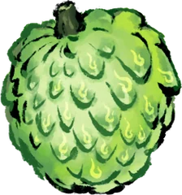

# 【卡牌修仙传】图鉴攻略 — 卡牌 / 灵草&丹药

- 收录总数：97（游戏官方数据，其中图鉴未收录 12 条）
- 更新时间：2026-11-18 04:42

---

## 1. 止血草

大千世界里最常见的灵草，稍加炼制便可以止血化瘀。

### 【获取途径】

培养种子有40%概率获得人品灵草；

探索药田有10%概率获得人品灵草

可以在坊市与其他修士交易获得；

---

## 2. 凝血草

大千世界里最常见的灵草，稍加炼制便可以止血化瘀。

### 【获取途径】

培养种子有40%概率获得人品灵草；

探索药田有10%概率获得人品灵草

可以在坊市与其他修士交易获得；

---

## 3. 苍血草

大千世界里最常见的灵草，稍加炼制便可以止血化瘀。

### 【获取途径】

培养种子有40%概率获得人品灵草；

探索药田有10%概率获得人品灵草

可以在坊市与其他修士交易获得；

---

## 4. 洗骨花

闻一下花的香味，能感觉身体都被洗涤了一次。

### 【获取途径】

培养种子有30%概率获得地品灵草；

探索药田有25%概率获得地品灵草

可以在坊市与其他修士交易获得；

---

## 5. 大洗骨花

闻一下花的香味，能感觉身体都被洗涤了一次。

### 【获取途径】

培养种子有30%概率获得地品灵草；

探索药田有25%概率获得地品灵草

可以在坊市与其他修士交易获得；

---

## 6. 洗髓花

闻一下花的香味，能感觉身体都被洗涤了一次。

### 【获取途径】

培养种子有30%概率获得地品灵草；

探索药田有25%概率获得地品灵草

可以在坊市与其他修士交易获得；

---

## 7. 红仁果

闻一下花的香味，能感觉身体都被洗涤了一次。

### 【获取途径】

培养种子有20%概率获得天品灵草；

探索药田有20%概率获得天品灵草

可以在坊市与其他修士交易获得；

---

## 8. 炎仁果

红彤彤的果实里蕴含着补充人体血气的神奇之物。

### 【获取途径】

培养种子有20%概率获得天品灵草；

探索药田有20%概率获得天品灵草

可以在坊市与其他修士交易获得；

---

## 9. 天火果

红彤彤的果实里蕴含着补充人体血气的神奇之物。

### 【获取途径】

培养种子有20%概率获得天品灵草；

探索药田有20%概率获得天品灵草

可以在坊市与其他修士交易获得；

---

## 10. 血精果

血精果里蕴含大量气血和灵气，是珍贵的灵草。

### 【获取途径】

探索药田有10%概率获得神品灵草；

可以在坊市与其他修士交易获得；

---

## 11. 大血精果

血精果里蕴含大量气血和灵气，是珍贵的灵草。

### 【获取途径】

探索药田有10%概率获得神品灵草；

可以在坊市与其他修士交易获得；

---

## 12. 血晶果

血精果里蕴含大量气血和灵气，是珍贵的灵草。

### 【获取途径】

探索药田有10%概率获得神品灵草；

可以在坊市与其他修士交易获得；

---

## 13. 金蝉

击败妖王**金蝉蛊**后有概率获得，因长期吸取蛊王灵气所以内涵大量气血。

### 【获取途径】

击败妖王：金蝉蛊后有20%概率获得，炼化其内丹大概率获得；

---

## 14. 土茯苓

深藏在地下的灵草，吸收了大地的养分和灵气.

### 【获取途径】

培养种子有40%概率获得人品灵草；

探索药田有10%概率获得人品灵草

可以在坊市与其他修士交易获得；

---

## 15. 千年土茯苓

深藏在地下的灵草，吸收了大地的养分和灵气.

### 【获取途径】

培养种子有40%概率获得人品灵草；

探索药田有10%概率获得人品灵草

可以在坊市与其他修士交易获得；

---

## 16. 万年土茯苓

深藏在地下的灵草，吸收了大地的养分和灵气.

### 【获取途径】

培养种子有40%概率获得人品灵草；

探索药田有10%概率获得人品灵草

可以在坊市与其他修士交易获得；

---

## 17. 白莲子

洁白无暇的莲子，仔细看便能发现莲子里蕴含着灵气。

### 【获取途径】

培养种子有20%概率获得天品灵草；

探索药田有20%概率获得天品灵草

可以在坊市与其他修士交易获得；

---

## 18. 白莲芯

洁白无暇的莲子，仔细看便能发现莲子里蕴含着灵气。

### 【获取途径】

培养种子有20%概率获得天品灵草；

探索药田有20%概率获得天品灵草

可以在坊市与其他修士交易获得；

---

## 19. 白莲玉

洁白无暇的莲子，仔细看便能发现莲子里蕴含着灵气。

### 【获取途径】

培养种子有20%概率获得天品灵草；

探索药田有20%概率获得天品灵草

可以在坊市与其他修士交易获得；

---

## 20. 魂婴果

通常情况下，只有生物才有魂魄，但魂婴果里也似乎存在。

### 【获取途径】

培养种子有10%概率获得仙品灵草；

探索药田有25%概率获得仙品灵草

可以在坊市与其他修士交易获得；

---

## 21. 百年魂婴果

通常情况下，只有生物才有魂魄，但魂婴果里也似乎存在。

### 【获取途径】

培养种子有10%概率获得仙品灵草；

探索药田有25%概率获得仙品灵草

可以在坊市与其他修士交易获得；

---

## 22. 千年魂婴果

通常情况下，只有生物才有魂魄，但魂婴果里也似乎存在。

### 【获取途径】

培养种子有10%概率获得仙品灵草；

探索药田有25%概率获得仙品灵草

可以在坊市与其他修士交易获得；

---

## 23. 铁熊胆

击败妖王**铁骨熊**后有概率获得，熊胆拥有极大量的灵气。

### 【获取途径】

击败妖王：铁骨熊后有20%概率获得，炼化其内丹大概率获得；

---

## 24. 腐木菇

生长在腐烂尸体上的灵菇，散发着一股难闻的味道。

### 【获取途径】

培养种子有40%概率获得人品灵草；

探索药田有10%概率获得人品灵草

可以在坊市与其他修士交易获得；

---

## 25. 大腐木菇

生长在腐烂尸体上的灵菇，散发着一股难闻的味道。

### 【获取途径】

培养种子有40%概率获得人品灵草；

探索药田有10%概率获得人品灵草

可以在坊市与其他修士交易获得；

---

## 26. 腐尸菇

生长在腐烂尸体上的灵菇，散发着一股难闻的味道。

### 【获取途径】

培养种子有40%概率获得人品灵草；

探索药田有10%概率获得人品灵草

可以在坊市与其他修士交易获得；

---

## 27. 断魂花

吸聚了大量冤魂的怪花，夜晚时能听到冤魂的呼叫。

### 【获取途径】

培养种子有30%概率获得地品灵草；

探索药田有25%概率获得地品灵草

可以在坊市与其他修士交易获得；

---

## 28. 大断魂花

吸聚了大量冤魂的怪花，夜晚时能听到冤魂的呼叫。

### 【获取途径】

培养种子有30%概率获得地品灵草；

探索药田有25%概率获得地品灵草

可以在坊市与其他修士交易获得；

---

## 29. 绝魂草

吸聚了大量冤魂的怪花，夜晚时能听到冤魂的呼叫。

### 【获取途径】

培养种子有30%概率获得地品灵草；

探索药田有25%概率获得地品灵草

可以在坊市与其他修士交易获得；

---

## 30. 腐骨草

如果不小心接触到此草，那么连骨头也有可能被腐蚀

### 【获取途径】

探索药田有10%概率获得神品灵草；

可以在坊市与其他修士交易获得；

---

## 31. 大腐骨草

如果不小心接触到此草，那么连骨头也有可能被腐蚀

### 【获取途径】

探索药田有10%概率获得神品灵草；

可以在坊市与其他修士交易获得；

---

## 32. 阴骨草

如果不小心接触到此草，那么连骨头也有可能被腐蚀

### 【获取途径】

探索药田有10%概率获得神品灵草；

可以在坊市与其他修士交易获得；

---

## 33. 毒液

击败小型的鬼面蛛有概率获得，从其毒囊里收集的精华毒液。

此卡牌无主药效果，如果用于主材料，则只能炼制出无效果的丹药

### 【获取途径】

击败妖王：鬼面蛛后有20%概率获得，炼化其内丹大概率获得；

---

## 34. 剧毒液

击败妖王**鬼面蛛**后有概率获得，炼制成丹药后可造成大量伤害

### 【获取途径】

击败妖王：鬼面蛛后有20%概率获得，炼化其内丹大概率获得；

---

## 35. 紫烟果

果子不时的冒出一股股的紫烟，透过紫烟似乎能看到另一片世界。

### 【获取途径】

培养种子有30%概率获得地品灵草；

探索药田有25%概率获得地品灵草

可以在坊市与其他修士交易获得；

---

## 36. 大紫烟果

果子不时的冒出一股股的紫烟，透过紫烟似乎能看到另一片世界。

### 【获取途径】

培养种子有30%概率获得地品灵草；

探索药田有25%概率获得地品灵草

可以在坊市与其他修士交易获得；

---

## 37. 六瓣兰

奇怪的兰花，生长的时间越长，花瓣数量会越多。

### 【获取途径】

培养种子有20%概率获得天品灵草；

探索药田有20%概率获得天品灵草

可以在坊市与其他修士交易获得；

---

## 38. 九瓣兰

奇怪的兰花，生长的时间越长，花瓣数量会越多。

### 【获取途径】

培养种子有20%概率获得天品灵草；

探索药田有20%概率获得天品灵草

可以在坊市与其他修士交易获得；

---

## 39. 冰雪莲

生长在冰川雪地的莲花，整朵花瓣都如冰雪般晶莹。

### 【获取途径】

培养种子有10%概率获得仙品灵草；

探索药田有25%概率获得仙品灵草

可以在坊市与其他修士交易获得；

---

## 40. 冰晶莲

生长在冰川雪地的莲花，整朵花瓣都如冰雪般晶莹。

### 【获取途径】

培养种子有10%概率获得仙品灵草；

探索药田有25%概率获得仙品灵草

可以在坊市与其他修士交易获得；

---

## 41. 磐石粉

一部分〔土〕妖王身上都覆盖磐石，击败妖王后有概率获得。

### 【获取途径】

击败妖王：巨灵烈象或石魈后有20%概率获得，炼化其内丹大概率获得；

---

## 42. 醉龙果

果实里富含营养物，只是实在太多了，以至于妖怪吃了也要醉倒。

### 【获取途径】

培养种子有10%概率获得仙品灵草；

探索药田有25%概率获得仙品灵草

可以在坊市与其他修士交易获得；

---

## 43. 百年醉龙果

果实里富含营养物，只是实在太多了，以至于妖怪吃了也要醉倒。

### 【获取途径】

培养种子有10%概率获得仙品灵草；

探索药田有25%概率获得仙品灵草

可以在坊市与其他修士交易获得；

---

## 44. 千年醉龙果

果实里富含营养物，只是实在太多了，以至于妖怪吃了也要醉倒。

### 【获取途径】

培养种子有10%概率获得仙品灵草；

探索药田有25%概率获得仙品灵草

可以在坊市与其他修士交易获得；

---

## 45. 菩提果

菩提树历经百年沧桑才会结果。

### 【获取途径】

探索药田有10%概率获得神品灵草；

可以在坊市与其他修士交易获得；

---

## 46. 大菩提果

菩提树历经百年沧桑才会结果。

### 【获取途径】

探索药田有10%概率获得神品灵草；

可以在坊市与其他修士交易获得；

---

## 47. 菩提道果

菩提树历经百年沧桑才会结果。

### 【获取途径】

探索药田有10%概率获得神品灵草；

可以在坊市与其他修士交易获得；

---

## 48. 迷魂香

闻到香味着，无论妖怪或是人物，均会倒地不起。

### 【获取途径】

培养种子有30%概率获得地品灵草；

探索药田有25%概率获得地品灵草

可以在坊市与其他修士交易获得；

---

## 49. 迷魂迭香

闻到香味着，无论妖怪或是人物，均会倒地不起。

### 【获取途径】

培养种子有30%概率获得地品灵草；

探索药田有25%概率获得地品灵草

可以在坊市与其他修士交易获得；

---

## 50. 忘魂香

闻到香味着，无论妖怪或是人物，均会倒地不起。

### 【获取途径】

培养种子有30%概率获得地品灵草；

探索药田有25%概率获得地品灵草

可以在坊市与其他修士交易获得；

---

## 51. 幻神草

哪怕神仙尝一口，也会触发幻觉的灵草。

### 【获取途径】

培养种子有10%概率获得仙品灵草；

探索药田有25%概率获得仙品灵草

可以在坊市与其他修士交易获得；

---

## 52. 大幻神草

哪怕神仙尝一口，也会触发幻觉的灵草。

### 【获取途径】

培养种子有10%概率获得仙品灵草；

探索药田有25%概率获得仙品灵草

可以在坊市与其他修士交易获得；

---

## 53. 幻魄草

哪怕神仙尝一口，也会触发幻觉的灵草。

### 【获取途径】

培养种子有10%概率获得仙品灵草；

探索药田有25%概率获得仙品灵草

可以在坊市与其他修士交易获得；

---

## 54. 青焰根

此火焰并不灼烧肉体，而是燃烧灵魂

### 【获取途径】

培养种子有20%概率获得天品灵草；

探索药田有20%概率获得天品灵草

可以在坊市与其他修士交易获得；

---

## 55. 青焰魔根

此火焰并不灼烧肉体，而是燃烧灵魂

### 【获取途径】

培养种子有20%概率获得天品灵草；

探索药田有20%概率获得天品灵草

可以在坊市与其他修士交易获得；

---

## 56. 魔焰根

此火焰并不灼烧肉体，而是燃烧灵魂

### 【获取途径】

培养种子有20%概率获得天品灵草；

探索药田有20%概率获得天品灵草

可以在坊市与其他修士交易获得；

---

## 57. 百灵参

生长了多年的人参。

### 【获取途径】

培养种子有10%概率获得仙品灵草；

探索药田有25%概率获得仙品灵草

可以在坊市与其他修士交易获得；

---

## 58. 千灵参

生长了多年的人参。

### 【获取途径】

培养种子有10%概率获得仙品灵草；

探索药田有25%概率获得仙品灵草

可以在坊市与其他修士交易获得；

---

## 59. 万灵参

生长了多年的人参。

### 【获取途径】

培养种子有10%概率获得仙品灵草；

探索药田有25%概率获得仙品灵草

可以在坊市与其他修士交易获得；

---

## 60. 蕴元仙萼

萼瓣凝霜、芯藏金光，得天地元气滋养万年方得成形；

### 【获取途径】

在古木幽森的深处有概率获得；

---

## 61. 兽涎水

这种水会散发一股香气，能吸引妖怪的到来。

### 【获取途径】

培养种子有30%概率获得地品灵草；

探索药田有25%概率获得地品灵草

可以在坊市与其他修士交易获得；

---

## 62. 兽涎露

这种水会散发一股香气，能吸引妖怪的到来。

### 【获取途径】

培养种子有30%概率获得地品灵草；

探索药田有25%概率获得地品灵草

可以在坊市与其他修士交易获得；

---

## 63. 兽涎露石

这种水会散发一股香气，能吸引妖怪的到来。

### 【获取途径】

培养种子有30%概率获得地品灵草；

探索药田有25%概率获得地品灵草

可以在坊市与其他修士交易获得；

---

## 64. 九霄灵芝

生长在仙界的灵芝，灵芝会自己跑动，才流落到人间。

### 【获取途径】

在古木幽森的深处有概率获得；

---

## 65. 赤霄灵芝

生长在仙界的灵芝，灵芝会自己跑动，才流落到人间。

### 【获取途径】

在古木幽森的深处有概率获得；

---

## 66. 碧霄灵芝

生长在仙界的灵芝，灵芝会自己跑动，才流落到人间。

### 【获取途径】

在古木幽森的深处有概率获得；

---

## 67. 血灵芝

击败妖王**血肉灵芝**后有概率获得，可用于炼制寿元丹，但其血腥之气实在容易令人入魔

### 【获取途径】

击败妖王：血肉灵芝后有20%概率获得，炼化其内丹大概率获得；

---

## 68. 缘玑仙草

隐于云海仙山的聚气之地，茎生七叶、叶缀玑珠，沐晨露吸星华而生，其株自带缥缈气运

### 【获取途径】

在古木幽森的深处有概率获得；

---

## 69. 化瘀丹

普通的回血丹药，在战斗中亦可服用。

### 【获取途径】

使用止血草，洗骨花，红仁果，金蝉做主药可以炼制出；

---

## 70. 血还丹

能够同时恢复气血和灵气的丹药！

### 【效果（各境界 / 品质）】

练气·绝品：能够同时恢复大量〔血量〕和〔灵气〕的丹药！

筑基·绝品：能够同时恢复大量〔血量〕和〔灵气〕的丹药！

结丹·绝品：能够同时恢复大量〔血量〕和〔灵气〕的丹药！

元婴·绝品：能够同时恢复大量〔血量〕和〔灵气〕的丹药！

### 【获取途径】

使用血精果做主药可以炼制出；

---

## 71. 引气丸

常见的丹药，可以快速补充修士体内的灵气。探索秘境时必带之。

### 【获取途径】

使用土茯苓，白莲子做主药可以炼制出；

---

## 72. 魔元丹

可恢复大量的灵气，但服用后会入魔。

### 【获取途径】

使用魂婴果做主药可以炼制出；

---

## 73. 毒心散

蕴含剧毒的丹药，能对生物造成伤害。

### 【效果（各境界 / 品质）】

练气·绝品：比普通的毒心散更加难制作，毒药效果大幅加强。

筑基·绝品：比普通的毒心散更加难制作，毒药效果大幅加强。

结丹·绝品：比普通的毒心散更加难制作，毒药效果大幅加强。

元婴·绝品：比普通的毒心散更加难制作，毒药效果大幅加强。

### 【获取途径】

使用腐木菇，断魂花，腐骨草，剧毒液做主药可以炼制出；

---

## 74. 铸体丹

服用后可以将身体稍稍硬化。

### 【效果（各境界 / 品质）】

筑基·绝品：服用后可以将身体大幅度硬化。

结丹·绝品：服用后可以将身体大幅度硬化。

元婴·绝品：服用后可以将身体大幅度硬化。

### 【获取途径】

使用紫烟果，三瓣兰，磐石粉做主药可以炼制出；

---

## 75. 玄霜丸

服用后可以将身体外覆盖一层冰甲，可过低的温度也会身体造成一些负面效果。

### 【获取途径】

使用冰雪莲做主药可以炼制出；

---

## 76. 醉心露

服用后会醉倒，但在醉梦中才悟得清楚

### 【获取途径】

使用醉龙果做主药可以炼制出；

---

## 77. 真悟丹

服用后会进入顿悟状态。

### 【获取途径】

使用菩提果做主药可以炼制出；

---

## 78. 迷魂丹

将目标的神经放松，才可控制目标。

### 【获取途径】

使用迷魂香做主药可以炼制出；

---

## 79. 锁神丹

把目标的神识牢牢锁住

### 【获取途径】

使用幻神草做主药可以炼制出；

---

## 80. 燃魂散

服用后可获得修为，但对魂魄造成一定的伤害

### 【获取途径】

使用青焰根做主药可以炼制出；

---

## 81. 逆元丹

服用后可以将全身的灵气逆转成修为

### 【获取途径】

使用百灵参做主药可以炼制出；

---

## 82. 修为丹

服用后立刻获得修为，且无其他副作用。

### 【效果（各境界 / 品质）】

练气·绝品：服用后立刻获得大量修为。

筑基·绝品：服用后立刻获得大量修为。

结丹·绝品：服用后立刻获得大量修为。

元婴·绝品：服用后立刻获得大量修为。

### 【获取途径】

使用蕴元仙萼做主药可以炼制出；

---

## 83. 引兽丸

丹药散发着浓浓的香味，能将妖兽吸引来

### 【获取途径】

使用兽涎水做主药可以炼制出；

---

## 84. 寿元丹

能逆天改命的丹药，服用后增加少量寿命

### 【效果（各境界 / 品质）】

练气·绝品：能逆天改命的丹药，服用后增加大量〔寿命〕

筑基·绝品：能逆天改命的丹药，服用后增加大量〔寿命〕

结丹·绝品：能逆天改命的丹药，服用后增加大量〔寿命〕

元婴·绝品：能逆天改命的丹药，服用后增加大量〔寿命〕

### 【获取途径】

使用九霄灵芝，血灵芝做主药可以炼制出；

---

## 85. 慧心丹

蕴含因果机缘的丹药。

### 【获取途径】

使用缘玑仙草做主药可以炼制出；

---

## 86. 聚灵丹（图鉴未收录）

服用后永久提高〔灵气〕上限

### 【获取途径】

比武大会的魁首奖品；

---

## 87. 凝元丹（图鉴未收录）

服用后永久提高神识

### 【获取途径】

比武大会的魁首奖品；

---

## 88. 回春髓（图鉴未收录）

服用后清除身上的死亡记录

### 【获取途径】

比武大会的魁首奖品；

---

## 89. 兵魄丹（图鉴未收录）

服用后永久提高〔攻击〕

### 【获取途径】

比武大会的魁首奖品；

---

## 90. 璇玑露（图鉴未收录）

服用后永久提高〔血量〕

### 【获取途径】

比武大会的魁首奖品；

---

## 91. 遁速丹（图鉴未收录）

服用后可提升对灵气的操控度，使得飞行速度加快。

### 【获取途径】

比武大会的魁首奖品；

---

## 92. 心魇酿（图鉴未收录）

一盏照执念，杯底见众生

### 【获取途径】

在醉仙阁向精明的小二购买；

---

## 93. 劫尘醉（图鉴未收录）

千秋业火烬，半杯洗浮尘

### 【获取途径】

在醉仙阁向精明的小二购买；

---

## 94. 乱神觞（图鉴未收录）

狂泉浇块垒，疯骨铸金刚

### 【获取途径】

在醉仙阁向精明的小二购买；

---

## 95. 玉髓滴（图鉴未收录）

涓露润道基，久饮通明台

### 【获取途径】

在醉仙阁向精明的小二购买；

---

## 96. 回春露（图鉴未收录）

一滴劫灰烬，半盏赎魂灯

掌柜提醒：服用后可清除身上的死亡记录

### 【获取途径】

在醉仙阁向精明的小二购买；

---

## 97. 灵泉酿（图鉴未收录）

一盏润喉舌，半壶解千愁

### 【获取途径】

在醉仙阁向小二购买；

---
