# 【卡牌修仙传】图鉴攻略 — 卡牌 / 灵草&丹药

- 收录总数：97（游戏官方数据，其中图鉴未收录 12 条）
- 更新时间：2026-11-18 12:43

---

## 1. 止血草

大千世界里最常见的灵草，稍加炼制便可以止血化瘀。

### 【主药效果】

活血：恢复血量

### 【辅药效果】

活血：恢复血量

### 【各版本（境界 / 品质）】

练气·人品：主药 活血：恢复血量（2）；辅药 活血：恢复血量（2）

### 【炼丹用途】

做主药：炼出「化瘀丹」（数值见【主药效果】；炼出的丹药是哪个境界，看 5 株草药的境界分总和）

做辅药：给主效果是【活血】的丹药（「化瘀丹」、「血还丹」）叠加数值（见【辅药效果】）

品质：人品；境界分：练气 1。品质越高越容易炼出高品质丹药；原理和每种丹药的推荐配方见对应丹药的【最佳合成路线】

### 【获取途径】

培养种子有40%概率获得人品灵草

探索药田有10%概率获得人品灵草

可以在坊市与其他修士交易获得

---

## 2. 凝血草

大千世界里最常见的灵草，稍加炼制便可以止血化瘀。

### 【主药效果】

活血：恢复血量

### 【辅药效果】

活血：恢复血量

### 【各版本（境界 / 品质）】

筑基·人品：主药 活血：恢复血量（3）；辅药 活血：恢复血量（3）

### 【炼丹用途】

做主药：炼出「化瘀丹」（数值见【主药效果】；炼出的丹药是哪个境界，看 5 株草药的境界分总和）

做辅药：给主效果是【活血】的丹药（「化瘀丹」、「血还丹」）叠加数值（见【辅药效果】）

品质：人品；境界分：筑基 2。品质越高越容易炼出高品质丹药；原理和每种丹药的推荐配方见对应丹药的【最佳合成路线】

### 【获取途径】

培养种子有40%概率获得人品灵草

探索药田有10%概率获得人品灵草

可以在坊市与其他修士交易获得

---

## 3. 苍血草

大千世界里最常见的灵草，稍加炼制便可以止血化瘀。

### 【主药效果】

活血：恢复血量

### 【辅药效果】

活血：恢复血量

### 【各版本（境界 / 品质）】

结丹·人品：主药 活血：恢复血量（5）；辅药 活血：恢复血量（5）

元婴·人品：主药 活血：恢复血量（12）；辅药 活血：恢复血量（12）

### 【炼丹用途】

做主药：炼出「化瘀丹」（数值见【主药效果】；炼出的丹药是哪个境界，看 5 株草药的境界分总和）

做辅药：给主效果是【活血】的丹药（「化瘀丹」、「血还丹」）叠加数值（见【辅药效果】）

品质：人品；境界分：结丹 8、元婴 29。品质越高越容易炼出高品质丹药；原理和每种丹药的推荐配方见对应丹药的【最佳合成路线】

### 【获取途径】

培养种子有40%概率获得人品灵草

探索药田有10%概率获得人品灵草

可以在坊市与其他修士交易获得

---

## 4. 洗骨花

闻一下花的香味，能感觉身体都被洗涤了一次。

### 【主药效果】

活血：恢复血量

### 【辅药效果】

活血：恢复血量

### 【各版本（境界 / 品质）】

练气·地品：主药 活血：恢复血量（3）；辅药 活血：恢复血量（3）

### 【炼丹用途】

做主药：炼出「化瘀丹」（数值见【主药效果】；炼出的丹药是哪个境界，看 5 株草药的境界分总和）

做辅药：给主效果是【活血】的丹药（「化瘀丹」、「血还丹」）叠加数值（见【辅药效果】）

品质：地品；境界分：练气 1。品质越高越容易炼出高品质丹药；原理和每种丹药的推荐配方见对应丹药的【最佳合成路线】

### 【获取途径】

培养种子有30%概率获得地品灵草

探索药田有25%概率获得地品灵草

可以在坊市与其他修士交易获得

---

## 5. 大洗骨花

闻一下花的香味，能感觉身体都被洗涤了一次。

### 【主药效果】

活血：恢复血量

### 【辅药效果】

活血：恢复血量

### 【各版本（境界 / 品质）】

筑基·地品：主药 活血：恢复血量（4）；辅药 活血：恢复血量（4）

### 【炼丹用途】

做主药：炼出「化瘀丹」（数值见【主药效果】；炼出的丹药是哪个境界，看 5 株草药的境界分总和）

做辅药：给主效果是【活血】的丹药（「化瘀丹」、「血还丹」）叠加数值（见【辅药效果】）

品质：地品；境界分：筑基 2。品质越高越容易炼出高品质丹药；原理和每种丹药的推荐配方见对应丹药的【最佳合成路线】

### 【获取途径】

培养种子有30%概率获得地品灵草

探索药田有25%概率获得地品灵草

可以在坊市与其他修士交易获得

---

## 6. 洗髓花

闻一下花的香味，能感觉身体都被洗涤了一次。

### 【主药效果】

活血：恢复血量

### 【辅药效果】

活血：恢复血量

### 【各版本（境界 / 品质）】

结丹·地品：主药 活血：恢复血量（7）；辅药 活血：恢复血量（7）

元婴·地品：主药 活血：恢复血量（18）；辅药 活血：恢复血量（18）

### 【炼丹用途】

做主药：炼出「化瘀丹」（数值见【主药效果】；炼出的丹药是哪个境界，看 5 株草药的境界分总和）

做辅药：给主效果是【活血】的丹药（「化瘀丹」、「血还丹」）叠加数值（见【辅药效果】）

品质：地品；境界分：结丹 8、元婴 29。品质越高越容易炼出高品质丹药；原理和每种丹药的推荐配方见对应丹药的【最佳合成路线】

### 【获取途径】

培养种子有30%概率获得地品灵草

探索药田有25%概率获得地品灵草

可以在坊市与其他修士交易获得

---

## 7. 红仁果

闻一下花的香味，能感觉身体都被洗涤了一次。

### 【主药效果】

活血：恢复血量

### 【辅药效果】

活血：恢复血量

聚气：补充灵气值

### 【各版本（境界 / 品质）】

练气·天品：主药 活血：恢复血量（3）；辅药 活血：恢复血量（2）；辅药 聚气：补充灵气值（2）

### 【炼丹用途】

做主药：炼出「化瘀丹」（数值见【主药效果】；炼出的丹药是哪个境界，看 5 株草药的境界分总和）

做辅药：给主效果是【活血】的丹药（「化瘀丹」、「血还丹」）叠加数值（见【辅药效果】）

做辅药：给主效果是【聚气】的丹药（「引气丸」、「魔元丹」）叠加数值（见【辅药效果】）

品质：天品；境界分：练气 1。品质越高越容易炼出高品质丹药；原理和每种丹药的推荐配方见对应丹药的【最佳合成路线】

### 【获取途径】

培养种子有20%概率获得天品灵草

探索药田有20%概率获得天品灵草

可以在坊市与其他修士交易获得

---

## 8. 炎仁果

红彤彤的果实里蕴含着补充人体血气的神奇之物。

### 【主药效果】

活血：恢复血量

### 【辅药效果】

活血：恢复血量

聚气：补充灵气值

### 【各版本（境界 / 品质）】

筑基·天品：主药 活血：恢复血量（4）；辅药 活血：恢复血量（3）；辅药 聚气：补充灵气值（3）

### 【炼丹用途】

做主药：炼出「化瘀丹」（数值见【主药效果】；炼出的丹药是哪个境界，看 5 株草药的境界分总和）

做辅药：给主效果是【活血】的丹药（「化瘀丹」、「血还丹」）叠加数值（见【辅药效果】）

做辅药：给主效果是【聚气】的丹药（「引气丸」、「魔元丹」）叠加数值（见【辅药效果】）

品质：天品；境界分：筑基 2。品质越高越容易炼出高品质丹药；原理和每种丹药的推荐配方见对应丹药的【最佳合成路线】

### 【获取途径】

培养种子有20%概率获得天品灵草

探索药田有20%概率获得天品灵草

可以在坊市与其他修士交易获得

---

## 9. 天火果

红彤彤的果实里蕴含着补充人体血气的神奇之物。

### 【主药效果】

活血：恢复血量

### 【辅药效果】

活血：恢复血量

聚气：补充灵气值

### 【各版本（境界 / 品质）】

结丹·天品：主药 活血：恢复血量（7）；辅药 活血：恢复血量（5）；辅药 聚气：补充灵气值（5）

元婴·天品：主药 活血：恢复血量（18）；辅药 活血：恢复血量（12）；辅药 聚气：补充灵气值（8）

### 【炼丹用途】

做主药：炼出「化瘀丹」（数值见【主药效果】；炼出的丹药是哪个境界，看 5 株草药的境界分总和）

做辅药：给主效果是【活血】的丹药（「化瘀丹」、「血还丹」）叠加数值（见【辅药效果】）

做辅药：给主效果是【聚气】的丹药（「引气丸」、「魔元丹」）叠加数值（见【辅药效果】）

品质：天品；境界分：结丹 8、元婴 29。品质越高越容易炼出高品质丹药；原理和每种丹药的推荐配方见对应丹药的【最佳合成路线】

### 【获取途径】

培养种子有20%概率获得天品灵草

探索药田有20%概率获得天品灵草

可以在坊市与其他修士交易获得

---

## 10. 血精果

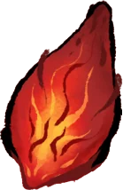

血精果里蕴含大量气血和灵气，是珍贵的灵草。

### 【主药效果】

活血：恢复血量

聚气：补充灵气值

### 【辅药效果】

开窍：可获得修为

### 【各版本（境界 / 品质）】

练气·神品：主药 活血：恢复血量（4）；主药 聚气：补充灵气值（4）；辅药 开窍：可获得修为（1）

### 【炼丹用途】

做主药：炼出「血还丹」（数值见【主药效果】；炼出的丹药是哪个境界，看 5 株草药的境界分总和）

做辅药：给主效果是【开窍】的丹药（「修为丹」、「燃魂散」、「逆元丹」）叠加数值（见【辅药效果】）

品质：神品；境界分：练气 1。品质越高越容易炼出高品质丹药；原理和每种丹药的推荐配方见对应丹药的【最佳合成路线】

### 【获取途径】

探索药田有10%概率获得神品灵草

可以在坊市与其他修士交易获得

---

## 11. 大血精果

血精果里蕴含大量气血和灵气，是珍贵的灵草。

### 【主药效果】

活血：恢复血量

聚气：补充灵气值

### 【辅药效果】

开窍：可获得修为

### 【各版本（境界 / 品质）】

筑基·神品：主药 活血：恢复血量（7）；主药 聚气：补充灵气值（5）；辅药 开窍：可获得修为（2）

### 【炼丹用途】

做主药：炼出「血还丹」（数值见【主药效果】；炼出的丹药是哪个境界，看 5 株草药的境界分总和）

做辅药：给主效果是【开窍】的丹药（「修为丹」、「燃魂散」、「逆元丹」）叠加数值（见【辅药效果】）

品质：神品；境界分：筑基 2。品质越高越容易炼出高品质丹药；原理和每种丹药的推荐配方见对应丹药的【最佳合成路线】

### 【获取途径】

探索药田有10%概率获得神品灵草

可以在坊市与其他修士交易获得

---

## 12. 血晶果

血精果里蕴含大量气血和灵气，是珍贵的灵草。

### 【主药效果】

活血：恢复血量

聚气：补充灵气值

### 【辅药效果】

开窍：可获得修为

### 【各版本（境界 / 品质）】

结丹·神品：主药 活血：恢复血量（14）；主药 聚气：补充灵气值（10）；辅药 开窍：可获得修为（3）

元婴·神品：主药 活血：恢复血量（35）；主药 聚气：补充灵气值（10）；辅药 开窍：可获得修为（7）

### 【炼丹用途】

做主药：炼出「血还丹」（数值见【主药效果】；炼出的丹药是哪个境界，看 5 株草药的境界分总和）

做辅药：给主效果是【开窍】的丹药（「修为丹」、「燃魂散」、「逆元丹」）叠加数值（见【辅药效果】）

品质：神品；境界分：结丹 8、元婴 29。品质越高越容易炼出高品质丹药；原理和每种丹药的推荐配方见对应丹药的【最佳合成路线】

### 【获取途径】

探索药田有10%概率获得神品灵草

可以在坊市与其他修士交易获得

---

## 13. 金蝉

因长期吸取蛊王灵气所以内涵大量气血。

### 【主药效果】

活血：恢复血量

### 【各版本（境界 / 品质）】

筑基·仙品：主药 活血：恢复血量（20）

结丹·仙品：主药 活血：恢复血量（40）

元婴·仙品：主药 活血：恢复血量（100）

### 【炼丹用途】

做主药：炼出「化瘀丹」（数值见【主药效果】；炼出的丹药是哪个境界，看 5 株草药的境界分总和）

品质：仙品；境界分：筑基 2、结丹 8、元婴 29。品质越高越容易炼出高品质丹药；原理和每种丹药的推荐配方见对应丹药的【最佳合成路线】

### 【获取途径】

击败妖王「金蝉蛊」后有20%概率获得，炼化金蝉蛊的内丹大概率获得

---

## 14. 土茯苓

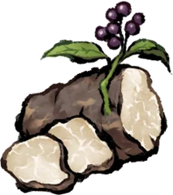

深藏在地下的灵草，吸收了大地的养分和灵气.

### 【主药效果】

聚气：补充灵气值

### 【辅药效果】

聚气：补充灵气值

### 【各版本（境界 / 品质）】

练气·人品：主药 聚气：补充灵气值（1）；辅药 聚气：补充灵气值（1）

### 【炼丹用途】

做主药：炼出「引气丸」（数值见【主药效果】；炼出的丹药是哪个境界，看 5 株草药的境界分总和）

做辅药：给主效果是【聚气】的丹药（「引气丸」、「魔元丹」）叠加数值（见【辅药效果】）

品质：人品；境界分：练气 1。品质越高越容易炼出高品质丹药；原理和每种丹药的推荐配方见对应丹药的【最佳合成路线】

### 【获取途径】

培养种子有40%概率获得人品灵草

探索药田有10%概率获得人品灵草

可以在坊市与其他修士交易获得

---

## 15. 千年土茯苓

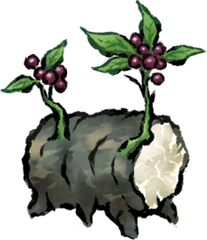

深藏在地下的灵草，吸收了大地的养分和灵气.

### 【主药效果】

聚气：补充灵气值

### 【辅药效果】

聚气：补充灵气值

### 【各版本（境界 / 品质）】

筑基·人品：主药 聚气：补充灵气值（2）；辅药 聚气：补充灵气值（2）

### 【炼丹用途】

做主药：炼出「引气丸」（数值见【主药效果】；炼出的丹药是哪个境界，看 5 株草药的境界分总和）

做辅药：给主效果是【聚气】的丹药（「引气丸」、「魔元丹」）叠加数值（见【辅药效果】）

品质：人品；境界分：筑基 2。品质越高越容易炼出高品质丹药；原理和每种丹药的推荐配方见对应丹药的【最佳合成路线】

### 【获取途径】

培养种子有40%概率获得人品灵草

探索药田有10%概率获得人品灵草

可以在坊市与其他修士交易获得

---

## 16. 万年土茯苓

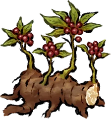

深藏在地下的灵草，吸收了大地的养分和灵气.

### 【主药效果】

聚气：补充灵气值

### 【辅药效果】

聚气：补充灵气值

### 【各版本（境界 / 品质）】

结丹·人品：主药 聚气：补充灵气值（3）；辅药 聚气：补充灵气值（3）

元婴·人品：主药 聚气：补充灵气值（5）；辅药 聚气：补充灵气值（5）

### 【炼丹用途】

做主药：炼出「引气丸」（数值见【主药效果】；炼出的丹药是哪个境界，看 5 株草药的境界分总和）

做辅药：给主效果是【聚气】的丹药（「引气丸」、「魔元丹」）叠加数值（见【辅药效果】）

品质：人品；境界分：结丹 8、元婴 29。品质越高越容易炼出高品质丹药；原理和每种丹药的推荐配方见对应丹药的【最佳合成路线】

### 【获取途径】

培养种子有40%概率获得人品灵草

探索药田有10%概率获得人品灵草

可以在坊市与其他修士交易获得

---

## 17. 白莲子

洁白无暇的莲子，仔细看便能发现莲子里蕴含着灵气。

### 【主药效果】

聚气：补充灵气值

### 【辅药效果】

聚气：补充灵气值

断脉：可造成伤害

### 【各版本（境界 / 品质）】

练气·天品：主药 聚气：补充灵气值（2）；辅药 聚气：补充灵气值（3）；辅药 断脉：可造成伤害（1）

### 【炼丹用途】

做主药：炼出「引气丸」（数值见【主药效果】；炼出的丹药是哪个境界，看 5 株草药的境界分总和）

做辅药：给主效果是【聚气】的丹药（「引气丸」、「魔元丹」）叠加数值（见【辅药效果】）

做辅药：给主效果是【断脉】的丹药（「毒心散」）叠加数值（见【辅药效果】）

品质：天品；境界分：练气 1。品质越高越容易炼出高品质丹药；原理和每种丹药的推荐配方见对应丹药的【最佳合成路线】

### 【获取途径】

培养种子有20%概率获得天品灵草

探索药田有20%概率获得天品灵草

可以在坊市与其他修士交易获得

---

## 18. 白莲芯

洁白无暇的莲子，仔细看便能发现莲子里蕴含着灵气。

### 【主药效果】

聚气：补充灵气值

### 【辅药效果】

聚气：补充灵气值

断脉：可造成伤害

### 【各版本（境界 / 品质）】

筑基·天品：主药 聚气：补充灵气值（3）；辅药 聚气：补充灵气值（4）；辅药 断脉：可造成伤害（2）

### 【炼丹用途】

做主药：炼出「引气丸」（数值见【主药效果】；炼出的丹药是哪个境界，看 5 株草药的境界分总和）

做辅药：给主效果是【聚气】的丹药（「引气丸」、「魔元丹」）叠加数值（见【辅药效果】）

做辅药：给主效果是【断脉】的丹药（「毒心散」）叠加数值（见【辅药效果】）

品质：天品；境界分：筑基 2。品质越高越容易炼出高品质丹药；原理和每种丹药的推荐配方见对应丹药的【最佳合成路线】

### 【获取途径】

培养种子有20%概率获得天品灵草

探索药田有20%概率获得天品灵草

可以在坊市与其他修士交易获得

---

## 19. 白莲玉

洁白无暇的莲子，仔细看便能发现莲子里蕴含着灵气。

### 【主药效果】

聚气：补充灵气值

### 【辅药效果】

聚气：补充灵气值

断脉：可造成伤害

### 【各版本（境界 / 品质）】

结丹·天品：主药 聚气：补充灵气值（5）；辅药 聚气：补充灵气值（5）；辅药 断脉：可造成伤害（4）

元婴·天品：主药 聚气：补充灵气值（8）；辅药 聚气：补充灵气值（8）；辅药 断脉：可造成伤害（8）

### 【炼丹用途】

做主药：炼出「引气丸」（数值见【主药效果】；炼出的丹药是哪个境界，看 5 株草药的境界分总和）

做辅药：给主效果是【聚气】的丹药（「引气丸」、「魔元丹」）叠加数值（见【辅药效果】）

做辅药：给主效果是【断脉】的丹药（「毒心散」）叠加数值（见【辅药效果】）

品质：天品；境界分：结丹 8、元婴 29。品质越高越容易炼出高品质丹药；原理和每种丹药的推荐配方见对应丹药的【最佳合成路线】

### 【获取途径】

培养种子有20%概率获得天品灵草

探索药田有20%概率获得天品灵草

可以在坊市与其他修士交易获得

---

## 20. 魂婴果

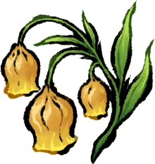

通常情况下，只有生物才有魂魄，但魂婴果里也似乎存在。

### 【主药效果】

聚气：补充灵气值

堕心：会产生心魔

### 【辅药效果】

聚气：补充灵气值

### 【各版本（境界 / 品质）】

练气·仙品：主药 聚气：补充灵气值（6）；主药 堕心：会产生心魔（1）；辅药 聚气：补充灵气值（2）

### 【炼丹用途】

做主药：炼出「魔元丹」（数值见【主药效果】；炼出的丹药是哪个境界，看 5 株草药的境界分总和）

做辅药：给主效果是【聚气】的丹药（「引气丸」、「魔元丹」）叠加数值（见【辅药效果】）

品质：仙品；境界分：练气 1。品质越高越容易炼出高品质丹药；原理和每种丹药的推荐配方见对应丹药的【最佳合成路线】

### 【获取途径】

培养种子有10%概率获得仙品灵草

探索药田有25%概率获得仙品灵草

可以在坊市与其他修士交易获得

---

## 21. 百年魂婴果

通常情况下，只有生物才有魂魄，但魂婴果里也似乎存在。

### 【主药效果】

聚气：补充灵气值

堕心：会产生心魔

### 【辅药效果】

聚气：补充灵气值

### 【各版本（境界 / 品质）】

筑基·仙品：主药 聚气：补充灵气值（8）；主药 堕心：会产生心魔（1）；辅药 聚气：补充灵气值（3）

### 【炼丹用途】

做主药：炼出「魔元丹」（数值见【主药效果】；炼出的丹药是哪个境界，看 5 株草药的境界分总和）

做辅药：给主效果是【聚气】的丹药（「引气丸」、「魔元丹」）叠加数值（见【辅药效果】）

品质：仙品；境界分：筑基 2。品质越高越容易炼出高品质丹药；原理和每种丹药的推荐配方见对应丹药的【最佳合成路线】

### 【获取途径】

培养种子有10%概率获得仙品灵草

探索药田有25%概率获得仙品灵草

可以在坊市与其他修士交易获得

---

## 22. 千年魂婴果

通常情况下，只有生物才有魂魄，但魂婴果里也似乎存在。

### 【主药效果】

聚气：补充灵气值

堕心：会产生心魔

### 【辅药效果】

聚气：补充灵气值

### 【各版本（境界 / 品质）】

结丹·仙品：主药 聚气：补充灵气值（10）；主药 堕心：会产生心魔（1）；辅药 聚气：补充灵气值（5）

元婴·仙品：主药 聚气：补充灵气值（15）；主药 堕心：会产生心魔（1）；辅药 聚气：补充灵气值（8）

### 【炼丹用途】

做主药：炼出「魔元丹」（数值见【主药效果】；炼出的丹药是哪个境界，看 5 株草药的境界分总和）

做辅药：给主效果是【聚气】的丹药（「引气丸」、「魔元丹」）叠加数值（见【辅药效果】）

品质：仙品；境界分：结丹 8、元婴 29。品质越高越容易炼出高品质丹药；原理和每种丹药的推荐配方见对应丹药的【最佳合成路线】

### 【获取途径】

培养种子有10%概率获得仙品灵草

探索药田有25%概率获得仙品灵草

可以在坊市与其他修士交易获得

---

## 23. 铁熊胆

熊胆拥有极大量的灵气。

### 【主药效果】

聚气：补充灵气值

### 【各版本（境界 / 品质）】

筑基·神品：主药 聚气：补充灵气值（20）

结丹·神品：主药 聚气：补充灵气值（40）

元婴·神品：主药 聚气：补充灵气值（60）

### 【炼丹用途】

做主药：炼出「引气丸」（数值见【主药效果】；炼出的丹药是哪个境界，看 5 株草药的境界分总和）

品质：神品；境界分：筑基 2、结丹 8、元婴 29。品质越高越容易炼出高品质丹药；原理和每种丹药的推荐配方见对应丹药的【最佳合成路线】

### 【获取途径】

击败妖王「铁骨熊」后有20%概率获得，炼化铁骨熊的内丹大概率获得

---

## 24. 腐木菇

生长在腐烂尸体上的灵菇，散发着一股难闻的味道。

### 【主药效果】

断脉：可造成伤害

### 【辅药效果】

断脉：可造成伤害

### 【各版本（境界 / 品质）】

练气·人品：主药 断脉：可造成伤害（1）；辅药 断脉：可造成伤害（2）

### 【炼丹用途】

做主药：炼出「毒心散」（数值见【主药效果】；炼出的丹药是哪个境界，看 5 株草药的境界分总和）

做辅药：给主效果是【断脉】的丹药（「毒心散」）叠加数值（见【辅药效果】）

品质：人品；境界分：练气 1。品质越高越容易炼出高品质丹药；原理和每种丹药的推荐配方见对应丹药的【最佳合成路线】

### 【获取途径】

培养种子有40%概率获得人品灵草

探索药田有10%概率获得人品灵草

可以在坊市与其他修士交易获得

---

## 25. 大腐木菇

生长在腐烂尸体上的灵菇，散发着一股难闻的味道。

### 【主药效果】

断脉：可造成伤害

### 【辅药效果】

断脉：可造成伤害

### 【各版本（境界 / 品质）】

筑基·人品：主药 断脉：可造成伤害（2）；辅药 断脉：可造成伤害（3）

### 【炼丹用途】

做主药：炼出「毒心散」（数值见【主药效果】；炼出的丹药是哪个境界，看 5 株草药的境界分总和）

做辅药：给主效果是【断脉】的丹药（「毒心散」）叠加数值（见【辅药效果】）

品质：人品；境界分：筑基 2。品质越高越容易炼出高品质丹药；原理和每种丹药的推荐配方见对应丹药的【最佳合成路线】

### 【获取途径】

培养种子有40%概率获得人品灵草

探索药田有10%概率获得人品灵草

可以在坊市与其他修士交易获得

---

## 26. 腐尸菇

生长在腐烂尸体上的灵菇，散发着一股难闻的味道。

### 【主药效果】

断脉：可造成伤害

### 【辅药效果】

断脉：可造成伤害

### 【各版本（境界 / 品质）】

结丹·人品：主药 断脉：可造成伤害（4）；辅药 断脉：可造成伤害（6）

元婴·人品：主药 断脉：可造成伤害（10）；辅药 断脉：可造成伤害（15）

### 【炼丹用途】

做主药：炼出「毒心散」（数值见【主药效果】；炼出的丹药是哪个境界，看 5 株草药的境界分总和）

做辅药：给主效果是【断脉】的丹药（「毒心散」）叠加数值（见【辅药效果】）

品质：人品；境界分：结丹 8、元婴 29。品质越高越容易炼出高品质丹药；原理和每种丹药的推荐配方见对应丹药的【最佳合成路线】

### 【获取途径】

培养种子有40%概率获得人品灵草

探索药田有10%概率获得人品灵草

可以在坊市与其他修士交易获得

---

## 27. 断魂花

吸聚了大量冤魂的怪花，夜晚时能听到冤魂的呼叫。

### 【主药效果】

断脉：可造成伤害

### 【辅药效果】

断脉：可造成伤害

### 【各版本（境界 / 品质）】

练气·地品：主药 断脉：可造成伤害（2）；辅药 断脉：可造成伤害（1）

### 【炼丹用途】

做主药：炼出「毒心散」（数值见【主药效果】；炼出的丹药是哪个境界，看 5 株草药的境界分总和）

做辅药：给主效果是【断脉】的丹药（「毒心散」）叠加数值（见【辅药效果】）

品质：地品；境界分：练气 1。品质越高越容易炼出高品质丹药；原理和每种丹药的推荐配方见对应丹药的【最佳合成路线】

### 【获取途径】

培养种子有30%概率获得地品灵草

探索药田有25%概率获得地品灵草

可以在坊市与其他修士交易获得

---

## 28. 大断魂花

吸聚了大量冤魂的怪花，夜晚时能听到冤魂的呼叫。

### 【主药效果】

断脉：可造成伤害

### 【辅药效果】

断脉：可造成伤害

### 【各版本（境界 / 品质）】

筑基·地品：主药 断脉：可造成伤害（3）；辅药 断脉：可造成伤害（2）

### 【炼丹用途】

做主药：炼出「毒心散」（数值见【主药效果】；炼出的丹药是哪个境界，看 5 株草药的境界分总和）

做辅药：给主效果是【断脉】的丹药（「毒心散」）叠加数值（见【辅药效果】）

品质：地品；境界分：筑基 2。品质越高越容易炼出高品质丹药；原理和每种丹药的推荐配方见对应丹药的【最佳合成路线】

### 【获取途径】

培养种子有30%概率获得地品灵草

探索药田有25%概率获得地品灵草

可以在坊市与其他修士交易获得

---

## 29. 绝魂草

吸聚了大量冤魂的怪花，夜晚时能听到冤魂的呼叫。

### 【主药效果】

断脉：可造成伤害

### 【辅药效果】

断脉：可造成伤害

### 【各版本（境界 / 品质）】

结丹·地品：主药 断脉：可造成伤害（6）；辅药 断脉：可造成伤害（4）

元婴·地品：主药 断脉：可造成伤害（15）；辅药 断脉：可造成伤害（10）

### 【炼丹用途】

做主药：炼出「毒心散」（数值见【主药效果】；炼出的丹药是哪个境界，看 5 株草药的境界分总和）

做辅药：给主效果是【断脉】的丹药（「毒心散」）叠加数值（见【辅药效果】）

品质：地品；境界分：结丹 8、元婴 29。品质越高越容易炼出高品质丹药；原理和每种丹药的推荐配方见对应丹药的【最佳合成路线】

### 【获取途径】

培养种子有30%概率获得地品灵草

探索药田有25%概率获得地品灵草

可以在坊市与其他修士交易获得

---

## 30. 腐骨草

如果不小心接触到此草，那么连骨头也有可能被腐蚀

### 【主药效果】

断脉：可造成伤害

### 【各版本（境界 / 品质）】

练气·神品：主药 断脉：可造成伤害（5）

### 【炼丹用途】

做主药：炼出「毒心散」（数值见【主药效果】；炼出的丹药是哪个境界，看 5 株草药的境界分总和）

品质：神品；境界分：练气 1。品质越高越容易炼出高品质丹药；原理和每种丹药的推荐配方见对应丹药的【最佳合成路线】

### 【获取途径】

探索药田有10%概率获得神品灵草

可以在坊市与其他修士交易获得

---

## 31. 大腐骨草

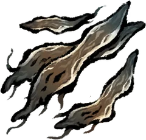

如果不小心接触到此草，那么连骨头也有可能被腐蚀

### 【主药效果】

断脉：可造成伤害

### 【各版本（境界 / 品质）】

筑基·神品：主药 断脉：可造成伤害（8）

### 【炼丹用途】

做主药：炼出「毒心散」（数值见【主药效果】；炼出的丹药是哪个境界，看 5 株草药的境界分总和）

品质：神品；境界分：筑基 2。品质越高越容易炼出高品质丹药；原理和每种丹药的推荐配方见对应丹药的【最佳合成路线】

### 【获取途径】

探索药田有10%概率获得神品灵草

可以在坊市与其他修士交易获得

---

## 32. 阴骨草

如果不小心接触到此草，那么连骨头也有可能被腐蚀

### 【主药效果】

断脉：可造成伤害

### 【各版本（境界 / 品质）】

结丹·神品：主药 断脉：可造成伤害（15）

元婴·神品：主药 断脉：可造成伤害（38）

### 【炼丹用途】

做主药：炼出「毒心散」（数值见【主药效果】；炼出的丹药是哪个境界，看 5 株草药的境界分总和）

品质：神品；境界分：结丹 8、元婴 29。品质越高越容易炼出高品质丹药；原理和每种丹药的推荐配方见对应丹药的【最佳合成路线】

### 【获取途径】

探索药田有10%概率获得神品灵草

可以在坊市与其他修士交易获得

---

## 33. 毒液

击败小型的鬼面蛛有概率获得，从其毒囊里收集的精华毒液。

此卡牌无主药效果，如果用于主材料，则只能炼制出无效果的丹药

### 【辅药效果】

断脉：可造成伤害

### 【各版本（境界 / 品质）】

练气·天品：辅药 断脉：可造成伤害（3.5）

筑基·天品：辅药 断脉：可造成伤害（5）

结丹·天品：辅药 断脉：可造成伤害（8）

元婴·天品：辅药 断脉：可造成伤害（20）

### 【炼丹用途】

没有主药效果，只适合做辅药

做辅药：给主效果是【断脉】的丹药（「毒心散」）叠加数值（见【辅药效果】）

品质：天品；境界分：练气 1、筑基 2、结丹 8、元婴 29。品质越高越容易炼出高品质丹药；原理和每种丹药的推荐配方见对应丹药的【最佳合成路线】

### 【获取途径】

击败妖王「鬼面蛛」后有20%概率获得，炼化鬼面蛛的内丹大概率获得

---

## 34. 剧毒液

炼制成丹药后可造成大量伤害

### 【主药效果】

断脉：可造成伤害

### 【辅药效果】

断脉：可造成伤害

### 【各版本（境界 / 品质）】

练气·神品：主药 断脉：可造成伤害（8）；辅药 断脉：可造成伤害（3.5）

筑基·神品：主药 断脉：可造成伤害（15）；辅药 断脉：可造成伤害（5）

结丹·神品：主药 断脉：可造成伤害（30）；辅药 断脉：可造成伤害（8）

元婴·神品：主药 断脉：可造成伤害（75）；辅药 断脉：可造成伤害（20）

### 【炼丹用途】

做主药：炼出「毒心散」（数值见【主药效果】；炼出的丹药是哪个境界，看 5 株草药的境界分总和）

做辅药：给主效果是【断脉】的丹药（「毒心散」）叠加数值（见【辅药效果】）

品质：神品；境界分：练气 1、筑基 2、结丹 8、元婴 29。品质越高越容易炼出高品质丹药；原理和每种丹药的推荐配方见对应丹药的【最佳合成路线】

### 【获取途径】

击败妖王「鬼面蛛」后有20%概率获得，炼化鬼面蛛的内丹大概率获得

---

## 35. 紫烟果

果子不时的冒出一股股的紫烟，透过紫烟似乎能看到另一片世界。

### 【主药效果】

硬肤：获得〔护甲〕

### 【辅药效果】

硬肤：获得〔护甲〕

### 【各版本（境界 / 品质）】

筑基·地品：主药 硬肤：获得〔护甲〕（4）；辅药 硬肤：获得〔护甲〕（6）

### 【炼丹用途】

做主药：炼出「铸体丹」（数值见【主药效果】；炼出的丹药是哪个境界，看 5 株草药的境界分总和）

做辅药：给主效果是【硬肤】的丹药（「玄霜丸」、「铸体丹」）叠加数值（见【辅药效果】）

品质：地品；境界分：筑基 2。品质越高越容易炼出高品质丹药；原理和每种丹药的推荐配方见对应丹药的【最佳合成路线】

### 【获取途径】

培养种子有30%概率获得地品灵草

探索药田有25%概率获得地品灵草

可以在坊市与其他修士交易获得

---

## 36. 大紫烟果

果子不时的冒出一股股的紫烟，透过紫烟似乎能看到另一片世界。

### 【主药效果】

硬肤：获得〔护甲〕

### 【辅药效果】

硬肤：获得〔护甲〕

### 【各版本（境界 / 品质）】

结丹·地品：主药 硬肤：获得〔护甲〕（10）；辅药 硬肤：获得〔护甲〕（12）

元婴·地品：主药 硬肤：获得〔护甲〕（25）；辅药 硬肤：获得〔护甲〕（30）

### 【炼丹用途】

做主药：炼出「铸体丹」（数值见【主药效果】；炼出的丹药是哪个境界，看 5 株草药的境界分总和）

做辅药：给主效果是【硬肤】的丹药（「玄霜丸」、「铸体丹」）叠加数值（见【辅药效果】）

品质：地品；境界分：结丹 8、元婴 29。品质越高越容易炼出高品质丹药；原理和每种丹药的推荐配方见对应丹药的【最佳合成路线】

### 【获取途径】

培养种子有30%概率获得地品灵草

探索药田有25%概率获得地品灵草

可以在坊市与其他修士交易获得

---

## 37. 六瓣兰

奇怪的兰花，生长的时间越长，花瓣数量会越多。

### 【主药效果】

硬肤：获得〔护甲〕

### 【各版本（境界 / 品质）】

筑基·天品：主药 硬肤：获得〔护甲〕（8）

### 【炼丹用途】

做主药：炼出「铸体丹」（数值见【主药效果】；炼出的丹药是哪个境界，看 5 株草药的境界分总和）

品质：天品；境界分：筑基 2。品质越高越容易炼出高品质丹药；原理和每种丹药的推荐配方见对应丹药的【最佳合成路线】

### 【获取途径】

培养种子有20%概率获得天品灵草

探索药田有20%概率获得天品灵草

可以在坊市与其他修士交易获得

---

## 38. 九瓣兰

奇怪的兰花，生长的时间越长，花瓣数量会越多。

### 【主药效果】

硬肤：获得〔护甲〕

### 【各版本（境界 / 品质）】

结丹·天品：主药 硬肤：获得〔护甲〕（16）

元婴·天品：主药 硬肤：获得〔护甲〕（40）

### 【炼丹用途】

做主药：炼出「铸体丹」（数值见【主药效果】；炼出的丹药是哪个境界，看 5 株草药的境界分总和）

品质：天品；境界分：结丹 8、元婴 29。品质越高越容易炼出高品质丹药；原理和每种丹药的推荐配方见对应丹药的【最佳合成路线】

### 【获取途径】

培养种子有20%概率获得天品灵草

探索药田有20%概率获得天品灵草

可以在坊市与其他修士交易获得

---

## 39. 冰雪莲

生长在冰川雪地的莲花，整朵花瓣都如冰雪般晶莹。

### 【主药效果】

硬肤：获得〔护甲〕

逆经：会减少当前灵气

### 【辅药效果】

硬肤：获得〔护甲〕

逆经：会减少当前灵气

### 【各版本（境界 / 品质）】

筑基·仙品：主药 硬肤：获得〔护甲〕（12）；主药 逆经：会减少当前灵气（3）；辅药 硬肤：获得〔护甲〕（12）；辅药 逆经：会减少当前灵气（3）

### 【炼丹用途】

做主药：炼出「玄霜丸」（数值见【主药效果】；炼出的丹药是哪个境界，看 5 株草药的境界分总和）

做辅药：给主效果是【硬肤】的丹药（「玄霜丸」、「铸体丹」）叠加数值（见【辅药效果】）

做辅药：没有以【逆经】为主效果的丹药，这个辅药效果加不上去，只影响品质

品质：仙品；境界分：筑基 2。品质越高越容易炼出高品质丹药；原理和每种丹药的推荐配方见对应丹药的【最佳合成路线】

### 【获取途径】

培养种子有10%概率获得仙品灵草

探索药田有25%概率获得仙品灵草

可以在坊市与其他修士交易获得

---

## 40. 冰晶莲

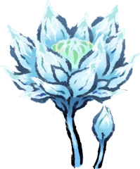

生长在冰川雪地的莲花，整朵花瓣都如冰雪般晶莹。

### 【主药效果】

硬肤：获得〔护甲〕

逆经：会减少当前灵气

### 【辅药效果】

硬肤：获得〔护甲〕

逆经：会减少当前灵气

### 【各版本（境界 / 品质）】

结丹·仙品：主药 硬肤：获得〔护甲〕（24）；主药 逆经：会减少当前灵气（5）；辅药 硬肤：获得〔护甲〕（24）；辅药 逆经：会减少当前灵气（5）

元婴·仙品：主药 硬肤：获得〔护甲〕（60）；主药 逆经：会减少当前灵气（8）；辅药 硬肤：获得〔护甲〕（60）；辅药 逆经：会减少当前灵气（8）

### 【炼丹用途】

做主药：炼出「玄霜丸」（数值见【主药效果】；炼出的丹药是哪个境界，看 5 株草药的境界分总和）

做辅药：给主效果是【硬肤】的丹药（「玄霜丸」、「铸体丹」）叠加数值（见【辅药效果】）

做辅药：没有以【逆经】为主效果的丹药，这个辅药效果加不上去，只影响品质

品质：仙品；境界分：结丹 8、元婴 29。品质越高越容易炼出高品质丹药；原理和每种丹药的推荐配方见对应丹药的【最佳合成路线】

### 【获取途径】

培养种子有10%概率获得仙品灵草

探索药田有25%概率获得仙品灵草

可以在坊市与其他修士交易获得

---

## 41. 磐石粉

一部分〔土〕妖王身上都覆盖磐石，击败妖王后有概率获得。

### 【主药效果】

硬肤：获得〔护甲〕

### 【各版本（境界 / 品质）】

筑基·神品：主药 硬肤：获得〔护甲〕（24）

结丹·神品：主药 硬肤：获得〔护甲〕（60）

元婴·神品：主药 硬肤：获得〔护甲〕（150）

筑基·神品：主药 硬肤：获得〔护甲〕（50）

结丹·神品：主药 硬肤：获得〔护甲〕（100）

元婴·神品：主药 硬肤：获得〔护甲〕（250）

### 【炼丹用途】

做主药：炼出「铸体丹」（数值见【主药效果】；炼出的丹药是哪个境界，看 5 株草药的境界分总和）

品质：神品；境界分：筑基 2、结丹 8、元婴 29。品质越高越容易炼出高品质丹药；原理和每种丹药的推荐配方见对应丹药的【最佳合成路线】

### 【获取途径】

击败妖王「巨灵烈象或石魈」后有20%概率获得，炼化巨灵烈象或石魈的内丹大概率获得

---

## 42. 醉龙果

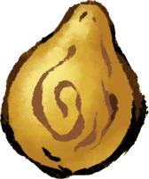

果实里富含营养物，只是实在太多了，以至于妖怪吃了也要醉倒。

### 【主药效果】

醉心：会进入入定状态

堕心：会产生心魔

### 【辅药效果】

断脉：可造成伤害

### 【各版本（境界 / 品质）】

练气·仙品：主药 醉心：会进入入定状态（1）；主药 堕心：会产生心魔（1）；辅药 断脉：可造成伤害（2）

### 【炼丹用途】

做主药：炼出「醉心露」（数值见【主药效果】；炼出的丹药是哪个境界，看 5 株草药的境界分总和）

做辅药：给主效果是【断脉】的丹药（「毒心散」）叠加数值（见【辅药效果】）

品质：仙品；境界分：练气 1。品质越高越容易炼出高品质丹药；原理和每种丹药的推荐配方见对应丹药的【最佳合成路线】

### 【获取途径】

培养种子有10%概率获得仙品灵草

探索药田有25%概率获得仙品灵草

可以在坊市与其他修士交易获得

---

## 43. 百年醉龙果

果实里富含营养物，只是实在太多了，以至于妖怪吃了也要醉倒。

### 【主药效果】

醉心：会进入入定状态

堕心：会产生心魔

### 【辅药效果】

断脉：可造成伤害

### 【各版本（境界 / 品质）】

筑基·仙品：主药 醉心：会进入入定状态（1）；主药 堕心：会产生心魔（1）；辅药 断脉：可造成伤害（3）

### 【炼丹用途】

做主药：炼出「醉心露」（数值见【主药效果】；炼出的丹药是哪个境界，看 5 株草药的境界分总和）

做辅药：给主效果是【断脉】的丹药（「毒心散」）叠加数值（见【辅药效果】）

品质：仙品；境界分：筑基 2。品质越高越容易炼出高品质丹药；原理和每种丹药的推荐配方见对应丹药的【最佳合成路线】

### 【获取途径】

培养种子有10%概率获得仙品灵草

探索药田有25%概率获得仙品灵草

可以在坊市与其他修士交易获得

---

## 44. 千年醉龙果

果实里富含营养物，只是实在太多了，以至于妖怪吃了也要醉倒。

### 【主药效果】

醉心：会进入入定状态

堕心：会产生心魔

### 【辅药效果】

断脉：可造成伤害

### 【各版本（境界 / 品质）】

结丹·仙品：主药 醉心：会进入入定状态（1）；主药 堕心：会产生心魔（1）；辅药 断脉：可造成伤害（6）

元婴·仙品：主药 醉心：会进入入定状态（1）；主药 堕心：会产生心魔（1）；辅药 断脉：可造成伤害（15）

### 【炼丹用途】

做主药：炼出「醉心露」（数值见【主药效果】；炼出的丹药是哪个境界，看 5 株草药的境界分总和）

做辅药：给主效果是【断脉】的丹药（「毒心散」）叠加数值（见【辅药效果】）

品质：仙品；境界分：结丹 8、元婴 29。品质越高越容易炼出高品质丹药；原理和每种丹药的推荐配方见对应丹药的【最佳合成路线】

### 【获取途径】

培养种子有10%概率获得仙品灵草

探索药田有25%概率获得仙品灵草

可以在坊市与其他修士交易获得

---

## 45. 菩提果

菩提树历经百年沧桑才会结果。

### 【主药效果】

醉心：会进入入定状态

### 【各版本（境界 / 品质）】

练气·神品：主药 醉心：会进入入定状态（1）

### 【炼丹用途】

做主药：炼出「真悟丹」（数值见【主药效果】；炼出的丹药是哪个境界，看 5 株草药的境界分总和）

品质：神品；境界分：练气 1。品质越高越容易炼出高品质丹药；原理和每种丹药的推荐配方见对应丹药的【最佳合成路线】

### 【获取途径】

探索药田有10%概率获得神品灵草

可以在坊市与其他修士交易获得

---

## 46. 大菩提果

菩提树历经百年沧桑才会结果。

### 【主药效果】

醉心：会进入入定状态

### 【各版本（境界 / 品质）】

筑基·神品：主药 醉心：会进入入定状态（1）

### 【炼丹用途】

做主药：炼出「真悟丹」（数值见【主药效果】；炼出的丹药是哪个境界，看 5 株草药的境界分总和）

品质：神品；境界分：筑基 2。品质越高越容易炼出高品质丹药；原理和每种丹药的推荐配方见对应丹药的【最佳合成路线】

### 【获取途径】

探索药田有10%概率获得神品灵草

可以在坊市与其他修士交易获得

---

## 47. 菩提道果

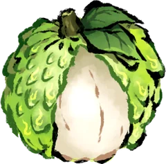

菩提树历经百年沧桑才会结果。

### 【主药效果】

醉心：会进入入定状态

### 【各版本（境界 / 品质）】

结丹·神品：主药 醉心：会进入入定状态（1）

元婴·神品：主药 醉心：会进入入定状态（1）

### 【炼丹用途】

做主药：炼出「真悟丹」（数值见【主药效果】；炼出的丹药是哪个境界，看 5 株草药的境界分总和）

品质：神品；境界分：结丹 8、元婴 29。品质越高越容易炼出高品质丹药；原理和每种丹药的推荐配方见对应丹药的【最佳合成路线】

### 【获取途径】

探索药田有10%概率获得神品灵草

可以在坊市与其他修士交易获得

---

## 48. 迷魂香

闻到香味着，无论妖怪或是人物，均会倒地不起。

### 【主药效果】

迷魂：有控制目标的效果

活血：恢复血量

### 【辅药效果】

迷魂：有控制目标的效果

### 【各版本（境界 / 品质）】

练气·地品：主药 迷魂：有控制目标的效果（2）；主药 活血：恢复血量（3）；辅药 迷魂：有控制目标的效果（2）

### 【炼丹用途】

做主药：炼出「迷魂丹」（数值见【主药效果】；炼出的丹药是哪个境界，看 5 株草药的境界分总和）

做辅药：给主效果是【迷魂】的丹药（「迷魂丹」、「锁神丹」）叠加数值（见【辅药效果】）

品质：地品；境界分：练气 1。品质越高越容易炼出高品质丹药；原理和每种丹药的推荐配方见对应丹药的【最佳合成路线】

### 【获取途径】

培养种子有30%概率获得地品灵草

探索药田有25%概率获得地品灵草

可以在坊市与其他修士交易获得

---

## 49. 迷魂迭香

闻到香味着，无论妖怪或是人物，均会倒地不起。

### 【主药效果】

迷魂：有控制目标的效果

活血：恢复血量

### 【辅药效果】

迷魂：有控制目标的效果

### 【各版本（境界 / 品质）】

筑基·地品：主药 迷魂：有控制目标的效果（3）；主药 活血：恢复血量（4）；辅药 迷魂：有控制目标的效果（3）

### 【炼丹用途】

做主药：炼出「迷魂丹」（数值见【主药效果】；炼出的丹药是哪个境界，看 5 株草药的境界分总和）

做辅药：给主效果是【迷魂】的丹药（「迷魂丹」、「锁神丹」）叠加数值（见【辅药效果】）

品质：地品；境界分：筑基 2。品质越高越容易炼出高品质丹药；原理和每种丹药的推荐配方见对应丹药的【最佳合成路线】

### 【获取途径】

培养种子有30%概率获得地品灵草

探索药田有25%概率获得地品灵草

可以在坊市与其他修士交易获得

---

## 50. 忘魂香

闻到香味着，无论妖怪或是人物，均会倒地不起。

### 【主药效果】

迷魂：有控制目标的效果

活血：恢复血量

### 【辅药效果】

迷魂：有控制目标的效果

### 【各版本（境界 / 品质）】

结丹·地品：主药 迷魂：有控制目标的效果（6）；主药 活血：恢复血量（6）；辅药 迷魂：有控制目标的效果（4）

元婴·地品：主药 迷魂：有控制目标的效果（9）；主药 活血：恢复血量（15）；辅药 迷魂：有控制目标的效果（7）

### 【炼丹用途】

做主药：炼出「迷魂丹」（数值见【主药效果】；炼出的丹药是哪个境界，看 5 株草药的境界分总和）

做辅药：给主效果是【迷魂】的丹药（「迷魂丹」、「锁神丹」）叠加数值（见【辅药效果】）

品质：地品；境界分：结丹 8、元婴 29。品质越高越容易炼出高品质丹药；原理和每种丹药的推荐配方见对应丹药的【最佳合成路线】

### 【获取途径】

培养种子有30%概率获得地品灵草

探索药田有25%概率获得地品灵草

可以在坊市与其他修士交易获得

---

## 51. 幻神草

哪怕神仙尝一口，也会触发幻觉的灵草。

### 【主药效果】

迷魂：有控制目标的效果

### 【辅药效果】

迷魂：有控制目标的效果

### 【各版本（境界 / 品质）】

练气·仙品：主药 迷魂：有控制目标的效果（4）；辅药 迷魂：有控制目标的效果（3）

### 【炼丹用途】

做主药：炼出「锁神丹」（数值见【主药效果】；炼出的丹药是哪个境界，看 5 株草药的境界分总和）

做辅药：给主效果是【迷魂】的丹药（「迷魂丹」、「锁神丹」）叠加数值（见【辅药效果】）

品质：仙品；境界分：练气 1。品质越高越容易炼出高品质丹药；原理和每种丹药的推荐配方见对应丹药的【最佳合成路线】

### 【获取途径】

培养种子有10%概率获得仙品灵草

探索药田有25%概率获得仙品灵草

可以在坊市与其他修士交易获得

---

## 52. 大幻神草

哪怕神仙尝一口，也会触发幻觉的灵草。

### 【主药效果】

迷魂：有控制目标的效果

### 【辅药效果】

迷魂：有控制目标的效果

### 【各版本（境界 / 品质）】

筑基·仙品：主药 迷魂：有控制目标的效果（5）；辅药 迷魂：有控制目标的效果（4）

### 【炼丹用途】

做主药：炼出「锁神丹」（数值见【主药效果】；炼出的丹药是哪个境界，看 5 株草药的境界分总和）

做辅药：给主效果是【迷魂】的丹药（「迷魂丹」、「锁神丹」）叠加数值（见【辅药效果】）

品质：仙品；境界分：筑基 2。品质越高越容易炼出高品质丹药；原理和每种丹药的推荐配方见对应丹药的【最佳合成路线】

### 【获取途径】

培养种子有10%概率获得仙品灵草

探索药田有25%概率获得仙品灵草

可以在坊市与其他修士交易获得

---

## 53. 幻魄草

哪怕神仙尝一口，也会触发幻觉的灵草。

### 【主药效果】

迷魂：有控制目标的效果

### 【辅药效果】

迷魂：有控制目标的效果

### 【各版本（境界 / 品质）】

结丹·仙品：主药 迷魂：有控制目标的效果（10）；辅药 迷魂：有控制目标的效果（5）

元婴·仙品：主药 迷魂：有控制目标的效果（15）；辅药 迷魂：有控制目标的效果（9）

### 【炼丹用途】

做主药：炼出「锁神丹」（数值见【主药效果】；炼出的丹药是哪个境界，看 5 株草药的境界分总和）

做辅药：给主效果是【迷魂】的丹药（「迷魂丹」、「锁神丹」）叠加数值（见【辅药效果】）

品质：仙品；境界分：结丹 8、元婴 29。品质越高越容易炼出高品质丹药；原理和每种丹药的推荐配方见对应丹药的【最佳合成路线】

### 【获取途径】

培养种子有10%概率获得仙品灵草

探索药田有25%概率获得仙品灵草

可以在坊市与其他修士交易获得

---

## 54. 青焰根

此火焰并不灼烧肉体，而是燃烧灵魂

### 【主药效果】

开窍：可获得修为

堕心：会产生心魔

### 【辅药效果】

断脉：可造成伤害

### 【各版本（境界 / 品质）】

练气·天品：主药 开窍：可获得修为（3）；主药 堕心：会产生心魔（1）；辅药 断脉：可造成伤害（2.5）

### 【炼丹用途】

做主药：炼出「燃魂散」（数值见【主药效果】；炼出的丹药是哪个境界，看 5 株草药的境界分总和）

做辅药：给主效果是【断脉】的丹药（「毒心散」）叠加数值（见【辅药效果】）

品质：天品；境界分：练气 1。品质越高越容易炼出高品质丹药；原理和每种丹药的推荐配方见对应丹药的【最佳合成路线】

### 【获取途径】

培养种子有20%概率获得天品灵草

探索药田有20%概率获得天品灵草

可以在坊市与其他修士交易获得

---

## 55. 青焰魔根

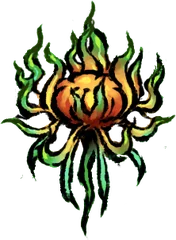

此火焰并不灼烧肉体，而是燃烧灵魂

### 【主药效果】

开窍：可获得修为

堕心：会产生心魔

### 【辅药效果】

断脉：可造成伤害

### 【各版本（境界 / 品质）】

筑基·天品：主药 开窍：可获得修为（5）；主药 堕心：会产生心魔（1）；辅药 断脉：可造成伤害（3.5）

### 【炼丹用途】

做主药：炼出「燃魂散」（数值见【主药效果】；炼出的丹药是哪个境界，看 5 株草药的境界分总和）

做辅药：给主效果是【断脉】的丹药（「毒心散」）叠加数值（见【辅药效果】）

品质：天品；境界分：筑基 2。品质越高越容易炼出高品质丹药；原理和每种丹药的推荐配方见对应丹药的【最佳合成路线】

### 【获取途径】

培养种子有20%概率获得天品灵草

探索药田有20%概率获得天品灵草

可以在坊市与其他修士交易获得

---

## 56. 魔焰根

此火焰并不灼烧肉体，而是燃烧灵魂

### 【主药效果】

开窍：可获得修为

堕心：会产生心魔

### 【辅药效果】

断脉：可造成伤害

### 【各版本（境界 / 品质）】

结丹·天品：主药 开窍：可获得修为（7）；主药 堕心：会产生心魔（1）；辅药 断脉：可造成伤害（6.5）

元婴·天品：主药 开窍：可获得修为（15）；主药 堕心：会产生心魔（1）；辅药 断脉：可造成伤害（15）

### 【炼丹用途】

做主药：炼出「燃魂散」（数值见【主药效果】；炼出的丹药是哪个境界，看 5 株草药的境界分总和）

做辅药：给主效果是【断脉】的丹药（「毒心散」）叠加数值（见【辅药效果】）

品质：天品；境界分：结丹 8、元婴 29。品质越高越容易炼出高品质丹药；原理和每种丹药的推荐配方见对应丹药的【最佳合成路线】

### 【获取途径】

培养种子有20%概率获得天品灵草

探索药田有20%概率获得天品灵草

可以在坊市与其他修士交易获得

---

## 57. 百灵参

生长了多年的人参。

### 【主药效果】

开窍：可获得修为

逆经：会减少当前灵气

### 【各版本（境界 / 品质）】

练气·仙品：主药 开窍：可获得修为（3）；主药 逆经：会减少当前灵气（20）

### 【炼丹用途】

做主药：炼出「逆元丹」（数值见【主药效果】；炼出的丹药是哪个境界，看 5 株草药的境界分总和）

品质：仙品；境界分：练气 1。品质越高越容易炼出高品质丹药；原理和每种丹药的推荐配方见对应丹药的【最佳合成路线】

### 【获取途径】

培养种子有10%概率获得仙品灵草

探索药田有25%概率获得仙品灵草

可以在坊市与其他修士交易获得

---

## 58. 千灵参

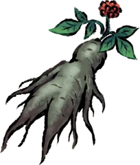

生长了多年的人参。

### 【主药效果】

开窍：可获得修为

逆经：会减少当前灵气

### 【各版本（境界 / 品质）】

筑基·仙品：主药 开窍：可获得修为（5）；主药 逆经：会减少当前灵气（30）

### 【炼丹用途】

做主药：炼出「逆元丹」（数值见【主药效果】；炼出的丹药是哪个境界，看 5 株草药的境界分总和）

品质：仙品；境界分：筑基 2。品质越高越容易炼出高品质丹药；原理和每种丹药的推荐配方见对应丹药的【最佳合成路线】

### 【获取途径】

培养种子有10%概率获得仙品灵草

探索药田有25%概率获得仙品灵草

可以在坊市与其他修士交易获得

---

## 59. 万灵参

生长了多年的人参。

### 【主药效果】

开窍：可获得修为

逆经：会减少当前灵气

### 【各版本（境界 / 品质）】

结丹·仙品：主药 开窍：可获得修为（7）；主药 逆经：会减少当前灵气（40）

元婴·仙品：主药 开窍：可获得修为（15）；主药 逆经：会减少当前灵气（60）

### 【炼丹用途】

做主药：炼出「逆元丹」（数值见【主药效果】；炼出的丹药是哪个境界，看 5 株草药的境界分总和）

品质：仙品；境界分：结丹 8、元婴 29。品质越高越容易炼出高品质丹药；原理和每种丹药的推荐配方见对应丹药的【最佳合成路线】

### 【获取途径】

培养种子有10%概率获得仙品灵草

探索药田有25%概率获得仙品灵草

可以在坊市与其他修士交易获得

---

## 60. 蕴元仙萼

萼瓣凝霜、芯藏金光，得天地元气滋养万年方得成形

### 【主药效果】

开窍：可获得修为

### 【辅药效果】

开窍：可获得修为

### 【各版本（境界 / 品质）】

练气·绝品：主药 开窍：可获得修为（5）；辅药 开窍：可获得修为（2）

筑基·绝品：主药 开窍：可获得修为（8）；辅药 开窍：可获得修为（3）

结丹·绝品：主药 开窍：可获得修为（12）；辅药 开窍：可获得修为（5）

元婴·绝品：主药 开窍：可获得修为（30）；辅药 开窍：可获得修为（13）

### 【炼丹用途】

做主药：炼出「修为丹」（数值见【主药效果】；炼出的丹药是哪个境界，看 5 株草药的境界分总和）

做辅药：给主效果是【开窍】的丹药（「修为丹」、「燃魂散」、「逆元丹」）叠加数值（见【辅药效果】）

品质：绝品；境界分：练气 1、筑基 2、结丹 8、元婴 29。品质越高越容易炼出高品质丹药；原理和每种丹药的推荐配方见对应丹药的【最佳合成路线】

### 【获取途径】

在古木幽森的深处有概率获得

---

## 61. 兽涎水

这种水会散发一股香气，能吸引妖怪的到来。

### 【主药效果】

唤灵：可招来妖兽

### 【辅药效果】

迷魂：有控制目标的效果

### 【各版本（境界 / 品质）】

练气·地品：主药 唤灵：可招来妖兽（1）；辅药 迷魂：有控制目标的效果（3）

### 【炼丹用途】

做主药：炼出「引兽丸」（数值见【主药效果】；炼出的丹药是哪个境界，看 5 株草药的境界分总和）

做辅药：给主效果是【迷魂】的丹药（「迷魂丹」、「锁神丹」）叠加数值（见【辅药效果】）

品质：地品；境界分：练气 1。品质越高越容易炼出高品质丹药；原理和每种丹药的推荐配方见对应丹药的【最佳合成路线】

### 【获取途径】

培养种子有30%概率获得地品灵草

探索药田有25%概率获得地品灵草

可以在坊市与其他修士交易获得

---

## 62. 兽涎露

这种水会散发一股香气，能吸引妖怪的到来。

### 【主药效果】

唤灵：可招来妖兽

### 【辅药效果】

迷魂：有控制目标的效果

### 【各版本（境界 / 品质）】

筑基·地品：主药 唤灵：可招来妖兽（2）；辅药 迷魂：有控制目标的效果（3）

### 【炼丹用途】

做主药：炼出「引兽丸」（数值见【主药效果】；炼出的丹药是哪个境界，看 5 株草药的境界分总和）

做辅药：给主效果是【迷魂】的丹药（「迷魂丹」、「锁神丹」）叠加数值（见【辅药效果】）

品质：地品；境界分：筑基 2。品质越高越容易炼出高品质丹药；原理和每种丹药的推荐配方见对应丹药的【最佳合成路线】

### 【获取途径】

培养种子有30%概率获得地品灵草

探索药田有25%概率获得地品灵草

可以在坊市与其他修士交易获得

---

## 63. 兽涎露石

这种水会散发一股香气，能吸引妖怪的到来。

### 【主药效果】

唤灵：可招来妖兽

### 【辅药效果】

迷魂：有控制目标的效果

### 【各版本（境界 / 品质）】

结丹·地品：主药 唤灵：可招来妖兽（3）；辅药 迷魂：有控制目标的效果（3）

### 【炼丹用途】

做主药：炼出「引兽丸」（数值见【主药效果】；炼出的丹药是哪个境界，看 5 株草药的境界分总和）

做辅药：给主效果是【迷魂】的丹药（「迷魂丹」、「锁神丹」）叠加数值（见【辅药效果】）

品质：地品；境界分：结丹 8。品质越高越容易炼出高品质丹药；原理和每种丹药的推荐配方见对应丹药的【最佳合成路线】

### 【获取途径】

培养种子有30%概率获得地品灵草

探索药田有25%概率获得地品灵草

可以在坊市与其他修士交易获得

---

## 64. 九霄灵芝

生长在仙界的灵芝，灵芝会自己跑动，才流落到人间。

### 【主药效果】

延寿：有增加寿命的效果

### 【各版本（境界 / 品质）】

练气·绝品：主药 延寿：有增加寿命的效果（4）

### 【炼丹用途】

做主药：炼出「寿元丹」（数值见【主药效果】；炼出的丹药是哪个境界，看 5 株草药的境界分总和）

品质：绝品；境界分：练气 1。品质越高越容易炼出高品质丹药；原理和每种丹药的推荐配方见对应丹药的【最佳合成路线】

### 【获取途径】

在古木幽森的深处有概率获得

---

## 65. 赤霄灵芝

生长在仙界的灵芝，灵芝会自己跑动，才流落到人间。

### 【主药效果】

延寿：有增加寿命的效果

### 【各版本（境界 / 品质）】

筑基·绝品：主药 延寿：有增加寿命的效果（9）

### 【炼丹用途】

做主药：炼出「寿元丹」（数值见【主药效果】；炼出的丹药是哪个境界，看 5 株草药的境界分总和）

品质：绝品；境界分：筑基 2。品质越高越容易炼出高品质丹药；原理和每种丹药的推荐配方见对应丹药的【最佳合成路线】

### 【获取途径】

在古木幽森的深处有概率获得

---

## 66. 碧霄灵芝

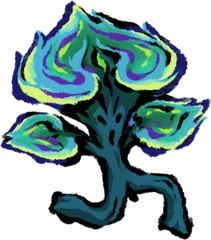

生长在仙界的灵芝，灵芝会自己跑动，才流落到人间。

### 【主药效果】

延寿：有增加寿命的效果

### 【各版本（境界 / 品质）】

结丹·绝品：主药 延寿：有增加寿命的效果（15）

元婴·绝品：主药 延寿：有增加寿命的效果（35）

### 【炼丹用途】

做主药：炼出「寿元丹」（数值见【主药效果】；炼出的丹药是哪个境界，看 5 株草药的境界分总和）

品质：绝品；境界分：结丹 8、元婴 29。品质越高越容易炼出高品质丹药；原理和每种丹药的推荐配方见对应丹药的【最佳合成路线】

### 【获取途径】

在古木幽森的深处有概率获得

---

## 67. 血灵芝

可用于炼制寿元丹，但其血腥之气实在容易令人入魔

### 【主药效果】

延寿：有增加寿命的效果

堕心：会产生心魔

### 【各版本（境界 / 品质）】

筑基·绝品：主药 延寿：有增加寿命的效果（9）；主药 堕心：会产生心魔（1）

结丹·绝品：主药 延寿：有增加寿命的效果（15）；主药 堕心：会产生心魔（1）

元婴·绝品：主药 延寿：有增加寿命的效果（35）；主药 堕心：会产生心魔（2）

### 【炼丹用途】

做主药：炼出「寿元丹」（数值见【主药效果】；炼出的丹药是哪个境界，看 5 株草药的境界分总和）

品质：绝品；境界分：筑基 2、结丹 8、元婴 29。品质越高越容易炼出高品质丹药；原理和每种丹药的推荐配方见对应丹药的【最佳合成路线】

### 【获取途径】

击败妖王「血肉灵芝」后有20%概率获得，炼化血肉灵芝的内丹大概率获得

---

## 68. 缘玑仙草

隐于云海仙山的聚气之地，茎生七叶、叶缀玑珠，沐晨露吸星华而生，其株自带缥缈气运

### 【主药效果】

气运：可获得机缘

开窍：可获得修为

### 【辅药效果】

气运：可获得机缘

### 【各版本（境界 / 品质）】

练气·绝品：主药 气运：可获得机缘（0.15）；主药 开窍：可获得修为（3）；辅药 气运：可获得机缘（0.15）

筑基·绝品：主药 气运：可获得机缘（0.15）；主药 开窍：可获得修为（4）；辅药 气运：可获得机缘（0.15）

结丹·绝品：主药 气运：可获得机缘（0.15）；主药 开窍：可获得修为（5）；辅药 气运：可获得机缘（0.15）

元婴·绝品：主药 气运：可获得机缘（0.15）；主药 开窍：可获得修为（13）；辅药 气运：可获得机缘（0.15）

### 【炼丹用途】

做主药：炼出「慧心丹」（数值见【主药效果】；炼出的丹药是哪个境界，看 5 株草药的境界分总和）

做辅药：给主效果是【气运】的丹药（「慧心丹」）叠加数值（见【辅药效果】）

品质：绝品；境界分：练气 1、筑基 2、结丹 8、元婴 29。品质越高越容易炼出高品质丹药；原理和每种丹药的推荐配方见对应丹药的【最佳合成路线】

### 【获取途径】

在古木幽森的深处有概率获得

---

## 69. 化瘀丹

普通的回血丹药，在战斗中亦可服用。

### 【各版本（境界 / 品质）】

练气·人品：活血：恢复使用者6血量

练气·地品：活血：恢复使用者9血量

练气·天品：活血：恢复使用者12血量

练气·仙品：活血：恢复使用者15血量

练气·神品：活血：恢复使用者18血量

筑基·人品：活血：恢复使用者8血量

筑基·地品：活血：恢复使用者12血量

筑基·天品：活血：恢复使用者16血量

筑基·仙品：活血：恢复使用者20血量

筑基·神品：活血：恢复使用者24血量

结丹·人品：活血：恢复使用者14血量

结丹·地品：活血：恢复使用者21血量

结丹·天品：活血：恢复使用者28血量

结丹·仙品：活血：恢复使用者35血量

结丹·神品：活血：恢复使用者42血量

元婴·人品：活血：恢复使用者35血量

元婴·地品：活血：恢复使用者54血量

元婴·天品：活血：恢复使用者70血量

元婴·仙品：活血：恢复使用者88血量

元婴·神品：活血：恢复使用者105血量

### 【最佳合成路线】

【练气·数值最高】主药「金蝉」（筑基·仙品·金） + 辅药「洗骨花」×2、「蕴元仙萼」×2：境界分 6 → 练气期丹药；活血合计 26，按公式估算成丹数值（人 / 地 / 天 / 仙 / 神）≈ 人10.4 / 地15.6 / 天20.8 / 仙26 / 神31.2；成丹品质概率（未计五行加成）：地品11%，仙品32%，神品57%

【练气·同系草药】主药「金蝉」（筑基·仙品·金） + 辅药「红仁果」×4：境界分 6 → 练气期丹药；活血合计 28，按公式估算成丹数值（人 / 地 / 天 / 仙 / 神）≈ 人11.2 / 地16.8 / 天22.4 / 仙28 / 神33.6；成丹品质概率（未计五行加成）：地品11%，天品65%，仙品22%，神品2%

【筑基·数值最高】主药「金蝉」（结丹·仙品·金） + 辅药「大洗骨花」×1、「蕴元仙萼」×3：境界分 13 → 筑基期丹药；活血合计 44，按公式估算成丹数值（人 / 地 / 天 / 仙 / 神）≈ 人17.6 / 地26.4 / 天35.2 / 仙44 / 神52.8；成丹品质概率（未计五行加成）：神品100%

【筑基·同系草药】主药「金蝉」（结丹·仙品·金） + 辅药「大洗骨花」×2、「金蝉」×2：境界分 16 → 筑基期丹药；活血合计 48，按公式估算成丹数值（人 / 地 / 天 / 仙 / 神）≈ 人19.2 / 地28.8 / 天38.4 / 仙48 / 神57.6；成丹品质概率（未计五行加成）：地品9%，天品34%，仙品51%，神品6%

【结丹·数值最高】主药「金蝉」（元婴·仙品·金） + 辅药「洗髓花」×1、「蕴元仙萼」×3：境界分 40 → 结丹期丹药；活血合计 107，按公式估算成丹数值（人 / 地 / 天 / 仙 / 神）≈ 人42.8 / 地64.2 / 天85.6 / 仙107 / 神128.4；成丹品质概率（未计五行加成）：神品100%

【结丹·同系草药】主药「金蝉」（元婴·仙品·金） + 辅药「洗髓花」×2、「金蝉」×2：境界分 49 → 结丹期丹药；活血合计 114，按公式估算成丹数值（人 / 地 / 天 / 仙 / 神）≈ 人45.6 / 地68.4 / 天91.2 / 仙114 / 神136.8；成丹品质概率（未计五行加成）：地品9%，天品34%，仙品51%，神品6%

【元婴·数值最高】主药「金蝉」（元婴·仙品·金） + 辅药「洗髓花」×2、「蕴元仙萼」×2：境界分 117 → 元婴期丹药；活血合计 136，按公式估算成丹数值（人 / 地 / 天 / 仙 / 神）≈ 人54.4 / 地81.6 / 天108.8 / 仙136 / 神163.2；成丹品质概率（未计五行加成）：地品11%，仙品32%，神品57%

【元婴·同系草药】主药「金蝉」（元婴·仙品·金） + 辅药「洗髓花」×2、「金蝉」×2：境界分 118 → 元婴期丹药；活血合计 136，按公式估算成丹数值（人 / 地 / 天 / 仙 / 神）≈ 人54.4 / 地81.6 / 天108.8 / 仙136 / 神163.2；成丹品质概率（未计五行加成）：地品9%，天品34%，仙品51%，神品6%

（「数值最高」= 能炼出该境界的组合里，成丹数值的期望最高（失败算 0，没算五行加成和天赋加成）；草药只要游戏里存在就算，不考虑好不好拿到。「同系草药」= 只用这种丹药自己的主药草，加上辅药效果相同的草药，比较好凑齐。）

### 【主药 / 辅药怎么选】

主药可选（主药决定炼出化瘀丹）：

练气：「止血草」（练气·人品·全属性）活血2；「洗骨花」（练气·地品·金）活血3；「红仁果」（练气·天品·土）活血3

筑基：「凝血草」（筑基·人品·全属性）活血3；「大洗骨花」（筑基·地品·金）活血4；「炎仁果」（筑基·天品·土）活血4；「金蝉」（筑基·仙品·金）活血20

结丹：「苍血草」（结丹·人品·全属性）活血5；「洗髓花」（结丹·地品·金）活血7；「天火果」（结丹·天品·土）活血7；「金蝉」（结丹·仙品·金）活血40

元婴：「苍血草」（元婴·人品·全属性）活血12；「洗髓花」（元婴·地品·金）活血18；「天火果」（元婴·天品·土）活血18；「金蝉」（元婴·仙品·金）活血100

辅药里带【活血】辅药效果的草药才会叠加数值（其余辅药只影响品质）：

练气：「洗骨花」+3（地品）、「红仁果」+2（天品）、「止血草」+2（人品）

筑基：「大洗骨花」+4（地品）、「炎仁果」+3（天品）、「凝血草」+3（人品）

结丹：「洗髓花」+7（地品）、「天火果」+5（天品）、「苍血草」+5（人品）

元婴：「洗髓花」+18（地品）、「天火果」+12（天品）、「苍血草」+12（人品）

主药是〔金〕属性时：辅药优先用〔金〕属性和相生的〔土〕属性草药，避开相克的〔火〕属性

主药是〔土〕属性时：辅药优先用〔土〕属性和相生的〔火〕属性草药，避开相克的〔木〕属性

全属性的主药（如「止血草」）本身就算齐七种属性，可以拿到「七行齐全」的高品质加成

### 【炼丹原理】

炼丹工作台放 1 株主药 + 最多 4 株辅药。主药决定炼出哪一种丹药和它的效果；辅药的作用是提高成功率 / 品质，以及叠加数值。

数值：从主药的【主药效果】开始，辅药的【辅药效果】里和主药相同的效果会加上去（主药没有的效果不会加）。成丹数值 = 合计 × 品质系数（人品×0.4、地品×0.6、天品×0.8、仙品×1.0、神品×1.2）；活血 / 聚气 / 断脉 / 硬肤还会再加上天赋提供的加成。

注意：上方各品质版本里写的是游戏数据表预设的丹药数值；自己炼制时按上面的公式由草药数值计算，所以「估算成丹数值」可能和预设数值不一样，仅供比较不同配方的强弱。

境界：每株草药按自己的境界给「境界分」（练气 1、筑基 2、结丹 8、元婴 29），5 株加起来 ≥7 是筑基丹、≥28 是结丹丹、≥102 是元婴丹，否则是练气丹。例：5 株筑基草药 = 10 分 → 筑基丹；1 株结丹 + 4 株练气 = 12 分 → 只有筑基丹。

品质：每株草药按自己的品质加权重（人品草药偏向失败 / 人品，神品草药偏向仙 / 神品），草药越少越容易失败（1 株：失败权重 +15；2 株 +10；3 株 +5；4 株 +3；5 株不加），5 株的品质总和越高越好（总和 <10 炼不出仙 / 神品，<15 炼不出神品；≥16 失败 / 人 / 地品权重减少，≥20 不会失败也不会出人品，≥24 最低天品）。

五行：以主药的属性为准——同属性 3 株 + 生主药属性（相生）2 株，或同属性 4 株 + 相生 1 株：天 / 仙 / 神品权重 +1 / +2 / +3；只要有相生的草药，失败权重 −5；有克主药属性（相克）的草药，失败权重 +5，同属性 3~4 株再配相克的更会大幅增加失败（+20）；五株凑齐金木水火土阴阳七种属性（「止血草」这类全属性灵草一株就算齐）：天 / 仙 / 神品权重各 +5。

相生 / 相克（生主药 / 克主药）：金：土生 / 火克；木：水生 / 金克；水：金生 / 土克；火：木生 / 水克；土：火生 / 木克；阴：阴 / 阳克；阳：阳 / 阴克。

### 【获取途径】

使用止血草，洗骨花，红仁果，金蝉做主药可以炼制出

---

## 70. 血还丹

能够同时恢复气血和灵气的丹药！

### 【各版本（境界 / 品质）】

练气·仙品：活血：恢复使用者16血量；聚气：补充使用者16灵气值

练气·神品：活血：恢复使用者19血量；聚气：补充使用者19灵气值

筑基·仙品：活血：恢复使用者23血量；聚气：补充使用者23灵气值

筑基·神品：活血：恢复使用者28血量；聚气：补充使用者28灵气值

结丹·仙品：活血：恢复使用者42血量；聚气：补充使用者42灵气值

结丹·神品：活血：恢复使用者50血量；聚气：补充使用者50灵气值

元婴·仙品：活血：恢复使用者105血量；聚气：补充使用者63灵气值

元婴·神品：活血：恢复使用者125血量；聚气：补充使用者75灵气值

练气·绝品：能够同时恢复大量〔血量〕和〔灵气〕的丹药！；活血：恢复使用者35血量；聚气：补充使用者35灵气值

筑基·绝品：能够同时恢复大量〔血量〕和〔灵气〕的丹药！；活血：恢复使用者50血量；聚气：补充使用者50灵气值

结丹·绝品：能够同时恢复大量〔血量〕和〔灵气〕的丹药！；活血：恢复使用者150血量；聚气：补充使用者80灵气值

元婴·绝品：能够同时恢复大量〔血量〕和〔灵气〕的丹药！；活血：恢复使用者375血量；聚气：补充使用者120灵气值

### 【最佳合成路线】

【练气·数值最高】主药「大血精果」（筑基·神品·木） + 辅药「洗骨花」×3、「蕴元仙萼」×1：境界分 6 → 练气期丹药；活血合计 16，按公式估算成丹数值（人 / 地 / 天 / 仙 / 神）≈ 人6.4 / 地9.6 / 天12.8 / 仙16 / 神19.2；成丹品质概率（未计五行加成）：人品5%，地品29%，天品16%，仙品13%，神品37%

【练气·同系草药】主药「大血精果」（筑基·神品·木） + 辅药「洗骨花」×3、「血精果」×1：境界分 6 → 练气期丹药；活血合计 16，按公式估算成丹数值（人 / 地 / 天 / 仙 / 神）≈ 人6.4 / 地9.6 / 天12.8 / 仙16 / 神19.2；成丹品质概率（未计五行加成）：人品6%，地品33%，天品18%，仙品18%，神品24%

【筑基·数值最高】主药「血晶果」（结丹·神品·木） + 辅药「大洗骨花」×2、「蕴元仙萼」×2：境界分 14 → 筑基期丹药；活血合计 22，按公式估算成丹数值（人 / 地 / 天 / 仙 / 神）≈ 人8.8 / 地13.2 / 天17.6 / 仙22 / 神26.4；成丹品质概率（未计五行加成）：地品11%，仙品20%，神品69%

【筑基·同系草药】主药「血晶果」（结丹·神品·木） + 辅药「大洗骨花」×1、「炎仁果」×1、「血精果」×2：境界分 14 → 筑基期丹药；活血合计 21，按公式估算成丹数值（人 / 地 / 天 / 仙 / 神）≈ 人8.4 / 地12.6 / 天16.8 / 仙21 / 神25.2；成丹品质概率（未计五行加成）：地品4%，仙品43%，神品52%

【结丹·数值最高】主药「血晶果」（元婴·神品·木） + 辅药「洗髓花」×2、「蕴元仙萼」×2：境界分 47 → 结丹期丹药；活血合计 49，按公式估算成丹数值（人 / 地 / 天 / 仙 / 神）≈ 人19.6 / 地29.4 / 天39.2 / 仙49 / 神58.8；成丹品质概率（未计五行加成）：地品11%，仙品20%，神品69%

【结丹·同系草药】主药「血晶果」（元婴·神品·木） + 辅药「洗髓花」×1、「天火果」×1、「血精果」×2：境界分 47 → 结丹期丹药；活血合计 47，按公式估算成丹数值（人 / 地 / 天 / 仙 / 神）≈ 人18.8 / 地28.2 / 天37.6 / 仙47 / 神56.4；成丹品质概率（未计五行加成）：地品4%，仙品43%，神品52%

【元婴·数值最高】主药「血晶果」（元婴·神品·木） + 辅药「洗髓花」×3、「蕴元仙萼」×1：境界分 117 → 元婴期丹药；活血合计 89，按公式估算成丹数值（人 / 地 / 天 / 仙 / 神）≈ 人35.6 / 地53.4 / 天71.2 / 仙89 / 神106.8；成丹品质概率（未计五行加成）：人品5%，地品29%，天品16%，仙品13%，神品37%

【元婴·同系草药】主药「血晶果」（元婴·神品·木） + 辅药「洗髓花」×3、「血精果」×1：境界分 117 → 元婴期丹药；活血合计 89，按公式估算成丹数值（人 / 地 / 天 / 仙 / 神）≈ 人35.6 / 地53.4 / 天71.2 / 仙89 / 神106.8；成丹品质概率（未计五行加成）：人品6%，地品33%，天品18%，仙品18%，神品24%

（「数值最高」= 能炼出该境界的组合里，成丹数值的期望最高（失败算 0，没算五行加成和天赋加成）；草药只要游戏里存在就算，不考虑好不好拿到。「同系草药」= 只用这种丹药自己的主药草，加上辅药效果相同的草药，比较好凑齐。）

### 【主药 / 辅药怎么选】

主药可选（主药决定炼出血还丹）：

练气：「血精果」（练气·神品·木）活血4、聚气4

筑基：「大血精果」（筑基·神品·木）活血7、聚气5

结丹：「血晶果」（结丹·神品·木）活血14、聚气10

元婴：「血晶果」（元婴·神品·木）活血35、聚气10

辅药里带【活血】辅药效果的草药才会叠加数值（其余辅药只影响品质）：

练气：「洗骨花」+3（地品）、「红仁果」+2（天品）、「止血草」+2（人品）

筑基：「大洗骨花」+4（地品）、「炎仁果」+3（天品）、「凝血草」+3（人品）

结丹：「洗髓花」+7（地品）、「天火果」+5（天品）、「苍血草」+5（人品）

元婴：「洗髓花」+18（地品）、「天火果」+12（天品）、「苍血草」+12（人品）

主药是〔木〕属性时：辅药优先用〔木〕属性和相生的〔水〕属性草药，避开相克的〔金〕属性

### 【炼丹原理】

炼丹工作台放 1 株主药 + 最多 4 株辅药。主药决定炼出哪一种丹药和它的效果；辅药的作用是提高成功率 / 品质，以及叠加数值。

数值：从主药的【主药效果】开始，辅药的【辅药效果】里和主药相同的效果会加上去（主药没有的效果不会加）。成丹数值 = 合计 × 品质系数（人品×0.4、地品×0.6、天品×0.8、仙品×1.0、神品×1.2）；活血 / 聚气 / 断脉 / 硬肤还会再加上天赋提供的加成。

注意：上方各品质版本里写的是游戏数据表预设的丹药数值；自己炼制时按上面的公式由草药数值计算，所以「估算成丹数值」可能和预设数值不一样，仅供比较不同配方的强弱。

境界：每株草药按自己的境界给「境界分」（练气 1、筑基 2、结丹 8、元婴 29），5 株加起来 ≥7 是筑基丹、≥28 是结丹丹、≥102 是元婴丹，否则是练气丹。例：5 株筑基草药 = 10 分 → 筑基丹；1 株结丹 + 4 株练气 = 12 分 → 只有筑基丹。

品质：每株草药按自己的品质加权重（人品草药偏向失败 / 人品，神品草药偏向仙 / 神品），草药越少越容易失败（1 株：失败权重 +15；2 株 +10；3 株 +5；4 株 +3；5 株不加），5 株的品质总和越高越好（总和 <10 炼不出仙 / 神品，<15 炼不出神品；≥16 失败 / 人 / 地品权重减少，≥20 不会失败也不会出人品，≥24 最低天品）。

五行：以主药的属性为准——同属性 3 株 + 生主药属性（相生）2 株，或同属性 4 株 + 相生 1 株：天 / 仙 / 神品权重 +1 / +2 / +3；只要有相生的草药，失败权重 −5；有克主药属性（相克）的草药，失败权重 +5，同属性 3~4 株再配相克的更会大幅增加失败（+20）；五株凑齐金木水火土阴阳七种属性（「止血草」这类全属性灵草一株就算齐）：天 / 仙 / 神品权重各 +5。

相生 / 相克（生主药 / 克主药）：金：土生 / 火克；木：水生 / 金克；水：金生 / 土克；火：木生 / 水克；土：火生 / 木克；阴：阴 / 阳克；阳：阳 / 阴克。

### 【获取途径】

使用血精果做主药可以炼制出

---

## 71. 引气丸

常见的丹药，可以快速补充修士体内的灵气。探索秘境时必带之。

### 【各版本（境界 / 品质）】

练气·人品：聚气：补充使用者4灵气值

练气·地品：聚气：补充使用者5灵气值

练气·天品：聚气：补充使用者6灵气值

练气·仙品：聚气：补充使用者8灵气值

练气·神品：聚气：补充使用者10灵气值

筑基·人品：聚气：补充使用者6灵气值

筑基·地品：聚气：补充使用者7灵气值

筑基·天品：聚气：补充使用者10灵气值

筑基·仙品：聚气：补充使用者12灵气值

筑基·神品：聚气：补充使用者14灵气值

结丹·人品：聚气：补充使用者9灵气值

结丹·地品：聚气：补充使用者12灵气值

结丹·天品：聚气：补充使用者16灵气值

结丹·仙品：聚气：补充使用者20灵气值

结丹·神品：聚气：补充使用者24灵气值

元婴·人品：聚气：补充使用者14灵气值

元婴·地品：聚气：补充使用者18灵气值

元婴·天品：聚气：补充使用者24灵气值

元婴·仙品：聚气：补充使用者30灵气值

元婴·神品：聚气：补充使用者36灵气值

### 【最佳合成路线】

【练气·数值最高】主药「铁熊胆」（筑基·神品·土） + 辅药「白莲子」×1、「魂婴果」×1、「蕴元仙萼」×2：境界分 6 → 练气期丹药；聚气合计 25，按公式估算成丹数值（人 / 地 / 天 / 仙 / 神）≈ 人10 / 地15 / 天20 / 仙25 / 神30；成丹品质概率（未计五行加成）：天品7%，仙品4%，神品89%

【练气·同系草药】主药「铁熊胆」（筑基·神品·土） + 辅药「白莲子」×1、「魂婴果」×3：境界分 6 → 练气期丹药；聚气合计 29，按公式估算成丹数值（人 / 地 / 天 / 仙 / 神）≈ 人11.6 / 地17.4 / 天23.2 / 仙29 / 神34.8；成丹品质概率（未计五行加成）：天品22%，仙品62%，神品16%

【筑基·数值最高】主药「铁熊胆」（结丹·神品·土） + 辅药「白莲芯」×1、「百年魂婴果」×1、「蕴元仙萼」×2：境界分 14 → 筑基期丹药；聚气合计 47，按公式估算成丹数值（人 / 地 / 天 / 仙 / 神）≈ 人18.8 / 地28.2 / 天37.6 / 仙47 / 神56.4；成丹品质概率（未计五行加成）：天品7%，仙品4%，神品89%

【筑基·同系草药】主药「铁熊胆」（结丹·神品·土） + 辅药「百年魂婴果」×4：境界分 16 → 筑基期丹药；聚气合计 52，按公式估算成丹数值（人 / 地 / 天 / 仙 / 神）≈ 人20.8 / 地31.2 / 天41.6 / 仙52 / 神62.4；成丹品质概率（未计五行加成）：天品12%，仙品71%，神品16%

【结丹·数值最高】主药「铁熊胆」（元婴·神品·土） + 辅药「千年魂婴果」×2、「蕴元仙萼」×2：境界分 47 → 结丹期丹药；聚气合计 70，按公式估算成丹数值（人 / 地 / 天 / 仙 / 神）≈ 人28 / 地42 / 天56 / 仙70 / 神84；成丹品质概率（未计五行加成）：仙品24%，神品76%

【结丹·同系草药】主药「铁熊胆」（元婴·神品·土） + 辅药「千年魂婴果」×4：境界分 61 → 结丹期丹药；聚气合计 80，按公式估算成丹数值（人 / 地 / 天 / 仙 / 神）≈ 人32 / 地48 / 天64 / 仙80 / 神96；成丹品质概率（未计五行加成）：天品12%，仙品71%，神品16%

【元婴·数值最高】主药「铁熊胆」（元婴·神品·土） + 辅药「千年魂婴果」×4：境界分 145 → 元婴期丹药；聚气合计 92，按公式估算成丹数值（人 / 地 / 天 / 仙 / 神）≈ 人36.8 / 地55.2 / 天73.6 / 仙92 / 神110.4；成丹品质概率（未计五行加成）：天品12%，仙品71%，神品16%

（「数值最高」= 能炼出该境界的组合里，成丹数值的期望最高（失败算 0，没算五行加成和天赋加成）；草药只要游戏里存在就算，不考虑好不好拿到。「同系草药」= 只用这种丹药自己的主药草，加上辅药效果相同的草药，比较好凑齐。）

### 【主药 / 辅药怎么选】

主药可选（主药决定炼出引气丸）：

练气：「土茯苓」（练气·人品·全属性）聚气1；「白莲子」（练气·天品·木）聚气2

筑基：「千年土茯苓」（筑基·人品·全属性）聚气2；「白莲芯」（筑基·天品·木）聚气3；「铁熊胆」（筑基·神品·土）聚气20

结丹：「万年土茯苓」（结丹·人品·全属性）聚气3；「白莲玉」（结丹·天品·木）聚气5；「铁熊胆」（结丹·神品·土）聚气40

元婴：「万年土茯苓」（元婴·人品·全属性）聚气5；「白莲玉」（元婴·天品·木）聚气8；「铁熊胆」（元婴·神品·土）聚气60

辅药里带【聚气】辅药效果的草药才会叠加数值（其余辅药只影响品质）：

练气：「白莲子」+3（天品）、「魂婴果」+2（仙品）、「红仁果」+2（天品）、「土茯苓」+1（人品）

筑基：「白莲芯」+4（天品）、「百年魂婴果」+3（仙品）、「炎仁果」+3（天品）、「千年土茯苓」+2（人品）

结丹：「千年魂婴果」+5（仙品）、「天火果」+5（天品）、「白莲玉」+5（天品）、「万年土茯苓」+3（人品）

元婴：「千年魂婴果」+8（仙品）、「天火果」+8（天品）、「白莲玉」+8（天品）、「万年土茯苓」+5（人品）

主药是〔木〕属性时：辅药优先用〔木〕属性和相生的〔水〕属性草药，避开相克的〔金〕属性

主药是〔土〕属性时：辅药优先用〔土〕属性和相生的〔火〕属性草药，避开相克的〔木〕属性

全属性的主药（如「止血草」）本身就算齐七种属性，可以拿到「七行齐全」的高品质加成

### 【炼丹原理】

炼丹工作台放 1 株主药 + 最多 4 株辅药。主药决定炼出哪一种丹药和它的效果；辅药的作用是提高成功率 / 品质，以及叠加数值。

数值：从主药的【主药效果】开始，辅药的【辅药效果】里和主药相同的效果会加上去（主药没有的效果不会加）。成丹数值 = 合计 × 品质系数（人品×0.4、地品×0.6、天品×0.8、仙品×1.0、神品×1.2）；活血 / 聚气 / 断脉 / 硬肤还会再加上天赋提供的加成。

注意：上方各品质版本里写的是游戏数据表预设的丹药数值；自己炼制时按上面的公式由草药数值计算，所以「估算成丹数值」可能和预设数值不一样，仅供比较不同配方的强弱。

境界：每株草药按自己的境界给「境界分」（练气 1、筑基 2、结丹 8、元婴 29），5 株加起来 ≥7 是筑基丹、≥28 是结丹丹、≥102 是元婴丹，否则是练气丹。例：5 株筑基草药 = 10 分 → 筑基丹；1 株结丹 + 4 株练气 = 12 分 → 只有筑基丹。

品质：每株草药按自己的品质加权重（人品草药偏向失败 / 人品，神品草药偏向仙 / 神品），草药越少越容易失败（1 株：失败权重 +15；2 株 +10；3 株 +5；4 株 +3；5 株不加），5 株的品质总和越高越好（总和 <10 炼不出仙 / 神品，<15 炼不出神品；≥16 失败 / 人 / 地品权重减少，≥20 不会失败也不会出人品，≥24 最低天品）。

五行：以主药的属性为准——同属性 3 株 + 生主药属性（相生）2 株，或同属性 4 株 + 相生 1 株：天 / 仙 / 神品权重 +1 / +2 / +3；只要有相生的草药，失败权重 −5；有克主药属性（相克）的草药，失败权重 +5，同属性 3~4 株再配相克的更会大幅增加失败（+20）；五株凑齐金木水火土阴阳七种属性（「止血草」这类全属性灵草一株就算齐）：天 / 仙 / 神品权重各 +5。

相生 / 相克（生主药 / 克主药）：金：土生 / 火克；木：水生 / 金克；水：金生 / 土克；火：木生 / 水克；土：火生 / 木克；阴：阴 / 阳克；阳：阳 / 阴克。

### 【获取途径】

使用土茯苓，白莲子做主药可以炼制出

---

## 72. 魔元丹

可恢复大量的灵气，但服用后会入魔。

### 【各版本（境界 / 品质）】

练气·仙品：聚气：补充使用者18灵气值；堕心：服用后会产生张1心魔卡

练气·神品：聚气：补充使用者22灵气值；堕心：服用后会产生张1心魔卡

筑基·仙品：聚气：补充使用者24灵气值；堕心：服用后会产生张1心魔卡

筑基·神品：聚气：补充使用者29灵气值；堕心：服用后会产生张1心魔卡

结丹·仙品：聚气：补充使用者28灵气值；堕心：服用后会产生张1心魔卡

结丹·神品：聚气：补充使用者34灵气值；堕心：服用后会产生张1心魔卡

元婴·仙品：聚气：补充使用者42灵气值；堕心：服用后会产生张1心魔卡

元婴·神品：聚气：补充使用者51灵气值；堕心：服用后会产生张1心魔卡

### 【最佳合成路线】

【练气·数值最高】主药「百年魂婴果」（筑基·仙品·阴） + 辅药「白莲子」×3、「魂婴果」×1：境界分 6 → 练气期丹药；聚气合计 19，按公式估算成丹数值（人 / 地 / 天 / 仙 / 神）≈ 人7.6 / 地11.4 / 天15.2 / 仙19 / 神22.8；成丹品质概率（未计五行加成）：地品4%，天品58%，仙品35%，神品4%

【筑基·数值最高】主药「千年魂婴果」（结丹·仙品·阴） + 辅药「白莲芯」×3、「百年魂婴果」×1：境界分 16 → 筑基期丹药；聚气合计 25，按公式估算成丹数值（人 / 地 / 天 / 仙 / 神）≈ 人10 / 地15 / 天20 / 仙25 / 神30；成丹品质概率（未计五行加成）：地品4%，天品58%，仙品35%，神品4%

【结丹·数值最高】主药「千年魂婴果」（元婴·仙品·阴） + 辅药「千年魂婴果」×4：境界分 61 → 结丹期丹药；聚气合计 35，按公式估算成丹数值（人 / 地 / 天 / 仙 / 神）≈ 人14 / 地21 / 天28 / 仙35 / 神42；成丹品质概率（未计五行加成）：天品18%，仙品73%，神品9%

【元婴·数值最高】主药「千年魂婴果」（元婴·仙品·阴） + 辅药「千年魂婴果」×4：境界分 145 → 元婴期丹药；聚气合计 47，按公式估算成丹数值（人 / 地 / 天 / 仙 / 神）≈ 人18.8 / 地28.2 / 天37.6 / 仙47 / 神56.4；成丹品质概率（未计五行加成）：天品18%，仙品73%，神品9%

（「数值最高」= 能炼出该境界的组合里，成丹数值的期望最高（失败算 0，没算五行加成和天赋加成）；草药只要游戏里存在就算，不考虑好不好拿到。「同系草药」= 只用这种丹药自己的主药草，加上辅药效果相同的草药，比较好凑齐。）

### 【主药 / 辅药怎么选】

主药可选（主药决定炼出魔元丹）：

练气：「魂婴果」（练气·仙品·阴）聚气6、堕心1

筑基：「百年魂婴果」（筑基·仙品·阴）聚气8、堕心1

结丹：「千年魂婴果」（结丹·仙品·阴）聚气10、堕心1

元婴：「千年魂婴果」（元婴·仙品·阴）聚气15、堕心1

辅药里带【聚气】辅药效果的草药才会叠加数值（其余辅药只影响品质）：

练气：「白莲子」+3（天品）、「魂婴果」+2（仙品）、「红仁果」+2（天品）、「土茯苓」+1（人品）

筑基：「白莲芯」+4（天品）、「百年魂婴果」+3（仙品）、「炎仁果」+3（天品）、「千年土茯苓」+2（人品）

结丹：「千年魂婴果」+5（仙品）、「天火果」+5（天品）、「白莲玉」+5（天品）、「万年土茯苓」+3（人品）

元婴：「千年魂婴果」+8（仙品）、「天火果」+8（天品）、「白莲玉」+8（天品）、「万年土茯苓」+5（人品）

主药是〔阴〕属性时：辅药优先用〔阴〕属性草药，避开〔阳〕属性

### 【炼丹原理】

炼丹工作台放 1 株主药 + 最多 4 株辅药。主药决定炼出哪一种丹药和它的效果；辅药的作用是提高成功率 / 品质，以及叠加数值。

数值：从主药的【主药效果】开始，辅药的【辅药效果】里和主药相同的效果会加上去（主药没有的效果不会加）。成丹数值 = 合计 × 品质系数（人品×0.4、地品×0.6、天品×0.8、仙品×1.0、神品×1.2）；活血 / 聚气 / 断脉 / 硬肤还会再加上天赋提供的加成。

注意：上方各品质版本里写的是游戏数据表预设的丹药数值；自己炼制时按上面的公式由草药数值计算，所以「估算成丹数值」可能和预设数值不一样，仅供比较不同配方的强弱。

境界：每株草药按自己的境界给「境界分」（练气 1、筑基 2、结丹 8、元婴 29），5 株加起来 ≥7 是筑基丹、≥28 是结丹丹、≥102 是元婴丹，否则是练气丹。例：5 株筑基草药 = 10 分 → 筑基丹；1 株结丹 + 4 株练气 = 12 分 → 只有筑基丹。

品质：每株草药按自己的品质加权重（人品草药偏向失败 / 人品，神品草药偏向仙 / 神品），草药越少越容易失败（1 株：失败权重 +15；2 株 +10；3 株 +5；4 株 +3；5 株不加），5 株的品质总和越高越好（总和 <10 炼不出仙 / 神品，<15 炼不出神品；≥16 失败 / 人 / 地品权重减少，≥20 不会失败也不会出人品，≥24 最低天品）。

五行：以主药的属性为准——同属性 3 株 + 生主药属性（相生）2 株，或同属性 4 株 + 相生 1 株：天 / 仙 / 神品权重 +1 / +2 / +3；只要有相生的草药，失败权重 −5；有克主药属性（相克）的草药，失败权重 +5，同属性 3~4 株再配相克的更会大幅增加失败（+20）；五株凑齐金木水火土阴阳七种属性（「止血草」这类全属性灵草一株就算齐）：天 / 仙 / 神品权重各 +5。

相生 / 相克（生主药 / 克主药）：金：土生 / 火克；木：水生 / 金克；水：金生 / 土克；火：木生 / 水克；土：火生 / 木克；阴：阴 / 阳克；阳：阳 / 阴克。

### 【获取途径】

使用魂婴果做主药可以炼制出

---

## 73. 毒心散

蕴含剧毒的丹药，能对生物造成伤害。

### 【各版本（境界 / 品质）】

练气·人品：断脉：对使用者造成4点伤害

练气·地品：断脉：对使用者造成6点伤害

练气·天品：断脉：对使用者造成8点伤害

练气·仙品：断脉：对使用者造成10点伤害

练气·神品：断脉：对使用者造成12点伤害

筑基·人品：断脉：对使用者造成6点伤害

筑基·地品：断脉：对使用者造成9点伤害

筑基·天品：断脉：对使用者造成12点伤害

筑基·仙品：断脉：对使用者造成15点伤害

筑基·神品：断脉：对使用者造成18点伤害

结丹·人品：断脉：对使用者造成12点伤害

结丹·地品：断脉：对使用者造成18点伤害

结丹·天品：断脉：对使用者造成24点伤害

结丹·仙品：断脉：对使用者造成30点伤害

结丹·神品：断脉：对使用者造成36点伤害

元婴·人品：断脉：对使用者造成30点伤害

元婴·地品：断脉：对使用者造成45点伤害

元婴·天品：断脉：对使用者造成60点伤害

元婴·仙品：断脉：对使用者造成75点伤害

元婴·神品：断脉：对使用者造成90点伤害

练气·绝品：比普通的毒心散更加难制作，毒药效果大幅加强。；断脉：对使用者造成30点伤害

筑基·绝品：比普通的毒心散更加难制作，毒药效果大幅加强。；断脉：对使用者造成50点伤害

结丹·绝品：比普通的毒心散更加难制作，毒药效果大幅加强。；断脉：对使用者造成150点伤害

元婴·绝品：比普通的毒心散更加难制作，毒药效果大幅加强。；断脉：对使用者造成375点伤害

### 【最佳合成路线】

【练气·数值最高】主药「剧毒液」（筑基·神品·阴） + 辅药「剧毒液」×4：境界分 6 → 练气期丹药；断脉合计 29，按公式估算成丹数值（人 / 地 / 天 / 仙 / 神）≈ 人11.6 / 地17.4 / 天23.2 / 仙29 / 神34.8；成丹品质概率（未计五行加成）：神品100%

【筑基·数值最高】主药「剧毒液」（结丹·神品·阴） + 辅药「剧毒液」×4：境界分 16 → 筑基期丹药；断脉合计 50，按公式估算成丹数值（人 / 地 / 天 / 仙 / 神）≈ 人20 / 地30 / 天40 / 仙50 / 神60；成丹品质概率（未计五行加成）：神品100%

【结丹·数值最高】主药「剧毒液」（元婴·神品·阴） + 辅药「剧毒液」×4：境界分 61 → 结丹期丹药；断脉合计 107，按公式估算成丹数值（人 / 地 / 天 / 仙 / 神）≈ 人42.8 / 地64.2 / 天85.6 / 仙107 / 神128.4；成丹品质概率（未计五行加成）：神品100%

【元婴·数值最高】主药「剧毒液」（元婴·神品·阴） + 辅药「剧毒液」×4：境界分 145 → 元婴期丹药；断脉合计 155，按公式估算成丹数值（人 / 地 / 天 / 仙 / 神）≈ 人62 / 地93 / 天124 / 仙155 / 神186；成丹品质概率（未计五行加成）：神品100%

（「数值最高」= 能炼出该境界的组合里，成丹数值的期望最高（失败算 0，没算五行加成和天赋加成）；草药只要游戏里存在就算，不考虑好不好拿到。「同系草药」= 只用这种丹药自己的主药草，加上辅药效果相同的草药，比较好凑齐。）

### 【主药 / 辅药怎么选】

主药可选（主药决定炼出毒心散）：

练气：「腐木菇」（练气·人品·全属性）断脉1；「断魂花」（练气·地品·火）断脉2；「腐骨草」（练气·神品·土）断脉5；「剧毒液」（练气·神品·阴）断脉8

筑基：「大腐木菇」（筑基·人品·全属性）断脉2；「大断魂花」（筑基·地品·火）断脉3；「大腐骨草」（筑基·神品·土）断脉8；「剧毒液」（筑基·神品·阴）断脉15

结丹：「腐尸菇」（结丹·人品·全属性）断脉4；「绝魂草」（结丹·地品·火）断脉6；「阴骨草」（结丹·神品·土）断脉15；「剧毒液」（结丹·神品·阴）断脉30

元婴：「腐尸菇」（元婴·人品·全属性）断脉10；「绝魂草」（元婴·地品·火）断脉15；「阴骨草」（元婴·神品·土）断脉38；「剧毒液」（元婴·神品·阴）断脉75

辅药里带【断脉】辅药效果的草药才会叠加数值（其余辅药只影响品质）：

练气：「剧毒液」+3.5（神品）、「毒液」+3.5（天品）、「青焰根」+2.5（天品）、「醉龙果」+2（仙品）、「腐木菇」+2（人品）、「白莲子」+1（天品）、「断魂花」+1（地品）

筑基：「剧毒液」+5（神品）、「毒液」+5（天品）、「青焰魔根」+3.5（天品）、「百年醉龙果」+3（仙品）、「大腐木菇」+3（人品）、「白莲芯」+2（天品）、「大断魂花」+2（地品）

结丹：「剧毒液」+8（神品）、「毒液」+8（天品）、「魔焰根」+6.5（天品）、「千年醉龙果」+6（仙品）、「腐尸菇」+6（人品）、「白莲玉」+4（天品）、「绝魂草」+4（地品）

元婴：「剧毒液」+20（神品）、「毒液」+20（天品）、「千年醉龙果」+15（仙品）、「魔焰根」+15（天品）、「腐尸菇」+15（人品）、「绝魂草」+10（地品）、「白莲玉」+8（天品）

主药是〔火〕属性时：辅药优先用〔火〕属性和相生的〔木〕属性草药，避开相克的〔水〕属性

主药是〔土〕属性时：辅药优先用〔土〕属性和相生的〔火〕属性草药，避开相克的〔木〕属性

主药是〔阴〕属性时：辅药优先用〔阴〕属性草药，避开〔阳〕属性

全属性的主药（如「止血草」）本身就算齐七种属性，可以拿到「七行齐全」的高品质加成

### 【炼丹原理】

炼丹工作台放 1 株主药 + 最多 4 株辅药。主药决定炼出哪一种丹药和它的效果；辅药的作用是提高成功率 / 品质，以及叠加数值。

数值：从主药的【主药效果】开始，辅药的【辅药效果】里和主药相同的效果会加上去（主药没有的效果不会加）。成丹数值 = 合计 × 品质系数（人品×0.4、地品×0.6、天品×0.8、仙品×1.0、神品×1.2）；活血 / 聚气 / 断脉 / 硬肤还会再加上天赋提供的加成。

注意：上方各品质版本里写的是游戏数据表预设的丹药数值；自己炼制时按上面的公式由草药数值计算，所以「估算成丹数值」可能和预设数值不一样，仅供比较不同配方的强弱。

境界：每株草药按自己的境界给「境界分」（练气 1、筑基 2、结丹 8、元婴 29），5 株加起来 ≥7 是筑基丹、≥28 是结丹丹、≥102 是元婴丹，否则是练气丹。例：5 株筑基草药 = 10 分 → 筑基丹；1 株结丹 + 4 株练气 = 12 分 → 只有筑基丹。

品质：每株草药按自己的品质加权重（人品草药偏向失败 / 人品，神品草药偏向仙 / 神品），草药越少越容易失败（1 株：失败权重 +15；2 株 +10；3 株 +5；4 株 +3；5 株不加），5 株的品质总和越高越好（总和 <10 炼不出仙 / 神品，<15 炼不出神品；≥16 失败 / 人 / 地品权重减少，≥20 不会失败也不会出人品，≥24 最低天品）。

五行：以主药的属性为准——同属性 3 株 + 生主药属性（相生）2 株，或同属性 4 株 + 相生 1 株：天 / 仙 / 神品权重 +1 / +2 / +3；只要有相生的草药，失败权重 −5；有克主药属性（相克）的草药，失败权重 +5，同属性 3~4 株再配相克的更会大幅增加失败（+20）；五株凑齐金木水火土阴阳七种属性（「止血草」这类全属性灵草一株就算齐）：天 / 仙 / 神品权重各 +5。

相生 / 相克（生主药 / 克主药）：金：土生 / 火克；木：水生 / 金克；水：金生 / 土克；火：木生 / 水克；土：火生 / 木克；阴：阴 / 阳克；阳：阳 / 阴克。

### 【获取途径】

使用腐木菇，断魂花，腐骨草，剧毒液做主药可以炼制出

---

## 74. 铸体丹

服用后可以将身体稍稍硬化。

### 【各版本（境界 / 品质）】

筑基·天品：硬肤：增加使用者26〔护甲〕

筑基·仙品：硬肤：增加使用者32〔护甲〕

筑基·神品：硬肤：增加使用者38〔护甲〕

结丹·天品：硬肤：增加使用者52〔护甲〕

结丹·仙品：硬肤：增加使用者64〔护甲〕

结丹·神品：硬肤：增加使用者76〔护甲〕

元婴·天品：硬肤：增加使用者120〔护甲〕

元婴·仙品：硬肤：增加使用者160〔护甲〕

元婴·神品：硬肤：增加使用者190〔护甲〕

筑基·绝品：服用后可以将身体大幅度硬化。；硬肤：增加使用者200〔护甲〕

结丹·绝品：服用后可以将身体大幅度硬化。；硬肤：增加使用者500〔护甲〕

元婴·绝品：服用后可以将身体大幅度硬化。；硬肤：增加使用者1250〔护甲〕

### 【最佳合成路线】

【练气·数值最高】主药「磐石粉」（筑基·神品·土） + 辅药「蕴元仙萼」×4：境界分 6 → 练气期丹药；硬肤合计 50，按公式估算成丹数值（人 / 地 / 天 / 仙 / 神）≈ 人20 / 地30 / 天40 / 仙50 / 神60；成丹品质概率（未计五行加成）：神品100%

【筑基·数值最高】主药「磐石粉」（结丹·神品·土） + 辅药「冰雪莲」×4：境界分 16 → 筑基期丹药；硬肤合计 148，按公式估算成丹数值（人 / 地 / 天 / 仙 / 神）≈ 人59.2 / 地88.8 / 天118.4 / 仙148 / 神177.6；成丹品质概率（未计五行加成）：天品12%，仙品71%，神品16%

【结丹·数值最高】主药「磐石粉」（元婴·神品·土） + 辅药「冰晶莲」×4：境界分 61 → 结丹期丹药；硬肤合计 346，按公式估算成丹数值（人 / 地 / 天 / 仙 / 神）≈ 人138.4 / 地207.6 / 天276.8 / 仙346 / 神415.2；成丹品质概率（未计五行加成）：天品12%，仙品71%，神品16%

【元婴·数值最高】主药「磐石粉」（元婴·神品·土） + 辅药「冰晶莲」×4：境界分 145 → 元婴期丹药；硬肤合计 490，按公式估算成丹数值（人 / 地 / 天 / 仙 / 神）≈ 人196 / 地294 / 天392 / 仙490 / 神588；成丹品质概率（未计五行加成）：天品12%，仙品71%，神品16%

（「数值最高」= 能炼出该境界的组合里，成丹数值的期望最高（失败算 0，没算五行加成和天赋加成）；草药只要游戏里存在就算，不考虑好不好拿到。「同系草药」= 只用这种丹药自己的主药草，加上辅药效果相同的草药，比较好凑齐。）

### 【主药 / 辅药怎么选】

主药可选（主药决定炼出铸体丹）：

筑基：「紫烟果」（筑基·地品·木）硬肤4；「六瓣兰」（筑基·天品·金）硬肤8；「磐石粉」（筑基·神品·土）硬肤24；「磐石粉」（筑基·神品·土）硬肤50

结丹：「大紫烟果」（结丹·地品·木）硬肤10；「九瓣兰」（结丹·天品·金）硬肤16；「磐石粉」（结丹·神品·土）硬肤60；「磐石粉」（结丹·神品·土）硬肤100

元婴：「大紫烟果」（元婴·地品·木）硬肤25；「九瓣兰」（元婴·天品·金）硬肤40；「磐石粉」（元婴·神品·土）硬肤150；「磐石粉」（元婴·神品·土）硬肤250

辅药里带【硬肤】辅药效果的草药才会叠加数值（其余辅药只影响品质）：

筑基：「冰雪莲」+12（仙品）、「紫烟果」+6（地品）

结丹：「冰晶莲」+24（仙品）、「大紫烟果」+12（地品）

元婴：「冰晶莲」+60（仙品）、「大紫烟果」+30（地品）

主药是〔金〕属性时：辅药优先用〔金〕属性和相生的〔土〕属性草药，避开相克的〔火〕属性

主药是〔木〕属性时：辅药优先用〔木〕属性和相生的〔水〕属性草药，避开相克的〔金〕属性

主药是〔土〕属性时：辅药优先用〔土〕属性和相生的〔火〕属性草药，避开相克的〔木〕属性

### 【炼丹原理】

炼丹工作台放 1 株主药 + 最多 4 株辅药。主药决定炼出哪一种丹药和它的效果；辅药的作用是提高成功率 / 品质，以及叠加数值。

数值：从主药的【主药效果】开始，辅药的【辅药效果】里和主药相同的效果会加上去（主药没有的效果不会加）。成丹数值 = 合计 × 品质系数（人品×0.4、地品×0.6、天品×0.8、仙品×1.0、神品×1.2）；活血 / 聚气 / 断脉 / 硬肤还会再加上天赋提供的加成。

注意：上方各品质版本里写的是游戏数据表预设的丹药数值；自己炼制时按上面的公式由草药数值计算，所以「估算成丹数值」可能和预设数值不一样，仅供比较不同配方的强弱。

境界：每株草药按自己的境界给「境界分」（练气 1、筑基 2、结丹 8、元婴 29），5 株加起来 ≥7 是筑基丹、≥28 是结丹丹、≥102 是元婴丹，否则是练气丹。例：5 株筑基草药 = 10 分 → 筑基丹；1 株结丹 + 4 株练气 = 12 分 → 只有筑基丹。

品质：每株草药按自己的品质加权重（人品草药偏向失败 / 人品，神品草药偏向仙 / 神品），草药越少越容易失败（1 株：失败权重 +15；2 株 +10；3 株 +5；4 株 +3；5 株不加），5 株的品质总和越高越好（总和 <10 炼不出仙 / 神品，<15 炼不出神品；≥16 失败 / 人 / 地品权重减少，≥20 不会失败也不会出人品，≥24 最低天品）。

五行：以主药的属性为准——同属性 3 株 + 生主药属性（相生）2 株，或同属性 4 株 + 相生 1 株：天 / 仙 / 神品权重 +1 / +2 / +3；只要有相生的草药，失败权重 −5；有克主药属性（相克）的草药，失败权重 +5，同属性 3~4 株再配相克的更会大幅增加失败（+20）；五株凑齐金木水火土阴阳七种属性（「止血草」这类全属性灵草一株就算齐）：天 / 仙 / 神品权重各 +5。

相生 / 相克（生主药 / 克主药）：金：土生 / 火克；木：水生 / 金克；水：金生 / 土克；火：木生 / 水克；土：火生 / 木克；阴：阴 / 阳克；阳：阳 / 阴克。

### 【获取途径】

使用紫烟果，三瓣兰，磐石粉做主药可以炼制出

---

## 75. 玄霜丸

服用后可以将身体外覆盖一层冰甲，可过低的温度也会身体造成一些负面效果。

### 【各版本（境界 / 品质）】

筑基·天品：硬肤：增加使用者48〔护甲〕；逆经：减少使用者15灵气值

筑基·仙品：硬肤：增加使用者60〔护甲〕；逆经：减少使用者15灵气值

筑基·神品：硬肤：增加使用者72〔护甲〕；逆经：减少使用者15灵气值

结丹·天品：硬肤：增加使用者96〔护甲〕；逆经：减少使用者20灵气值

结丹·仙品：硬肤：增加使用者120〔护甲〕；逆经：减少使用者20灵气值

结丹·神品：硬肤：增加使用者144〔护甲〕；逆经：减少使用者20灵气值

元婴·天品：硬肤：增加使用者240〔护甲〕；逆经：减少使用者30灵气值

元婴·仙品：硬肤：增加使用者300〔护甲〕；逆经：减少使用者30灵气值

元婴·神品：硬肤：增加使用者360〔护甲〕；逆经：减少使用者30灵气值

### 【最佳合成路线】

【练气·数值最高】主药「冰雪莲」（筑基·仙品·水） + 辅药「蕴元仙萼」×4：境界分 6 → 练气期丹药；硬肤合计 12，按公式估算成丹数值（人 / 地 / 天 / 仙 / 神）≈ 人4.8 / 地7.2 / 天9.6 / 仙12 / 神14.4；成丹品质概率（未计五行加成）：仙品2%，神品98%

【筑基·数值最高】主药「冰晶莲」（结丹·仙品·水） + 辅药「冰雪莲」×4：境界分 16 → 筑基期丹药；硬肤合计 72，按公式估算成丹数值（人 / 地 / 天 / 仙 / 神）≈ 人28.8 / 地43.2 / 天57.6 / 仙72 / 神86.4；成丹品质概率（未计五行加成）：天品18%，仙品73%，神品9%

【结丹·数值最高】主药「冰晶莲」（元婴·仙品·水） + 辅药「冰晶莲」×4：境界分 61 → 结丹期丹药；硬肤合计 156，按公式估算成丹数值（人 / 地 / 天 / 仙 / 神）≈ 人62.4 / 地93.6 / 天124.8 / 仙156 / 神187.2；成丹品质概率（未计五行加成）：天品18%，仙品73%，神品9%

【元婴·数值最高】主药「冰晶莲」（元婴·仙品·水） + 辅药「冰晶莲」×4：境界分 145 → 元婴期丹药；硬肤合计 300，按公式估算成丹数值（人 / 地 / 天 / 仙 / 神）≈ 人120 / 地180 / 天240 / 仙300 / 神360；成丹品质概率（未计五行加成）：天品18%，仙品73%，神品9%

（「数值最高」= 能炼出该境界的组合里，成丹数值的期望最高（失败算 0，没算五行加成和天赋加成）；草药只要游戏里存在就算，不考虑好不好拿到。「同系草药」= 只用这种丹药自己的主药草，加上辅药效果相同的草药，比较好凑齐。）

### 【主药 / 辅药怎么选】

主药可选（主药决定炼出玄霜丸）：

筑基：「冰雪莲」（筑基·仙品·水）硬肤12、逆经3

结丹：「冰晶莲」（结丹·仙品·水）硬肤24、逆经5

元婴：「冰晶莲」（元婴·仙品·水）硬肤60、逆经8

辅药里带【硬肤】辅药效果的草药才会叠加数值（其余辅药只影响品质）：

筑基：「冰雪莲」+12（仙品）、「紫烟果」+6（地品）

结丹：「冰晶莲」+24（仙品）、「大紫烟果」+12（地品）

元婴：「冰晶莲」+60（仙品）、「大紫烟果」+30（地品）

主药是〔水〕属性时：辅药优先用〔水〕属性和相生的〔金〕属性草药，避开相克的〔土〕属性

### 【炼丹原理】

炼丹工作台放 1 株主药 + 最多 4 株辅药。主药决定炼出哪一种丹药和它的效果；辅药的作用是提高成功率 / 品质，以及叠加数值。

数值：从主药的【主药效果】开始，辅药的【辅药效果】里和主药相同的效果会加上去（主药没有的效果不会加）。成丹数值 = 合计 × 品质系数（人品×0.4、地品×0.6、天品×0.8、仙品×1.0、神品×1.2）；活血 / 聚气 / 断脉 / 硬肤还会再加上天赋提供的加成。

注意：上方各品质版本里写的是游戏数据表预设的丹药数值；自己炼制时按上面的公式由草药数值计算，所以「估算成丹数值」可能和预设数值不一样，仅供比较不同配方的强弱。

境界：每株草药按自己的境界给「境界分」（练气 1、筑基 2、结丹 8、元婴 29），5 株加起来 ≥7 是筑基丹、≥28 是结丹丹、≥102 是元婴丹，否则是练气丹。例：5 株筑基草药 = 10 分 → 筑基丹；1 株结丹 + 4 株练气 = 12 分 → 只有筑基丹。

品质：每株草药按自己的品质加权重（人品草药偏向失败 / 人品，神品草药偏向仙 / 神品），草药越少越容易失败（1 株：失败权重 +15；2 株 +10；3 株 +5；4 株 +3；5 株不加），5 株的品质总和越高越好（总和 <10 炼不出仙 / 神品，<15 炼不出神品；≥16 失败 / 人 / 地品权重减少，≥20 不会失败也不会出人品，≥24 最低天品）。

五行：以主药的属性为准——同属性 3 株 + 生主药属性（相生）2 株，或同属性 4 株 + 相生 1 株：天 / 仙 / 神品权重 +1 / +2 / +3；只要有相生的草药，失败权重 −5；有克主药属性（相克）的草药，失败权重 +5，同属性 3~4 株再配相克的更会大幅增加失败（+20）；五株凑齐金木水火土阴阳七种属性（「止血草」这类全属性灵草一株就算齐）：天 / 仙 / 神品权重各 +5。

相生 / 相克（生主药 / 克主药）：金：土生 / 火克；木：水生 / 金克；水：金生 / 土克；火：木生 / 水克；土：火生 / 木克；阴：阴 / 阳克；阳：阳 / 阴克。

### 【获取途径】

使用冰雪莲做主药可以炼制出

---

## 76. 醉心露

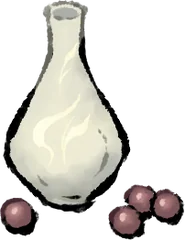

服用后会醉倒，但在醉梦中才悟得清楚

### 【各版本（境界 / 品质）】

练气·神品：醉心：服用后获得2张思绪卡（仅对主角使用生效）；逆经：减少使用者10灵气值；断脉：对使用者造成3点伤害

筑基·神品：醉心：服用后获得2张思绪卡（仅对主角使用生效）；逆经：减少使用者20灵气值；断脉：对使用者造成5点伤害

结丹·神品：醉心：服用后获得2张思绪卡（仅对主角使用生效）；逆经：减少使用者30灵气值；断脉：对使用者造成10点伤害

元婴·神品：醉心：服用后获得2张思绪卡（仅对主角使用生效）；逆经：减少使用者40灵气值；断脉：对使用者造成20点伤害

### 【最佳合成路线】

【练气·数值最高】主药「醉龙果」（练气·仙品·阴） + 辅药「蕴元仙萼」×4：境界分 5 → 练气期丹药；醉心合计 1；成丹品质概率（未计五行加成）：仙品2%，神品98%

【练气·同系草药】主药「醉龙果」（练气·仙品·阴） + 辅药「醉龙果」×4：境界分 5 → 练气期丹药；醉心合计 1；成丹品质概率（未计五行加成）：天品18%，仙品73%，神品9%

【筑基·数值最高】主药「千年醉龙果」（结丹·仙品·阴） + 辅药「蕴元仙萼」×4：境界分 12 → 筑基期丹药；醉心合计 1；成丹品质概率（未计五行加成）：仙品2%，神品98%

【筑基·同系草药】主药「千年醉龙果」（结丹·仙品·阴） + 辅药「醉龙果」×4：境界分 12 → 筑基期丹药；醉心合计 1；成丹品质概率（未计五行加成）：天品18%，仙品73%，神品9%

【结丹·数值最高】主药「千年醉龙果」（元婴·仙品·阴） + 辅药「蕴元仙萼」×4：境界分 33 → 结丹期丹药；醉心合计 1；成丹品质概率（未计五行加成）：仙品2%，神品98%

【结丹·同系草药】主药「千年醉龙果」（元婴·仙品·阴） + 辅药「醉龙果」×4：境界分 33 → 结丹期丹药；醉心合计 1；成丹品质概率（未计五行加成）：天品18%，仙品73%，神品9%

【元婴·数值最高】主药「千年醉龙果」（元婴·仙品·阴） + 辅药「蕴元仙萼」×4：境界分 117 → 元婴期丹药；醉心合计 1；成丹品质概率（未计五行加成）：仙品2%，神品98%

【元婴·同系草药】主药「千年醉龙果」（元婴·仙品·阴） + 辅药「醉龙果」×1、「千年醉龙果」×3：境界分 117 → 元婴期丹药；醉心合计 1；成丹品质概率（未计五行加成）：天品18%，仙品73%，神品9%

（「数值最高」= 能炼出该境界的组合里，成丹数值的期望最高（失败算 0，没算五行加成和天赋加成）；草药只要游戏里存在就算，不考虑好不好拿到。「同系草药」= 只用这种丹药自己的主药草，加上辅药效果相同的草药，比较好凑齐。）

### 【主药 / 辅药怎么选】

主药可选（主药决定炼出醉心露）：

练气：「醉龙果」（练气·仙品·阴）醉心1、堕心1

筑基：「百年醉龙果」（筑基·仙品·阴）醉心1、堕心1

结丹：「千年醉龙果」（结丹·仙品·阴）醉心1、堕心1

元婴：「千年醉龙果」（元婴·仙品·阴）醉心1、堕心1

没有任何草药的辅药效果是【醉心】，所以辅药不会增加数值，只用来提高成功率 / 品质（挑品质高的）。

主药是〔阴〕属性时：辅药优先用〔阴〕属性草药，避开〔阳〕属性

### 【炼丹原理】

炼丹工作台放 1 株主药 + 最多 4 株辅药。主药决定炼出哪一种丹药和它的效果；辅药的作用是提高成功率 / 品质，以及叠加数值。

数值：从主药的【主药效果】开始，辅药的【辅药效果】里和主药相同的效果会加上去（主药没有的效果不会加）。成丹数值 = 合计 × 品质系数（人品×0.4、地品×0.6、天品×0.8、仙品×1.0、神品×1.2）；活血 / 聚气 / 断脉 / 硬肤还会再加上天赋提供的加成。

注意：上方各品质版本里写的是游戏数据表预设的丹药数值；自己炼制时按上面的公式由草药数值计算，所以「估算成丹数值」可能和预设数值不一样，仅供比较不同配方的强弱。

境界：每株草药按自己的境界给「境界分」（练气 1、筑基 2、结丹 8、元婴 29），5 株加起来 ≥7 是筑基丹、≥28 是结丹丹、≥102 是元婴丹，否则是练气丹。例：5 株筑基草药 = 10 分 → 筑基丹；1 株结丹 + 4 株练气 = 12 分 → 只有筑基丹。

品质：每株草药按自己的品质加权重（人品草药偏向失败 / 人品，神品草药偏向仙 / 神品），草药越少越容易失败（1 株：失败权重 +15；2 株 +10；3 株 +5；4 株 +3；5 株不加），5 株的品质总和越高越好（总和 <10 炼不出仙 / 神品，<15 炼不出神品；≥16 失败 / 人 / 地品权重减少，≥20 不会失败也不会出人品，≥24 最低天品）。

五行：以主药的属性为准——同属性 3 株 + 生主药属性（相生）2 株，或同属性 4 株 + 相生 1 株：天 / 仙 / 神品权重 +1 / +2 / +3；只要有相生的草药，失败权重 −5；有克主药属性（相克）的草药，失败权重 +5，同属性 3~4 株再配相克的更会大幅增加失败（+20）；五株凑齐金木水火土阴阳七种属性（「止血草」这类全属性灵草一株就算齐）：天 / 仙 / 神品权重各 +5。

相生 / 相克（生主药 / 克主药）：金：土生 / 火克；木：水生 / 金克；水：金生 / 土克；火：木生 / 水克；土：火生 / 木克；阴：阴 / 阳克；阳：阳 / 阴克。

### 【获取途径】

使用醉龙果做主药可以炼制出

---

## 77. 真悟丹

服用后会进入顿悟状态。

### 【各版本（境界 / 品质）】

练气·神品：醉心：服用后获得2张思绪卡（仅对主角使用生效）

筑基·神品：醉心：服用后获得2张思绪卡（仅对主角使用生效）

结丹·神品：醉心：服用后获得2张思绪卡（仅对主角使用生效）

元婴·神品：醉心：服用后获得2张思绪卡（仅对主角使用生效）

### 【最佳合成路线】

【练气·数值最高】主药「菩提果」（练气·神品·火） + 辅药「蕴元仙萼」×4：境界分 5 → 练气期丹药；醉心合计 1；成丹品质概率（未计五行加成）：神品100%

【练气·同系草药】主药「菩提果」（练气·神品·火） + 辅药「菩提果」×4：境界分 5 → 练气期丹药；醉心合计 1；成丹品质概率（未计五行加成）：神品100%

【筑基·数值最高】主药「菩提道果」（结丹·神品·火） + 辅药「蕴元仙萼」×4：境界分 12 → 筑基期丹药；醉心合计 1；成丹品质概率（未计五行加成）：神品100%

【筑基·同系草药】主药「菩提道果」（结丹·神品·火） + 辅药「菩提果」×4：境界分 12 → 筑基期丹药；醉心合计 1；成丹品质概率（未计五行加成）：神品100%

【结丹·数值最高】主药「菩提道果」（元婴·神品·火） + 辅药「蕴元仙萼」×4：境界分 33 → 结丹期丹药；醉心合计 1；成丹品质概率（未计五行加成）：神品100%

【结丹·同系草药】主药「菩提道果」（元婴·神品·火） + 辅药「菩提果」×4：境界分 33 → 结丹期丹药；醉心合计 1；成丹品质概率（未计五行加成）：神品100%

【元婴·数值最高】主药「菩提道果」（元婴·神品·火） + 辅药「蕴元仙萼」×4：境界分 117 → 元婴期丹药；醉心合计 1；成丹品质概率（未计五行加成）：神品100%

【元婴·同系草药】主药「菩提道果」（元婴·神品·火） + 辅药「菩提果」×1、「菩提道果」×3：境界分 117 → 元婴期丹药；醉心合计 1；成丹品质概率（未计五行加成）：神品100%

（「数值最高」= 能炼出该境界的组合里，成丹数值的期望最高（失败算 0，没算五行加成和天赋加成）；草药只要游戏里存在就算，不考虑好不好拿到。「同系草药」= 只用这种丹药自己的主药草，加上辅药效果相同的草药，比较好凑齐。）

### 【主药 / 辅药怎么选】

主药可选（主药决定炼出真悟丹）：

练气：「菩提果」（练气·神品·火）醉心1

筑基：「大菩提果」（筑基·神品·火）醉心1

结丹：「菩提道果」（结丹·神品·火）醉心1

元婴：「菩提道果」（元婴·神品·火）醉心1

没有任何草药的辅药效果是【醉心】，所以辅药不会增加数值，只用来提高成功率 / 品质（挑品质高的）。

主药是〔火〕属性时：辅药优先用〔火〕属性和相生的〔木〕属性草药，避开相克的〔水〕属性

### 【炼丹原理】

炼丹工作台放 1 株主药 + 最多 4 株辅药。主药决定炼出哪一种丹药和它的效果；辅药的作用是提高成功率 / 品质，以及叠加数值。

数值：从主药的【主药效果】开始，辅药的【辅药效果】里和主药相同的效果会加上去（主药没有的效果不会加）。成丹数值 = 合计 × 品质系数（人品×0.4、地品×0.6、天品×0.8、仙品×1.0、神品×1.2）；活血 / 聚气 / 断脉 / 硬肤还会再加上天赋提供的加成。

注意：上方各品质版本里写的是游戏数据表预设的丹药数值；自己炼制时按上面的公式由草药数值计算，所以「估算成丹数值」可能和预设数值不一样，仅供比较不同配方的强弱。

境界：每株草药按自己的境界给「境界分」（练气 1、筑基 2、结丹 8、元婴 29），5 株加起来 ≥7 是筑基丹、≥28 是结丹丹、≥102 是元婴丹，否则是练气丹。例：5 株筑基草药 = 10 分 → 筑基丹；1 株结丹 + 4 株练气 = 12 分 → 只有筑基丹。

品质：每株草药按自己的品质加权重（人品草药偏向失败 / 人品，神品草药偏向仙 / 神品），草药越少越容易失败（1 株：失败权重 +15；2 株 +10；3 株 +5；4 株 +3；5 株不加），5 株的品质总和越高越好（总和 <10 炼不出仙 / 神品，<15 炼不出神品；≥16 失败 / 人 / 地品权重减少，≥20 不会失败也不会出人品，≥24 最低天品）。

五行：以主药的属性为准——同属性 3 株 + 生主药属性（相生）2 株，或同属性 4 株 + 相生 1 株：天 / 仙 / 神品权重 +1 / +2 / +3；只要有相生的草药，失败权重 −5；有克主药属性（相克）的草药，失败权重 +5，同属性 3~4 株再配相克的更会大幅增加失败（+20）；五株凑齐金木水火土阴阳七种属性（「止血草」这类全属性灵草一株就算齐）：天 / 仙 / 神品权重各 +5。

相生 / 相克（生主药 / 克主药）：金：土生 / 火克；木：水生 / 金克；水：金生 / 土克；火：木生 / 水克；土：火生 / 木克；阴：阴 / 阳克；阳：阳 / 阴克。

### 【获取途径】

使用菩提果做主药可以炼制出

---

## 78. 迷魂丹

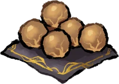

将目标的神经放松，才可控制目标。

### 【各版本（境界 / 品质）】

练气·人品：迷魂：有6%控制使用者。（可对妖兽，中立NPC使用，对高境界的卡牌无效）；活血：恢复使用者3血量

练气·地品：迷魂：有9%控制使用者。（可对妖兽，中立NPC使用，对高境界的卡牌无效）；活血：恢复使用者3血量

练气·天品：迷魂：有12%控制使用者。（可对妖兽，中立NPC使用，对高境界的卡牌无效）；活血：恢复使用者3血量

练气·仙品：迷魂：有14%控制使用者。（可对妖兽，中立NPC使用，对高境界的卡牌无效）；活血：恢复使用者3血量

练气·神品：迷魂：有17%控制使用者。（可对妖兽，中立NPC使用，对高境界的卡牌无效）；活血：恢复使用者3血量

筑基·人品：迷魂：有8%控制使用者。（可对妖兽，中立NPC使用，对高境界的卡牌无效）；活血：恢复使用者7血量

筑基·地品：迷魂：有12%控制使用者。（可对妖兽，中立NPC使用，对高境界的卡牌无效）；活血：恢复使用者7血量

筑基·天品：迷魂：有16%控制使用者。（可对妖兽，中立NPC使用，对高境界的卡牌无效）；活血：恢复使用者7血量

筑基·仙品：迷魂：有19%控制使用者。（可对妖兽，中立NPC使用，对高境界的卡牌无效）；活血：恢复使用者7血量

筑基·神品：迷魂：有23%控制使用者。（可对妖兽，中立NPC使用，对高境界的卡牌无效）；活血：恢复使用者7血量

结丹·人品：迷魂：有8%控制使用者。（可对妖兽，中立NPC使用，对高境界的卡牌无效）；活血：恢复使用者7血量

结丹·地品：迷魂：有12%控制使用者。（可对妖兽，中立NPC使用，对高境界的卡牌无效）；活血：恢复使用者7血量

结丹·天品：迷魂：有16%控制使用者。（可对妖兽，中立NPC使用，对高境界的卡牌无效）；活血：恢复使用者7血量

结丹·仙品：迷魂：有19%控制使用者。（可对妖兽，中立NPC使用，对高境界的卡牌无效）；活血：恢复使用者7血量

结丹·神品：迷魂：有23%控制使用者。（可对妖兽，中立NPC使用，对高境界的卡牌无效）；活血：恢复使用者7血量

元婴·人品：迷魂：有12%控制使用者。（可对妖兽，中立NPC使用，对高境界的卡牌无效）；活血：恢复使用者18血量

元婴·地品：迷魂：有18%控制使用者。（可对妖兽，中立NPC使用，对高境界的卡牌无效）；活血：恢复使用者18血量

元婴·天品：迷魂：有24%控制使用者。（可对妖兽，中立NPC使用，对高境界的卡牌无效）；活血：恢复使用者18血量

元婴·仙品：迷魂：有30%控制使用者。（可对妖兽，中立NPC使用，对高境界的卡牌无效）；活血：恢复使用者18血量

元婴·神品：迷魂：有35%控制使用者。（可对妖兽，中立NPC使用，对高境界的卡牌无效）；活血：恢复使用者18血量

### 【最佳合成路线】

【练气·数值最高】主药「迷魂迭香」（筑基·地品·土） + 辅药「幻神草」×4：境界分 6 → 练气期丹药；迷魂合计 15，按公式估算成丹数值（人 / 地 / 天 / 仙 / 神）≈ 人6 / 地9 / 天12 / 仙15 / 神18；成丹品质概率（未计五行加成）：天品33%，仙品59%，神品7%

【筑基·数值最高】主药「忘魂香」（结丹·地品·土） + 辅药「大幻神草」×4：境界分 16 → 筑基期丹药；迷魂合计 22，按公式估算成丹数值（人 / 地 / 天 / 仙 / 神）≈ 人8.8 / 地13.2 / 天17.6 / 仙22 / 神26.4；成丹品质概率（未计五行加成）：天品33%，仙品59%，神品7%

【结丹·数值最高】主药「忘魂香」（元婴·地品·土） + 辅药「幻魄草」×4：境界分 61 → 结丹期丹药；迷魂合计 29，按公式估算成丹数值（人 / 地 / 天 / 仙 / 神）≈ 人11.6 / 地17.4 / 天23.2 / 仙29 / 神34.8；成丹品质概率（未计五行加成）：天品33%，仙品59%，神品7%

【元婴·数值最高】主药「忘魂香」（元婴·地品·土） + 辅药「幻魄草」×4：境界分 145 → 元婴期丹药；迷魂合计 45，按公式估算成丹数值（人 / 地 / 天 / 仙 / 神）≈ 人18 / 地27 / 天36 / 仙45 / 神54；成丹品质概率（未计五行加成）：天品33%，仙品59%，神品7%

（「数值最高」= 能炼出该境界的组合里，成丹数值的期望最高（失败算 0，没算五行加成和天赋加成）；草药只要游戏里存在就算，不考虑好不好拿到。「同系草药」= 只用这种丹药自己的主药草，加上辅药效果相同的草药，比较好凑齐。）

### 【主药 / 辅药怎么选】

主药可选（主药决定炼出迷魂丹）：

练气：「迷魂香」（练气·地品·土）迷魂2、活血3

筑基：「迷魂迭香」（筑基·地品·土）迷魂3、活血4

结丹：「忘魂香」（结丹·地品·土）迷魂6、活血6

元婴：「忘魂香」（元婴·地品·土）迷魂9、活血15

辅药里带【迷魂】辅药效果的草药才会叠加数值（其余辅药只影响品质）：

练气：「幻神草」+3（仙品）、「兽涎水」+3（地品）、「迷魂香」+2（地品）

筑基：「大幻神草」+4（仙品）、「迷魂迭香」+3（地品）、「兽涎露」+3（地品）

结丹：「幻魄草」+5（仙品）、「忘魂香」+4（地品）、「兽涎露石」+3（地品）

元婴：「幻魄草」+9（仙品）、「忘魂香」+7（地品）

主药是〔土〕属性时：辅药优先用〔土〕属性和相生的〔火〕属性草药，避开相克的〔木〕属性

### 【炼丹原理】

炼丹工作台放 1 株主药 + 最多 4 株辅药。主药决定炼出哪一种丹药和它的效果；辅药的作用是提高成功率 / 品质，以及叠加数值。

数值：从主药的【主药效果】开始，辅药的【辅药效果】里和主药相同的效果会加上去（主药没有的效果不会加）。成丹数值 = 合计 × 品质系数（人品×0.4、地品×0.6、天品×0.8、仙品×1.0、神品×1.2）；活血 / 聚气 / 断脉 / 硬肤还会再加上天赋提供的加成。

注意：上方各品质版本里写的是游戏数据表预设的丹药数值；自己炼制时按上面的公式由草药数值计算，所以「估算成丹数值」可能和预设数值不一样，仅供比较不同配方的强弱。

境界：每株草药按自己的境界给「境界分」（练气 1、筑基 2、结丹 8、元婴 29），5 株加起来 ≥7 是筑基丹、≥28 是结丹丹、≥102 是元婴丹，否则是练气丹。例：5 株筑基草药 = 10 分 → 筑基丹；1 株结丹 + 4 株练气 = 12 分 → 只有筑基丹。

品质：每株草药按自己的品质加权重（人品草药偏向失败 / 人品，神品草药偏向仙 / 神品），草药越少越容易失败（1 株：失败权重 +15；2 株 +10；3 株 +5；4 株 +3；5 株不加），5 株的品质总和越高越好（总和 <10 炼不出仙 / 神品，<15 炼不出神品；≥16 失败 / 人 / 地品权重减少，≥20 不会失败也不会出人品，≥24 最低天品）。

五行：以主药的属性为准——同属性 3 株 + 生主药属性（相生）2 株，或同属性 4 株 + 相生 1 株：天 / 仙 / 神品权重 +1 / +2 / +3；只要有相生的草药，失败权重 −5；有克主药属性（相克）的草药，失败权重 +5，同属性 3~4 株再配相克的更会大幅增加失败（+20）；五株凑齐金木水火土阴阳七种属性（「止血草」这类全属性灵草一株就算齐）：天 / 仙 / 神品权重各 +5。

相生 / 相克（生主药 / 克主药）：金：土生 / 火克；木：水生 / 金克；水：金生 / 土克；火：木生 / 水克；土：火生 / 木克；阴：阴 / 阳克；阳：阳 / 阴克。

### 【获取途径】

使用迷魂香做主药可以炼制出

---

## 79. 锁神丹

把目标的神识牢牢锁住

### 【各版本（境界 / 品质）】

练气·仙品：迷魂：有16%控制使用者。（可对妖兽，中立NPC使用，对高境界的卡牌无效）

练气·神品：迷魂：有20%控制使用者。（可对妖兽，中立NPC使用，对高境界的卡牌无效）

筑基·仙品：迷魂：有21%控制使用者。（可对妖兽，中立NPC使用，对高境界的卡牌无效）

筑基·神品：迷魂：有26%控制使用者。（可对妖兽，中立NPC使用，对高境界的卡牌无效）

结丹·仙品：迷魂：有21%控制使用者。（可对妖兽，中立NPC使用，对高境界的卡牌无效）

结丹·神品：迷魂：有26%控制使用者。（可对妖兽，中立NPC使用，对高境界的卡牌无效）

元婴·仙品：迷魂：有32%控制使用者。（可对妖兽，中立NPC使用，对高境界的卡牌无效）

元婴·神品：迷魂：有39%控制使用者。（可对妖兽，中立NPC使用，对高境界的卡牌无效）

### 【最佳合成路线】

【练气·数值最高】主药「大幻神草」（筑基·仙品·金） + 辅药「幻神草」×4：境界分 6 → 练气期丹药；迷魂合计 17，按公式估算成丹数值（人 / 地 / 天 / 仙 / 神）≈ 人6.8 / 地10.2 / 天13.6 / 仙17 / 神20.4；成丹品质概率（未计五行加成）：天品18%，仙品73%，神品9%

【筑基·数值最高】主药「幻魄草」（结丹·仙品·金） + 辅药「大幻神草」×4：境界分 16 → 筑基期丹药；迷魂合计 26，按公式估算成丹数值（人 / 地 / 天 / 仙 / 神）≈ 人10.4 / 地15.6 / 天20.8 / 仙26 / 神31.2；成丹品质概率（未计五行加成）：天品18%，仙品73%，神品9%

【结丹·数值最高】主药「幻魄草」（元婴·仙品·金） + 辅药「幻魄草」×4：境界分 61 → 结丹期丹药；迷魂合计 35，按公式估算成丹数值（人 / 地 / 天 / 仙 / 神）≈ 人14 / 地21 / 天28 / 仙35 / 神42；成丹品质概率（未计五行加成）：天品18%，仙品73%，神品9%

【元婴·数值最高】主药「幻魄草」（元婴·仙品·金） + 辅药「幻魄草」×4：境界分 145 → 元婴期丹药；迷魂合计 51，按公式估算成丹数值（人 / 地 / 天 / 仙 / 神）≈ 人20.4 / 地30.6 / 天40.8 / 仙51 / 神61.2；成丹品质概率（未计五行加成）：天品18%，仙品73%，神品9%

（「数值最高」= 能炼出该境界的组合里，成丹数值的期望最高（失败算 0，没算五行加成和天赋加成）；草药只要游戏里存在就算，不考虑好不好拿到。「同系草药」= 只用这种丹药自己的主药草，加上辅药效果相同的草药，比较好凑齐。）

### 【主药 / 辅药怎么选】

主药可选（主药决定炼出锁神丹）：

练气：「幻神草」（练气·仙品·金）迷魂4

筑基：「大幻神草」（筑基·仙品·金）迷魂5

结丹：「幻魄草」（结丹·仙品·金）迷魂10

元婴：「幻魄草」（元婴·仙品·金）迷魂15

辅药里带【迷魂】辅药效果的草药才会叠加数值（其余辅药只影响品质）：

练气：「幻神草」+3（仙品）、「兽涎水」+3（地品）、「迷魂香」+2（地品）

筑基：「大幻神草」+4（仙品）、「迷魂迭香」+3（地品）、「兽涎露」+3（地品）

结丹：「幻魄草」+5（仙品）、「忘魂香」+4（地品）、「兽涎露石」+3（地品）

元婴：「幻魄草」+9（仙品）、「忘魂香」+7（地品）

主药是〔金〕属性时：辅药优先用〔金〕属性和相生的〔土〕属性草药，避开相克的〔火〕属性

### 【炼丹原理】

炼丹工作台放 1 株主药 + 最多 4 株辅药。主药决定炼出哪一种丹药和它的效果；辅药的作用是提高成功率 / 品质，以及叠加数值。

数值：从主药的【主药效果】开始，辅药的【辅药效果】里和主药相同的效果会加上去（主药没有的效果不会加）。成丹数值 = 合计 × 品质系数（人品×0.4、地品×0.6、天品×0.8、仙品×1.0、神品×1.2）；活血 / 聚气 / 断脉 / 硬肤还会再加上天赋提供的加成。

注意：上方各品质版本里写的是游戏数据表预设的丹药数值；自己炼制时按上面的公式由草药数值计算，所以「估算成丹数值」可能和预设数值不一样，仅供比较不同配方的强弱。

境界：每株草药按自己的境界给「境界分」（练气 1、筑基 2、结丹 8、元婴 29），5 株加起来 ≥7 是筑基丹、≥28 是结丹丹、≥102 是元婴丹，否则是练气丹。例：5 株筑基草药 = 10 分 → 筑基丹；1 株结丹 + 4 株练气 = 12 分 → 只有筑基丹。

品质：每株草药按自己的品质加权重（人品草药偏向失败 / 人品，神品草药偏向仙 / 神品），草药越少越容易失败（1 株：失败权重 +15；2 株 +10；3 株 +5；4 株 +3；5 株不加），5 株的品质总和越高越好（总和 <10 炼不出仙 / 神品，<15 炼不出神品；≥16 失败 / 人 / 地品权重减少，≥20 不会失败也不会出人品，≥24 最低天品）。

五行：以主药的属性为准——同属性 3 株 + 生主药属性（相生）2 株，或同属性 4 株 + 相生 1 株：天 / 仙 / 神品权重 +1 / +2 / +3；只要有相生的草药，失败权重 −5；有克主药属性（相克）的草药，失败权重 +5，同属性 3~4 株再配相克的更会大幅增加失败（+20）；五株凑齐金木水火土阴阳七种属性（「止血草」这类全属性灵草一株就算齐）：天 / 仙 / 神品权重各 +5。

相生 / 相克（生主药 / 克主药）：金：土生 / 火克；木：水生 / 金克；水：金生 / 土克；火：木生 / 水克；土：火生 / 木克；阴：阴 / 阳克；阳：阳 / 阴克。

### 【获取途径】

使用幻神草做主药可以炼制出

---

## 80. 燃魂散

服用后可获得修为，但对魂魄造成一定的伤害

### 【各版本（境界 / 品质）】

练气·神品：开窍：服用后获得4张修为卡（仅对主角使用生效）；堕心：服用后会产生张1心魔卡

筑基·神品：开窍：服用后获得6张修为卡（仅对主角使用生效）；堕心：服用后会产生张1心魔卡

结丹·神品：开窍：服用后获得8张修为卡（仅对主角使用生效）；堕心：服用后会产生张1心魔卡

元婴·神品：开窍：服用后获得20张修为卡（仅对主角使用生效）；堕心：服用后会产生张1心魔卡

### 【最佳合成路线】

【练气·数值最高】主药「青焰魔根」（筑基·天品·火） + 辅药「蕴元仙萼」×4：境界分 6 → 练气期丹药；开窍合计 13，按公式估算成丹数值（人 / 地 / 天 / 仙 / 神）≈ 人5.2 / 地7.8 / 天10.4 / 仙13 / 神15.6；成丹品质概率（未计五行加成）：神品100%

【筑基·数值最高】主药「魔焰根」（结丹·天品·火） + 辅药「蕴元仙萼」×4：境界分 16 → 筑基期丹药；开窍合计 19，按公式估算成丹数值（人 / 地 / 天 / 仙 / 神）≈ 人7.6 / 地11.4 / 天15.2 / 仙19 / 神22.8；成丹品质概率（未计五行加成）：神品100%

【结丹·数值最高】主药「魔焰根」（元婴·天品·火） + 辅药「蕴元仙萼」×4：境界分 61 → 结丹期丹药；开窍合计 35，按公式估算成丹数值（人 / 地 / 天 / 仙 / 神）≈ 人14 / 地21 / 天28 / 仙35 / 神42；成丹品质概率（未计五行加成）：神品100%

【元婴·数值最高】主药「魔焰根」（元婴·天品·火） + 辅药「蕴元仙萼」×4：境界分 145 → 元婴期丹药；开窍合计 67，按公式估算成丹数值（人 / 地 / 天 / 仙 / 神）≈ 人26.8 / 地40.2 / 天53.6 / 仙67 / 神80.4；成丹品质概率（未计五行加成）：神品100%

（「数值最高」= 能炼出该境界的组合里，成丹数值的期望最高（失败算 0，没算五行加成和天赋加成）；草药只要游戏里存在就算，不考虑好不好拿到。「同系草药」= 只用这种丹药自己的主药草，加上辅药效果相同的草药，比较好凑齐。）

### 【主药 / 辅药怎么选】

主药可选（主药决定炼出燃魂散）：

练气：「青焰根」（练气·天品·火）开窍3、堕心1

筑基：「青焰魔根」（筑基·天品·火）开窍5、堕心1

结丹：「魔焰根」（结丹·天品·火）开窍7、堕心1

元婴：「魔焰根」（元婴·天品·火）开窍15、堕心1

辅药里带【开窍】辅药效果的草药才会叠加数值（其余辅药只影响品质）：

练气：「蕴元仙萼」+2（绝品）、「血精果」+1（神品）

筑基：「蕴元仙萼」+3（绝品）、「大血精果」+2（神品）

结丹：「蕴元仙萼」+5（绝品）、「血晶果」+3（神品）

元婴：「蕴元仙萼」+13（绝品）、「血晶果」+7（神品）

主药是〔火〕属性时：辅药优先用〔火〕属性和相生的〔木〕属性草药，避开相克的〔水〕属性

### 【炼丹原理】

炼丹工作台放 1 株主药 + 最多 4 株辅药。主药决定炼出哪一种丹药和它的效果；辅药的作用是提高成功率 / 品质，以及叠加数值。

数值：从主药的【主药效果】开始，辅药的【辅药效果】里和主药相同的效果会加上去（主药没有的效果不会加）。成丹数值 = 合计 × 品质系数（人品×0.4、地品×0.6、天品×0.8、仙品×1.0、神品×1.2）；活血 / 聚气 / 断脉 / 硬肤还会再加上天赋提供的加成。

注意：上方各品质版本里写的是游戏数据表预设的丹药数值；自己炼制时按上面的公式由草药数值计算，所以「估算成丹数值」可能和预设数值不一样，仅供比较不同配方的强弱。

境界：每株草药按自己的境界给「境界分」（练气 1、筑基 2、结丹 8、元婴 29），5 株加起来 ≥7 是筑基丹、≥28 是结丹丹、≥102 是元婴丹，否则是练气丹。例：5 株筑基草药 = 10 分 → 筑基丹；1 株结丹 + 4 株练气 = 12 分 → 只有筑基丹。

品质：每株草药按自己的品质加权重（人品草药偏向失败 / 人品，神品草药偏向仙 / 神品），草药越少越容易失败（1 株：失败权重 +15；2 株 +10；3 株 +5；4 株 +3；5 株不加），5 株的品质总和越高越好（总和 <10 炼不出仙 / 神品，<15 炼不出神品；≥16 失败 / 人 / 地品权重减少，≥20 不会失败也不会出人品，≥24 最低天品）。

五行：以主药的属性为准——同属性 3 株 + 生主药属性（相生）2 株，或同属性 4 株 + 相生 1 株：天 / 仙 / 神品权重 +1 / +2 / +3；只要有相生的草药，失败权重 −5；有克主药属性（相克）的草药，失败权重 +5，同属性 3~4 株再配相克的更会大幅增加失败（+20）；五株凑齐金木水火土阴阳七种属性（「止血草」这类全属性灵草一株就算齐）：天 / 仙 / 神品权重各 +5。

相生 / 相克（生主药 / 克主药）：金：土生 / 火克；木：水生 / 金克；水：金生 / 土克；火：木生 / 水克；土：火生 / 木克；阴：阴 / 阳克；阳：阳 / 阴克。

### 【获取途径】

使用青焰根做主药可以炼制出

---

## 81. 逆元丹

服用后可以将全身的灵气逆转成修为

### 【各版本（境界 / 品质）】

练气·神品：开窍：服用后获得4张修为卡（仅对主角使用生效）；逆经：减少使用者20灵气值

筑基·神品：开窍：服用后获得8张修为卡（仅对主角使用生效）；逆经：减少使用者20灵气值

结丹·神品：开窍：服用后获得12张修为卡（仅对主角使用生效）；逆经：减少使用者20灵气值

元婴·神品：开窍：服用后获得30张修为卡（仅对主角使用生效）；逆经：减少使用者20灵气值

### 【最佳合成路线】

【练气·数值最高】主药「千灵参」（筑基·仙品·水） + 辅药「蕴元仙萼」×4：境界分 6 → 练气期丹药；开窍合计 13，按公式估算成丹数值（人 / 地 / 天 / 仙 / 神）≈ 人5.2 / 地7.8 / 天10.4 / 仙13 / 神15.6；成丹品质概率（未计五行加成）：仙品2%，神品98%

【筑基·数值最高】主药「万灵参」（结丹·仙品·水） + 辅药「蕴元仙萼」×4：境界分 16 → 筑基期丹药；开窍合计 19，按公式估算成丹数值（人 / 地 / 天 / 仙 / 神）≈ 人7.6 / 地11.4 / 天15.2 / 仙19 / 神22.8；成丹品质概率（未计五行加成）：仙品2%，神品98%

【结丹·数值最高】主药「万灵参」（元婴·仙品·水） + 辅药「蕴元仙萼」×4：境界分 61 → 结丹期丹药；开窍合计 35，按公式估算成丹数值（人 / 地 / 天 / 仙 / 神）≈ 人14 / 地21 / 天28 / 仙35 / 神42；成丹品质概率（未计五行加成）：仙品2%，神品98%

【元婴·数值最高】主药「万灵参」（元婴·仙品·水） + 辅药「蕴元仙萼」×4：境界分 145 → 元婴期丹药；开窍合计 67，按公式估算成丹数值（人 / 地 / 天 / 仙 / 神）≈ 人26.8 / 地40.2 / 天53.6 / 仙67 / 神80.4；成丹品质概率（未计五行加成）：仙品2%，神品98%

（「数值最高」= 能炼出该境界的组合里，成丹数值的期望最高（失败算 0，没算五行加成和天赋加成）；草药只要游戏里存在就算，不考虑好不好拿到。「同系草药」= 只用这种丹药自己的主药草，加上辅药效果相同的草药，比较好凑齐。）

### 【主药 / 辅药怎么选】

主药可选（主药决定炼出逆元丹）：

练气：「百灵参」（练气·仙品·水）开窍3、逆经20

筑基：「千灵参」（筑基·仙品·水）开窍5、逆经30

结丹：「万灵参」（结丹·仙品·水）开窍7、逆经40

元婴：「万灵参」（元婴·仙品·水）开窍15、逆经60

辅药里带【开窍】辅药效果的草药才会叠加数值（其余辅药只影响品质）：

练气：「蕴元仙萼」+2（绝品）、「血精果」+1（神品）

筑基：「蕴元仙萼」+3（绝品）、「大血精果」+2（神品）

结丹：「蕴元仙萼」+5（绝品）、「血晶果」+3（神品）

元婴：「蕴元仙萼」+13（绝品）、「血晶果」+7（神品）

主药是〔水〕属性时：辅药优先用〔水〕属性和相生的〔金〕属性草药，避开相克的〔土〕属性

### 【炼丹原理】

炼丹工作台放 1 株主药 + 最多 4 株辅药。主药决定炼出哪一种丹药和它的效果；辅药的作用是提高成功率 / 品质，以及叠加数值。

数值：从主药的【主药效果】开始，辅药的【辅药效果】里和主药相同的效果会加上去（主药没有的效果不会加）。成丹数值 = 合计 × 品质系数（人品×0.4、地品×0.6、天品×0.8、仙品×1.0、神品×1.2）；活血 / 聚气 / 断脉 / 硬肤还会再加上天赋提供的加成。

注意：上方各品质版本里写的是游戏数据表预设的丹药数值；自己炼制时按上面的公式由草药数值计算，所以「估算成丹数值」可能和预设数值不一样，仅供比较不同配方的强弱。

境界：每株草药按自己的境界给「境界分」（练气 1、筑基 2、结丹 8、元婴 29），5 株加起来 ≥7 是筑基丹、≥28 是结丹丹、≥102 是元婴丹，否则是练气丹。例：5 株筑基草药 = 10 分 → 筑基丹；1 株结丹 + 4 株练气 = 12 分 → 只有筑基丹。

品质：每株草药按自己的品质加权重（人品草药偏向失败 / 人品，神品草药偏向仙 / 神品），草药越少越容易失败（1 株：失败权重 +15；2 株 +10；3 株 +5；4 株 +3；5 株不加），5 株的品质总和越高越好（总和 <10 炼不出仙 / 神品，<15 炼不出神品；≥16 失败 / 人 / 地品权重减少，≥20 不会失败也不会出人品，≥24 最低天品）。

五行：以主药的属性为准——同属性 3 株 + 生主药属性（相生）2 株，或同属性 4 株 + 相生 1 株：天 / 仙 / 神品权重 +1 / +2 / +3；只要有相生的草药，失败权重 −5；有克主药属性（相克）的草药，失败权重 +5，同属性 3~4 株再配相克的更会大幅增加失败（+20）；五株凑齐金木水火土阴阳七种属性（「止血草」这类全属性灵草一株就算齐）：天 / 仙 / 神品权重各 +5。

相生 / 相克（生主药 / 克主药）：金：土生 / 火克；木：水生 / 金克；水：金生 / 土克；火：木生 / 水克；土：火生 / 木克；阴：阴 / 阳克；阳：阳 / 阴克。

### 【获取途径】

使用百灵参做主药可以炼制出

---

## 82. 修为丹

服用后立刻获得修为，且无其他副作用。

服用后立刻获得大量修为。

### 【各版本（境界 / 品质）】

练气·绝品：开窍：服用后获得10张修为卡（仅对主角使用生效）

筑基·绝品：开窍：服用后获得20张修为卡（仅对主角使用生效）

结丹·绝品：开窍：服用后获得35张修为卡（仅对主角使用生效）

元婴·绝品：开窍：服用后获得90张修为卡（仅对主角使用生效）

### 【最佳合成路线】

【练气·数值最高】主药「蕴元仙萼」（筑基·绝品·阳） + 辅药「蕴元仙萼」×4：境界分 6 → 练气期丹药；开窍合计 16，按公式估算成丹数值（人 / 地 / 天 / 仙 / 神）≈ 人6.4 / 地9.6 / 天12.8 / 仙16 / 神19.2；成丹品质概率（未计五行加成）：神品100%

【筑基·数值最高】主药「蕴元仙萼」（结丹·绝品·阳） + 辅药「蕴元仙萼」×4：境界分 16 → 筑基期丹药；开窍合计 24，按公式估算成丹数值（人 / 地 / 天 / 仙 / 神）≈ 人9.6 / 地14.4 / 天19.2 / 仙24 / 神28.8；成丹品质概率（未计五行加成）：神品100%

【结丹·数值最高】主药「蕴元仙萼」（元婴·绝品·阳） + 辅药「蕴元仙萼」×4：境界分 61 → 结丹期丹药；开窍合计 50，按公式估算成丹数值（人 / 地 / 天 / 仙 / 神）≈ 人20 / 地30 / 天40 / 仙50 / 神60；成丹品质概率（未计五行加成）：神品100%

【元婴·数值最高】主药「蕴元仙萼」（元婴·绝品·阳） + 辅药「蕴元仙萼」×4：境界分 145 → 元婴期丹药；开窍合计 82，按公式估算成丹数值（人 / 地 / 天 / 仙 / 神）≈ 人32.8 / 地49.2 / 天65.6 / 仙82 / 神98.4；成丹品质概率（未计五行加成）：神品100%

（「数值最高」= 能炼出该境界的组合里，成丹数值的期望最高（失败算 0，没算五行加成和天赋加成）；草药只要游戏里存在就算，不考虑好不好拿到。「同系草药」= 只用这种丹药自己的主药草，加上辅药效果相同的草药，比较好凑齐。）

### 【主药 / 辅药怎么选】

主药可选（主药决定炼出修为丹）：

练气：「蕴元仙萼」（练气·绝品·阳）开窍5

筑基：「蕴元仙萼」（筑基·绝品·阳）开窍8

结丹：「蕴元仙萼」（结丹·绝品·阳）开窍12

元婴：「蕴元仙萼」（元婴·绝品·阳）开窍30

辅药里带【开窍】辅药效果的草药才会叠加数值（其余辅药只影响品质）：

练气：「蕴元仙萼」+2（绝品）、「血精果」+1（神品）

筑基：「蕴元仙萼」+3（绝品）、「大血精果」+2（神品）

结丹：「蕴元仙萼」+5（绝品）、「血晶果」+3（神品）

元婴：「蕴元仙萼」+13（绝品）、「血晶果」+7（神品）

主药是〔阳〕属性时：辅药优先用〔阳〕属性草药，避开〔阴〕属性

### 【炼丹原理】

炼丹工作台放 1 株主药 + 最多 4 株辅药。主药决定炼出哪一种丹药和它的效果；辅药的作用是提高成功率 / 品质，以及叠加数值。

数值：从主药的【主药效果】开始，辅药的【辅药效果】里和主药相同的效果会加上去（主药没有的效果不会加）。成丹数值 = 合计 × 品质系数（人品×0.4、地品×0.6、天品×0.8、仙品×1.0、神品×1.2）；活血 / 聚气 / 断脉 / 硬肤还会再加上天赋提供的加成。

注意：上方各品质版本里写的是游戏数据表预设的丹药数值；自己炼制时按上面的公式由草药数值计算，所以「估算成丹数值」可能和预设数值不一样，仅供比较不同配方的强弱。

境界：每株草药按自己的境界给「境界分」（练气 1、筑基 2、结丹 8、元婴 29），5 株加起来 ≥7 是筑基丹、≥28 是结丹丹、≥102 是元婴丹，否则是练气丹。例：5 株筑基草药 = 10 分 → 筑基丹；1 株结丹 + 4 株练气 = 12 分 → 只有筑基丹。

品质：每株草药按自己的品质加权重（人品草药偏向失败 / 人品，神品草药偏向仙 / 神品），草药越少越容易失败（1 株：失败权重 +15；2 株 +10；3 株 +5；4 株 +3；5 株不加），5 株的品质总和越高越好（总和 <10 炼不出仙 / 神品，<15 炼不出神品；≥16 失败 / 人 / 地品权重减少，≥20 不会失败也不会出人品，≥24 最低天品）。

五行：以主药的属性为准——同属性 3 株 + 生主药属性（相生）2 株，或同属性 4 株 + 相生 1 株：天 / 仙 / 神品权重 +1 / +2 / +3；只要有相生的草药，失败权重 −5；有克主药属性（相克）的草药，失败权重 +5，同属性 3~4 株再配相克的更会大幅增加失败（+20）；五株凑齐金木水火土阴阳七种属性（「止血草」这类全属性灵草一株就算齐）：天 / 仙 / 神品权重各 +5。

相生 / 相克（生主药 / 克主药）：金：土生 / 火克；木：水生 / 金克；水：金生 / 土克；火：木生 / 水克；土：火生 / 木克；阴：阴 / 阳克；阳：阳 / 阴克。

### 【获取途径】

使用蕴元仙萼做主药可以炼制出

---

## 83. 引兽丸

丹药散发着浓浓的香味，能将妖兽吸引来

### 【各版本（境界 / 品质）】

练气·人品：唤灵：服用后会招来1只妖兽

练气·地品：唤灵：服用后会招来2只妖兽

练气·天品：唤灵：服用后会招来3只妖兽

练气·仙品：唤灵：服用后会招来3只妖兽

练气·神品：唤灵：服用后会招来3只妖兽

筑基·人品：唤灵：服用后会招来1只妖兽

筑基·地品：唤灵：服用后会招来2只妖兽

筑基·天品：唤灵：服用后会招来3只妖兽

筑基·仙品：唤灵：服用后会招来3只妖兽

筑基·神品：唤灵：服用后会招来3只妖兽

结丹·人品：唤灵：服用后会招来1只妖兽

结丹·地品：唤灵：服用后会招来2只妖兽

结丹·天品：唤灵：服用后会招来3只妖兽

结丹·仙品：唤灵：服用后会招来3只妖兽

结丹·神品：唤灵：服用后会招来3只妖兽

### 【最佳合成路线】

【练气·数值最高】主药「兽涎露」（筑基·地品·水） + 辅药「蕴元仙萼」×4：境界分 6 → 练气期丹药；唤灵合计 2；成丹品质概率（未计五行加成）：神品100%

【练气·同系草药】主药「兽涎露」（筑基·地品·水） + 辅药「兽涎水」×4：境界分 6 → 练气期丹药；唤灵合计 2；成丹品质概率（未计五行加成）：人品31%，地品54%，天品15%

【筑基·数值最高】主药「兽涎露石」（结丹·地品·水） + 辅药「蕴元仙萼」×4：境界分 12 → 筑基期丹药；唤灵合计 3；成丹品质概率（未计五行加成）：神品100%

【筑基·同系草药】主药「兽涎露石」（结丹·地品·水） + 辅药「兽涎水」×4：境界分 12 → 筑基期丹药；唤灵合计 3；成丹品质概率（未计五行加成）：人品31%，地品54%，天品15%

【结丹·数值最高】主药「兽涎露石」（结丹·地品·水） + 辅药「蕴元仙萼」×4：境界分 33 → 结丹期丹药；唤灵合计 3；成丹品质概率（未计五行加成）：神品100%

【结丹·同系草药】主药「兽涎露石」（结丹·地品·水） + 辅药「兽涎水」×1、「兽涎露石」×3：境界分 33 → 结丹期丹药；唤灵合计 3；成丹品质概率（未计五行加成）：人品31%，地品54%，天品15%

【元婴·数值最高】主药「兽涎露石」（结丹·地品·水） + 辅药「蕴元仙萼」×4：境界分 103 → 元婴期丹药；唤灵合计 3；成丹品质概率（未计五行加成）：神品100%

（「数值最高」= 能炼出该境界的组合里，成丹数值的期望最高（失败算 0，没算五行加成和天赋加成）；草药只要游戏里存在就算，不考虑好不好拿到。「同系草药」= 只用这种丹药自己的主药草，加上辅药效果相同的草药，比较好凑齐。）

### 【主药 / 辅药怎么选】

主药可选（主药决定炼出引兽丸）：

练气：「兽涎水」（练气·地品·水）唤灵1

筑基：「兽涎露」（筑基·地品·水）唤灵2

结丹：「兽涎露石」（结丹·地品·水）唤灵3

没有任何草药的辅药效果是【唤灵】，所以辅药不会增加数值，只用来提高成功率 / 品质（挑品质高的）。

主药是〔水〕属性时：辅药优先用〔水〕属性和相生的〔金〕属性草药，避开相克的〔土〕属性

### 【炼丹原理】

炼丹工作台放 1 株主药 + 最多 4 株辅药。主药决定炼出哪一种丹药和它的效果；辅药的作用是提高成功率 / 品质，以及叠加数值。

数值：从主药的【主药效果】开始，辅药的【辅药效果】里和主药相同的效果会加上去（主药没有的效果不会加）。成丹数值 = 合计 × 品质系数（人品×0.4、地品×0.6、天品×0.8、仙品×1.0、神品×1.2）；活血 / 聚气 / 断脉 / 硬肤还会再加上天赋提供的加成。

注意：上方各品质版本里写的是游戏数据表预设的丹药数值；自己炼制时按上面的公式由草药数值计算，所以「估算成丹数值」可能和预设数值不一样，仅供比较不同配方的强弱。

境界：每株草药按自己的境界给「境界分」（练气 1、筑基 2、结丹 8、元婴 29），5 株加起来 ≥7 是筑基丹、≥28 是结丹丹、≥102 是元婴丹，否则是练气丹。例：5 株筑基草药 = 10 分 → 筑基丹；1 株结丹 + 4 株练气 = 12 分 → 只有筑基丹。

品质：每株草药按自己的品质加权重（人品草药偏向失败 / 人品，神品草药偏向仙 / 神品），草药越少越容易失败（1 株：失败权重 +15；2 株 +10；3 株 +5；4 株 +3；5 株不加），5 株的品质总和越高越好（总和 <10 炼不出仙 / 神品，<15 炼不出神品；≥16 失败 / 人 / 地品权重减少，≥20 不会失败也不会出人品，≥24 最低天品）。

五行：以主药的属性为准——同属性 3 株 + 生主药属性（相生）2 株，或同属性 4 株 + 相生 1 株：天 / 仙 / 神品权重 +1 / +2 / +3；只要有相生的草药，失败权重 −5；有克主药属性（相克）的草药，失败权重 +5，同属性 3~4 株再配相克的更会大幅增加失败（+20）；五株凑齐金木水火土阴阳七种属性（「止血草」这类全属性灵草一株就算齐）：天 / 仙 / 神品权重各 +5。

相生 / 相克（生主药 / 克主药）：金：土生 / 火克；木：水生 / 金克；水：金生 / 土克；火：木生 / 水克；土：火生 / 木克；阴：阴 / 阳克；阳：阳 / 阴克。

### 【获取途径】

使用兽涎水做主药可以炼制出

---

## 84. 寿元丹

能逆天改命的丹药，服用后增加少量寿命

### 【各版本（境界 / 品质）】

练气·神品：延寿：增加使用者3年寿命

筑基·神品：延寿：增加使用者5年寿命

结丹·神品：延寿：增加使用者8年寿命

元婴·神品：延寿：增加使用者20年寿命

练气·绝品：能逆天改命的丹药，服用后增加大量〔寿命〕；延寿：增加使用者15年寿命

筑基·绝品：能逆天改命的丹药，服用后增加大量〔寿命〕；延寿：增加使用者35年寿命

结丹·绝品：能逆天改命的丹药，服用后增加大量〔寿命〕；延寿：增加使用者70年寿命

元婴·绝品：能逆天改命的丹药，服用后增加大量〔寿命〕；延寿：增加使用者120年寿命

### 【最佳合成路线】

【练气·数值最高】主药「赤霄灵芝」（筑基·绝品·阳） + 辅药「蕴元仙萼」×4：境界分 6 → 练气期丹药；延寿合计 9，按公式估算成丹数值（人 / 地 / 天 / 仙 / 神）≈ 人3.6 / 地5.4 / 天7.2 / 仙9 / 神10.8；成丹品质概率（未计五行加成）：神品100%

【练气·同系草药】主药「赤霄灵芝」（筑基·绝品·阳） + 辅药「九霄灵芝」×4：境界分 6 → 练气期丹药；延寿合计 9，按公式估算成丹数值（人 / 地 / 天 / 仙 / 神）≈ 人3.6 / 地5.4 / 天7.2 / 仙9 / 神10.8；成丹品质概率（未计五行加成）：神品100%

【筑基·数值最高】主药「碧霄灵芝」（结丹·绝品·阳） + 辅药「蕴元仙萼」×4：境界分 12 → 筑基期丹药；延寿合计 15，按公式估算成丹数值（人 / 地 / 天 / 仙 / 神）≈ 人6 / 地9 / 天12 / 仙15 / 神18；成丹品质概率（未计五行加成）：神品100%

【筑基·同系草药】主药「碧霄灵芝」（结丹·绝品·阳） + 辅药「九霄灵芝」×4：境界分 12 → 筑基期丹药；延寿合计 15，按公式估算成丹数值（人 / 地 / 天 / 仙 / 神）≈ 人6 / 地9 / 天12 / 仙15 / 神18；成丹品质概率（未计五行加成）：神品100%

【结丹·数值最高】主药「碧霄灵芝」（元婴·绝品·阳） + 辅药「蕴元仙萼」×4：境界分 33 → 结丹期丹药；延寿合计 35，按公式估算成丹数值（人 / 地 / 天 / 仙 / 神）≈ 人14 / 地21 / 天28 / 仙35 / 神42；成丹品质概率（未计五行加成）：神品100%

【结丹·同系草药】主药「碧霄灵芝」（元婴·绝品·阳） + 辅药「九霄灵芝」×4：境界分 33 → 结丹期丹药；延寿合计 35，按公式估算成丹数值（人 / 地 / 天 / 仙 / 神）≈ 人14 / 地21 / 天28 / 仙35 / 神42；成丹品质概率（未计五行加成）：神品100%

【元婴·数值最高】主药「碧霄灵芝」（元婴·绝品·阳） + 辅药「蕴元仙萼」×4：境界分 117 → 元婴期丹药；延寿合计 35，按公式估算成丹数值（人 / 地 / 天 / 仙 / 神）≈ 人14 / 地21 / 天28 / 仙35 / 神42；成丹品质概率（未计五行加成）：神品100%

【元婴·同系草药】主药「碧霄灵芝」（元婴·绝品·阳） + 辅药「九霄灵芝」×1、「碧霄灵芝」×3：境界分 117 → 元婴期丹药；延寿合计 35，按公式估算成丹数值（人 / 地 / 天 / 仙 / 神）≈ 人14 / 地21 / 天28 / 仙35 / 神42；成丹品质概率（未计五行加成）：神品100%

（「数值最高」= 能炼出该境界的组合里，成丹数值的期望最高（失败算 0，没算五行加成和天赋加成）；草药只要游戏里存在就算，不考虑好不好拿到。「同系草药」= 只用这种丹药自己的主药草，加上辅药效果相同的草药，比较好凑齐。）

### 【主药 / 辅药怎么选】

主药可选（主药决定炼出寿元丹）：

练气：「九霄灵芝」（练气·绝品·阳）延寿4

筑基：「赤霄灵芝」（筑基·绝品·阳）延寿9；「血灵芝」（筑基·绝品·阴）延寿9、堕心1

结丹：「碧霄灵芝」（结丹·绝品·阳）延寿15；「血灵芝」（结丹·绝品·阴）延寿15、堕心1

元婴：「碧霄灵芝」（元婴·绝品·阳）延寿35；「血灵芝」（元婴·绝品·阴）延寿35、堕心2

没有任何草药的辅药效果是【延寿】，所以辅药不会增加数值，只用来提高成功率 / 品质（挑品质高的）。

主药是〔阴〕属性时：辅药优先用〔阴〕属性草药，避开〔阳〕属性

主药是〔阳〕属性时：辅药优先用〔阳〕属性草药，避开〔阴〕属性

### 【炼丹原理】

炼丹工作台放 1 株主药 + 最多 4 株辅药。主药决定炼出哪一种丹药和它的效果；辅药的作用是提高成功率 / 品质，以及叠加数值。

数值：从主药的【主药效果】开始，辅药的【辅药效果】里和主药相同的效果会加上去（主药没有的效果不会加）。成丹数值 = 合计 × 品质系数（人品×0.4、地品×0.6、天品×0.8、仙品×1.0、神品×1.2）；活血 / 聚气 / 断脉 / 硬肤还会再加上天赋提供的加成。

注意：上方各品质版本里写的是游戏数据表预设的丹药数值；自己炼制时按上面的公式由草药数值计算，所以「估算成丹数值」可能和预设数值不一样，仅供比较不同配方的强弱。

境界：每株草药按自己的境界给「境界分」（练气 1、筑基 2、结丹 8、元婴 29），5 株加起来 ≥7 是筑基丹、≥28 是结丹丹、≥102 是元婴丹，否则是练气丹。例：5 株筑基草药 = 10 分 → 筑基丹；1 株结丹 + 4 株练气 = 12 分 → 只有筑基丹。

品质：每株草药按自己的品质加权重（人品草药偏向失败 / 人品，神品草药偏向仙 / 神品），草药越少越容易失败（1 株：失败权重 +15；2 株 +10；3 株 +5；4 株 +3；5 株不加），5 株的品质总和越高越好（总和 <10 炼不出仙 / 神品，<15 炼不出神品；≥16 失败 / 人 / 地品权重减少，≥20 不会失败也不会出人品，≥24 最低天品）。

五行：以主药的属性为准——同属性 3 株 + 生主药属性（相生）2 株，或同属性 4 株 + 相生 1 株：天 / 仙 / 神品权重 +1 / +2 / +3；只要有相生的草药，失败权重 −5；有克主药属性（相克）的草药，失败权重 +5，同属性 3~4 株再配相克的更会大幅增加失败（+20）；五株凑齐金木水火土阴阳七种属性（「止血草」这类全属性灵草一株就算齐）：天 / 仙 / 神品权重各 +5。

相生 / 相克（生主药 / 克主药）：金：土生 / 火克；木：水生 / 金克；水：金生 / 土克；火：木生 / 水克；土：火生 / 木克；阴：阴 / 阳克；阳：阳 / 阴克。

### 【获取途径】

使用九霄灵芝，血灵芝做主药可以炼制出

---

## 85. 慧心丹

蕴含因果机缘的丹药。

### 【各版本（境界 / 品质）】

练气·神品：气运：服用后获得1张机缘卡；开窍：服用后获得3张修为卡（仅对主角使用生效）

筑基·神品：气运：服用后获得1张机缘卡；开窍：服用后获得6张修为卡（仅对主角使用生效）

结丹·神品：气运：服用后获得1张机缘卡；开窍：服用后获得8张修为卡（仅对主角使用生效）

元婴·神品：气运：服用后获得1张机缘卡；开窍：服用后获得20张修为卡（仅对主角使用生效）

### 【最佳合成路线】

【练气·数值最高】主药「缘玑仙草」（练气·绝品·阳） + 辅药「缘玑仙草」×4：境界分 5 → 练气期丹药；气运合计 0.75，按公式估算成丹数值（人 / 地 / 天 / 仙 / 神）≈ 人0.3 / 地0.45 / 天0.6 / 仙0.75 / 神0.9；成丹品质概率（未计五行加成）：神品100%

【筑基·数值最高】主药「缘玑仙草」（结丹·绝品·阳） + 辅药「缘玑仙草」×4：境界分 12 → 筑基期丹药；气运合计 0.75，按公式估算成丹数值（人 / 地 / 天 / 仙 / 神）≈ 人0.3 / 地0.45 / 天0.6 / 仙0.75 / 神0.9；成丹品质概率（未计五行加成）：神品100%

【结丹·数值最高】主药「缘玑仙草」（元婴·绝品·阳） + 辅药「缘玑仙草」×4：境界分 33 → 结丹期丹药；气运合计 0.75，按公式估算成丹数值（人 / 地 / 天 / 仙 / 神）≈ 人0.3 / 地0.45 / 天0.6 / 仙0.75 / 神0.9；成丹品质概率（未计五行加成）：神品100%

【元婴·数值最高】主药「缘玑仙草」（元婴·绝品·阳） + 辅药「缘玑仙草」×4：境界分 117 → 元婴期丹药；气运合计 0.75，按公式估算成丹数值（人 / 地 / 天 / 仙 / 神）≈ 人0.3 / 地0.45 / 天0.6 / 仙0.75 / 神0.9；成丹品质概率（未计五行加成）：神品100%

（「数值最高」= 能炼出该境界的组合里，成丹数值的期望最高（失败算 0，没算五行加成和天赋加成）；草药只要游戏里存在就算，不考虑好不好拿到。「同系草药」= 只用这种丹药自己的主药草，加上辅药效果相同的草药，比较好凑齐。）

### 【主药 / 辅药怎么选】

主药可选（主药决定炼出慧心丹）：

练气：「缘玑仙草」（练气·绝品·阳）气运0.15、开窍3

筑基：「缘玑仙草」（筑基·绝品·阳）气运0.15、开窍4

结丹：「缘玑仙草」（结丹·绝品·阳）气运0.15、开窍5

元婴：「缘玑仙草」（元婴·绝品·阳）气运0.15、开窍13

辅药里带【气运】辅药效果的草药才会叠加数值（其余辅药只影响品质）：

练气：「缘玑仙草」+0.15（绝品）

筑基：「缘玑仙草」+0.15（绝品）

结丹：「缘玑仙草」+0.15（绝品）

元婴：「缘玑仙草」+0.15（绝品）

主药是〔阳〕属性时：辅药优先用〔阳〕属性草药，避开〔阴〕属性

### 【炼丹原理】

炼丹工作台放 1 株主药 + 最多 4 株辅药。主药决定炼出哪一种丹药和它的效果；辅药的作用是提高成功率 / 品质，以及叠加数值。

数值：从主药的【主药效果】开始，辅药的【辅药效果】里和主药相同的效果会加上去（主药没有的效果不会加）。成丹数值 = 合计 × 品质系数（人品×0.4、地品×0.6、天品×0.8、仙品×1.0、神品×1.2）；活血 / 聚气 / 断脉 / 硬肤还会再加上天赋提供的加成。

注意：上方各品质版本里写的是游戏数据表预设的丹药数值；自己炼制时按上面的公式由草药数值计算，所以「估算成丹数值」可能和预设数值不一样，仅供比较不同配方的强弱。

境界：每株草药按自己的境界给「境界分」（练气 1、筑基 2、结丹 8、元婴 29），5 株加起来 ≥7 是筑基丹、≥28 是结丹丹、≥102 是元婴丹，否则是练气丹。例：5 株筑基草药 = 10 分 → 筑基丹；1 株结丹 + 4 株练气 = 12 分 → 只有筑基丹。

品质：每株草药按自己的品质加权重（人品草药偏向失败 / 人品，神品草药偏向仙 / 神品），草药越少越容易失败（1 株：失败权重 +15；2 株 +10；3 株 +5；4 株 +3；5 株不加），5 株的品质总和越高越好（总和 <10 炼不出仙 / 神品，<15 炼不出神品；≥16 失败 / 人 / 地品权重减少，≥20 不会失败也不会出人品，≥24 最低天品）。

五行：以主药的属性为准——同属性 3 株 + 生主药属性（相生）2 株，或同属性 4 株 + 相生 1 株：天 / 仙 / 神品权重 +1 / +2 / +3；只要有相生的草药，失败权重 −5；有克主药属性（相克）的草药，失败权重 +5，同属性 3~4 株再配相克的更会大幅增加失败（+20）；五株凑齐金木水火土阴阳七种属性（「止血草」这类全属性灵草一株就算齐）：天 / 仙 / 神品权重各 +5。

相生 / 相克（生主药 / 克主药）：金：土生 / 火克；木：水生 / 金克；水：金生 / 土克；火：木生 / 水克；土：火生 / 木克；阴：阴 / 阳克；阳：阳 / 阴克。

### 【获取途径】

使用缘玑仙草做主药可以炼制出

---

## 86. 聚灵丹（图鉴未收录）

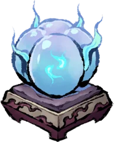

服用后永久提高〔灵气〕上限

### 【各版本（境界 / 品质）】

筑基·绝品：聚灵：服用后永久增加8〔灵气〕上限

结丹·绝品：聚灵：服用后永久增加15〔灵气〕上限

元婴·绝品：聚灵：服用后永久增加25〔灵气〕上限

### 【获取途径】

比武大会的魁首奖品

---

## 87. 凝元丹（图鉴未收录）

服用后永久提高神识

### 【各版本（境界 / 品质）】

筑基·绝品：凝神：服用后永久增加1神识值

结丹·绝品：凝神：服用后永久增加1神识值

元婴·绝品：凝神：服用后永久增加1神识值

### 【获取途径】

比武大会的魁首奖品

---

## 88. 回春髓（图鉴未收录）

服用后清除身上的死亡记录

### 【各版本（境界 / 品质）】

筑基·绝品：改命：服用后清除死亡惩罚的记录

结丹·绝品：改命：服用后清除死亡惩罚的记录

元婴·绝品：改命：服用后清除死亡惩罚的记录

### 【获取途径】

比武大会的魁首奖品

---

## 89. 兵魄丹（图鉴未收录）

服用后永久提高〔攻击〕

### 【各版本（境界 / 品质）】

筑基·绝品：强攻：服用后永久增加5〔攻击〕

结丹·绝品：强攻：服用后永久增加8〔攻击〕

元婴·绝品：强攻：服用后永久增加13〔攻击〕

### 【获取途径】

比武大会的魁首奖品

---

## 90. 璇玑露（图鉴未收录）

服用后永久提高〔血量〕

### 【各版本（境界 / 品质）】

筑基·绝品：健体：服用后永久增加20〔血量〕

结丹·绝品：健体：服用后永久增加50〔血量〕

元婴·绝品：健体：服用后永久增加125〔血量〕

### 【获取途径】

比武大会的魁首奖品

---

## 91. 遁速丹（图鉴未收录）

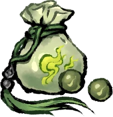

服用后可提升对灵气的操控度，使得飞行速度加快。

### 【各版本（境界 / 品质）】

筑基·绝品：乘风：服用后永久增加5飞行速度

结丹·绝品：乘风：服用后永久增加5飞行速度

元婴·绝品：乘风：服用后永久增加5飞行速度

### 【获取途径】

比武大会的魁首奖品

---

## 92. 心魇酿（图鉴未收录）

一盏照执念，杯底见众生

### 【各版本（境界 / 品质）】

地品：堕心：服用后会产生张1心魔卡

### 【获取途径】

在醉仙阁向精明的小二购买

---

## 93. 劫尘醉（图鉴未收录）

千秋业火烬，半杯洗浮尘

### 【各版本（境界 / 品质）】

仙品：醉心：服用后获得1张思绪卡（仅对主角使用生效）；逆经：减少使用者20灵气值

### 【获取途径】

在醉仙阁向精明的小二购买

---

## 94. 乱神觞（图鉴未收录）

狂泉浇块垒，疯骨铸金刚

### 【各版本（境界 / 品质）】

天品：开窍：服用后获得1张修为卡（仅对主角使用生效）；堕心：服用后会产生张1心魔卡；醉心：服用后获得1张思绪卡（仅对主角使用生效）；断脉：对使用者造成30点伤害

### 【获取途径】

在醉仙阁向精明的小二购买

---

## 95. 玉髓滴（图鉴未收录）

涓露润道基，久饮通明台

### 【各版本（境界 / 品质）】

神品：开窍：服用后获得3张修为卡（仅对主角使用生效）

### 【获取途径】

在醉仙阁向精明的小二购买

---

## 96. 回春露（图鉴未收录）

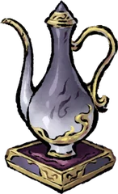

一滴劫灰烬，半盏赎魂灯

掌柜提醒：服用后可清除身上的死亡记录

### 【各版本（境界 / 品质）】

绝品：改命：服用后清除死亡惩罚的记录

### 【获取途径】

在醉仙阁向精明的小二购买

---

## 97. 灵泉酿（图鉴未收录）

一盏润喉舌，半壶解千愁

### 【各版本（境界 / 品质）】

人品：聚气：补充使用者10灵气值

### 【获取途径】

在醉仙阁向小二购买

---
