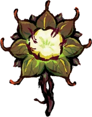
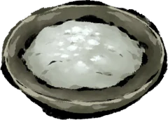
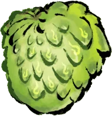
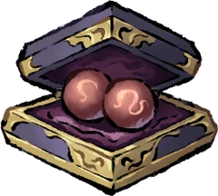
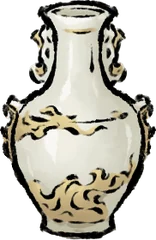

# 【卡牌修仙传】图鉴攻略 — 卡牌 / 灵草&丹药

- 收录总数：97（游戏官方数据，其中图鉴未收录 12 条）
- 更新时间：2026-11-18 07:56

---

## 1. 止血草

大千世界里最常见的灵草，稍加炼制便可以止血化瘀。

### 【主药效果】

活血：恢复血量

### 【辅药效果】

活血：恢复血量

### 【各版本（境界 / 品质）】

练气·人品：主药 活血：恢复血量（2）；辅药 活血：恢复血量（2）

### 【获取途径】

培养种子有40%概率获得人品灵草

探索药田有10%概率获得人品灵草

可以在坊市与其他修士交易获得

---

## 2. 凝血草

大千世界里最常见的灵草，稍加炼制便可以止血化瘀。

### 【主药效果】

活血：恢复血量

### 【辅药效果】

活血：恢复血量

### 【各版本（境界 / 品质）】

筑基·人品：主药 活血：恢复血量（3）；辅药 活血：恢复血量（3）

### 【获取途径】

培养种子有40%概率获得人品灵草

探索药田有10%概率获得人品灵草

可以在坊市与其他修士交易获得

---

## 3. 苍血草

大千世界里最常见的灵草，稍加炼制便可以止血化瘀。

### 【主药效果】

活血：恢复血量

### 【辅药效果】

活血：恢复血量

### 【各版本（境界 / 品质）】

结丹·人品：主药 活血：恢复血量（5）；辅药 活血：恢复血量（5）

元婴·人品：主药 活血：恢复血量（12）；辅药 活血：恢复血量（12）

### 【获取途径】

培养种子有40%概率获得人品灵草

探索药田有10%概率获得人品灵草

可以在坊市与其他修士交易获得

---

## 4. 洗骨花

闻一下花的香味，能感觉身体都被洗涤了一次。

### 【主药效果】

活血：恢复血量

### 【辅药效果】

活血：恢复血量

### 【各版本（境界 / 品质）】

练气·地品：主药 活血：恢复血量（3）；辅药 活血：恢复血量（3）

### 【获取途径】

培养种子有30%概率获得地品灵草

探索药田有25%概率获得地品灵草

可以在坊市与其他修士交易获得

---

## 5. 大洗骨花

闻一下花的香味，能感觉身体都被洗涤了一次。

### 【主药效果】

活血：恢复血量

### 【辅药效果】

活血：恢复血量

### 【各版本（境界 / 品质）】

筑基·地品：主药 活血：恢复血量（4）；辅药 活血：恢复血量（4）

### 【获取途径】

培养种子有30%概率获得地品灵草

探索药田有25%概率获得地品灵草

可以在坊市与其他修士交易获得

---

## 6. 洗髓花

闻一下花的香味，能感觉身体都被洗涤了一次。

### 【主药效果】

活血：恢复血量

### 【辅药效果】

活血：恢复血量

### 【各版本（境界 / 品质）】

结丹·地品：主药 活血：恢复血量（7）；辅药 活血：恢复血量（7）

元婴·地品：主药 活血：恢复血量（18）；辅药 活血：恢复血量（18）

### 【获取途径】

培养种子有30%概率获得地品灵草

探索药田有25%概率获得地品灵草

可以在坊市与其他修士交易获得

---

## 7. 红仁果

闻一下花的香味，能感觉身体都被洗涤了一次。

### 【主药效果】

活血：恢复血量

### 【辅药效果】

活血：恢复血量

聚气：补充灵气值

### 【各版本（境界 / 品质）】

练气·天品：主药 活血：恢复血量（3）；辅药 活血：恢复血量（2）；辅药 聚气：补充灵气值（2）

### 【获取途径】

培养种子有20%概率获得天品灵草

探索药田有20%概率获得天品灵草

可以在坊市与其他修士交易获得

---

## 8. 炎仁果

红彤彤的果实里蕴含着补充人体血气的神奇之物。

### 【主药效果】

活血：恢复血量

### 【辅药效果】

活血：恢复血量

聚气：补充灵气值

### 【各版本（境界 / 品质）】

筑基·天品：主药 活血：恢复血量（4）；辅药 活血：恢复血量（3）；辅药 聚气：补充灵气值（3）

### 【获取途径】

培养种子有20%概率获得天品灵草

探索药田有20%概率获得天品灵草

可以在坊市与其他修士交易获得

---

## 9. 天火果

红彤彤的果实里蕴含着补充人体血气的神奇之物。

### 【主药效果】

活血：恢复血量

### 【辅药效果】

活血：恢复血量

聚气：补充灵气值

### 【各版本（境界 / 品质）】

结丹·天品：主药 活血：恢复血量（7）；辅药 活血：恢复血量（5）；辅药 聚气：补充灵气值（5）

元婴·天品：主药 活血：恢复血量（18）；辅药 活血：恢复血量（12）；辅药 聚气：补充灵气值（8）

### 【获取途径】

培养种子有20%概率获得天品灵草

探索药田有20%概率获得天品灵草

可以在坊市与其他修士交易获得

---

## 10. 血精果

血精果里蕴含大量气血和灵气，是珍贵的灵草。

### 【主药效果】

活血：恢复血量

聚气：补充灵气值

### 【辅药效果】

开窍：可获得修为

### 【各版本（境界 / 品质）】

练气·神品：主药 活血：恢复血量（4）；主药 聚气：补充灵气值（4）；辅药 开窍：可获得修为（1）

### 【获取途径】

探索药田有10%概率获得神品灵草

可以在坊市与其他修士交易获得

---

## 11. 大血精果

血精果里蕴含大量气血和灵气，是珍贵的灵草。

### 【主药效果】

活血：恢复血量

聚气：补充灵气值

### 【辅药效果】

开窍：可获得修为

### 【各版本（境界 / 品质）】

筑基·神品：主药 活血：恢复血量（7）；主药 聚气：补充灵气值（5）；辅药 开窍：可获得修为（2）

### 【获取途径】

探索药田有10%概率获得神品灵草

可以在坊市与其他修士交易获得

---

## 12. 血晶果

血精果里蕴含大量气血和灵气，是珍贵的灵草。

### 【主药效果】

活血：恢复血量

聚气：补充灵气值

### 【辅药效果】

开窍：可获得修为

### 【各版本（境界 / 品质）】

结丹·神品：主药 活血：恢复血量（14）；主药 聚气：补充灵气值（10）；辅药 开窍：可获得修为（3）

元婴·神品：主药 活血：恢复血量（35）；主药 聚气：补充灵气值（10）；辅药 开窍：可获得修为（7）

### 【获取途径】

探索药田有10%概率获得神品灵草

可以在坊市与其他修士交易获得

---

## 13. 金蝉

因长期吸取蛊王灵气所以内涵大量气血。

### 【主药效果】

活血：恢复血量

### 【各版本（境界 / 品质）】

筑基·仙品：主药 活血：恢复血量（20）

结丹·仙品：主药 活血：恢复血量（40）

元婴·仙品：主药 活血：恢复血量（100）

### 【获取途径】

击败妖王「金蝉蛊」后有20%概率获得，炼化其内丹大概率获得

---

## 14. 土茯苓

深藏在地下的灵草，吸收了大地的养分和灵气.

### 【主药效果】

聚气：补充灵气值

### 【辅药效果】

聚气：补充灵气值

### 【各版本（境界 / 品质）】

练气·人品：主药 聚气：补充灵气值（1）；辅药 聚气：补充灵气值（1）

### 【获取途径】

培养种子有40%概率获得人品灵草

探索药田有10%概率获得人品灵草

可以在坊市与其他修士交易获得

---

## 15. 千年土茯苓

深藏在地下的灵草，吸收了大地的养分和灵气.

### 【主药效果】

聚气：补充灵气值

### 【辅药效果】

聚气：补充灵气值

### 【各版本（境界 / 品质）】

筑基·人品：主药 聚气：补充灵气值（2）；辅药 聚气：补充灵气值（2）

### 【获取途径】

培养种子有40%概率获得人品灵草

探索药田有10%概率获得人品灵草

可以在坊市与其他修士交易获得

---

## 16. 万年土茯苓

深藏在地下的灵草，吸收了大地的养分和灵气.

### 【主药效果】

聚气：补充灵气值

### 【辅药效果】

聚气：补充灵气值

### 【各版本（境界 / 品质）】

结丹·人品：主药 聚气：补充灵气值（3）；辅药 聚气：补充灵气值（3）

元婴·人品：主药 聚气：补充灵气值（5）；辅药 聚气：补充灵气值（5）

### 【获取途径】

培养种子有40%概率获得人品灵草

探索药田有10%概率获得人品灵草

可以在坊市与其他修士交易获得

---

## 17. 白莲子

洁白无暇的莲子，仔细看便能发现莲子里蕴含着灵气。

### 【主药效果】

聚气：补充灵气值

### 【辅药效果】

聚气：补充灵气值

断脉：可造成伤害

### 【各版本（境界 / 品质）】

练气·天品：主药 聚气：补充灵气值（2）；辅药 聚气：补充灵气值（3）；辅药 断脉：可造成伤害（1）

### 【获取途径】

培养种子有20%概率获得天品灵草

探索药田有20%概率获得天品灵草

可以在坊市与其他修士交易获得

---

## 18. 白莲芯

洁白无暇的莲子，仔细看便能发现莲子里蕴含着灵气。

### 【主药效果】

聚气：补充灵气值

### 【辅药效果】

聚气：补充灵气值

断脉：可造成伤害

### 【各版本（境界 / 品质）】

筑基·天品：主药 聚气：补充灵气值（3）；辅药 聚气：补充灵气值（4）；辅药 断脉：可造成伤害（2）

### 【获取途径】

培养种子有20%概率获得天品灵草

探索药田有20%概率获得天品灵草

可以在坊市与其他修士交易获得

---

## 19. 白莲玉

洁白无暇的莲子，仔细看便能发现莲子里蕴含着灵气。

### 【主药效果】

聚气：补充灵气值

### 【辅药效果】

聚气：补充灵气值

断脉：可造成伤害

### 【各版本（境界 / 品质）】

结丹·天品：主药 聚气：补充灵气值（5）；辅药 聚气：补充灵气值（5）；辅药 断脉：可造成伤害（4）

元婴·天品：主药 聚气：补充灵气值（8）；辅药 聚气：补充灵气值（8）；辅药 断脉：可造成伤害（8）

### 【获取途径】

培养种子有20%概率获得天品灵草

探索药田有20%概率获得天品灵草

可以在坊市与其他修士交易获得

---

## 20. 魂婴果

通常情况下，只有生物才有魂魄，但魂婴果里也似乎存在。

### 【主药效果】

聚气：补充灵气值

堕心：会产生心魔

### 【辅药效果】

聚气：补充灵气值

### 【各版本（境界 / 品质）】

练气·仙品：主药 聚气：补充灵气值（6）；主药 堕心：会产生心魔（1）；辅药 聚气：补充灵气值（2）

### 【获取途径】

培养种子有10%概率获得仙品灵草

探索药田有25%概率获得仙品灵草

可以在坊市与其他修士交易获得

---

## 21. 百年魂婴果

通常情况下，只有生物才有魂魄，但魂婴果里也似乎存在。

### 【主药效果】

聚气：补充灵气值

堕心：会产生心魔

### 【辅药效果】

聚气：补充灵气值

### 【各版本（境界 / 品质）】

筑基·仙品：主药 聚气：补充灵气值（8）；主药 堕心：会产生心魔（1）；辅药 聚气：补充灵气值（3）

### 【获取途径】

培养种子有10%概率获得仙品灵草

探索药田有25%概率获得仙品灵草

可以在坊市与其他修士交易获得

---

## 22. 千年魂婴果

通常情况下，只有生物才有魂魄，但魂婴果里也似乎存在。

### 【主药效果】

聚气：补充灵气值

堕心：会产生心魔

### 【辅药效果】

聚气：补充灵气值

### 【各版本（境界 / 品质）】

结丹·仙品：主药 聚气：补充灵气值（10）；主药 堕心：会产生心魔（1）；辅药 聚气：补充灵气值（5）

元婴·仙品：主药 聚气：补充灵气值（15）；主药 堕心：会产生心魔（1）；辅药 聚气：补充灵气值（8）

### 【获取途径】

培养种子有10%概率获得仙品灵草

探索药田有25%概率获得仙品灵草

可以在坊市与其他修士交易获得

---

## 23. 铁熊胆

熊胆拥有极大量的灵气。

### 【主药效果】

聚气：补充灵气值

### 【各版本（境界 / 品质）】

筑基·神品：主药 聚气：补充灵气值（20）

结丹·神品：主药 聚气：补充灵气值（40）

元婴·神品：主药 聚气：补充灵气值（60）

### 【获取途径】

击败妖王「铁骨熊」后有20%概率获得，炼化其内丹大概率获得

---

## 24. 腐木菇

生长在腐烂尸体上的灵菇，散发着一股难闻的味道。

### 【主药效果】

断脉：可造成伤害

### 【辅药效果】

断脉：可造成伤害

### 【各版本（境界 / 品质）】

练气·人品：主药 断脉：可造成伤害（1）；辅药 断脉：可造成伤害（2）

### 【获取途径】

培养种子有40%概率获得人品灵草

探索药田有10%概率获得人品灵草

可以在坊市与其他修士交易获得

---

## 25. 大腐木菇

生长在腐烂尸体上的灵菇，散发着一股难闻的味道。

### 【主药效果】

断脉：可造成伤害

### 【辅药效果】

断脉：可造成伤害

### 【各版本（境界 / 品质）】

筑基·人品：主药 断脉：可造成伤害（2）；辅药 断脉：可造成伤害（3）

### 【获取途径】

培养种子有40%概率获得人品灵草

探索药田有10%概率获得人品灵草

可以在坊市与其他修士交易获得

---

## 26. 腐尸菇

生长在腐烂尸体上的灵菇，散发着一股难闻的味道。

### 【主药效果】

断脉：可造成伤害

### 【辅药效果】

断脉：可造成伤害

### 【各版本（境界 / 品质）】

结丹·人品：主药 断脉：可造成伤害（4）；辅药 断脉：可造成伤害（6）

元婴·人品：主药 断脉：可造成伤害（10）；辅药 断脉：可造成伤害（15）

### 【获取途径】

培养种子有40%概率获得人品灵草

探索药田有10%概率获得人品灵草

可以在坊市与其他修士交易获得

---

## 27. 断魂花

吸聚了大量冤魂的怪花，夜晚时能听到冤魂的呼叫。

### 【主药效果】

断脉：可造成伤害

### 【辅药效果】

断脉：可造成伤害

### 【各版本（境界 / 品质）】

练气·地品：主药 断脉：可造成伤害（2）；辅药 断脉：可造成伤害（1）

### 【获取途径】

培养种子有30%概率获得地品灵草

探索药田有25%概率获得地品灵草

可以在坊市与其他修士交易获得

---

## 28. 大断魂花

吸聚了大量冤魂的怪花，夜晚时能听到冤魂的呼叫。

### 【主药效果】

断脉：可造成伤害

### 【辅药效果】

断脉：可造成伤害

### 【各版本（境界 / 品质）】

筑基·地品：主药 断脉：可造成伤害（3）；辅药 断脉：可造成伤害（2）

### 【获取途径】

培养种子有30%概率获得地品灵草

探索药田有25%概率获得地品灵草

可以在坊市与其他修士交易获得

---

## 29. 绝魂草

吸聚了大量冤魂的怪花，夜晚时能听到冤魂的呼叫。

### 【主药效果】

断脉：可造成伤害

### 【辅药效果】

断脉：可造成伤害

### 【各版本（境界 / 品质）】

结丹·地品：主药 断脉：可造成伤害（6）；辅药 断脉：可造成伤害（4）

元婴·地品：主药 断脉：可造成伤害（15）；辅药 断脉：可造成伤害（10）

### 【获取途径】

培养种子有30%概率获得地品灵草

探索药田有25%概率获得地品灵草

可以在坊市与其他修士交易获得

---

## 30. 腐骨草

如果不小心接触到此草，那么连骨头也有可能被腐蚀

### 【主药效果】

断脉：可造成伤害

### 【各版本（境界 / 品质）】

练气·神品：主药 断脉：可造成伤害（5）

### 【获取途径】

探索药田有10%概率获得神品灵草

可以在坊市与其他修士交易获得

---

## 31. 大腐骨草

如果不小心接触到此草，那么连骨头也有可能被腐蚀

### 【主药效果】

断脉：可造成伤害

### 【各版本（境界 / 品质）】

筑基·神品：主药 断脉：可造成伤害（8）

### 【获取途径】

探索药田有10%概率获得神品灵草

可以在坊市与其他修士交易获得

---

## 32. 阴骨草

如果不小心接触到此草，那么连骨头也有可能被腐蚀

### 【主药效果】

断脉：可造成伤害

### 【各版本（境界 / 品质）】

结丹·神品：主药 断脉：可造成伤害（15）

元婴·神品：主药 断脉：可造成伤害（38）

### 【获取途径】

探索药田有10%概率获得神品灵草

可以在坊市与其他修士交易获得

---

## 33. 毒液

击败小型的鬼面蛛有概率获得，从其毒囊里收集的精华毒液。

此卡牌无主药效果，如果用于主材料，则只能炼制出无效果的丹药

### 【辅药效果】

断脉：可造成伤害

### 【各版本（境界 / 品质）】

练气·天品：辅药 断脉：可造成伤害（3.5）

筑基·天品：辅药 断脉：可造成伤害（5）

结丹·天品：辅药 断脉：可造成伤害（8）

元婴·天品：辅药 断脉：可造成伤害（20）

### 【获取途径】

击败妖王「鬼面蛛」后有20%概率获得，炼化其内丹大概率获得

---

## 34. 剧毒液

炼制成丹药后可造成大量伤害

### 【主药效果】

断脉：可造成伤害

### 【辅药效果】

断脉：可造成伤害

### 【各版本（境界 / 品质）】

练气·神品：主药 断脉：可造成伤害（8）；辅药 断脉：可造成伤害（3.5）

筑基·神品：主药 断脉：可造成伤害（15）；辅药 断脉：可造成伤害（5）

结丹·神品：主药 断脉：可造成伤害（30）；辅药 断脉：可造成伤害（8）

元婴·神品：主药 断脉：可造成伤害（75）；辅药 断脉：可造成伤害（20）

### 【获取途径】

击败妖王「鬼面蛛」后有20%概率获得，炼化其内丹大概率获得

---

## 35. 紫烟果

果子不时的冒出一股股的紫烟，透过紫烟似乎能看到另一片世界。

### 【主药效果】

硬肤：获得〔护甲〕

### 【辅药效果】

硬肤：获得〔护甲〕

### 【各版本（境界 / 品质）】

筑基·地品：主药 硬肤：获得〔护甲〕（4）；辅药 硬肤：获得〔护甲〕（6）

### 【获取途径】

培养种子有30%概率获得地品灵草

探索药田有25%概率获得地品灵草

可以在坊市与其他修士交易获得

---

## 36. 大紫烟果

果子不时的冒出一股股的紫烟，透过紫烟似乎能看到另一片世界。

### 【主药效果】

硬肤：获得〔护甲〕

### 【辅药效果】

硬肤：获得〔护甲〕

### 【各版本（境界 / 品质）】

结丹·地品：主药 硬肤：获得〔护甲〕（10）；辅药 硬肤：获得〔护甲〕（12）

元婴·地品：主药 硬肤：获得〔护甲〕（25）；辅药 硬肤：获得〔护甲〕（30）

### 【获取途径】

培养种子有30%概率获得地品灵草

探索药田有25%概率获得地品灵草

可以在坊市与其他修士交易获得

---

## 37. 六瓣兰

奇怪的兰花，生长的时间越长，花瓣数量会越多。

### 【主药效果】

硬肤：获得〔护甲〕

### 【各版本（境界 / 品质）】

筑基·天品：主药 硬肤：获得〔护甲〕（8）

### 【获取途径】

培养种子有20%概率获得天品灵草

探索药田有20%概率获得天品灵草

可以在坊市与其他修士交易获得

---

## 38. 九瓣兰

奇怪的兰花，生长的时间越长，花瓣数量会越多。

### 【主药效果】

硬肤：获得〔护甲〕

### 【各版本（境界 / 品质）】

结丹·天品：主药 硬肤：获得〔护甲〕（16）

元婴·天品：主药 硬肤：获得〔护甲〕（40）

### 【获取途径】

培养种子有20%概率获得天品灵草

探索药田有20%概率获得天品灵草

可以在坊市与其他修士交易获得

---

## 39. 冰雪莲

生长在冰川雪地的莲花，整朵花瓣都如冰雪般晶莹。

### 【主药效果】

硬肤：获得〔护甲〕

逆经：会减少当前灵气

### 【辅药效果】

硬肤：获得〔护甲〕

逆经：会减少当前灵气

### 【各版本（境界 / 品质）】

筑基·仙品：主药 硬肤：获得〔护甲〕（12）；主药 逆经：会减少当前灵气（3）；辅药 硬肤：获得〔护甲〕（12）；辅药 逆经：会减少当前灵气（3）

### 【获取途径】

培养种子有10%概率获得仙品灵草

探索药田有25%概率获得仙品灵草

可以在坊市与其他修士交易获得

---

## 40. 冰晶莲

生长在冰川雪地的莲花，整朵花瓣都如冰雪般晶莹。

### 【主药效果】

硬肤：获得〔护甲〕

逆经：会减少当前灵气

### 【辅药效果】

硬肤：获得〔护甲〕

逆经：会减少当前灵气

### 【各版本（境界 / 品质）】

结丹·仙品：主药 硬肤：获得〔护甲〕（24）；主药 逆经：会减少当前灵气（5）；辅药 硬肤：获得〔护甲〕（24）；辅药 逆经：会减少当前灵气（5）

元婴·仙品：主药 硬肤：获得〔护甲〕（60）；主药 逆经：会减少当前灵气（8）；辅药 硬肤：获得〔护甲〕（60）；辅药 逆经：会减少当前灵气（8）

### 【获取途径】

培养种子有10%概率获得仙品灵草

探索药田有25%概率获得仙品灵草

可以在坊市与其他修士交易获得

---

## 41. 磐石粉

一部分〔土〕妖王身上都覆盖磐石，击败妖王后有概率获得。

### 【主药效果】

硬肤：获得〔护甲〕

### 【各版本（境界 / 品质）】

筑基·神品：主药 硬肤：获得〔护甲〕（24）

结丹·神品：主药 硬肤：获得〔护甲〕（60）

元婴·神品：主药 硬肤：获得〔护甲〕（150）

筑基·神品：主药 硬肤：获得〔护甲〕（50）

结丹·神品：主药 硬肤：获得〔护甲〕（100）

元婴·神品：主药 硬肤：获得〔护甲〕（250）

### 【获取途径】

击败妖王「巨灵烈象或石魈」后有20%概率获得，炼化其内丹大概率获得

---

## 42. 醉龙果

果实里富含营养物，只是实在太多了，以至于妖怪吃了也要醉倒。

### 【主药效果】

醉心：会进入入定状态

堕心：会产生心魔

### 【辅药效果】

断脉：可造成伤害

### 【各版本（境界 / 品质）】

练气·仙品：主药 醉心：会进入入定状态（1）；主药 堕心：会产生心魔（1）；辅药 断脉：可造成伤害（2）

### 【获取途径】

培养种子有10%概率获得仙品灵草

探索药田有25%概率获得仙品灵草

可以在坊市与其他修士交易获得

---

## 43. 百年醉龙果

果实里富含营养物，只是实在太多了，以至于妖怪吃了也要醉倒。

### 【主药效果】

醉心：会进入入定状态

堕心：会产生心魔

### 【辅药效果】

断脉：可造成伤害

### 【各版本（境界 / 品质）】

筑基·仙品：主药 醉心：会进入入定状态（1）；主药 堕心：会产生心魔（1）；辅药 断脉：可造成伤害（3）

### 【获取途径】

培养种子有10%概率获得仙品灵草

探索药田有25%概率获得仙品灵草

可以在坊市与其他修士交易获得

---

## 44. 千年醉龙果

果实里富含营养物，只是实在太多了，以至于妖怪吃了也要醉倒。

### 【主药效果】

醉心：会进入入定状态

堕心：会产生心魔

### 【辅药效果】

断脉：可造成伤害

### 【各版本（境界 / 品质）】

结丹·仙品：主药 醉心：会进入入定状态（1）；主药 堕心：会产生心魔（1）；辅药 断脉：可造成伤害（6）

元婴·仙品：主药 醉心：会进入入定状态（1）；主药 堕心：会产生心魔（1）；辅药 断脉：可造成伤害（15）

### 【获取途径】

培养种子有10%概率获得仙品灵草

探索药田有25%概率获得仙品灵草

可以在坊市与其他修士交易获得

---

## 45. 菩提果

菩提树历经百年沧桑才会结果。

### 【主药效果】

醉心：会进入入定状态

### 【各版本（境界 / 品质）】

练气·神品：主药 醉心：会进入入定状态（1）

### 【获取途径】

探索药田有10%概率获得神品灵草

可以在坊市与其他修士交易获得

---

## 46. 大菩提果

菩提树历经百年沧桑才会结果。

### 【主药效果】

醉心：会进入入定状态

### 【各版本（境界 / 品质）】

筑基·神品：主药 醉心：会进入入定状态（1）

### 【获取途径】

探索药田有10%概率获得神品灵草

可以在坊市与其他修士交易获得

---

## 47. 菩提道果

菩提树历经百年沧桑才会结果。

### 【主药效果】

醉心：会进入入定状态

### 【各版本（境界 / 品质）】

结丹·神品：主药 醉心：会进入入定状态（1）

元婴·神品：主药 醉心：会进入入定状态（1）

### 【获取途径】

探索药田有10%概率获得神品灵草

可以在坊市与其他修士交易获得

---

## 48. 迷魂香

闻到香味着，无论妖怪或是人物，均会倒地不起。

### 【主药效果】

迷魂：有控制目标的效果

活血：恢复血量

### 【辅药效果】

迷魂：有控制目标的效果

### 【各版本（境界 / 品质）】

练气·地品：主药 迷魂：有控制目标的效果（2）；主药 活血：恢复血量（3）；辅药 迷魂：有控制目标的效果（2）

### 【获取途径】

培养种子有30%概率获得地品灵草

探索药田有25%概率获得地品灵草

可以在坊市与其他修士交易获得

---

## 49. 迷魂迭香

闻到香味着，无论妖怪或是人物，均会倒地不起。

### 【主药效果】

迷魂：有控制目标的效果

活血：恢复血量

### 【辅药效果】

迷魂：有控制目标的效果

### 【各版本（境界 / 品质）】

筑基·地品：主药 迷魂：有控制目标的效果（3）；主药 活血：恢复血量（4）；辅药 迷魂：有控制目标的效果（3）

### 【获取途径】

培养种子有30%概率获得地品灵草

探索药田有25%概率获得地品灵草

可以在坊市与其他修士交易获得

---

## 50. 忘魂香

闻到香味着，无论妖怪或是人物，均会倒地不起。

### 【主药效果】

迷魂：有控制目标的效果

活血：恢复血量

### 【辅药效果】

迷魂：有控制目标的效果

### 【各版本（境界 / 品质）】

结丹·地品：主药 迷魂：有控制目标的效果（6）；主药 活血：恢复血量（6）；辅药 迷魂：有控制目标的效果（4）

元婴·地品：主药 迷魂：有控制目标的效果（9）；主药 活血：恢复血量（15）；辅药 迷魂：有控制目标的效果（7）

### 【获取途径】

培养种子有30%概率获得地品灵草

探索药田有25%概率获得地品灵草

可以在坊市与其他修士交易获得

---

## 51. 幻神草

哪怕神仙尝一口，也会触发幻觉的灵草。

### 【主药效果】

迷魂：有控制目标的效果

### 【辅药效果】

迷魂：有控制目标的效果

### 【各版本（境界 / 品质）】

练气·仙品：主药 迷魂：有控制目标的效果（4）；辅药 迷魂：有控制目标的效果（3）

### 【获取途径】

培养种子有10%概率获得仙品灵草

探索药田有25%概率获得仙品灵草

可以在坊市与其他修士交易获得

---

## 52. 大幻神草

哪怕神仙尝一口，也会触发幻觉的灵草。

### 【主药效果】

迷魂：有控制目标的效果

### 【辅药效果】

迷魂：有控制目标的效果

### 【各版本（境界 / 品质）】

筑基·仙品：主药 迷魂：有控制目标的效果（5）；辅药 迷魂：有控制目标的效果（4）

### 【获取途径】

培养种子有10%概率获得仙品灵草

探索药田有25%概率获得仙品灵草

可以在坊市与其他修士交易获得

---

## 53. 幻魄草

哪怕神仙尝一口，也会触发幻觉的灵草。

### 【主药效果】

迷魂：有控制目标的效果

### 【辅药效果】

迷魂：有控制目标的效果

### 【各版本（境界 / 品质）】

结丹·仙品：主药 迷魂：有控制目标的效果（10）；辅药 迷魂：有控制目标的效果（5）

元婴·仙品：主药 迷魂：有控制目标的效果（15）；辅药 迷魂：有控制目标的效果（9）

### 【获取途径】

培养种子有10%概率获得仙品灵草

探索药田有25%概率获得仙品灵草

可以在坊市与其他修士交易获得

---

## 54. 青焰根

此火焰并不灼烧肉体，而是燃烧灵魂

### 【主药效果】

开窍：可获得修为

堕心：会产生心魔

### 【辅药效果】

断脉：可造成伤害

### 【各版本（境界 / 品质）】

练气·天品：主药 开窍：可获得修为（3）；主药 堕心：会产生心魔（1）；辅药 断脉：可造成伤害（2.5）

### 【获取途径】

培养种子有20%概率获得天品灵草

探索药田有20%概率获得天品灵草

可以在坊市与其他修士交易获得

---

## 55. 青焰魔根

此火焰并不灼烧肉体，而是燃烧灵魂

### 【主药效果】

开窍：可获得修为

堕心：会产生心魔

### 【辅药效果】

断脉：可造成伤害

### 【各版本（境界 / 品质）】

筑基·天品：主药 开窍：可获得修为（5）；主药 堕心：会产生心魔（1）；辅药 断脉：可造成伤害（3.5）

### 【获取途径】

培养种子有20%概率获得天品灵草

探索药田有20%概率获得天品灵草

可以在坊市与其他修士交易获得

---

## 56. 魔焰根

此火焰并不灼烧肉体，而是燃烧灵魂

### 【主药效果】

开窍：可获得修为

堕心：会产生心魔

### 【辅药效果】

断脉：可造成伤害

### 【各版本（境界 / 品质）】

结丹·天品：主药 开窍：可获得修为（7）；主药 堕心：会产生心魔（1）；辅药 断脉：可造成伤害（6.5）

元婴·天品：主药 开窍：可获得修为（15）；主药 堕心：会产生心魔（1）；辅药 断脉：可造成伤害（15）

### 【获取途径】

培养种子有20%概率获得天品灵草

探索药田有20%概率获得天品灵草

可以在坊市与其他修士交易获得

---

## 57. 百灵参

生长了多年的人参。

### 【主药效果】

开窍：可获得修为

逆经：会减少当前灵气

### 【各版本（境界 / 品质）】

练气·仙品：主药 开窍：可获得修为（3）；主药 逆经：会减少当前灵气（20）

### 【获取途径】

培养种子有10%概率获得仙品灵草

探索药田有25%概率获得仙品灵草

可以在坊市与其他修士交易获得

---

## 58. 千灵参

生长了多年的人参。

### 【主药效果】

开窍：可获得修为

逆经：会减少当前灵气

### 【各版本（境界 / 品质）】

筑基·仙品：主药 开窍：可获得修为（5）；主药 逆经：会减少当前灵气（30）

### 【获取途径】

培养种子有10%概率获得仙品灵草

探索药田有25%概率获得仙品灵草

可以在坊市与其他修士交易获得

---

## 59. 万灵参

生长了多年的人参。

### 【主药效果】

开窍：可获得修为

逆经：会减少当前灵气

### 【各版本（境界 / 品质）】

结丹·仙品：主药 开窍：可获得修为（7）；主药 逆经：会减少当前灵气（40）

元婴·仙品：主药 开窍：可获得修为（15）；主药 逆经：会减少当前灵气（60）

### 【获取途径】

培养种子有10%概率获得仙品灵草

探索药田有25%概率获得仙品灵草

可以在坊市与其他修士交易获得

---

## 60. 蕴元仙萼

萼瓣凝霜、芯藏金光，得天地元气滋养万年方得成形

### 【主药效果】

开窍：可获得修为

### 【辅药效果】

开窍：可获得修为

### 【各版本（境界 / 品质）】

练气·绝品：主药 开窍：可获得修为（5）；辅药 开窍：可获得修为（2）

筑基·绝品：主药 开窍：可获得修为（8）；辅药 开窍：可获得修为（3）

结丹·绝品：主药 开窍：可获得修为（12）；辅药 开窍：可获得修为（5）

元婴·绝品：主药 开窍：可获得修为（30）；辅药 开窍：可获得修为（13）

### 【获取途径】

在古木幽森的深处有概率获得

---

## 61. 兽涎水

这种水会散发一股香气，能吸引妖怪的到来。

### 【主药效果】

唤灵：可招来妖兽

### 【辅药效果】

迷魂：有控制目标的效果

### 【各版本（境界 / 品质）】

练气·地品：主药 唤灵：可招来妖兽（1）；辅药 迷魂：有控制目标的效果（3）

### 【获取途径】

培养种子有30%概率获得地品灵草

探索药田有25%概率获得地品灵草

可以在坊市与其他修士交易获得

---

## 62. 兽涎露

这种水会散发一股香气，能吸引妖怪的到来。

### 【主药效果】

唤灵：可招来妖兽

### 【辅药效果】

迷魂：有控制目标的效果

### 【各版本（境界 / 品质）】

筑基·地品：主药 唤灵：可招来妖兽（2）；辅药 迷魂：有控制目标的效果（3）

### 【获取途径】

培养种子有30%概率获得地品灵草

探索药田有25%概率获得地品灵草

可以在坊市与其他修士交易获得

---

## 63. 兽涎露石

这种水会散发一股香气，能吸引妖怪的到来。

### 【主药效果】

唤灵：可招来妖兽

### 【辅药效果】

迷魂：有控制目标的效果

### 【各版本（境界 / 品质）】

结丹·地品：主药 唤灵：可招来妖兽（3）；辅药 迷魂：有控制目标的效果（3）

### 【获取途径】

培养种子有30%概率获得地品灵草

探索药田有25%概率获得地品灵草

可以在坊市与其他修士交易获得

---

## 64. 九霄灵芝

生长在仙界的灵芝，灵芝会自己跑动，才流落到人间。

### 【主药效果】

延寿：有增加寿命的效果

### 【各版本（境界 / 品质）】

练气·绝品：主药 延寿：有增加寿命的效果（4）

### 【获取途径】

在古木幽森的深处有概率获得

---

## 65. 赤霄灵芝

生长在仙界的灵芝，灵芝会自己跑动，才流落到人间。

### 【主药效果】

延寿：有增加寿命的效果

### 【各版本（境界 / 品质）】

筑基·绝品：主药 延寿：有增加寿命的效果（9）

### 【获取途径】

在古木幽森的深处有概率获得

---

## 66. 碧霄灵芝

生长在仙界的灵芝，灵芝会自己跑动，才流落到人间。

### 【主药效果】

延寿：有增加寿命的效果

### 【各版本（境界 / 品质）】

结丹·绝品：主药 延寿：有增加寿命的效果（15）

元婴·绝品：主药 延寿：有增加寿命的效果（35）

### 【获取途径】

在古木幽森的深处有概率获得

---

## 67. 血灵芝

可用于炼制寿元丹，但其血腥之气实在容易令人入魔

### 【主药效果】

延寿：有增加寿命的效果

堕心：会产生心魔

### 【各版本（境界 / 品质）】

筑基·绝品：主药 延寿：有增加寿命的效果（9）；主药 堕心：会产生心魔（1）

结丹·绝品：主药 延寿：有增加寿命的效果（15）；主药 堕心：会产生心魔（1）

元婴·绝品：主药 延寿：有增加寿命的效果（35）；主药 堕心：会产生心魔（2）

### 【获取途径】

击败妖王「血肉灵芝」后有20%概率获得，炼化其内丹大概率获得

---

## 68. 缘玑仙草

隐于云海仙山的聚气之地，茎生七叶、叶缀玑珠，沐晨露吸星华而生，其株自带缥缈气运

### 【主药效果】

气运：可获得机缘

开窍：可获得修为

### 【辅药效果】

气运：可获得机缘

### 【各版本（境界 / 品质）】

练气·绝品：主药 气运：可获得机缘（0.15）；主药 开窍：可获得修为（3）；辅药 气运：可获得机缘（0.15）

筑基·绝品：主药 气运：可获得机缘（0.15）；主药 开窍：可获得修为（4）；辅药 气运：可获得机缘（0.15）

结丹·绝品：主药 气运：可获得机缘（0.15）；主药 开窍：可获得修为（5）；辅药 气运：可获得机缘（0.15）

元婴·绝品：主药 气运：可获得机缘（0.15）；主药 开窍：可获得修为（13）；辅药 气运：可获得机缘（0.15）

### 【获取途径】

在古木幽森的深处有概率获得

---

## 69. 化瘀丹

普通的回血丹药，在战斗中亦可服用。

### 【各版本（境界 / 品质）】

练气·人品：活血：恢复使用者6血量

练气·地品：活血：恢复使用者9血量

练气·天品：活血：恢复使用者12血量

练气·仙品：活血：恢复使用者15血量

练气·神品：活血：恢复使用者18血量

筑基·人品：活血：恢复使用者8血量

筑基·地品：活血：恢复使用者12血量

筑基·天品：活血：恢复使用者16血量

筑基·仙品：活血：恢复使用者20血量

筑基·神品：活血：恢复使用者24血量

结丹·人品：活血：恢复使用者14血量

结丹·地品：活血：恢复使用者21血量

结丹·天品：活血：恢复使用者28血量

结丹·仙品：活血：恢复使用者35血量

结丹·神品：活血：恢复使用者42血量

元婴·人品：活血：恢复使用者35血量

元婴·地品：活血：恢复使用者54血量

元婴·天品：活血：恢复使用者70血量

元婴·仙品：活血：恢复使用者88血量

元婴·神品：活血：恢复使用者105血量

### 【获取途径】

使用止血草，洗骨花，红仁果，金蝉做主药可以炼制出

---

## 70. 血还丹

能够同时恢复气血和灵气的丹药！

### 【各版本（境界 / 品质）】

练气·仙品：活血：恢复使用者16血量；聚气：补充使用者16灵气值

练气·神品：活血：恢复使用者19血量；聚气：补充使用者19灵气值

筑基·仙品：活血：恢复使用者23血量；聚气：补充使用者23灵气值

筑基·神品：活血：恢复使用者28血量；聚气：补充使用者28灵气值

结丹·仙品：活血：恢复使用者42血量；聚气：补充使用者42灵气值

结丹·神品：活血：恢复使用者50血量；聚气：补充使用者50灵气值

元婴·仙品：活血：恢复使用者105血量；聚气：补充使用者63灵气值

元婴·神品：活血：恢复使用者125血量；聚气：补充使用者75灵气值

练气·绝品：能够同时恢复大量〔血量〕和〔灵气〕的丹药！；活血：恢复使用者35血量；聚气：补充使用者35灵气值

筑基·绝品：能够同时恢复大量〔血量〕和〔灵气〕的丹药！；活血：恢复使用者50血量；聚气：补充使用者50灵气值

结丹·绝品：能够同时恢复大量〔血量〕和〔灵气〕的丹药！；活血：恢复使用者150血量；聚气：补充使用者80灵气值

元婴·绝品：能够同时恢复大量〔血量〕和〔灵气〕的丹药！；活血：恢复使用者375血量；聚气：补充使用者120灵气值

### 【获取途径】

使用血精果做主药可以炼制出

---

## 71. 引气丸

常见的丹药，可以快速补充修士体内的灵气。探索秘境时必带之。

### 【各版本（境界 / 品质）】

练气·人品：聚气：补充使用者4灵气值

练气·地品：聚气：补充使用者5灵气值

练气·天品：聚气：补充使用者6灵气值

练气·仙品：聚气：补充使用者8灵气值

练气·神品：聚气：补充使用者10灵气值

筑基·人品：聚气：补充使用者6灵气值

筑基·地品：聚气：补充使用者7灵气值

筑基·天品：聚气：补充使用者10灵气值

筑基·仙品：聚气：补充使用者12灵气值

筑基·神品：聚气：补充使用者14灵气值

结丹·人品：聚气：补充使用者9灵气值

结丹·地品：聚气：补充使用者12灵气值

结丹·天品：聚气：补充使用者16灵气值

结丹·仙品：聚气：补充使用者20灵气值

结丹·神品：聚气：补充使用者24灵气值

元婴·人品：聚气：补充使用者14灵气值

元婴·地品：聚气：补充使用者18灵气值

元婴·天品：聚气：补充使用者24灵气值

元婴·仙品：聚气：补充使用者30灵气值

元婴·神品：聚气：补充使用者36灵气值

### 【获取途径】

使用土茯苓，白莲子做主药可以炼制出

---

## 72. 魔元丹

可恢复大量的灵气，但服用后会入魔。

### 【各版本（境界 / 品质）】

练气·仙品：聚气：补充使用者18灵气值；堕心：服用后会产生张1心魔卡

练气·神品：聚气：补充使用者22灵气值；堕心：服用后会产生张1心魔卡

筑基·仙品：聚气：补充使用者24灵气值；堕心：服用后会产生张1心魔卡

筑基·神品：聚气：补充使用者29灵气值；堕心：服用后会产生张1心魔卡

结丹·仙品：聚气：补充使用者28灵气值；堕心：服用后会产生张1心魔卡

结丹·神品：聚气：补充使用者34灵气值；堕心：服用后会产生张1心魔卡

元婴·仙品：聚气：补充使用者42灵气值；堕心：服用后会产生张1心魔卡

元婴·神品：聚气：补充使用者51灵气值；堕心：服用后会产生张1心魔卡

### 【获取途径】

使用魂婴果做主药可以炼制出

---

## 73. 毒心散

蕴含剧毒的丹药，能对生物造成伤害。

### 【各版本（境界 / 品质）】

练气·人品：断脉：对使用者造成4点伤害

练气·地品：断脉：对使用者造成6点伤害

练气·天品：断脉：对使用者造成8点伤害

练气·仙品：断脉：对使用者造成10点伤害

练气·神品：断脉：对使用者造成12点伤害

筑基·人品：断脉：对使用者造成6点伤害

筑基·地品：断脉：对使用者造成9点伤害

筑基·天品：断脉：对使用者造成12点伤害

筑基·仙品：断脉：对使用者造成15点伤害

筑基·神品：断脉：对使用者造成18点伤害

结丹·人品：断脉：对使用者造成12点伤害

结丹·地品：断脉：对使用者造成18点伤害

结丹·天品：断脉：对使用者造成24点伤害

结丹·仙品：断脉：对使用者造成30点伤害

结丹·神品：断脉：对使用者造成36点伤害

元婴·人品：断脉：对使用者造成30点伤害

元婴·地品：断脉：对使用者造成45点伤害

元婴·天品：断脉：对使用者造成60点伤害

元婴·仙品：断脉：对使用者造成75点伤害

元婴·神品：断脉：对使用者造成90点伤害

练气·绝品：比普通的毒心散更加难制作，毒药效果大幅加强。；断脉：对使用者造成30点伤害

筑基·绝品：比普通的毒心散更加难制作，毒药效果大幅加强。；断脉：对使用者造成50点伤害

结丹·绝品：比普通的毒心散更加难制作，毒药效果大幅加强。；断脉：对使用者造成150点伤害

元婴·绝品：比普通的毒心散更加难制作，毒药效果大幅加强。；断脉：对使用者造成375点伤害

### 【获取途径】

使用腐木菇，断魂花，腐骨草，剧毒液做主药可以炼制出

---

## 74. 铸体丹

服用后可以将身体稍稍硬化。

### 【各版本（境界 / 品质）】

筑基·天品：硬肤：增加使用者26〔护甲〕

筑基·仙品：硬肤：增加使用者32〔护甲〕

筑基·神品：硬肤：增加使用者38〔护甲〕

结丹·天品：硬肤：增加使用者52〔护甲〕

结丹·仙品：硬肤：增加使用者64〔护甲〕

结丹·神品：硬肤：增加使用者76〔护甲〕

元婴·天品：硬肤：增加使用者120〔护甲〕

元婴·仙品：硬肤：增加使用者160〔护甲〕

元婴·神品：硬肤：增加使用者190〔护甲〕

筑基·绝品：服用后可以将身体大幅度硬化。；硬肤：增加使用者200〔护甲〕

结丹·绝品：服用后可以将身体大幅度硬化。；硬肤：增加使用者500〔护甲〕

元婴·绝品：服用后可以将身体大幅度硬化。；硬肤：增加使用者1250〔护甲〕

### 【获取途径】

使用紫烟果，三瓣兰，磐石粉做主药可以炼制出

---

## 75. 玄霜丸

服用后可以将身体外覆盖一层冰甲，可过低的温度也会身体造成一些负面效果。

### 【各版本（境界 / 品质）】

筑基·天品：硬肤：增加使用者48〔护甲〕；逆经：减少使用者15灵气值

筑基·仙品：硬肤：增加使用者60〔护甲〕；逆经：减少使用者15灵气值

筑基·神品：硬肤：增加使用者72〔护甲〕；逆经：减少使用者15灵气值

结丹·天品：硬肤：增加使用者96〔护甲〕；逆经：减少使用者20灵气值

结丹·仙品：硬肤：增加使用者120〔护甲〕；逆经：减少使用者20灵气值

结丹·神品：硬肤：增加使用者144〔护甲〕；逆经：减少使用者20灵气值

元婴·天品：硬肤：增加使用者240〔护甲〕；逆经：减少使用者30灵气值

元婴·仙品：硬肤：增加使用者300〔护甲〕；逆经：减少使用者30灵气值

元婴·神品：硬肤：增加使用者360〔护甲〕；逆经：减少使用者30灵气值

### 【获取途径】

使用冰雪莲做主药可以炼制出

---

## 76. 醉心露

服用后会醉倒，但在醉梦中才悟得清楚

### 【各版本（境界 / 品质）】

练气·神品：醉心：服用后获得2张思绪卡（仅对主角使用生效）；逆经：减少使用者10灵气值；断脉：对使用者造成3点伤害

筑基·神品：醉心：服用后获得2张思绪卡（仅对主角使用生效）；逆经：减少使用者20灵气值；断脉：对使用者造成5点伤害

结丹·神品：醉心：服用后获得2张思绪卡（仅对主角使用生效）；逆经：减少使用者30灵气值；断脉：对使用者造成10点伤害

元婴·神品：醉心：服用后获得2张思绪卡（仅对主角使用生效）；逆经：减少使用者40灵气值；断脉：对使用者造成20点伤害

### 【获取途径】

使用醉龙果做主药可以炼制出

---

## 77. 真悟丹

服用后会进入顿悟状态。

### 【各版本（境界 / 品质）】

练气·神品：醉心：服用后获得2张思绪卡（仅对主角使用生效）

筑基·神品：醉心：服用后获得2张思绪卡（仅对主角使用生效）

结丹·神品：醉心：服用后获得2张思绪卡（仅对主角使用生效）

元婴·神品：醉心：服用后获得2张思绪卡（仅对主角使用生效）

### 【获取途径】

使用菩提果做主药可以炼制出

---

## 78. 迷魂丹

将目标的神经放松，才可控制目标。

### 【各版本（境界 / 品质）】

练气·人品：迷魂：有6%控制使用者。（可对妖兽，中立NPC使用，对高境界的卡牌无效）；活血：恢复使用者3血量

练气·地品：迷魂：有9%控制使用者。（可对妖兽，中立NPC使用，对高境界的卡牌无效）；活血：恢复使用者3血量

练气·天品：迷魂：有12%控制使用者。（可对妖兽，中立NPC使用，对高境界的卡牌无效）；活血：恢复使用者3血量

练气·仙品：迷魂：有14%控制使用者。（可对妖兽，中立NPC使用，对高境界的卡牌无效）；活血：恢复使用者3血量

练气·神品：迷魂：有17%控制使用者。（可对妖兽，中立NPC使用，对高境界的卡牌无效）；活血：恢复使用者3血量

筑基·人品：迷魂：有8%控制使用者。（可对妖兽，中立NPC使用，对高境界的卡牌无效）；活血：恢复使用者7血量

筑基·地品：迷魂：有12%控制使用者。（可对妖兽，中立NPC使用，对高境界的卡牌无效）；活血：恢复使用者7血量

筑基·天品：迷魂：有16%控制使用者。（可对妖兽，中立NPC使用，对高境界的卡牌无效）；活血：恢复使用者7血量

筑基·仙品：迷魂：有19%控制使用者。（可对妖兽，中立NPC使用，对高境界的卡牌无效）；活血：恢复使用者7血量

筑基·神品：迷魂：有23%控制使用者。（可对妖兽，中立NPC使用，对高境界的卡牌无效）；活血：恢复使用者7血量

结丹·人品：迷魂：有8%控制使用者。（可对妖兽，中立NPC使用，对高境界的卡牌无效）；活血：恢复使用者7血量

结丹·地品：迷魂：有12%控制使用者。（可对妖兽，中立NPC使用，对高境界的卡牌无效）；活血：恢复使用者7血量

结丹·天品：迷魂：有16%控制使用者。（可对妖兽，中立NPC使用，对高境界的卡牌无效）；活血：恢复使用者7血量

结丹·仙品：迷魂：有19%控制使用者。（可对妖兽，中立NPC使用，对高境界的卡牌无效）；活血：恢复使用者7血量

结丹·神品：迷魂：有23%控制使用者。（可对妖兽，中立NPC使用，对高境界的卡牌无效）；活血：恢复使用者7血量

元婴·人品：迷魂：有12%控制使用者。（可对妖兽，中立NPC使用，对高境界的卡牌无效）；活血：恢复使用者18血量

元婴·地品：迷魂：有18%控制使用者。（可对妖兽，中立NPC使用，对高境界的卡牌无效）；活血：恢复使用者18血量

元婴·天品：迷魂：有24%控制使用者。（可对妖兽，中立NPC使用，对高境界的卡牌无效）；活血：恢复使用者18血量

元婴·仙品：迷魂：有30%控制使用者。（可对妖兽，中立NPC使用，对高境界的卡牌无效）；活血：恢复使用者18血量

元婴·神品：迷魂：有35%控制使用者。（可对妖兽，中立NPC使用，对高境界的卡牌无效）；活血：恢复使用者18血量

### 【获取途径】

使用迷魂香做主药可以炼制出

---

## 79. 锁神丹

把目标的神识牢牢锁住

### 【各版本（境界 / 品质）】

练气·仙品：迷魂：有16%控制使用者。（可对妖兽，中立NPC使用，对高境界的卡牌无效）

练气·神品：迷魂：有20%控制使用者。（可对妖兽，中立NPC使用，对高境界的卡牌无效）

筑基·仙品：迷魂：有21%控制使用者。（可对妖兽，中立NPC使用，对高境界的卡牌无效）

筑基·神品：迷魂：有26%控制使用者。（可对妖兽，中立NPC使用，对高境界的卡牌无效）

结丹·仙品：迷魂：有21%控制使用者。（可对妖兽，中立NPC使用，对高境界的卡牌无效）

结丹·神品：迷魂：有26%控制使用者。（可对妖兽，中立NPC使用，对高境界的卡牌无效）

元婴·仙品：迷魂：有32%控制使用者。（可对妖兽，中立NPC使用，对高境界的卡牌无效）

元婴·神品：迷魂：有39%控制使用者。（可对妖兽，中立NPC使用，对高境界的卡牌无效）

### 【获取途径】

使用幻神草做主药可以炼制出

---

## 80. 燃魂散

服用后可获得修为，但对魂魄造成一定的伤害

### 【各版本（境界 / 品质）】

练气·神品：开窍：服用后获得4张修为卡（仅对主角使用生效）；堕心：服用后会产生张1心魔卡

筑基·神品：开窍：服用后获得6张修为卡（仅对主角使用生效）；堕心：服用后会产生张1心魔卡

结丹·神品：开窍：服用后获得8张修为卡（仅对主角使用生效）；堕心：服用后会产生张1心魔卡

元婴·神品：开窍：服用后获得20张修为卡（仅对主角使用生效）；堕心：服用后会产生张1心魔卡

### 【获取途径】

使用青焰根做主药可以炼制出

---

## 81. 逆元丹

服用后可以将全身的灵气逆转成修为

### 【各版本（境界 / 品质）】

练气·神品：开窍：服用后获得4张修为卡（仅对主角使用生效）；逆经：减少使用者20灵气值

筑基·神品：开窍：服用后获得8张修为卡（仅对主角使用生效）；逆经：减少使用者20灵气值

结丹·神品：开窍：服用后获得12张修为卡（仅对主角使用生效）；逆经：减少使用者20灵气值

元婴·神品：开窍：服用后获得30张修为卡（仅对主角使用生效）；逆经：减少使用者20灵气值

### 【获取途径】

使用百灵参做主药可以炼制出

---

## 82. 修为丹

服用后立刻获得修为，且无其他副作用。

服用后立刻获得大量修为。

### 【各版本（境界 / 品质）】

练气·绝品：开窍：服用后获得10张修为卡（仅对主角使用生效）

筑基·绝品：开窍：服用后获得20张修为卡（仅对主角使用生效）

结丹·绝品：开窍：服用后获得35张修为卡（仅对主角使用生效）

元婴·绝品：开窍：服用后获得90张修为卡（仅对主角使用生效）

### 【获取途径】

使用蕴元仙萼做主药可以炼制出

---

## 83. 引兽丸

丹药散发着浓浓的香味，能将妖兽吸引来

### 【各版本（境界 / 品质）】

练气·人品：唤灵：服用后会招来1只妖兽

练气·地品：唤灵：服用后会招来2只妖兽

练气·天品：唤灵：服用后会招来3只妖兽

练气·仙品：唤灵：服用后会招来3只妖兽

练气·神品：唤灵：服用后会招来3只妖兽

筑基·人品：唤灵：服用后会招来1只妖兽

筑基·地品：唤灵：服用后会招来2只妖兽

筑基·天品：唤灵：服用后会招来3只妖兽

筑基·仙品：唤灵：服用后会招来3只妖兽

筑基·神品：唤灵：服用后会招来3只妖兽

### 【获取途径】

使用兽涎水做主药可以炼制出

---

## 84. 寿元丹

能逆天改命的丹药，服用后增加少量寿命

### 【各版本（境界 / 品质）】

练气·神品：延寿：增加使用者3年寿命

筑基·神品：延寿：增加使用者5年寿命

结丹·神品：延寿：增加使用者8年寿命

元婴·神品：延寿：增加使用者20年寿命

练气·绝品：能逆天改命的丹药，服用后增加大量〔寿命〕；延寿：增加使用者15年寿命

筑基·绝品：能逆天改命的丹药，服用后增加大量〔寿命〕；延寿：增加使用者35年寿命

结丹·绝品：能逆天改命的丹药，服用后增加大量〔寿命〕；延寿：增加使用者70年寿命

元婴·绝品：能逆天改命的丹药，服用后增加大量〔寿命〕；延寿：增加使用者120年寿命

### 【获取途径】

使用九霄灵芝，血灵芝做主药可以炼制出

---

## 85. 慧心丹

蕴含因果机缘的丹药。

### 【获取途径】

使用缘玑仙草做主药可以炼制出

---

## 86. 聚灵丹（图鉴未收录）

服用后永久提高〔灵气〕上限

### 【各版本（境界 / 品质）】

筑基·绝品：聚灵：服用后永久增加8〔灵气〕上限

结丹·绝品：聚灵：服用后永久增加15〔灵气〕上限

元婴·绝品：聚灵：服用后永久增加25〔灵气〕上限

### 【获取途径】

比武大会的魁首奖品

---

## 87. 凝元丹（图鉴未收录）

服用后永久提高神识

### 【各版本（境界 / 品质）】

筑基·绝品：凝神：服用后永久增加1神识值

结丹·绝品：凝神：服用后永久增加1神识值

元婴·绝品：凝神：服用后永久增加1神识值

### 【获取途径】

比武大会的魁首奖品

---

## 88. 回春髓（图鉴未收录）

服用后清除身上的死亡记录

### 【各版本（境界 / 品质）】

筑基·绝品：改命：服用后清除死亡惩罚的记录

结丹·绝品：改命：服用后清除死亡惩罚的记录

元婴·绝品：改命：服用后清除死亡惩罚的记录

### 【获取途径】

比武大会的魁首奖品

---

## 89. 兵魄丹（图鉴未收录）

服用后永久提高〔攻击〕

### 【各版本（境界 / 品质）】

筑基·绝品：强攻：服用后永久增加5〔攻击〕

结丹·绝品：强攻：服用后永久增加8〔攻击〕

元婴·绝品：强攻：服用后永久增加13〔攻击〕

### 【获取途径】

比武大会的魁首奖品

---

## 90. 璇玑露（图鉴未收录）

服用后永久提高〔血量〕

### 【各版本（境界 / 品质）】

筑基·绝品：健体：服用后永久增加20〔血量〕

结丹·绝品：健体：服用后永久增加50〔血量〕

元婴·绝品：健体：服用后永久增加125〔血量〕

### 【获取途径】

比武大会的魁首奖品

---

## 91. 遁速丹（图鉴未收录）

服用后可提升对灵气的操控度，使得飞行速度加快。

### 【各版本（境界 / 品质）】

筑基·绝品：乘风：服用后永久增加5飞行速度

结丹·绝品：乘风：服用后永久增加5飞行速度

元婴·绝品：乘风：服用后永久增加5飞行速度

### 【获取途径】

比武大会的魁首奖品

---

## 92. 心魇酿（图鉴未收录）

一盏照执念，杯底见众生

### 【各版本（境界 / 品质）】

地品：堕心：服用后会产生张1心魔卡

### 【获取途径】

在醉仙阁向精明的小二购买

---

## 93. 劫尘醉（图鉴未收录）

千秋业火烬，半杯洗浮尘

### 【各版本（境界 / 品质）】

仙品：醉心：服用后获得1张思绪卡（仅对主角使用生效）；逆经：减少使用者20灵气值

### 【获取途径】

在醉仙阁向精明的小二购买

---

## 94. 乱神觞（图鉴未收录）

狂泉浇块垒，疯骨铸金刚

### 【各版本（境界 / 品质）】

天品：开窍：服用后获得1张修为卡（仅对主角使用生效）；堕心：服用后会产生张1心魔卡；醉心：服用后获得1张思绪卡（仅对主角使用生效）；断脉：对使用者造成30点伤害

### 【获取途径】

在醉仙阁向精明的小二购买

---

## 95. 玉髓滴（图鉴未收录）

涓露润道基，久饮通明台

### 【各版本（境界 / 品质）】

神品：开窍：服用后获得3张修为卡（仅对主角使用生效）

### 【获取途径】

在醉仙阁向精明的小二购买

---

## 96. 回春露（图鉴未收录）

一滴劫灰烬，半盏赎魂灯

掌柜提醒：服用后可清除身上的死亡记录

### 【各版本（境界 / 品质）】

绝品：改命：服用后清除死亡惩罚的记录

### 【获取途径】

在醉仙阁向精明的小二购买

---

## 97. 灵泉酿（图鉴未收录）

一盏润喉舌，半壶解千愁

### 【各版本（境界 / 品质）】

人品：聚气：补充使用者10灵气值

### 【获取途径】

在醉仙阁向小二购买

---
