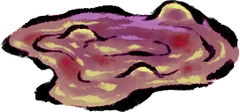
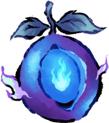
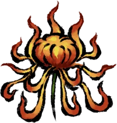
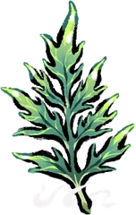
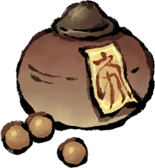
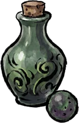
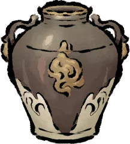

# 【卡牌修仙传】图鉴攻略 — 卡牌 / 灵草&丹药

- 收录总数：60（游戏官方数据，其中图鉴未收录 14 条）
- 更新时间：2026-11-20 06:49

---

## 1. 止血草

大千世界里最常见的灵草，稍加炼制便可以止血化瘀。

### 【主药效果】

活血：恢复血量

### 【辅药效果】

活血：恢复血量

### 【各版本（境界 / 品质）】

止血草·练气·人品：主药 活血：恢复血量（2）；辅药 活血：恢复血量（2）

凝血草·筑基·人品：主药 活血：恢复血量（3）；辅药 活血：恢复血量（3）

苍血草·结丹·人品：主药 活血：恢复血量（5）；辅药 活血：恢复血量（5）

苍血草·元婴·人品：主药 活血：恢复血量（12）；辅药 活血：恢复血量（12）

### 【炼丹用途】

做主药：炼出「化瘀丹」（数值见上方各境界版本；炼出哪个境界的丹药，看 5 株草药的境界分总和）

做辅药：给主效果是【活血】的丹药（「化瘀丹」、「血还丹」）叠加数值（数值见上方各境界版本）

品质：人品；境界分：练气 1、筑基 2、结丹 8、元婴 29。品质越高越容易炼出高品质丹药；原理和每种丹药的推荐配方见对应丹药的【最佳合成路线】

### 【获取途径】

培养种子有40%概率获得人品灵草

探索药田有10%概率获得人品灵草

可以在坊市与其他修士交易获得

---

## 2. 洗骨花

闻一下花的香味，能感觉身体都被洗涤了一次。

### 【主药效果】

活血：恢复血量

### 【辅药效果】

活血：恢复血量

### 【各版本（境界 / 品质）】

洗骨花·练气·地品：主药 活血：恢复血量（3）；辅药 活血：恢复血量（3）

大洗骨花·筑基·地品：主药 活血：恢复血量（4）；辅药 活血：恢复血量（4）

洗髓花·结丹·地品：主药 活血：恢复血量（7）；辅药 活血：恢复血量（7）

洗髓花·元婴·地品：主药 活血：恢复血量（18）；辅药 活血：恢复血量（18）

### 【炼丹用途】

做主药：炼出「化瘀丹」（数值见上方各境界版本；炼出哪个境界的丹药，看 5 株草药的境界分总和）

做辅药：给主效果是【活血】的丹药（「化瘀丹」、「血还丹」）叠加数值（数值见上方各境界版本）

品质：地品；境界分：练气 1、筑基 2、结丹 8、元婴 29。品质越高越容易炼出高品质丹药；原理和每种丹药的推荐配方见对应丹药的【最佳合成路线】

### 【获取途径】

培养种子有30%概率获得地品灵草

探索药田有25%概率获得地品灵草

可以在坊市与其他修士交易获得

---

## 3. 红仁果

闻一下花的香味，能感觉身体都被洗涤了一次。

### 【主药效果】

活血：恢复血量

### 【辅药效果】

活血：恢复血量

聚气：补充灵气值

### 【各版本（境界 / 品质）】

红仁果·练气·天品：主药 活血：恢复血量（3）；辅药 活血：恢复血量（2）；辅药 聚气：补充灵气值（2）

炎仁果·筑基·天品：红彤彤的果实里蕴含着补充人体血气的神奇之物。；主药 活血：恢复血量（4）；辅药 活血：恢复血量（3）；辅药 聚气：补充灵气值（3）

天火果·结丹·天品：红彤彤的果实里蕴含着补充人体血气的神奇之物。；主药 活血：恢复血量（7）；辅药 活血：恢复血量（5）；辅药 聚气：补充灵气值（5）

天火果·元婴·天品：红彤彤的果实里蕴含着补充人体血气的神奇之物。；主药 活血：恢复血量（18）；辅药 活血：恢复血量（12）；辅药 聚气：补充灵气值（8）

### 【炼丹用途】

做主药：炼出「化瘀丹」（数值见上方各境界版本；炼出哪个境界的丹药，看 5 株草药的境界分总和）

做辅药：给主效果是【活血】的丹药（「化瘀丹」、「血还丹」）叠加数值（数值见上方各境界版本）

做辅药：给主效果是【聚气】的丹药（「引气丸」、「魔元丹」）叠加数值（数值见上方各境界版本）

品质：天品；境界分：练气 1、筑基 2、结丹 8、元婴 29。品质越高越容易炼出高品质丹药；原理和每种丹药的推荐配方见对应丹药的【最佳合成路线】

### 【获取途径】

培养种子有20%概率获得天品灵草

探索药田有20%概率获得天品灵草

可以在坊市与其他修士交易获得

---

## 4. 血精果

血精果里蕴含大量气血和灵气，是珍贵的灵草。

### 【主药效果】

活血：恢复血量

聚气：补充灵气值

### 【辅药效果】

开窍：可获得修为

### 【各版本（境界 / 品质）】

血精果·练气·神品：主药 活血：恢复血量（4）；主药 聚气：补充灵气值（4）；辅药 开窍：可获得修为（1）

大血精果·筑基·神品：主药 活血：恢复血量（7）；主药 聚气：补充灵气值（5）；辅药 开窍：可获得修为（2）

血晶果·结丹·神品：主药 活血：恢复血量（14）；主药 聚气：补充灵气值（10）；辅药 开窍：可获得修为（3）

血晶果·元婴·神品：主药 活血：恢复血量（35）；主药 聚气：补充灵气值（10）；辅药 开窍：可获得修为（7）

### 【炼丹用途】

做主药：炼出「血还丹」（数值见上方各境界版本；炼出哪个境界的丹药，看 5 株草药的境界分总和）

做辅药：给主效果是【开窍】的丹药（「修为丹」、「燃魂散」、「逆元丹」）叠加数值（数值见上方各境界版本）

品质：神品；境界分：练气 1、筑基 2、结丹 8、元婴 29。品质越高越容易炼出高品质丹药；原理和每种丹药的推荐配方见对应丹药的【最佳合成路线】

### 【获取途径】

探索药田有10%概率获得神品灵草

可以在坊市与其他修士交易获得

---

## 5. 金蝉

因长期吸取蛊王灵气所以内涵大量气血。

### 【主药效果】

活血：恢复血量

### 【各版本（境界 / 品质）】

筑基·仙品：主药 活血：恢复血量（20）

结丹·仙品：主药 活血：恢复血量（40）

元婴·仙品：主药 活血：恢复血量（100）

### 【炼丹用途】

做主药：炼出「化瘀丹」（数值见上方各境界版本；炼出哪个境界的丹药，看 5 株草药的境界分总和）

品质：仙品；境界分：筑基 2、结丹 8、元婴 29。品质越高越容易炼出高品质丹药；原理和每种丹药的推荐配方见对应丹药的【最佳合成路线】

### 【获取途径】

击败妖王「金蝉蛊」后有20%概率获得，炼化金蝉蛊的内丹大概率获得

结丹期：和「金蝉蛊」对话（在「月照之地」），有概率获得

---

## 6. 土茯苓

深藏在地下的灵草，吸收了大地的养分和灵气.

### 【主药效果】

聚气：补充灵气值

### 【辅药效果】

聚气：补充灵气值

### 【各版本（境界 / 品质）】

土茯苓·练气·人品：主药 聚气：补充灵气值（1）；辅药 聚气：补充灵气值（1）

千年土茯苓·筑基·人品：主药 聚气：补充灵气值（2）；辅药 聚气：补充灵气值（2）

万年土茯苓·结丹·人品：主药 聚气：补充灵气值（3）；辅药 聚气：补充灵气值（3）

万年土茯苓·元婴·人品：主药 聚气：补充灵气值（5）；辅药 聚气：补充灵气值（5）

### 【炼丹用途】

做主药：炼出「引气丸」（数值见上方各境界版本；炼出哪个境界的丹药，看 5 株草药的境界分总和）

做辅药：给主效果是【聚气】的丹药（「引气丸」、「魔元丹」）叠加数值（数值见上方各境界版本）

品质：人品；境界分：练气 1、筑基 2、结丹 8、元婴 29。品质越高越容易炼出高品质丹药；原理和每种丹药的推荐配方见对应丹药的【最佳合成路线】

### 【获取途径】

培养种子有40%概率获得人品灵草

探索药田有10%概率获得人品灵草

可以在坊市与其他修士交易获得

---

## 7. 白莲子

洁白无暇的莲子，仔细看便能发现莲子里蕴含着灵气。

### 【主药效果】

聚气：补充灵气值

### 【辅药效果】

聚气：补充灵气值

断脉：可造成伤害

### 【各版本（境界 / 品质）】

白莲子·练气·天品：主药 聚气：补充灵气值（2）；辅药 聚气：补充灵气值（3）；辅药 断脉：可造成伤害（1）

白莲芯·筑基·天品：主药 聚气：补充灵气值（3）；辅药 聚气：补充灵气值（4）；辅药 断脉：可造成伤害（2）

白莲玉·结丹·天品：主药 聚气：补充灵气值（5）；辅药 聚气：补充灵气值（5）；辅药 断脉：可造成伤害（4）

白莲玉·元婴·天品：主药 聚气：补充灵气值（8）；辅药 聚气：补充灵气值（8）；辅药 断脉：可造成伤害（8）

### 【炼丹用途】

做主药：炼出「引气丸」（数值见上方各境界版本；炼出哪个境界的丹药，看 5 株草药的境界分总和）

做辅药：给主效果是【聚气】的丹药（「引气丸」、「魔元丹」）叠加数值（数值见上方各境界版本）

做辅药：给主效果是【断脉】的丹药（「毒心散」）叠加数值（数值见上方各境界版本）

品质：天品；境界分：练气 1、筑基 2、结丹 8、元婴 29。品质越高越容易炼出高品质丹药；原理和每种丹药的推荐配方见对应丹药的【最佳合成路线】

### 【获取途径】

培养种子有20%概率获得天品灵草

探索药田有20%概率获得天品灵草

可以在坊市与其他修士交易获得

---

## 8. 魂婴果

通常情况下，只有生物才有魂魄，但魂婴果里也似乎存在。

### 【主药效果】

聚气：补充灵气值

堕心：会产生心魔

### 【辅药效果】

聚气：补充灵气值

### 【各版本（境界 / 品质）】

魂婴果·练气·仙品：主药 聚气：补充灵气值（6）；主药 堕心：会产生心魔（1）；辅药 聚气：补充灵气值（2）

百年魂婴果·筑基·仙品：主药 聚气：补充灵气值（8）；主药 堕心：会产生心魔（1）；辅药 聚气：补充灵气值（3）

千年魂婴果·结丹·仙品：主药 聚气：补充灵气值（10）；主药 堕心：会产生心魔（1）；辅药 聚气：补充灵气值（5）

千年魂婴果·元婴·仙品：主药 聚气：补充灵气值（15）；主药 堕心：会产生心魔（1）；辅药 聚气：补充灵气值（8）

### 【炼丹用途】

做主药：炼出「魔元丹」（数值见上方各境界版本；炼出哪个境界的丹药，看 5 株草药的境界分总和）

做辅药：给主效果是【聚气】的丹药（「引气丸」、「魔元丹」）叠加数值（数值见上方各境界版本）

品质：仙品；境界分：练气 1、筑基 2、结丹 8、元婴 29。品质越高越容易炼出高品质丹药；原理和每种丹药的推荐配方见对应丹药的【最佳合成路线】

### 【获取途径】

培养种子有10%概率获得仙品灵草

探索药田有25%概率获得仙品灵草

可以在坊市与其他修士交易获得

---

## 9. 铁熊胆

熊胆拥有极大量的灵气。

### 【主药效果】

聚气：补充灵气值

### 【各版本（境界 / 品质）】

筑基·神品：主药 聚气：补充灵气值（20）

结丹·神品：主药 聚气：补充灵气值（40）

元婴·神品：主药 聚气：补充灵气值（60）

### 【炼丹用途】

做主药：炼出「引气丸」（数值见上方各境界版本；炼出哪个境界的丹药，看 5 株草药的境界分总和）

品质：神品；境界分：筑基 2、结丹 8、元婴 29。品质越高越容易炼出高品质丹药；原理和每种丹药的推荐配方见对应丹药的【最佳合成路线】

### 【获取途径】

击败妖王「铁骨熊」后有20%概率获得，炼化铁骨熊的内丹大概率获得

---

## 10. 腐木菇

生长在腐烂尸体上的灵菇，散发着一股难闻的味道。

### 【主药效果】

断脉：可造成伤害

### 【辅药效果】

断脉：可造成伤害

### 【各版本（境界 / 品质）】

腐木菇·练气·人品：主药 断脉：可造成伤害（1）；辅药 断脉：可造成伤害（2）

大腐木菇·筑基·人品：主药 断脉：可造成伤害（2）；辅药 断脉：可造成伤害（3）

腐尸菇·结丹·人品：主药 断脉：可造成伤害（4）；辅药 断脉：可造成伤害（6）

腐尸菇·元婴·人品：主药 断脉：可造成伤害（10）；辅药 断脉：可造成伤害（15）

### 【炼丹用途】

做主药：炼出「毒心散」（数值见上方各境界版本；炼出哪个境界的丹药，看 5 株草药的境界分总和）

做辅药：给主效果是【断脉】的丹药（「毒心散」）叠加数值（数值见上方各境界版本）

品质：人品；境界分：练气 1、筑基 2、结丹 8、元婴 29。品质越高越容易炼出高品质丹药；原理和每种丹药的推荐配方见对应丹药的【最佳合成路线】

### 【获取途径】

培养种子有40%概率获得人品灵草

探索药田有10%概率获得人品灵草

可以在坊市与其他修士交易获得

---

## 11. 断魂花

吸聚了大量冤魂的怪花，夜晚时能听到冤魂的呼叫。

### 【主药效果】

断脉：可造成伤害

### 【辅药效果】

断脉：可造成伤害

### 【各版本（境界 / 品质）】

断魂花·练气·地品：主药 断脉：可造成伤害（2）；辅药 断脉：可造成伤害（1）

大断魂花·筑基·地品：主药 断脉：可造成伤害（3）；辅药 断脉：可造成伤害（2）

绝魂草·结丹·地品：主药 断脉：可造成伤害（6）；辅药 断脉：可造成伤害（4）

绝魂草·元婴·地品：主药 断脉：可造成伤害（15）；辅药 断脉：可造成伤害（10）

### 【炼丹用途】

做主药：炼出「毒心散」（数值见上方各境界版本；炼出哪个境界的丹药，看 5 株草药的境界分总和）

做辅药：给主效果是【断脉】的丹药（「毒心散」）叠加数值（数值见上方各境界版本）

品质：地品；境界分：练气 1、筑基 2、结丹 8、元婴 29。品质越高越容易炼出高品质丹药；原理和每种丹药的推荐配方见对应丹药的【最佳合成路线】

### 【获取途径】

培养种子有30%概率获得地品灵草

探索药田有25%概率获得地品灵草

可以在坊市与其他修士交易获得

---

## 12. 腐骨草

如果不小心接触到此草，那么连骨头也有可能被腐蚀

### 【主药效果】

断脉：可造成伤害

### 【各版本（境界 / 品质）】

腐骨草·练气·神品：主药 断脉：可造成伤害（5）

大腐骨草·筑基·神品：主药 断脉：可造成伤害（8）

阴骨草·结丹·神品：主药 断脉：可造成伤害（15）

阴骨草·元婴·神品：主药 断脉：可造成伤害（38）

### 【炼丹用途】

做主药：炼出「毒心散」（数值见上方各境界版本；炼出哪个境界的丹药，看 5 株草药的境界分总和）

品质：神品；境界分：练气 1、筑基 2、结丹 8、元婴 29。品质越高越容易炼出高品质丹药；原理和每种丹药的推荐配方见对应丹药的【最佳合成路线】

### 【获取途径】

探索药田有10%概率获得神品灵草

可以在坊市与其他修士交易获得

---

## 13. 毒液

击败小型的鬼面蛛有概率获得，从其毒囊里收集的精华毒液。

此卡牌无主药效果，如果用于主材料，则只能炼制出无效果的丹药

### 【辅药效果】

断脉：可造成伤害

### 【各版本（境界 / 品质）】

练气·天品：辅药 断脉：可造成伤害（3.5）

筑基·天品：辅药 断脉：可造成伤害（5）

结丹·天品：辅药 断脉：可造成伤害（8）

元婴·天品：辅药 断脉：可造成伤害（20）

### 【炼丹用途】

没有主药效果，只适合做辅药

做辅药：给主效果是【断脉】的丹药（「毒心散」）叠加数值（数值见上方各境界版本）

品质：天品；境界分：练气 1、筑基 2、结丹 8、元婴 29。品质越高越容易炼出高品质丹药；原理和每种丹药的推荐配方见对应丹药的【最佳合成路线】

### 【获取途径】

击败〈毒蛛〉后掉落

---

## 14. 剧毒液

炼制成丹药后可造成大量伤害

### 【主药效果】

断脉：可造成伤害

### 【辅药效果】

断脉：可造成伤害

### 【各版本（境界 / 品质）】

练气·神品：主药 断脉：可造成伤害（8）；辅药 断脉：可造成伤害（3.5）

筑基·神品：主药 断脉：可造成伤害（15）；辅药 断脉：可造成伤害（5）

结丹·神品：主药 断脉：可造成伤害（30）；辅药 断脉：可造成伤害（8）

元婴·神品：主药 断脉：可造成伤害（75）；辅药 断脉：可造成伤害（20）

### 【炼丹用途】

做主药：炼出「毒心散」（数值见上方各境界版本；炼出哪个境界的丹药，看 5 株草药的境界分总和）

做辅药：给主效果是【断脉】的丹药（「毒心散」）叠加数值（数值见上方各境界版本）

品质：神品；境界分：练气 1、筑基 2、结丹 8、元婴 29。品质越高越容易炼出高品质丹药；原理和每种丹药的推荐配方见对应丹药的【最佳合成路线】

### 【获取途径】

击败妖王「鬼面蛛」后有20%概率获得，炼化鬼面蛛的内丹大概率获得

---

## 15. 紫烟果

果子不时的冒出一股股的紫烟，透过紫烟似乎能看到另一片世界。

### 【主药效果】

硬肤：获得〔护甲〕

### 【辅药效果】

硬肤：获得〔护甲〕

### 【各版本（境界 / 品质）】

紫烟果·筑基·地品：主药 硬肤：获得〔护甲〕（4）；辅药 硬肤：获得〔护甲〕（6）

大紫烟果·结丹·地品：主药 硬肤：获得〔护甲〕（10）；辅药 硬肤：获得〔护甲〕（12）

大紫烟果·元婴·地品：主药 硬肤：获得〔护甲〕（25）；辅药 硬肤：获得〔护甲〕（30）

### 【炼丹用途】

做主药：炼出「铸体丹」（数值见上方各境界版本；炼出哪个境界的丹药，看 5 株草药的境界分总和）

做辅药：给主效果是【硬肤】的丹药（「玄霜丸」、「铸体丹」）叠加数值（数值见上方各境界版本）

品质：地品；境界分：筑基 2、结丹 8、元婴 29。品质越高越容易炼出高品质丹药；原理和每种丹药的推荐配方见对应丹药的【最佳合成路线】

### 【获取途径】

培养种子有30%概率获得地品灵草

探索药田有25%概率获得地品灵草

可以在坊市与其他修士交易获得

---

## 16. 六瓣兰

奇怪的兰花，生长的时间越长，花瓣数量会越多。

### 【主药效果】

硬肤：获得〔护甲〕

### 【各版本（境界 / 品质）】

六瓣兰·筑基·天品：主药 硬肤：获得〔护甲〕（8）

九瓣兰·结丹·天品：主药 硬肤：获得〔护甲〕（16）

九瓣兰·元婴·天品：主药 硬肤：获得〔护甲〕（40）

### 【炼丹用途】

做主药：炼出「铸体丹」（数值见上方各境界版本；炼出哪个境界的丹药，看 5 株草药的境界分总和）

品质：天品；境界分：筑基 2、结丹 8、元婴 29。品质越高越容易炼出高品质丹药；原理和每种丹药的推荐配方见对应丹药的【最佳合成路线】

### 【获取途径】

培养种子有20%概率获得天品灵草

探索药田有20%概率获得天品灵草

可以在坊市与其他修士交易获得

---

## 17. 冰雪莲

生长在冰川雪地的莲花，整朵花瓣都如冰雪般晶莹。

### 【主药效果】

硬肤：获得〔护甲〕

逆经：会减少当前灵气

### 【辅药效果】

硬肤：获得〔护甲〕

逆经：会减少当前灵气

### 【各版本（境界 / 品质）】

冰雪莲·筑基·仙品：主药 硬肤：获得〔护甲〕（12）；主药 逆经：会减少当前灵气（3）；辅药 硬肤：获得〔护甲〕（12）；辅药 逆经：会减少当前灵气（3）

冰晶莲·结丹·仙品：主药 硬肤：获得〔护甲〕（24）；主药 逆经：会减少当前灵气（5）；辅药 硬肤：获得〔护甲〕（24）；辅药 逆经：会减少当前灵气（5）

冰晶莲·元婴·仙品：主药 硬肤：获得〔护甲〕（60）；主药 逆经：会减少当前灵气（8）；辅药 硬肤：获得〔护甲〕（60）；辅药 逆经：会减少当前灵气（8）

### 【炼丹用途】

做主药：炼出「玄霜丸」（数值见上方各境界版本；炼出哪个境界的丹药，看 5 株草药的境界分总和）

做辅药：给主效果是【硬肤】的丹药（「玄霜丸」、「铸体丹」）叠加数值（数值见上方各境界版本）

做辅药：没有以【逆经】为主效果的丹药，这个辅药效果加不上去，只影响品质

品质：仙品；境界分：筑基 2、结丹 8、元婴 29。品质越高越容易炼出高品质丹药；原理和每种丹药的推荐配方见对应丹药的【最佳合成路线】

### 【获取途径】

培养种子有10%概率获得仙品灵草

探索药田有25%概率获得仙品灵草

可以在坊市与其他修士交易获得

---

## 18. 磐石粉

一部分〔土〕妖王身上都覆盖磐石，击败妖王后有概率获得。

### 【主药效果】

硬肤：获得〔护甲〕

### 【各版本（境界 / 品质）】

筑基·神品：主药 硬肤：获得〔护甲〕（24）

结丹·神品：主药 硬肤：获得〔护甲〕（60）

元婴·神品：主药 硬肤：获得〔护甲〕（150）

筑基·神品：主药 硬肤：获得〔护甲〕（50）

结丹·神品：主药 硬肤：获得〔护甲〕（100）

元婴·神品：主药 硬肤：获得〔护甲〕（250）

### 【炼丹用途】

做主药：炼出「铸体丹」（数值见上方各境界版本；炼出哪个境界的丹药，看 5 株草药的境界分总和）

品质：神品；境界分：筑基 2、结丹 8、元婴 29。品质越高越容易炼出高品质丹药；原理和每种丹药的推荐配方见对应丹药的【最佳合成路线】

### 【获取途径】

击败妖王「巨灵烈象或石魈」后有20%概率获得，炼化巨灵烈象或石魈的内丹大概率获得

---

## 19. 醉龙果

果实里富含营养物，只是实在太多了，以至于妖怪吃了也要醉倒。

### 【主药效果】

醉心：会进入入定状态

堕心：会产生心魔

### 【辅药效果】

断脉：可造成伤害

### 【各版本（境界 / 品质）】

醉龙果·练气·仙品：主药 醉心：会进入入定状态（1）；主药 堕心：会产生心魔（1）；辅药 断脉：可造成伤害（2）

百年醉龙果·筑基·仙品：主药 醉心：会进入入定状态（1）；主药 堕心：会产生心魔（1）；辅药 断脉：可造成伤害（3）

千年醉龙果·结丹·仙品：主药 醉心：会进入入定状态（1）；主药 堕心：会产生心魔（1）；辅药 断脉：可造成伤害（6）

千年醉龙果·元婴·仙品：主药 醉心：会进入入定状态（1）；主药 堕心：会产生心魔（1）；辅药 断脉：可造成伤害（15）

### 【炼丹用途】

做主药：炼出「醉心露」（数值见上方各境界版本；炼出哪个境界的丹药，看 5 株草药的境界分总和）

做辅药：给主效果是【断脉】的丹药（「毒心散」）叠加数值（数值见上方各境界版本）

品质：仙品；境界分：练气 1、筑基 2、结丹 8、元婴 29。品质越高越容易炼出高品质丹药；原理和每种丹药的推荐配方见对应丹药的【最佳合成路线】

### 【获取途径】

培养种子有10%概率获得仙品灵草

探索药田有25%概率获得仙品灵草

可以在坊市与其他修士交易获得

---

## 20. 菩提果

菩提树历经百年沧桑才会结果。

### 【主药效果】

醉心：会进入入定状态

### 【各版本（境界 / 品质）】

菩提果·练气·神品：主药 醉心：会进入入定状态（1）

大菩提果·筑基·神品：主药 醉心：会进入入定状态（1）

菩提道果·结丹·神品：主药 醉心：会进入入定状态（1）

菩提道果·元婴·神品：主药 醉心：会进入入定状态（1）

### 【炼丹用途】

做主药：炼出「真悟丹」（数值见上方各境界版本；炼出哪个境界的丹药，看 5 株草药的境界分总和）

品质：神品；境界分：练气 1、筑基 2、结丹 8、元婴 29。品质越高越容易炼出高品质丹药；原理和每种丹药的推荐配方见对应丹药的【最佳合成路线】

### 【获取途径】

探索药田有10%概率获得神品灵草

可以在坊市与其他修士交易获得

---

## 21. 迷魂香

闻到香味着，无论妖怪或是人物，均会倒地不起。

### 【主药效果】

迷魂：有控制目标的效果

活血：恢复血量

### 【辅药效果】

迷魂：有控制目标的效果

### 【各版本（境界 / 品质）】

迷魂香·练气·地品：主药 迷魂：有控制目标的效果（2）；主药 活血：恢复血量（3）；辅药 迷魂：有控制目标的效果（2）

迷魂迭香·筑基·地品：主药 迷魂：有控制目标的效果（3）；主药 活血：恢复血量（4）；辅药 迷魂：有控制目标的效果（3）

忘魂香·结丹·地品：主药 迷魂：有控制目标的效果（6）；主药 活血：恢复血量（6）；辅药 迷魂：有控制目标的效果（4）

忘魂香·元婴·地品：主药 迷魂：有控制目标的效果（9）；主药 活血：恢复血量（15）；辅药 迷魂：有控制目标的效果（7）

### 【炼丹用途】

做主药：炼出「迷魂丹」（数值见上方各境界版本；炼出哪个境界的丹药，看 5 株草药的境界分总和）

做辅药：给主效果是【迷魂】的丹药（「迷魂丹」、「锁神丹」）叠加数值（数值见上方各境界版本）

品质：地品；境界分：练气 1、筑基 2、结丹 8、元婴 29。品质越高越容易炼出高品质丹药；原理和每种丹药的推荐配方见对应丹药的【最佳合成路线】

### 【获取途径】

培养种子有30%概率获得地品灵草

探索药田有25%概率获得地品灵草

可以在坊市与其他修士交易获得

---

## 22. 幻神草

哪怕神仙尝一口，也会触发幻觉的灵草。

### 【主药效果】

迷魂：有控制目标的效果

### 【辅药效果】

迷魂：有控制目标的效果

### 【各版本（境界 / 品质）】

幻神草·练气·仙品：主药 迷魂：有控制目标的效果（4）；辅药 迷魂：有控制目标的效果（3）

大幻神草·筑基·仙品：主药 迷魂：有控制目标的效果（5）；辅药 迷魂：有控制目标的效果（4）

幻魄草·结丹·仙品：主药 迷魂：有控制目标的效果（10）；辅药 迷魂：有控制目标的效果（5）

幻魄草·元婴·仙品：主药 迷魂：有控制目标的效果（15）；辅药 迷魂：有控制目标的效果（9）

### 【炼丹用途】

做主药：炼出「锁神丹」（数值见上方各境界版本；炼出哪个境界的丹药，看 5 株草药的境界分总和）

做辅药：给主效果是【迷魂】的丹药（「迷魂丹」、「锁神丹」）叠加数值（数值见上方各境界版本）

品质：仙品；境界分：练气 1、筑基 2、结丹 8、元婴 29。品质越高越容易炼出高品质丹药；原理和每种丹药的推荐配方见对应丹药的【最佳合成路线】

### 【获取途径】

培养种子有10%概率获得仙品灵草

探索药田有25%概率获得仙品灵草

可以在坊市与其他修士交易获得

---

## 23. 青焰根

此火焰并不灼烧肉体，而是燃烧灵魂

### 【主药效果】

开窍：可获得修为

堕心：会产生心魔

### 【辅药效果】

断脉：可造成伤害

### 【各版本（境界 / 品质）】

青焰根·练气·天品：主药 开窍：可获得修为（3）；主药 堕心：会产生心魔（1）；辅药 断脉：可造成伤害（2.5）

青焰魔根·筑基·天品：主药 开窍：可获得修为（5）；主药 堕心：会产生心魔（1）；辅药 断脉：可造成伤害（3.5）

魔焰根·结丹·天品：主药 开窍：可获得修为（7）；主药 堕心：会产生心魔（1）；辅药 断脉：可造成伤害（6.5）

魔焰根·元婴·天品：主药 开窍：可获得修为（15）；主药 堕心：会产生心魔（1）；辅药 断脉：可造成伤害（15）

### 【炼丹用途】

做主药：炼出「燃魂散」（数值见上方各境界版本；炼出哪个境界的丹药，看 5 株草药的境界分总和）

做辅药：给主效果是【断脉】的丹药（「毒心散」）叠加数值（数值见上方各境界版本）

品质：天品；境界分：练气 1、筑基 2、结丹 8、元婴 29。品质越高越容易炼出高品质丹药；原理和每种丹药的推荐配方见对应丹药的【最佳合成路线】

### 【获取途径】

培养种子有20%概率获得天品灵草

探索药田有20%概率获得天品灵草

可以在坊市与其他修士交易获得

---

## 24. 百灵参

生长了多年的人参。

### 【主药效果】

开窍：可获得修为

逆经：会减少当前灵气

### 【各版本（境界 / 品质）】

百灵参·练气·仙品：主药 开窍：可获得修为（3）；主药 逆经：会减少当前灵气（20）

千灵参·筑基·仙品：主药 开窍：可获得修为（5）；主药 逆经：会减少当前灵气（30）

万灵参·结丹·仙品：主药 开窍：可获得修为（7）；主药 逆经：会减少当前灵气（40）

万灵参·元婴·仙品：主药 开窍：可获得修为（15）；主药 逆经：会减少当前灵气（60）

### 【炼丹用途】

做主药：炼出「逆元丹」（数值见上方各境界版本；炼出哪个境界的丹药，看 5 株草药的境界分总和）

品质：仙品；境界分：练气 1、筑基 2、结丹 8、元婴 29。品质越高越容易炼出高品质丹药；原理和每种丹药的推荐配方见对应丹药的【最佳合成路线】

### 【获取途径】

培养种子有10%概率获得仙品灵草

探索药田有25%概率获得仙品灵草

可以在坊市与其他修士交易获得

---

## 25. 蕴元仙萼

萼瓣凝霜、芯藏金光，得天地元气滋养万年方得成形

### 【主药效果】

开窍：可获得修为

### 【辅药效果】

开窍：可获得修为

### 【各版本（境界 / 品质）】

练气·绝品：主药 开窍：可获得修为（5）；辅药 开窍：可获得修为（2）

筑基·绝品：主药 开窍：可获得修为（8）；辅药 开窍：可获得修为（3）

结丹·绝品：主药 开窍：可获得修为（12）；辅药 开窍：可获得修为（5）

元婴·绝品：主药 开窍：可获得修为（30）；辅药 开窍：可获得修为（13）

### 【炼丹用途】

做主药：炼出「修为丹」（数值见上方各境界版本；炼出哪个境界的丹药，看 5 株草药的境界分总和）

做辅药：给主效果是【开窍】的丹药（「修为丹」、「燃魂散」、「逆元丹」）叠加数值（数值见上方各境界版本）

品质：绝品；境界分：练气 1、筑基 2、结丹 8、元婴 29。品质越高越容易炼出高品质丹药；原理和每种丹药的推荐配方见对应丹药的【最佳合成路线】

### 【获取途径】

在古木幽森的深处有概率获得（筑基期的版本）

练气～结丹期：在〈调查工作台〉放入〈灵兽〉「派出灵兽」，有概率带回和灵兽同境界的版本（元婴期灵兽带回结丹期版本）

练气期：在「山脚下」派出灵兽，有概率获得

练气～结丹期：在「青灵木」/「青灵木(小)」/「药园」探索、派出灵兽或利用傀儡，有概率获得

筑基～元婴期：修炼〈幽兰录〉/〈幽兰录(二)〉/〈幽兰录(三)〉有概率获得

筑基～元婴期：在〈培养工作台〉培养〈灵草种子〉，有概率获得

筑基 / 结丹期：「慕容绛璃」每年送的礼物（好感 ≥ 10，随机给一张）

在灵田培养它可以收获更多（需要葫芦 / 瓶子、傀儡或药童帮忙才能长）

---

## 26. 兽涎水

这种水会散发一股香气，能吸引妖怪的到来。

### 【主药效果】

唤灵：可招来妖兽

### 【辅药效果】

迷魂：有控制目标的效果

### 【各版本（境界 / 品质）】

兽涎水·练气·地品：主药 唤灵：可招来妖兽（1）；辅药 迷魂：有控制目标的效果（3）

兽涎露·筑基·地品：主药 唤灵：可招来妖兽（2）；辅药 迷魂：有控制目标的效果（3）

兽涎露石·结丹·地品：主药 唤灵：可招来妖兽（3）；辅药 迷魂：有控制目标的效果（3）

### 【炼丹用途】

做主药：炼出「引兽丸」（数值见上方各境界版本；炼出哪个境界的丹药，看 5 株草药的境界分总和）

做辅药：给主效果是【迷魂】的丹药（「迷魂丹」、「锁神丹」）叠加数值（数值见上方各境界版本）

品质：地品；境界分：练气 1、筑基 2、结丹 8。品质越高越容易炼出高品质丹药；原理和每种丹药的推荐配方见对应丹药的【最佳合成路线】

### 【获取途径】

培养种子有30%概率获得地品灵草

探索药田有25%概率获得地品灵草

可以在坊市与其他修士交易获得

---

## 27. 九霄灵芝

生长在仙界的灵芝，灵芝会自己跑动，才流落到人间。

### 【主药效果】

延寿：有增加寿命的效果

### 【各版本（境界 / 品质）】

九霄灵芝·练气·绝品：主药 延寿：有增加寿命的效果（4）

赤霄灵芝·筑基·绝品：主药 延寿：有增加寿命的效果（9）

碧霄灵芝·结丹·绝品：主药 延寿：有增加寿命的效果（15）

碧霄灵芝·元婴·绝品：主药 延寿：有增加寿命的效果（35）

### 【炼丹用途】

做主药：炼出「寿元丹」（数值见上方各境界版本；炼出哪个境界的丹药，看 5 株草药的境界分总和）

品质：绝品；境界分：练气 1、筑基 2、结丹 8、元婴 29。品质越高越容易炼出高品质丹药；原理和每种丹药的推荐配方见对应丹药的【最佳合成路线】

### 【获取途径】

在古木幽森的深处有概率获得（筑基期的版本：赤霄灵芝）

练气～结丹期：在〈调查工作台〉放入〈灵兽〉「派出灵兽」，有概率带回和灵兽同境界的版本（元婴期灵兽带回结丹期版本）

练气期：在「山脚下」派出灵兽，有概率获得

练气～结丹期：在「青灵木」/「青灵木(小)」/「药园」探索、派出灵兽或利用傀儡，有概率获得

筑基～元婴期：修炼〈幽兰录〉/〈幽兰录(二)〉/〈幽兰录(三)〉有概率获得

筑基～元婴期：在〈培养工作台〉培养〈灵草种子〉，有概率获得

筑基 / 结丹期：「慕容绛璃」每年送的礼物（好感 ≥ 10，随机给一张）

筑基 / 结丹期：打开〈宝藏〉有小概率获得

---

## 28. 血灵芝

可用于炼制寿元丹，但其血腥之气实在容易令人入魔

### 【主药效果】

延寿：有增加寿命的效果

堕心：会产生心魔

### 【各版本（境界 / 品质）】

筑基·绝品：主药 延寿：有增加寿命的效果（9）；主药 堕心：会产生心魔（1）

结丹·绝品：主药 延寿：有增加寿命的效果（15）；主药 堕心：会产生心魔（1）

元婴·绝品：主药 延寿：有增加寿命的效果（35）；主药 堕心：会产生心魔（2）

### 【炼丹用途】

做主药：炼出「寿元丹」（数值见上方各境界版本；炼出哪个境界的丹药，看 5 株草药的境界分总和）

品质：绝品；境界分：筑基 2、结丹 8、元婴 29。品质越高越容易炼出高品质丹药；原理和每种丹药的推荐配方见对应丹药的【最佳合成路线】

### 【获取途径】

击败妖王「血肉灵芝」后有20%概率获得，炼化血肉灵芝的内丹大概率获得

筑基 / 结丹期：和「赵子义」对话，有概率获得

---

## 29. 缘玑仙草

隐于云海仙山的聚气之地，茎生七叶、叶缀玑珠，沐晨露吸星华而生，其株自带缥缈气运

### 【主药效果】

气运：可获得机缘

开窍：可获得修为

### 【辅药效果】

气运：可获得机缘

### 【各版本（境界 / 品质）】

练气·绝品：主药 气运：可获得机缘（0.15）；主药 开窍：可获得修为（3）；辅药 气运：可获得机缘（0.15）

筑基·绝品：主药 气运：可获得机缘（0.15）；主药 开窍：可获得修为（4）；辅药 气运：可获得机缘（0.15）

结丹·绝品：主药 气运：可获得机缘（0.15）；主药 开窍：可获得修为（5）；辅药 气运：可获得机缘（0.15）

元婴·绝品：主药 气运：可获得机缘（0.15）；主药 开窍：可获得修为（13）；辅药 气运：可获得机缘（0.15）

### 【炼丹用途】

做主药：炼出「慧心丹」（数值见上方各境界版本；炼出哪个境界的丹药，看 5 株草药的境界分总和）

做辅药：给主效果是【气运】的丹药（「慧心丹」）叠加数值（数值见上方各境界版本）

品质：绝品；境界分：练气 1、筑基 2、结丹 8、元婴 29。品质越高越容易炼出高品质丹药；原理和每种丹药的推荐配方见对应丹药的【最佳合成路线】

### 【获取途径】

在古木幽森的深处有概率获得（筑基期的版本）

练气～结丹期：在〈调查工作台〉放入〈灵兽〉「派出灵兽」，有概率带回和灵兽同境界的版本（元婴期灵兽带回结丹期版本）

练气期：在「山脚下」派出灵兽，有概率获得

练气～结丹期：在「青灵木」/「青灵木(小)」/「药园」探索、派出灵兽或利用傀儡，有概率获得

筑基～元婴期：修炼〈幽兰录〉/〈幽兰录(二)〉/〈幽兰录(三)〉有概率获得

筑基～元婴期：在〈培养工作台〉培养〈灵草种子〉，有概率获得

筑基 / 结丹期：「慕容绛璃」每年送的礼物（好感 ≥ 10，随机给一张）

在灵田培养它可以收获更多（需要葫芦 / 瓶子、傀儡或药童帮忙才能长）

---

## 30. 化瘀丹

普通的回血丹药，在战斗中亦可服用。

### 【各版本（境界 / 品质）】

练气·人品：活血：恢复使用者血量

练气·地品：活血：恢复使用者血量

练气·天品：活血：恢复使用者血量

练气·仙品：活血：恢复使用者血量

练气·神品：活血：恢复使用者血量；获得方式 用炼丹工作台「炼制丹药」炼出、在天地熔炉里「炼制丹药」，主药放〈止血草〉或〈洗骨花〉或〈红仁果〉，只会炼出神品

筑基·人品：活血：恢复使用者血量

筑基·地品：活血：恢复使用者血量

筑基·天品：活血：恢复使用者血量

筑基·仙品：活血：恢复使用者血量

筑基·神品：活血：恢复使用者血量；获得方式 用炼丹工作台「炼制丹药」炼出、「慕容绛璃」每年送的礼物（主角筑基期）：好感 ≥ 45（随机给一张）、在「修士战场」探索（放入「无名氏或神识或自由模式主角」），有概率获得（主角筑基期）、在天地熔炉里「炼制丹药」，主药放〈凝血草〉或〈大洗骨花〉或〈炎仁果〉或〈金蝉〉，只会炼出神品

结丹·人品：活血：恢复使用者血量

结丹·地品：活血：恢复使用者血量

结丹·天品：活血：恢复使用者血量

结丹·仙品：活血：恢复使用者血量

结丹·神品：活血：恢复使用者血量；获得方式 用炼丹工作台「炼制丹药」炼出、「慕容绛璃」每年送的礼物（主角结丹期）：好感 ≥ 45（随机给一张）、在「修士战场」探索（放入「无名氏或神识或自由模式主角」），有概率获得（主角结丹/元婴/化神/炼虚/合体/大乘期）、在天地熔炉里「炼制丹药」，主药放〈天火果〉或〈洗髓花〉或〈苍血草〉或〈金蝉〉，只会炼出神品

元婴·人品：活血：恢复使用者血量

元婴·地品：活血：恢复使用者血量

元婴·天品：活血：恢复使用者血量

元婴·仙品：活血：恢复使用者血量

元婴·神品：活血：恢复使用者血量；获得方式 用炼丹工作台「炼制丹药」炼出、在天地熔炉里「炼制丹药」，主药放〈天火果〉或〈洗髓花〉或〈苍血草〉或〈金蝉〉，只会炼出神品

### 【最佳合成路线】

### 【炼丹计算器】

主药只能选能炼出「化瘀丹」的草药；辅药 4 格任选，也可以空着。

### 【主药 / 辅药怎么选】

主药不限境界：丹药是哪个境界只看 5 株草药的「境界分」总和，和主药是哪个境界无关。例如练气主药 1 分 + 4 株元婴辅药 4×29 分 = 117 分 ≥ 102 → 炼出元婴期「化瘀丹」。

但是数值从主药的【主药效果】开始算：低境界主药的底数小，炼出来的高境界丹药数值会偏低 —— 想要数值高，主药也用同境界（或更高品质）的。

主药：放哪一株都能炼出「化瘀丹」（不限境界；高境界主药的主药效果数值更高）

境界 | 草药 | 品质 | 主药效果

练气 | 「止血草」 | 人品 | 活血 2

练气 | 「洗骨花」 | 地品 | 活血 3

练气 | 「红仁果」 | 天品 | 活血 3

筑基 | 「凝血草」 | 人品 | 活血 3

筑基 | 「大洗骨花」 | 地品 | 活血 4

筑基 | 「炎仁果」 | 天品 | 活血 4

筑基 | 「金蝉」 | 仙品 | 活血 20

结丹 | 「苍血草」 | 人品 | 活血 5

结丹 | 「洗髓花」 | 地品 | 活血 7

结丹 | 「天火果」 | 天品 | 活血 7

结丹 | 「金蝉」 | 仙品 | 活血 40

元婴 | 「苍血草」 | 人品 | 活血 12

元婴 | 「洗髓花」 | 地品 | 活血 18

元婴 | 「天火果」 | 天品 | 活血 18

元婴 | 「金蝉」 | 仙品 | 活血 100

辅药：带【活血】辅药效果的草药才会叠加数值（其余草药做辅药只影响品质）

境界 | 草药 | 品质 | +活血 |

练气 | 「洗骨花」 | 地品 | +3 | 也是主药

练气 | 「红仁果」 | 天品 | +2 | 也是主药

练气 | 「止血草」 | 人品 | +2 | 也是主药

筑基 | 「大洗骨花」 | 地品 | +4 | 也是主药

筑基 | 「炎仁果」 | 天品 | +3 | 也是主药

筑基 | 「凝血草」 | 人品 | +3 | 也是主药

结丹 | 「洗髓花」 | 地品 | +7 | 也是主药

结丹 | 「天火果」 | 天品 | +5 | 也是主药

结丹 | 「苍血草」 | 人品 | +5 | 也是主药

元婴 | 「洗髓花」 | 地品 | +18 | 也是主药

元婴 | 「天火果」 | 天品 | +12 | 也是主药

元婴 | 「苍血草」 | 人品 | +12 | 也是主药

### 【炼丹原理】

炼丹工作台放 1 株主药 + 最多 4 株辅药。主药决定炼出哪一种丹药和它的效果；辅药用来提高成功率 / 品质，以及叠加数值。

数值：从主药的【主药效果】开始，辅药的【辅药效果】里和主药相同的效果会加上去（主药没有的效果不会加）；成丹数值 = 合计 × 品质系数（见下表），再取整：不到 1 按 1 算，其余四舍五入（正好 .5 时取偶数）；迷魂、断脉不取整。活血 / 聚气 / 断脉 / 硬肤还会再加上天赋提供的加成。丹药的境界不影响数值，只影响卖价（境界越高越贵）。上方各品质版本只列出效果、不写数字：丹药卡本身没有固定数值（图鉴里的数字是游戏算卖价用的基础值），实际数值由炼制时放的草药决定。

品质：草药品质越高，越容易炼出高品质丹药；草药放得越少越容易失败（放满 5 株最稳）。5 株的品质分加起来：不到 10 炼不出仙品 / 神品，不到 15 炼不出神品；到 20 不会失败、也不会出人品；到 24 最低是天品。

炼丹最高只能炼出神品：主药是神品 / 绝品时，再放 4 株神品辅药就 100% 炼出神品，换成绝品辅药也不会更好。

绝品丹药炼不出来，只能从比武大会魁首奖品、鬼市「鬼火兑换员：丹药」、「悔念真人」等处得到（具体写在各丹药绝品版本的【获得】里）。

境界：5 株草药的境界分加起来，决定炼出哪个境界的丹药

| 练气 | 筑基 | 结丹 | 元婴

每株草药的境界分 | 1 | 2 | 8 | 29

5 株总分 → 丹药境界 | <7 | ≥7 | ≥28 | ≥102

品质系数：成丹数值 = 药效合计 × 系数

成丹品质 | 人品 | 地品 | 天品 | 仙品 | 神品

系数 | ×0.4 | ×0.6 | ×0.8 | ×1 | ×1.2

### 【获取途径】

炼丹工作台：主药放〈止血草〉/〈洗骨花〉/〈红仁果〉/〈金蝉〉

---

## 31. 血还丹

能够同时恢复〔血量〕和〔灵气〕的丹药！

### 【各版本（境界 / 品质）】

练气·仙品：活血：恢复使用者血量；聚气：补充使用者灵气值

练气·神品：活血：恢复使用者血量；聚气：补充使用者灵气值；获得方式 用炼丹工作台「炼制丹药」炼出、在天地熔炉里「炼制丹药」，主药放〈血精果〉，只会炼出神品

筑基·仙品：活血：恢复使用者血量；聚气：补充使用者灵气值

筑基·神品：活血：恢复使用者血量；聚气：补充使用者灵气值；获得方式 用炼丹工作台「炼制丹药」炼出、「慕容绛璃」每年送的礼物（主角筑基期）：好感 ≥ 45（随机给一张）、在「修士战场」探索（放入「无名氏或神识或自由模式主角」），有概率获得（主角筑基期）、在天地熔炉里「炼制丹药」，主药放〈大血精果〉，只会炼出神品

结丹·仙品：活血：恢复使用者血量；聚气：补充使用者灵气值

结丹·神品：活血：恢复使用者血量；聚气：补充使用者灵气值；获得方式 用炼丹工作台「炼制丹药」炼出、「慕容绛璃」每年送的礼物（主角结丹期）：好感 ≥ 45（随机给一张）、在「修士战场」探索（放入「无名氏或神识或自由模式主角」），有概率获得（主角结丹/元婴/化神/炼虚/合体/大乘期）、在天地熔炉里「炼制丹药」，主药放〈血晶果〉，只会炼出神品

元婴·仙品：活血：恢复使用者血量；聚气：补充使用者灵气值

元婴·神品：活血：恢复使用者血量；聚气：补充使用者灵气值；获得方式 用炼丹工作台「炼制丹药」炼出、在天地熔炉里「炼制丹药」，主药放〈血晶果〉，只会炼出神品

练气·绝品：活血：恢复使用者血量；聚气：补充使用者灵气值

筑基·绝品：活血：恢复使用者血量；聚气：补充使用者灵气值；获得方式 把〈陈立德〉交给「林衍」（在「金陵城」/「湖月城」），获得、筑基组拿到魁首后和「悔念真人」对话，随机送一颗（筑基后期的版本）

结丹·绝品：活血：恢复使用者血量；聚气：补充使用者灵气值；获得方式 结丹组拿到魁首后和「悔念真人」对话，随机送一颗（结丹后期的版本）、「慕容绛璃」在结丹期寿元耗尽坐化时留下的遗言（好感 ≥ 50）（随机给一张）

元婴·绝品：活血：恢复使用者血量；聚气：补充使用者灵气值

### 【最佳合成路线】

### 【炼丹计算器】

主药只能选能炼出「血还丹」的草药；辅药 4 格任选，也可以空着。

### 【主药 / 辅药怎么选】

主药不限境界：丹药是哪个境界只看 5 株草药的「境界分」总和，和主药是哪个境界无关。例如练气主药 1 分 + 4 株元婴辅药 4×29 分 = 117 分 ≥ 102 → 炼出元婴期「血还丹」。

但是数值从主药的【主药效果】开始算：低境界主药的底数小，炼出来的高境界丹药数值会偏低 —— 想要数值高，主药也用同境界（或更高品质）的。

主药：放哪一株都能炼出「血还丹」（不限境界；高境界主药的主药效果数值更高）

境界 | 草药 | 品质 | 主药效果

练气 | 「血精果」 | 神品 | 活血 4、聚气 4

筑基 | 「大血精果」 | 神品 | 活血 7、聚气 5

结丹 | 「血晶果」 | 神品 | 活血 14、聚气 10

元婴 | 「血晶果」 | 神品 | 活血 35、聚气 10

辅药：带【活血】辅药效果的草药才会叠加数值（其余草药做辅药只影响品质）

境界 | 草药 | 品质 | +活血 |

练气 | 「洗骨花」 | 地品 | +3 |

练气 | 「红仁果」 | 天品 | +2 |

练气 | 「止血草」 | 人品 | +2 |

筑基 | 「大洗骨花」 | 地品 | +4 |

筑基 | 「炎仁果」 | 天品 | +3 |

筑基 | 「凝血草」 | 人品 | +3 |

结丹 | 「洗髓花」 | 地品 | +7 |

结丹 | 「天火果」 | 天品 | +5 |

结丹 | 「苍血草」 | 人品 | +5 |

元婴 | 「洗髓花」 | 地品 | +18 |

元婴 | 「天火果」 | 天品 | +12 |

元婴 | 「苍血草」 | 人品 | +12 |

### 【炼丹原理】

炼丹工作台放 1 株主药 + 最多 4 株辅药。主药决定炼出哪一种丹药和它的效果；辅药用来提高成功率 / 品质，以及叠加数值。

数值：从主药的【主药效果】开始，辅药的【辅药效果】里和主药相同的效果会加上去（主药没有的效果不会加）；成丹数值 = 合计 × 品质系数（见下表），再取整：不到 1 按 1 算，其余四舍五入（正好 .5 时取偶数）；迷魂、断脉不取整。活血 / 聚气 / 断脉 / 硬肤还会再加上天赋提供的加成。丹药的境界不影响数值，只影响卖价（境界越高越贵）。上方各品质版本只列出效果、不写数字：丹药卡本身没有固定数值（图鉴里的数字是游戏算卖价用的基础值），实际数值由炼制时放的草药决定。

品质：草药品质越高，越容易炼出高品质丹药；草药放得越少越容易失败（放满 5 株最稳）。5 株的品质分加起来：不到 10 炼不出仙品 / 神品，不到 15 炼不出神品；到 20 不会失败、也不会出人品；到 24 最低是天品。

炼丹最高只能炼出神品：主药是神品 / 绝品时，再放 4 株神品辅药就 100% 炼出神品，换成绝品辅药也不会更好。

绝品丹药炼不出来，只能从比武大会魁首奖品、鬼市「鬼火兑换员：丹药」、「悔念真人」等处得到（具体写在各丹药绝品版本的【获得】里）。

境界：5 株草药的境界分加起来，决定炼出哪个境界的丹药

| 练气 | 筑基 | 结丹 | 元婴

每株草药的境界分 | 1 | 2 | 8 | 29

5 株总分 → 丹药境界 | <7 | ≥7 | ≥28 | ≥102

品质系数：成丹数值 = 药效合计 × 系数

成丹品质 | 人品 | 地品 | 天品 | 仙品 | 神品

系数 | ×0.4 | ×0.6 | ×0.8 | ×1 | ×1.2

### 【获取途径】

炼丹工作台：主药放〈血精果〉

---

## 32. 引气丸

常见的丹药，可以快速补充修士体内的灵气。探索秘境时必带之。

### 【各版本（境界 / 品质）】

练气·人品：聚气：补充使用者灵气值

练气·地品：聚气：补充使用者灵气值

练气·天品：聚气：补充使用者灵气值

练气·仙品：聚气：补充使用者灵气值

练气·神品：聚气：补充使用者灵气值；获得方式 用炼丹工作台「炼制丹药」炼出、在天地熔炉里「炼制丹药」，主药放〈土茯苓〉或〈白莲子〉，只会炼出神品

筑基·人品：聚气：补充使用者灵气值

筑基·地品：聚气：补充使用者灵气值

筑基·天品：聚气：补充使用者灵气值

筑基·仙品：聚气：补充使用者灵气值

筑基·神品：聚气：补充使用者灵气值；获得方式 用炼丹工作台「炼制丹药」炼出、「慕容绛璃」每年送的礼物（主角筑基期）：好感 ≥ 45（随机给一张）、在「修士战场」探索（放入「无名氏或神识或自由模式主角」），有概率获得（主角筑基期）、在天地熔炉里「炼制丹药」，主药放〈千年土茯苓〉或〈白莲芯〉或〈铁熊胆〉，只会炼出神品

结丹·人品：聚气：补充使用者灵气值

结丹·地品：聚气：补充使用者灵气值

结丹·天品：聚气：补充使用者灵气值

结丹·仙品：聚气：补充使用者灵气值

结丹·神品：聚气：补充使用者灵气值；获得方式 用炼丹工作台「炼制丹药」炼出、「慕容绛璃」每年送的礼物（主角结丹期）：好感 ≥ 45（随机给一张）、在「修士战场」探索（放入「无名氏或神识或自由模式主角」），有概率获得（主角结丹/元婴/化神/炼虚/合体/大乘期）、在天地熔炉里「炼制丹药」，主药放〈万年土茯苓〉或〈白莲玉〉或〈铁熊胆〉，只会炼出神品

元婴·人品：聚气：补充使用者灵气值

元婴·地品：聚气：补充使用者灵气值

元婴·天品：聚气：补充使用者灵气值

元婴·仙品：聚气：补充使用者灵气值

元婴·神品：聚气：补充使用者灵气值；获得方式 用炼丹工作台「炼制丹药」炼出、在天地熔炉里「炼制丹药」，主药放〈万年土茯苓〉或〈白莲玉〉或〈铁熊胆〉，只会炼出神品

### 【最佳合成路线】

### 【炼丹计算器】

主药只能选能炼出「引气丸」的草药；辅药 4 格任选，也可以空着。

### 【主药 / 辅药怎么选】

主药不限境界：丹药是哪个境界只看 5 株草药的「境界分」总和，和主药是哪个境界无关。例如练气主药 1 分 + 4 株元婴辅药 4×29 分 = 117 分 ≥ 102 → 炼出元婴期「引气丸」。

但是数值从主药的【主药效果】开始算：低境界主药的底数小，炼出来的高境界丹药数值会偏低 —— 想要数值高，主药也用同境界（或更高品质）的。

主药：放哪一株都能炼出「引气丸」（不限境界；高境界主药的主药效果数值更高）

境界 | 草药 | 品质 | 主药效果

练气 | 「土茯苓」 | 人品 | 聚气 1

练气 | 「白莲子」 | 天品 | 聚气 2

筑基 | 「千年土茯苓」 | 人品 | 聚气 2

筑基 | 「白莲芯」 | 天品 | 聚气 3

筑基 | 「铁熊胆」 | 神品 | 聚气 20

结丹 | 「万年土茯苓」 | 人品 | 聚气 3

结丹 | 「白莲玉」 | 天品 | 聚气 5

结丹 | 「铁熊胆」 | 神品 | 聚气 40

元婴 | 「万年土茯苓」 | 人品 | 聚气 5

元婴 | 「白莲玉」 | 天品 | 聚气 8

元婴 | 「铁熊胆」 | 神品 | 聚气 60

辅药：带【聚气】辅药效果的草药才会叠加数值（其余草药做辅药只影响品质）

境界 | 草药 | 品质 | +聚气 |

练气 | 「白莲子」 | 天品 | +3 | 也是主药

练气 | 「魂婴果」 | 仙品 | +2 |

练气 | 「红仁果」 | 天品 | +2 |

练气 | 「土茯苓」 | 人品 | +1 | 也是主药

筑基 | 「白莲芯」 | 天品 | +4 | 也是主药

筑基 | 「百年魂婴果」 | 仙品 | +3 |

筑基 | 「炎仁果」 | 天品 | +3 |

筑基 | 「千年土茯苓」 | 人品 | +2 | 也是主药

结丹 | 「千年魂婴果」 | 仙品 | +5 |

结丹 | 「天火果」 | 天品 | +5 |

结丹 | 「白莲玉」 | 天品 | +5 | 也是主药

结丹 | 「万年土茯苓」 | 人品 | +3 | 也是主药

元婴 | 「千年魂婴果」 | 仙品 | +8 |

元婴 | 「天火果」 | 天品 | +8 |

元婴 | 「白莲玉」 | 天品 | +8 | 也是主药

元婴 | 「万年土茯苓」 | 人品 | +5 | 也是主药

### 【炼丹原理】

炼丹工作台放 1 株主药 + 最多 4 株辅药。主药决定炼出哪一种丹药和它的效果；辅药用来提高成功率 / 品质，以及叠加数值。

数值：从主药的【主药效果】开始，辅药的【辅药效果】里和主药相同的效果会加上去（主药没有的效果不会加）；成丹数值 = 合计 × 品质系数（见下表），再取整：不到 1 按 1 算，其余四舍五入（正好 .5 时取偶数）；迷魂、断脉不取整。活血 / 聚气 / 断脉 / 硬肤还会再加上天赋提供的加成。丹药的境界不影响数值，只影响卖价（境界越高越贵）。上方各品质版本只列出效果、不写数字：丹药卡本身没有固定数值（图鉴里的数字是游戏算卖价用的基础值），实际数值由炼制时放的草药决定。

品质：草药品质越高，越容易炼出高品质丹药；草药放得越少越容易失败（放满 5 株最稳）。5 株的品质分加起来：不到 10 炼不出仙品 / 神品，不到 15 炼不出神品；到 20 不会失败、也不会出人品；到 24 最低是天品。

炼丹最高只能炼出神品：主药是神品 / 绝品时，再放 4 株神品辅药就 100% 炼出神品，换成绝品辅药也不会更好。

绝品丹药炼不出来，只能从比武大会魁首奖品、鬼市「鬼火兑换员：丹药」、「悔念真人」等处得到（具体写在各丹药绝品版本的【获得】里）。

境界：5 株草药的境界分加起来，决定炼出哪个境界的丹药

| 练气 | 筑基 | 结丹 | 元婴

每株草药的境界分 | 1 | 2 | 8 | 29

5 株总分 → 丹药境界 | <7 | ≥7 | ≥28 | ≥102

品质系数：成丹数值 = 药效合计 × 系数

成丹品质 | 人品 | 地品 | 天品 | 仙品 | 神品

系数 | ×0.4 | ×0.6 | ×0.8 | ×1 | ×1.2

### 【获取途径】

炼丹工作台：主药放〈土茯苓〉/〈白莲子〉

---

## 33. 魔元丹

可恢复大量的灵气，但服用后会入魔。

### 【各版本（境界 / 品质）】

练气·仙品：聚气：补充使用者灵气值；堕心：服用后会产生心魔卡

练气·神品：聚气：补充使用者灵气值；堕心：服用后会产生心魔卡；获得方式 用炼丹工作台「炼制丹药」炼出、在天地熔炉里「炼制丹药」，主药放〈魂婴果〉，只会炼出神品

筑基·仙品：聚气：补充使用者灵气值；堕心：服用后会产生心魔卡

筑基·神品：聚气：补充使用者灵气值；堕心：服用后会产生心魔卡；获得方式 用炼丹工作台「炼制丹药」炼出、「慕容绛璃」每年送的礼物（主角筑基期）：好感 ≥ 45（随机给一张）、在「修士战场」探索（放入「无名氏或神识或自由模式主角」），有概率获得（主角筑基期）、在天地熔炉里「炼制丹药」，主药放〈百年魂婴果〉，只会炼出神品

结丹·仙品：聚气：补充使用者灵气值；堕心：服用后会产生心魔卡

结丹·神品：聚气：补充使用者灵气值；堕心：服用后会产生心魔卡；获得方式 用炼丹工作台「炼制丹药」炼出、「慕容绛璃」每年送的礼物（主角结丹期）：好感 ≥ 45（随机给一张）、在「修士战场」探索（放入「无名氏或神识或自由模式主角」），有概率获得（主角结丹/元婴/化神/炼虚/合体/大乘期）、在天地熔炉里「炼制丹药」，主药放〈千年魂婴果〉，只会炼出神品

元婴·仙品：聚气：补充使用者灵气值；堕心：服用后会产生心魔卡

元婴·神品：聚气：补充使用者灵气值；堕心：服用后会产生心魔卡；获得方式 用炼丹工作台「炼制丹药」炼出、在天地熔炉里「炼制丹药」，主药放〈千年魂婴果〉，只会炼出神品

### 【最佳合成路线】

### 【炼丹计算器】

主药只能选能炼出「魔元丹」的草药；辅药 4 格任选，也可以空着。

### 【主药 / 辅药怎么选】

主药不限境界：丹药是哪个境界只看 5 株草药的「境界分」总和，和主药是哪个境界无关。例如练气主药 1 分 + 4 株元婴辅药 4×29 分 = 117 分 ≥ 102 → 炼出元婴期「魔元丹」。

但是数值从主药的【主药效果】开始算：低境界主药的底数小，炼出来的高境界丹药数值会偏低 —— 想要数值高，主药也用同境界（或更高品质）的。

主药：放哪一株都能炼出「魔元丹」（不限境界；高境界主药的主药效果数值更高）

境界 | 草药 | 品质 | 主药效果

练气 | 「魂婴果」 | 仙品 | 聚气 6、堕心 1

筑基 | 「百年魂婴果」 | 仙品 | 聚气 8、堕心 1

结丹 | 「千年魂婴果」 | 仙品 | 聚气 10、堕心 1

元婴 | 「千年魂婴果」 | 仙品 | 聚气 15、堕心 1

辅药：带【聚气】辅药效果的草药才会叠加数值（其余草药做辅药只影响品质）

境界 | 草药 | 品质 | +聚气 |

练气 | 「白莲子」 | 天品 | +3 |

练气 | 「魂婴果」 | 仙品 | +2 | 也是主药

练气 | 「红仁果」 | 天品 | +2 |

练气 | 「土茯苓」 | 人品 | +1 |

筑基 | 「白莲芯」 | 天品 | +4 |

筑基 | 「百年魂婴果」 | 仙品 | +3 | 也是主药

筑基 | 「炎仁果」 | 天品 | +3 |

筑基 | 「千年土茯苓」 | 人品 | +2 |

结丹 | 「千年魂婴果」 | 仙品 | +5 | 也是主药

结丹 | 「天火果」 | 天品 | +5 |

结丹 | 「白莲玉」 | 天品 | +5 |

结丹 | 「万年土茯苓」 | 人品 | +3 |

元婴 | 「千年魂婴果」 | 仙品 | +8 | 也是主药

元婴 | 「天火果」 | 天品 | +8 |

元婴 | 「白莲玉」 | 天品 | +8 |

元婴 | 「万年土茯苓」 | 人品 | +5 |

### 【炼丹原理】

炼丹工作台放 1 株主药 + 最多 4 株辅药。主药决定炼出哪一种丹药和它的效果；辅药用来提高成功率 / 品质，以及叠加数值。

数值：从主药的【主药效果】开始，辅药的【辅药效果】里和主药相同的效果会加上去（主药没有的效果不会加）；成丹数值 = 合计 × 品质系数（见下表），再取整：不到 1 按 1 算，其余四舍五入（正好 .5 时取偶数）；迷魂、断脉不取整。活血 / 聚气 / 断脉 / 硬肤还会再加上天赋提供的加成。丹药的境界不影响数值，只影响卖价（境界越高越贵）。上方各品质版本只列出效果、不写数字：丹药卡本身没有固定数值（图鉴里的数字是游戏算卖价用的基础值），实际数值由炼制时放的草药决定。

品质：草药品质越高，越容易炼出高品质丹药；草药放得越少越容易失败（放满 5 株最稳）。5 株的品质分加起来：不到 10 炼不出仙品 / 神品，不到 15 炼不出神品；到 20 不会失败、也不会出人品；到 24 最低是天品。

炼丹最高只能炼出神品：主药是神品 / 绝品时，再放 4 株神品辅药就 100% 炼出神品，换成绝品辅药也不会更好。

绝品丹药炼不出来，只能从比武大会魁首奖品、鬼市「鬼火兑换员：丹药」、「悔念真人」等处得到（具体写在各丹药绝品版本的【获得】里）。

境界：5 株草药的境界分加起来，决定炼出哪个境界的丹药

| 练气 | 筑基 | 结丹 | 元婴

每株草药的境界分 | 1 | 2 | 8 | 29

5 株总分 → 丹药境界 | <7 | ≥7 | ≥28 | ≥102

品质系数：成丹数值 = 药效合计 × 系数

成丹品质 | 人品 | 地品 | 天品 | 仙品 | 神品

系数 | ×0.4 | ×0.6 | ×0.8 | ×1 | ×1.2

### 【获取途径】

炼丹工作台：主药放〈魂婴果〉

---

## 34. 毒心散

蕴含剧毒的丹药，能对生物造成伤害。

### 【各版本（境界 / 品质）】

练气·人品：断脉：对使用者造成伤害

练气·地品：断脉：对使用者造成伤害

练气·天品：断脉：对使用者造成伤害

练气·仙品：断脉：对使用者造成伤害

练气·神品：断脉：对使用者造成伤害；获得方式 用炼丹工作台「炼制丹药」炼出、在天地熔炉里「炼制丹药」，主药放〈剧毒液〉或〈断魂花〉或〈毒液〉或〈腐木菇〉或〈腐骨草〉，只会炼出神品

筑基·人品：断脉：对使用者造成伤害

筑基·地品：断脉：对使用者造成伤害

筑基·天品：断脉：对使用者造成伤害

筑基·仙品：断脉：对使用者造成伤害

筑基·神品：断脉：对使用者造成伤害；获得方式 用炼丹工作台「炼制丹药」炼出、「慕容绛璃」每年送的礼物（主角筑基期）：好感 ≥ 45（随机给一张）、在「修士战场」探索（放入「无名氏或神识或自由模式主角」），有概率获得（主角筑基期）、在天地熔炉里「炼制丹药」，主药放〈剧毒液〉或〈大断魂花〉或〈大腐木菇〉或〈大腐骨草〉或〈毒液〉，只会炼出神品

结丹·人品：断脉：对使用者造成伤害

结丹·地品：断脉：对使用者造成伤害

结丹·天品：断脉：对使用者造成伤害

结丹·仙品：断脉：对使用者造成伤害

结丹·神品：断脉：对使用者造成伤害；获得方式 用炼丹工作台「炼制丹药」炼出、和「慕容绛璃」对话（在「古木幽森」），获得、和「慕容绛璃」对话，获得、「慕容绛璃」每年送的礼物（主角结丹期）：好感 ≥ 45（随机给一张）、在「修士战场」探索（放入「无名氏或神识或自由模式主角」），有概率获得（主角结丹/元婴/化神/炼虚/合体/大乘期）、在天地熔炉里「炼制丹药」，主药放〈剧毒液〉或〈毒液〉或〈绝魂草〉或〈腐尸菇〉或〈阴骨草〉，只会炼出神品

元婴·人品：断脉：对使用者造成伤害

元婴·地品：断脉：对使用者造成伤害

元婴·天品：断脉：对使用者造成伤害

元婴·仙品：断脉：对使用者造成伤害

元婴·神品：断脉：对使用者造成伤害；获得方式 用炼丹工作台「炼制丹药」炼出、在天地熔炉里「炼制丹药」，主药放〈剧毒液〉或〈毒液〉或〈绝魂草〉或〈腐尸菇〉或〈阴骨草〉，只会炼出神品

练气·绝品：比普通的毒心散更加难制作，毒药效果大幅加强。；断脉：对使用者造成伤害

筑基·绝品：比普通的毒心散更加难制作，毒药效果大幅加强。；断脉：对使用者造成伤害；获得方式 筑基组拿到魁首后和「悔念真人」对话，随机送一颗（筑基后期的版本）

结丹·绝品：比普通的毒心散更加难制作，毒药效果大幅加强。；断脉：对使用者造成伤害；获得方式 结丹组拿到魁首后和「悔念真人」对话，随机送一颗（结丹后期的版本）、「慕容绛璃」在结丹期寿元耗尽坐化时留下的遗言（好感 ≥ 50）（随机给一张）

元婴·绝品：比普通的毒心散更加难制作，毒药效果大幅加强。；断脉：对使用者造成伤害

### 【最佳合成路线】

### 【炼丹计算器】

主药只能选能炼出「毒心散」的草药；辅药 4 格任选，也可以空着。

### 【主药 / 辅药怎么选】

主药不限境界：丹药是哪个境界只看 5 株草药的「境界分」总和，和主药是哪个境界无关。例如练气主药 1 分 + 4 株元婴辅药 4×29 分 = 117 分 ≥ 102 → 炼出元婴期「毒心散」。

但是数值从主药的【主药效果】开始算：低境界主药的底数小，炼出来的高境界丹药数值会偏低 —— 想要数值高，主药也用同境界（或更高品质）的。

主药：放哪一株都能炼出「毒心散」（不限境界；高境界主药的主药效果数值更高）

境界 | 草药 | 品质 | 主药效果

练气 | 「腐木菇」 | 人品 | 断脉 1

练气 | 「断魂花」 | 地品 | 断脉 2

练气 | 「剧毒液」 | 神品 | 断脉 8

练气 | 「腐骨草」 | 神品 | 断脉 5

筑基 | 「大腐木菇」 | 人品 | 断脉 2

筑基 | 「大断魂花」 | 地品 | 断脉 3

筑基 | 「剧毒液」 | 神品 | 断脉 15

筑基 | 「大腐骨草」 | 神品 | 断脉 8

结丹 | 「腐尸菇」 | 人品 | 断脉 4

结丹 | 「绝魂草」 | 地品 | 断脉 6

结丹 | 「剧毒液」 | 神品 | 断脉 30

结丹 | 「阴骨草」 | 神品 | 断脉 15

元婴 | 「腐尸菇」 | 人品 | 断脉 10

元婴 | 「绝魂草」 | 地品 | 断脉 15

元婴 | 「剧毒液」 | 神品 | 断脉 75

元婴 | 「阴骨草」 | 神品 | 断脉 38

辅药：带【断脉】辅药效果的草药才会叠加数值（其余草药做辅药只影响品质）

境界 | 草药 | 品质 | +断脉 |

练气 | 「剧毒液」 | 神品 | +3.5 | 也是主药

练气 | 「毒液」 | 天品 | +3.5 |

练气 | 「青焰根」 | 天品 | +2.5 |

练气 | 「醉龙果」 | 仙品 | +2 |

练气 | 「腐木菇」 | 人品 | +2 | 也是主药

练气 | 「白莲子」 | 天品 | +1 |

练气 | 「断魂花」 | 地品 | +1 | 也是主药

筑基 | 「剧毒液」 | 神品 | +5 | 也是主药

筑基 | 「毒液」 | 天品 | +5 |

筑基 | 「青焰魔根」 | 天品 | +3.5 |

筑基 | 「百年醉龙果」 | 仙品 | +3 |

筑基 | 「大腐木菇」 | 人品 | +3 | 也是主药

筑基 | 「白莲芯」 | 天品 | +2 |

筑基 | 「大断魂花」 | 地品 | +2 | 也是主药

结丹 | 「剧毒液」 | 神品 | +8 | 也是主药

结丹 | 「毒液」 | 天品 | +8 |

结丹 | 「魔焰根」 | 天品 | +6.5 |

结丹 | 「千年醉龙果」 | 仙品 | +6 |

结丹 | 「腐尸菇」 | 人品 | +6 | 也是主药

结丹 | 「白莲玉」 | 天品 | +4 |

结丹 | 「绝魂草」 | 地品 | +4 | 也是主药

元婴 | 「剧毒液」 | 神品 | +20 | 也是主药

元婴 | 「毒液」 | 天品 | +20 |

元婴 | 「千年醉龙果」 | 仙品 | +15 |

元婴 | 「魔焰根」 | 天品 | +15 |

元婴 | 「腐尸菇」 | 人品 | +15 | 也是主药

元婴 | 「绝魂草」 | 地品 | +10 | 也是主药

元婴 | 「白莲玉」 | 天品 | +8 |

### 【炼丹原理】

炼丹工作台放 1 株主药 + 最多 4 株辅药。主药决定炼出哪一种丹药和它的效果；辅药用来提高成功率 / 品质，以及叠加数值。

数值：从主药的【主药效果】开始，辅药的【辅药效果】里和主药相同的效果会加上去（主药没有的效果不会加）；成丹数值 = 合计 × 品质系数（见下表），再取整：不到 1 按 1 算，其余四舍五入（正好 .5 时取偶数）；迷魂、断脉不取整。活血 / 聚气 / 断脉 / 硬肤还会再加上天赋提供的加成。丹药的境界不影响数值，只影响卖价（境界越高越贵）。上方各品质版本只列出效果、不写数字：丹药卡本身没有固定数值（图鉴里的数字是游戏算卖价用的基础值），实际数值由炼制时放的草药决定。

品质：草药品质越高，越容易炼出高品质丹药；草药放得越少越容易失败（放满 5 株最稳）。5 株的品质分加起来：不到 10 炼不出仙品 / 神品，不到 15 炼不出神品；到 20 不会失败、也不会出人品；到 24 最低是天品。

炼丹最高只能炼出神品：主药是神品 / 绝品时，再放 4 株神品辅药就 100% 炼出神品，换成绝品辅药也不会更好。

绝品丹药炼不出来，只能从比武大会魁首奖品、鬼市「鬼火兑换员：丹药」、「悔念真人」等处得到（具体写在各丹药绝品版本的【获得】里）。

境界：5 株草药的境界分加起来，决定炼出哪个境界的丹药

| 练气 | 筑基 | 结丹 | 元婴

每株草药的境界分 | 1 | 2 | 8 | 29

5 株总分 → 丹药境界 | <7 | ≥7 | ≥28 | ≥102

品质系数：成丹数值 = 药效合计 × 系数

成丹品质 | 人品 | 地品 | 天品 | 仙品 | 神品

系数 | ×0.4 | ×0.6 | ×0.8 | ×1 | ×1.2

### 【获取途径】

炼丹工作台：主药放〈腐木菇〉/〈断魂花〉/〈腐骨草〉/〈剧毒液〉

---

## 35. 铸体丹

服用后可以将身体稍稍硬化。

### 【各版本（境界 / 品质）】

筑基·天品：硬肤：增加使用者〔护甲〕

筑基·仙品：硬肤：增加使用者〔护甲〕

筑基·神品：硬肤：增加使用者〔护甲〕；获得方式 用炼丹工作台「炼制丹药」炼出、「慕容绛璃」每年送的礼物（主角筑基期）：好感 ≥ 45（随机给一张）、在「修士战场」探索（放入「无名氏或神识或自由模式主角」），有概率获得（主角筑基期）、在天地熔炉里「炼制丹药」，主药放〈六瓣兰〉或〈磐石粉〉或〈紫烟果〉，只会炼出神品

结丹·天品：硬肤：增加使用者〔护甲〕

结丹·仙品：硬肤：增加使用者〔护甲〕

结丹·神品：硬肤：增加使用者〔护甲〕；获得方式 用炼丹工作台「炼制丹药」炼出、「慕容绛璃」每年送的礼物（主角结丹期）：好感 ≥ 45（随机给一张）、在「修士战场」探索（放入「无名氏或神识或自由模式主角」），有概率获得（主角结丹/元婴/化神/炼虚/合体/大乘期）、在天地熔炉里「炼制丹药」，主药放〈九瓣兰〉或〈大紫烟果〉或〈磐石粉〉，只会炼出神品

元婴·天品：硬肤：增加使用者〔护甲〕

元婴·仙品：硬肤：增加使用者〔护甲〕

元婴·神品：硬肤：增加使用者〔护甲〕；获得方式 用炼丹工作台「炼制丹药」炼出、在天地熔炉里「炼制丹药」，主药放〈九瓣兰〉或〈大紫烟果〉或〈磐石粉〉，只会炼出神品

筑基·绝品：硬肤：增加使用者〔护甲〕；获得方式 筑基组拿到魁首后和「悔念真人」对话，随机送一颗（筑基后期的版本）

结丹·绝品：硬肤：增加使用者〔护甲〕；获得方式 结丹组拿到魁首后和「悔念真人」对话，随机送一颗（结丹后期的版本）、「慕容绛璃」在结丹期寿元耗尽坐化时留下的遗言（好感 ≥ 50）（随机给一张）

元婴·绝品：硬肤：增加使用者〔护甲〕

### 【最佳合成路线】

### 【炼丹计算器】

主药只能选能炼出「铸体丹」的草药；辅药 4 格任选，也可以空着。

### 【主药 / 辅药怎么选】

主药不限境界：丹药是哪个境界只看 5 株草药的「境界分」总和，和主药是哪个境界无关。例如练气主药 1 分 + 4 株元婴辅药 4×29 分 = 117 分 ≥ 102 → 炼出元婴期「铸体丹」。

但是数值从主药的【主药效果】开始算：低境界主药的底数小，炼出来的高境界丹药数值会偏低 —— 想要数值高，主药也用同境界（或更高品质）的。

主药：放哪一株都能炼出「铸体丹」（不限境界；高境界主药的主药效果数值更高）

境界 | 草药 | 品质 | 主药效果

筑基 | 「紫烟果」 | 地品 | 硬肤 4

筑基 | 「六瓣兰」 | 天品 | 硬肤 8

筑基 | 「磐石粉」 | 神品 | 硬肤 24

筑基 | 「磐石粉」 | 神品 | 硬肤 50

结丹 | 「大紫烟果」 | 地品 | 硬肤 10

结丹 | 「九瓣兰」 | 天品 | 硬肤 16

结丹 | 「磐石粉」 | 神品 | 硬肤 60

结丹 | 「磐石粉」 | 神品 | 硬肤 100

元婴 | 「大紫烟果」 | 地品 | 硬肤 25

元婴 | 「九瓣兰」 | 天品 | 硬肤 40

元婴 | 「磐石粉」 | 神品 | 硬肤 150

元婴 | 「磐石粉」 | 神品 | 硬肤 250

辅药：带【硬肤】辅药效果的草药才会叠加数值（其余草药做辅药只影响品质）

境界 | 草药 | 品质 | +硬肤 |

筑基 | 「冰雪莲」 | 仙品 | +12 |

筑基 | 「紫烟果」 | 地品 | +6 | 也是主药

结丹 | 「冰晶莲」 | 仙品 | +24 |

结丹 | 「大紫烟果」 | 地品 | +12 | 也是主药

元婴 | 「冰晶莲」 | 仙品 | +60 |

元婴 | 「大紫烟果」 | 地品 | +30 | 也是主药

### 【炼丹原理】

炼丹工作台放 1 株主药 + 最多 4 株辅药。主药决定炼出哪一种丹药和它的效果；辅药用来提高成功率 / 品质，以及叠加数值。

数值：从主药的【主药效果】开始，辅药的【辅药效果】里和主药相同的效果会加上去（主药没有的效果不会加）；成丹数值 = 合计 × 品质系数（见下表），再取整：不到 1 按 1 算，其余四舍五入（正好 .5 时取偶数）；迷魂、断脉不取整。活血 / 聚气 / 断脉 / 硬肤还会再加上天赋提供的加成。丹药的境界不影响数值，只影响卖价（境界越高越贵）。上方各品质版本只列出效果、不写数字：丹药卡本身没有固定数值（图鉴里的数字是游戏算卖价用的基础值），实际数值由炼制时放的草药决定。

品质：草药品质越高，越容易炼出高品质丹药；草药放得越少越容易失败（放满 5 株最稳）。5 株的品质分加起来：不到 10 炼不出仙品 / 神品，不到 15 炼不出神品；到 20 不会失败、也不会出人品；到 24 最低是天品。

炼丹最高只能炼出神品：主药是神品 / 绝品时，再放 4 株神品辅药就 100% 炼出神品，换成绝品辅药也不会更好。

绝品丹药炼不出来，只能从比武大会魁首奖品、鬼市「鬼火兑换员：丹药」、「悔念真人」等处得到（具体写在各丹药绝品版本的【获得】里）。

境界：5 株草药的境界分加起来，决定炼出哪个境界的丹药

| 练气 | 筑基 | 结丹 | 元婴

每株草药的境界分 | 1 | 2 | 8 | 29

5 株总分 → 丹药境界 | <7 | ≥7 | ≥28 | ≥102

品质系数：成丹数值 = 药效合计 × 系数

成丹品质 | 人品 | 地品 | 天品 | 仙品 | 神品

系数 | ×0.4 | ×0.6 | ×0.8 | ×1 | ×1.2

### 【获取途径】

炼丹工作台：主药放〈紫烟果〉/〈三瓣兰〉/〈磐石粉〉

---

## 36. 玄霜丸

服用后可以将身体外覆盖一层冰甲，可过低的温度也会身体造成一些负面效果。

### 【各版本（境界 / 品质）】

筑基·天品：硬肤：增加使用者〔护甲〕；逆经：减少使用者灵气值

筑基·仙品：硬肤：增加使用者〔护甲〕；逆经：减少使用者灵气值

筑基·神品：硬肤：增加使用者〔护甲〕；逆经：减少使用者灵气值；获得方式 用炼丹工作台「炼制丹药」炼出、「慕容绛璃」每年送的礼物（主角筑基期）：好感 ≥ 45（随机给一张）、在「修士战场」探索（放入「无名氏或神识或自由模式主角」），有概率获得（主角筑基期）、在天地熔炉里「炼制丹药」，主药放〈冰雪莲〉，只会炼出神品

结丹·天品：硬肤：增加使用者〔护甲〕；逆经：减少使用者灵气值

结丹·仙品：硬肤：增加使用者〔护甲〕；逆经：减少使用者灵气值

结丹·神品：硬肤：增加使用者〔护甲〕；逆经：减少使用者灵气值；获得方式 用炼丹工作台「炼制丹药」炼出、「慕容绛璃」每年送的礼物（主角结丹期）：好感 ≥ 45（随机给一张）、在「修士战场」探索（放入「无名氏或神识或自由模式主角」），有概率获得（主角结丹/元婴/化神/炼虚/合体/大乘期）、在天地熔炉里「炼制丹药」，主药放〈冰晶莲〉，只会炼出神品

元婴·天品：硬肤：增加使用者〔护甲〕；逆经：减少使用者灵气值

元婴·仙品：硬肤：增加使用者〔护甲〕；逆经：减少使用者灵气值

元婴·神品：硬肤：增加使用者〔护甲〕；逆经：减少使用者灵气值；获得方式 用炼丹工作台「炼制丹药」炼出、在天地熔炉里「炼制丹药」，主药放〈冰晶莲〉，只会炼出神品

### 【最佳合成路线】

### 【炼丹计算器】

主药只能选能炼出「玄霜丸」的草药；辅药 4 格任选，也可以空着。

### 【主药 / 辅药怎么选】

主药不限境界：丹药是哪个境界只看 5 株草药的「境界分」总和，和主药是哪个境界无关。例如练气主药 1 分 + 4 株元婴辅药 4×29 分 = 117 分 ≥ 102 → 炼出元婴期「玄霜丸」。

但是数值从主药的【主药效果】开始算：低境界主药的底数小，炼出来的高境界丹药数值会偏低 —— 想要数值高，主药也用同境界（或更高品质）的。

主药：放哪一株都能炼出「玄霜丸」（不限境界；高境界主药的主药效果数值更高）

境界 | 草药 | 品质 | 主药效果

筑基 | 「冰雪莲」 | 仙品 | 硬肤 12、逆经 3

结丹 | 「冰晶莲」 | 仙品 | 硬肤 24、逆经 5

元婴 | 「冰晶莲」 | 仙品 | 硬肤 60、逆经 8

辅药：带【硬肤】辅药效果的草药才会叠加数值（其余草药做辅药只影响品质）

境界 | 草药 | 品质 | +硬肤 |

筑基 | 「冰雪莲」 | 仙品 | +12 | 也是主药

筑基 | 「紫烟果」 | 地品 | +6 |

结丹 | 「冰晶莲」 | 仙品 | +24 | 也是主药

结丹 | 「大紫烟果」 | 地品 | +12 |

元婴 | 「冰晶莲」 | 仙品 | +60 | 也是主药

元婴 | 「大紫烟果」 | 地品 | +30 |

### 【炼丹原理】

炼丹工作台放 1 株主药 + 最多 4 株辅药。主药决定炼出哪一种丹药和它的效果；辅药用来提高成功率 / 品质，以及叠加数值。

数值：从主药的【主药效果】开始，辅药的【辅药效果】里和主药相同的效果会加上去（主药没有的效果不会加）；成丹数值 = 合计 × 品质系数（见下表），再取整：不到 1 按 1 算，其余四舍五入（正好 .5 时取偶数）；迷魂、断脉不取整。活血 / 聚气 / 断脉 / 硬肤还会再加上天赋提供的加成。丹药的境界不影响数值，只影响卖价（境界越高越贵）。上方各品质版本只列出效果、不写数字：丹药卡本身没有固定数值（图鉴里的数字是游戏算卖价用的基础值），实际数值由炼制时放的草药决定。

品质：草药品质越高，越容易炼出高品质丹药；草药放得越少越容易失败（放满 5 株最稳）。5 株的品质分加起来：不到 10 炼不出仙品 / 神品，不到 15 炼不出神品；到 20 不会失败、也不会出人品；到 24 最低是天品。

炼丹最高只能炼出神品：主药是神品 / 绝品时，再放 4 株神品辅药就 100% 炼出神品，换成绝品辅药也不会更好。

绝品丹药炼不出来，只能从比武大会魁首奖品、鬼市「鬼火兑换员：丹药」、「悔念真人」等处得到（具体写在各丹药绝品版本的【获得】里）。

境界：5 株草药的境界分加起来，决定炼出哪个境界的丹药

| 练气 | 筑基 | 结丹 | 元婴

每株草药的境界分 | 1 | 2 | 8 | 29

5 株总分 → 丹药境界 | <7 | ≥7 | ≥28 | ≥102

品质系数：成丹数值 = 药效合计 × 系数

成丹品质 | 人品 | 地品 | 天品 | 仙品 | 神品

系数 | ×0.4 | ×0.6 | ×0.8 | ×1 | ×1.2

### 【获取途径】

炼丹工作台：主药放〈冰雪莲〉

---

## 37. 醉心露

服用后会醉倒，但在醉梦中才悟得清楚

### 【各版本（境界 / 品质）】

练气·神品：醉心：服用后获得思绪卡（仅对主角使用生效）；逆经：减少使用者灵气值；断脉：对使用者造成伤害；获得方式 用炼丹工作台「炼制丹药」炼出、在天地熔炉里「炼制丹药」，主药放〈醉龙果〉，只会炼出神品

筑基·神品：醉心：服用后获得思绪卡（仅对主角使用生效）；逆经：减少使用者灵气值；断脉：对使用者造成伤害；获得方式 用炼丹工作台「炼制丹药」炼出、「慕容绛璃」每年送的礼物（主角筑基期）：好感 ≥ 45（随机给一张）、在「修士战场」探索（放入「无名氏或神识或自由模式主角」），有概率获得（主角筑基期）、在天地熔炉里「炼制丹药」，主药放〈百年醉龙果〉，只会炼出神品

结丹·神品：醉心：服用后获得思绪卡（仅对主角使用生效）；逆经：减少使用者灵气值；断脉：对使用者造成伤害；获得方式 用炼丹工作台「炼制丹药」炼出、「慕容绛璃」每年送的礼物（主角结丹期）：好感 ≥ 45（随机给一张）、在「修士战场」探索（放入「无名氏或神识或自由模式主角」），有概率获得（主角结丹/元婴/化神/炼虚/合体/大乘期）、在天地熔炉里「炼制丹药」，主药放〈千年醉龙果〉，只会炼出神品

元婴·神品：醉心：服用后获得思绪卡（仅对主角使用生效）；逆经：减少使用者灵气值；断脉：对使用者造成伤害；获得方式 用炼丹工作台「炼制丹药」炼出、在天地熔炉里「炼制丹药」，主药放〈千年醉龙果〉，只会炼出神品

### 【最佳合成路线】

### 【炼丹计算器】

主药只能选能炼出「醉心露」的草药；辅药 4 格任选，也可以空着。

### 【主药 / 辅药怎么选】

主药不限境界：丹药是哪个境界只看 5 株草药的「境界分」总和，和主药是哪个境界无关。例如练气主药 1 分 + 4 株元婴辅药 4×29 分 = 117 分 ≥ 102 → 炼出元婴期「醉心露」。

但是数值从主药的【主药效果】开始算：低境界主药的底数小，炼出来的高境界丹药数值会偏低 —— 想要数值高，主药也用同境界（或更高品质）的。

没有任何草药的辅药效果是【醉心】：辅药不会增加数值，只用来提高品质和凑境界分 ——主药是神品 / 绝品时，4 株神品辅药就能 100% 出神品，用不着绝品；优先挑能种的灵草。

主药：放哪一株都能炼出「醉心露」（不限境界；高境界主药的主药效果数值更高）

境界 | 草药 | 品质 | 主药效果

练气 | 「醉龙果」 | 仙品 | 醉心 1、堕心 1

筑基 | 「百年醉龙果」 | 仙品 | 醉心 1、堕心 1

结丹 | 「千年醉龙果」 | 仙品 | 醉心 1、堕心 1

元婴 | 「千年醉龙果」 | 仙品 | 醉心 1、堕心 1

### 【炼丹原理】

炼丹工作台放 1 株主药 + 最多 4 株辅药。主药决定炼出哪一种丹药和它的效果；辅药用来提高成功率 / 品质，以及叠加数值。

数值：从主药的【主药效果】开始，辅药的【辅药效果】里和主药相同的效果会加上去（主药没有的效果不会加）；成丹数值 = 合计 × 品质系数（见下表），再取整：不到 1 按 1 算，其余四舍五入（正好 .5 时取偶数）；迷魂、断脉不取整。活血 / 聚气 / 断脉 / 硬肤还会再加上天赋提供的加成。丹药的境界不影响数值，只影响卖价（境界越高越贵）。上方各品质版本只列出效果、不写数字：丹药卡本身没有固定数值（图鉴里的数字是游戏算卖价用的基础值），实际数值由炼制时放的草药决定。

品质：草药品质越高，越容易炼出高品质丹药；草药放得越少越容易失败（放满 5 株最稳）。5 株的品质分加起来：不到 10 炼不出仙品 / 神品，不到 15 炼不出神品；到 20 不会失败、也不会出人品；到 24 最低是天品。

炼丹最高只能炼出神品：主药是神品 / 绝品时，再放 4 株神品辅药就 100% 炼出神品，换成绝品辅药也不会更好。

绝品丹药炼不出来，只能从比武大会魁首奖品、鬼市「鬼火兑换员：丹药」、「悔念真人」等处得到（具体写在各丹药绝品版本的【获得】里）。

境界：5 株草药的境界分加起来，决定炼出哪个境界的丹药

| 练气 | 筑基 | 结丹 | 元婴

每株草药的境界分 | 1 | 2 | 8 | 29

5 株总分 → 丹药境界 | <7 | ≥7 | ≥28 | ≥102

品质系数：成丹数值 = 药效合计 × 系数

成丹品质 | 人品 | 地品 | 天品 | 仙品 | 神品

系数 | ×0.4 | ×0.6 | ×0.8 | ×1 | ×1.2

### 【获取途径】

炼丹工作台：主药放〈醉龙果〉

---

## 38. 真悟丹

服用后会进入顿悟状态。

### 【各版本（境界 / 品质）】

练气·神品：醉心：服用后获得思绪卡（仅对主角使用生效）；获得方式 用炼丹工作台「炼制丹药」炼出、在天地熔炉里「炼制丹药」，主药放〈菩提果〉，只会炼出神品

筑基·神品：醉心：服用后获得思绪卡（仅对主角使用生效）；获得方式 用炼丹工作台「炼制丹药」炼出、「慕容绛璃」每年送的礼物（主角筑基期）：好感 ≥ 45（随机给一张）、在「修士战场」探索（放入「无名氏或神识或自由模式主角」），有概率获得（主角筑基期）、在天地熔炉里「炼制丹药」，主药放〈大菩提果〉，只会炼出神品

结丹·神品：醉心：服用后获得思绪卡（仅对主角使用生效）；获得方式 用炼丹工作台「炼制丹药」炼出、「慕容绛璃」每年送的礼物（主角结丹期）：好感 ≥ 45（随机给一张）、在「修士战场」探索（放入「无名氏或神识或自由模式主角」），有概率获得（主角结丹/元婴/化神/炼虚/合体/大乘期）、在天地熔炉里「炼制丹药」，主药放〈菩提道果〉，只会炼出神品

元婴·神品：醉心：服用后获得思绪卡（仅对主角使用生效）；获得方式 用炼丹工作台「炼制丹药」炼出、在天地熔炉里「炼制丹药」，主药放〈菩提道果〉，只会炼出神品

### 【最佳合成路线】

### 【炼丹计算器】

主药只能选能炼出「真悟丹」的草药；辅药 4 格任选，也可以空着。

### 【主药 / 辅药怎么选】

主药不限境界：丹药是哪个境界只看 5 株草药的「境界分」总和，和主药是哪个境界无关。例如练气主药 1 分 + 4 株元婴辅药 4×29 分 = 117 分 ≥ 102 → 炼出元婴期「真悟丹」。

但是数值从主药的【主药效果】开始算：低境界主药的底数小，炼出来的高境界丹药数值会偏低 —— 想要数值高，主药也用同境界（或更高品质）的。

没有任何草药的辅药效果是【醉心】：辅药不会增加数值，只用来提高品质和凑境界分 ——主药是神品 / 绝品时，4 株神品辅药就能 100% 出神品，用不着绝品；优先挑能种的灵草。

主药：放哪一株都能炼出「真悟丹」（不限境界；高境界主药的主药效果数值更高）

境界 | 草药 | 品质 | 主药效果

练气 | 「菩提果」 | 神品 | 醉心 1

筑基 | 「大菩提果」 | 神品 | 醉心 1

结丹 | 「菩提道果」 | 神品 | 醉心 1

元婴 | 「菩提道果」 | 神品 | 醉心 1

### 【炼丹原理】

炼丹工作台放 1 株主药 + 最多 4 株辅药。主药决定炼出哪一种丹药和它的效果；辅药用来提高成功率 / 品质，以及叠加数值。

数值：从主药的【主药效果】开始，辅药的【辅药效果】里和主药相同的效果会加上去（主药没有的效果不会加）；成丹数值 = 合计 × 品质系数（见下表），再取整：不到 1 按 1 算，其余四舍五入（正好 .5 时取偶数）；迷魂、断脉不取整。活血 / 聚气 / 断脉 / 硬肤还会再加上天赋提供的加成。丹药的境界不影响数值，只影响卖价（境界越高越贵）。上方各品质版本只列出效果、不写数字：丹药卡本身没有固定数值（图鉴里的数字是游戏算卖价用的基础值），实际数值由炼制时放的草药决定。

品质：草药品质越高，越容易炼出高品质丹药；草药放得越少越容易失败（放满 5 株最稳）。5 株的品质分加起来：不到 10 炼不出仙品 / 神品，不到 15 炼不出神品；到 20 不会失败、也不会出人品；到 24 最低是天品。

炼丹最高只能炼出神品：主药是神品 / 绝品时，再放 4 株神品辅药就 100% 炼出神品，换成绝品辅药也不会更好。

绝品丹药炼不出来，只能从比武大会魁首奖品、鬼市「鬼火兑换员：丹药」、「悔念真人」等处得到（具体写在各丹药绝品版本的【获得】里）。

境界：5 株草药的境界分加起来，决定炼出哪个境界的丹药

| 练气 | 筑基 | 结丹 | 元婴

每株草药的境界分 | 1 | 2 | 8 | 29

5 株总分 → 丹药境界 | <7 | ≥7 | ≥28 | ≥102

品质系数：成丹数值 = 药效合计 × 系数

成丹品质 | 人品 | 地品 | 天品 | 仙品 | 神品

系数 | ×0.4 | ×0.6 | ×0.8 | ×1 | ×1.2

### 【获取途径】

炼丹工作台：主药放〈菩提果〉

---

## 39. 迷魂丹

将目标的神经放松，才可控制目标。

### 【各版本（境界 / 品质）】

练气·人品：迷魂：有一定概率控制使用者。（可对妖兽，中立NPC使用，对高境界的卡牌无效）；活血：恢复使用者血量

练气·地品：迷魂：有一定概率控制使用者。（可对妖兽，中立NPC使用，对高境界的卡牌无效）；活血：恢复使用者血量

练气·天品：迷魂：有一定概率控制使用者。（可对妖兽，中立NPC使用，对高境界的卡牌无效）；活血：恢复使用者血量

练气·仙品：迷魂：有一定概率控制使用者。（可对妖兽，中立NPC使用，对高境界的卡牌无效）；活血：恢复使用者血量

练气·神品：迷魂：有一定概率控制使用者。（可对妖兽，中立NPC使用，对高境界的卡牌无效）；活血：恢复使用者血量；获得方式 用炼丹工作台「炼制丹药」炼出、在天地熔炉里「炼制丹药」，主药放〈迷魂香〉，只会炼出神品

筑基·人品：迷魂：有一定概率控制使用者。（可对妖兽，中立NPC使用，对高境界的卡牌无效）；活血：恢复使用者血量

筑基·地品：迷魂：有一定概率控制使用者。（可对妖兽，中立NPC使用，对高境界的卡牌无效）；活血：恢复使用者血量

筑基·天品：迷魂：有一定概率控制使用者。（可对妖兽，中立NPC使用，对高境界的卡牌无效）；活血：恢复使用者血量

筑基·仙品：迷魂：有一定概率控制使用者。（可对妖兽，中立NPC使用，对高境界的卡牌无效）；活血：恢复使用者血量

筑基·神品：迷魂：有一定概率控制使用者。（可对妖兽，中立NPC使用，对高境界的卡牌无效）；活血：恢复使用者血量；获得方式 用炼丹工作台「炼制丹药」炼出、「慕容绛璃」每年送的礼物（主角筑基期）：好感 ≥ 45（随机给一张）、在「修士战场」探索（放入「无名氏或神识或自由模式主角」），有概率获得（主角筑基期）、在天地熔炉里「炼制丹药」，主药放〈迷魂迭香〉，只会炼出神品

结丹·人品：迷魂：有一定概率控制使用者。（可对妖兽，中立NPC使用，对高境界的卡牌无效）；活血：恢复使用者血量

结丹·地品：迷魂：有一定概率控制使用者。（可对妖兽，中立NPC使用，对高境界的卡牌无效）；活血：恢复使用者血量

结丹·天品：迷魂：有一定概率控制使用者。（可对妖兽，中立NPC使用，对高境界的卡牌无效）；活血：恢复使用者血量

结丹·仙品：迷魂：有一定概率控制使用者。（可对妖兽，中立NPC使用，对高境界的卡牌无效）；活血：恢复使用者血量

结丹·神品：迷魂：有一定概率控制使用者。（可对妖兽，中立NPC使用，对高境界的卡牌无效）；活血：恢复使用者血量；获得方式 用炼丹工作台「炼制丹药」炼出、「慕容绛璃」每年送的礼物（主角结丹期）：好感 ≥ 45（随机给一张）、在「修士战场」探索（放入「无名氏或神识或自由模式主角」），有概率获得（主角结丹/元婴/化神/炼虚/合体/大乘期）、在天地熔炉里「炼制丹药」，主药放〈忘魂香〉，只会炼出神品

元婴·人品：迷魂：有一定概率控制使用者。（可对妖兽，中立NPC使用，对高境界的卡牌无效）；活血：恢复使用者血量

元婴·地品：迷魂：有一定概率控制使用者。（可对妖兽，中立NPC使用，对高境界的卡牌无效）；活血：恢复使用者血量

元婴·天品：迷魂：有一定概率控制使用者。（可对妖兽，中立NPC使用，对高境界的卡牌无效）；活血：恢复使用者血量

元婴·仙品：迷魂：有一定概率控制使用者。（可对妖兽，中立NPC使用，对高境界的卡牌无效）；活血：恢复使用者血量

元婴·神品：迷魂：有一定概率控制使用者。（可对妖兽，中立NPC使用，对高境界的卡牌无效）；活血：恢复使用者血量；获得方式 用炼丹工作台「炼制丹药」炼出、在天地熔炉里「炼制丹药」，主药放〈忘魂香〉，只会炼出神品

### 【最佳合成路线】

### 【炼丹计算器】

主药只能选能炼出「迷魂丹」的草药；辅药 4 格任选，也可以空着。

### 【主药 / 辅药怎么选】

主药不限境界：丹药是哪个境界只看 5 株草药的「境界分」总和，和主药是哪个境界无关。例如练气主药 1 分 + 4 株元婴辅药 4×29 分 = 117 分 ≥ 102 → 炼出元婴期「迷魂丹」。

但是数值从主药的【主药效果】开始算：低境界主药的底数小，炼出来的高境界丹药数值会偏低 —— 想要数值高，主药也用同境界（或更高品质）的。

主药：放哪一株都能炼出「迷魂丹」（不限境界；高境界主药的主药效果数值更高）

境界 | 草药 | 品质 | 主药效果

练气 | 「迷魂香」 | 地品 | 迷魂 2、活血 3

筑基 | 「迷魂迭香」 | 地品 | 迷魂 3、活血 4

结丹 | 「忘魂香」 | 地品 | 迷魂 6、活血 6

元婴 | 「忘魂香」 | 地品 | 迷魂 9、活血 15

辅药：带【迷魂】辅药效果的草药才会叠加数值（其余草药做辅药只影响品质）

境界 | 草药 | 品质 | +迷魂 |

练气 | 「幻神草」 | 仙品 | +3 |

练气 | 「兽涎水」 | 地品 | +3 |

练气 | 「迷魂香」 | 地品 | +2 | 也是主药

筑基 | 「大幻神草」 | 仙品 | +4 |

筑基 | 「兽涎露」 | 地品 | +3 |

筑基 | 「迷魂迭香」 | 地品 | +3 | 也是主药

结丹 | 「幻魄草」 | 仙品 | +5 |

结丹 | 「忘魂香」 | 地品 | +4 | 也是主药

结丹 | 「兽涎露石」 | 地品 | +3 |

元婴 | 「幻魄草」 | 仙品 | +9 |

元婴 | 「忘魂香」 | 地品 | +7 | 也是主药

### 【炼丹原理】

炼丹工作台放 1 株主药 + 最多 4 株辅药。主药决定炼出哪一种丹药和它的效果；辅药用来提高成功率 / 品质，以及叠加数值。

数值：从主药的【主药效果】开始，辅药的【辅药效果】里和主药相同的效果会加上去（主药没有的效果不会加）；成丹数值 = 合计 × 品质系数（见下表），再取整：不到 1 按 1 算，其余四舍五入（正好 .5 时取偶数）；迷魂、断脉不取整。活血 / 聚气 / 断脉 / 硬肤还会再加上天赋提供的加成。丹药的境界不影响数值，只影响卖价（境界越高越贵）。上方各品质版本只列出效果、不写数字：丹药卡本身没有固定数值（图鉴里的数字是游戏算卖价用的基础值），实际数值由炼制时放的草药决定。

品质：草药品质越高，越容易炼出高品质丹药；草药放得越少越容易失败（放满 5 株最稳）。5 株的品质分加起来：不到 10 炼不出仙品 / 神品，不到 15 炼不出神品；到 20 不会失败、也不会出人品；到 24 最低是天品。

炼丹最高只能炼出神品：主药是神品 / 绝品时，再放 4 株神品辅药就 100% 炼出神品，换成绝品辅药也不会更好。

绝品丹药炼不出来，只能从比武大会魁首奖品、鬼市「鬼火兑换员：丹药」、「悔念真人」等处得到（具体写在各丹药绝品版本的【获得】里）。

境界：5 株草药的境界分加起来，决定炼出哪个境界的丹药

| 练气 | 筑基 | 结丹 | 元婴

每株草药的境界分 | 1 | 2 | 8 | 29

5 株总分 → 丹药境界 | <7 | ≥7 | ≥28 | ≥102

品质系数：成丹数值 = 药效合计 × 系数

成丹品质 | 人品 | 地品 | 天品 | 仙品 | 神品

系数 | ×0.4 | ×0.6 | ×0.8 | ×1 | ×1.2

### 【获取途径】

炼丹工作台：主药放〈迷魂香〉

---

## 40. 锁神丹

把目标的神识牢牢锁住

### 【各版本（境界 / 品质）】

练气·仙品：迷魂：有一定概率控制使用者。（可对妖兽，中立NPC使用，对高境界的卡牌无效）

练气·神品：迷魂：有一定概率控制使用者。（可对妖兽，中立NPC使用，对高境界的卡牌无效）；获得方式 用炼丹工作台「炼制丹药」炼出、在天地熔炉里「炼制丹药」，主药放〈幻神草〉，只会炼出神品

筑基·仙品：迷魂：有一定概率控制使用者。（可对妖兽，中立NPC使用，对高境界的卡牌无效）

筑基·神品：迷魂：有一定概率控制使用者。（可对妖兽，中立NPC使用，对高境界的卡牌无效）；获得方式 用炼丹工作台「炼制丹药」炼出、「慕容绛璃」每年送的礼物（主角筑基期）：好感 ≥ 45（随机给一张）、在「修士战场」探索（放入「无名氏或神识或自由模式主角」），有概率获得（主角筑基期）、在天地熔炉里「炼制丹药」，主药放〈大幻神草〉，只会炼出神品

结丹·仙品：迷魂：有一定概率控制使用者。（可对妖兽，中立NPC使用，对高境界的卡牌无效）

结丹·神品：迷魂：有一定概率控制使用者。（可对妖兽，中立NPC使用，对高境界的卡牌无效）；获得方式 用炼丹工作台「炼制丹药」炼出、「慕容绛璃」每年送的礼物（主角结丹期）：好感 ≥ 45（随机给一张）、在「修士战场」探索（放入「无名氏或神识或自由模式主角」），有概率获得（主角结丹/元婴/化神/炼虚/合体/大乘期）、在天地熔炉里「炼制丹药」，主药放〈幻魄草〉，只会炼出神品

元婴·仙品：迷魂：有一定概率控制使用者。（可对妖兽，中立NPC使用，对高境界的卡牌无效）

元婴·神品：迷魂：有一定概率控制使用者。（可对妖兽，中立NPC使用，对高境界的卡牌无效）；获得方式 用炼丹工作台「炼制丹药」炼出、在天地熔炉里「炼制丹药」，主药放〈幻魄草〉，只会炼出神品

练气·绝品：暂无目标可以躲过此锁神丹的效果。（除了不可控制的目标外）；迷魂：有一定概率控制使用者。（可对妖兽，中立NPC使用，对高境界的卡牌无效）

筑基·绝品：暂无目标可以躲过此锁神丹的效果。（除了不可控制的目标外）；迷魂：有一定概率控制使用者。（可对妖兽，中立NPC使用，对高境界的卡牌无效）；获得方式 筑基组拿到魁首后和「悔念真人」对话，随机送一颗（筑基后期的版本）

结丹·绝品：暂无目标可以躲过此锁神丹的效果。（除了不可控制的目标外）；迷魂：有一定概率控制使用者。（可对妖兽，中立NPC使用，对高境界的卡牌无效）；获得方式 结丹组拿到魁首后和「悔念真人」对话，随机送一颗（结丹后期的版本）、「慕容绛璃」在结丹期寿元耗尽坐化时留下的遗言（好感 ≥ 50）（随机给一张）

元婴·绝品：暂无目标可以躲过此锁神丹的效果。（除了不可控制的目标外）；迷魂：有一定概率控制使用者。（可对妖兽，中立NPC使用，对高境界的卡牌无效）

### 【最佳合成路线】

### 【炼丹计算器】

主药只能选能炼出「锁神丹」的草药；辅药 4 格任选，也可以空着。

### 【主药 / 辅药怎么选】

主药不限境界：丹药是哪个境界只看 5 株草药的「境界分」总和，和主药是哪个境界无关。例如练气主药 1 分 + 4 株元婴辅药 4×29 分 = 117 分 ≥ 102 → 炼出元婴期「锁神丹」。

但是数值从主药的【主药效果】开始算：低境界主药的底数小，炼出来的高境界丹药数值会偏低 —— 想要数值高，主药也用同境界（或更高品质）的。

主药：放哪一株都能炼出「锁神丹」（不限境界；高境界主药的主药效果数值更高）

境界 | 草药 | 品质 | 主药效果

练气 | 「幻神草」 | 仙品 | 迷魂 4

筑基 | 「大幻神草」 | 仙品 | 迷魂 5

结丹 | 「幻魄草」 | 仙品 | 迷魂 10

元婴 | 「幻魄草」 | 仙品 | 迷魂 15

辅药：带【迷魂】辅药效果的草药才会叠加数值（其余草药做辅药只影响品质）

境界 | 草药 | 品质 | +迷魂 |

练气 | 「幻神草」 | 仙品 | +3 | 也是主药

练气 | 「兽涎水」 | 地品 | +3 |

练气 | 「迷魂香」 | 地品 | +2 |

筑基 | 「大幻神草」 | 仙品 | +4 | 也是主药

筑基 | 「兽涎露」 | 地品 | +3 |

筑基 | 「迷魂迭香」 | 地品 | +3 |

结丹 | 「幻魄草」 | 仙品 | +5 | 也是主药

结丹 | 「忘魂香」 | 地品 | +4 |

结丹 | 「兽涎露石」 | 地品 | +3 |

元婴 | 「幻魄草」 | 仙品 | +9 | 也是主药

元婴 | 「忘魂香」 | 地品 | +7 |

### 【炼丹原理】

炼丹工作台放 1 株主药 + 最多 4 株辅药。主药决定炼出哪一种丹药和它的效果；辅药用来提高成功率 / 品质，以及叠加数值。

数值：从主药的【主药效果】开始，辅药的【辅药效果】里和主药相同的效果会加上去（主药没有的效果不会加）；成丹数值 = 合计 × 品质系数（见下表），再取整：不到 1 按 1 算，其余四舍五入（正好 .5 时取偶数）；迷魂、断脉不取整。活血 / 聚气 / 断脉 / 硬肤还会再加上天赋提供的加成。丹药的境界不影响数值，只影响卖价（境界越高越贵）。上方各品质版本只列出效果、不写数字：丹药卡本身没有固定数值（图鉴里的数字是游戏算卖价用的基础值），实际数值由炼制时放的草药决定。

品质：草药品质越高，越容易炼出高品质丹药；草药放得越少越容易失败（放满 5 株最稳）。5 株的品质分加起来：不到 10 炼不出仙品 / 神品，不到 15 炼不出神品；到 20 不会失败、也不会出人品；到 24 最低是天品。

炼丹最高只能炼出神品：主药是神品 / 绝品时，再放 4 株神品辅药就 100% 炼出神品，换成绝品辅药也不会更好。

绝品丹药炼不出来，只能从比武大会魁首奖品、鬼市「鬼火兑换员：丹药」、「悔念真人」等处得到（具体写在各丹药绝品版本的【获得】里）。

境界：5 株草药的境界分加起来，决定炼出哪个境界的丹药

| 练气 | 筑基 | 结丹 | 元婴

每株草药的境界分 | 1 | 2 | 8 | 29

5 株总分 → 丹药境界 | <7 | ≥7 | ≥28 | ≥102

品质系数：成丹数值 = 药效合计 × 系数

成丹品质 | 人品 | 地品 | 天品 | 仙品 | 神品

系数 | ×0.4 | ×0.6 | ×0.8 | ×1 | ×1.2

### 【获取途径】

炼丹工作台：主药放〈幻神草〉

---

## 41. 燃魂散

服用后可获得修为，但对魂魄造成一定的伤害

### 【各版本（境界 / 品质）】

练气·神品：开窍：服用后获得修为卡（仅对主角使用生效）；堕心：服用后会产生心魔卡；获得方式 用炼丹工作台「炼制丹药」炼出、在天地熔炉里「炼制丹药」，主药放〈青焰根〉，只会炼出神品

筑基·神品：开窍：服用后获得修为卡（仅对主角使用生效）；堕心：服用后会产生心魔卡；获得方式 用炼丹工作台「炼制丹药」炼出、「慕容绛璃」每年送的礼物（主角筑基期）：好感 ≥ 45（随机给一张）、在「修士战场」探索（放入「无名氏或神识或自由模式主角」），有概率获得（主角筑基期）、在天地熔炉里「炼制丹药」，主药放〈青焰魔根〉，只会炼出神品

结丹·神品：开窍：服用后获得修为卡（仅对主角使用生效）；堕心：服用后会产生心魔卡；获得方式 用炼丹工作台「炼制丹药」炼出、「慕容绛璃」每年送的礼物（主角结丹期）：好感 ≥ 45（随机给一张）、在「修士战场」探索（放入「无名氏或神识或自由模式主角」），有概率获得（主角结丹/元婴/化神/炼虚/合体/大乘期）、在天地熔炉里「炼制丹药」，主药放〈魔焰根〉，只会炼出神品

元婴·神品：开窍：服用后获得修为卡（仅对主角使用生效）；堕心：服用后会产生心魔卡；获得方式 用炼丹工作台「炼制丹药」炼出、在天地熔炉里「炼制丹药」，主药放〈魔焰根〉，只会炼出神品

### 【最佳合成路线】

### 【炼丹计算器】

主药只能选能炼出「燃魂散」的草药；辅药 4 格任选，也可以空着。

### 【主药 / 辅药怎么选】

主药不限境界：丹药是哪个境界只看 5 株草药的「境界分」总和，和主药是哪个境界无关。例如练气主药 1 分 + 4 株元婴辅药 4×29 分 = 117 分 ≥ 102 → 炼出元婴期「燃魂散」。

但是数值从主药的【主药效果】开始算：低境界主药的底数小，炼出来的高境界丹药数值会偏低 —— 想要数值高，主药也用同境界（或更高品质）的。

主药：放哪一株都能炼出「燃魂散」（不限境界；高境界主药的主药效果数值更高）

境界 | 草药 | 品质 | 主药效果

练气 | 「青焰根」 | 天品 | 开窍 3、堕心 1

筑基 | 「青焰魔根」 | 天品 | 开窍 5、堕心 1

结丹 | 「魔焰根」 | 天品 | 开窍 7、堕心 1

元婴 | 「魔焰根」 | 天品 | 开窍 15、堕心 1

辅药：带【开窍】辅药效果的草药才会叠加数值（其余草药做辅药只影响品质）

境界 | 草药 | 品质 | +开窍 |

练气 | 「蕴元仙萼」 | 绝品 | +2 |

练气 | 「血精果」 | 神品 | +1 |

筑基 | 「蕴元仙萼」 | 绝品 | +3 |

筑基 | 「大血精果」 | 神品 | +2 |

结丹 | 「蕴元仙萼」 | 绝品 | +5 |

结丹 | 「血晶果」 | 神品 | +3 |

元婴 | 「蕴元仙萼」 | 绝品 | +13 |

元婴 | 「血晶果」 | 神品 | +7 |

### 【炼丹原理】

炼丹工作台放 1 株主药 + 最多 4 株辅药。主药决定炼出哪一种丹药和它的效果；辅药用来提高成功率 / 品质，以及叠加数值。

数值：从主药的【主药效果】开始，辅药的【辅药效果】里和主药相同的效果会加上去（主药没有的效果不会加）；成丹数值 = 合计 × 品质系数（见下表），再取整：不到 1 按 1 算，其余四舍五入（正好 .5 时取偶数）；迷魂、断脉不取整。活血 / 聚气 / 断脉 / 硬肤还会再加上天赋提供的加成。丹药的境界不影响数值，只影响卖价（境界越高越贵）。上方各品质版本只列出效果、不写数字：丹药卡本身没有固定数值（图鉴里的数字是游戏算卖价用的基础值），实际数值由炼制时放的草药决定。

品质：草药品质越高，越容易炼出高品质丹药；草药放得越少越容易失败（放满 5 株最稳）。5 株的品质分加起来：不到 10 炼不出仙品 / 神品，不到 15 炼不出神品；到 20 不会失败、也不会出人品；到 24 最低是天品。

炼丹最高只能炼出神品：主药是神品 / 绝品时，再放 4 株神品辅药就 100% 炼出神品，换成绝品辅药也不会更好。

绝品丹药炼不出来，只能从比武大会魁首奖品、鬼市「鬼火兑换员：丹药」、「悔念真人」等处得到（具体写在各丹药绝品版本的【获得】里）。

境界：5 株草药的境界分加起来，决定炼出哪个境界的丹药

| 练气 | 筑基 | 结丹 | 元婴

每株草药的境界分 | 1 | 2 | 8 | 29

5 株总分 → 丹药境界 | <7 | ≥7 | ≥28 | ≥102

品质系数：成丹数值 = 药效合计 × 系数

成丹品质 | 人品 | 地品 | 天品 | 仙品 | 神品

系数 | ×0.4 | ×0.6 | ×0.8 | ×1 | ×1.2

### 【获取途径】

炼丹工作台：主药放〈青焰根〉

---

## 42. 逆元丹

服用后可以将全身的灵气逆转成修为

### 【各版本（境界 / 品质）】

练气·神品：开窍：服用后获得修为卡（仅对主角使用生效）；逆经：减少使用者灵气值；获得方式 用炼丹工作台「炼制丹药」炼出、在天地熔炉里「炼制丹药」，主药放〈百灵参〉，只会炼出神品

筑基·神品：开窍：服用后获得修为卡（仅对主角使用生效）；逆经：减少使用者灵气值；获得方式 用炼丹工作台「炼制丹药」炼出、「慕容绛璃」每年送的礼物（主角筑基期）：好感 ≥ 45（随机给一张）、在「修士战场」探索（放入「无名氏或神识或自由模式主角」），有概率获得（主角筑基期）、在天地熔炉里「炼制丹药」，主药放〈千灵参〉，只会炼出神品

结丹·神品：开窍：服用后获得修为卡（仅对主角使用生效）；逆经：减少使用者灵气值；获得方式 用炼丹工作台「炼制丹药」炼出、「慕容绛璃」每年送的礼物（主角结丹期）：好感 ≥ 45（随机给一张）、在「修士战场」探索（放入「无名氏或神识或自由模式主角」），有概率获得（主角结丹/元婴/化神/炼虚/合体/大乘期）、在天地熔炉里「炼制丹药」，主药放〈万灵参〉，只会炼出神品

元婴·神品：开窍：服用后获得修为卡（仅对主角使用生效）；逆经：减少使用者灵气值；获得方式 用炼丹工作台「炼制丹药」炼出、在天地熔炉里「炼制丹药」，主药放〈万灵参〉，只会炼出神品

### 【最佳合成路线】

### 【炼丹计算器】

主药只能选能炼出「逆元丹」的草药；辅药 4 格任选，也可以空着。

### 【主药 / 辅药怎么选】

主药不限境界：丹药是哪个境界只看 5 株草药的「境界分」总和，和主药是哪个境界无关。例如练气主药 1 分 + 4 株元婴辅药 4×29 分 = 117 分 ≥ 102 → 炼出元婴期「逆元丹」。

但是数值从主药的【主药效果】开始算：低境界主药的底数小，炼出来的高境界丹药数值会偏低 —— 想要数值高，主药也用同境界（或更高品质）的。

主药：放哪一株都能炼出「逆元丹」（不限境界；高境界主药的主药效果数值更高）

境界 | 草药 | 品质 | 主药效果

练气 | 「百灵参」 | 仙品 | 开窍 3、逆经 20

筑基 | 「千灵参」 | 仙品 | 开窍 5、逆经 30

结丹 | 「万灵参」 | 仙品 | 开窍 7、逆经 40

元婴 | 「万灵参」 | 仙品 | 开窍 15、逆经 60

辅药：带【开窍】辅药效果的草药才会叠加数值（其余草药做辅药只影响品质）

境界 | 草药 | 品质 | +开窍 |

练气 | 「蕴元仙萼」 | 绝品 | +2 |

练气 | 「血精果」 | 神品 | +1 |

筑基 | 「蕴元仙萼」 | 绝品 | +3 |

筑基 | 「大血精果」 | 神品 | +2 |

结丹 | 「蕴元仙萼」 | 绝品 | +5 |

结丹 | 「血晶果」 | 神品 | +3 |

元婴 | 「蕴元仙萼」 | 绝品 | +13 |

元婴 | 「血晶果」 | 神品 | +7 |

### 【炼丹原理】

炼丹工作台放 1 株主药 + 最多 4 株辅药。主药决定炼出哪一种丹药和它的效果；辅药用来提高成功率 / 品质，以及叠加数值。

数值：从主药的【主药效果】开始，辅药的【辅药效果】里和主药相同的效果会加上去（主药没有的效果不会加）；成丹数值 = 合计 × 品质系数（见下表），再取整：不到 1 按 1 算，其余四舍五入（正好 .5 时取偶数）；迷魂、断脉不取整。活血 / 聚气 / 断脉 / 硬肤还会再加上天赋提供的加成。丹药的境界不影响数值，只影响卖价（境界越高越贵）。上方各品质版本只列出效果、不写数字：丹药卡本身没有固定数值（图鉴里的数字是游戏算卖价用的基础值），实际数值由炼制时放的草药决定。

品质：草药品质越高，越容易炼出高品质丹药；草药放得越少越容易失败（放满 5 株最稳）。5 株的品质分加起来：不到 10 炼不出仙品 / 神品，不到 15 炼不出神品；到 20 不会失败、也不会出人品；到 24 最低是天品。

炼丹最高只能炼出神品：主药是神品 / 绝品时，再放 4 株神品辅药就 100% 炼出神品，换成绝品辅药也不会更好。

绝品丹药炼不出来，只能从比武大会魁首奖品、鬼市「鬼火兑换员：丹药」、「悔念真人」等处得到（具体写在各丹药绝品版本的【获得】里）。

境界：5 株草药的境界分加起来，决定炼出哪个境界的丹药

| 练气 | 筑基 | 结丹 | 元婴

每株草药的境界分 | 1 | 2 | 8 | 29

5 株总分 → 丹药境界 | <7 | ≥7 | ≥28 | ≥102

品质系数：成丹数值 = 药效合计 × 系数

成丹品质 | 人品 | 地品 | 天品 | 仙品 | 神品

系数 | ×0.4 | ×0.6 | ×0.8 | ×1 | ×1.2

### 【获取途径】

炼丹工作台：主药放〈百灵参〉

---

## 43. 修为丹

服用后立刻获得修为，且无其他副作用。

### 【各版本（境界 / 品质）】

练气·绝品：服用后立刻获得大量修为。；开窍：服用后获得修为卡（仅对主角使用生效）

筑基·绝品：服用后立刻获得大量修为。；开窍：服用后获得修为卡（仅对主角使用生效）；获得方式 筑基组拿到魁首后和「悔念真人」对话，随机送一颗（筑基后期的版本）

结丹·绝品：服用后立刻获得大量修为。；开窍：服用后获得修为卡（仅对主角使用生效）；获得方式 结丹组拿到魁首后和「悔念真人」对话，随机送一颗（结丹后期的版本）、「慕容绛璃」在结丹期寿元耗尽坐化时留下的遗言（好感 ≥ 50）（随机给一张）

元婴·绝品：服用后立刻获得大量修为。；开窍：服用后获得修为卡（仅对主角使用生效）

练气·神品：开窍：服用后获得修为卡（仅对主角使用生效）；获得方式 用炼丹工作台「炼制丹药」炼出、在天地熔炉里「炼制丹药」，主药放〈蕴元仙萼〉，只会炼出神品

筑基·神品：开窍：服用后获得修为卡（仅对主角使用生效）；获得方式 用炼丹工作台「炼制丹药」炼出、「慕容绛璃」每年送的礼物（主角筑基期）：好感 ≥ 45（随机给一张）、在「修士战场」探索（放入「无名氏或神识或自由模式主角」），有概率获得（主角筑基期）、在天地熔炉里「炼制丹药」，主药放〈蕴元仙萼〉，只会炼出神品

结丹·神品：开窍：服用后获得修为卡（仅对主角使用生效）；获得方式 用炼丹工作台「炼制丹药」炼出、「慕容绛璃」每年送的礼物（主角结丹期）：好感 ≥ 45（随机给一张）、在「修士战场」探索（放入「无名氏或神识或自由模式主角」），有概率获得（主角结丹/元婴/化神/炼虚/合体/大乘期）、在天地熔炉里「炼制丹药」，主药放〈蕴元仙萼〉，只会炼出神品

元婴·神品：开窍：服用后获得修为卡（仅对主角使用生效）；获得方式 用炼丹工作台「炼制丹药」炼出、在天地熔炉里「炼制丹药」，主药放〈蕴元仙萼〉，只会炼出神品

### 【最佳合成路线】

### 【炼丹计算器】

主药只能选能炼出「修为丹」的草药；辅药 4 格任选，也可以空着。

### 【主药 / 辅药怎么选】

主药不限境界：丹药是哪个境界只看 5 株草药的「境界分」总和，和主药是哪个境界无关。例如练气主药 1 分 + 4 株元婴辅药 4×29 分 = 117 分 ≥ 102 → 炼出元婴期「修为丹」。

但是数值从主药的【主药效果】开始算：低境界主药的底数小，炼出来的高境界丹药数值会偏低 —— 想要数值高，主药也用同境界（或更高品质）的。

主药：放哪一株都能炼出「修为丹」（不限境界；高境界主药的主药效果数值更高）

境界 | 草药 | 品质 | 主药效果

练气 | 「蕴元仙萼」 | 绝品 | 开窍 5

筑基 | 「蕴元仙萼」 | 绝品 | 开窍 8

结丹 | 「蕴元仙萼」 | 绝品 | 开窍 12

元婴 | 「蕴元仙萼」 | 绝品 | 开窍 30

辅药：带【开窍】辅药效果的草药才会叠加数值（其余草药做辅药只影响品质）

境界 | 草药 | 品质 | +开窍 |

练气 | 「蕴元仙萼」 | 绝品 | +2 | 也是主药

练气 | 「血精果」 | 神品 | +1 |

筑基 | 「蕴元仙萼」 | 绝品 | +3 | 也是主药

筑基 | 「大血精果」 | 神品 | +2 |

结丹 | 「蕴元仙萼」 | 绝品 | +5 | 也是主药

结丹 | 「血晶果」 | 神品 | +3 |

元婴 | 「蕴元仙萼」 | 绝品 | +13 | 也是主药

元婴 | 「血晶果」 | 神品 | +7 |

### 【炼丹原理】

炼丹工作台放 1 株主药 + 最多 4 株辅药。主药决定炼出哪一种丹药和它的效果；辅药用来提高成功率 / 品质，以及叠加数值。

数值：从主药的【主药效果】开始，辅药的【辅药效果】里和主药相同的效果会加上去（主药没有的效果不会加）；成丹数值 = 合计 × 品质系数（见下表），再取整：不到 1 按 1 算，其余四舍五入（正好 .5 时取偶数）；迷魂、断脉不取整。活血 / 聚气 / 断脉 / 硬肤还会再加上天赋提供的加成。丹药的境界不影响数值，只影响卖价（境界越高越贵）。上方各品质版本只列出效果、不写数字：丹药卡本身没有固定数值（图鉴里的数字是游戏算卖价用的基础值），实际数值由炼制时放的草药决定。

品质：草药品质越高，越容易炼出高品质丹药；草药放得越少越容易失败（放满 5 株最稳）。5 株的品质分加起来：不到 10 炼不出仙品 / 神品，不到 15 炼不出神品；到 20 不会失败、也不会出人品；到 24 最低是天品。

炼丹最高只能炼出神品：主药是神品 / 绝品时，再放 4 株神品辅药就 100% 炼出神品，换成绝品辅药也不会更好。

绝品丹药炼不出来，只能从比武大会魁首奖品、鬼市「鬼火兑换员：丹药」、「悔念真人」等处得到（具体写在各丹药绝品版本的【获得】里）。

境界：5 株草药的境界分加起来，决定炼出哪个境界的丹药

| 练气 | 筑基 | 结丹 | 元婴

每株草药的境界分 | 1 | 2 | 8 | 29

5 株总分 → 丹药境界 | <7 | ≥7 | ≥28 | ≥102

品质系数：成丹数值 = 药效合计 × 系数

成丹品质 | 人品 | 地品 | 天品 | 仙品 | 神品

系数 | ×0.4 | ×0.6 | ×0.8 | ×1 | ×1.2

### 【获取途径】

炼丹工作台：主药放〈蕴元仙萼〉

---

## 44. 引兽丸

丹药散发着浓浓的香味，能将妖兽吸引来

### 【各版本（境界 / 品质）】

练气·人品：唤灵：服用后会招来妖兽

练气·地品：唤灵：服用后会招来妖兽

练气·天品：唤灵：服用后会招来妖兽

练气·仙品：唤灵：服用后会招来妖兽

练气·神品：唤灵：服用后会招来妖兽；获得方式 用炼丹工作台「炼制丹药」炼出、在天地熔炉里「炼制丹药」，主药放〈兽涎水〉，只会炼出神品

筑基·人品：唤灵：服用后会招来妖兽

筑基·地品：唤灵：服用后会招来妖兽

筑基·天品：唤灵：服用后会招来妖兽

筑基·仙品：唤灵：服用后会招来妖兽

筑基·神品：唤灵：服用后会招来妖兽；获得方式 用炼丹工作台「炼制丹药」炼出、「慕容绛璃」每年送的礼物（主角筑基期）：好感 ≥ 45（随机给一张）、在「修士战场」探索（放入「无名氏或神识或自由模式主角」），有概率获得（主角筑基期）、在天地熔炉里「炼制丹药」，主药放〈兽涎露〉，只会炼出神品

结丹·人品：唤灵：服用后会招来妖兽

结丹·地品：唤灵：服用后会招来妖兽

结丹·天品：唤灵：服用后会招来妖兽

结丹·仙品：唤灵：服用后会招来妖兽

结丹·神品：唤灵：服用后会招来妖兽；获得方式 用炼丹工作台「炼制丹药」炼出、「慕容绛璃」每年送的礼物（主角结丹期）：好感 ≥ 45（随机给一张）、在「修士战场」探索（放入「无名氏或神识或自由模式主角」），有概率获得（主角结丹/元婴/化神/炼虚/合体/大乘期）、在天地熔炉里「炼制丹药」，主药放〈兽涎露石〉，只会炼出神品

### 【最佳合成路线】

### 【炼丹计算器】

主药只能选能炼出「引兽丸」的草药；辅药 4 格任选，也可以空着。

### 【主药 / 辅药怎么选】

主药不限境界：丹药是哪个境界只看 5 株草药的「境界分」总和，和主药是哪个境界无关。例如练气主药 1 分 + 4 株元婴辅药 4×29 分 = 117 分 ≥ 102 → 炼出元婴期「引兽丸」。

但是数值从主药的【主药效果】开始算：低境界主药的底数小，炼出来的高境界丹药数值会偏低 —— 想要数值高，主药也用同境界（或更高品质）的。

没有任何草药的辅药效果是【唤灵】：辅药不会增加数值，只用来提高品质和凑境界分 ——主药是神品 / 绝品时，4 株神品辅药就能 100% 出神品，用不着绝品；优先挑能种的灵草。

主药：放哪一株都能炼出「引兽丸」（不限境界；高境界主药的主药效果数值更高）

境界 | 草药 | 品质 | 主药效果

练气 | 「兽涎水」 | 地品 | 唤灵 1

筑基 | 「兽涎露」 | 地品 | 唤灵 2

结丹 | 「兽涎露石」 | 地品 | 唤灵 3

### 【炼丹原理】

炼丹工作台放 1 株主药 + 最多 4 株辅药。主药决定炼出哪一种丹药和它的效果；辅药用来提高成功率 / 品质，以及叠加数值。

数值：从主药的【主药效果】开始，辅药的【辅药效果】里和主药相同的效果会加上去（主药没有的效果不会加）；成丹数值 = 合计 × 品质系数（见下表），再取整：不到 1 按 1 算，其余四舍五入（正好 .5 时取偶数）；迷魂、断脉不取整。活血 / 聚气 / 断脉 / 硬肤还会再加上天赋提供的加成。丹药的境界不影响数值，只影响卖价（境界越高越贵）。上方各品质版本只列出效果、不写数字：丹药卡本身没有固定数值（图鉴里的数字是游戏算卖价用的基础值），实际数值由炼制时放的草药决定。

品质：草药品质越高，越容易炼出高品质丹药；草药放得越少越容易失败（放满 5 株最稳）。5 株的品质分加起来：不到 10 炼不出仙品 / 神品，不到 15 炼不出神品；到 20 不会失败、也不会出人品；到 24 最低是天品。

炼丹最高只能炼出神品：主药是神品 / 绝品时，再放 4 株神品辅药就 100% 炼出神品，换成绝品辅药也不会更好。

绝品丹药炼不出来，只能从比武大会魁首奖品、鬼市「鬼火兑换员：丹药」、「悔念真人」等处得到（具体写在各丹药绝品版本的【获得】里）。

境界：5 株草药的境界分加起来，决定炼出哪个境界的丹药

| 练气 | 筑基 | 结丹 | 元婴

每株草药的境界分 | 1 | 2 | 8 | 29

5 株总分 → 丹药境界 | <7 | ≥7 | ≥28 | ≥102

品质系数：成丹数值 = 药效合计 × 系数

成丹品质 | 人品 | 地品 | 天品 | 仙品 | 神品

系数 | ×0.4 | ×0.6 | ×0.8 | ×1 | ×1.2

### 【获取途径】

炼丹工作台：主药放〈兽涎水〉

---

## 45. 寿元丹

### 【各版本（境界 / 品质）】

练气·神品：延寿：增加使用者寿命；获得方式 用炼丹工作台「炼制丹药」炼出、在天地熔炉里「炼制丹药」，主药放〈九霄灵芝〉，只会炼出神品

筑基·神品：延寿：增加使用者寿命；获得方式 用炼丹工作台「炼制丹药」炼出、「慕容绛璃」每年送的礼物（主角筑基期）：好感 ≥ 45（随机给一张）、在「修士战场」探索（放入「无名氏或神识或自由模式主角」），有概率获得（主角筑基期）、在天地熔炉里「炼制丹药」，主药放〈血灵芝〉或〈赤霄灵芝〉，只会炼出神品

结丹·神品：延寿：增加使用者寿命；获得方式 用炼丹工作台「炼制丹药」炼出、「慕容绛璃」每年送的礼物（主角结丹期）：好感 ≥ 45（随机给一张）、在「修士战场」探索（放入「无名氏或神识或自由模式主角」），有概率获得（主角结丹/元婴/化神/炼虚/合体/大乘期）、在天地熔炉里「炼制丹药」，主药放〈碧霄灵芝〉或〈血灵芝〉，只会炼出神品

元婴·神品：延寿：增加使用者寿命；获得方式 用炼丹工作台「炼制丹药」炼出、在天地熔炉里「炼制丹药」，主药放〈碧霄灵芝〉或〈血灵芝〉，只会炼出神品

练气·绝品：能逆天改命的丹药，服用后增加大量〔寿命〕；延寿：增加使用者寿命

筑基·绝品：能逆天改命的丹药，服用后增加大量〔寿命〕；延寿：增加使用者寿命；获得方式 比武大会筑基组拿到魁首，打开〈魁首奖品〉自选一颗（筑基后期的版本）

结丹·绝品：能逆天改命的丹药，服用后增加大量〔寿命〕；延寿：增加使用者寿命；获得方式 比武大会结丹组拿到魁首，打开〈魁首奖品〉自选一颗（结丹后期的版本）、「慕容绛璃」在结丹期寿元耗尽坐化时留下的遗言（好感 ≥ 50）（随机给一张）

元婴·绝品：能逆天改命的丹药，服用后增加大量〔寿命〕；延寿：增加使用者寿命

### 【最佳合成路线】

### 【炼丹计算器】

主药只能选能炼出「寿元丹」的草药；辅药 4 格任选，也可以空着。

### 【主药 / 辅药怎么选】

主药不限境界：丹药是哪个境界只看 5 株草药的「境界分」总和，和主药是哪个境界无关。例如练气主药 1 分 + 4 株元婴辅药 4×29 分 = 117 分 ≥ 102 → 炼出元婴期「寿元丹」。

但是数值从主药的【主药效果】开始算：低境界主药的底数小，炼出来的高境界丹药数值会偏低 —— 想要数值高，主药也用同境界（或更高品质）的。

没有任何草药的辅药效果是【延寿】：辅药不会增加数值，只用来提高品质和凑境界分 ——主药是神品 / 绝品时，4 株神品辅药就能 100% 出神品，用不着绝品；优先挑能种的灵草。

主药：放哪一株都能炼出「寿元丹」（不限境界；高境界主药的主药效果数值更高）

境界 | 草药 | 品质 | 主药效果

练气 | 「九霄灵芝」 | 绝品 | 延寿 4

筑基 | 「血灵芝」 | 绝品 | 延寿 9、堕心 1

筑基 | 「赤霄灵芝」 | 绝品 | 延寿 9

结丹 | 「碧霄灵芝」 | 绝品 | 延寿 15

结丹 | 「血灵芝」 | 绝品 | 延寿 15、堕心 1

元婴 | 「碧霄灵芝」 | 绝品 | 延寿 35

元婴 | 「血灵芝」 | 绝品 | 延寿 35、堕心 2

### 【炼丹原理】

炼丹工作台放 1 株主药 + 最多 4 株辅药。主药决定炼出哪一种丹药和它的效果；辅药用来提高成功率 / 品质，以及叠加数值。

数值：从主药的【主药效果】开始，辅药的【辅药效果】里和主药相同的效果会加上去（主药没有的效果不会加）；成丹数值 = 合计 × 品质系数（见下表），再取整：不到 1 按 1 算，其余四舍五入（正好 .5 时取偶数）；迷魂、断脉不取整。活血 / 聚气 / 断脉 / 硬肤还会再加上天赋提供的加成。丹药的境界不影响数值，只影响卖价（境界越高越贵）。上方各品质版本只列出效果、不写数字：丹药卡本身没有固定数值（图鉴里的数字是游戏算卖价用的基础值），实际数值由炼制时放的草药决定。

品质：草药品质越高，越容易炼出高品质丹药；草药放得越少越容易失败（放满 5 株最稳）。5 株的品质分加起来：不到 10 炼不出仙品 / 神品，不到 15 炼不出神品；到 20 不会失败、也不会出人品；到 24 最低是天品。

炼丹最高只能炼出神品：主药是神品 / 绝品时，再放 4 株神品辅药就 100% 炼出神品，换成绝品辅药也不会更好。

绝品丹药炼不出来，只能从比武大会魁首奖品、鬼市「鬼火兑换员：丹药」、「悔念真人」等处得到（具体写在各丹药绝品版本的【获得】里）。

境界：5 株草药的境界分加起来，决定炼出哪个境界的丹药

| 练气 | 筑基 | 结丹 | 元婴

每株草药的境界分 | 1 | 2 | 8 | 29

5 株总分 → 丹药境界 | <7 | ≥7 | ≥28 | ≥102

品质系数：成丹数值 = 药效合计 × 系数

成丹品质 | 人品 | 地品 | 天品 | 仙品 | 神品

系数 | ×0.4 | ×0.6 | ×0.8 | ×1 | ×1.2

### 【获取途径】

炼丹工作台：主药放〈九霄灵芝〉/〈血灵芝〉

---

## 46. 慧心丹

蕴含因果机缘的丹药。

### 【各版本（境界 / 品质）】

练气·神品：气运：服用后获得机缘卡；开窍：服用后获得修为卡（仅对主角使用生效）；获得方式 用炼丹工作台「炼制丹药」炼出、在天地熔炉里「炼制丹药」，主药放〈缘玑仙草〉，只会炼出神品

筑基·神品：气运：服用后获得机缘卡；开窍：服用后获得修为卡（仅对主角使用生效）；获得方式 用炼丹工作台「炼制丹药」炼出、「慕容绛璃」每年送的礼物（主角筑基期）：好感 ≥ 45（随机给一张）、在「修士战场」探索（放入「无名氏或神识或自由模式主角」），有概率获得（主角筑基期）、在天地熔炉里「炼制丹药」，主药放〈缘玑仙草〉，只会炼出神品

结丹·神品：气运：服用后获得机缘卡；开窍：服用后获得修为卡（仅对主角使用生效）；获得方式 用炼丹工作台「炼制丹药」炼出、「慕容绛璃」每年送的礼物（主角结丹期）：好感 ≥ 45（随机给一张）、在「修士战场」探索（放入「无名氏或神识或自由模式主角」），有概率获得（主角结丹/元婴/化神/炼虚/合体/大乘期）、在天地熔炉里「炼制丹药」，主药放〈缘玑仙草〉，只会炼出神品

元婴·神品：气运：服用后获得机缘卡；开窍：服用后获得修为卡（仅对主角使用生效）；获得方式 用炼丹工作台「炼制丹药」炼出、在天地熔炉里「炼制丹药」，主药放〈缘玑仙草〉，只会炼出神品

### 【最佳合成路线】

### 【炼丹计算器】

主药只能选能炼出「慧心丹」的草药；辅药 4 格任选，也可以空着。

### 【主药 / 辅药怎么选】

主药不限境界：丹药是哪个境界只看 5 株草药的「境界分」总和，和主药是哪个境界无关。例如练气主药 1 分 + 4 株元婴辅药 4×29 分 = 117 分 ≥ 102 → 炼出元婴期「慧心丹」。

但是数值从主药的【主药效果】开始算：低境界主药的底数小，炼出来的高境界丹药数值会偏低 —— 想要数值高，主药也用同境界（或更高品质）的。

主药：放哪一株都能炼出「慧心丹」（不限境界；高境界主药的主药效果数值更高）

境界 | 草药 | 品质 | 主药效果

练气 | 「缘玑仙草」 | 绝品 | 气运 0.15、开窍 3

筑基 | 「缘玑仙草」 | 绝品 | 气运 0.15、开窍 4

结丹 | 「缘玑仙草」 | 绝品 | 气运 0.15、开窍 5

元婴 | 「缘玑仙草」 | 绝品 | 气运 0.15、开窍 13

辅药：带【气运】辅药效果的草药才会叠加数值（其余草药做辅药只影响品质）

境界 | 草药 | 品质 | +气运 |

练气 | 「缘玑仙草」 | 绝品 | +0.15 | 也是主药

筑基 | 「缘玑仙草」 | 绝品 | +0.15 | 也是主药

结丹 | 「缘玑仙草」 | 绝品 | +0.15 | 也是主药

元婴 | 「缘玑仙草」 | 绝品 | +0.15 | 也是主药

### 【炼丹原理】

炼丹工作台放 1 株主药 + 最多 4 株辅药。主药决定炼出哪一种丹药和它的效果；辅药用来提高成功率 / 品质，以及叠加数值。

数值：从主药的【主药效果】开始，辅药的【辅药效果】里和主药相同的效果会加上去（主药没有的效果不会加）；成丹数值 = 合计 × 品质系数（见下表），再取整：不到 1 按 1 算，其余四舍五入（正好 .5 时取偶数）；迷魂、断脉不取整。活血 / 聚气 / 断脉 / 硬肤还会再加上天赋提供的加成。丹药的境界不影响数值，只影响卖价（境界越高越贵）。上方各品质版本只列出效果、不写数字：丹药卡本身没有固定数值（图鉴里的数字是游戏算卖价用的基础值），实际数值由炼制时放的草药决定。

品质：草药品质越高，越容易炼出高品质丹药；草药放得越少越容易失败（放满 5 株最稳）。5 株的品质分加起来：不到 10 炼不出仙品 / 神品，不到 15 炼不出神品；到 20 不会失败、也不会出人品；到 24 最低是天品。

炼丹最高只能炼出神品：主药是神品 / 绝品时，再放 4 株神品辅药就 100% 炼出神品，换成绝品辅药也不会更好。

绝品丹药炼不出来，只能从比武大会魁首奖品、鬼市「鬼火兑换员：丹药」、「悔念真人」等处得到（具体写在各丹药绝品版本的【获得】里）。

境界：5 株草药的境界分加起来，决定炼出哪个境界的丹药

| 练气 | 筑基 | 结丹 | 元婴

每株草药的境界分 | 1 | 2 | 8 | 29

5 株总分 → 丹药境界 | <7 | ≥7 | ≥28 | ≥102

品质系数：成丹数值 = 药效合计 × 系数

成丹品质 | 人品 | 地品 | 天品 | 仙品 | 神品

系数 | ×0.4 | ×0.6 | ×0.8 | ×1 | ×1.2

### 【获取途径】

炼丹工作台：主药放〈缘玑仙草〉

---

## 47. 聚灵丹（图鉴未收录）

### 【各版本（境界 / 品质）】

筑基·绝品：聚灵：服用后永久增加8〔灵气〕上限；获得方式 比武大会筑基组拿到魁首，打开〈魁首奖品〉自选一颗（筑基后期的版本）

结丹·绝品：聚灵：服用后永久增加15〔灵气〕上限；获得方式 比武大会结丹组拿到魁首，打开〈魁首奖品〉自选一颗（结丹后期的版本）、鬼市「鬼火兑换员」用〈抵押契约〉换「丹药」，随机得到一颗（结丹后期的版本）、「慕容绛璃」在结丹期寿元耗尽坐化时留下的遗言（好感 ≥ 50）（随机给一张）

元婴·绝品：聚灵：服用后永久增加25〔灵气〕上限

### 【获取途径】

比武大会的魁首奖品（自选）

鬼市「鬼火兑换员：丹药」：交〈抵押契约〉换一颗随机的结丹级绝品丹药

---

## 48. 凝元丹（图鉴未收录）

### 【各版本（境界 / 品质）】

筑基·绝品：凝神：服用后永久增加1神识值；获得方式 比武大会筑基组拿到魁首，打开〈魁首奖品〉自选一颗（筑基后期的版本）

结丹·绝品：凝神：服用后永久增加1神识值；获得方式 比武大会结丹组拿到魁首，打开〈魁首奖品〉自选一颗（结丹后期的版本）、鬼市「鬼火兑换员」用〈抵押契约〉换「丹药」，随机得到一颗（结丹后期的版本）、「慕容绛璃」在结丹期寿元耗尽坐化时留下的遗言（好感 ≥ 50）（随机给一张）

元婴·绝品：凝神：服用后永久增加1神识值

### 【获取途径】

比武大会的魁首奖品（自选）

鬼市「鬼火兑换员：丹药」：交〈抵押契约〉换一颗随机的结丹级绝品丹药

---

## 49. 回春髓（图鉴未收录）

### 【各版本（境界 / 品质）】

筑基·绝品：改命：服用后清除死亡惩罚的记录

结丹·绝品：改命：服用后清除死亡惩罚的记录；获得方式 「慕容绛璃」在结丹期寿元耗尽坐化时留下的遗言（好感 ≥ 50）（随机给一张）

元婴·绝品：改命：服用后清除死亡惩罚的记录

---

## 50. 兵魄丹（图鉴未收录）

### 【各版本（境界 / 品质）】

筑基·绝品：强攻：服用后永久增加5〔攻击〕；获得方式 比武大会筑基组拿到魁首，打开〈魁首奖品〉自选一颗（筑基后期的版本）

结丹·绝品：强攻：服用后永久增加8〔攻击〕；获得方式 比武大会结丹组拿到魁首，打开〈魁首奖品〉自选一颗（结丹后期的版本）、鬼市「鬼火兑换员」用〈抵押契约〉换「丹药」，随机得到一颗（结丹后期的版本）、「慕容绛璃」在结丹期寿元耗尽坐化时留下的遗言（好感 ≥ 50）（随机给一张）

元婴·绝品：强攻：服用后永久增加13〔攻击〕

### 【获取途径】

比武大会的魁首奖品（自选）

鬼市「鬼火兑换员：丹药」：交〈抵押契约〉换一颗随机的结丹级绝品丹药

---

## 51. 璇玑露（图鉴未收录）

### 【各版本（境界 / 品质）】

筑基·绝品：健体：服用后永久增加20〔血量〕；获得方式 比武大会筑基组拿到魁首，打开〈魁首奖品〉自选一颗（筑基后期的版本）

结丹·绝品：健体：服用后永久增加50〔血量〕；获得方式 比武大会结丹组拿到魁首，打开〈魁首奖品〉自选一颗（结丹后期的版本）、鬼市「鬼火兑换员」用〈抵押契约〉换「丹药」，随机得到一颗（结丹后期的版本）、「慕容绛璃」在结丹期寿元耗尽坐化时留下的遗言（好感 ≥ 50）（随机给一张）

元婴·绝品：健体：服用后永久增加125〔血量〕

### 【获取途径】

比武大会的魁首奖品（自选）

鬼市「鬼火兑换员：丹药」：交〈抵押契约〉换一颗随机的结丹级绝品丹药

---

## 52. 遁速丹（图鉴未收录）

### 【各版本（境界 / 品质）】

筑基·绝品：乘风：服用后永久增加5飞行速度；获得方式 比武大会筑基组拿到魁首，打开〈魁首奖品〉自选一颗（筑基后期的版本）

结丹·绝品：乘风：服用后永久增加5飞行速度；获得方式 比武大会结丹组拿到魁首，打开〈魁首奖品〉自选一颗（结丹后期的版本）、鬼市「鬼火兑换员」用〈抵押契约〉换「丹药」，随机得到一颗（结丹后期的版本）、「慕容绛璃」在结丹期寿元耗尽坐化时留下的遗言（好感 ≥ 50）（随机给一张）

元婴·绝品：乘风：服用后永久增加5飞行速度

### 【获取途径】

比武大会的魁首奖品（自选）

鬼市「鬼火兑换员：丹药」：交〈抵押契约〉换一颗随机的结丹级绝品丹药

---

## 53. 天枢丹（图鉴未收录）

### 【各版本（境界 / 品质）】

筑基·绝品：天枢：服用后永久增加3〔术伤〕；获得方式 比武大会筑基组拿到魁首，打开〈魁首奖品〉自选一颗（筑基后期的版本）

结丹·绝品：天枢：服用后永久增加6〔术伤〕；获得方式 比武大会结丹组拿到魁首，打开〈魁首奖品〉自选一颗（结丹后期的版本）、鬼市「鬼火兑换员」用〈抵押契约〉换「丹药」，随机得到一颗（结丹后期的版本）、「慕容绛璃」在结丹期寿元耗尽坐化时留下的遗言（好感 ≥ 50）（随机给一张）

元婴·绝品：天枢：服用后永久增加12〔术伤〕

### 【获取途径】

比武大会的魁首奖品（自选）

鬼市「鬼火兑换员：丹药」：交〈抵押契约〉换一颗随机的结丹级绝品丹药

---

## 54. 淬毒丹（图鉴未收录）

### 【各版本（境界 / 品质）】

筑基·绝品：淬毒：服用后永久增加3〔毒〕伤；获得方式 比武大会筑基组拿到魁首，打开〈魁首奖品〉自选一颗（筑基后期的版本）

结丹·绝品：淬毒：服用后永久增加6〔毒〕伤；获得方式 比武大会结丹组拿到魁首，打开〈魁首奖品〉自选一颗（结丹后期的版本）、鬼市「鬼火兑换员」用〈抵押契约〉换「丹药」，随机得到一颗（结丹后期的版本）、「慕容绛璃」在结丹期寿元耗尽坐化时留下的遗言（好感 ≥ 50）（随机给一张）

元婴·绝品：淬毒：服用后永久增加12〔毒〕伤

### 【获取途径】

比武大会的魁首奖品（自选）

鬼市「鬼火兑换员：丹药」：交〈抵押契约〉换一颗随机的结丹级绝品丹药

---

## 55. 心魇酿（图鉴未收录）

一盏照执念，杯底见众生

### 【各版本（境界 / 品质）】

地品：堕心：服用后会产生张1心魔卡

### 【获取途径】

在醉仙阁向精明的小二购买

---

## 56. 劫尘醉（图鉴未收录）

千秋业火烬，半杯洗浮尘

### 【各版本（境界 / 品质）】

仙品：醉心：服用后获得1张思绪卡（仅对主角使用生效）；逆经：减少使用者20灵气值

### 【获取途径】

在醉仙阁向精明的小二购买

---

## 57. 乱神觞（图鉴未收录）

狂泉浇块垒，疯骨铸金刚

### 【各版本（境界 / 品质）】

天品：开窍：服用后获得1张修为卡（仅对主角使用生效）；堕心：服用后会产生张1心魔卡；醉心：服用后获得1张思绪卡（仅对主角使用生效）；断脉：对使用者造成30点伤害

### 【获取途径】

在醉仙阁向精明的小二购买

---

## 58. 玉髓滴（图鉴未收录）

涓露润道基，久饮通明台

### 【各版本（境界 / 品质）】

神品：开窍：服用后获得3张修为卡（仅对主角使用生效）

### 【获取途径】

在醉仙阁向精明的小二购买

和「李长歌」对话，获得

---

## 59. 回春露（图鉴未收录）

一滴劫灰烬，半盏赎魂灯

掌柜提醒：服用后可清除身上的死亡记录

### 【各版本（境界 / 品质）】

绝品：改命：服用后清除死亡惩罚的记录；获得方式 和「精明的小二」对话（在「醉仙阁」），有概率获得

### 【获取途径】

在醉仙阁向精明的小二购买

---

## 60. 灵泉酿（图鉴未收录）

一盏润喉舌，半壶解千愁

### 【各版本（境界 / 品质）】

人品：聚气：补充使用者10灵气值

### 【获取途径】

在醉仙阁向小二购买

---
