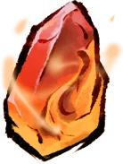

# 【卡牌修仙传】图鉴攻略 — 卡牌 / 内丹

- 收录总数：21（游戏官方数据）
- 更新时间：2026-11-20 16:59

---

## 1. 内丹

妖兽通过修炼凝聚的生命精华和生命结晶

可以把内丹通过"炼制"，获得其他卡牌

### 【各版本（境界 / 品质）】

练气·人品：炼化：必得：修为；另外随机一次：金灵气 50%、黑尾毛/毒囊（随机一种） 10%、什么都没有 40%；获得方式 击败「山豹」必定掉落、击败「耳鼠」、「毒蟾」有概率掉落、在「山脚下」利用傀儡，有概率获得、在「金芒矿(小)」（〔金〕地点）探索（放入「无名氏或神识或自由模式主角」），有概率获得（主角练气期）、在「金芒矿(小)」（〔金〕地点）探索（放入「无名氏或神识或自由模式主角」），有概率获得（主角筑基/结丹/元婴/化神/炼虚/合体/大乘期）、在「金芒矿(小)」（〔金〕地点）利用傀儡，有概率获得（主角筑基/结丹/元婴/化神/炼虚/合体/大乘期）、在「金芒矿(小)」（〔金〕地点）利用傀儡，有概率获得、在「山脚下」探索（放入「无名氏或自由模式主角」），有概率获得、在「山脚下」利用神识感知，有概率获得（主角练气期）、在「山脚下」探索（放入「无名氏或神识或自由模式主角」），有概率获得（主角筑基/结丹/元婴/化神/炼虚/合体/大乘期）

练气·人品：炼化：必得：修为；另外随机一次：木灵气 50%、青蛇鳞片/小根兽骨（随机一种） 10%、什么都没有 40%；获得方式 击败「树妖」必定掉落、击败「青蛇」、「长臂猴」有概率掉落、在「山脚下」利用傀儡，有概率获得、在「青灵木(小)」（〔木〕地点）利用傀儡，有概率获得（主角筑基/结丹/元婴/化神/炼虚/合体/大乘期）、在「青灵木(小)」（〔木〕地点）利用傀儡，有概率获得、在「山脚下」探索（放入「无名氏或自由模式主角」），有概率获得、在「山脚下」利用神识感知，有概率获得（主角练气期）、在「山脚下」探索（放入「无名氏或神识或自由模式主角」），有概率获得（主角筑基/结丹/元婴/化神/炼虚/合体/大乘期）

练气·人品：炼化：必得：修为；另外随机一次：水灵气 50%、鱼鳞片/水囊（随机一种） 10%、什么都没有 40%；获得方式 击败「飞鱼」、「花臂章鱼」有概率掉落、在「山脚下」利用傀儡，有概率获得、在「愈魂池(小)」（〔水〕地点）利用傀儡，有概率获得（主角筑基/结丹/元婴/化神/炼虚/合体/大乘期）、在「愈魂池(小)」（〔水〕地点）利用傀儡，有概率获得、在「山脚下」探索（放入「无名氏或自由模式主角」），有概率获得、在「山脚下」利用神识感知，有概率获得（主角练气期）、在「山脚下」探索（放入「无名氏或神识或自由模式主角」），有概率获得（主角筑基/结丹/元婴/化神/炼虚/合体/大乘期）

练气·人品：炼化：必得：修为；另外随机一次：火灵气 50%、利爪/红蛇鳞片（随机一种） 10%、什么都没有 40%；获得方式 击败「火灵树妖」必定掉落、击败「山豹」、「枳首蛇」有概率掉落、在「山脚下」利用傀儡，有概率获得、在「火云树(小)」（〔火〕地点）探索（放入「无名氏或神识或自由模式主角」），有概率获得（主角练气期）、在「火云树(小)」（〔火〕地点）探索（放入「无名氏或神识或自由模式主角」），有概率获得（主角筑基/结丹/元婴/化神/炼虚/合体/大乘期）、在「火云树(小)」（〔火〕地点）利用傀儡，有概率获得（主角筑基/结丹/元婴/化神/炼虚/合体/大乘期）、在「火云树(小)」（〔火〕地点）利用傀儡，有概率获得、在「山脚下」探索（放入「无名氏或自由模式主角」），有概率获得、在「山脚下」利用神识感知，有概率获得（主角练气期）、在「山脚下」探索（放入「无名氏或神识或自由模式主角」），有概率获得（主角筑基/结丹/元婴/化神/炼虚/合体/大乘期）

练气·人品：炼化：必得：修为；另外随机一次：土灵气 50%、长兽骨/大兽骨（随机一种） 10%、什么都没有 40%；获得方式 击败「鸣鸟」、「巨象」有概率掉落、在「山脚下」利用傀儡，有概率获得、在「凝土墟(小)」（〔土〕地点）利用傀儡，有概率获得（主角筑基/结丹/元婴/化神/炼虚/合体/大乘期）、在「凝土墟(小)」（〔土〕地点）利用傀儡，有概率获得、在「山脚下」探索（放入「无名氏或自由模式主角」），有概率获得、在「山脚下」利用神识感知，有概率获得（主角练气期）、在「山脚下」探索（放入「无名氏或神识或自由模式主角」），有概率获得（主角筑基/结丹/元婴/化神/炼虚/合体/大乘期）

练气·神品：炼化：必得：修为、金灵气、思绪；另外随机一次：混沌灵气 15%、金灵气 20%、黑尾毛/毒囊（随机一种） 30%、什么都没有 35%；炼化：必得：修为；另外随机一次：金灵气 50%、黑尾毛/毒囊（随机一种） 20%、什么都没有 30%；获得方式 击败「耳鼠」、「毒蟾」有概率掉落、在「山脚下」利用傀儡，有概率获得、在「金芒矿(小)」（〔金〕地点）探索（放入「无名氏或神识或自由模式主角」），有概率获得（主角练气期）、在「金芒矿(小)」（〔金〕地点）探索（放入「无名氏或神识或自由模式主角」），有概率获得（主角筑基/结丹/元婴/化神/炼虚/合体/大乘期）、在「金芒矿(小)」（〔金〕地点）利用傀儡，有概率获得（主角筑基/结丹/元婴/化神/炼虚/合体/大乘期）、在「金芒矿(小)」（〔金〕地点）利用傀儡，有概率获得

练气·神品：炼化：必得：修为、木灵气、思绪；另外随机一次：混沌灵气 15%、木灵气 20%、青蛇鳞片/小根兽骨（随机一种） 30%、什么都没有 35%；炼化：必得：修为；另外随机一次：木灵气 50%、青蛇鳞片/小根兽骨（随机一种） 20%、什么都没有 30%；获得方式 击败「青蛇」、「长臂猴」有概率掉落、在「山脚下」利用傀儡，有概率获得、在「青灵木(小)」（〔木〕地点）利用傀儡，有概率获得（主角筑基/结丹/元婴/化神/炼虚/合体/大乘期）、在「青灵木(小)」（〔木〕地点）利用傀儡，有概率获得

练气·神品：炼化：必得：修为、水灵气、思绪；另外随机一次：混沌灵气 15%、水灵气 20%、鱼鳞片/水囊（随机一种） 30%、什么都没有 35%；炼化：必得：修为；另外随机一次：金灵气 50%、黑尾毛/毒囊（随机一种） 20%、什么都没有 30%；获得方式 击败「飞鱼」、「花臂章鱼」有概率掉落、在「山脚下」利用傀儡，有概率获得、在「愈魂池(小)」（〔水〕地点）利用傀儡，有概率获得（主角筑基/结丹/元婴/化神/炼虚/合体/大乘期）、在「愈魂池(小)」（〔水〕地点）利用傀儡，有概率获得

练气·神品：炼化：必得：修为、火灵气、思绪；另外随机一次：混沌灵气 15%、火灵气 20%、利爪/红蛇鳞片（随机一种） 30%、什么都没有 35%；炼化：必得：修为；另外随机一次：火灵气 50%、利爪/红蛇鳞片（随机一种） 20%、什么都没有 30%；获得方式 击败「山豹」、「枳首蛇」有概率掉落、在「山脚下」利用傀儡，有概率获得、在「火云树(小)」（〔火〕地点）探索（放入「无名氏或神识或自由模式主角」），有概率获得（主角练气期）、在「火云树(小)」（〔火〕地点）探索（放入「无名氏或神识或自由模式主角」），有概率获得（主角筑基/结丹/元婴/化神/炼虚/合体/大乘期）、在「火云树(小)」（〔火〕地点）利用傀儡，有概率获得（主角筑基/结丹/元婴/化神/炼虚/合体/大乘期）、在「火云树(小)」（〔火〕地点）利用傀儡，有概率获得

练气·神品：炼化：必得：修为、土灵气、思绪；另外随机一次：混沌灵气 15%、土灵气 20%、长兽骨/大兽骨（随机一种） 30%、什么都没有 35%；炼化：必得：修为；另外随机一次：土灵气 50%、长兽骨/大兽骨（随机一种） 20%、什么都没有 30%；获得方式 击败「鸣鸟」、「巨象」有概率掉落、在「山脚下」利用傀儡，有概率获得、在「凝土墟(小)」（〔土〕地点）利用傀儡，有概率获得（主角筑基/结丹/元婴/化神/炼虚/合体/大乘期）、在「凝土墟(小)」（〔土〕地点）利用傀儡，有概率获得

练气·绝品：炼化：必得：修为、黑尾毛/毒囊（随机一种）、机缘；另外随机一次：混沌灵气 20%、金灵气 15%、黑尾毛/毒囊（随机一种） 30%、修为 35%；获得方式 击败「耳鼠」、「毒蟾」必定掉落、在「山脚下」利用傀儡，有概率获得、在「金芒矿(小)」（〔金〕地点）探索（放入「无名氏或神识或自由模式主角」），有概率获得（主角练气期）、在「金芒矿(小)」（〔金〕地点）探索（放入「无名氏或神识或自由模式主角」），有概率获得（主角筑基/结丹/元婴/化神/炼虚/合体/大乘期）、在「金芒矿(小)」（〔金〕地点）利用傀儡，有概率获得（主角筑基/结丹/元婴/化神/炼虚/合体/大乘期）、在「金芒矿(小)」（〔金〕地点）利用傀儡，有概率获得、把〈藏宝之地（练气）〉放进调查工作台「探索宝物」，有概率获得

练气·绝品：炼化：必得：修为、青蛇鳞片/小根兽骨（随机一种）、机缘；另外随机一次：混沌灵气 20%、木灵气 15%、青蛇鳞片/小根兽骨（随机一种） 30%、修为 35%；获得方式 击败「青蛇」、「长臂猴」必定掉落、在「山脚下」利用傀儡，有概率获得、在「青灵木(小)」（〔木〕地点）利用傀儡，有概率获得（主角筑基/结丹/元婴/化神/炼虚/合体/大乘期）、在「青灵木(小)」（〔木〕地点）利用傀儡，有概率获得、把〈藏宝之地（练气）〉放进调查工作台「探索宝物」，有概率获得

练气·绝品：炼化：必得：修为、鱼鳞片/水囊（随机一种）、机缘；另外随机一次：混沌灵气 20%、水灵气 15%、鱼鳞片/水囊（随机一种） 30%、修为 35%；获得方式 击败「飞鱼」、「花臂章鱼」必定掉落、在「山脚下」利用傀儡，有概率获得、在「愈魂池(小)」（〔水〕地点）利用傀儡，有概率获得（主角筑基/结丹/元婴/化神/炼虚/合体/大乘期）、在「愈魂池(小)」（〔水〕地点）利用傀儡，有概率获得、把〈藏宝之地（练气）〉放进调查工作台「探索宝物」，有概率获得

练气·绝品：炼化：必得：修为、利爪/红蛇鳞片（随机一种）、机缘；另外随机一次：混沌灵气 20%、火灵气 15%、利爪/红蛇鳞片（随机一种） 30%、修为 35%；获得方式 击败「山豹」、「枳首蛇」、「火灵树妖」必定掉落、在「山脚下」利用傀儡，有概率获得、在「火云树(小)」（〔火〕地点）探索（放入「无名氏或神识或自由模式主角」），有概率获得（主角练气期）、在「火云树(小)」（〔火〕地点）探索（放入「无名氏或神识或自由模式主角」），有概率获得（主角筑基/结丹/元婴/化神/炼虚/合体/大乘期）、在「火云树(小)」（〔火〕地点）利用傀儡，有概率获得（主角筑基/结丹/元婴/化神/炼虚/合体/大乘期）、在「火云树(小)」（〔火〕地点）利用傀儡，有概率获得、把〈藏宝之地（练气）〉放进调查工作台「探索宝物」，有概率获得

练气·绝品：炼化：必得：修为、长兽骨/大兽骨（随机一种）、机缘；另外随机一次：混沌灵气 20%、土灵气 15%、长兽骨/大兽骨（随机一种） 30%、修为 35%；获得方式 击败「鸣鸟」、「巨象」必定掉落、在「山脚下」利用傀儡，有概率获得、在「凝土墟(小)」（〔土〕地点）利用傀儡，有概率获得（主角筑基/结丹/元婴/化神/炼虚/合体/大乘期）、在「凝土墟(小)」（〔土〕地点）利用傀儡，有概率获得、把〈藏宝之地（练气）〉放进调查工作台「探索宝物」，有概率获得

筑基·人品：炼化：必得：修为；另外随机一次：兑金 50%、黑尾毛/金色毒囊/獠牙/银精（随机一种） 10%、什么都没有 40%；获得方式 击败「飞鼠」、「金毒蟾」有概率掉落、在「金芒矿」（〔金〕地点）探索（放入「无名氏或神识或自由模式主角」），有概率获得（主角筑基期）、在「金芒矿」（〔金〕地点）利用傀儡，有概率获得、「苏软软」每年送的礼物（主角筑基期）：好感 ≥ 10（随机给一张）

筑基·人品：炼化：必得：修为；另外随机一次：震木 50%、青蛇鳞片/扇耳/骨爪（随机一种） 10%、什么都没有 40%；获得方式 击败「长蛇」、「鬼脸长臂猴」、「化蛇」有概率掉落、在「青灵木」（〔木〕地点）利用傀儡，有概率获得、「苏软软」每年送的礼物（主角筑基期）：好感 ≥ 10（随机给一张）

筑基·人品：炼化：必得：修为；另外随机一次：坎水 50%、巨大水囊/蛟鳞片（随机一种） 10%、什么都没有 40%；获得方式 击败「北海巨妖（小）」、「入水蛟」有概率掉落、在「愈魂池」（〔水〕地点）利用傀儡，有概率获得、「苏软软」每年送的礼物（主角筑基期）：好感 ≥ 10（随机给一张）

筑基·人品：炼化：必得：修为；另外随机一次：离火 50%、赤红利爪/红蛇鳞片（随机一种） 10%、什么都没有 40%；获得方式 击败「赤红豹」、「三头枳首蛇」有概率掉落、在「火云树」（〔火〕地点）探索（放入「无名氏或自由模式主角」），有概率获得、在「火云树」（〔火〕地点）探索（放入「神识」），有概率获得（主角筑基期）、在「火云树」（〔火〕地点）利用傀儡，有概率获得、「苏软软」每年送的礼物（主角筑基期）：好感 ≥ 10（随机给一张）

筑基·人品：炼化：必得：修为；另外随机一次：艮土 50%、长兽骨 10%、什么都没有 40%；获得方式 击败「鸣坟鸠」、「青口兽」有概率掉落、在「凝土墟」（〔土〕地点）利用傀儡，有概率获得、「苏软软」每年送的礼物（主角筑基期）：好感 ≥ 10（随机给一张）

筑基·神品：炼化：必得：修为、兑金、思绪；另外随机一次：混沌灵气 15%、兑金 20%、黑尾毛/金色毒囊/獠牙/银精（随机一种） 30%、什么都没有 35%；炼化：必得：修为；另外随机一次：兑金 50%、黑尾毛/金色毒囊/獠牙/银精（随机一种） 20%、什么都没有 30%；获得方式 击败「飞鼠」、「金毒蟾」有概率掉落、在「金芒矿」（〔金〕地点）探索（放入「无名氏或神识或自由模式主角」），有概率获得（主角筑基期）、在「金芒矿」（〔金〕地点）利用傀儡，有概率获得、「苏软软」每年送的礼物（主角筑基期）：好感 ≥ 25（随机给一张）

筑基·神品：炼化：必得：修为、震木、思绪；另外随机一次：混沌灵气 15%、震木 20%、青蛇鳞片/扇耳/骨爪（随机一种） 30%、什么都没有 35%；炼化：必得：修为；另外随机一次：震木 50%、青蛇鳞片/扇耳/骨爪（随机一种） 20%、什么都没有 30%；获得方式 击败「长蛇」、「鬼脸长臂猴」、「化蛇」有概率掉落、在「青灵木」（〔木〕地点）利用傀儡，有概率获得、「苏软软」每年送的礼物（主角筑基期）：好感 ≥ 25（随机给一张）

筑基·神品：炼化：必得：修为、坎水、思绪；另外随机一次：混沌灵气 15%、坎水 20%、巨大水囊/蛟鳞片（随机一种） 30%、什么都没有 35%；炼化：必得：修为；另外随机一次：兑金 50%、黑尾毛/金色毒囊/獠牙/银精（随机一种） 20%、什么都没有 30%；获得方式 击败「北海巨妖（小）」、「入水蛟」有概率掉落、在「愈魂池」（〔水〕地点）利用傀儡，有概率获得、「苏软软」每年送的礼物（主角筑基期）：好感 ≥ 25（随机给一张）

筑基·神品：炼化：必得：修为、离火、思绪；另外随机一次：混沌灵气 15%、离火 20%、赤红利爪/红蛇鳞片（随机一种） 30%、什么都没有 35%；炼化：必得：修为；另外随机一次：离火 50%、赤红利爪/红蛇鳞片（随机一种） 20%、什么都没有 30%；获得方式 击败「赤红豹」、「三头枳首蛇」有概率掉落、在「火云树」（〔火〕地点）探索（放入「无名氏或自由模式主角」），有概率获得、在「火云树」（〔火〕地点）探索（放入「神识」），有概率获得（主角筑基期）、在「火云树」（〔火〕地点）利用傀儡，有概率获得、「苏软软」每年送的礼物（主角筑基期）：好感 ≥ 25（随机给一张）

筑基·神品：炼化：必得：修为、艮土、思绪；另外随机一次：混沌灵气 15%、艮土 20%、长兽骨 30%、什么都没有 35%；炼化：必得：修为；另外随机一次：艮土 50%、长兽骨 20%、什么都没有 30%；获得方式 击败「鸣坟鸠」、「青口兽」有概率掉落、在「凝土墟」（〔土〕地点）利用傀儡，有概率获得、「苏软软」每年送的礼物（主角筑基期）：好感 ≥ 25（随机给一张）

筑基·绝品：炼化：必得：修为、黑尾毛/金色毒囊/獠牙/银精（随机一种）、机缘；另外随机一次：混沌灵气 20%、兑金 15%、黑尾毛/金色毒囊/獠牙/银精（随机一种） 30%、修为 35%；获得方式 击败「飞鼠」、「金毒蟾」必定掉落、在「金芒矿」（〔金〕地点）探索（放入「无名氏或神识或自由模式主角」），有概率获得（主角筑基期）、在「金芒矿」（〔金〕地点）利用傀儡，有概率获得、「苏软软」每年送的礼物（主角筑基期）：好感 ≥ 45（随机给一张）、把〈藏宝之地（筑基）〉放进调查工作台「探索宝物」，有概率获得

筑基·绝品：炼化：必得：修为、青蛇鳞片/扇耳/骨爪（随机一种）、机缘；另外随机一次：混沌灵气 20%、震木 15%、青蛇鳞片/扇耳/骨爪（随机一种） 30%、修为 35%；获得方式 击败「长蛇」、「鬼脸长臂猴」、「化蛇」必定掉落、在「青灵木」（〔木〕地点）利用傀儡，有概率获得、「苏软软」每年送的礼物（主角筑基期）：好感 ≥ 45（随机给一张）、把〈藏宝之地（筑基）〉放进调查工作台「探索宝物」，有概率获得

筑基·绝品：炼化：必得：修为、巨大水囊/蛟鳞片（随机一种）、机缘；另外随机一次：混沌灵气 20%、坎水 15%、巨大水囊/蛟鳞片（随机一种） 30%、修为 35%；获得方式 击败「北海巨妖（小）」、「入水蛟」必定掉落、在「愈魂池」（〔水〕地点）利用傀儡，有概率获得、「苏软软」每年送的礼物（主角筑基期）：好感 ≥ 45（随机给一张）、把〈藏宝之地（筑基）〉放进调查工作台「探索宝物」，有概率获得

筑基·绝品：炼化：必得：修为、赤红利爪/红蛇鳞片（随机一种）、机缘；另外随机一次：混沌灵气 20%、离火 15%、赤红利爪/红蛇鳞片（随机一种） 30%、修为 35%；获得方式 击败「赤红豹」、「三头枳首蛇」必定掉落、在「火云树」（〔火〕地点）探索（放入「无名氏或自由模式主角」），有概率获得、在「火云树」（〔火〕地点）探索（放入「神识」），有概率获得（主角筑基期）、在「火云树」（〔火〕地点）利用傀儡，有概率获得、「苏软软」每年送的礼物（主角筑基期）：好感 ≥ 45（随机给一张）、把〈藏宝之地（筑基）〉放进调查工作台「探索宝物」，有概率获得

筑基·绝品：炼化：必得：修为、长兽骨、机缘；另外随机一次：混沌灵气 20%、艮土 15%、长兽骨 30%、修为 35%；获得方式 击败「鸣坟鸠」、「青口兽」必定掉落、在「凝土墟」（〔土〕地点）利用傀儡，有概率获得、「苏软软」每年送的礼物（主角筑基期）：好感 ≥ 45（随机给一张）、把〈藏宝之地（筑基）〉放进调查工作台「探索宝物」，有概率获得

结丹·人品：炼化：必得：修为；另外随机一次：太乙精金 50%、尸黑羽毛/金色毒囊/滴血獠牙/皇极银（随机一种） 10%、什么都没有 40%；获得方式 击败「三足金毒蟾」、「噬金狂蚣」有概率掉落、在「金芒矿」（〔金〕地点）探索（放入「无名氏或神识或自由模式主角」），有概率获得（主角结丹期）、在「金芒矿」（〔金〕地点）探索（放入「无名氏或神识或自由模式主角」），有概率获得（主角结丹/元婴/化神/炼虚/合体/大乘期）、在「金芒矿」（〔金〕地点）利用傀儡，有概率获得、「苏软软」每年送的礼物（主角结丹期）：好感 ≥ 10（随机给一张）

结丹·人品：炼化：必得：修为；另外随机一次：青阳木精 50%、骨脸/千棘藤心（随机一种） 10%、什么都没有 40%；获得方式 击败「鬼脸飞蛇」、「千棘藤妖」有概率掉落、在「青灵木」（〔木〕地点）利用傀儡，有概率获得、「苏软软」每年送的礼物（主角结丹期）：好感 ≥ 10（随机给一张）

结丹·人品：炼化：必得：修为；另外随机一次：九阴黑水 50%、流水鳞片/龙鲤血（随机一种） 10%、什么都没有 40%；获得方式 击败「凶蛟」、「彩鳞龙鲤」有概率掉落、在「愈魂池」（〔水〕地点）利用傀儡，有概率获得、「苏软软」每年送的礼物（主角结丹期）：好感 ≥ 10（随机给一张）

结丹·人品：炼化：必得：修为；另外随机一次：三昧真火 50%、赤红角/鲜红蛇鳞片/噬金甲（随机一种） 10%、什么都没有 40%；获得方式 击败「独角赤豹」、「六头枳首蛇」有概率掉落、在「火云树」（〔火〕地点）探索（放入「无名氏或自由模式主角」），有概率获得、在「火云树」（〔火〕地点）探索（放入「神识」），有概率获得（主角结丹期）、在「火云树」（〔火〕地点）探索（放入「神识」），有概率获得（主角结丹/元婴/化神/炼虚/合体/大乘期）、在「火云树」（〔火〕地点）利用傀儡，有概率获得、「苏软软」每年送的礼物（主角结丹期）：好感 ≥ 10（随机给一张）

结丹·人品：炼化：必得：修为；另外随机一次：镇地黄土 50%、长兽骨 10%、什么都没有 40%；获得方式 击败「尸鸠」、「獠牙烈兽」有概率掉落、在「凝土墟」（〔土〕地点）利用傀儡，有概率获得、「苏软软」每年送的礼物（主角结丹期）：好感 ≥ 10（随机给一张）

结丹·神品：炼化：必得：修为、太乙精金、思绪；另外随机一次：混沌灵气 15%、太乙精金 20%、尸黑羽毛/金色毒囊/滴血獠牙/皇极银（随机一种） 30%、什么都没有 35%；炼化：必得：修为；另外随机一次：太乙精金 50%、尸黑羽毛/金色毒囊/滴血獠牙/皇极银（随机一种） 20%、什么都没有 30%；获得方式 击败「三足金毒蟾」、「噬金狂蚣」有概率掉落、在「金芒矿」（〔金〕地点）探索（放入「无名氏或神识或自由模式主角」），有概率获得（主角结丹期）、在「金芒矿」（〔金〕地点）探索（放入「无名氏或神识或自由模式主角」），有概率获得（主角结丹/元婴/化神/炼虚/合体/大乘期）、在「金芒矿」（〔金〕地点）利用傀儡，有概率获得、「苏软软」每年送的礼物（主角结丹期）：好感 ≥ 25（随机给一张）

结丹·神品：炼化：必得：修为、青阳木精、思绪；另外随机一次：混沌灵气 15%、青阳木精 20%、骨脸/千棘藤心（随机一种） 30%、什么都没有 35%；炼化：必得：修为；另外随机一次：青阳木精 50%、骨脸/千棘藤心（随机一种） 20%、什么都没有 30%；获得方式 击败「鬼脸飞蛇」、「千棘藤妖」有概率掉落、在「青灵木」（〔木〕地点）利用傀儡，有概率获得、「苏软软」每年送的礼物（主角结丹期）：好感 ≥ 25（随机给一张）

结丹·神品：炼化：必得：修为、九阴黑水、思绪；另外随机一次：混沌灵气 15%、九阴黑水 20%、流水鳞片/龙鲤血（随机一种） 30%、什么都没有 35%；炼化：必得：修为；另外随机一次：太乙精金 50%、尸黑羽毛/金色毒囊/滴血獠牙/皇极银（随机一种） 20%、什么都没有 30%；获得方式 击败「凶蛟」、「彩鳞龙鲤」有概率掉落、在「愈魂池」（〔水〕地点）利用傀儡，有概率获得、「苏软软」每年送的礼物（主角结丹期）：好感 ≥ 25（随机给一张）

结丹·神品：炼化：必得：修为、三昧真火、思绪；另外随机一次：混沌灵气 15%、三昧真火 20%、赤红角/鲜红蛇鳞片/噬金甲（随机一种） 30%、什么都没有 35%；炼化：必得：修为；另外随机一次：三昧真火 50%、赤红角/鲜红蛇鳞片/噬金甲（随机一种） 20%、什么都没有 30%；获得方式 击败「独角赤豹」、「六头枳首蛇」有概率掉落、在「火云树」（〔火〕地点）探索（放入「无名氏或自由模式主角」），有概率获得、在「火云树」（〔火〕地点）探索（放入「神识」），有概率获得（主角结丹期）、在「火云树」（〔火〕地点）探索（放入「神识」），有概率获得（主角结丹/元婴/化神/炼虚/合体/大乘期）、在「火云树」（〔火〕地点）利用傀儡，有概率获得、「苏软软」每年送的礼物（主角结丹期）：好感 ≥ 25（随机给一张）

结丹·神品：炼化：必得：修为、镇地黄土、思绪；另外随机一次：混沌灵气 15%、镇地黄土 20%、长兽骨 30%、什么都没有 35%；炼化：必得：修为；另外随机一次：镇地黄土 50%、长兽骨 20%、什么都没有 30%；获得方式 击败「尸鸠」、「獠牙烈兽」有概率掉落、在「凝土墟」（〔土〕地点）利用傀儡，有概率获得、「苏软软」每年送的礼物（主角结丹期）：好感 ≥ 25（随机给一张）

结丹·绝品：炼化：必得：修为、尸黑羽毛/金色毒囊/滴血獠牙/皇极银（随机一种）、机缘；另外随机一次：混沌灵气 20%、太乙精金 15%、尸黑羽毛/金色毒囊/滴血獠牙/皇极银（随机一种） 30%、修为 35%；获得方式 击败「三足金毒蟾」、「噬金狂蚣」必定掉落、在「金芒矿」（〔金〕地点）探索（放入「无名氏或神识或自由模式主角」），有概率获得（主角结丹期）、在「金芒矿」（〔金〕地点）探索（放入「无名氏或神识或自由模式主角」），有概率获得（主角结丹/元婴/化神/炼虚/合体/大乘期）、在「金芒矿」（〔金〕地点）利用傀儡，有概率获得、「苏软软」每年送的礼物（主角结丹期）：好感 ≥ 45（随机给一张）、把〈藏宝之地（结丹）〉放进调查工作台「探索宝物」，有概率获得

结丹·绝品：炼化：必得：修为、骨脸/千棘藤心（随机一种）、机缘；另外随机一次：混沌灵气 20%、青阳木精 15%、骨脸/千棘藤心（随机一种） 30%、修为 35%；获得方式 击败「鬼脸飞蛇」、「千棘藤妖」必定掉落、在「青灵木」（〔木〕地点）利用傀儡，有概率获得、「苏软软」每年送的礼物（主角结丹期）：好感 ≥ 45（随机给一张）、把〈藏宝之地（结丹）〉放进调查工作台「探索宝物」，有概率获得

结丹·绝品：炼化：必得：修为、流水鳞片/龙鲤血（随机一种）、机缘；另外随机一次：混沌灵气 20%、九阴黑水 15%、流水鳞片/龙鲤血（随机一种） 30%、修为 35%；获得方式 击败「凶蛟」、「彩鳞龙鲤」必定掉落、在「愈魂池」（〔水〕地点）利用傀儡，有概率获得、「苏软软」每年送的礼物（主角结丹期）：好感 ≥ 45（随机给一张）、把〈藏宝之地（结丹）〉放进调查工作台「探索宝物」，有概率获得

结丹·绝品：炼化：必得：修为、赤红角/鲜红蛇鳞片/噬金甲（随机一种）、机缘；另外随机一次：混沌灵气 20%、三昧真火 15%、赤红角/鲜红蛇鳞片/噬金甲（随机一种） 30%、修为 35%；获得方式 击败「独角赤豹」、「六头枳首蛇」必定掉落、在「火云树」（〔火〕地点）探索（放入「无名氏或自由模式主角」），有概率获得、在「火云树」（〔火〕地点）探索（放入「神识」），有概率获得（主角结丹期）、在「火云树」（〔火〕地点）探索（放入「神识」），有概率获得（主角结丹/元婴/化神/炼虚/合体/大乘期）、在「火云树」（〔火〕地点）利用傀儡，有概率获得、「苏软软」每年送的礼物（主角结丹期）：好感 ≥ 45（随机给一张）、把〈藏宝之地（结丹）〉放进调查工作台「探索宝物」，有概率获得

结丹·绝品：炼化：必得：修为、长兽骨、机缘；另外随机一次：混沌灵气 20%、镇地黄土 15%、长兽骨 30%、修为 35%；获得方式 击败「尸鸠」、「獠牙烈兽」必定掉落、在「凝土墟」（〔土〕地点）利用傀儡，有概率获得、「苏软软」每年送的礼物（主角结丹期）：好感 ≥ 45（随机给一张）、把〈藏宝之地（结丹）〉放进调查工作台「探索宝物」，有概率获得

---

## 2. 坟蛊鸪的内丹

妖王的内丹：放进炼制工作台「炼化妖王内丹」可获得修为和随机奖励。

### 【各版本（境界 / 品质）】

练气·绝品：炼化：必得：修为×2、思绪、主角〔寿命〕+1；另外随机一次：机缘 10%、灵兽神魄人品 15%、长兽骨/大兽骨（随机一种）×5 10%、什么都没有 65%；获得方式 击败「坟蛊鸪」必定掉落

筑基·绝品：炼化：必得：修为、阴坟骨/腐羽蛊翎（随机一种）、主角〔寿命〕+1；另外随机一次：机缘 10%、灵兽神魄人品 15%、随机一张筑基后期材料（共12种）×5 10%、思绪 25%、什么都没有 40%；获得方式 击败「坟蛊鸪」必定掉落、「悦萱儿」自己突破时送你：到结丹前期（好感 ≥ 15）（随机给一张）、把〈宝藏〉放进调查工作台「打开宝箱」，有概率获得

结丹·绝品：炼化：必得：修为、阴坟骨/腐羽蛊翎（随机一种）、主角〔寿命〕+1；另外随机一次：机缘 10%、灵兽神魄人品 15%、随机一张结丹后期材料（共12种）×5 10%、思绪 25%、什么都没有 40%；获得方式 击败「坟蛊鸪」必定掉落、「悦萱儿」自己突破时送你：到元婴前期（好感 ≥ 45）（随机给一张）、把〈宝藏〉放进调查工作台「打开宝箱」，有概率获得

元婴·绝品：炼化：必得：修为、阴坟骨/腐羽蛊翎（随机一种）、主角〔寿命〕+1；另外随机一次：机缘 10%、灵兽神魄人品 15%、思绪 25%、什么都没有 50%；获得方式 击败「坟蛊鸪」必定掉落

---

## 3. 鬼面蛛的内丹

妖王的内丹：放进炼制工作台「炼化妖王内丹」可获得修为和随机奖励。

### 【各版本（境界 / 品质）】

练气·绝品：炼化：必得：修为×2、思绪、主角〔寿命〕+1；另外随机一次：机缘 10%、灵兽神魄人品 15%、长兽骨/大兽骨（随机一种）×5 10%、什么都没有 65%；获得方式 击败「鬼面蛛」必定掉落

筑基·绝品：炼化：必得：修为、鬼面毒丝/剧毒液（随机一种）、主角〔寿命〕+1；另外随机一次：机缘 10%、灵兽神魄人品 15%、随机一张筑基后期材料（共12种）×5 10%、思绪 25%、什么都没有 40%；获得方式 击败「鬼面蛛」必定掉落、「悦萱儿」自己突破时送你：到结丹前期（好感 ≥ 15）（随机给一张）、把〈宝藏〉放进调查工作台「打开宝箱」，有概率获得

结丹·绝品：炼化：必得：修为、鬼面毒丝/剧毒液（随机一种）、主角〔寿命〕+1；另外随机一次：机缘 10%、灵兽神魄人品 15%、随机一张结丹后期材料（共12种）×5 10%、思绪 25%、什么都没有 40%；获得方式 击败「鬼面蛛」必定掉落、「悦萱儿」自己突破时送你：到元婴前期（好感 ≥ 45）（随机给一张）、把〈宝藏〉放进调查工作台「打开宝箱」，有概率获得

元婴·绝品：炼化：必得：修为、鬼面毒丝/剧毒液（随机一种）、主角〔寿命〕+1；另外随机一次：机缘 10%、灵兽神魄人品 15%、思绪 25%、什么都没有 50%；获得方式 击败「鬼面蛛」必定掉落

---

## 4. 无名妖兽的内丹

无名妖王的内丹，因为取丹时间太久，其蕴含的能力已经变得很弱，但依然保留妖王内丹的性质

### 【各版本（境界 / 品质）】

筑基·绝品：获得方式 「悦萱儿」自己突破时送你：到结丹前期（好感 ≥ 15）（随机给一张）、把〈宝藏〉放进调查工作台「打开宝箱」，有概率获得、在「金芒矿」（〔金〕地点）利用傀儡，有概率获得

筑基·绝品：获得方式 「悦萱儿」自己突破时送你：到结丹前期（好感 ≥ 15）（随机给一张）、把〈宝藏〉放进调查工作台「打开宝箱」，有概率获得、在「青灵木」（〔木〕地点）利用傀儡，有概率获得

筑基·绝品：获得方式 「悦萱儿」自己突破时送你：到结丹前期（好感 ≥ 15）（随机给一张）、把〈宝藏〉放进调查工作台「打开宝箱」，有概率获得、在「愈魂池」（〔水〕地点）利用傀儡，有概率获得

筑基·绝品：获得方式 「悦萱儿」自己突破时送你：到结丹前期（好感 ≥ 15）（随机给一张）、把〈宝藏〉放进调查工作台「打开宝箱」，有概率获得、在「火云树」（〔火〕地点）利用傀儡，有概率获得

筑基·绝品：获得方式 「悦萱儿」自己突破时送你：到结丹前期（好感 ≥ 15）（随机给一张）、把〈宝藏〉放进调查工作台「打开宝箱」，有概率获得、在「凝土墟」（〔土〕地点）利用傀儡，有概率获得

筑基·绝品：获得方式 「悦萱儿」自己突破时送你：到结丹前期（好感 ≥ 15）（随机给一张）、把〈宝藏〉放进调查工作台「打开宝箱」，有概率获得

筑基·绝品：获得方式 「悦萱儿」自己突破时送你：到结丹前期（好感 ≥ 15）（随机给一张）、把〈宝藏〉放进调查工作台「打开宝箱」，有概率获得

结丹·绝品：获得方式 「悦萱儿」自己突破时送你：到元婴前期（好感 ≥ 45）（随机给一张）、把〈宝藏〉放进调查工作台「打开宝箱」，有概率获得、在「金芒矿」（〔金〕地点）利用傀儡，有概率获得

结丹·绝品：获得方式 「悦萱儿」自己突破时送你：到元婴前期（好感 ≥ 45）（随机给一张）、把〈宝藏〉放进调查工作台「打开宝箱」，有概率获得、在「青灵木」（〔木〕地点）利用傀儡，有概率获得

结丹·绝品：获得方式 「悦萱儿」自己突破时送你：到元婴前期（好感 ≥ 45）（随机给一张）、把〈宝藏〉放进调查工作台「打开宝箱」，有概率获得、在「愈魂池」（〔水〕地点）利用傀儡，有概率获得

结丹·绝品：获得方式 「悦萱儿」自己突破时送你：到元婴前期（好感 ≥ 45）（随机给一张）、把〈宝藏〉放进调查工作台「打开宝箱」，有概率获得、在「火云树」（〔火〕地点）利用傀儡，有概率获得

结丹·绝品：获得方式 「悦萱儿」自己突破时送你：到元婴前期（好感 ≥ 45）（随机给一张）、把〈宝藏〉放进调查工作台「打开宝箱」，有概率获得、在「凝土墟」（〔土〕地点）利用傀儡，有概率获得

结丹·绝品：获得方式 「悦萱儿」自己突破时送你：到元婴前期（好感 ≥ 45）（随机给一张）、把〈宝藏〉放进调查工作台「打开宝箱」，有概率获得

结丹·绝品：获得方式 「悦萱儿」自己突破时送你：到元婴前期（好感 ≥ 45）（随机给一张）、把〈宝藏〉放进调查工作台「打开宝箱」，有概率获得

### 【获取途径】

击败妖王「无名妖兽」获得（各境界的「无名妖兽」掉落对应境界的内丹）

---

## 5. 妖剑的眼

妖王的内丹：放进炼制工作台「炼化妖王内丹」可获得修为和随机奖励。

### 【各版本（境界 / 品质）】

筑基·绝品：炼化：必得：修为、剑魂残魄、主角〔寿命〕+1；另外随机一次：机缘 10%、灵兽神魄人品 15%、黑尾毛/金色毒囊/獠牙/银精（随机一种）×5 10%、思绪 25%、什么都没有 40%；获得方式 击败「妖剑」必定掉落、「悦萱儿」自己突破时送你：到结丹前期（好感 ≥ 15）（随机给一张）、把〈宝藏〉放进调查工作台「打开宝箱」，有概率获得、在「金芒矿」（〔金〕地点）利用傀儡，有概率获得

结丹·绝品：炼化：必得：修为、剑魂残魄、主角〔寿命〕+1；另外随机一次：机缘 10%、灵兽神魄人品 15%、尸黑羽毛/金色毒囊/滴血獠牙/皇极银（随机一种）×5 10%、思绪 25%、什么都没有 40%；获得方式 击败「妖剑」必定掉落、「悦萱儿」自己突破时送你：到元婴前期（好感 ≥ 45）（随机给一张）、把〈宝藏〉放进调查工作台「打开宝箱」，有概率获得、在「金芒矿」（〔金〕地点）利用傀儡，有概率获得

元婴·绝品：炼化：必得：修为、剑魂残魄、主角〔寿命〕+1；另外随机一次：机缘 10%、灵兽神魄人品 15%、思绪 25%、什么都没有 50%；获得方式 击败「妖剑」必定掉落

---

## 6. 金蝉蛊的内丹

妖王的内丹：放进炼制工作台「炼化妖王内丹」可获得修为和随机奖励。

### 【各版本（境界 / 品质）】

筑基·绝品：炼化：必得：修为、不朽蜕壳/魂蛊丝/金蝉（随机一种）、主角〔寿命〕+1；另外随机一次：机缘 10%、灵兽神魄人品 15%、黑尾毛/金色毒囊/獠牙/银精（随机一种）×5 10%、思绪 25%、什么都没有 40%；获得方式 击败「金蝉蛊」必定掉落、「悦萱儿」自己突破时送你：到结丹前期（好感 ≥ 15）（随机给一张）、把〈宝藏〉放进调查工作台「打开宝箱」，有概率获得、在「金芒矿」（〔金〕地点）利用傀儡，有概率获得

结丹·绝品：炼化：必得：修为、不朽蜕壳/魂蛊丝/金蝉（随机一种）、主角〔寿命〕+1；另外随机一次：机缘 10%、灵兽神魄人品 15%、尸黑羽毛/金色毒囊/滴血獠牙/皇极银（随机一种）×5 10%、思绪 25%、什么都没有 40%；获得方式 击败「金蝉蛊」必定掉落、「悦萱儿」自己突破时送你：到元婴前期（好感 ≥ 45）（随机给一张）、把〈宝藏〉放进调查工作台「打开宝箱」，有概率获得、在「金芒矿」（〔金〕地点）利用傀儡，有概率获得

元婴·绝品：炼化：必得：修为、不朽蜕壳/魂蛊丝/金蝉（随机一种）、主角〔寿命〕+1；另外随机一次：机缘 10%、灵兽神魄人品 15%、思绪 25%、什么都没有 50%；获得方式 击败「金蝉蛊」、「金缕」必定掉落

---

## 7. 血藤古树的内丹

妖王的内丹：放进炼制工作台「炼化妖王内丹」可获得修为和随机奖励。

### 【各版本（境界 / 品质）】

筑基·绝品：炼化：必得：修为、血藤蔓/血藤毒刺（随机一种）、主角〔寿命〕+1；另外随机一次：机缘 10%、灵兽神魄人品 15%、青蛇鳞片/扇耳/骨爪（随机一种）×5 10%、思绪 25%、什么都没有 40%；获得方式 击败「血藤古树」必定掉落、「悦萱儿」自己突破时送你：到结丹前期（好感 ≥ 15）（随机给一张）、把〈宝藏〉放进调查工作台「打开宝箱」，有概率获得、在「青灵木」（〔木〕地点）利用傀儡，有概率获得

结丹·绝品：炼化：必得：修为、血藤蔓/血藤毒刺（随机一种）、主角〔寿命〕+1；另外随机一次：机缘 10%、灵兽神魄人品 15%、骨脸/千棘藤心（随机一种）×5 10%、思绪 25%、什么都没有 40%；获得方式 击败「血藤古树」必定掉落、「悦萱儿」自己突破时送你：到元婴前期（好感 ≥ 45）（随机给一张）、把〈宝藏〉放进调查工作台「打开宝箱」，有概率获得、在「青灵木」（〔木〕地点）利用傀儡，有概率获得

元婴·绝品：炼化：必得：修为、血藤蔓/血藤毒刺（随机一种）、主角〔寿命〕+1；另外随机一次：机缘 10%、灵兽神魄人品 15%、思绪 25%、什么都没有 50%；获得方式 击败「血藤古树」、「饮岁」必定掉落

---

## 8. 血肉灵芝的内丹

妖王的内丹：放进炼制工作台「炼化妖王内丹」可获得修为和随机奖励。

### 【各版本（境界 / 品质）】

筑基·绝品：炼化：必得：修为、血肉根/血灵芝（随机一种）、主角〔寿命〕+1；另外随机一次：机缘 10%、灵兽神魄人品 15%、青蛇鳞片/扇耳/骨爪（随机一种）×5 10%、思绪 25%、什么都没有 40%；获得方式 击败「血肉灵芝」必定掉落、「悦萱儿」自己突破时送你：到结丹前期（好感 ≥ 15）（随机给一张）、把〈宝藏〉放进调查工作台「打开宝箱」，有概率获得、在「青灵木」（〔木〕地点）利用傀儡，有概率获得

结丹·绝品：炼化：必得：修为、血肉根/血灵芝（随机一种）、主角〔寿命〕+1；另外随机一次：机缘 10%、灵兽神魄人品 15%、骨脸/千棘藤心（随机一种）×5 10%、思绪 25%、什么都没有 40%；获得方式 击败「血肉灵芝」必定掉落、「悦萱儿」自己突破时送你：到元婴前期（好感 ≥ 45）（随机给一张）、把〈宝藏〉放进调查工作台「打开宝箱」，有概率获得、在「青灵木」（〔木〕地点）利用傀儡，有概率获得

元婴·绝品：炼化：必得：修为、血肉根/血灵芝（随机一种）、主角〔寿命〕+1；另外随机一次：机缘 10%、灵兽神魄人品 15%、思绪 25%、什么都没有 50%；获得方式 击败「血肉灵芝」必定掉落

---

## 9. 夔牛的内丹

妖王的内丹：放进炼制工作台「炼化妖王内丹」可获得修为和随机奖励。

### 【各版本（境界 / 品质）】

筑基·绝品：炼化：必得：修为、夔雷核/风雨精魄（随机一种）、主角〔寿命〕+1；另外随机一次：机缘 10%、灵兽神魄人品 15%、巨大水囊/蛟鳞片（随机一种）×5 10%、思绪 25%、什么都没有 40%；获得方式 击败「夔牛」必定掉落、「悦萱儿」自己突破时送你：到结丹前期（好感 ≥ 15）（随机给一张）、把〈宝藏〉放进调查工作台「打开宝箱」，有概率获得、在「愈魂池」（〔水〕地点）利用傀儡，有概率获得

结丹·绝品：炼化：必得：修为、夔雷核/风雨精魄（随机一种）、主角〔寿命〕+1；另外随机一次：机缘 10%、灵兽神魄人品 15%、流水鳞片/龙鲤血（随机一种）×5 10%、思绪 25%、什么都没有 40%；获得方式 击败「夔牛」必定掉落、「悦萱儿」自己突破时送你：到元婴前期（好感 ≥ 45）（随机给一张）、把〈宝藏〉放进调查工作台「打开宝箱」，有概率获得、在「愈魂池」（〔水〕地点）利用傀儡，有概率获得

元婴·绝品：炼化：必得：修为、夔雷核/风雨精魄（随机一种）、主角〔寿命〕+1；另外随机一次：机缘 10%、灵兽神魄人品 15%、思绪 25%、什么都没有 50%；获得方式 击败「夔牛」必定掉落

---

## 10. 北海巨妖的内丹

妖王的内丹：放进炼制工作台「炼化妖王内丹」可获得修为和随机奖励。

### 【各版本（境界 / 品质）】

筑基·绝品：炼化：必得：修为、巨妖触须/风暴之瞳（随机一种）、主角〔寿命〕+1；另外随机一次：机缘 10%、灵兽神魄人品 15%、巨大水囊/蛟鳞片（随机一种）×5 10%、思绪 25%、什么都没有 40%；获得方式 击败「北海巨妖」必定掉落、「悦萱儿」自己突破时送你：到结丹前期（好感 ≥ 15）（随机给一张）、把〈宝藏〉放进调查工作台「打开宝箱」，有概率获得、在「愈魂池」（〔水〕地点）利用傀儡，有概率获得

结丹·绝品：炼化：必得：修为、巨妖触须/风暴之瞳（随机一种）、主角〔寿命〕+1；另外随机一次：机缘 10%、灵兽神魄人品 15%、流水鳞片/龙鲤血（随机一种）×5 10%、思绪 25%、什么都没有 40%；获得方式 击败「北海巨妖」必定掉落、「悦萱儿」自己突破时送你：到元婴前期（好感 ≥ 45）（随机给一张）、把〈宝藏〉放进调查工作台「打开宝箱」，有概率获得、在「愈魂池」（〔水〕地点）利用傀儡，有概率获得

元婴·绝品：炼化：必得：修为、巨妖触须/风暴之瞳（随机一种）、主角〔寿命〕+1；另外随机一次：机缘 10%、灵兽神魄人品 15%、思绪 25%、什么都没有 50%；获得方式 击败「北海巨妖」、「玄墨」必定掉落

---

## 11. 祸斗的内丹

妖王的内丹：放进炼制工作台「炼化妖王内丹」可获得修为和随机奖励。

### 【各版本（境界 / 品质）】

筑基·绝品：炼化：必得：修为、九阳火种/灾焰爪（随机一种）、主角〔寿命〕+1；另外随机一次：机缘 10%、灵兽神魄人品 15%、赤红利爪/红蛇鳞片（随机一种）×5 10%、思绪 25%、什么都没有 40%；获得方式 击败「祸斗」必定掉落、「悦萱儿」自己突破时送你：到结丹前期（好感 ≥ 15）（随机给一张）、把〈宝藏〉放进调查工作台「打开宝箱」，有概率获得、在「火云树」（〔火〕地点）利用傀儡，有概率获得

结丹·绝品：炼化：必得：修为、九阳火种/灾焰爪（随机一种）、主角〔寿命〕+1；另外随机一次：机缘 10%、灵兽神魄人品 15%、赤红角/鲜红蛇鳞片/噬金甲（随机一种）×5 10%、思绪 25%、什么都没有 40%；获得方式 击败「祸斗」必定掉落、「悦萱儿」自己突破时送你：到元婴前期（好感 ≥ 45）（随机给一张）、把〈宝藏〉放进调查工作台「打开宝箱」，有概率获得、在「火云树」（〔火〕地点）利用傀儡，有概率获得

元婴·绝品：炼化：必得：修为、九阳火种/灾焰爪（随机一种）、主角〔寿命〕+1；另外随机一次：机缘 10%、灵兽神魄人品 15%、思绪 25%、什么都没有 50%；获得方式 击败「祸斗」、「赤牙」必定掉落

---

## 12. 黑焰虎的内丹

妖王的内丹：放进炼制工作台「炼化妖王内丹」可获得修为和随机奖励。

### 【各版本（境界 / 品质）】

筑基·绝品：炼化：必得：修为、黑焰、主角〔寿命〕+1；另外随机一次：机缘 10%、灵兽神魄人品 15%、赤红利爪/红蛇鳞片（随机一种）×5 10%、思绪 25%、什么都没有 40%；获得方式 击败「黑焰虎」必定掉落、「悦萱儿」自己突破时送你：到结丹前期（好感 ≥ 15）（随机给一张）、把〈宝藏〉放进调查工作台「打开宝箱」，有概率获得、在「火云树」（〔火〕地点）利用傀儡，有概率获得

结丹·绝品：炼化：必得：修为、黑焰、主角〔寿命〕+1；另外随机一次：机缘 10%、灵兽神魄人品 15%、赤红角/鲜红蛇鳞片/噬金甲（随机一种）×5 10%、思绪 25%、什么都没有 40%；获得方式 击败「黑焰虎」必定掉落、「悦萱儿」自己突破时送你：到元婴前期（好感 ≥ 45）（随机给一张）、把〈宝藏〉放进调查工作台「打开宝箱」，有概率获得、在「火云树」（〔火〕地点）利用傀儡，有概率获得

元婴·绝品：炼化：必得：修为、黑焰、主角〔寿命〕+1；另外随机一次：机缘 10%、灵兽神魄人品 15%、思绪 25%、什么都没有 50%；获得方式 击败「黑焰虎」必定掉落

---

## 13. 巨灵烈象的内丹

妖王的内丹：放进炼制工作台「炼化妖王内丹」可获得修为和随机奖励。

### 【各版本（境界 / 品质）】

筑基·绝品：炼化：必得：修为、巨大象皮/烈象巨齿/磐石粉（随机一种）、主角〔寿命〕+1；另外随机一次：机缘 10%、灵兽神魄人品 15%、长兽骨×5 10%、思绪 25%、什么都没有 40%；获得方式 击败「巨灵烈象」必定掉落、「悦萱儿」自己突破时送你：到结丹前期（好感 ≥ 15）（随机给一张）、把〈宝藏〉放进调查工作台「打开宝箱」，有概率获得、在「凝土墟」（〔土〕地点）利用傀儡，有概率获得

结丹·绝品：炼化：必得：修为、巨大象皮/烈象巨齿/磐石粉（随机一种）、主角〔寿命〕+1；另外随机一次：机缘 10%、灵兽神魄人品 15%、长兽骨×5 10%、思绪 25%、什么都没有 40%；获得方式 击败「巨灵烈象」必定掉落、「悦萱儿」自己突破时送你：到元婴前期（好感 ≥ 45）（随机给一张）、把〈宝藏〉放进调查工作台「打开宝箱」，有概率获得、在「凝土墟」（〔土〕地点）利用傀儡，有概率获得

元婴·绝品：炼化：必得：修为、巨大象皮/烈象巨齿/磐石粉（随机一种）、主角〔寿命〕+1；另外随机一次：机缘 10%、灵兽神魄人品 15%、思绪 25%、什么都没有 50%；获得方式 击败「巨灵烈象」必定掉落

---

## 14. 铁骨熊的内丹

妖王的内丹：放进炼制工作台「炼化妖王内丹」可获得修为和随机奖励。

### 【各版本（境界 / 品质）】

筑基·绝品：炼化：必得：修为、玄铁战骨/铁熊胆（随机一种）、主角〔寿命〕+1；另外随机一次：机缘 10%、灵兽神魄人品 15%、长兽骨×5 10%、思绪 25%、什么都没有 40%；获得方式 击败「铁骨熊」必定掉落、「悦萱儿」自己突破时送你：到结丹前期（好感 ≥ 15）（随机给一张）、把〈宝藏〉放进调查工作台「打开宝箱」，有概率获得、在「凝土墟」（〔土〕地点）利用傀儡，有概率获得

结丹·绝品：炼化：必得：修为、玄铁战骨/铁熊胆（随机一种）、主角〔寿命〕+1；另外随机一次：机缘 10%、灵兽神魄人品 15%、长兽骨×5 10%、思绪 25%、什么都没有 40%；获得方式 击败「铁骨熊」必定掉落、「悦萱儿」自己突破时送你：到元婴前期（好感 ≥ 45）（随机给一张）、把〈宝藏〉放进调查工作台「打开宝箱」，有概率获得、在「凝土墟」（〔土〕地点）利用傀儡，有概率获得

元婴·绝品：炼化：必得：修为、玄铁战骨/铁熊胆（随机一种）、主角〔寿命〕+1；另外随机一次：机缘 10%、灵兽神魄人品 15%、思绪 25%、什么都没有 50%；获得方式 击败「铁骨熊」、「暴君」必定掉落

---

## 15. 青翼蝠王的内丹

妖王的内丹：放进炼制工作台「炼化妖王内丹」可获得修为和随机奖励。

### 【各版本（境界 / 品质）】

筑基·绝品：炼化：必得：修为、青翼影膜/摄魂音囊（随机一种）、主角〔寿命〕+1；另外随机一次：机缘 10%、灵兽神魄人品 15%、随机一张筑基后期材料（共12种）×5 10%、思绪 25%、什么都没有 40%；获得方式 击败「青翼蝠王」必定掉落、「悦萱儿」自己突破时送你：到结丹前期（好感 ≥ 15）（随机给一张）、把〈宝藏〉放进调查工作台「打开宝箱」，有概率获得

结丹·绝品：炼化：必得：修为、青翼影膜/摄魂音囊（随机一种）、主角〔寿命〕+1；另外随机一次：机缘 10%、灵兽神魄人品 15%、随机一张结丹后期材料（共12种）×5 10%、思绪 25%、什么都没有 40%；获得方式 击败「青翼蝠王」必定掉落、「悦萱儿」自己突破时送你：到元婴前期（好感 ≥ 45）（随机给一张）、把〈宝藏〉放进调查工作台「打开宝箱」，有概率获得

元婴·绝品：炼化：必得：修为、摄魂音囊、主角〔寿命〕+1；另外随机一次：机缘 10%、灵兽神魄人品 15%、思绪 25%、什么都没有 50%；获得方式 击败「青翼蝠王」必定掉落

---

## 16. 狰的内丹

妖王的内丹：放进炼制工作台「炼化妖王内丹」可获得修为和随机奖励。

### 【各版本（境界 / 品质）】

结丹·绝品：炼化：必得：修为、裂石赤角/五色妖尾（随机一种）、主角〔寿命〕+1；另外随机一次：机缘 10%、灵兽神魄人品 15%、尸黑羽毛/金色毒囊/滴血獠牙/皇极银（随机一种）×5 10%、思绪 25%、什么都没有 40%；获得方式 击败「狰」必定掉落、「悦萱儿」自己突破时送你：到元婴前期（好感 ≥ 45）（随机给一张）、把〈宝藏〉放进调查工作台「打开宝箱」，有概率获得、在「金芒矿」（〔金〕地点）利用傀儡，有概率获得

元婴·绝品：炼化：必得：修为、裂石赤角/五色妖尾（随机一种）、主角〔寿命〕+1；另外随机一次：机缘 10%、灵兽神魄人品 15%、思绪 25%、什么都没有 50%；获得方式 击败「狰」必定掉落

---

## 17. 肥遗的内丹

妖王的内丹：放进炼制工作台「炼化妖王内丹」可获得修为和随机奖励。

### 【各版本（境界 / 品质）】

结丹·绝品：炼化：必得：修为、旱火蛇鳞/旱火丹（随机一种）、主角〔寿命〕+1；另外随机一次：机缘 10%、灵兽神魄人品 15%、骨脸/千棘藤心（随机一种）×5 10%、思绪 25%、什么都没有 40%；获得方式 击败「肥遗」必定掉落、「悦萱儿」自己突破时送你：到元婴前期（好感 ≥ 45）（随机给一张）、把〈宝藏〉放进调查工作台「打开宝箱」，有概率获得、在「青灵木」（〔木〕地点）利用傀儡，有概率获得

元婴·绝品：炼化：必得：修为、旱火蛇鳞/旱火丹（随机一种）、主角〔寿命〕+1；另外随机一次：机缘 10%、灵兽神魄人品 15%、思绪 25%、什么都没有 50%；获得方式 击败「肥遗」必定掉落

---

## 18. 文鳐鱼的内丹

妖王的内丹：放进炼制工作台「炼化妖王内丹」可获得修为和随机奖励。

### 【各版本（境界 / 品质）】

结丹·绝品：炼化：必得：修为、夜飞双翼神品/赤喙锐骨/苍文瑞鳞（随机一种）、主角〔寿命〕+1；另外随机一次：机缘 10%、灵兽神魄人品 15%、流水鳞片/龙鲤血（随机一种）×5 10%、思绪 25%、什么都没有 40%；获得方式 击败「文鳐鱼」必定掉落、「悦萱儿」自己突破时送你：到元婴前期（好感 ≥ 45）（随机给一张）、把〈宝藏〉放进调查工作台「打开宝箱」，有概率获得、在「愈魂池」（〔水〕地点）利用傀儡，有概率获得

元婴·绝品：炼化：必得：修为、夜飞双翼神品/赤喙锐骨/苍文瑞鳞（随机一种）、主角〔寿命〕+1；另外随机一次：机缘 10%、灵兽神魄人品 15%、思绪 25%、什么都没有 50%；获得方式 击败「文鳐鱼」、「澜音」必定掉落

---

## 19. 火云雀的内丹

妖王的内丹：放进炼制工作台「炼化妖王内丹」可获得修为和随机奖励。

### 【各版本（境界 / 品质）】

结丹·绝品：炼化：必得：修为、涅槃火羽神品/火云翼（随机一种）、主角〔寿命〕+1；另外随机一次：机缘 10%、灵兽神魄人品 15%、赤红角/鲜红蛇鳞片/噬金甲（随机一种）×5 10%、思绪 25%、什么都没有 40%；获得方式 击败「火云雀」必定掉落、「悦萱儿」自己突破时送你：到元婴前期（好感 ≥ 45）（随机给一张）、把〈宝藏〉放进调查工作台「打开宝箱」，有概率获得、在「火云树」（〔火〕地点）利用傀儡，有概率获得

元婴·绝品：炼化：必得：修为、涅槃火羽神品/火云翼（随机一种）、主角〔寿命〕+1；另外随机一次：机缘 10%、灵兽神魄人品 15%、思绪 25%、什么都没有 50%；获得方式 击败「火云雀」必定掉落

---

## 20. 石魈的内丹

妖王的内丹：放进炼制工作台「炼化妖王内丹」可获得修为和随机奖励。

### 【各版本（境界 / 品质）】

结丹·绝品：炼化：必得：修为、千岳脊骨/磐石粉（随机一种）、主角〔寿命〕+1；另外随机一次：机缘 10%、灵兽神魄人品 15%、长兽骨×5 10%、思绪 25%、什么都没有 40%；获得方式 击败「石魈」必定掉落、「悦萱儿」自己突破时送你：到元婴前期（好感 ≥ 45）（随机给一张）、把〈宝藏〉放进调查工作台「打开宝箱」，有概率获得、在「凝土墟」（〔土〕地点）利用傀儡，有概率获得

元婴·绝品：炼化：必得：修为、千岳脊骨/磐石粉（随机一种）、主角〔寿命〕+1；另外随机一次：机缘 10%、灵兽神魄人品 15%、思绪 25%、什么都没有 50%；获得方式 击败「石魈」必定掉落

---

## 21. 九幽骨魅的内丹

妖王的内丹：放进炼制工作台「炼化妖王内丹」可获得修为和随机奖励。

### 【各版本（境界 / 品质）】

结丹·绝品：炼化：必得：修为、九幽魂火/幽魂骨/不朽玉骨人品（随机一种）、主角〔寿命〕+1；另外随机一次：机缘 10%、灵兽神魄人品 15%、随机一张结丹后期材料（共12种）×5 10%、思绪 25%、什么都没有 40%；获得方式 击败「九幽骨魅」必定掉落、「悦萱儿」自己突破时送你：到元婴前期（好感 ≥ 45）（随机给一张）、把〈宝藏〉放进调查工作台「打开宝箱」，有概率获得

元婴·绝品：炼化：必得：修为、九幽魂火/幽魂骨/不朽玉骨人品（随机一种）、主角〔寿命〕+1；另外随机一次：机缘 10%、灵兽神魄人品 15%、思绪 25%、什么都没有 50%；获得方式 击败「九幽骨魅」、「素影」必定掉落

---
