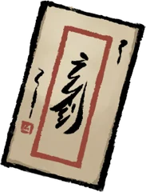
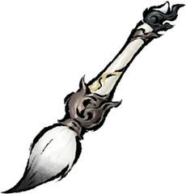
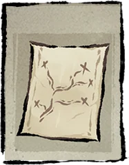
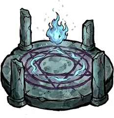
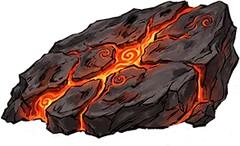

# 【卡牌修仙传】图鉴攻略 — 卡牌 / 宝物&其他道具

- 收录总数：98（游戏官方数据，其中图鉴未收录 1 条）
- 更新时间：2026-11-19 07:45

---

## 1. 仙灵余脉

一个小型的灵石矿：每经过60天，都会随机的生成灵石卡

当主角提升境界后，把此卡牌拖动主角上升级此宝物的境界

把主角拖动到此卡牌上，可关闭卡牌自动产卡的功能

### 【各版本（境界 / 品质）】

练气·人品：获得方式 人物对话 / 事件奖励

筑基·人品：获得方式 在「灵气源」培养宝物，获得（主角筑基/结丹/元婴/化神/炼虚/合体/大乘期）、人物对话 / 事件奖励

结丹·人品：获得方式 在「灵气源」培养宝物，获得（主角结丹/元婴/化神/炼虚/合体/大乘期）、人物对话 / 事件奖励

元婴·人品：获得方式 在「灵气源」培养宝物，获得（主角元婴/化神/炼虚/合体/大乘期）、人物对话 / 事件奖励

---

## 2. 本命灵种

本命灵种可以无限生成灵草：每经过180天，随机生成1-3株灵草（与灵种境界相符）。

人品灵草：10%

地品灵草：15%

天品灵草：25%

仙品灵草：25%

神品灵草：15%

绝品灵草：10%

当主角提升境界后，把此卡牌拖动主角上升级此宝物的境界

把主角拖动到此卡牌上，可关闭卡牌自动产卡的功能

### 【各版本（境界 / 品质）】

练气·神品：获得方式 人物对话 / 事件奖励

筑基·神品：获得方式 人物对话 / 事件奖励、培养宝物

结丹·神品：获得方式 人物对话 / 事件奖励、培养宝物

元婴·神品：获得方式 人物对话 / 事件奖励、培养宝物

---

## 3. 小灵气源

一个小型的灵气源：每经过90天，随机生成一张灵气卡（与灵气源境界相同），有小概率（10%）生成混沌灵气

当主角提升境界后，把此卡牌拖动主角上升级此宝物的境界

把主角拖动到此卡牌上，可关闭卡牌自动产卡的功能

### 【各版本（境界 / 品质）】

练气·神品：获得方式 人物对话 / 事件奖励

筑基·神品：获得方式 在「灵气源」培养宝物，获得（主角筑基/结丹/元婴/化神/炼虚/合体/大乘期）、人物对话 / 事件奖励

结丹·神品：获得方式 在「灵气源」培养宝物，获得（主角结丹/元婴/化神/炼虚/合体/大乘期）、人物对话 / 事件奖励

元婴·神品：获得方式 在「灵气源」培养宝物，获得（主角元婴/化神/炼虚/合体/大乘期）、人物对话 / 事件奖励

---

## 4. 天眷福泽

踏入仙途后，把此卡牌拖动至主角处使用：获得持续20年的气运，每经过360日，生成一张机缘卡

### 【各版本（境界 / 品质）】

神品：获得方式 人物对话 / 事件奖励

神品：获得方式 人物对话 / 事件奖励

---

## 5. 一瞬明悟

踏入仙途后，把此卡牌拖动至主角处使用：获得持续500日的气运，每经过60日，生成一张顿悟卡

### 【各版本（境界 / 品质）】

神品：获得方式 人物对话 / 事件奖励

神品：获得方式 人物对话 / 事件奖励

---

## 6. 亡命之徒

每经过1年，都会生成一个寻仇工作台

直到主角元婴期后，才能在将此气运卡消除；（将此卡牌拖到主角卡身上消除）

（主角位于凡人期时不触发）

---

## 7. 机缘

### 【各版本（境界 / 品质）】

神品：获得方式 击败「坟蛊鸪」、「杨巅峰」必定掉落、击败「妖剑」、「血藤古树」、「夔牛」、「祸斗」、「巨灵烈象」、「鬼面蛛」、「金蝉蛊」、「血肉灵芝」、「北海巨妖」、「黑焰虎」、「铁骨熊」、「青翼蝠王」、「狰」、「肥遗」、「文鳐鱼」、「火云雀」、「石魈」、「九幽骨魅」、「灵剑」有概率掉落、修炼〈观星术〉、赠送人物礼物的回礼、在「庄&顾合墓」祭拜亡人，获得、在「无名墓碑」祭拜亡人，获得、人物对话 / 事件奖励、机缘、外出游历、神识扫描、调查危险之地、调查血煞之地、探索宝物、打开宝箱、分析线索、这有何用？、炼化内丹〈兽血〉、炼化妖王内丹

神品：游历时遇到的一份机缘，在合适的地方使用会有意想不到的结果。；完成世界大事件后获得，并不会随时间流动而消逝，但同时只能存在一张。；获得方式 人物对话 / 事件奖励

---

## 8. 善缘

我帮助它人时获得的善缘，我可以把它当做机缘使用，但它似乎还有其他作用。

### 【各版本（境界 / 品质）】

神品：获得方式 在「凝土墟」（〔土〕地点）埋葬无名骸骨，获得、在「庄&顾合墓」立碑，获得、在「无名墓碑」立碑，获得、在「山脚下」埋葬无名骸骨，获得、在「凝土墟(小)」（〔土〕地点）埋葬无名骸骨，获得、人物对话 / 事件奖励

---

## 9. 因果

世间的运行冥冥之中似有因果的影响。

完成世界大事件后获得，并不会随时间流动而消逝，但同时只能存在一张。

### 【各版本（境界 / 品质）】

神品：获得方式 击败「九尾天狐的分身」、「鲲的分身」、「白龙的分身」、「三头凶蛟的分身」必定掉落、机缘？〈机缘＋机缘〉、赠送人物礼物的回礼、人物对话 / 事件奖励、这有何用？

---

## 10. 秘钥

蒙面人给我的钥匙，可以解卡其中一本心法的禁制

或者把钥匙交给蒙面人换取一份万魂幡的图纸

### 【各版本（境界 / 品质）】

获得方式 人物对话 / 事件奖励

绝品：玄剑阁的秘钥，我可以把它还给李长歌，又或者偷偷留下？；我可以通过工作台**调查**此物。；获得方式 人物对话 / 事件奖励

---

## 11. 神秘高手的肉体

神秘高手的肉体。

我可以把它还给神秘高手

我也可以将其放入**炼制**工作台，炼制后视为修炼了一次百炼钢躯：我的〔攻击〕+20；〔血量〕+200

### 【各版本（境界 / 品质）】

获得方式 击败「赤牙」必定掉落、人物对话 / 事件奖励

---

## 12. 卖身契

柳昭昭的卖身契，交给柳昭昭后，柳昭昭将变会自由身。

### 【各版本（境界 / 品质）】

获得方式 人物对话 / 事件奖励

---

## 13. 一个黑棋

无名前辈留下的一颗黑棋，可以打破棋局奖励的锁！

### 【各版本（境界 / 品质）】

获得方式 在「修士战场」探索（放入「无名氏或神识或自由模式主角」），获得（主角筑基期）、在「修士战场」探索（放入「无名氏或神识或自由模式主角」），获得（主角结丹/元婴/化神/炼虚/合体/大乘期）、人物对话 / 事件奖励、因果？

---

## 14. 宝藏

我可以用**调查工作台**打开

---

## 15. 武极门弟子神念

我交易到一次帮助的机会，在我有需要的时候，可以唤一位武极门弟子来助我一臂之力！

---

## 16. 损坏的机关傀儡

在战场发现的一副已损坏的机关傀儡，但从它身上还残存着淡淡的灵气来看，似乎还有什么在？

此卡牌由内测玩家：**2R**设计

### 【各版本（境界 / 品质）】

筑基：获得方式 在「修士战场」探索（放入「无名氏或神识或自由模式主角」），获得（主角筑基期）

结丹：获得方式 在「修士战场」探索（放入「无名氏或神识或自由模式主角」），获得（主角结丹/元婴/化神/炼虚/合体/大乘期）

---

## 17. 濒死的灵兽

在战场发现的一只濒死的灵兽，如果能将其**恢复**，那还能有机会救活！

---

## 18. 曼珠沙华

如果我把曼珠沙华还给苏怜烟，她是否会放下戒备？

### 【各版本（境界 / 品质）】

筑基：吸血：（被动）攻击后，造成的伤害将恢复到自身血量；获得方式 人物对话 / 事件奖励

---

## 19. 江山笔（损坏）

我的毛笔在刚刚的大战中损坏了。

### 【各版本（境界 / 品质）】

江山笔(损坏)·筑基：获得方式 调查附近

---

## 20. 三尾灵狐神魄

灵兽的神魄：灵兽残存于天地间的仅剩灵识，它在慢慢的吸收灵气复活

可以在"炼制"工作台加速炼制成灵兽。

### 【各版本（境界 / 品质）】

筑基·人品：获得方式 击败「三尾灵狐」有概率掉落

---

## 21. 金瞳虎神魄

灵兽的神魄：灵兽残存于天地间的仅剩灵识，它在慢慢的吸收灵气复活

可以在"炼制"工作台加速炼制成灵兽。

### 【各版本（境界 / 品质）】

筑基·人品：获得方式 击败「金瞳虎」有概率掉落

结丹·人品：获得方式 击败「劫纹虎」有概率掉落

---

## 22. 貔貅神魄

灵兽的神魄：灵兽残存于天地间的仅剩灵识，它在慢慢的吸收灵气复活

可以在"炼制"工作台加速炼制成灵兽。

### 【各版本（境界 / 品质）】

筑基·人品：获得方式 击败「貔貅」有概率掉落

结丹·人品：获得方式 击败「貔貅」有概率掉落

---

## 23. 玉角鹿神魄

灵兽的神魄：灵兽残存于天地间的仅剩灵识，它在慢慢的吸收灵气复活

可以在"炼制"工作台加速炼制成灵兽。

### 【各版本（境界 / 品质）】

筑基·人品：获得方式 击败「玉角鹿」有概率掉落

---

## 24. 青霄鹤神魄

灵兽的神魄：灵兽残存于天地间的仅剩灵识，它在慢慢的吸收灵气复活

可以在"炼制"工作台加速炼制成灵兽。

### 【各版本（境界 / 品质）】

筑基·人品：获得方式 击败「青霄鹤」有概率掉落

---

## 25. 空桑兽神魄

灵兽的神魄：灵兽残存于天地间的仅剩灵识，它在慢慢的吸收灵气复活

可以在"炼制"工作台加速炼制成灵兽。

### 【各版本（境界 / 品质）】

筑基·人品：获得方式 击败「空桑兽」有概率掉落

结丹·人品：获得方式 击败「空桑兽」有概率掉落

---

## 26. 玄冰蛟神魄

灵兽的神魄：灵兽残存于天地间的仅剩灵识，它在慢慢的吸收灵气复活

可以在"炼制"工作台加速炼制成灵兽。

### 【各版本（境界 / 品质）】

筑基·人品：获得方式 击败「玄冰蛟」有概率掉落

---

## 27. 寒影狼神魄

灵兽的神魄：灵兽残存于天地间的仅剩灵识，它在慢慢的吸收灵气复活

可以在"炼制"工作台加速炼制成灵兽。

### 【各版本（境界 / 品质）】

筑基·人品：获得方式 击败「寒影狼」有概率掉落

---

## 28. 雷云母神魄

灵兽的神魄：灵兽残存于天地间的仅剩灵识，它在慢慢的吸收灵气复活

可以在"炼制"工作台加速炼制成灵兽。

### 【各版本（境界 / 品质）】

筑基·人品：获得方式 击败「雷云母」有概率掉落

结丹·人品：获得方式 击败「雷云母」有概率掉落

---

## 29. 吼炎狮神魄

灵兽的神魄：灵兽残存于天地间的仅剩灵识，它在慢慢的吸收灵气复活

可以在"炼制"工作台加速炼制成灵兽。

### 【各版本（境界 / 品质）】

筑基·人品：获得方式 击败「吼炎狮」有概率掉落

---

## 30. 炽翎乌神魄

灵兽的神魄：灵兽残存于天地间的仅剩灵识，它在慢慢的吸收灵气复活

可以在"炼制"工作台加速炼制成灵兽。

### 【各版本（境界 / 品质）】

筑基·人品：获得方式 击败「炽翎乌」有概率掉落

---

## 31. 祸斗（小）神魄

灵兽的神魄：灵兽残存于天地间的仅剩灵识，它在慢慢的吸收灵气复活

可以在"炼制"工作台加速炼制成灵兽。

### 【各版本（境界 / 品质）】

祸斗(小)神魄·筑基·人品：获得方式 击败「祸斗」、「祸斗（小）」有概率掉落

---

## 32. 山岳龟神魄

灵兽的神魄：灵兽残存于天地间的仅剩灵识，它在慢慢的吸收灵气复活

可以在"炼制"工作台加速炼制成灵兽。

### 【各版本（境界 / 品质）】

筑基·人品：获得方式 击败「山岳龟」有概率掉落

---

## 33. 裂地蚁神魄

灵兽的神魄：灵兽残存于天地间的仅剩灵识，它在慢慢的吸收灵气复活

可以在"炼制"工作台加速炼制成灵兽。

### 【各版本（境界 / 品质）】

筑基·人品：获得方式 击败「裂地蚁」有概率掉落

---

## 34. 千足蜈神魄

灵兽的神魄：灵兽残存于天地间的仅剩灵识，它在慢慢的吸收灵气复活

可以在"炼制"工作台加速炼制成灵兽。

### 【各版本（境界 / 品质）】

筑基·人品：获得方式 击败「千足蜈」有概率掉落

结丹·人品：获得方式 击败「千足蜈」有概率掉落

---

## 35. 黄泉蝎神魄

灵兽的神魄：灵兽残存于天地间的仅剩灵识，它在慢慢的吸收灵气复活

可以在"炼制"工作台加速炼制成灵兽。

### 【各版本（境界 / 品质）】

筑基·人品：获得方式 击败「黄泉蝎」有概率掉落

结丹·人品：获得方式 击败「黄泉蝎」有概率掉落

---

## 36. 幻音蝶神魄

灵兽的神魄：灵兽残存于天地间的仅剩灵识，它在慢慢的吸收灵气复活

可以在"炼制"工作台加速炼制成灵兽。

### 【各版本（境界 / 品质）】

筑基·人品：获得方式 击败「幻音蝶」有概率掉落

结丹·人品：获得方式 击败「幻音蝶」有概率掉落

---

## 37. 六尾灵狐神魄

灵兽的神魄：灵兽残存于天地间的仅剩灵识，它在慢慢的吸收灵气复活

可以在"炼制"工作台加速炼制成灵兽。

### 【各版本（境界 / 品质）】

结丹·人品：获得方式 击败「六尾灵狐」有概率掉落

---

## 38. 青锋隼神魄

灵兽的神魄：灵兽残存于天地间的仅剩灵识，它在慢慢的吸收灵气复活

可以在"炼制"工作台加速炼制成灵兽。

### 【各版本（境界 / 品质）】

结丹·人品：获得方式 击败「青锋隼」有概率掉落

---

## 39. 戮法金猊神魄

灵兽的神魄：灵兽残存于天地间的仅剩灵识，它在慢慢的吸收灵气复活

可以在"炼制"工作台加速炼制成灵兽。

### 【各版本（境界 / 品质）】

结丹·人品：获得方式 击败「戮法金猊」有概率掉落

---

## 40. 虬枝鹿神魄

灵兽的神魄：灵兽残存于天地间的仅剩灵识，它在慢慢的吸收灵气复活

可以在"炼制"工作台加速炼制成灵兽。

### 【各版本（境界 / 品质）】

结丹·人品：获得方式 击败「虬枝鹿」有概率掉落

---

## 41. 紫霄鹤神魄

灵兽的神魄：灵兽残存于天地间的仅剩灵识，它在慢慢的吸收灵气复活

可以在"炼制"工作台加速炼制成灵兽。

### 【各版本（境界 / 品质）】

结丹·人品：获得方式 击败「紫霄鹤」有概率掉落

---

## 42. 蓬茸兔神魄

灵兽的神魄：灵兽残存于天地间的仅剩灵识，它在慢慢的吸收灵气复活

可以在"炼制"工作台加速炼制成灵兽。

### 【各版本（境界 / 品质）】

结丹·人品：获得方式 击败「蓬茸兔」有概率掉落

---

## 43. 青羽神鸟神魄

灵兽的神魄：灵兽残存于天地间的仅剩灵识，它在慢慢的吸收灵气复活

可以在"炼制"工作台加速炼制成灵兽。

### 【各版本（境界 / 品质）】

结丹·人品：获得方式 击败「青羽神鸟」有概率掉落

---

## 44. 寒渊蛟神魄

灵兽的神魄：灵兽残存于天地间的仅剩灵识，它在慢慢的吸收灵气复活

可以在"炼制"工作台加速炼制成灵兽。

### 【各版本（境界 / 品质）】

结丹·人品：获得方式 击败「寒渊蛟」有概率掉落

---

## 45. 冰魄狼神魄

灵兽的神魄：灵兽残存于天地间的仅剩灵识，它在慢慢的吸收灵气复活

可以在"炼制"工作台加速炼制成灵兽。

### 【各版本（境界 / 品质）】

结丹·人品：获得方式 击败「冰魄狼」有概率掉落

---

## 46. 霜鳞鲸神魄

灵兽的神魄：灵兽残存于天地间的仅剩灵识，它在慢慢的吸收灵气复活

可以在"炼制"工作台加速炼制成灵兽。

### 【各版本（境界 / 品质）】

结丹·人品：获得方式 击败「霜鳞鲸」有概率掉落

---

## 47. 雾羽仙鹤

灵兽的神魄：灵兽残存于天地间的仅剩灵识，它在慢慢的吸收灵气复活

可以在"炼制"工作台加速炼制成灵兽。

### 【各版本（境界 / 品质）】

结丹·人品：获得方式 击败「雾羽仙鹤」有概率掉落

---

## 48. 烬煌狮神魄

灵兽的神魄：灵兽残存于天地间的仅剩灵识，它在慢慢的吸收灵气复活

可以在"炼制"工作台加速炼制成灵兽。

### 【各版本（境界 / 品质）】

结丹·人品：获得方式 击败「烬煌狮」有概率掉落

---

## 49. 赤霄乌神魄

灵兽的神魄：灵兽残存于天地间的仅剩灵识，它在慢慢的吸收灵气复活

可以在"炼制"工作台加速炼制成灵兽。

### 【各版本（境界 / 品质）】

结丹·人品：获得方式 击败「赤霄乌」有概率掉落

---

## 50. 祸斗神魄

灵兽的神魄：灵兽残存于天地间的仅剩灵识，它在慢慢的吸收灵气复活

可以在"炼制"工作台加速炼制成灵兽。

### 【各版本（境界 / 品质）】

结丹·人品：获得方式 击败「祸斗」、「祸斗（小）」有概率掉落

---

## 51. 火岩鼠神魄

灵兽的神魄：灵兽残存于天地间的仅剩灵识，它在慢慢的吸收灵气复活

可以在"炼制"工作台加速炼制成灵兽。

### 【各版本（境界 / 品质）】

结丹·人品：获得方式 击败「火岩鼠」有概率掉落

---

## 52. 赤焰神鸟神魄

灵兽的神魄：灵兽残存于天地间的仅剩灵识，它在慢慢的吸收灵气复活

可以在"炼制"工作台加速炼制成灵兽。

### 【各版本（境界 / 品质）】

结丹·人品：获得方式 击败「赤焰神鸟」有概率掉落

---

## 53. 地藏龟神魄

灵兽的神魄：灵兽残存于天地间的仅剩灵识，它在慢慢的吸收灵气复活

可以在"炼制"工作台加速炼制成灵兽。

### 【各版本（境界 / 品质）】

结丹·人品：获得方式 击败「地藏龟」有概率掉落

---

## 54. 神蛰蚁神魄

灵兽的神魄：灵兽残存于天地间的仅剩灵识，它在慢慢的吸收灵气复活

可以在"炼制"工作台加速炼制成灵兽。

### 【各版本（境界 / 品质）】

结丹·人品：获得方式 击败「神蛰蚁」有概率掉落

---

## 55. 晶甲犀神魄

灵兽的神魄：灵兽残存于天地间的仅剩灵识，它在慢慢的吸收灵气复活

可以在"炼制"工作台加速炼制成灵兽。

### 【各版本（境界 / 品质）】

结丹·人品：获得方式 击败「晶甲犀」有概率掉落

---

## 56. 岩甲蜥蜴神魄

灵兽的神魄：灵兽残存于天地间的仅剩灵识，它在慢慢的吸收灵气复活

可以在"炼制"工作台加速炼制成灵兽。

### 【各版本（境界 / 品质）】

结丹·人品：获得方式 击败「岩甲蜥蜴」有概率掉落

---

## 57. 血玉蜘蛛神魄

灵兽的神魄：灵兽残存于天地间的仅剩灵识，它在慢慢的吸收灵气复活

可以在"炼制"工作台加速炼制成灵兽。

### 【各版本（境界 / 品质）】

结丹·人品：获得方式 击败「血玉蜘蛛」有概率掉落

---

## 58. 紫极麒麟神魄

灵兽的神魄：灵兽残存于天地间的仅剩灵识，它在慢慢的吸收灵气复活

可以在"炼制"工作台加速炼制成灵兽。

### 【各版本（境界 / 品质）】

结丹·人品：获得方式 击败「紫极麒麟」有概率掉落

---

## 59. 结金丹

突破境界时方可服用

---

## 60. 武极门高手神念

我交易到一次帮助的机会，在我有需要的时候，可以唤一位武极门弟子来助我一臂之力！

---

## 61. 神秘高手的元婴

神秘高手的元婴。

我可以把它交换给赤牙以获得神秘高手的肉体，且赤牙不会与我敌对

我也可以将其元婴炼化，获得神秘高手的所有技能：分身，分身不灭，燃血，燃血贰，火焰拳，不动，忍耐；（如已获得上述技能，将不会重复获得）

### 【各版本（境界 / 品质）】

元婴：获得方式 击败「神秘高手的元婴」必定掉落

---

## 62. 青霄神气

来自传说中的神域：青霄的灵气。能将一个元婴期的法宝提升至下一品质。

### 【各版本（境界 / 品质）】

元婴·神品：获得方式 调查危险之地

---

## 63. 武极门护法神念

我交易到一次帮助的机会，在我有需要的时候，可以唤一位武极门弟子来助我一臂之力！

---

## 64. 秘境地图

在冥狱发现的地图，里面标注了一些秘境传闻的位置，分别是：

古木幽森

灵兽谷

碧潭瀑布

镇妖塔

无字玉璧

还有一处血红字样：我已无法离开，在湖月城右上角，有我曾居住的地方，位置隐秘，若君需要，可前往。

### 【各版本（境界 / 品质）】

获得方式 打开包袱〈包袱〉、打开包袱

---

## 65. 鬼师

当我拥有此卡牌时，证明我有独特的能力：我可以把一名修士炼制成魂体

---

## 66. 包袱

放入**调查工作台**，可获得一把随机法宝（练气期）和一本随机心法（练气期）

---

## 67. 凝聚中的神气

重新凝聚中的玄霄神气。

### 【各版本（境界 / 品质）】

人品：获得方式 锻造法宝〈玄霄神气〉

---

## 68. 回天箓

不会消耗；可代替灵气/材料激活恢复工作台的恢复阵法；回复量与使用仙品材料效果相同

---

## 69. 五年之约

这是柳昭昭与我立下的五年之约，她要在5年内正式踏入修炼之途.

5年之后，此约定将化为柳昭昭的神念。

### 【各版本（境界 / 品质）】

神品：获得方式 人物对话 / 事件奖励

---

## 70. 一年之约

柳昭昭拿到我的心法后，需要一年时间修炼

等待一年时间后，才可召唤柳昭昭！

### 【各版本（境界 / 品质）】

神品：获得方式 人物对话 / 事件奖励

---

## 71. 面具

一个雪隐宗的面具，上面的灵力让我在他人面前隐去身份。

把此卡牌给自己使用，将以普通身份进入城市

### 【各版本（境界 / 品质）】

神品：获得方式 赠送人物礼物的回礼、人物对话 / 事件奖励、因果？

---

## 72. 玄霄神气

来自传说中的神域：玄霄的灵气。能将一个元婴期以下的法宝提升至下一品质。

使用后不会消失，而是进入3年的冷却期

### 【各版本（境界 / 品质）】

神品：获得方式 人物对话 / 事件奖励

---

## 73. 灵火芯

一簇灵火，以天地灵气为燃料，永不燃尽

我有预感可以利用灵火芯修炼出口诀！

或者提升仙品火属性法宝的品质！

### 【各版本（境界 / 品质）】

神品：获得方式 击败「火灵树妖」必定掉落

---

## 74. 一把秘钥

我猜这把钥匙能打开面前的宝物。可惜呀，只有一把！

---

## 75. 枯萎的曼珠沙华

这是死亡之花：曼珠沙华，可它已经枯萎了，暂时看不出有什么用。

### 【各版本（境界 / 品质）】

绝品：获得方式 剧情模式主线故事

---

## 76. 神游

我陷入了奇怪的状态，神识在感知范围似乎有所扩大。

放入**修炼**工作台运行后扩大地图范围。

在忘尘庙使用会缩小地图范围

### 【各版本（境界 / 品质）】

绝品：获得方式 剧情模式主线故事、因果？

---

## 77. 赵子义的神念

我曾帮助过TA，为了答谢我，TA留下一缕神念。

在我有需要的时候，可以通过**调查工作台**把TA请过来帮忙。

如果**可控的TA已经存在于桌面**上，则**召唤失败，神念将消失**！

### 【各版本（境界 / 品质）】

绝品：获得方式 赠送人物礼物的回礼、人物对话 / 事件奖励

---

## 78. 悦萱儿的神念

我曾帮助过TA，为了答谢我，TA留下一缕神念。

在我有需要的时候，可以通过**调查工作台**把TA请过来帮忙。

如果**可控的TA已经存在于桌面**上，则**召唤失败，神念将消失**！

### 【各版本（境界 / 品质）】

绝品：获得方式 赠送人物礼物的回礼

---

## 79. 慕容绛璃的神念

我曾帮助过TA，为了答谢我，TA留下一缕神念。

在我有需要的时候，可以通过**调查工作台**把TA请过来帮忙。

如果**可控的TA已经存在于桌面**上，则**召唤失败，神念将消失**！

### 【各版本（境界 / 品质）】

绝品：获得方式 赠送人物礼物的回礼

---

## 80. 武破岳的神念

我曾帮助过TA，为了答谢我，TA留下一缕神念。

在我有需要的时候，可以通过**调查工作台**把TA请过来帮忙。

如果**可控的TA已经存在于桌面**上，则**召唤失败，神念将消失**！

### 【各版本（境界 / 品质）】

绝品：获得方式 赠送人物礼物的回礼

---

## 81. 苏软软的神念

我曾帮助过TA，为了答谢我，TA留下一缕神念。

在我有需要的时候，可以通过**调查工作台**把TA请过来帮忙。

如果**可控的TA已经存在于桌面**上，则**召唤失败，神念将消失**！

### 【各版本（境界 / 品质）】

绝品：获得方式 赠送人物礼物的回礼

---

## 82. 温明德的神念

我曾帮助过TA，为了答谢我，TA留下一缕神念。

在我有需要的时候，可以通过**调查工作台**把TA请过来帮忙。

如果**可控的TA已经存在于桌面**上，则**召唤失败，神念将消失**！

### 【各版本（境界 / 品质）】

绝品：获得方式 人物对话 / 事件奖励

---

## 83. 李长歌的神念

待我准备好之后，召唤李长歌前往金陵城的秘密房子抓拿师弟和魔道

### 【各版本（境界 / 品质）】

绝品：我曾帮助过TA，为了答谢我，TA留下一缕神念。；在我有需要的时候，可以通过**调查工作台**把TA请过来帮忙。；如果**可控的TA已经存在于桌面**上，则**召唤失败，神念将消失**！

---

## 84. 柳昭昭的神念

我曾帮助过TA，为了答谢我，TA留下一缕神念。

在我有需要的时候，可以通过**调查工作台**把TA请过来帮忙。

如果**可控的TA已经存在于桌面**上，则**召唤失败，神念将消失**！

### 【各版本（境界 / 品质）】

绝品：获得方式 赠送人物礼物的回礼

---

## 85. 敖月的神念

我曾帮助过TA，为了答谢我，TA留下一缕神念。

在我有需要的时候，可以通过**调查工作台**把TA请过来帮忙。

如果**可控的TA已经存在于桌面**上，则**召唤失败，神念将消失**！

---

## 86. 金不换的神念

这是我付费获得一次金不换帮忙的机会~

### 【各版本（境界 / 品质）】

绝品：获得方式 人物对话 / 事件奖励

---

## 87. 执黑的神念

我曾帮助过TA，为了答谢我，TA留下一缕神念。

在我有需要的时候，可以通过**调查工作台**把TA请过来帮忙。

如果**可控的TA已经存在于桌面**上，则**召唤失败，神念将消失**！

---

## 88. 神秘高手的神念

我曾帮助过TA，为了答谢我，TA留下一缕神念。

在我有需要的时候，可以通过**调查工作台**把TA请过来帮忙。

如果**可控的TA已经存在于桌面**上，则**召唤失败，神念将消失**！

### 【各版本（境界 / 品质）】

绝品：获得方式 恢复肉身〈尸体〉、恢复肉身〈友好修士〉

---

## 89. 袁白的神念

我曾帮助过TA，为了答谢我，TA留下一缕神念。

在我有需要的时候，可以通过**调查工作台**把TA请过来帮忙。

如果**可控的TA已经存在于桌面**上，则**召唤失败，神念将消失**！

### 【各版本（境界 / 品质）】

绝品：获得方式 人物对话 / 事件奖励

---

## 90. 聚魂台

可以帮助我召唤附近境界相同的灵体，但每次召唤均消耗5年寿命

把聚魂台拖动到主角上，便能召唤灵体

把聚魂台放置在五行地点处，可召唤对应生前与之相同五行的灵体

---

## 91. 包袱

不知何人留下的包袱，可以通过**调查**检查。

### 【各版本（境界 / 品质）】

这里有一个包袱？大概是幽玄派的前辈留下的吧。；放入**调查**以打开包袱。

---

## 92. 傀儡零件

将收集到的零件组合后，能制作出傀儡机关人。

### 【各版本（境界 / 品质）】

人品：获得方式 击败「机关傀儡」必定掉落、在「凝土墟」（〔土〕地点）探索（放入「无名氏或神识或自由模式主角」），获得（主角筑基期）、在「凝土墟」（〔土〕地点）探索（放入「无名氏或神识或自由模式主角」），获得（主角结丹期）、在「凝土墟」（〔土〕地点）探索（放入「无名氏或神识或自由模式主角」），获得（主角结丹/元婴/化神/炼虚/合体/大乘期）、在「凝土墟(小)」（〔土〕地点）探索（放入「无名氏或神识或自由模式主角」），获得（主角练气期）、在「凝土墟(小)」（〔土〕地点）探索（放入「无名氏或神识或自由模式主角」），获得（主角筑基/结丹/元婴/化神/炼虚/合体/大乘期）、人物对话 / 事件奖励、探索宝物

---

## 93. 不灭熔岩

在地火深洞处击败熔岩傀儡有概率获得

### 【各版本（境界 / 品质）】

神品：获得方式 击败「熔岩傀儡」有概率掉落

---

## 94. 元婴精血

猎杀妖王后有概率获得；妖王之血凝聚妖王的修为。

---

## 95. 血木

击败饮岁（血藤古树）有概率获得

---

## 96. 江山笔

萧枕墨过去使用的法宝，但经过大战后损坏，效果已不如从前

### 【各版本（境界 / 品质）】

筑基：画皮：加入战场的首个回合开始时，召唤**萧枕墨的分身**（需萧枕墨在场）；攻击 None / 血量 34

筑基：画皮：回合开始时，画一个萧枕墨的分身；攻击 None / 血量 28；获得方式 重铸法宝〈灵气＋灵气〉

结丹：画皮：加入战场的首个回合开始时，召唤**萧枕墨的分身**（需萧枕墨在场）；攻击 None / 血量 92；获得方式 人物对话 / 事件奖励

结丹：画皮：回合开始时，画一个萧枕墨的分身；攻击 None / 血量 77

元婴：画皮：加入战场的首个回合开始时，召唤**萧枕墨的分身**（需萧枕墨在场）；攻击 None / 血量 254

元婴：画皮：回合开始时，画一个萧枕墨的分身；攻击 None / 血量 212

化神：画皮：加入战场的首个回合开始时，召唤**萧枕墨的分身**（需萧枕墨在场）；攻击 None / 血量 700

---

## 97. 曼珠沙华

苏怜烟的本命法宝。是苏怜烟为了压制额外的阴脉而炼制的，于苏怜烟的生命力紧紧相连。曼珠沙华极难培养，需要用人之精血滋润。

### 【各版本（境界 / 品质）】

筑基：攻击 7 / 血量 25

筑基：吸血：（被动）攻击后，造成的伤害将恢复到自身血量；攻击 18 / 血量 53

结丹：攻击 19 / 血量 70

结丹：吸血：（被动）攻击后，造成的伤害将恢复到自身血量；攻击 19 / 血量 58

元婴：攻击 53 / 血量 191

化神：攻击 146 / 血量 524

---

## 98. 替身（图鉴未收录）

把此替身放入战斗中断后，可以把其他卡牌抽离战斗！

### 【各版本（境界 / 品质）】

天品：攻击 None / 血量 10；获得方式 炼制工作台：放入「不朽蜕壳」（击败妖王「金蝉蛊」掉落）制作替身，一次得 3 张、修炼〈续脉经〉、重塑肉身〈续脉经〉

---
