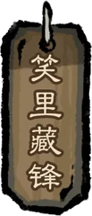
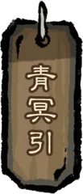
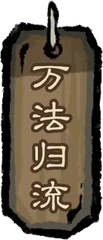
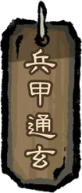

# 【卡牌修仙传】图鉴攻略 — 卡牌 / 天赋

- 收录总数：51（游戏官方数据）
- 更新时间：2026-11-18 04:42

---

## 1. 御剑飞行

修炼后获得以下能力：

开启在地图上**御剑飞行**的功能

### 【获取途径】

在剧情模式里，完成主线故事获得；

---

## 2. 剑术精通

修炼后获得技能效果：（需主角在战场）己方的剑在攻击前，提高一定的〔攻击〕和〔血量〕，但会减少自己的〔灵气〕上限：

### 【效果（各境界 / 品质）】

练气·天品：修炼后获得以下能力：

练气·天品：（需主角在战场）己方的剑在攻击前，〔攻击〕+1；

筑基·仙品：修炼后获得以下能力：

筑基·仙品：己方的剑在攻击前，〔血量〕+5；（需主角在战场）；

筑基·仙品：我的〔灵气〕上限-2；

筑基·仙品：己方的剑在攻击前，〔攻击〕+3；（需主角在战场）；

筑基·仙品：我的〔灵气〕上限-2

练气·地品：修炼后获得以下能力：

练气·地品：（需主角在战场）己方的剑在攻击前，〔攻击〕+1；

筑基·绝品：修炼后获得以下能力：

筑基·绝品：（需主角在战场）己方的剑在攻击前，〔血量〕+5；

筑基·绝品：（需主角在战场）己方的剑在攻击前，〔攻击〕+3；

结丹·天品：修炼后获得以下能力：

结丹·天品：（需主角在战场）己方的剑在攻击前，〔血量〕+15；（需主角在战场）；

结丹·天品：我的〔灵气〕上限-4；；

结丹·天品：（需主角在战场）己方的剑在攻击前，〔攻击〕+8；（需主角在战场）；

结丹·天品：我的〔灵气〕上限-4；

结丹·绝品：修炼后获得以下能力：

结丹·绝品：（需主角在战场）己方的剑在攻击前，〔血量〕+15；；

结丹·绝品：（需主角在战场）己方的剑在攻击前，〔攻击〕+8；

### 【获取途径】

修炼御剑术，归流剑经，焚心剑谱后获得；

在天帝宝库中有概率获得；

在〔金〕地点修炼剑意有概率获得；

---

## 3. 御剑无锋

修炼后获得技能效果：（需主角在战场）己方的剑在攻击后，使目标获得一定层数的**易伤**（伤害结果=攻击伤害+易伤值），但会减少自己的〔灵气〕上限：

### 【效果（各境界 / 品质）】

筑基·仙品：修炼后获得以下能力：

筑基·仙品：（需主角在战场）自己的剑在攻击目标后，会给目标留下2层**易伤**；

筑基·仙品：我的〔灵气〕上限-1；

筑基·绝品：修炼后获得以下能力：

筑基·绝品：（需主角在战场）自己的剑在攻击目标后，会给目标留下2层**易伤**；

结丹·天品：修炼后获得以下能力：

结丹·天品：（需主角在战场）自己的剑在攻击目标后，会给目标留下3层**易伤**；

结丹·天品：我的〔灵气〕上限-2；

结丹·绝品：修炼后获得以下能力：

结丹·绝品：（需主角在战场）自己的剑在攻击目标后，会给目标留下3层**易伤**；

### 【获取途径】

修炼阴阳两仪剑后获得；

在天帝宝库中有概率获得；

在〔金〕地点修炼剑意有概率获得；

---

## 4. 剑气四射

修炼后获得技能效果：（需主角在战场）己方的剑在攻击前，先对目标造成一定剑气伤害，但会减少自己的〔灵气〕上限：

### 【效果（各境界 / 品质）】

筑基·仙品：修炼后获得以下能力：

筑基·仙品：（需主角在战场）在使用剑攻击前，会先用剑气攻击目标（造成3点伤害）；

筑基·仙品：我的〔灵气〕上限-2；

筑基·绝品：修炼后获得以下能力：

筑基·绝品：（需主角在战场）在使用剑攻击前，会先用剑气攻击目标（造成3点伤害）；

结丹·天品：修炼后获得以下能力：

结丹·天品：（需主角在战场）在使用剑攻击前，会先用剑气攻击目标（造成7点伤害）；

结丹·天品：我的〔灵气〕上限-2；

结丹·绝品：修炼后获得以下能力：

结丹·绝品：（需主角在战场）在使用剑攻击前，会先用剑气攻击目标（造成7点伤害）；

### 【获取途径】

修炼无相剑典后获得；

在天帝宝库中有概率获得；

在〔金〕地点修炼剑意有概率获得；

---

## 5. 断邪斩

修炼后获得技能效果：（需主角在战场）自己的第一件兵器法宝（剑/刀/双刀/扇子）攻击后，使目标获得一定层数的**易伤**（伤害结果=攻击伤害+易伤值），但会减少自己的〔灵气〕上限：

### 【效果（各境界 / 品质）】

筑基·神品：修炼后获得以下能力：

筑基·神品：己方第一件法宝兵器法宝（剑/刀/双刀/扇子）攻击后，为目标附加2点**易伤**

筑基·绝品：修炼后获得以下能力：

筑基·绝品：己方第一件法宝兵器法宝（剑/刀/双刀/扇子）攻击后，为目标附加2点**易伤**

结丹·仙品：修炼后获得以下能力：

结丹·仙品：己方第一件法宝兵器法宝（剑/刀/双刀/扇子）攻击后，为目标附加3点**易伤**

结丹·天品：修炼后获得以下能力：

结丹·天品：己方第一件法宝兵器法宝（剑/刀/双刀/扇子）攻击后，为目标附加2点**易伤**

结丹·绝品：修炼后获得以下能力：

结丹·绝品：己方第一件法宝兵器法宝（剑/刀/双刀/扇子）攻击后，为目标附加3点**易伤**

### 【获取途径】

修炼破煞剑谱后获得；

在天帝宝库中有概率获得；

在〔金〕地点修炼剑意有概率获得；

---

## 6. 器心通明

修炼后使得自己的御物能力获得强化，减少御物基础的〔灵气〕消耗，但会增加御兽的基础消耗：

### 【效果（各境界 / 品质）】

筑基·神品：修炼后获得以下能力：

筑基·神品：〔御器〕-1；

筑基·神品：〔御兽〕+1；

筑基·绝品：修炼后获得以下能力：

筑基·绝品：〔御器〕-1；

结丹·绝品：修炼后获得以下能力：

结丹·绝品：〔御器〕-1；

结丹·绝品：〔御兽〕+1；

结丹·绝品：使用法宝/傀儡的〔灵气〕消耗-1；

结丹·神品：修炼后获得以下能力：

结丹·神品：使用法宝/傀儡的〔灵气〕消耗-1；

结丹·神品：驭兽的〔灵气〕消耗+1；

结丹·人品：修炼后获得以下能力：

结丹·人品：使用法宝/傀儡的〔灵气〕消耗-1；

结丹·人品：驭兽的〔灵气〕消耗+2；

### 【获取途径】

修炼剑魄诀后获得；

在天帝宝库中有概率获得；

器道结丹奖励中有概率出现；

---

## 7. 金锋破

修炼后获得技能效果：（需主角在战场）自己的〔金〕法宝攻击后，使目标获得一定层数的**易伤**（伤害结果=攻击伤害+易伤值），但会减少自己的〔灵气〕上限：

### 【效果（各境界 / 品质）】

筑基·绝品：修炼后获得以下能力：

筑基·绝品：（需主角在战场）使用金系法宝攻击目标，会给目标留下2层**易伤**；

结丹·神品：修炼后获得以下能力：

结丹·神品：（需主角在战场）使用金系法宝攻击目标，会给目标留下3层**易伤**；

结丹·神品：我的〔灵气〕上限-2；

结丹·绝品：修炼后获得以下能力：

结丹·绝品：（需主角在战场）使用金系法宝攻击目标，会给目标留下3层**易伤**；

### 【获取途径】

修炼金锋谱后获得；

在天帝宝库中有概率获得；

在〔金〕地点修炼剑意有概率获得；

---

## 8. 笑里藏锋

修炼后获得技能效果：（需主角在战场）每回合开始时，使随机目标获得一定层数的**易伤**（伤害结果=攻击伤害+易伤值），但会减少自己的〔灵气〕上限：

### 【效果（各境界 / 品质）】

筑基·绝品：修炼后获得以下能力：

筑基·绝品：（需主角在战场）每回合开始时，使随机目标留下2层**易伤**；

结丹·仙品：修炼后获得以下能力：

结丹·仙品：（需主角在战场）每回合开始时，使随机目标留下3层**易伤**；

结丹·仙品：我的〔灵气〕上限-2；

结丹·天品：修炼后获得以下能力：

结丹·天品：（需主角在战场）每回合开始时，使随机目标留下3层**易伤**；

结丹·天品：我的〔灵气〕上限-4；

结丹·绝品：修炼后获得以下能力：

结丹·绝品：（需主角在战场）每回合开始时，使随机目标留下3层**易伤**；

### 【获取途径】

修炼藏锋诀后获得；

在天帝宝库中有概率获得；

在〔金〕地点修炼剑意有概率获得；

---

## 9. 丹元催化

修炼后使得自己炼制丹药的能力获得提高，但会减少自己的〔灵气〕上限：

### 【效果（各境界 / 品质）】

练气·天品：修炼后获得以下能力：

练气·天品：炼制的丹药效果：活血，聚气和断脉的效果值+2；

筑基·天品：修炼后获得以下能力：

筑基·天品：炼制的丹药效果：断脉的效果值+4；

筑基·天品：自身的〔攻击〕-4；

筑基·仙品：修炼后获得以下能力：

筑基·仙品：炼制的丹药效果：活血，聚气效果值+4；

筑基·绝品：修炼后获得以下能力：

筑基·绝品：炼制的丹药效果：断脉的效果值+10；

筑基·绝品：自身的〔攻击〕-10；

筑基·地品：修炼后获得以下能力：

筑基·地品：炼制的丹药效果：活血，聚气和断脉的效果值+2；

筑基·绝品：炼制的丹药效果：断脉的效果值+7；

结丹·地品：修炼后获得以下能力：

结丹·地品：炼制的丹药效果：断脉的效果值+4；

结丹·地品：自身的〔攻击〕-4；

结丹·天品：修炼后获得以下能力：

结丹·天品：炼制的丹药效果：活血，聚气效果值+10；

结丹·仙品：修炼后获得以下能力：

结丹·仙品：炼制的丹药效果：活血的效果值+30；

结丹·绝品：修炼后获得以下能力：

结丹·绝品：炼制的丹药效果：断脉的效果值+15；

结丹·绝品：炼制的丹药效果：活血的效果值+30；

结丹·神品：修炼后获得以下能力：

结丹·神品：炼制的丹药效果：断脉的效果值+10；

结丹·人品：修炼后获得以下能力：

结丹·人品：炼制的丹药效果：断脉的效果值+5；

### 【获取途径】

修炼百药谱，百毒谱，春蚕诀后获得；

在天帝宝库中有概率获得；

完成慕容绛璃的筑基期支线任务后获得；

丹道结丹奖励中有概率出现；

---

## 10. 千幻毒手

修炼后使得自己使用**毒丹药（带有断脉效果）**的效果提高，但会减少自己的〔攻击〕：

### 【效果（各境界 / 品质）】

筑基·仙品：修炼后获得以下能力：

筑基·仙品：使用丹药时，断脉的效果+5；（此效果不受境界衰减影响）

筑基·仙品：自身的〔攻击〕-5；

筑基·绝品：修炼后获得以下能力：

筑基·绝品：使用丹药时，断脉的效果+5；（此效果不受境界衰减影响）；

结丹·天品：修炼后获得以下能力：

结丹·天品：使用丹药时，断脉的效果+10；（此效果不受境界衰减影响）

结丹·天品：自身的〔攻击〕-10；

结丹·绝品：修炼后获得以下能力：

结丹·绝品：使用丹药时，断脉的效果+15；（此效果不受境界衰减影响）

结丹·绝品：使用丹药时，断脉的效果+10；（此效果不受境界衰减影响）

结丹·神品：修炼后获得以下能力：

结丹·神品：使用丹药时，断脉的效果+9；（此效果不受境界衰减影响）

结丹·人品：修炼后获得以下能力：

结丹·人品：使用丹药时，断脉的效果+6；（此效果不受境界衰减影响）

### 【获取途径】

修炼断肠经后获得；

在天帝宝库中有概率获得；

完成慕容绛璃的结丹期支线任务后获得；

丹道结丹奖励中有概率出现；

---

## 11. 长生之法

修炼后使得自己的寿命提高：

### 【效果（各境界 / 品质）】

筑基·地品：修炼后寿命+20年

筑基·绝品：修炼后寿命+50年

结丹·绝品：修炼后寿命+100年

### 【获取途径】

修炼长生录后获得；

在天帝宝库中有概率获得；

---

## 12. 元殒毒术

习后使得自己对**满血的卡牌）**使用**毒丹药（带有断脉效果）**的效果提高，但会减少自己的〔攻击〕：

### 【效果（各境界 / 品质）】

筑基·绝品：修炼后获得以下能力：

筑基·绝品：对满血的卡牌使毒丹时，伤害效果额外增加6点；

结丹·神品：修炼后获得以下能力：

结丹·神品：对满血的卡牌使毒丹时，伤害效果额外增加18点；

结丹·神品：但我的〔攻击〕-15；

结丹·绝品：修炼后获得以下能力：

结丹·绝品：对满血的卡牌使毒丹时，伤害效果额外增加18点；

结丹·绝品：对满血的卡牌使用毒丹时，效果额外增加18点；

结丹·神品：对满血的卡牌使用毒丹时，效果额外增加12点；

结丹·神品：自身的〔攻击〕-10；

结丹·人品：修炼后获得以下能力：

结丹·人品：对满血的卡牌使用毒丹时，效果额外增加6点；

结丹·人品：自身的〔攻击〕-5；

### 【获取途径】

修炼毒心经后获得；

在天帝宝库中有概率获得；

丹道结丹奖励中有概率出现；

---

## 13. 灵植之心

修炼后使得自己种植灵草的产量提高：

### 【效果（各境界 / 品质）】

结丹·仙品：修炼后获得以下能力：

结丹·仙品：在药田种植灵草的产量提高（上限和下限+1）；

结丹·仙品：但我的〔攻击〕-10

结丹·绝品：修炼后获得以下能力：

结丹·绝品：在药田种植灵草的产量提高（上限和下限+2）；

结丹·神品：修炼后获得以下能力：

结丹·神品：在药田种植灵草的产量提高（上限和下限+1）；

结丹·人品：修炼后获得以下能力：

结丹·人品：在药田种植灵草的产量提高（上限和下限+1）；

结丹·人品：自身的〔攻击〕-10；

### 【获取途径】

修炼蕴灵诀后获得；

在天帝宝库中有概率获得；

丹道结丹奖励中有概率出现；

---

## 14. 青冥引

修炼后获得技能效果：（需主角在战场）自己的〔木〕战败时，会对随机敌方卡牌造成一定伤害，但此效果会使我的〔攻击〕降低：

### 【效果（各境界 / 品质）】

筑基·绝品：修炼后获得以下能力：

筑基·绝品：（需主角在战场）自己的〔木〕卡牌战败时，会对随机目标造成7点伤害；

结丹·仙品：修炼后获得以下能力：

结丹·仙品：（需主角在战场）自己的〔木〕卡牌战败时，会对随机目标造成15点伤害；

结丹·仙品：但我的〔攻击〕上限-15；

结丹·绝品：修炼后获得以下能力：

结丹·绝品：（需主角在战场）自己的〔木〕卡牌战败时，会对随机目标造成15点伤害；

### 【获取途径】

修炼青冥真解后获得；

在天帝宝库中有概率获得；

丹道结丹奖励中有概率出现；

---

## 15. 万斛丹源

修炼后使得自己炼制丹药的产量获得提高，但会减少自己的〔攻击〕：

### 【效果（各境界 / 品质）】

结丹·绝品：修炼后获得以下能力：

结丹·绝品：炼制丹药时，最后一轮的产量会+1

结丹·神品：修炼后获得以下能力：

结丹·神品：炼制丹药时，最后一轮的产量会+1；

结丹·神品：自身的〔攻击〕-5；

结丹·人品：修炼后获得以下能力：

结丹·人品：炼制丹药时，最后一轮的产量会+1；

结丹·人品：自身的〔攻击〕-10；

### 【获取途径】

完成慕容绛璃结丹期任务后获得；

在天帝宝库中有概率获得；

丹道结丹奖励中有概率出现；

---

## 16. 幻尘毒手

修炼后使得自己使用**毒丹药（带有断脉效果）**的效果提高，但自己的技能格子数量会减少。

### 【效果（各境界 / 品质）】

结丹·绝品：修炼后获得以下能力：

结丹·绝品：使用丹药时，断脉的效果+30；（此效果不受境界衰减影响）；

结丹·绝品：但我可装备的技能数量-1

### 【获取途径】

丹道结丹奖励中有概率出现；

---

## 17. 丹元通玄

修炼后使得自己炼制丹药的能力获得提高，但自己的技能格子数量会减少。

### 【效果（各境界 / 品质）】

结丹·绝品：修炼后获得以下能力：

结丹·绝品：炼制的丹药效果：活血，聚气和断脉的效果值+20；

结丹·绝品：但我可装备的技能数量-1

### 【获取途径】

丹道结丹奖励中有概率出现；

---

## 18. 花之魂

修炼后获得技能效果：（需主角在战场）在战斗中通过卡牌技能召唤其他〔木〕卡牌时，使场上的所有花灵的〔攻击〕提高，但此技能效果会降低自己的〔攻击〕：

### 【效果（各境界 / 品质）】

筑基·绝品：修炼后获得以下能力：

筑基·绝品：在战斗中通过卡牌技能召唤其他〔木〕属性卡牌时，使自己所有的花灵的〔攻击〕+4；

结丹·仙品：修炼后获得以下能力：

结丹·仙品：在战斗中通过卡牌技能召唤其他〔木〕属性卡牌时，使自己所有的花灵的〔攻击〕+4；

结丹·仙品：但主角的〔攻击〕-4；

结丹·绝品：修炼后获得以下能力：

结丹·绝品：在战斗中通过卡牌技能召唤其他〔木〕属性卡牌时，使自己所有的花灵的〔攻击〕+8；

结丹·神品：修炼后获得以下能力：

结丹·神品：在战斗中通过卡牌技能召唤其他〔木〕属性卡牌时，使自己所有的花灵的〔攻击〕+6；

结丹·神品：但主角的〔攻击〕-2；

结丹·人品：修炼后获得以下能力：

结丹·人品：在战斗中通过卡牌技能召唤其他〔木〕属性卡牌时，使自己所有的花灵的〔攻击〕+1；

元婴·天品：修炼后获得以下能力：

元婴·天品：在战斗中通过卡牌技能召唤其他〔木〕属性卡牌时，使自己所有的花灵的〔攻击〕+10；

元婴·天品：但主角的〔攻击〕-6；

### 【获取途径】

修炼花栖木后获得；

在天帝宝库中有概率获得；

丹道结丹奖励中有概率出现；

---

## 19. 落叶归根

修炼后获得技能效果：（需主角在战场）每当友方的〔木〕卡牌战败时，主角的〔攻击〕和〔血量〕均提高，但此技能效果会降低自己的〔攻击〕：

### 【效果（各境界 / 品质）】

筑基·绝品：修炼后获得以下能力：

筑基·绝品：在战斗中，每次〔木〕卡牌阵亡时，主角的〔攻击〕和〔血量〕+2；

结丹·仙品：修炼后获得以下能力：

结丹·仙品：在战斗中，每次〔木〕卡牌阵亡时，主角的〔攻击〕和〔血量〕+3；

结丹·仙品：当主角的〔攻击〕-8；

结丹·绝品：修炼后获得以下能力：

结丹·绝品：在战斗中，每次〔木〕卡牌阵亡时，主角的〔攻击〕和〔血量〕+5；

结丹·神品：修炼后获得以下能力：

结丹·神品：在战斗中，每次〔木〕卡牌阵亡时，主角的〔攻击〕和〔血量〕+4；

结丹·神品：当主角的〔攻击〕-6；

结丹·人品：修炼后获得以下能力：

结丹·人品：在战斗中，每次〔木〕卡牌阵亡时，主角的〔攻击〕和〔血量〕+1；

### 【获取途径】

修炼归根护元法后获得；

在天帝宝库中有概率获得；

丹道结丹奖励中有概率出现；

---

## 20. 灵脉之躯

修炼后使得自己〔灵气〕上限提高，但会提高自己的御器/御兽的基础消耗：

### 【效果（各境界 / 品质）】

筑基·绝品：修炼后获得以下能力：

筑基·绝品：我的〔灵气〕上限提高25；

筑基·绝品：我使用法宝/灵兽/傀儡的基础〔灵气〕消耗+1；

筑基·人品：修炼后获得以下能力：

筑基·人品：我的〔灵气〕上限提高5

筑基·绝品：我的〔灵气〕上限提高15；

结丹·神品：修炼后获得以下能力：

结丹·神品：我的〔灵气〕上限提高40；

结丹·神品：我使用法宝/灵兽/傀儡的基础〔灵气〕消耗+1；

结丹·人品：修炼后获得以下能力：

结丹·人品：我的〔灵气〕上限提高5

结丹·绝品：修炼后获得以下能力：

结丹·绝品：我的〔灵气〕上限提高25；

结丹·绝品：我的〔灵气〕上限提高40；

结丹·神品：我的〔灵气〕上限提高15；

结丹·人品：我的〔灵气〕上限提高8；

### 【获取途径】

修炼续脉经后获得；

在天帝宝库中有概率获得；

术道结丹奖励中有概率出现；

完成李长歌支线任务可获得；

---

## 21. 万法归流

修炼后使得自己使用**口诀**的能力获得提高，但会减少自己的〔血量〕：

### 【效果（各境界 / 品质）】

筑基·仙品：修炼后获得以下能力：

筑基·仙品：我使用口诀的〔灵气〕消耗-2；

筑基·仙品：我的〔血量〕-10；

筑基·仙品：我使用口诀后的冷却时间-5日；

筑基·绝品：修炼后获得以下能力：

筑基·绝品：我使用口诀的〔灵气〕消耗-2；

筑基·绝品：我使用口诀后的冷却时间-5日；

结丹·天品：修炼后获得以下能力：

结丹·天品：我使用口诀的〔灵气〕消耗-2；

结丹·天品：我的〔血量〕-20；

结丹·天品：我使用口诀后的冷却时间-5日；

结丹·绝品：修炼后获得以下能力：

结丹·绝品：我使用口诀的〔灵气〕消耗-2；

结丹·绝品：我使用口诀后的冷却时间-5日；

结丹·绝品：我使用口诀的〔灵气〕消耗-8；

结丹·神品：修炼后获得以下能力：

结丹·神品：我使用口诀的〔灵气〕消耗-5；

结丹·人品：修炼后获得以下能力：

结丹·人品：我使用口诀的〔灵气〕消耗-2；

结丹·绝品：我使用口诀后的冷却时间-30日；

结丹·神品：我使用口诀后的冷却时间-20日；

结丹·人品：我使用口诀后的冷却时间-10日；

### 【获取途径】

修炼水元诀，引潮法后获得；

在天帝宝库中有概率获得；

术道结丹奖励中有概率出现；

---

## 22. 法术精通

修炼后使得自己使用**口诀**的伤害获得提高，但会减少自己的〔攻击〕：

### 【效果（各境界 / 品质）】

筑基·仙品：修炼后获得以下能力：

筑基·仙品：使用单体攻击的口诀时，伤害〔伤害〕+7；

筑基·仙品：我的〔血量〕-15；

筑基·绝品：修炼后获得以下能力：

筑基·绝品：使用单体攻击的口诀时，伤害〔伤害〕+7；

结丹·天品：修炼后获得以下能力：

结丹·天品：使用单体攻击的口诀时，伤害〔伤害〕+15；

结丹·天品：我的〔血量〕-30；

结丹·绝品：修炼后获得以下能力：

结丹·绝品：使用单体攻击的口诀时，伤害〔伤害〕+15；

结丹·神品：修炼后获得以下能力：

结丹·神品：使用单体攻击的口诀时，伤害〔伤害〕+8；

结丹·人品：修炼后获得以下能力：

结丹·人品：使用单体攻击的口诀时，伤害〔伤害〕+5；

结丹·绝品：使用单体攻击的口诀时，伤害〔伤害〕+25；

结丹·绝品：但我可装备的技能数量-1

### 【获取途径】

修炼归藏法后获得；

在天帝宝库中有概率获得；

术道结丹奖励中有概率出现；

---

## 23. 落珠回春

修炼后获得技能效果：（需主角在战场）自己〔水〕卡牌战败时，会使全体友方卡牌治疗一定〔血量〕，但此技能效果会使我的〔御兽〕增加：

### 【效果（各境界 / 品质）】

结丹·仙品：修炼后获得以下能力：

结丹·仙品：（需主角在战场）自己的〔水〕卡牌战败时，会为全体友军恢复15〔血量〕；

结丹·仙品：〔御兽〕消耗+1

结丹·绝品：修炼后获得以下能力：

结丹·绝品：（需主角在战场）自己的〔水〕卡牌战败时，会为全体友军恢复15〔血量〕；

### 【获取途径】

修炼汐残照后获得；

在天帝宝库中有概率获得；

---

## 24. 生生不息

修炼后获得技能效果：（需主角在战场）前10回合结束时，为血量最低的卡牌恢复生命值，但此技能效果会使我的〔血量〕上限减少；

### 【效果（各境界 / 品质）】

筑基·仙品：修炼后获得以下能力：

筑基·仙品：（需主角在战场）前10回合结束时，为友方血量最少的卡牌恢复8点〔血量〕，

筑基·仙品：但主角的〔血量〕-4；

结丹·天品：修炼后获得以下能力：

结丹·天品：（需主角在战场）前10回合结束时，为友方血量最少的卡牌恢复20点〔血量〕，

结丹·天品：但主角的〔血量〕-10；

结丹·绝品：修炼后获得以下能力：

结丹·绝品：（需主角在战场）前10回合结束时，为友方血量最少的卡牌恢复25点〔血量〕；

结丹·神品：修炼后获得以下能力：

结丹·神品：（需主角在战场）前10回合结束时，为友方血量最少的卡牌恢复15点〔血量〕，

结丹·神品：但主角的〔血量〕-8；

结丹·人品：修炼后获得以下能力：

结丹·人品：（需主角在战场）前10回合结束时，为友方血量最少的卡牌恢复5点〔血量〕；

### 【获取途径】

修炼润元心法后获得；

在天帝宝库中有概率获得；

术道结丹奖励中有概率出现；

---

## 25. 无形冰

修炼后获得技能效果：（需主角在战场）回合开始时，对随机2名敌人造成固定伤害，但修炼此技能会使我的〔血量〕减少：

### 【效果（各境界 / 品质）】

筑基·仙品：修炼后获得以下能力：

筑基·仙品：（需主角在战场）回合开始时，对随机2名敌人造成4点伤害〔伤害〕，

筑基·仙品：但主角的〔血量〕-6；

结丹·天品：修炼后获得以下能力：

结丹·天品：（需主角在战场）回合开始时，对随机2名敌人造成15点伤害〔伤害〕，

结丹·天品：但主角的〔血量〕-15；

结丹·绝品：修炼后获得以下能力：

结丹·绝品：（需主角在战场）回合开始时，对随机2名敌人造成10点伤害〔伤害〕；

结丹·神品：修炼后获得以下能力：

结丹·神品：（需主角在战场）回合开始时，对随机2名敌人造成6点伤害〔伤害〕，

结丹·神品：但主角的〔血量〕-9；

结丹·人品：修炼后获得以下能力：

结丹·人品：（需主角在战场）回合开始时，对随机2名敌人造成2点伤害〔伤害〕；

### 【获取途径】

修炼寒影追魂录后获得；

在天帝宝库中有概率获得；

术道结丹奖励中有概率出现；

---

## 26. 百炼钢躯

修炼后使得自己〔攻击〕和〔血量〕上限提高，但会减少自己的〔灵气〕上限：

### 【效果（各境界 / 品质）】

练气·天品：修炼后获得以下能力：

练气·天品：我的〔攻击〕和〔血量〕均+2；

筑基·天品：修炼后获得以下能力：

筑基·天品：我的〔攻击〕+3；

筑基·天品：我的〔灵气〕上限-5

筑基·仙品：修炼后获得以下能力：

筑基·仙品：我的〔血量〕+15；

筑基·仙品：我的〔灵气〕上限-5

筑基·仙品：我的〔攻击〕+5；

筑基·仙品：我的〔灵气〕上限-10

筑基·绝品：修炼后获得以下能力：

筑基·绝品：我的〔攻击〕+15；〔血量〕+80；

筑基·绝品：使用法宝，灵兽和傀儡的基础〔灵气〕消耗都增加1点；

筑基·绝品：我的〔攻击〕+10；〔血量〕+50；

筑基·绝品：我的〔神识〕-1；

筑基·地品：修炼后获得以下能力：

筑基·地品：我的〔攻击〕和〔血量〕均+3；

筑基·绝品：我的〔血量〕+15；

筑基·绝品：我的〔攻击〕+5；

结丹·地品：修炼后获得以下能力：

结丹·地品：我的〔攻击〕+3；

结丹·地品：我的〔灵气〕上限-5

结丹·天品：修炼后获得以下能力：

结丹·天品：我的〔血量〕+50；

结丹·天品：我的〔灵气〕上限-10

结丹·天品：我的〔攻击〕+10；

结丹·天品：我的〔灵气〕上限-15

结丹·绝品：修炼后获得以下能力：

结丹·绝品：我的〔血量〕+50；

结丹·绝品：我的〔攻击〕+10；

结丹·绝品：我的〔攻击〕+20；

结丹·绝品：我的〔血量〕+150；

结丹·神品：修炼后获得以下能力：

结丹·神品：我的〔攻击〕+10；

结丹·神品：我的〔血量〕+100；

结丹·人品：修炼后获得以下能力：

结丹·人品：我的〔攻击〕+5；

结丹·人品：我的〔血量〕+50；

结丹·绝品：我可以额外装备一个技能。

### 【获取途径】

修炼淬骨功，玄火锻骨录，焚心剑谱，焚脉法，燃血术后获得；

在天帝宝库中有概率获得；

武道结丹奖励中有概率出现；

完成神秘高手支线可获得；

---

## 27. 真炎道

修炼后获得技能效果：（需主角在战场）每回合开始时，使己方随机〔火〕卡牌获得一定增伤。但此技能效果会降低自己的〔灵气〕：

### 【效果（各境界 / 品质）】

筑基·绝品：修炼后获得以下能力：

筑基·绝品：（需主角在战场）每回合开始时，使一张〔火〕卡牌获得8点增伤；

结丹·仙品：修炼后获得以下能力：

结丹·仙品：（需主角在战场）每回合开始时，使一张〔火〕卡牌获得20点增伤；

结丹·仙品：但我的〔灵气〕上限-10；

结丹·绝品：修炼后获得以下能力：

结丹·绝品：（需主角在战场）每回合开始时，使一张〔火〕卡牌获得20点增伤；

### 【获取途径】

修炼焚霄诀后获得；

在天帝宝库中有概率获得；

---

## 28. 神魂锻体

修炼后使得自己〔攻击〕和〔血量〕上限提高，但会降低〔神识〕：

### 【效果（各境界 / 品质）】

筑基·神品：修炼后获得以下能力：

筑基·神品：我的〔血量〕+70；

筑基·神品：〔神识〕-1

结丹·仙品：修炼后获得以下能力：

结丹·仙品：我的〔血量〕+180；

结丹·仙品：〔神识〕-1

结丹·仙品：我的〔攻击〕+10；〔血量〕+100；

结丹·仙品：我的〔神识〕-1

结丹·绝品：修炼后获得以下能力：

结丹·绝品：我的〔攻击〕+10；〔血量〕+100；

结丹·绝品：我的〔神识〕-1

### 【获取途径】

修炼血髓功，燃神诀后获得；

在天帝宝库中有概率获得；

---

## 29. 太素炼形

修炼后使得自己〔攻击〕和〔血量〕上限提高，但会降低〔寿命〕：

### 【效果（各境界 / 品质）】

结丹·仙品：修炼后获得以下能力：

结丹·仙品：我的〔攻击〕+10；〔血量〕+120；

结丹·仙品：我的寿命〔寿命〕-80

结丹·绝品：修炼后获得以下能力：

结丹·绝品：我的〔攻击〕+10；〔血量〕+120；

结丹·绝品：我的寿命〔寿命〕-40

### 【获取途径】

修炼燃魄诀后获得；

在天帝宝库中有概率获得；

---

## 30. 天窍

修炼后使得自己获得额外的技能装备格，但会减少自己的〔灵气〕上限：

### 【效果（各境界 / 品质）】

结丹·绝品：修炼后获得以下能力：

结丹·绝品：我可以额外装备一个技能。

结丹·绝品：但我的〔灵气〕上限-35；

### 【获取途径】

修炼炼心诀后获得；

在天帝宝库中有概率获得；（此天赋有唯一性，仅能获得一张）

武道结丹奖励中有概率出现；

---

## 31. 浴火之躯

修炼后获得技能效果：（需主角在战场）减少受到〔火〕卡牌的伤害，但此技能效果会减少自己的〔灵气〕上限：

### 【效果（各境界 / 品质）】

结丹·仙品：修炼后获得以下能力：

结丹·仙品：自己受到的〔火〕卡牌的伤害减少10%；

结丹·仙品：但我的〔灵气〕上限-5；

结丹·绝品：修炼后获得以下能力：

结丹·绝品：自己受到的〔火〕卡牌的伤害减少25%；

结丹·神品：修炼后获得以下能力：

结丹·神品：自己受到的〔火〕卡牌的伤害减少15%；

结丹·神品：但我的〔灵气〕上限-5；

结丹·人品：修炼后获得以下能力：

结丹·人品：自己受到的〔火〕卡牌的伤害减少5%；

### 【获取途径】

修炼炎息心法后获得；

在天帝宝库中有概率获得；

武道结丹奖励中有概率出现；

---

## 32. 生死契约

修炼后使得自己的**灵兽**在**战败**后仍保留更多的**血量**，但会减少自己的〔攻击〕和〔血量〕：

### 【效果（各境界 / 品质）】

筑基·仙品：修炼后获得以下能力：

筑基·仙品：我的灵兽在战败后，会保留5点〔血量〕；

筑基·仙品：但我的〔血量〕上限-5

筑基·仙品：但我的〔攻击〕上限-3

筑基·绝品：修炼后获得以下能力：

筑基·绝品：我的灵兽在战败后，会保留5点〔血量〕；

结丹·天品：修炼后获得以下能力：

结丹·天品：我的灵兽在战败后，会保留15点〔血量〕；

结丹·天品：但我的〔血量〕上限-10

结丹·天品：但我的〔攻击〕上限-5

结丹·绝品：修炼后获得以下能力：

结丹·绝品：我的灵兽在战败后，会保留20点〔血量〕；

结丹·神品：修炼后获得以下能力：

结丹·神品：我的灵兽在战败后，会保留10点〔血量〕；

结丹·人品：修炼后获得以下能力：

结丹·人品：我的灵兽在战败后，会保留5点〔血量〕；

### 【获取途径】

修炼轮回经，鱼龙变后获得；

在天帝宝库中有概率获得；

兽道结丹奖励中有概率出现；

---

## 33. 驭兽之道

修炼后使得自己的御兽能力获得强化，减少御兽基础的〔灵气〕消耗，但会增加御器的基础消耗：

### 【效果（各境界 / 品质）】

筑基·仙品：修炼后获得以下能力：

筑基·仙品：驭兽的基础〔灵气〕消耗-1；

筑基·仙品：御器（包括傀儡）的基础〔灵气〕消耗+1；

筑基·绝品：修炼后获得以下能力：

筑基·绝品：驭兽的基础〔灵气〕消耗-1；

结丹·天品：修炼后获得以下能力：

结丹·天品：驭兽的基础〔灵气〕消耗-1；

结丹·天品：御器（包括傀儡）的基础〔灵气〕消耗+1；

结丹·绝品：修炼后获得以下能力：

结丹·绝品：驭兽的基础〔灵气〕消耗-1；

结丹·绝品：驭兽的基础〔灵气〕消耗-3；

结丹·神品：修炼后获得以下能力：

结丹·神品：驭兽的基础〔灵气〕消耗-2；

结丹·神品：御器（包括傀儡）的基础〔灵气〕消耗+1；

结丹·人品：修炼后获得以下能力：

结丹·人品：驭兽的基础〔灵气〕消耗-1；

结丹·人品：御器（包括傀儡）的基础〔灵气〕消耗+1；

### 【获取途径】

修炼驭兽决后获得；

在天帝宝库中有概率获得；

兽道结丹奖励中有概率出现；

---

## 34. 远古血脉

修炼后开启功能：自己**灵兽**可以通过吞噬**妖王内丹**增加属性，但会增加自己御兽的基础〔灵气〕消耗：

### 【效果（各境界 / 品质）】

筑基·绝品：修炼后获得以下能力：

筑基·绝品：开启功能：我的灵兽可以吞噬1个**妖王内丹**以获得其属性（灵兽升阶后清除）。

筑基·绝品：驭兽的基础〔灵气〕消耗+1；

结丹·绝品：修炼后获得以下能力：

结丹·绝品：开启功能：我的灵兽可以吞噬1个**妖王内丹**以获得其属性（灵兽升阶后清除）。

结丹·绝品：驭兽的基础〔灵气〕消耗+1；

结丹·神品：修炼后获得以下能力：

结丹·神品：开启功能：我的灵兽可以吞噬1个**妖王内丹**以获得其属性（灵兽升阶后清除）。

结丹·神品：驭兽的基础〔灵气〕消耗+1；

结丹·人品：修炼后获得以下能力：

结丹·人品：开启功能：我的灵兽可以吞噬1个**妖王内丹**以获得其属性（灵兽升阶后清除）。

结丹·人品：驭兽的基础〔灵气〕消耗+2；

### 【获取途径】

修炼荒古诀后获得；

兽道结丹奖励中有概率出现；

完成悦萱儿筑基期支线可以获得；

---

## 35. 不动如山

修炼后获得技能效果：自己受到兵器（剑/刀/双刀/扇子）的攻击时，减少一定的伤害，但此技能效果会降低自己的〔灵气〕：

### 【效果（各境界 / 品质）】

筑基·神品：修炼后获得以下能力：

筑基·神品：我在战斗中受到兵器的伤害减少5点。

筑基·神品：我的〔灵气〕上限-10

筑基·绝品：修炼后获得以下能力：

筑基·绝品：我在战斗中受到兵器的伤害减少5点。

结丹·神品：修炼后获得以下能力：

结丹·神品：我在战斗中受到兵器的伤害减少10点。

结丹·神品：我的〔灵气〕上限-20

结丹·绝品：修炼后获得以下能力：

结丹·绝品：我在战斗中受到兵器的伤害减少10点。

### 【获取途径】

修炼不动经后获得；

在天帝宝库中有概率获得；

---

## 36. 兽魂觉醒

修炼后开启功能：自己的**灵兽**激活**第二技能**，但会增加自己御兽的基础〔灵气〕消耗：

### 【效果（各境界 / 品质）】

绝品：修炼后获得以下能力：

绝品：开启功能：我的灵兽将激活第二技能；

绝品：驭兽的基础〔灵气〕消耗+1；

### 【获取途径】

完成悦萱儿筑基期支线可以获得；

---

## 37. 灵愈血契

修炼后使得自己的**灵兽**在**恢复**时的速度提高：

### 【效果（各境界 / 品质）】

结丹·绝品：修炼后获得以下能力：

结丹·绝品：战斗结束后，从战斗中脱离的卡牌会恢复50〔血量〕（手动拿走的卡牌不会恢复）

结丹·神品：修炼后获得以下能力：

结丹·神品：灵兽在恢复工作台的恢复速度小幅度提高（恢复系数+3）

结丹·人品：修炼后获得以下能力：

结丹·人品：战斗结束后，从战斗中脱离的卡牌会恢复20〔血量〕（手动拿走的卡牌不会恢复）

### 【获取途径】

兽道结丹奖励中有概率出现；

在天帝宝库中有概率获得；

---

## 38. 载天盾

修炼后获得技能效果：（需主角在战场）战斗开始时，我方的〔土〕卡牌均获得一定的护甲，但此效果会减少我的〔血量〕：

### 【效果（各境界 / 品质）】

结丹·仙品：修炼后获得以下能力：

结丹·仙品：（需主角在战场）战斗开始时，我方的〔土〕卡牌均获得10〔护甲〕；

结丹·仙品：我的〔血量〕-20；

结丹·绝品：修炼后获得以下能力：

结丹·绝品：（需主角在战场）战斗开始时，我方的〔土〕卡牌均获得10〔护甲〕

### 【获取途径】

修炼苍壁经后获得；

在天帝宝库中有概率获得；

---

## 39. 磐石之躯

修炼后获得技能效果：前10回合开始时，主角获得〔护甲〕，但此技能会减少我的〔攻击〕：

### 【效果（各境界 / 品质）】

筑基·仙品：修炼后获得以下能力：

筑基·仙品：前10回合开始时，主角获得5〔护甲〕；

筑基·仙品：但我的〔攻击〕-3；

结丹·天品：修炼后获得以下能力：

结丹·天品：前10回合开始时，主角获得10〔护甲〕；

结丹·天品：但我的〔攻击〕-5；

结丹·绝品：修炼后获得以下能力：

结丹·绝品：前10回合开始时，主角获得18〔护甲〕；

结丹·神品：修炼后获得以下能力：

结丹·神品：前10回合开始时，主角获得13〔护甲〕；

结丹·神品：但我的〔攻击〕-6；

结丹·人品：修炼后获得以下能力：

结丹·人品：前10回合开始时，主角获得7〔护甲〕；

结丹·人品：但我的〔攻击〕-3；

### 【获取途径】

修炼磐石功后获得；

在天帝宝库中有概率获得；

兽道结丹奖励中有概率出现；

---

## 40. 与兽共舞

修炼后获得技能效果：主角在每回合受到的前3次攻击时，均会提高友方随机灵兽的〔攻击〕，但此技能会导致我的〔攻击〕减少：

### 【效果（各境界 / 品质）】

筑基·仙品：修炼后获得以下能力：

筑基·仙品：主角在每回合受到的前3次攻击时，使友方随机灵兽的〔攻击〕+3；

筑基·仙品：但我的〔攻击〕-5；

结丹·天品：修炼后获得以下能力：

结丹·天品：主角在每回合受到的前3次攻击时，使友方随机灵兽的〔攻击〕+7；

结丹·天品：但我的〔攻击〕-10；

结丹·绝品：修炼后获得以下能力：

结丹·绝品：主角在每回合受到的前3次攻击时，使友方随机灵兽的〔攻击〕+8；

结丹·神品：修炼后获得以下能力：

结丹·神品：主角在每回合受到的前3次攻击时，使友方随机灵兽的〔攻击〕+5；

结丹·神品：但我的〔攻击〕-8；

结丹·人品：修炼后获得以下能力：

结丹·人品：主角在每回合受到的前3次攻击时，使友方随机灵兽的〔攻击〕+3；

### 【获取途径】

修炼契兽诀后获得；

在天帝宝库中有概率获得；

兽道结丹奖励中有概率出现；

---

## 41. 噬魂

修炼后开启功能：自己在击杀**修士**时，会根据与修士的境界差距，额外掉落**修为**：

### 【效果（各境界 / 品质）】

筑基·神品：修炼后获得以下能力：

筑基·神品：开启功能：击杀境界高于自己的修士时，会额外获得修为卡；

### 【获取途径】

修炼噬魂秘法后获得；

---

## 42. 杀戮

修炼后开启功能：自己在击杀**修士**时，拘下它的魂魄，形成魂体卡；魂体保留60%的属性和技能

### 【效果（各境界 / 品质）】

筑基·神品：修炼后获得以下能力：

筑基·神品：开启功能：击杀修士时，会获得其魂体卡；魂体卡会保留修士生前的属性，技能，但不保留生前的法宝/灵兽/傀儡。

### 【获取途径】

修炼七杀经后获得；

---

## 43. 拘魂

修炼后开启功能：可以在**炼制工作台**炼制修士，将修士转化成魂体，完全保留其生前的实力！

### 【效果（各境界 / 品质）】

筑基·神品：修炼后获得以下能力：

筑基·神品：开启功能：可以在**炼制工作台**炼制修士，将修士转化成魂体，且实力大增；

### 【获取途径】

修炼锁魂术后获得；

---

## 44. 夺灵

修炼后开启功能：在击败修士时，会恢复自身的〔灵气〕

### 【效果（各境界 / 品质）】

结丹·神品：修炼后获得以下能力：

结丹·神品：击败目标后，会恢复自身5点〔灵气〕

结丹·绝品：修炼后获得以下能力：

结丹·绝品：击败目标后，会恢复自身10点〔灵气〕

### 【获取途径】

修炼夺灵天卷后获得；

---

## 45. 虚境遥观

修炼后使游戏桌面范围变大：

### 【效果（各境界 / 品质）】

筑基·绝品：修炼后获得以下能力：

筑基·绝品：我的桌面范围变大10%。

结丹·绝品：修炼后获得以下能力：

结丹·绝品：我的桌面范围变大10%。

结丹·绝品：我的桌面范围变大15%。

### 【获取途径】

神品或绝品结丹奖励中有概率出现；

---

## 46. 窥天机

修炼后开启功能：战斗中，无视境界压制的天道规则！

### 【效果（各境界 / 品质）】

绝品：修炼后获得以下能力：

绝品：战斗无视境界压制！

### 【获取途径】

修炼天衍决后获得；（需完成镇妖塔里萧清钰的支线任务）

---

## 47. 敛锋蕴气

战斗结束后，从战斗中脱离的卡牌会恢复〔血量〕（手动拿走的卡牌不会恢复）

### 【效果（各境界 / 品质）】

筑基·神品：修炼后获得以下能力：

筑基·神品：战斗结束后，从战斗中脱离的卡牌会恢复15〔血量〕（手动拿走的卡牌不会恢复）

筑基·仙品：修炼后获得以下能力：

筑基·仙品：战斗结束后，从战斗中脱离的卡牌会恢复10〔血量〕（手动拿走的卡牌不会恢复）

筑基·绝品：修炼后获得以下能力：

筑基·绝品：战斗结束后，从战斗中脱离的卡牌会恢复20〔血量〕

结丹·天品：修炼后获得以下能力：

结丹·天品：战斗结束后，从战斗中脱离的卡牌会恢复15〔血量〕（手动拿走的卡牌不会恢复）

结丹·绝品：修炼后获得以下能力：

结丹·绝品：战斗结束后，从战斗中脱离的卡牌会恢复15〔血量〕（手动拿走的卡牌不会恢复）

结丹·绝品：战斗结束后，从战斗中脱离的卡牌会恢复50〔血量〕（手动拿走的卡牌不会恢复）

结丹·神品：修炼后获得以下能力：

结丹·神品：战斗结束后，从战斗中脱离的卡牌会恢复30〔血量〕（手动拿走的卡牌不会恢复）

结丹·人品：修炼后获得以下能力：

结丹·人品：战斗结束后，从战斗中脱离的卡牌会恢复20〔血量〕（手动拿走的卡牌不会恢复）

元婴·地品：修炼后获得以下能力：

元婴·地品：战斗结束后，从战斗中脱离的卡牌会恢复25〔血量〕（手动拿走的卡牌不会恢复）

### 【获取途径】

在剧情模式中，修炼混元功（第三重）后获得；

修炼固本经后获得；

在天帝宝库中有概率获得；

器道和兽道结丹奖励中有概率出现；

---

## 48. 兵甲通玄

修炼后获得技能效果：（需主角在战场）战斗开始时，我方所有法宝卡的〔攻击〕和〔血量〕获得一定提高，但此技能效果会使我的〔御兽〕增加：

### 【效果（各境界 / 品质）】

结丹·神品：修炼后获得以下能力：

结丹·神品：战斗开始时，自己的法宝〔攻击〕+5；〔血量〕+10；

结丹·神品：但我的驭兽消耗+1；

结丹·绝品：修炼后获得以下能力：

结丹·绝品：战斗开始时，自己的法宝〔攻击〕+5；〔血量〕+10；

结丹·神品：战斗开始时，自己的法宝〔攻击〕+3；〔血量〕+5；

结丹·人品：修炼后获得以下能力：

结丹·人品：战斗开始时，自己的法宝〔攻击〕+3；〔血量〕+5；

结丹·人品：但我的驭兽消耗+1；

### 【获取途径】

修炼天工经后获得；

在天帝宝库中有概率获得；

---

## 49. 洞虚灵眸

修炼后提高自己的〔神识〕，但会降低〔灵气〕上限：

### 【效果（各境界 / 品质）】

结丹·绝品：修炼后获得以下能力：

结丹·绝品：神识值+1；

结丹·绝品：但我的〔寿命〕-150；

结丹·神品：修炼后获得以下能力：

结丹·神品：神识值+1；

结丹·神品：但我的〔寿命〕-100；

结丹·人品：修炼后获得以下能力：

结丹·人品：神识值+1；

结丹·人品：但我的〔寿命〕-200；

### 【获取途径】

修炼敛神术后获得；

在天帝宝库中有概率获得；

结丹奖励中有概率出现；

---

## 50. 回春圣体

修炼后使**自己**在**恢复**时的速度提高：

### 【效果（各境界 / 品质）】

结丹·绝品：修炼后获得以下能力：

结丹·绝品：自己在恢复工作台的恢复速度大幅提高（恢复系数+10）

结丹·神品：修炼后获得以下能力：

结丹·神品：自己在恢复工作台的恢复速度小幅度提高（恢复系数+6）

结丹·人品：修炼后获得以下能力：

结丹·人品：自己在恢复工作台的恢复速度提高（恢复系数+3）

### 【获取途径】

结丹奖励中有概率出现；

---

## 51. 灵犀巧手

重铸法宝时所需的材料减少一个；

### 【效果（各境界 / 品质）】

筑基·神品：修炼后获得以下能力：

筑基·神品：重铸法宝时所需要的材料减少一个；

### 【获取途径】

修炼炼元宝鉴后获得；

---
