# 【卡牌修仙传】图鉴攻略 — 卡牌 / 天赋

- 收录总数：51（已获得 27 / 🔒 未获得 24）
- 更新时间：2026-11-17 10:01

---

## 1. 御剑飞行

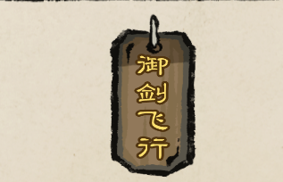

修炼后获得以下能力：开启在地图上御剑飞行的功能

### 【获取途径】

在剧情模式里，完成主线故事获得；

---

## 2. 剑术精通

修炼后获得技能效果：（需主角在战场）己方的剑在攻击前，提高一定的和，但会减少自

### 【己的🔥上限：】

### 【获取途径】

修炼御剑术，归流剑经，焚心剑谱后获得：

在天帝宝库中有概率获得：

在〔金〕地点修炼剑意有概率获得；

---

## 3. 御剑无锋

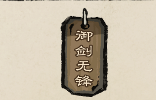

修炼后获得技能效果：（需主角在战场）己方的剑在攻击后，使目标获得一定层数的易伤（伤害结果=攻击伤害+易伤值），但会减少自己的上限：

### 【获取途径】

修炼阴阳两仪剑后获得；

在天帝宝库中有概率获得：

在〔金〕地点修炼剑意有概率获得；

---

## 4. 剑气四射（🔒 未获得）

> 尚未获得此卡牌，以下为图鉴中可见的部分信息。

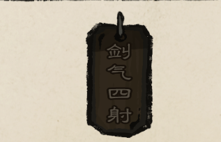

修炼后获得技能效果：（需主角在战场）己方的剑在攻击前，先对目标造成一定剑气伤害，但会減少自己的〔水〕上限：

### 【获取途径】

首次获得卡牌后解锁：

---

## 5. 断邪斩（🔒 未获得）

> 尚未获得此卡牌，以下为图鉴中可见的部分信息。

修炼后获得技能效果：（需主角在战场）自己的第一件兵器法宝（剑/刀/双刀/扇子）攻击后，使目标获得一定层数的易伤（伤害结果=攻击伤害+易伤值），但会减少自己的〔水〕上限：

### 【获取途径】

首次获得卡牌后解锁：

---

## 6. 器心通明（🔒 未获得）

> 尚未获得此卡牌，以下为图鉴中可见的部分信息。

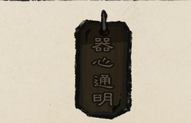

修炼后使得自己的御物能力获得强化，减少御物基础的〔水〕消耗，但会增加御兽的基础消耗：

### 【获取途径】

首次获得卡牌后解锁：

---

## 7. 金锋破（🔒 未获得）

> 尚未获得此卡牌，以下为图鉴中可见的部分信息。

修炼后获得技能效果：（需主角在战场）自己的〔金〕法宝攻击后使目标获得一定层数的易伤（伤害结果=攻击伤害+易伤值）。但会减少自己的上限：

### 【获取途径】

首次获得卡牌后解锁：

---

## 8. 笑里藏锋（🔒 未获得）

> 尚未获得此卡牌，以下为图鉴中可见的部分信息。

修炼后获得技能效果：（需主角在战场）每回合开始时，使随机目标获得一定层数的易伤（伤害结果=攻击伤害+易伤值），但会减少自己的〔水〕上限：

### 【获取途径】

首次获得卡牌后解锁：

---

## 9. 丹元催化

修炼后使得自己炼制丹药的能力获得提高，但会减少自己的〔水〕上限：

### 【获取途径】

修炼百药谱，百毒谱，春蚕诀后获得：

在天帝宝库中有概率获得：

完成慕容绛璃的筑基期支线任务后获得：

丹道结丹奖励中有概率出现；

---

## 10. 千幻毒手

修炼后使得自己使用毒丹药（带有断脉效果）的效果提高，但会减少自己的〔？〕

### 【获取途径】

修炼断肠经后获得

在天帝宝库中有概率获得

完成慕容绛璃的结丹期支线任务后获得：

丹道结丹奖励中有概率出现；

---

## 11. 长生之法（🔒 未获得）

> 尚未获得此卡牌，以下为图鉴中可见的部分信息。

修炼后使得自己的寿命提高：

### 【获取途径】

首次获得卡牌后解锁：

---

## 12. 元殒毒术（🔒 未获得）

> 尚未获得此卡牌，以下为图鉴中可见的部分信息。

习后使得自己对满血的卡牌）使用毒丹药（带有断脉效果）的效果提高，但会减少自己的〔？〕

### 【获取途径】

首次获得卡牌后解锁：

---

## 13. 灵植之心（🔒 未获得）

> 尚未获得此卡牌，以下为图鉴中可见的部分信息。

修炼后使得自己种植灵草的产量提高：

### 【获取途径】

首次获得卡牌后解锁：

---

## 14. 青冥引（🔒 未获得）

> 尚未获得此卡牌，以下为图鉴中可见的部分信息。

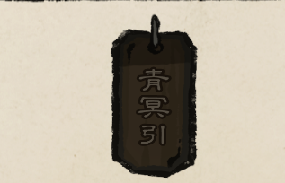

修炼后获得技能效果：（需主角在战场）自己的〔木〕战败时，会对随机敌方卡牌造成一定伤害，但此效果会使我的〔？〕降低：

### 【获取途径】

首次获得卡牌后解锁：

---

## 15. 万斛丹源（🔒 未获得）

> 尚未获得此卡牌，以下为图鉴中可见的部分信息。

修炼后使得自己炼制丹药的产量获得提高，但会减少自己的〔？〕

### 【获取途径】

首次获得卡牌后解锁：

---

## 16. 幻尘毒手

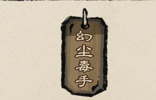

修炼后使得自己使用毒丹药（带有断脈效果）的效果提高，但自己的技能格子数量会减少。

### 【获取途径】

丹道结丹奖励中有概率出现；

---

## 17. 丹元通玄（🔒 未获得）

> 尚未获得此卡牌，以下为图鉴中可见的部分信息。

修炼后使得自己炼制丹药的能力获得提高，但自己的技能格子数量会减少。

### 【获取途径】

首次获得卡牌后解锁：

---

## 18. 花之魂（🔒 未获得）

> 尚未获得此卡牌，以下为图鉴中可见的部分信息。

修炼后获得技能效果：（需主角在战场）在战斗中通过卡牌技能召唤其他〔木〕卡牌时，使场上的所有花灵的〔？〕提高，但此技能效果会降低自己的〔？〕

### 【获取途径】

首次获得卡牌后解锁：

---

## 19. 落叶归根

修炼后获得技能效果：（需主角在战场）每当友方的〔木〕卡牌战败时，主角的〔？〕和〔火〕均提高，但此技能效果会降低自己的〔？〕

### 【获取途径】

修炼归根护元法后获得：

在天帝宝库中有概率获得：

丹道结丹奖励中有概率出现：

---

## 20. 灵脉之躯

修炼后使得自己〔水〕上限提高。但会提高自己的御器/御兽的基础消耗：

### 【获取途径】

修炼续脉经后获得

在天帝宝库中有概率获得

术道结丹奖励中有概率出现；

完成李长歌支线任务可获得；

---

## 21. 万法归流

修炼后使得自己使用口诀的能力获得提高，但会减少自己的〔火〕

### 【获取途径】

修炼水元诀，引潮法后获得：

在天帝宝库中有概率获得

术道结丹奖励中有概率出现：

---

## 22. 法术精通

修炼后使得自己使用口诀的伤害获得提高，但会减少自己的〔？〕

### 【获取途径】

修炼归藏法后获得

在天帝宝库中有概率获得

术道结丹奖励中有概率出现；

---

## 23. 落珠回春

修炼后获得技能效果：（需主角在战场）自己〔水〕卡牌战败时，会使全体友方卡牌治疗一定〔火〕，但此技能效果会使我的〔水〕增加：

### 【获取途径】

修炼汐残照后获得；

在天帝宝库中有概率获得：

---

## 24. 生生不息（🔒 未获得）

> 尚未获得此卡牌，以下为图鉴中可见的部分信息。

修炼后获得技能效果：（需主角在战场）前10回合结束时，为血量最低的卡牌恢复生命值，但此技能效果会使我的〔火〕上限减

### 【获取途径】

首次获得卡牌后解锁：

---

## 25. 无形冰

修炼后获得技能效果：（需主角在战场）回合开始时，对随机2名敌人造成固定伤害，但修炼此技能会使我的〔火〕减少：

### 【获取途径】

修炼寒影追魂录后获得：

在天帝宝库中有概率获得

术道结丹奖励中有概率出现；

---

## 26. 百炼钢躯

修炼后使得自己〔？〕和〔火〕上限提高，但会减少自己的〔水〕上限：

### 【获取途径】

修炼淬骨功，玄火锻骨录。焚心剑谱，焚脉法，燃血术后获得：

在天帝宝库中有概率获得

武道结丹奖励中有概率出现：

完成神秘高手支线可获得；

---

## 27. 真炎道（🔒 未获得）

> 尚未获得此卡牌，以下为图鉴中可见的部分信息。

修炼后获得技能效果：（需主角在战场）每回合开始时，使己方随机〔火〕卡牌获得一定增伤。但此技能效果会降低自己的〔水〕

### 【获取途径】

首次获得卡牌后解锁：

---

## 28. 神魂锻体（🔒 未获得）

> 尚未获得此卡牌，以下为图鉴中可见的部分信息。

修炼后使得自己〔？〕和〔火〕上限提高，但会降低〔水〕

### 【获取途径】

首次获得卡牌后解锁：

---

## 29. 太素炼形（🔒 未获得）

> 尚未获得此卡牌，以下为图鉴中可见的部分信息。

修炼后使得自己〔？〕和〔火〕上限提高，但会降低〔？〕

### 【获取途径】

首次获得卡牌后解锁：

---

## 30. 天窍（🔒 未获得）

> 尚未获得此卡牌，以下为图鉴中可见的部分信息。

修炼后使得自己获得额外的技能装备格，但会减少自己的〔水〕上限：

### 【获取途径】

首次获得卡牌后解锁：

---

## 31. 浴火之躯（🔒 未获得）

> 尚未获得此卡牌，以下为图鉴中可见的部分信息。

修炼后获得技能效果：（需主角在战场）减少受到〔火〕卡牌的伤害，但此技能效果会减少自己的〔水〕上限：

### 【获取途径】

首次获得卡牌后解锁：

---

## 32. 生死契约

修炼后使得自己的灵兽在战败后仍保留更多的血量，但会减少自己的〔？〕和〔火〕

### 【获取途径】

修炼轮回经，鱼龙变后获得：

在天帝宝库中有概率获得

兽道结丹奖励中有概率出现：

---

## 33. 驭兽之道

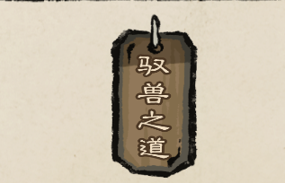

修炼后使得自己的御兽能力获得强化，减少御兽基础的〔水〕消耗，但会增加御器的基础消耗：

### 【获取途径】

修炼驭兽决后获得：

在天帝宝库中有概率获得：

兽道结丹奖励中有概率出现：

---

## 34. 远古血脉

修炼后开启功能：自己灵兽可以通过吞噬妖王内丹增加属性，但会增加自己御兽的基础〔水〕消耗：

### 【获取途径】

修炼荒古诀后获得；

兽道结丹奖励中有概率出现；

完成悦萱儿筑基期支线可以获得；

---

## 35. 不动如山

修炼后获得技能效果：自己受到兵器（剑/刀/双刀/扇子）的攻击时，减少一定的伤害，但此技能效果会降低自己的〔水〕

### 【获取途径】

修炼不动经后获得：

在天帝宝库中有概率获得：

---

## 36. 兽魂觉醒

修炼后开启功能：自己的灵兽激活第二技能，但会增加自己御兽的基础〔水〕消耗：

### 【获取途径】

完成悦萱儿筑基期支线可以获得；

---

## 37. 灵愈血契（🔒 未获得）

> 尚未获得此卡牌，以下为图鉴中可见的部分信息。

修炼后使得自己的灵兽在恢复时的速度提高：

### 【获取途径】

首次获得卡牌后解锁：

---

## 38. 载天盾（🔒 未获得）

> 尚未获得此卡牌，以下为图鉴中可见的部分信息。

修炼后获得技能效果：（需主角在战场）战斗开始时，我方的〔土〕卡牌均获得一定的护甲，但此效果会减少我的〔火〕

### 【获取途径】

首次获得卡牌后解锁：

---

## 39. 磐石之躯

修炼后获得技能效果：前10回合开始时，主角获得〔？〕，但此技能会減少我的〔？〕

### 【获取途径】

修炼磐石功后获得

在天帝宝库中有概率获得

兽道结丹奖励中有概率出现；

---

## 40. 与兽共舞（🔒 未获得）

> 尚未获得此卡牌，以下为图鉴中可见的部分信息。

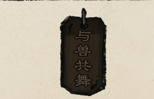

修炼后获得技能效果：主角在每回合受到的前3次攻击时，均会提高友方随机灵兽的〔？〕，但此技能会导致我的〔？〕减少：

### 【获取途径】

首次获得卡牌后解锁：

---

## 41. 噬魂

修炼后开启功能：自己在击杀修士时，会根据与修士的境界差距，额外掉落修为：

### 【获取途径】

修炼噬魂秘法后获得：

---

## 42. 杀戮

修炼后开启功能：自己在击杀修士时，拘下它的魂魄，形成魂体卡；魂体保留60%的属性和技能

### 【获取途径】

修炼七杀经后获得：

---

## 43. 拘魂

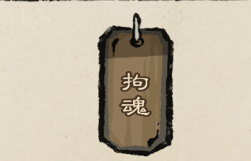

修炼后开启功能：可以在炼制工作台炼制修士，将修士转化成魂体，完全保留其生前的实力！

### 【获取途径】

修炼锁魂术后获得：

---

## 44. 夺灵

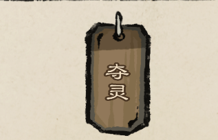

修炼后开启功能：在击败修士时，会恢复自身的〔水〕

### 【获取途径】

修炼夺灵天卷后获得：

---

## 45. 虚境遥观

修炼后使游戏桌面范围变大：

### 【获取途径】

神品或绝品结丹奖励中有概率出现；

---

## 46. 窥天机（🔒 未获得）

> 尚未获得此卡牌，以下为图鉴中可见的部分信息。

修炼后开启功能：战斗中，无视境界压制的天道规则！

### 【获取途径】

首次获得卡牌后解锁：

---

## 47. 敛锋蕴气

战斗结束后，从战斗中脱离的卡牌会恢复〔火〕（手动拿走的卡牌

### 【不会恢复）】

### 【获取途径】

在剧情模式中，修炼混元功（第三重）后获得：

修炼固本经后获得；

在天帝宝库中有概率获得：

器道和兽道结丹奖励中有概率出现；

---

## 48. 兵甲通玄

修炼后获得技能效果：（需主角在战场）战斗开始时，我方所有法宝卡的〔？〕和〔火〕获得一定提高，但此技能效果会使我的〔水〕增加：

### 【获取途径】

修炼天工经后获得：

在天帝宝库中有概率获得：

---

## 49. 洞虛灵眸

修炼后提高自己的白〔水〕，但会降低〔水〕上限：

### 【获取途径】

修炼敛神术后获得：

在天帝宝库中有概率获得：

结丹奖励中有概率出现；

---

## 50. 回春圣体（🔒 未获得）

> 尚未获得此卡牌，以下为图鉴中可见的部分信息。

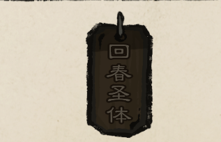

修炼后使自己在恢复时的速度提高：

### 【获取途径】

首次获得卡牌后解锁：

---

## 51. 灵犀巧手（🔒 未获得）

> 尚未获得此卡牌，以下为图鉴中可见的部分信息。

重铸法宝时所需的材料减少一个；

### 【获取途径】

首次获得卡牌后解锁：

---
