# 【卡牌修仙传】图鉴攻略 — 卡牌 / 天赋

- 收录总数：52（游戏官方数据，其中图鉴未收录 1 条）
- 更新时间：2026-11-19 18:28

---

## 1. 御剑飞行

### 【各版本（境界 / 品质）】

筑基·神品：开启在地图上**御剑飞行**的功能；获得方式 剧情模式主线故事

### 【获取途径】

在剧情模式里，完成主线故事获得

---

## 2. 剑术精通

### 【各版本（境界 / 品质）】

练气·天品：（需主角在战场）己方的剑在攻击前，〔攻击〕+1；获得方式 修炼〈御剑术〉

筑基·仙品：（需主角在战场）己方的剑在攻击前，〔血量〕+5；代价：〔灵气〕上限-2；获得方式 修炼〈归流剑经〉、在「金芒矿」（〔金〕地点）修炼「剑意」，有概率获得（主角筑基期）

筑基·仙品：（需主角在战场）己方的剑在攻击前，〔攻击〕+3；代价：〔灵气〕上限-2；获得方式 修炼〈焚心剑谱〉、在「金芒矿」（〔金〕地点）修炼「剑意」，有概率获得（主角筑基期）

练气·地品：（需主角在战场）己方的剑在攻击前，〔攻击〕+1；获得方式 修炼〈御剑术〉

筑基·绝品：（需主角在战场）己方的剑在攻击前，〔血量〕+5

筑基·绝品：（需主角在战场）己方的剑在攻击前，〔攻击〕+3；获得方式 在「天帝宝库内部 · 器道宝库」（筑基）里直接摆着这张卡（要用「一把秘钥」才能拿走，一把钥匙开一件）

结丹·天品：（需主角在战场）己方的剑在攻击前，〔血量〕+15；代价：〔灵气〕上限-4；获得方式 修炼〈归流剑经〉、在「金芒矿」（〔金〕地点）修炼「剑意」，有概率获得（主角结丹期）

结丹·天品：（需主角在战场）己方的剑在攻击前，〔攻击〕+8；代价：〔灵气〕上限-4；获得方式 修炼〈焚心剑谱〉、在「金芒矿」（〔金〕地点）修炼「剑意」，有概率获得（主角结丹期）

结丹·绝品：（需主角在战场）己方的剑在攻击前，〔血量〕+15；获得方式 在「天帝宝库内部 · 器道宝库」（结丹）里直接摆着这张卡（要用「一把秘钥」才能拿走，一把钥匙开一件）

结丹·绝品：（需主角在战场）己方的剑在攻击前，〔攻击〕+8；获得方式 在「天帝宝库内部 · 器道宝库」（结丹）里直接摆着这张卡（要用「一把秘钥」才能拿走，一把钥匙开一件）

### 【获取途径】

修炼〈御剑术〉 / 〈归流剑经〉 / 〈焚心剑谱〉后获得

在天帝宝库中有概率获得

在〔金〕地点，修炼**〈剑意〉**后有概率获得

---

## 3. 御剑无锋

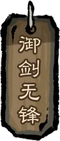

### 【各版本（境界 / 品质）】

筑基·仙品：（需主角在战场）自己的剑在攻击目标后，会给目标留下2层**易伤**；代价：〔灵气〕上限-1；获得方式 修炼〈阴阳两仪剑〉、在「金芒矿」（〔金〕地点）修炼「剑意」，有概率获得（主角筑基期）

筑基·绝品：（需主角在战场）自己的剑在攻击目标后，会给目标留下2层**易伤**；获得方式 在「天帝宝库内部 · 器道宝库」（筑基）里直接摆着这张卡（要用「一把秘钥」才能拿走，一把钥匙开一件）

结丹·天品：（需主角在战场）自己的剑在攻击目标后，会给目标留下3层**易伤**；代价：〔灵气〕上限-2；获得方式 修炼〈阴阳两仪剑〉、在「金芒矿」（〔金〕地点）修炼「剑意」，有概率获得（主角结丹期）

结丹·绝品：（需主角在战场）自己的剑在攻击目标后，会给目标留下3层**易伤**；获得方式 在「天帝宝库内部 · 器道宝库」（结丹）里直接摆着这张卡（要用「一把秘钥」才能拿走，一把钥匙开一件）

### 【获取途径】

在天帝宝库中有概率获得

在〔金〕地点，修炼**〈剑意〉**后有概率获得

---

## 4. 剑气四射

### 【各版本（境界 / 品质）】

筑基·仙品：（需主角在战场）在使用剑攻击前，会先用剑气攻击目标（造成3点伤害）；代价：〔灵气〕上限-2；获得方式 在「金芒矿」（〔金〕地点）修炼「剑意」，有概率获得（主角筑基期）

筑基·绝品：（需主角在战场）在使用剑攻击前，会先用剑气攻击目标（造成3点伤害）；获得方式 在「天帝宝库内部 · 器道宝库」（筑基）里直接摆着这张卡（要用「一把秘钥」才能拿走，一把钥匙开一件）

结丹·天品：（需主角在战场）在使用剑攻击前，会先用剑气攻击目标（造成7点伤害）；代价：〔灵气〕上限-2；获得方式 修炼〈无相剑典〉、在「金芒矿」（〔金〕地点）修炼「剑意」，有概率获得（主角结丹期）

结丹·绝品：（需主角在战场）在使用剑攻击前，会先用剑气攻击目标（造成7点伤害）；获得方式 在「天帝宝库内部 · 器道宝库」（结丹）里直接摆着这张卡（要用「一把秘钥」才能拿走，一把钥匙开一件）

### 【获取途径】

在天帝宝库中有概率获得

在〔金〕地点，修炼**〈剑意〉**后有概率获得

---

## 5. 断邪斩

### 【各版本（境界 / 品质）】

筑基·神品：己方第一件法宝兵器法宝（剑/刀/双刀/扇子）攻击后，为目标附加2点**易伤**；获得方式 修炼〈破煞剑谱〉、在「金芒矿」（〔金〕地点）修炼「剑意」，有概率获得（主角筑基期）

筑基·绝品：己方第一件法宝兵器法宝（剑/刀/双刀/扇子）攻击后，为目标附加2点**易伤**

结丹·仙品：己方第一件法宝兵器法宝（剑/刀/双刀/扇子）攻击后，为目标附加3点**易伤**；获得方式 修炼〈破煞剑谱〉

结丹·天品：己方第一件法宝兵器法宝（剑/刀/双刀/扇子）攻击后，为目标附加2点**易伤**；获得方式 在「金芒矿」（〔金〕地点）修炼「剑意」，有概率获得（主角结丹期）

结丹·绝品：己方第一件法宝兵器法宝（剑/刀/双刀/扇子）攻击后，为目标附加3点**易伤**；获得方式 在「天帝宝库内部 · 器道宝库」（结丹）里直接摆着这张卡（要用「一把秘钥」才能拿走，一把钥匙开一件）

### 【获取途径】

在天帝宝库中有概率获得

在〔金〕地点，修炼**〈剑意〉**后有概率获得

---

## 6. 器心通明

### 【各版本（境界 / 品质）】

筑基·神品：〔御器〕-1；〔御兽〕+1；获得方式 修炼〈剑魄诀〉

筑基·绝品：〔御器〕-1；获得方式 在「天帝宝库内部 · 器道宝库」（筑基）里直接摆着这张卡（要用「一把秘钥」才能拿走，一把钥匙开一件）

结丹·绝品：〔御器〕-1；〔御兽〕+1；获得方式 修炼〈剑魄诀〉

结丹·绝品：使用法宝/傀儡的〔灵气〕消耗-1；获得方式 结丹时把绝品器道放入〈修道之路〉，「功果圆成」三选一传承（器道）、在「天帝宝库内部 · 器道宝库」（结丹）里直接摆着这张卡（要用「一把秘钥」才能拿走，一把钥匙开一件）

结丹·神品：使用法宝/傀儡的〔灵气〕消耗-1；代价：驭兽的〔灵气〕消耗+1；获得方式 结丹时把神品器道放入〈修道之路〉，「功果圆成」三选一传承（器道）

结丹·人品：使用法宝/傀儡的〔灵气〕消耗-1；代价：驭兽的〔灵气〕消耗+2；获得方式 结丹时把人品器道放入〈修道之路〉，「功果圆成」三选一传承（器道）、结丹时把神品器道放入〈修道之路〉，「功果圆成」三选一传承（器道）

### 【获取途径】

在天帝宝库中有概率获得

器道结丹奖励中有概率出现

---

## 7. 金锋破

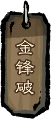

### 【各版本（境界 / 品质）】

筑基·绝品：（需主角在战场）使用金系法宝攻击目标，会给目标留下2层**易伤**；获得方式 在「天帝宝库内部 · 器道宝库」（筑基）里直接摆着这张卡（要用「一把秘钥」才能拿走，一把钥匙开一件）

结丹·神品：（需主角在战场）使用金系法宝攻击目标，会给目标留下3层**易伤**；代价：〔灵气〕上限-2；获得方式 修炼〈金锋谱〉

结丹·绝品：（需主角在战场）使用金系法宝攻击目标，会给目标留下3层**易伤**；获得方式 在「天帝宝库内部 · 器道宝库」（结丹）里直接摆着这张卡（要用「一把秘钥」才能拿走，一把钥匙开一件）

### 【获取途径】

在天帝宝库中有概率获得

在〔金〕地点，修炼**〈剑意〉**后有概率获得

---

## 8. 笑里藏锋

### 【各版本（境界 / 品质）】

筑基·绝品：（需主角在战场）每回合开始时，使随机目标留下2层**易伤**；获得方式 在「天帝宝库内部 · 器道宝库」（筑基）里直接摆着这张卡（要用「一把秘钥」才能拿走，一把钥匙开一件）

结丹·仙品：（需主角在战场）每回合开始时，使随机目标留下3层**易伤**；代价：〔灵气〕上限-2；获得方式 修炼〈藏锋诀〉

结丹·天品：（需主角在战场）每回合开始时，使随机目标留下3层**易伤**；代价：〔灵气〕上限-4；获得方式 在「金芒矿」（〔金〕地点）修炼「剑意」，有概率获得（主角结丹期）

结丹·绝品：（需主角在战场）每回合开始时，使随机目标留下3层**易伤**；获得方式 在「天帝宝库内部 · 器道宝库」（结丹）里直接摆着这张卡（要用「一把秘钥」才能拿走，一把钥匙开一件）

### 【获取途径】

在天帝宝库中有概率获得

在〔金〕地点，修炼**〈剑意〉**后有概率获得

---

## 9. 丹元催化

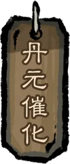

### 【各版本（境界 / 品质）】

练气·天品：炼制的丹药效果：活血，聚气和断脉的效果值+2；获得方式 修炼〈百药谱〉

筑基·天品：炼制的丹药效果：断脉的效果值+4；代价：〔攻击〕-4；获得方式 修炼〈百毒谱〉

筑基·仙品：炼制的丹药效果：活血，聚气效果值+4；获得方式 修炼〈春蚕诀〉

筑基·绝品：炼制的丹药效果：断脉的效果值+10；代价：〔攻击〕-10；获得方式 在「森林的石桌子」调查石桌（这是任务【慕容绛璃的支线】第 6 步「成功调查石桌」），获得

筑基·地品：炼制的丹药效果：活血，聚气和断脉的效果值+2；获得方式 修炼〈百药谱〉

筑基·绝品：炼制的丹药效果：断脉的效果值+7；获得方式 在「天帝宝库内部 · 丹道宝库」（筑基）里直接摆着这张卡（要用「一把秘钥」才能拿走，一把钥匙开一件）

结丹·地品：炼制的丹药效果：断脉的效果值+4；代价：〔攻击〕-4；获得方式 修炼〈百毒谱〉

结丹·天品：炼制的丹药效果：活血，聚气效果值+10；获得方式 修炼〈春蚕诀〉

结丹·仙品：炼制的丹药效果：活血的效果值+30；获得方式 修炼〈黄庭内景〉

结丹·绝品：炼制的丹药效果：断脉的效果值+15；获得方式 在「天帝宝库内部 · 丹道宝库」（结丹）里直接摆着这张卡（要用「一把秘钥」才能拿走，一把钥匙开一件）、结丹时把绝品丹道放入〈修道之路〉，「功果圆成」三选一传承（丹道）

结丹·绝品：炼制的丹药效果：活血的效果值+30；获得方式 在「天帝宝库内部 · 丹道宝库」（结丹）里直接摆着这张卡（要用「一把秘钥」才能拿走，一把钥匙开一件）

结丹·神品：炼制的丹药效果：断脉的效果值+10；获得方式 结丹时把神品丹道放入〈修道之路〉，「功果圆成」三选一传承（丹道）

结丹·人品：炼制的丹药效果：断脉的效果值+5；获得方式 结丹时把人品丹道放入〈修道之路〉，「功果圆成」三选一传承（丹道）、结丹时把神品丹道放入〈修道之路〉，「功果圆成」三选一传承（丹道）

### 【获取途径】

修炼〈百药谱〉 / 〈百毒谱〉 / 〈春蚕诀〉后获得

在天帝宝库中有概率获得

完成慕容绛璃的筑基期支线任务后获得

丹道结丹奖励中有概率出现

---

## 10. 千幻毒手

### 【各版本（境界 / 品质）】

筑基·仙品：使用丹药时，断脉的效果+5；（此效果不受境界衰减影响）；代价：〔攻击〕-5；获得方式 修炼〈断肠经〉、修炼〈春蚕诀〉

筑基·绝品：使用丹药时，断脉的效果+5；（此效果不受境界衰减影响）；获得方式 在「天帝宝库内部 · 丹道宝库」（筑基）里直接摆着这张卡（要用「一把秘钥」才能拿走，一把钥匙开一件）

结丹·天品：使用丹药时，断脉的效果+10；（此效果不受境界衰减影响）；代价：〔攻击〕-10；获得方式 修炼〈断肠经〉

结丹·绝品：使用丹药时，断脉的效果+15；（此效果不受境界衰减影响）；获得方式 结丹期「古木幽森」深处的「枯木」机关密室（慕容绛璃的结丹期支线）：和「慕容绛璃」一起把密室里的 10 只「火灵树妖」全部打败，「枯木的神念」出现后和它对话，获得、结丹时把绝品丹道放入〈修道之路〉，「功果圆成」三选一传承（丹道）

结丹·绝品：使用丹药时，断脉的效果+10；（此效果不受境界衰减影响）；获得方式 在「天帝宝库内部 · 丹道宝库」（结丹）里直接摆着这张卡（要用「一把秘钥」才能拿走，一把钥匙开一件）

结丹·神品：使用丹药时，断脉的效果+9；（此效果不受境界衰减影响）；获得方式 结丹时把神品丹道放入〈修道之路〉，「功果圆成」三选一传承（丹道）

结丹·人品：使用丹药时，断脉的效果+6；（此效果不受境界衰减影响）；获得方式 结丹时把人品丹道放入〈修道之路〉，「功果圆成」三选一传承（丹道）、结丹时把神品丹道放入〈修道之路〉，「功果圆成」三选一传承（丹道）

### 【获取途径】

在天帝宝库中有概率获得

完成慕容绛璃的结丹期支线任务后获得

丹道结丹奖励中有概率出现

---

## 11. 长生之法

### 【各版本（境界 / 品质）】

筑基·地品：修炼后寿命+20年；获得方式 修炼〈长生录〉

筑基·绝品：修炼后寿命+50年；获得方式 在「天帝宝库内部 · 丹道宝库」（筑基）里直接摆着这张卡（要用「一把秘钥」才能拿走，一把钥匙开一件）

结丹·绝品：修炼后寿命+100年；获得方式 在「天帝宝库内部 · 丹道宝库」（结丹）里直接摆着这张卡（要用「一把秘钥」才能拿走，一把钥匙开一件）

### 【获取途径】

在天帝宝库中有概率获得

---

## 12. 元殒毒术

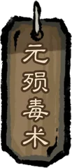

### 【各版本（境界 / 品质）】

筑基·绝品：对满血的卡牌使毒丹时，伤害效果额外增加6点；获得方式 在「天帝宝库内部 · 丹道宝库」（筑基）里直接摆着这张卡（要用「一把秘钥」才能拿走，一把钥匙开一件）

结丹·神品：对满血的卡牌使毒丹时，伤害效果额外增加18点；代价：〔攻击〕-15；获得方式 修炼〈毒心经〉

结丹·绝品：对满血的卡牌使毒丹时，伤害效果额外增加18点；获得方式 在「天帝宝库内部 · 丹道宝库」（结丹）里直接摆着这张卡（要用「一把秘钥」才能拿走，一把钥匙开一件）

结丹·绝品：对满血的卡牌使用毒丹时，效果额外增加18点；获得方式 结丹时把绝品丹道放入〈修道之路〉，「功果圆成」三选一传承（丹道）

结丹·神品：对满血的卡牌使用毒丹时，效果额外增加12点；代价：〔攻击〕-10；获得方式 结丹时把神品丹道放入〈修道之路〉，「功果圆成」三选一传承（丹道）

结丹·人品：对满血的卡牌使用毒丹时，效果额外增加6点；代价：〔攻击〕-5；获得方式 结丹时把人品丹道放入〈修道之路〉，「功果圆成」三选一传承（丹道）、结丹时把神品丹道放入〈修道之路〉，「功果圆成」三选一传承（丹道）

### 【获取途径】

在天帝宝库中有概率获得

丹道结丹奖励中有概率出现

---

## 13. 灵植之心

### 【各版本（境界 / 品质）】

结丹·仙品：在药田种植灵草的产量提高（上限和下限+1）；代价：〔攻击〕-10；获得方式 修炼〈蕴灵诀〉

结丹·绝品：在药田种植灵草的产量提高（上限和下限+2）；获得方式 结丹时把绝品丹道放入〈修道之路〉，「功果圆成」三选一传承（丹道）、在「天帝宝库内部 · 丹道宝库」（结丹）里直接摆着这张卡（要用「一把秘钥」才能拿走，一把钥匙开一件）

结丹·神品：在药田种植灵草的产量提高（上限和下限+1）；获得方式 结丹时把神品丹道放入〈修道之路〉，「功果圆成」三选一传承（丹道）

结丹·人品：在药田种植灵草的产量提高（上限和下限+1）；代价：〔攻击〕-10；获得方式 结丹时把人品丹道放入〈修道之路〉，「功果圆成」三选一传承（丹道）、结丹时把神品丹道放入〈修道之路〉，「功果圆成」三选一传承（丹道）

### 【获取途径】

在天帝宝库中有概率获得

丹道结丹奖励中有概率出现

---

## 14. 青冥引

### 【各版本（境界 / 品质）】

筑基·绝品：（需主角在战场）自己的〔木〕卡牌战败时，会对随机目标造成7点伤害；获得方式 在「天帝宝库内部 · 丹道宝库」（筑基）里直接摆着这张卡（要用「一把秘钥」才能拿走，一把钥匙开一件）

结丹·仙品：（需主角在战场）自己的〔木〕卡牌战败时，会对随机目标造成15点伤害；代价：〔攻击〕上限-15；获得方式 修炼〈青冥真解〉

结丹·绝品：（需主角在战场）自己的〔木〕卡牌战败时，会对随机目标造成15点伤害；获得方式 在「天帝宝库内部 · 丹道宝库」（结丹）里直接摆着这张卡（要用「一把秘钥」才能拿走，一把钥匙开一件）

### 【获取途径】

在天帝宝库中有概率获得

丹道结丹奖励中有概率出现

---

## 15. 万斛丹源

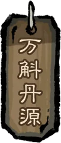

### 【各版本（境界 / 品质）】

结丹·绝品：炼制丹药时，最后一轮的产量会+1；获得方式 结丹期「古木幽森」深处的「枯木」机关密室（慕容绛璃的结丹期支线）：和「慕容绛璃」一起把密室里的 10 只「火灵树妖」全部打败，「枯木的神念」出现后和它对话，获得、结丹时把绝品丹道放入〈修道之路〉，「功果圆成」三选一传承（丹道）、在「天帝宝库内部 · 丹道宝库」（结丹）里直接摆着这张卡（要用「一把秘钥」才能拿走，一把钥匙开一件）

结丹·神品：炼制丹药时，最后一轮的产量会+1；代价：〔攻击〕-5；获得方式 结丹时把神品丹道放入〈修道之路〉，「功果圆成」三选一传承（丹道）

结丹·人品：炼制丹药时，最后一轮的产量会+1；代价：〔攻击〕-10；获得方式 结丹时把人品丹道放入〈修道之路〉，「功果圆成」三选一传承（丹道）、结丹时把神品丹道放入〈修道之路〉，「功果圆成」三选一传承（丹道）

### 【获取途径】

完成慕容绛璃结丹期任务后获得

在天帝宝库中有概率获得

丹道结丹奖励中有概率出现

---

## 16. 幻尘毒手

### 【各版本（境界 / 品质）】

结丹·绝品：使用丹药时，断脉的效果+30；（此效果不受境界衰减影响）；代价：可装备的技能数量-1；获得方式 结丹时把绝品丹道放入〈修道之路〉，「功果圆成」三选一传承（丹道）、在「天帝宝库内部 · 丹道宝库」（结丹）里直接摆着这张卡（要用「一把秘钥」才能拿走，一把钥匙开一件）

### 【获取途径】

丹道结丹奖励中有概率出现

---

## 17. 丹元通玄

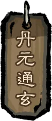

### 【各版本（境界 / 品质）】

结丹·绝品：炼制的丹药效果：活血，聚气和断脉的效果值+20；代价：可装备的技能数量-1；获得方式 结丹时把绝品丹道放入〈修道之路〉，「功果圆成」三选一传承（丹道）、在「天帝宝库内部 · 丹道宝库」（结丹）里直接摆着这张卡（要用「一把秘钥」才能拿走，一把钥匙开一件）

### 【获取途径】

丹道结丹奖励中有概率出现

---

## 18. 花之魂

### 【各版本（境界 / 品质）】

筑基·绝品：在战斗中通过卡牌技能召唤其他〔木〕属性卡牌时，使自己所有的花灵的〔攻击〕+4；获得方式 在「天帝宝库内部 · 丹道宝库」（筑基）里直接摆着这张卡（要用「一把秘钥」才能拿走，一把钥匙开一件）

结丹·仙品：在战斗中通过卡牌技能召唤其他〔木〕属性卡牌时，使自己所有的花灵的〔攻击〕+4；代价：主角的〔攻击〕-4；获得方式 修炼〈花栖木〉

结丹·绝品：在战斗中通过卡牌技能召唤其他〔木〕属性卡牌时，使自己所有的花灵的〔攻击〕+8；获得方式 结丹时把绝品丹道放入〈修道之路〉，「功果圆成」三选一传承（丹道）

结丹·神品：在战斗中通过卡牌技能召唤其他〔木〕属性卡牌时，使自己所有的花灵的〔攻击〕+6；代价：主角的〔攻击〕-2；获得方式 结丹时把神品丹道放入〈修道之路〉，「功果圆成」三选一传承（丹道）

结丹·人品：在战斗中通过卡牌技能召唤其他〔木〕属性卡牌时，使自己所有的花灵的〔攻击〕+1；获得方式 结丹时把人品丹道放入〈修道之路〉，「功果圆成」三选一传承（丹道）、结丹时把神品丹道放入〈修道之路〉，「功果圆成」三选一传承（丹道）

元婴·天品：在战斗中通过卡牌技能召唤其他〔木〕属性卡牌时，使自己所有的花灵的〔攻击〕+10；代价：主角的〔攻击〕-6；获得方式 修炼〈花栖木〉

### 【获取途径】

在天帝宝库中有概率获得

丹道结丹奖励中有概率出现

---

## 19. 落叶归根

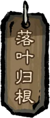

### 【各版本（境界 / 品质）】

筑基·绝品：在战斗中，每次〔木〕卡牌阵亡时，主角的〔攻击〕和〔血量〕+2；获得方式 在「天帝宝库内部 · 丹道宝库」（筑基）里直接摆着这张卡（要用「一把秘钥」才能拿走，一把钥匙开一件）

结丹·仙品：在战斗中，每次〔木〕卡牌阵亡时，主角的〔攻击〕和〔血量〕+3；代价：主角的〔攻击〕-8；获得方式 修炼〈归根护元法〉

结丹·绝品：在战斗中，每次〔木〕卡牌阵亡时，主角的〔攻击〕和〔血量〕+5；获得方式 结丹时把绝品丹道放入〈修道之路〉，「功果圆成」三选一传承（丹道）

结丹·神品：在战斗中，每次〔木〕卡牌阵亡时，主角的〔攻击〕和〔血量〕+4；代价：主角的〔攻击〕-6；获得方式 结丹时把神品丹道放入〈修道之路〉，「功果圆成」三选一传承（丹道）

结丹·人品：在战斗中，每次〔木〕卡牌阵亡时，主角的〔攻击〕和〔血量〕+1；获得方式 结丹时把人品丹道放入〈修道之路〉，「功果圆成」三选一传承（丹道）、结丹时把神品丹道放入〈修道之路〉，「功果圆成」三选一传承（丹道）

### 【获取途径】

在天帝宝库中有概率获得

丹道结丹奖励中有概率出现

---

## 20. 灵脉之躯

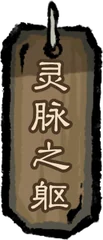

### 【各版本（境界 / 品质）】

筑基·绝品：我的〔灵气〕上限提高25；代价：使用法宝/灵兽/傀儡的基础〔灵气〕消耗+1；获得方式 带着〈沾血的信〉和「玄剑阁长老」对话（在「金陵城」）（这是任务【李长歌的支线】第 10 步「把李长歌的绝笔信交给玄剑阁长老」、【李长歌的支线】第 12 步「李长歌的秘钥」），获得、带着〈秘钥〉和「李长歌」对话（这是任务【李长歌的支线】第 7 步「把秘钥还给李长歌？」、【李长歌的支线】第 12 步「李长歌的秘钥」），获得

筑基·人品：我的〔灵气〕上限提高5；获得方式 修炼〈续脉经〉、重塑肉身〈续脉经〉

筑基·绝品：我的〔灵气〕上限提高15；获得方式 在「天帝宝库内部 · 术道宝库」（筑基）里直接摆着这张卡（要用「一把秘钥」才能拿走，一把钥匙开一件）

结丹·神品：我的〔灵气〕上限提高40；代价：使用法宝/灵兽/傀儡的基础〔灵气〕消耗+1；获得方式 修炼〈沧溟诀〉

结丹·人品：我的〔灵气〕上限提高5；获得方式 修炼〈续脉经〉、重塑肉身〈续脉经〉

结丹·绝品：我的〔灵气〕上限提高25；获得方式 在「天帝宝库内部 · 术道宝库」（结丹）里直接摆着这张卡（要用「一把秘钥」才能拿走，一把钥匙开一件）

结丹·绝品：我的〔灵气〕上限提高40；获得方式 结丹时把绝品术道放入〈修道之路〉，「功果圆成」三选一传承（术道）

结丹·神品：我的〔灵气〕上限提高15；获得方式 结丹时把神品术道放入〈修道之路〉，「功果圆成」三选一传承（术道）

结丹·人品：我的〔灵气〕上限提高8；获得方式 结丹时把人品术道放入〈修道之路〉，「功果圆成」三选一传承（术道）、结丹时把神品术道放入〈修道之路〉，「功果圆成」三选一传承（术道）

### 【获取途径】

在天帝宝库中有概率获得

术道结丹奖励中有概率出现

完成李长歌支线任务可获得

---

## 21. 万法归流

### 【各版本（境界 / 品质）】

筑基·仙品：我使用口诀的〔灵气〕消耗-2；代价：〔血量〕-10；获得方式 修炼〈水元诀〉

筑基·仙品：我使用口诀后的冷却时间-5日；代价：〔血量〕-10；获得方式 修炼〈引潮法〉

筑基·绝品：我使用口诀的〔灵气〕消耗-2；获得方式 在「天帝宝库内部 · 术道宝库」（筑基）里直接摆着这张卡（要用「一把秘钥」才能拿走，一把钥匙开一件）

筑基·绝品：我使用口诀后的冷却时间-5日；获得方式 在「天帝宝库内部 · 术道宝库」（筑基）里直接摆着这张卡（要用「一把秘钥」才能拿走，一把钥匙开一件）

结丹·天品：我使用口诀的〔灵气〕消耗-2；代价：〔血量〕-20；获得方式 修炼〈水元诀〉

结丹·天品：我使用口诀后的冷却时间-5日；代价：〔血量〕-20；获得方式 修炼〈引潮法〉

结丹·绝品：我使用口诀的〔灵气〕消耗-2；获得方式 在「天帝宝库内部 · 术道宝库」（结丹）里直接摆着这张卡（要用「一把秘钥」才能拿走，一把钥匙开一件）

结丹·绝品：我使用口诀后的冷却时间-5日；获得方式 在「天帝宝库内部 · 术道宝库」（结丹）里直接摆着这张卡（要用「一把秘钥」才能拿走，一把钥匙开一件）

结丹·绝品：我使用口诀的〔灵气〕消耗-8；获得方式 结丹时把绝品术道放入〈修道之路〉，「功果圆成」三选一传承（术道）

结丹·神品：我使用口诀的〔灵气〕消耗-5；获得方式 结丹时把神品术道放入〈修道之路〉，「功果圆成」三选一传承（术道）

结丹·人品：我使用口诀的〔灵气〕消耗-2；获得方式 结丹时把人品术道放入〈修道之路〉，「功果圆成」三选一传承（术道）、结丹时把神品术道放入〈修道之路〉，「功果圆成」三选一传承（术道）

结丹·绝品：我使用口诀后的冷却时间-30日；获得方式 结丹时把绝品术道放入〈修道之路〉，「功果圆成」三选一传承（术道）

结丹·神品：我使用口诀后的冷却时间-20日；获得方式 结丹时把神品术道放入〈修道之路〉，「功果圆成」三选一传承（术道）

结丹·人品：我使用口诀后的冷却时间-10日；获得方式 结丹时把人品术道放入〈修道之路〉，「功果圆成」三选一传承（术道）、结丹时把神品术道放入〈修道之路〉，「功果圆成」三选一传承（术道）

### 【获取途径】

修炼〈水元诀〉 / 〈引潮法〉后获得

在天帝宝库中有概率获得

术道结丹奖励中有概率出现

---

## 22. 法术精通

### 【各版本（境界 / 品质）】

筑基·仙品：使用单体攻击的口诀时，〔伤害〕+7；代价：〔血量〕-15；获得方式 修炼〈归藏术〉

筑基·绝品：使用单体攻击的口诀时，〔伤害〕+7；获得方式 在「天帝宝库内部 · 术道宝库」（筑基）里直接摆着这张卡（要用「一把秘钥」才能拿走，一把钥匙开一件）

结丹·天品：使用单体攻击的口诀时，〔伤害〕+15；代价：〔血量〕-30；获得方式 修炼〈归藏术〉

结丹·绝品：使用单体攻击的口诀时，〔伤害〕+15；获得方式 在「天帝宝库内部 · 术道宝库」（结丹）里直接摆着这张卡（要用「一把秘钥」才能拿走，一把钥匙开一件）、结丹时把绝品术道放入〈修道之路〉，「功果圆成」三选一传承（术道）

结丹·神品：使用单体攻击的口诀时，〔伤害〕+8；获得方式 结丹时把神品术道放入〈修道之路〉，「功果圆成」三选一传承（术道）

结丹·人品：使用单体攻击的口诀时，〔伤害〕+5；获得方式 结丹时把人品术道放入〈修道之路〉，「功果圆成」三选一传承（术道）、结丹时把神品术道放入〈修道之路〉，「功果圆成」三选一传承（术道）

结丹·绝品：使用单体攻击的口诀时，〔伤害〕+25；代价：可装备的技能数量-1；获得方式 结丹时把绝品术道放入〈修道之路〉，「功果圆成」三选一传承（术道）

### 【获取途径】

修炼归藏法后获得

在天帝宝库中有概率获得

术道结丹奖励中有概率出现

---

## 23. 落珠回春

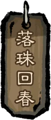

### 【各版本（境界 / 品质）】

结丹·仙品：（需主角在战场）自己的〔水〕卡牌战败时，会为全体友军恢复15〔血量〕；代价：〔御兽〕消耗+1；获得方式 修炼〈汐残照〉

结丹·绝品：（需主角在战场）自己的〔水〕卡牌战败时，会为全体友军恢复15〔血量〕；获得方式 在「天帝宝库内部 · 术道宝库」（结丹）里直接摆着这张卡（要用「一把秘钥」才能拿走，一把钥匙开一件）

### 【获取途径】

在天帝宝库中有概率获得

---

## 24. 生生不息

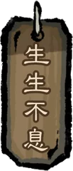

### 【各版本（境界 / 品质）】

筑基·仙品：（需主角在战场）前10回合结束时，为友方血量最少的卡牌恢复8点〔血量〕；代价：主角的〔血量〕-4；获得方式 修炼〈润元心法〉

结丹·天品：（需主角在战场）前10回合结束时，为友方血量最少的卡牌恢复20点〔血量〕；代价：主角的〔血量〕-10；获得方式 修炼〈润元心法〉

结丹·绝品：（需主角在战场）前10回合结束时，为友方血量最少的卡牌恢复25点〔血量〕；获得方式 结丹时把绝品术道放入〈修道之路〉，「功果圆成」三选一传承（术道）

结丹·神品：（需主角在战场）前10回合结束时，为友方血量最少的卡牌恢复15点〔血量〕；代价：主角的〔血量〕-8；获得方式 结丹时把神品术道放入〈修道之路〉，「功果圆成」三选一传承（术道）

结丹·人品：（需主角在战场）前10回合结束时，为友方血量最少的卡牌恢复5点〔血量〕；获得方式 结丹时把人品术道放入〈修道之路〉，「功果圆成」三选一传承（术道）、结丹时把神品术道放入〈修道之路〉，「功果圆成」三选一传承（术道）

### 【获取途径】

在天帝宝库中有概率获得

术道结丹奖励中有概率出现

---

## 25. 无形冰

### 【各版本（境界 / 品质）】

筑基·仙品：（需主角在战场）回合开始时，对随机2名敌人造成4点〔伤害〕；代价：主角的〔血量〕-6；获得方式 修炼〈寒影追魂录〉

结丹·天品：（需主角在战场）回合开始时，对随机2名敌人造成15点〔伤害〕；代价：主角的〔血量〕-15；获得方式 修炼〈寒影追魂录〉

结丹·绝品：（需主角在战场）回合开始时，对随机2名敌人造成10点〔伤害〕；获得方式 结丹时把绝品术道放入〈修道之路〉，「功果圆成」三选一传承（术道）

结丹·神品：（需主角在战场）回合开始时，对随机2名敌人造成6点〔伤害〕；代价：主角的〔血量〕-9；获得方式 结丹时把神品术道放入〈修道之路〉，「功果圆成」三选一传承（术道）

结丹·人品：（需主角在战场）回合开始时，对随机2名敌人造成2点〔伤害〕；获得方式 结丹时把人品术道放入〈修道之路〉，「功果圆成」三选一传承（术道）、结丹时把神品术道放入〈修道之路〉，「功果圆成」三选一传承（术道）

### 【获取途径】

在天帝宝库中有概率获得

术道结丹奖励中有概率出现

---

## 26. 百炼钢躯

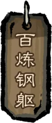

### 【各版本（境界 / 品质）】

练气·天品：我的〔攻击〕和〔血量〕均+2；获得方式 修炼〈淬骨功〉

筑基·天品：我的〔攻击〕+3；代价：〔灵气〕上限-5；获得方式 修炼〈玄火锻骨录〉

筑基·仙品：我的〔血量〕+15；代价：〔灵气〕上限-5；获得方式 修炼〈焚心剑谱〉、修炼〈焚脉法〉

筑基·仙品：我的〔攻击〕+5；代价：〔灵气〕上限-10；获得方式 修炼〈燃血术〉

筑基·绝品：我的〔攻击〕+15；〔血量〕+80；代价：使用法宝，灵兽和傀儡的基础〔灵气〕消耗都增加1点；获得方式 和「神秘高手」对话（这是任务【地火深洞的神秘高手】第 1 步「遇见并对话神秘高手」、【地火深洞的神秘高手】第 5 步「在地火深洞深处拜访神秘高手」），获得

筑基·绝品：我的〔攻击〕+10；〔血量〕+50；代价：〔神识〕-1；获得方式 在「天帝宝库内部 · 武道宝库」（筑基）里直接摆着这张卡（要用「一把秘钥」才能拿走，一把钥匙开一件）

筑基·地品：我的〔攻击〕和〔血量〕均+3；获得方式 修炼〈淬骨功〉

筑基·绝品：我的〔血量〕+15；获得方式 在「天帝宝库内部 · 武道宝库」（筑基）里直接摆着这张卡（要用「一把秘钥」才能拿走，一把钥匙开一件）

筑基·绝品：我的〔攻击〕+5；获得方式 在「天帝宝库内部 · 武道宝库」（筑基）里直接摆着这张卡（要用「一把秘钥」才能拿走，一把钥匙开一件）

结丹·地品：我的〔攻击〕+3；代价：〔灵气〕上限-5；获得方式 修炼〈玄火锻骨录〉

结丹·天品：我的〔血量〕+50；代价：〔灵气〕上限-10；获得方式 修炼〈焚心剑谱〉、修炼〈焚脉法〉

结丹·天品：我的〔攻击〕+10；代价：〔灵气〕上限-15；获得方式 修炼〈燃血术〉

结丹·绝品：我的〔血量〕+50；获得方式 「武破岳」在结丹期寿元耗尽坐化时留下的遗言（好感 ≥ 50）、在「天帝宝库内部 · 武道宝库」（结丹）里直接摆着这张卡（要用「一把秘钥」才能拿走，一把钥匙开一件）

结丹·绝品：我的〔攻击〕+10；获得方式 「武破岳」在结丹期寿元耗尽坐化时留下的遗言（好感 ≥ 50）、在「天帝宝库内部 · 武道宝库」（结丹）里直接摆着这张卡（要用「一把秘钥」才能拿走，一把钥匙开一件）

结丹·绝品：我的〔攻击〕+20；获得方式 结丹时把绝品武道放入〈修道之路〉，「功果圆成」三选一传承（武道）

结丹·绝品：我的〔血量〕+150；获得方式 结丹时把绝品武道放入〈修道之路〉，「功果圆成」三选一传承（武道）、结丹时把绝品兽道放入〈修道之路〉，「功果圆成」三选一传承（兽道）

结丹·神品：我的〔攻击〕+10；获得方式 结丹时把神品武道放入〈修道之路〉，「功果圆成」三选一传承（武道）、结丹时把神品器道放入〈修道之路〉，「功果圆成」三选一传承（器道）

结丹·神品：我的〔血量〕+100；获得方式 结丹时把神品武道放入〈修道之路〉，「功果圆成」三选一传承（武道）、结丹时把神品器道放入〈修道之路〉，「功果圆成」三选一传承（器道）

结丹·人品：我的〔攻击〕+5；获得方式 结丹时把人品武道放入〈修道之路〉，「功果圆成」三选一传承（武道）、结丹时把神品武道放入〈修道之路〉，「功果圆成」三选一传承（武道）、结丹时把人品器道放入〈修道之路〉，「功果圆成」三选一传承（器道）、结丹时把神品器道放入〈修道之路〉，「功果圆成」三选一传承（器道）

结丹·人品：我的〔血量〕+50；获得方式 结丹时把人品武道放入〈修道之路〉，「功果圆成」三选一传承（武道）、结丹时把神品武道放入〈修道之路〉，「功果圆成」三选一传承（武道）、结丹时把人品器道放入〈修道之路〉，「功果圆成」三选一传承（器道）、结丹时把神品器道放入〈修道之路〉，「功果圆成」三选一传承（器道）

天窍·结丹·绝品：我可以额外装备一个技能。；获得方式 结丹时把绝品武道放入〈修道之路〉，「功果圆成」三选一传承（武道）

### 【获取途径】

修炼〈淬骨功〉 / 〈玄火锻骨录〉 / 〈焚心剑谱〉 / 〈焚脉法〉 / 〈燃血术〉后获得

在天帝宝库中有概率获得

武道结丹奖励中有概率出现

完成神秘高手支线可获得

---

## 27. 真炎道

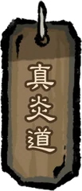

### 【各版本（境界 / 品质）】

筑基·绝品：（需主角在战场）每回合开始时，使一张〔火〕卡牌获得8点增伤；获得方式 在「天帝宝库内部 · 武道宝库」（筑基）里直接摆着这张卡（要用「一把秘钥」才能拿走，一把钥匙开一件）

结丹·仙品：（需主角在战场）每回合开始时，使一张〔火〕卡牌获得20点增伤；代价：〔灵气〕上限-10；获得方式 修炼〈焚霄诀〉

结丹·绝品：（需主角在战场）每回合开始时，使一张〔火〕卡牌获得20点增伤；获得方式 在「天帝宝库内部 · 武道宝库」（结丹）里直接摆着这张卡（要用「一把秘钥」才能拿走，一把钥匙开一件）

### 【获取途径】

在天帝宝库中有概率获得

---

## 28. 神魂锻体

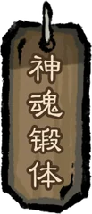

### 【各版本（境界 / 品质）】

筑基·神品：我的〔血量〕+70；代价：〔神识〕-1；获得方式 修炼〈血髓功〉

结丹·仙品：我的〔血量〕+180；代价：〔神识〕-1；获得方式 修炼〈血髓功〉

结丹·仙品：我的〔攻击〕+10；〔血量〕+100；代价：〔神识〕-1；获得方式 修炼〈燃神诀〉

结丹·绝品：我的〔攻击〕+10；〔血量〕+100；代价：〔神识〕-1；获得方式 「武破岳」在结丹期寿元耗尽坐化时留下的遗言（好感 ≥ 50）、在「天帝宝库内部 · 武道宝库」（结丹）里直接摆着这张卡（要用「一把秘钥」才能拿走，一把钥匙开一件）

### 【获取途径】

修炼〈血髓功〉 / 〈燃神诀〉后获得

在天帝宝库中有概率获得

---

## 29. 太素炼形

### 【各版本（境界 / 品质）】

结丹·仙品：我的〔攻击〕+10；〔血量〕+120；代价：〔寿命〕-80；获得方式 修炼〈燃魄诀〉

结丹·绝品：我的〔攻击〕+10；〔血量〕+120；代价：〔寿命〕-40；获得方式 「武破岳」在结丹期寿元耗尽坐化时留下的遗言（好感 ≥ 50）、在「天帝宝库内部 · 武道宝库」（结丹）里直接摆着这张卡（要用「一把秘钥」才能拿走，一把钥匙开一件）

### 【获取途径】

在天帝宝库中有概率获得

---

## 30. 天窍

### 【各版本（境界 / 品质）】

结丹·绝品：我可以额外装备一个技能。；代价：〔灵气〕上限-35；获得方式 修炼〈炼心诀〉

结丹·绝品：我可以额外装备一个技能。；获得方式 结丹时把绝品武道放入〈修道之路〉，「功果圆成」三选一传承（武道）

### 【获取途径】

在天帝宝库中有概率获得（此天赋有唯一性，仅能获得一张）

武道结丹奖励中有概率出现

---

## 31. 浴火之躯

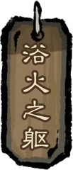

### 【各版本（境界 / 品质）】

结丹·仙品：自己受到的〔火〕卡牌的伤害减少10%；代价：〔灵气〕上限-5；获得方式 修炼〈炎息心法〉

结丹·绝品：自己受到的〔火〕卡牌的伤害减少25%

结丹·神品：自己受到的〔火〕卡牌的伤害减少15%；代价：〔灵气〕上限-5

结丹·人品：自己受到的〔火〕卡牌的伤害减少5%

### 【获取途径】

在天帝宝库中有概率获得

武道结丹奖励中有概率出现

---

## 32. 生死契约

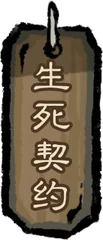

### 【各版本（境界 / 品质）】

筑基·仙品：我的灵兽在战败后，会保留5点〔血量〕；代价：〔血量〕上限-5；获得方式 修炼〈轮回经〉

筑基·仙品：我的灵兽在战败后，会保留5点〔血量〕；代价：〔攻击〕上限-3；获得方式 修炼〈鱼龙变〉

筑基·绝品：我的灵兽在战败后，会保留5点〔血量〕；获得方式 在「天帝宝库内部 · 兽道宝库」（筑基）里直接摆着这张卡（要用「一把秘钥」才能拿走，一把钥匙开一件）

结丹·天品：我的灵兽在战败后，会保留15点〔血量〕；代价：〔血量〕上限-10；获得方式 修炼〈轮回经〉

结丹·天品：我的灵兽在战败后，会保留15点〔血量〕；代价：〔攻击〕上限-5；获得方式 修炼〈鱼龙变〉

结丹·绝品：我的灵兽在战败后，会保留20点〔血量〕；获得方式 在「天帝宝库内部 · 兽道宝库」（结丹）里直接摆着这张卡（要用「一把秘钥」才能拿走，一把钥匙开一件）、结丹时把绝品兽道放入〈修道之路〉，「功果圆成」三选一传承（兽道）

结丹·神品：我的灵兽在战败后，会保留10点〔血量〕；获得方式 结丹时把神品兽道放入〈修道之路〉，「功果圆成」三选一传承（兽道）

结丹·人品：我的灵兽在战败后，会保留5点〔血量〕；获得方式 结丹时把人品兽道放入〈修道之路〉，「功果圆成」三选一传承（兽道）、结丹时把神品兽道放入〈修道之路〉，「功果圆成」三选一传承（兽道）

### 【获取途径】

修炼〈轮回经〉 / 〈鱼龙变〉后获得

在天帝宝库中有概率获得

兽道结丹奖励中有概率出现

---

## 33. 驭兽之道

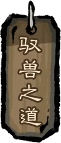

### 【各版本（境界 / 品质）】

筑基·仙品：驭兽的基础〔灵气〕消耗-1；代价：御器（包括傀儡）的基础〔灵气〕消耗+1；获得方式 修炼〈驭兽决〉

筑基·绝品：驭兽的基础〔灵气〕消耗-1；获得方式 在「天帝宝库内部 · 兽道宝库」（筑基）里直接摆着这张卡（要用「一把秘钥」才能拿走，一把钥匙开一件）

结丹·天品：驭兽的基础〔灵气〕消耗-1；代价：御器（包括傀儡）的基础〔灵气〕消耗+1；获得方式 修炼〈驭兽决〉

结丹·绝品：驭兽的基础〔灵气〕消耗-1；获得方式 在「天帝宝库内部 · 兽道宝库」（结丹）里直接摆着这张卡（要用「一把秘钥」才能拿走，一把钥匙开一件）

结丹·绝品：驭兽的基础〔灵气〕消耗-3；获得方式 结丹时把绝品兽道放入〈修道之路〉，「功果圆成」三选一传承（兽道）

结丹·神品：驭兽的基础〔灵气〕消耗-2；代价：御器（包括傀儡）的基础〔灵气〕消耗+1；获得方式 结丹时把神品兽道放入〈修道之路〉，「功果圆成」三选一传承（兽道）

结丹·人品：驭兽的基础〔灵气〕消耗-1；代价：御器（包括傀儡）的基础〔灵气〕消耗+1；获得方式 结丹时把人品兽道放入〈修道之路〉，「功果圆成」三选一传承（兽道）、结丹时把神品兽道放入〈修道之路〉，「功果圆成」三选一传承（兽道）

### 【获取途径】

在天帝宝库中有概率获得

兽道结丹奖励中有概率出现

---

## 34. 远古血脉

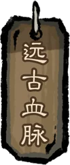

### 【各版本（境界 / 品质）】

筑基·绝品：开启功能：我的灵兽可以吞噬1个**妖王内丹**以获得其属性（灵兽升阶后清除）。；代价：驭兽的基础〔灵气〕消耗+1；获得方式 修炼〈荒古诀〉

结丹·绝品：开启功能：我的灵兽可以吞噬1个**妖王内丹**以获得其属性（灵兽升阶后清除）。；代价：驭兽的基础〔灵气〕消耗+1；获得方式 修炼〈荒古诀〉

结丹·绝品：开启功能：我的灵兽可以吞噬1个**妖王内丹**以获得其属性（灵兽升阶后清除）。；获得方式 结丹时把绝品兽道放入〈修道之路〉，「功果圆成」三选一传承（兽道）、在「天帝宝库内部 · 兽道宝库」（结丹）里直接摆着这张卡（要用「一把秘钥」才能拿走，一把钥匙开一件）

结丹·神品：开启功能：我的灵兽可以吞噬1个**妖王内丹**以获得其属性（灵兽升阶后清除）。；代价：驭兽的基础〔灵气〕消耗+1

结丹·人品：开启功能：我的灵兽可以吞噬1个**妖王内丹**以获得其属性（灵兽升阶后清除）。；代价：驭兽的基础〔灵气〕消耗+2

### 【获取途径】

兽道结丹奖励中有概率出现

完成悦萱儿筑基期支线可以获得

---

## 35. 不动如山

### 【各版本（境界 / 品质）】

筑基·神品：我在战斗中受到兵器的伤害减少5点。；代价：〔灵气〕上限-10；获得方式 修炼〈不动经〉

筑基·绝品：我在战斗中受到兵器的伤害减少5点。；获得方式 在「天帝宝库内部 · 兽道宝库」（筑基）里直接摆着这张卡（要用「一把秘钥」才能拿走，一把钥匙开一件）

结丹·神品：我在战斗中受到兵器的伤害减少10点。；代价：〔灵气〕上限-20；获得方式 修炼〈不动经〉

结丹·绝品：我在战斗中受到兵器的伤害减少10点。；获得方式 结丹时把绝品兽道放入〈修道之路〉，「功果圆成」三选一传承（兽道）、在「天帝宝库内部 · 兽道宝库」（结丹）里直接摆着这张卡（要用「一把秘钥」才能拿走，一把钥匙开一件）

### 【获取途径】

在天帝宝库中有概率获得

---

## 36. 兽魂觉醒

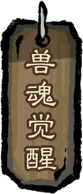

### 【各版本（境界 / 品质）】

绝品：开启功能：我的灵兽将激活第二技能；代价：驭兽的基础〔灵气〕消耗+1；获得方式 修炼〈荒古诀〉

### 【获取途径】

完成悦萱儿筑基期支线可以获得

---

## 37. 灵愈血契

### 【各版本（境界 / 品质）】

结丹·绝品：战斗结束后，从战斗中脱离的卡牌会恢复50〔血量〕（手动拿走的卡牌不会恢复）；获得方式 结丹时把绝品兽道放入〈修道之路〉，「功果圆成」三选一传承（兽道）

结丹·神品：灵兽在恢复工作台的恢复速度小幅度提高（恢复系数+3）；获得方式 结丹时把神品兽道放入〈修道之路〉，「功果圆成」三选一传承（兽道）

结丹·人品：战斗结束后，从战斗中脱离的卡牌会恢复20〔血量〕（手动拿走的卡牌不会恢复）；获得方式 结丹时把人品兽道放入〈修道之路〉，「功果圆成」三选一传承（兽道）、结丹时把神品兽道放入〈修道之路〉，「功果圆成」三选一传承（兽道）

### 【获取途径】

兽道结丹奖励中有概率出现

在天帝宝库中有概率获得

---

## 38. 载天盾

### 【各版本（境界 / 品质）】

结丹·仙品：（需主角在战场）战斗开始时，我方的〔土〕卡牌均获得10〔护甲〕；代价：〔血量〕-20；获得方式 修炼〈苍壁经〉

结丹·绝品：（需主角在战场）战斗开始时，我方的〔土〕卡牌均获得10〔护甲〕；获得方式 结丹时把绝品器道放入〈修道之路〉，「功果圆成」三选一传承（器道）、结丹时把绝品兽道放入〈修道之路〉，「功果圆成」三选一传承（兽道）、在「天帝宝库内部 · 兽道宝库」（结丹）里直接摆着这张卡（要用「一把秘钥」才能拿走，一把钥匙开一件）

### 【获取途径】

在天帝宝库中有概率获得

---

## 39. 磐石之躯

### 【各版本（境界 / 品质）】

筑基·仙品：前10回合开始时，主角获得5〔护甲〕；代价：〔攻击〕-3；获得方式 修炼〈磐石功〉

结丹·天品：前10回合开始时，主角获得10〔护甲〕；代价：〔攻击〕-5；获得方式 修炼〈磐石功〉

结丹·绝品：前10回合开始时，主角获得18〔护甲〕；获得方式 结丹时把绝品兽道放入〈修道之路〉，「功果圆成」三选一传承（兽道）

结丹·神品：前10回合开始时，主角获得13〔护甲〕；代价：〔攻击〕-6；获得方式 结丹时把神品兽道放入〈修道之路〉，「功果圆成」三选一传承（兽道）

结丹·人品：前10回合开始时，主角获得7〔护甲〕；代价：〔攻击〕-3；获得方式 结丹时把人品兽道放入〈修道之路〉，「功果圆成」三选一传承（兽道）、结丹时把神品兽道放入〈修道之路〉，「功果圆成」三选一传承（兽道）

### 【获取途径】

在天帝宝库中有概率获得

兽道结丹奖励中有概率出现

---

## 40. 与兽共舞

### 【各版本（境界 / 品质）】

筑基·仙品：主角在每回合受到的前3次攻击时，使友方随机灵兽的〔攻击〕+3；代价：〔攻击〕-5；获得方式 修炼〈契兽诀〉

结丹·天品：主角在每回合受到的前3次攻击时，使友方随机灵兽的〔攻击〕+7；代价：〔攻击〕-10；获得方式 修炼〈契兽诀〉

结丹·绝品：主角在每回合受到的前3次攻击时，使友方随机灵兽的〔攻击〕+8；获得方式 结丹时把绝品兽道放入〈修道之路〉，「功果圆成」三选一传承（兽道）

结丹·神品：主角在每回合受到的前3次攻击时，使友方随机灵兽的〔攻击〕+5；代价：〔攻击〕-8；获得方式 结丹时把神品兽道放入〈修道之路〉，「功果圆成」三选一传承（兽道）

结丹·人品：主角在每回合受到的前3次攻击时，使友方随机灵兽的〔攻击〕+3；获得方式 结丹时把人品兽道放入〈修道之路〉，「功果圆成」三选一传承（兽道）、结丹时把神品兽道放入〈修道之路〉，「功果圆成」三选一传承（兽道）

### 【获取途径】

在天帝宝库中有概率获得

兽道结丹奖励中有概率出现

---

## 41. 噬魂

### 【各版本（境界 / 品质）】

筑基·神品：开启功能：击杀境界高于自己的修士时，会额外获得修为卡；获得方式 修炼〈噬魂秘法〉

---

## 42. 杀戮

### 【各版本（境界 / 品质）】

筑基·神品：开启功能：击杀修士时，会获得其魂体卡；魂体卡会保留修士生前的属性，技能，但不保留生前的法宝/灵兽/傀儡。；获得方式 修炼〈七杀经〉

---

## 43. 拘魂

### 【各版本（境界 / 品质）】

筑基·神品：开启功能：可以在**炼制工作台**炼制修士，将修士转化成魂体，且实力大增；获得方式 修炼〈锁魂术〉

---

## 44. 夺灵

### 【各版本（境界 / 品质）】

结丹·神品：击败目标后，会恢复自身5点〔灵气〕；获得方式 修炼〈夺灵天卷〉

结丹·绝品：击败目标后，会恢复自身10点〔灵气〕；获得方式 结丹时把绝品术道放入〈修道之路〉，「功果圆成」三选一传承（术道）、在「天帝宝库内部 · 术道宝库」（结丹）里直接摆着这张卡（要用「一把秘钥」才能拿走，一把钥匙开一件）

---

## 45. 虚境遥观

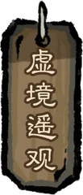

### 【各版本（境界 / 品质）】

筑基·绝品：我的桌面范围变大10%。；获得方式 修炼〈空明无相诀〉

结丹·绝品：我的桌面范围变大10%。；获得方式 修炼〈空明无相诀〉、在「天帝宝库内部 · 器道宝库」（结丹）里直接摆着这张卡（要用「一把秘钥」才能拿走，一把钥匙开一件）、在「天帝宝库内部 · 丹道宝库」（结丹）里直接摆着这张卡（要用「一把秘钥」才能拿走，一把钥匙开一件）、在「天帝宝库内部 · 术道宝库」（结丹）里直接摆着这张卡（要用「一把秘钥」才能拿走，一把钥匙开一件）、结丹时把神品武道放入〈修道之路〉，「功果圆成」三选一传承（武道）、结丹时把绝品武道放入〈修道之路〉，「功果圆成」三选一传承（武道）、结丹时把神品器道放入〈修道之路〉，「功果圆成」三选一传承（器道）、结丹时把绝品器道放入〈修道之路〉，「功果圆成」三选一传承（器道）、结丹时把神品兽道放入〈修道之路〉，「功果圆成」三选一传承（兽道）、结丹时把神品丹道放入〈修道之路〉，「功果圆成」三选一传承（丹道）、结丹时把神品术道放入〈修道之路〉，「功果圆成」三选一传承（术道）、结丹时把绝品术道放入〈修道之路〉，「功果圆成」三选一传承（术道）

结丹·绝品：我的桌面范围变大15%。；获得方式 修炼〈混元功〉

### 【获取途径】

神品或绝品结丹奖励中有概率出现

---

## 46. 窥天机

### 【各版本（境界 / 品质）】

绝品：战斗无视境界压制！；获得方式 修炼〈天衍诀〉

### 【获取途径】

修炼天衍决后获得（需完成镇妖塔里萧清钰的支线任务）

---

## 47. 敛锋蕴气

### 【各版本（境界 / 品质）】

筑基·神品：战斗结束后，从战斗中脱离的卡牌会恢复15〔血量〕（手动拿走的卡牌不会恢复）；获得方式 修炼〈混元功〉

筑基·仙品：战斗结束后，从战斗中脱离的卡牌会恢复10〔血量〕（手动拿走的卡牌不会恢复）；获得方式 修炼〈固本经〉

筑基·绝品：战斗结束后，从战斗中脱离的卡牌会恢复20〔血量〕；获得方式 在「天帝宝库内部 · 器道宝库」（筑基）里直接摆着这张卡（要用「一把秘钥」才能拿走，一把钥匙开一件）、在「天帝宝库内部 · 兽道宝库」（筑基）里直接摆着这张卡（要用「一把秘钥」才能拿走，一把钥匙开一件）

结丹·天品：战斗结束后，从战斗中脱离的卡牌会恢复15〔血量〕（手动拿走的卡牌不会恢复）；获得方式 修炼〈固本经〉

结丹·绝品：战斗结束后，从战斗中脱离的卡牌会恢复15〔血量〕（手动拿走的卡牌不会恢复）；获得方式 在「天帝宝库内部 · 器道宝库」（结丹）里直接摆着这张卡（要用「一把秘钥」才能拿走，一把钥匙开一件）、在「天帝宝库内部 · 兽道宝库」（结丹）里直接摆着这张卡（要用「一把秘钥」才能拿走，一把钥匙开一件）

结丹·绝品：战斗结束后，从战斗中脱离的卡牌会恢复50〔血量〕（手动拿走的卡牌不会恢复）；获得方式 结丹时把绝品器道放入〈修道之路〉，「功果圆成」三选一传承（器道）、结丹时把绝品兽道放入〈修道之路〉，「功果圆成」三选一传承（兽道）

结丹·神品：战斗结束后，从战斗中脱离的卡牌会恢复30〔血量〕（手动拿走的卡牌不会恢复）；获得方式 结丹时把神品器道放入〈修道之路〉，「功果圆成」三选一传承（器道）、结丹时把神品兽道放入〈修道之路〉，「功果圆成」三选一传承（兽道）

结丹·人品：战斗结束后，从战斗中脱离的卡牌会恢复20〔血量〕（手动拿走的卡牌不会恢复）；获得方式 结丹时把人品器道放入〈修道之路〉，「功果圆成」三选一传承（器道）、结丹时把人品兽道放入〈修道之路〉，「功果圆成」三选一传承（兽道）

元婴·地品：战斗结束后，从战斗中脱离的卡牌会恢复25〔血量〕（手动拿走的卡牌不会恢复）；获得方式 修炼〈固本经〉

### 【获取途径】

在剧情模式中，修炼混元功（第三重）后获得

在天帝宝库中有概率获得

器道和兽道结丹奖励中有概率出现

---

## 48. 兵甲通玄

### 【各版本（境界 / 品质）】

结丹·神品：战斗开始时，自己的法宝〔攻击〕+5；〔血量〕+10；代价：驭兽消耗+1；获得方式 修炼〈天工经〉

结丹·绝品：战斗开始时，自己的法宝〔攻击〕+5；〔血量〕+10；获得方式 结丹时把绝品器道放入〈修道之路〉，「功果圆成」三选一传承（器道）

结丹·神品：战斗开始时，自己的法宝〔攻击〕+3；〔血量〕+5；获得方式 结丹时把神品器道放入〈修道之路〉，「功果圆成」三选一传承（器道）

结丹·人品：战斗开始时，自己的法宝〔攻击〕+3；〔血量〕+5；代价：驭兽消耗+1

### 【获取途径】

在天帝宝库中有概率获得

---

## 49. 洞虚灵眸

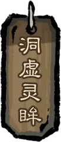

### 【各版本（境界 / 品质）】

结丹·绝品：神识值+1；代价：〔寿命〕-150；获得方式 修炼〈敛神术〉

结丹·绝品：神识值+1；获得方式 在「天帝宝库内部 · 器道宝库」（结丹）里直接摆着这张卡（要用「一把秘钥」才能拿走，一把钥匙开一件）、在「天帝宝库内部 · 兽道宝库」（结丹）里直接摆着这张卡（要用「一把秘钥」才能拿走，一把钥匙开一件）、在「天帝宝库内部 · 术道宝库」（结丹）里直接摆着这张卡（要用「一把秘钥」才能拿走，一把钥匙开一件）、结丹时把绝品武道放入〈修道之路〉，「功果圆成」三选一传承（武道）、结丹时把绝品器道放入〈修道之路〉，「功果圆成」三选一传承（器道）、结丹时把绝品兽道放入〈修道之路〉，「功果圆成」三选一传承（兽道）、结丹时把绝品丹道放入〈修道之路〉，「功果圆成」三选一传承（丹道）、结丹时把绝品术道放入〈修道之路〉，「功果圆成」三选一传承（术道）

结丹·神品：神识值+1；代价：〔寿命〕-100；获得方式 结丹时把神品武道放入〈修道之路〉，「功果圆成」三选一传承（武道）、结丹时把神品器道放入〈修道之路〉，「功果圆成」三选一传承（器道）、结丹时把神品兽道放入〈修道之路〉，「功果圆成」三选一传承（兽道）

结丹·人品：神识值+1；代价：〔寿命〕-200；获得方式 结丹时把人品武道放入〈修道之路〉，「功果圆成」三选一传承（武道）、结丹时把人品器道放入〈修道之路〉，「功果圆成」三选一传承（器道）、结丹时把神品器道放入〈修道之路〉，「功果圆成」三选一传承（器道）、结丹时把人品兽道放入〈修道之路〉，「功果圆成」三选一传承（兽道）、结丹时把神品兽道放入〈修道之路〉，「功果圆成」三选一传承（兽道）

### 【获取途径】

在天帝宝库中有概率获得

结丹奖励中有概率出现

---

## 50. 回春圣体

### 【各版本（境界 / 品质）】

结丹·绝品：自己在恢复工作台的恢复速度大幅提高（恢复系数+10）；获得方式 结丹时把绝品武道放入〈修道之路〉，「功果圆成」三选一传承（武道）

结丹·神品：自己在恢复工作台的恢复速度小幅度提高（恢复系数+6）；获得方式 结丹时把神品武道放入〈修道之路〉，「功果圆成」三选一传承（武道）

结丹·人品：自己在恢复工作台的恢复速度提高（恢复系数+3）；获得方式 结丹时把人品武道放入〈修道之路〉，「功果圆成」三选一传承（武道）、结丹时把神品武道放入〈修道之路〉，「功果圆成」三选一传承（武道）

### 【获取途径】

结丹奖励中有概率出现

---

## 51. 灵犀巧手

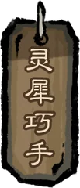

### 【各版本（境界 / 品质）】

筑基·神品：重铸法宝时所需要的材料减少一个；获得方式 修炼〈炼元宝鉴〉

---

## 52. 灵力亲和（图鉴未收录）

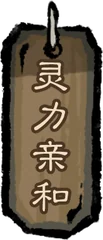

修炼后开启功能：**灵气卡**在消失时，会自动补充至主角体内；并使补充的〔灵气〕值提高

### 【各版本（境界 / 品质）】

练气·绝品：吸收灵气卡恢复的灵气量+5

筑基·仙品：吸收灵气卡恢复的灵气量+2；获得方式 修炼〈引气经〉

筑基·神品：吸收灵气卡恢复的灵气量+3；获得方式 修炼〈混元功〉

筑基·绝品：吸收灵气卡恢复的灵气量+2；获得方式 在「天帝宝库内部 · 术道宝库」（筑基）里直接摆着这张卡（要用「一把秘钥」才能拿走，一把钥匙开一件）

结丹·人品：吸收灵气卡恢复的灵气量+4；获得方式 结丹时把人品术道放入〈修道之路〉，「功果圆成」三选一传承（术道）、结丹时把神品术道放入〈修道之路〉，「功果圆成」三选一传承（术道）

结丹·天品：吸收灵气卡恢复的灵气量+3；获得方式 修炼〈引气经〉

结丹·神品：吸收灵气卡恢复的灵气量+7；获得方式 结丹时把神品术道放入〈修道之路〉，「功果圆成」三选一传承（术道）

结丹·绝品：吸收灵气卡恢复的灵气量+3；获得方式 在「天帝宝库内部 · 术道宝库」（结丹）里直接摆着这张卡（要用「一把秘钥」才能拿走，一把钥匙开一件）

结丹·绝品：吸收灵气卡恢复的灵气量+10；获得方式 结丹时把绝品术道放入〈修道之路〉，「功果圆成」三选一传承（术道）

元婴·地品：吸收灵气卡恢复的灵气量+4；获得方式 修炼〈引气经〉

神品：灵气卡牌在消失时，会自动吸取补充至自身！；获得方式 修炼〈混元功〉

---
