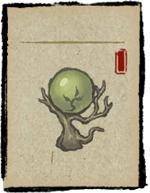
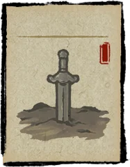
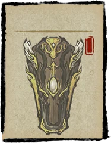
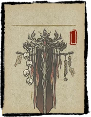

# 【卡牌修仙传】图鉴攻略 — 卡牌 / 图纸

- 收录总数：11（游戏官方数据）
- 更新时间：2026-11-19 18:28

---

## 1. 烈火剑图纸

### 【各版本（境界 / 品质）】

练气·地品：图纸里记载着烈火剑的炼制方法。我需要按照图纸上的记载，将材料收集完毕！；材料：火魂石、火灵气；获得方式 开局剧情（师傅的试炼第 3 步）：恢复体力后和「师傅」对话，师傅说下一个对手「树灵」你打不过、修仙之人要用法宝，给你〈烈火剑图纸〉和〈炼制〉工作台。接着去悬崖边的「燃岩松」探索，采集图纸要的〈火魂石〉和〈火灵气〉（一次没找到就多试几次），放进炼制工作台照图纸炼出〈烈火剑〉，用它打败树灵

---

## 2. 毒心散图纸

### 【各版本（境界 / 品质）】

练气·神品：图纸里记载着毒心散的炼制方法。如果我能收集到里面的材料，我应该也能炼制出丹药。；材料：腐木菇、腐木菇；获得方式 开局剧情（师傅的试炼第 5 步）：把〈灵兽神魄〉炼化成灵兽后和「师傅」对话，师傅让你把灵兽带到静室，并给你〈毒心散图纸〉

---

## 3. 筑基丹图纸

### 【各版本（境界 / 品质）】

练气·神品：炼制筑基丹的配方，需要收集完以下材料后方可炼制：；（需要把图纸放入"炼制"，放可以根据图纸炼丹）；材料：静心草、绝品内丹、灵气；获得方式 剧情模式主线故事、修炼〈吐纳之法〉

### 【获取途径】

第 1 步：突破「练气后期」时得到回忆剧情卡「初窥筑基」，点「完成事件」 → 师傅送你〈筑基丹图纸〉

用法：放进炼制工作台，配上〈静心草〉 + 任意一颗绝品内丹 + 任意灵气，炼出〈筑基丹〉

---

## 4. 生锈的剑

一把生锈的剑，需要使用以下材料炼制才能重新使用：

（需要把生锈的剑放入"炼制"）

### 【各版本（境界 / 品质）】

筑基·人品：材料：灵气、兽血；获得方式 在「剑冢的剑」拔剑，获得

筑基·地品：材料：灵气、兽血；获得方式 在「剑冢的剑」拔剑，获得

筑基·天品：材料：灵气、兽血；获得方式 在「剑冢的剑」拔剑，获得

筑基·仙品：材料：灵气、兽血；获得方式 在「剑冢的剑」拔剑，获得

筑基·神品：材料：灵气、兽血；获得方式 在「剑冢的剑」拔剑，获得

结丹·人品：材料：灵气、兽血；获得方式 在「剑冢的剑」拔剑，获得

结丹·地品：材料：灵气、兽血；获得方式 在「剑冢的剑」拔剑，获得

结丹·天品：材料：灵气、兽血；获得方式 在「剑冢的剑」拔剑，获得

结丹·仙品：材料：灵气、兽血；获得方式 在「剑冢的剑」拔剑，获得

结丹·神品：材料：灵气、兽血；获得方式 在「剑冢的剑」拔剑，获得

---

## 5. 损坏的法宝

在战场发现的一件法宝，但已损坏得看不出原状，但仍残留部分灵气，也许我可以将其重新**炼制**

---

## 6. 银霄天令图纸

### 【各版本（境界 / 品质）】

筑基·仙品：炼制法宝的图纸，需要收集完以下材料后方可炼制：；（需要把图纸放入"炼制"，放可以根据图纸炼制）；材料：〔金〕材料（筑基）、〔金〕材料（筑基）、〔土〕材料（筑基）、神品内丹（筑基）；获得方式 主角突破时「赵子义」送的贺礼：到筑基初期（好感 ≥ 10）

---

## 7. 镇魂伞图纸

### 【各版本（境界 / 品质）】

筑基·神品：炼制法宝的图纸，需要收集完以下材料后方可炼制：；（需要把图纸放入"炼制"，放可以根据图纸炼制）；材料：〔阴〕妖王内丹、百年妖骨、百年妖骨、黑魄寒冰；获得方式 和「顾杳杳之魂」对话，获得

---

## 8. 无双剑匣图纸

炼制法宝的图纸，需要收集完以下材料后方可炼制：

（需要把图纸放入"炼制"，放可以根据图纸炼制）

### 【各版本（境界 / 品质）】

筑基·神品：材料：剑魂残魄、剑魂残魄、绝品〔金〕材料；获得方式 因果？

结丹·神品：材料：剑魂残魄、剑魂残魄、剑魂残魄、绝品〔金〕材料；获得方式 因果？

---

## 9. 万魂幡图纸

炼制法宝的图纸，需要收集完以下材料后方可炼制：

（需要把图纸放入"炼制"，放可以根据图纸炼制）

### 【各版本（境界 / 品质）】

筑基·神品：材料：血肉根、巨兽皮、活人；获得方式 带着〈秘钥〉和「蒙面人」对话，获得、因果？

结丹·神品：材料：血肉根、血肉根、巨兽皮、活人；获得方式 带着〈秘钥〉和「蒙面人」对话，获得、因果？

---

## 10. 豢灵壶图纸

炼制法宝的图纸，需要收集完以下材料后方可炼制：

（需要把图纸放入"炼制"，放可以根据图纸炼制）

### 【各版本（境界 / 品质）】

筑基·神品：材料：灵兽神魄、灵兽神魄、本源兽魄、本源兽魄；获得方式 因果？

结丹·神品：材料：灵兽神魄、灵兽神魄、本源兽魄、本源兽魄；获得方式 因果？

---

## 11. 瑶池花篮图纸

### 【各版本（境界 / 品质）】

筑基·神品：炼制法宝的图纸，需要收集完以下材料后方可炼制：；（需要把图纸放入"炼制"，放可以根据图纸炼制）

---
