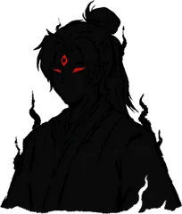

# 【卡牌修仙传】图鉴攻略 — 卡牌 / 敌对修士

- 收录总数：3（游戏官方数据，其中图鉴未收录 3 条）
- 更新时间：2026-11-20 16:59

---

## 1. 入魔的修士（图鉴未收录）

一名入魔的修士，TA已经失去了理智；对付TA的办法只能将TA击杀！

### 【各版本（境界 / 品质）】

练气：一名表情扭曲的修士，看他的情况，似乎在抵御心魔当中。我应该怎么做呢？；攻击 1 / 血量 5；获得方式 在「山脚下」探索（放入「无名氏或自由模式主角」），有概率获得、在「山脚下」利用神识感知，有概率获得（主角练气期）、在「山脚下」探索（放入「无名氏或神识或自由模式主角」），有概率获得（主角筑基/结丹/元婴/化神/炼虚/合体/大乘期）、在「山脚下」派出灵兽，有概率获得、在「山脚下」利用傀儡，有概率获得、在「金芒矿(小)」（〔金〕地点）探索（放入「无名氏或神识或自由模式主角」），有概率获得（主角练气期）、在「金芒矿(小)」（〔金〕地点）探索（放入「无名氏或神识或自由模式主角」），有概率获得（主角筑基/结丹/元婴/化神/炼虚/合体/大乘期）、在「青灵木(小)」（〔木〕地点）探索（放入「无名氏或神识或自由模式主角」），有概率获得（主角练气期）、在「青灵木(小)」（〔木〕地点）探索（放入「无名氏或神识或自由模式主角」），有概率获得（主角筑基/结丹/元婴/化神/炼虚/合体/大乘期）、在「愈魂池(小)」（〔水〕地点）探索（放入「无名氏或神识或自由模式主角」），有概率获得（主角练气期）、在「愈魂池(小)」（〔水〕地点）探索（放入「无名氏或神识或自由模式主角」），有概率获得（主角筑基/结丹/元婴/化神/炼虚/合体/大乘期）、在「火云树(小)」（〔火〕地点）探索（放入「无名氏或神识或自由模式主角」），有概率获得（主角练气期）、在「火云树(小)」（〔火〕地点）探索（放入「无名氏或神识或自由模式主角」），有概率获得（主角筑基/结丹/元婴/化神/炼虚/合体/大乘期）、在「凝土墟(小)」（〔土〕地点）探索（放入「无名氏或神识或自由模式主角」），有概率获得（主角练气期）、在「凝土墟(小)」（〔土〕地点）探索（放入「无名氏或神识或自由模式主角」），有概率获得（主角筑基/结丹/元婴/化神/炼虚/合体/大乘期）

筑基：一名表情扭曲的修士，看他的情况，似乎在抵御心魔当中。我应该怎么做呢？；攻击 1 / 血量 10；获得方式 在「金芒矿」（〔金〕地点）探索（放入「无名氏或神识或自由模式主角」），有概率获得（主角筑基期）、在「青灵木」（〔木〕地点）探索（放入「无名氏或神识或自由模式主角」），有概率获得（主角筑基期）、在「愈魂池」（〔水〕地点）探索（放入「无名氏或自由模式主角」），有概率获得、在「愈魂池」（〔水〕地点）探索（放入「神识」），有概率获得（主角筑基期）、在「火云树」（〔火〕地点）探索（放入「无名氏或自由模式主角」），有概率获得、在「火云树」（〔火〕地点）探索（放入「神识」），有概率获得（主角筑基期）、在「凝土墟」（〔土〕地点）探索（放入「无名氏或神识或自由模式主角」），有概率获得（主角筑基期）

结丹：一名表情扭曲的修士，看他的情况，似乎在抵御心魔当中。我应该怎么做呢？；攻击 1 / 血量 10；获得方式 在「金芒矿」（〔金〕地点）探索（放入「无名氏或神识或自由模式主角」），有概率获得（主角结丹期）、在「金芒矿」（〔金〕地点）探索（放入「无名氏或神识或自由模式主角」），有概率获得（主角结丹/元婴/化神/炼虚/合体/大乘期）、在「青灵木」（〔木〕地点）探索（放入「无名氏或神识或自由模式主角」），有概率获得（主角结丹期）、在「青灵木」（〔木〕地点）探索（放入「无名氏或神识或自由模式主角」），有概率获得（主角结丹/元婴/化神/炼虚/合体/大乘期）、在「愈魂池」（〔水〕地点）探索（放入「无名氏或自由模式主角」），有概率获得、在「愈魂池」（〔水〕地点）探索（放入「神识」），有概率获得（主角结丹期）、在「愈魂池」（〔水〕地点）探索（放入「神识」），有概率获得（主角结丹/元婴/化神/炼虚/合体/大乘期）、在「火云树」（〔火〕地点）探索（放入「无名氏或自由模式主角」），有概率获得、在「火云树」（〔火〕地点）探索（放入「神识」），有概率获得（主角结丹期）、在「火云树」（〔火〕地点）探索（放入「神识」），有概率获得（主角结丹/元婴/化神/炼虚/合体/大乘期）、在「凝土墟」（〔土〕地点）探索（放入「无名氏或神识或自由模式主角」），有概率获得（主角结丹期）、在「凝土墟」（〔土〕地点）探索（放入「无名氏或神识或自由模式主角」），有概率获得（主角结丹/元婴/化神/炼虚/合体/大乘期）

练气：入魔：每回合结束时，〔攻击〕+3；〔血量〕+6；因为我的"帮助"而承受不住心魔，彻底堕落！；攻击 8 / 血量 18；获得方式 带着〈任意心魔〉和「入魔的修士」对话，获得

筑基：入魔：每回合结束时，〔攻击〕+5；〔血量〕+15；因为我的"帮助"而承受不住心魔，彻底堕落！；攻击 22 / 血量 51；获得方式 带着〈任意心魔〉和「入魔的修士」对话，获得

筑基：入魔：（锁定技）前10个回合开始时，我方的随机一个卡牌的〔攻击〕+5，〔血量〕和〔护甲〕+5，额外攻击次数和**光盾**；（每个效果独立计算）；五行随机：〔金〕、〔木〕、〔水〕、〔火〕、〔土〕、〔阳〕、〔阴〕；攻击 6~28 / 血量 36~205；获得方式 大地图上随机刷出的游荡修士（由游戏的人物系统按主角境界生成，不走配方 / 奖励表）

结丹：入魔：每回合结束时，〔攻击〕+14；〔血量〕+44；因为我的"帮助"而承受不住心魔，彻底堕落！；攻击 60 / 血量 197；获得方式 带着〈任意心魔〉和「入魔的修士」对话，获得

结丹：入魔：（锁定技）前10个回合开始时，我方的随机一个卡牌的〔攻击〕+14，〔血量〕和〔护甲〕+14，额外攻击次数和**光盾**；（每个效果独立计算）；五行随机：〔金〕、〔木〕、〔水〕、〔火〕、〔土〕、〔阳〕、〔阴〕；攻击 15~78 / 血量 155~704；获得方式 大地图上随机刷出的游荡修士（由游戏的人物系统按主角境界生成，不走配方 / 奖励表）

元婴：入魔：（锁定技）前10个回合开始时，我方的随机一个卡牌的〔攻击〕+40，〔血量〕和〔护甲〕+40，额外攻击次数和**光盾**；（每个效果独立计算）；五行随机：〔金〕、〔木〕、〔水〕、〔火〕、〔土〕；攻击 55~215 / 血量 582~2314；获得方式 大地图上随机刷出的游荡修士（由游戏的人物系统按主角境界生成，不走配方 / 奖励表）

### 【两种「入魔的修士」】

探索时遇到的「入魔的修士」（练气 / 筑基 / 结丹三档）是一张事件卡：TA正在抵御心魔，可以选择帮或不帮。「帮助」TA有可能弄巧成拙：TA承受不住心魔、彻底堕落，变成会成长的敌人（每回合结束时〔攻击〕〔血量〕上涨）。

另一种是直接以敌人身份出现的「入魔的修士」（筑基～元婴），只能击杀；战斗时它的锁定技「入魔」会在前 10 个回合不断强化它这一方的卡牌，拖得越久越难打。

---

## 2. 愤怒的修士（图鉴未收录）

因为我的"帮助"从悟道状态清醒过来，对我产生了敌意！

### 【各版本（境界 / 品质）】

练气：愤怒：修士变得愤怒，每次行动会攻击2次；攻击 8 / 血量 14；获得方式 带着〈任意心魔〉和「打坐中的修士」对话，获得

筑基：愤怒：修士变得愤怒，每次行动会攻击2次；攻击 22 / 血量 37；获得方式 带着〈任意心魔〉和「打坐中的修士」对话，获得

结丹：愤怒：修士变得愤怒，每次行动会攻击2次；攻击 60 / 血量 157；获得方式 带着〈任意心魔〉和「打坐中的修士」对话，获得

---

## 3. 玄剑阁叛徒（图鉴未收录）

玄剑阁的叛徒！我已领取了击杀他的任务！

### 【各版本（境界 / 品质）】

攻击 14~38 / 血量 26~100；获得方式 把〈宗门叛徒〉放进调查工作台「寻找叛徒」，有概率获得

筑基：攻击 19~26 / 血量 36~47；获得方式 把〈宗门叛徒〉放进调查工作台「寻找叛徒」，有概率获得、把〈宗门叛徒〉放进调查工作台「寻找叛徒」，获得

结丹：攻击 54~70 / 血量 155~186；获得方式 把〈宗门叛徒〉放进调查工作台「寻找叛徒」，有概率获得、把〈宗门叛徒〉放进调查工作台「寻找叛徒」，获得

---
