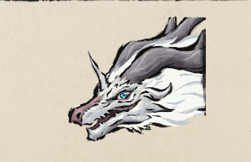
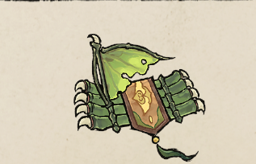
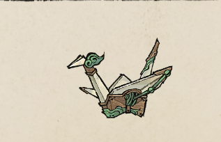
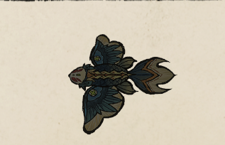
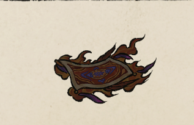
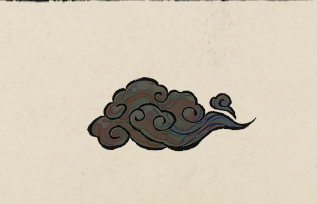
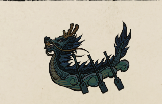
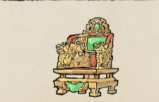

# 【卡牌修仙传】图鉴攻略 — 卡牌 / 载具

- 收录总数：8（已获得 4 / 🔒 未获得 4）
- 更新时间：2026-11-17 14:50

---

## 1. 坐骑：白龙

这是霜螭赠与我的飞行载具：遁速+20；运气（触发奇遇地点）中等幅度提高；

### 【获取途径】

找到白龙的名字，交给白龙后获得

---

## 2. 青翅竹筱

使用青翼蝠王的翅膀制作的飞行载具：遁速+25；运气（触发奇遇地点）小幅度提高；

### 【获取途径】

使用青翼蝠王的材料：青翼影膜炼制获得

---

## 3. 千机纸鹤

一个纸扎的鹤：运气（触发奇遇地点）中幅度提高；

### 【获取途径】

在玄机阁中出售

---

## 4. 霄流筝（🔒 未获得）

> 尚未获得此卡牌，以下为图鉴中可见的部分信息。

使用文鳐鱼的夜飞双翼制作的飞行载具：遁速+5；

### 【获取途径】

首次获得卡牌后解锁：

---

## 5. 霓凰羽毯（🔒 未获得）

> 尚未获得此卡牌，以下为图鉴中可见的部分信息。

使用火云雀的涅槃火羽制作的飞行载具：遁速+20；运气（触发奇遇地点）中等幅度提高；

### 【获取途径】

首次获得卡牌后解锁：

---

## 6. 筋斗云（🔒 未获得）

> 尚未获得此卡牌，以下为图鉴中可见的部分信息。

不知如何形成的一团云：遁速变得极快，但飞行过程中不会发现奇遇地点；

### 【获取途径】

首次获得卡牌后解锁：

---

## 7. 踏云龙舟（🔒 未获得）

> 尚未获得此卡牌，以下为图鉴中可见的部分信息。

不知如何制作的一艘龙舟：遁速+20；运气（触发奇遇地点）小幅度提高；

### 【获取途径】

首次获得卡牌后解锁：

---

## 8. 栖月椅

不知如何制作的一张椅子：遁速变得极慢，但运气（触发奇遇地点）极大幅度提高；

### 【获取途径】

雁荡城的隐藏商店有概率出售

---
