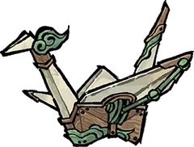
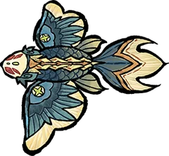

# 【卡牌修仙传】图鉴攻略 — 卡牌 / 载具

- 收录总数：8（游戏官方数据）
- 更新时间：2026-11-20 16:59

---

## 1. 坐骑：白龙

这是霜螭赠与我的飞行载具：

遁速+20；运气（触发奇遇地点）中等幅度提高

### 【获取途径】

第 1 步：拿到〈白龙的名字：霜螭〉（三种方法见下面「方法一～三」）

第 2 步：到「十万大山深处」，把名字卡拖给「白龙的分身」，获得

方法一：给〈乞丐修士〉100 〔灵石〕选「圣兽」秘闻，再把〈白龙的分身〉交给他

方法二：【悦萱儿的支线】帮「悦萱儿」找齐圣兽（白龙、鲲、三头凶蛟）后再和她对话

方法三：炼制〈因果〉（只能得到一次）

用法：坐骑，遁速 +20，运气中等幅度提高

---

## 2. 青翅竹筏

使用青翼蝠王的翅膀制作的飞行载具：

遁速+25；运气（触发奇遇地点）小幅度提高

### 【获取途径】

使用青翼蝠王的材料：青翼影膜炼制获得

---

## 3. 千机纸鹤

一个纸扎的鹤：

运气（触发奇遇地点）中幅度提高

### 【获取途径】

在玄机阁中出售

---

## 4. 霄流筝

使用文鳐鱼的夜飞双翼制作的飞行载具：

遁速+5

### 【获取途径】

使用文鳐鱼的材料：夜飞双翼炼制获得

---

## 5. 霓凰羽毯

使用火云雀的涅槃火羽制作的飞行载具：

遁速+20；运气（触发奇遇地点）中等幅度提高

### 【获取途径】

使用火云雀的材料：涅槃火羽炼制获得

---

## 6. 筋斗云

不知如何形成的一团云：

遁速变得极快，但飞行过程中不会发现奇遇地点

### 【获取途径】

第 1 步：拿到〈鲲的名字：扶溟〉（两种方法见下面「方法一～二」）

第 2 步：在海上的秘境「圣兽：鲲」里，把名字卡拖给「鲲的分身」，获得

方法一：给〈乞丐修士〉100 〔灵石〕选「圣兽」秘闻，再把〈鲲的分身〉交给他

方法二：炼制〈因果〉（只能得到一次）

另外：【悦萱儿的支线】最后赶回湖月城时，「悦萱儿」也会送你〈筋斗云〉

---

## 7. 踏云龙舟

不知如何制作的一艘龙舟：

遁速+20；运气（触发奇遇地点）小幅度提高

### 【获取途径】

在玄剑阁的珍宝阁中可兑换

---

## 8. 栖月椅

不知如何制作的一张椅子：

遁速变得极慢，但运气（触发奇遇地点）极大幅度提高

### 【获取途径】

在雁荡城「药店」花 30000 灵石购买（每 30 日刷新）

---
