# 【卡牌修仙传】图鉴攻略 — 卡牌 / 指点卡

- 收录总数：116（已获得 42 / 🔒 未获得 74）
- 更新时间：2026-11-17 10:01

---

## 1. 剑修

剑修是器修中最广为人知的一个分支，在本游戏里，可以通过加入玄剑阁或其他任务修炼出独有的剑修天赋；

剑修天赋可以大幅度提高剑类型法宝的战斗能力，但会减少主角使用口诀的能力。

### 【获取途径】

---

## 2. 丹修

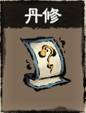

---

## 3. 武修

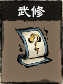

---

## 4. 术修

---

## 5. 兽修

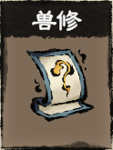

---

## 6. 魔修（🔒 未获得）

> 尚未获得此卡牌，以下为图鉴中可见的部分信息。

魔修是非正统修仙玩法，魔修流派的修士可以通过击杀游戏中的其他修士以获得修为，物品，增加自身属性，甚至是抢夺法宝等为主要玩法。魔修在游戏中触发寻仇的概率会极大的提高

### 【获取途径】

首次获得卡牌后解锁：

---

## 7. 操作：抽取卡牌

操作提示：Control键。按住Control键可以将卡牌从堆叠的一组里单独抽出来，在背包里也是相同操作

### 【获取途径】

---

## 8. 操作：快速移动

操作提示：双击桌面。如果你找不到主角卡在哪，双击桌面，主角卡会自动飞过来

### 【获取途径】

---

## 9. 规则：战斗规则

游戏的战斗规则：在对战时，会有境界压制：攻击方卡牌的大境界，如果比受击方的低，则会有伤害衰减（每相差一个大境界，衰减30%)；如果单个战场上阵的法宝/灵兽/傀儡卡数量，超过了神识，则需要消耗额外的灵气。如果你使用大境界比主角高的卡牌进入战斗，将会消耗大量灵气。2

---

## 10. 器修结丹

器修如何结丹：炼制出绝品法宝可以获得人品器道仅用自己和法宝击败妖王可以获得神品器道在比武大会的冠军赛上，仅用自己或法宝获得冠军，可以获得绝品器道

### 【获取途径】

---

## 11. 丹修结丹（🔒 未获得）

> 尚未获得此卡牌，以下为图鉴中可见的部分信息。

丹修如何结丹：仅使用丹药击败绝品妖兽可以获得人品丹道；仅使用丹药击败妖王可以获得神品丹道；仅用3颗丹药就击败妖王可以获得绝品丹道

### 【获取途径】

首次获得卡牌后解锁：

---

## 12. 体修结丹（🔒 未获得）

> 尚未获得此卡牌，以下为图鉴中可见的部分信息。

---

## 13. 术修结丹（🔒 未获得）

> 尚未获得此卡牌，以下为图鉴中可见的部分信息。

---

## 14. 兽修结丹（🔒 未获得）

> 尚未获得此卡牌，以下为图鉴中可见的部分信息。

---

## 15. 本命物

突破至结丹后，可以炼制本命物：我可以将绝品的法宝或灵兽，放入修炼工作台，将其炼制成本命物！我只能通过此方法，炼制出一个本命物。

### 【获取途径】

---

## 16. 本命技（🔒 未获得）

> 尚未获得此卡牌，以下为图鉴中可见的部分信息。

在天地熔炉里，我可以把本命物炼制成本命技！

### 【获取途径】

首次获得卡牌后解锁：

---

## 17. 妖王元婴？（🔒 未获得）

> 尚未获得此卡牌，以下为图鉴中可见的部分信息。

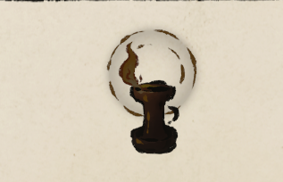

当击败元婴期以上的敌人时，他们不会立刻死亡，而是变成元婴，此时可以对元婴做以下操作：等待时间结束，元婴自行离去；使用法宝/灵兽攻击元婴，此举会导致该妖王永久死亡；使用主角/神识卡拘拿元婴：

### 【获取途径】

首次获得卡牌后解锁：

---

## 18. 指点（🔒 未获得）

> 尚未获得此卡牌，以下为图鉴中可见的部分信息。

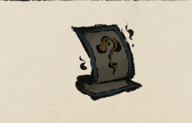

指点：剑意需要用金属制造的剑释放，除非剑意达到顶峰。

### 【获取途径】

首次获得卡牌后解锁：

---

## 19. 指点（🔒 未获得）

> 尚未获得此卡牌，以下为图鉴中可见的部分信息。

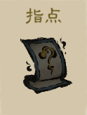

---

## 20. 指点

招式分两种，像火焰般的攻击，或是像岩石般的防御。

### 【获取途径】

---

## 21. 指点（🔒 未获得）

> 尚未获得此卡牌，以下为图鉴中可见的部分信息。

静心草一般生长在山顶。如果你是个有缘人的话，是可以在药园里采集到。

### 【获取途径】

首次获得卡牌后解锁：

---

## 22. 指点

每一本心法都可以领悟出口诀，技能或能力；

### 【获取途径】

---

## 23. 指点

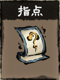

---

## 24. 指点（🔒 未获得）

> 尚未获得此卡牌，以下为图鉴中可见的部分信息。

如果你有“机缘”在调查时放入地点，会有不一样的产出；

### 【获取途径】

首次获得卡牌后解锁：

---

## 25. 指点（🔒 未获得）

> 尚未获得此卡牌，以下为图鉴中可见的部分信息。

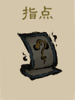

---

## 26. 指点

这附近有3个大城市，有时间你可御剑前往。金陵城：有坊市（常年有大量修士或商人可交易）；湖月城：灵气十分充裕，十分适合在此培养灵草：雁荡城：位于十万大山的边缘，有时会触发大型攻城玩法；

### 【获取途径】

---

## 27. 指点

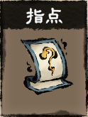

---

## 28. 指点

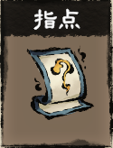

---

## 29. 指点（🔒 未获得）

> 尚未获得此卡牌，以下为图鉴中可见的部分信息。

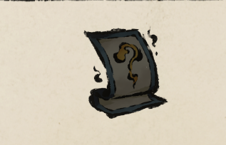

迷魂丹药在城市里是无法使用成功的。只能在世界或者秘境里尝试使用。

### 【获取途径】

首次获得卡牌后解锁：

---

## 30. 指点（🔒 未获得）

> 尚未获得此卡牌，以下为图鉴中可见的部分信息。

---

## 31. 指点（🔒 未获得）

> 尚未获得此卡牌，以下为图鉴中可见的部分信息。

---

## 32. 指点（🔒 未获得）

> 尚未获得此卡牌，以下为图鉴中可见的部分信息。

---

## 33. 指点

据说在天地熔炉升阶卡牌会保留品质。

### 【获取途径】

---

## 34. 指点（🔒 未获得）

> 尚未获得此卡牌，以下为图鉴中可见的部分信息。

如果法宝没有耐久了，可以尝试去碧潭瀑布，那里可以恢复耐久。

### 【获取途径】

首次获得卡牌后解锁：

---

## 35. 指点

药园，灵气源，修士战场无法探索出来。而是世界自行生成的。

### 【获取途径】

---

## 36. 指点（🔒 未获得）

> 尚未获得此卡牌，以下为图鉴中可见的部分信息。

如果在探索金矿的次数足够多，有时候会找到一大块的灵石。

### 【获取途径】

首次获得卡牌后解锁：

---

## 37. 指点（🔒 未获得）

> 尚未获得此卡牌，以下为图鉴中可见的部分信息。

---

## 38. 指点

如果你只修炼一种天赋，那么你在某个流派会变得很强。全部流派都修炼也并非不可只是你的寿命足够吗？

### 【获取途径】

---

## 39. 指点（🔒 未获得）

> 尚未获得此卡牌，以下为图鉴中可见的部分信息。

据说修炼至元婴后，会额外多一张元婴体卡牌。

### 【获取途径】

首次获得卡牌后解锁：

---

## 40. 指点

当你突破元婴时，天地会降下雷劫试图从神识层面开始击碎你；你只能找来好友帮忙护法，所以在江湖上遇到有名有姓的修士，多和他们交朋友。

### 【获取途径】

---

## 41. 指点（🔒 未获得）

> 尚未获得此卡牌，以下为图鉴中可见的部分信息。

化神期的修士可以使用大法力将地图上的地点移到另一个地方去，当然也包括自己的洞府。

### 【获取途径】

首次获得卡牌后解锁：

---

## 42. 指点（🔒 未获得）

> 尚未获得此卡牌，以下为图鉴中可见的部分信息。

---

## 43. 指点（🔒 未获得）

> 尚未获得此卡牌，以下为图鉴中可见的部分信息。

---

## 44. 指点（🔒 未获得）

> 尚未获得此卡牌，以下为图鉴中可见的部分信息。

---

## 45. 指点（🔒 未获得）

> 尚未获得此卡牌，以下为图鉴中可见的部分信息。

---

## 46. 指点（🔒 未获得）

> 尚未获得此卡牌，以下为图鉴中可见的部分信息。

---

## 47. 指点

如果你不知道工作台的卡槽需要放置哪张卡。可以点击卡槽，可放入的卡牌会高亮。

### 【获取途径】

---

## 48. 指点（🔒 未获得）

> 尚未获得此卡牌，以下为图鉴中可见的部分信息。

相同类型的卡牌可以堆叠在一起；按住左CTRL键，可以把中间的某张卡牌单独拖出来；

### 【获取途径】

首次获得卡牌后解锁：

---

## 49. 指点（🔒 未获得）

> 尚未获得此卡牌，以下为图鉴中可见的部分信息。

---

## 50. 指点

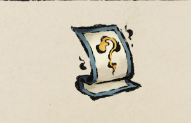

按住左CTRL键，可以把工作台“串联”起来统一拖动；

### 【获取途径】

---

## 51. 指点（🔒 未获得）

> 尚未获得此卡牌，以下为图鉴中可见的部分信息。

有些秘境太大了，找不到主角卡？鼠标左键双击空白的地图区域，主角卡就会自动飞过来；

### 【获取途径】

首次获得卡牌后解锁：

---

## 52. 指点

如果你使用了灵纹戒，右键卡牌（没有打开工作台）便会自动收纳到灵纹戒里。

### 【获取途径】

---

## 53. 指点（🔒 未获得）

> 尚未获得此卡牌，以下为图鉴中可见的部分信息。

可以把战斗中的卡牌拖出战场，视为逃跑；但总要留一张卡牌殿后！（可以配合暂停操作）

### 【获取途径】

首次获得卡牌后解锁：

---

## 54. 指点

在秘境里，右键卡牌会自动收纳至安全区；因灵气不足无法操控的卡牌也可以收纳。

### 【获取途径】

---

## 55. 指点（🔒 未获得）

> 尚未获得此卡牌，以下为图鉴中可见的部分信息。

按[Space]可以暂停/恢复游戏；按[Tab]可以切换游戏时间流逝速度。

### 【获取途径】

首次获得卡牌后解锁：

---

## 56. 指点（🔒 未获得）

> 尚未获得此卡牌，以下为图鉴中可见的部分信息。

---

## 57. 指点（🔒 未获得）

> 尚未获得此卡牌，以下为图鉴中可见的部分信息。

---

## 58. 指点（🔒 未获得）

> 尚未获得此卡牌，以下为图鉴中可见的部分信息。

---

## 59. 指点（🔒 未获得）

> 尚未获得此卡牌，以下为图鉴中可见的部分信息。

---

## 60. 指点

按快捷键[P]，可以生成一张卡牌：天道结界；堆叠在结界上的卡组，不会被其他卡牌撞歪。

### 【获取途径】

---

## 61. 指点（🔒 未获得）

> 尚未获得此卡牌，以下为图鉴中可见的部分信息。

静心草获得方式：在无名村庄旁边的山顶上，长着一株静心草，不过你需要先完成村长的任务；如果你能发现药园，可以用机缘探索到；村庄里的农夫就是在药园采集静心草而受伤，帮助他恢复吧；别小看小孩们，他们偶尔也能捡到静心草：

### 【获取途径】

首次获得卡牌后解锁

---

## 62. 指点（🔒 未获得）

> 尚未获得此卡牌，以下为图鉴中可见的部分信息。

如果你想踏入武道之路，不妨尝试只靠自己击败一只绝品妖兽

### 【获取途径】

首次获得卡牌后解锁：

---

## 63. 指点（🔒 未获得）

> 尚未获得此卡牌，以下为图鉴中可见的部分信息。

---

## 64. 指点（🔒 未获得）

> 尚未获得此卡牌，以下为图鉴中可见的部分信息。

---

## 65. 指点

如果你想修炼至武道巅峰，其中一个方法，便是镇妖塔最高层，以一己之力战胜妖王！

### 【获取途径】

---

## 66. 指点（🔒 未获得）

> 尚未获得此卡牌，以下为图鉴中可见的部分信息。

如果你想修炼至武道巅峰，其中一个方法，那便是欣赏元婴期武道高手的战斗！

### 【获取途径】

首次获得卡牌后解锁：

---

## 67. 指点

如果你想踏入器道之路，不妨尝试炼制一把绝品法宝

### 【获取途径】

---

## 68. 指点

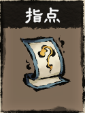

---

## 69. 指点（🔒 未获得）

> 尚未获得此卡牌，以下为图鉴中可见的部分信息。

如果你想修炼至器道巅峰，其中一个方法，便是在比武冠军赛力，仅以自己和法宝战胜敌人！（需自己和法宝均对敌人造成过伤害）

### 【获取途径】

首次获得卡牌后解锁：

---

## 70. 指点（🔒 未获得）

> 尚未获得此卡牌，以下为图鉴中可见的部分信息。

---

## 71. 指点（🔒 未获得）

> 尚未获得此卡牌，以下为图鉴中可见的部分信息。

---

## 72. 指点

如果你想踏入兽道之路，不妨尝试把一只灵兽提升至绝品

### 【获取途径】

---

## 73. 指点（🔒 未获得）

> 尚未获得此卡牌，以下为图鉴中可见的部分信息。

如果你想在兽道之路走得更远，那你需要只靠灵兽击败一只筑基期妖王

### 【获取途径】

首次获得卡牌后解锁：

---

## 74. 指点（🔒 未获得）

> 尚未获得此卡牌，以下为图鉴中可见的部分信息。

---

## 75. 指点（🔒 未获得）

> 尚未获得此卡牌，以下为图鉴中可见的部分信息。

---

## 76. 指点（🔒 未获得）

> 尚未获得此卡牌，以下为图鉴中可见的部分信息。

---

## 77. 指点（🔒 未获得）

> 尚未获得此卡牌，以下为图鉴中可见的部分信息。

---

## 78. 指点（🔒 未获得）

> 尚未获得此卡牌，以下为图鉴中可见的部分信息。

---

## 79. 指点

如果你想修炼至丹道巅峰，其中一个方法，便是仅用3个（包括小于3个）毒药毒杀筑基期妖王

### 【获取途径】

---

## 80. 指点（🔒 未获得）

> 尚未获得此卡牌，以下为图鉴中可见的部分信息。

如果你想修炼至丹道巅峰，其中一个方法，便是仅用1个毒药毒杀一名筑基期修士

### 【获取途径】

首次获得卡牌后解锁：

---

## 81. 指点

如果你能发现天帝宝库，里面说不定有丹道巅峰的修炼方法

### 【获取途径】

---

## 82. 指点

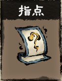

---

## 83. 指点

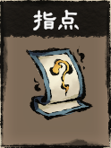

---

## 84. 指点（🔒 未获得）

> 尚未获得此卡牌，以下为图鉴中可见的部分信息。

如果你想修炼至术道巅峰，其中一个方法，便是在比武冠军赛力，以口诀法术战胜敌人！

### 【获取途径】

首次获得卡牌后解锁：

---

## 85. 指点（🔒 未获得）

> 尚未获得此卡牌，以下为图鉴中可见的部分信息。

---

## 86. 指点（🔒 未获得）

> 尚未获得此卡牌，以下为图鉴中可见的部分信息。

---

## 87. 指点（🔒 未获得）

> 尚未获得此卡牌，以下为图鉴中可见的部分信息。

---

## 88. 指点（🔒 未获得）

> 尚未获得此卡牌，以下为图鉴中可见的部分信息。

---

## 89. 指点

地图上的客栈，证明附近有秘境！但如何开启，倒是要自己找方法了。

### 【获取途径】

---

## 90. 指点

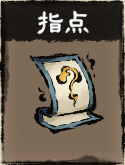

---

## 91. 指点（🔒 未获得）

> 尚未获得此卡牌，以下为图鉴中可见的部分信息。

不限制进入的秘境里的内容都有刷新时间，一般为180日或360日游戏时间。

### 【获取途径】

首次获得卡牌后解锁：

---

## 92. 指点（🔒 未获得）

> 尚未获得此卡牌，以下为图鉴中可见的部分信息。

---

## 93. 指点（🔒 未获得）

> 尚未获得此卡牌，以下为图鉴中可见的部分信息。

---

## 94. 指点（🔒 未获得）

> 尚未获得此卡牌，以下为图鉴中可见的部分信息。

---

## 95. 指点（🔒 未获得）

> 尚未获得此卡牌，以下为图鉴中可见的部分信息。

---

## 96. 指点（🔒 未获得）

> 尚未获得此卡牌，以下为图鉴中可见的部分信息。

---

## 97. 指点（🔒 未获得）

> 尚未获得此卡牌，以下为图鉴中可见的部分信息。

---

## 98. 指点

两个灵兽神魄可以培养成本源兽魄；也可以用机缘和圣兽交换本源兽魄

### 【获取途径】

---

## 99. 指点（🔒 未获得）

> 尚未获得此卡牌，以下为图鉴中可见的部分信息。

如果你想提升金丹的〔攻击〕和〔血量〕不妨把金丹带进天地熔炉或地火深洞修炼！

### 【获取途径】

首次获得卡牌后解锁：

---

## 100. 指点

如果你想提升金丹的〔御器〕效果，可以尝试跟着剑灵修炼。正好，玄剑阁的悟剑崖就有剑灵，不过你要加入玄剑阁方可接触到....否则，只能到剑冢碰碰运气了

### 【获取途径】

---

## 101. 指点（🔒 未获得）

> 尚未获得此卡牌，以下为图鉴中可见的部分信息。

传说有人跟随上古圣兽：白龙修炼金丹。然后他的〔御器〕就变得更轻松了。

### 【获取途径】

首次获得卡牌后解锁：

---

## 102. 指点（🔒 未获得）

> 尚未获得此卡牌，以下为图鉴中可见的部分信息。

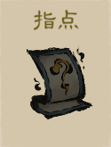

---

## 103. 指点（🔒 未获得）

> 尚未获得此卡牌，以下为图鉴中可见的部分信息。

---

## 104. 指点（🔒 未获得）

> 尚未获得此卡牌，以下为图鉴中可见的部分信息。

---

## 105. 指点（🔒 未获得）

> 尚未获得此卡牌，以下为图鉴中可见的部分信息。

---

## 106. 指点

如果你想获得大量经验，不妨把金丹带进无字玉璧的最深处！

### 【获取途径】

---

## 107. 指点（🔒 未获得）

> 尚未获得此卡牌，以下为图鉴中可见的部分信息。

在雁荡城最上的房间，那有一间隐藏的药店

### 【获取途径】

首次获得卡牌后解锁：

---

## 108. 指点（🔒 未获得）

> 尚未获得此卡牌，以下为图鉴中可见的部分信息。

---

## 109. 指点（🔒 未获得）

> 尚未获得此卡牌，以下为图鉴中可见的部分信息。

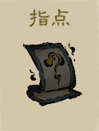

---

## 110. 指点（🔒 未获得）

> 尚未获得此卡牌，以下为图鉴中可见的部分信息。

---

## 111. 指点

把思绪卡丢给金丹，可以重置金丹的修为任务；

### 【获取途径】

---

## 112. 指点

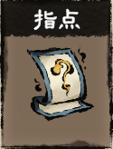

---

## 113. 指点（🔒 未获得）

> 尚未获得此卡牌，以下为图鉴中可见的部分信息。

金丹任务太难？重新思索修炼之道，任务便会重置。（把思绪卡拖至金丹）

### 【获取途径】

首次获得卡牌后解锁：

---

## 114. 指点（🔒 未获得）

> 尚未获得此卡牌，以下为图鉴中可见的部分信息。

---

## 115. 炼丹心得

炼丹心得------陆逸尘著第一步：先选择一味药放进炼制里，这味药便是本次炼丹的主药！练出的丹药的效果便等于主药效果了。第二步：再放入辅药，最多能放4种；但切记，第二格至第五格的灵草，只有和主药效果完全相同的辅药效果，才会叠加在丹药效果之中！但是，一些负面的灵草效果。不管灵草位于哪个位置，都会叠加在丹药上最后，法添加的灵草品质越高炼制的丹药效果也会更高

### 【获取途径】

---

## 116. 炼器心得

炼器心得------陆逸尘著第一步：先选择一个主材料。主材料决定着法宝的类型。一般来说，一个材料对应一种类型；然后放入辅材料，记住辅材料的五行属性，如果是克主材料的话，会降低法宝出现高品质的概率。如果你放置的材料，能以五行属性排列成一些花色，也会提高炼制概率

### 【获取途径】

---
