# 【卡牌修仙传】图鉴攻略 — 灵兽

- 收录总数：39（游戏官方数据）
- 更新时间：2026-11-20 15:04

---

## 1. 狐

- 类型：金
- 五行：金

### 【练气 · 灵狐】

攻击 3 / 血量 8（基础数值）

传闻生长在青丘山的灵狐，颇通人性，当修为增长时，尾巴数量也随之增加。

技能「聚光贰」每回合结束时，使我方（除本卡牌外）随机卡牌获得**光盾**

技能「狐之力」使获得**光盾**的友军〔攻击〕和〔血量〕+1

### 【筑基 · 三尾灵狐】

攻击 7 / 血量 21（基础数值）

灵狐修炼至筑基后，尾巴变成了3条

技能「聚光贰」每回合结束时，使我方（除本卡牌外）随机卡牌获得**光盾**

技能「狐之力」使获得**光盾**的友军〔攻击〕和〔血量〕+2

### 【结丹 · 六尾灵狐】

攻击 19 / 血量 59（基础数值）

灵狐修炼至结丹后，已经长成了6尾灵狐。

技能「聚光贰」每回合结束时，使我方（除本卡牌外）随机卡牌获得**光盾**

技能「狐之力」使获得**光盾**的友军〔攻击〕和〔血量〕+6

### 【元婴 · 青婠】

攻击 53 / 血量 162（基础数值）

灵狐化形为妖娆女子，我为她起了名字：青婠

技能「聚光贰」每回合结束时，使我方（除本卡牌外）随机卡牌获得**光盾**

技能「狐之力」使获得**光盾**的友军〔攻击〕和〔血量〕+16

### 【化神 · 青婠】

攻击 146 / 血量 446（基础数值）

灵狐化形为妖娆女子，我为她起了名字：青婠

技能「聚光贰」每回合结束时，使我方（除本卡牌外）随机卡牌获得**光盾**

技能「狐之力」使获得**光盾**的友军〔攻击〕和〔血量〕+45

---

## 2. 虎

- 类型：金
- 五行：金

### 【练气 · 金瞳虎】（图鉴未收录）

攻击 4 / 血量 8（基础数值）

金瞳虎的双瞳如熔金般璀璨，背生紫纹。其视力可达百里之远

技能「光力」当友军失去**光盾**时，此卡牌的〔攻击〕和〔血量〕均提高2

技能「虎之力」使自己触发光力时，额外获得一次攻击行动

### 【筑基 · 金瞳虎】

攻击 9 / 血量 19（基础数值）

金瞳虎的双瞳如熔金般璀璨，背生紫纹。其视力可达百里之远

技能「光力」当友军失去**光盾**时，此卡牌的〔攻击〕和〔血量〕均提高4

技能「虎之力」使自己触发光力时，额外获得一次攻击行动

### 【结丹 · 劫纹虎】

攻击 24 / 血量 54（基础数值）

金瞳虎在经受雷劫结丹后，背上出现雷劫击打后的纹路

技能「光力」当友军失去**光盾**时，此卡牌的〔攻击〕和〔血量〕均提高12

技能「虎之力」使自己触发光力时，额外获得一次攻击行动

### 【元婴 · 金瞑】

攻击 67 / 血量 149（基础数值）

劫纹虎化形为满身疤痕的金瞳男子，我为他起名：金瞑

技能「光力」当友军失去**光盾**时，此卡牌的〔攻击〕和〔血量〕均提高32

技能「虎之力」使自己触发光力时，额外获得一次攻击行动

### 【化神 · 金瞑】

攻击 184 / 血量 409（基础数值）

劫纹虎化形为满身疤痕的金瞳男子，我为他起名：金瞑

技能「光力」当友军失去**光盾**时，此卡牌的〔攻击〕和〔血量〕均提高90

技能「虎之力」使自己触发光力时，额外获得一次攻击行动

---

## 3. 貔貅

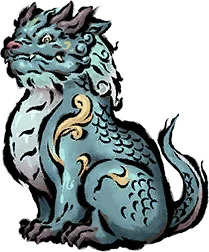

- 类型：金
- 五行：金

### 【练气 · 貔貅】（图鉴未收录）

攻击 1 / 血量 11（基础数值）

传说中的瑞兽貔貅，相传它能给人带来财运！

珍稀灵兽，通过**筑基期**的灵兽神魄组合〔金〕妖王内丹孵化

技能「光力叁」当友军失去**光盾**时，使它的〔攻击〕和〔血量〕均+2

技能「貔貅之力」使光力叁获得额外效果：再次获得**光盾**（每回合1次）

### 【筑基 · 貔貅】

攻击 3 / 血量 30（基础数值）

传说中的瑞兽貔貅，相传它能给人带来财运！

珍稀灵兽，通过**筑基期**的灵兽神魄组合〔金〕妖王内丹孵化

技能「光力叁」当友军失去**光盾**时，使它的〔攻击〕和〔血量〕均+4

技能「貔貅之力」使光力叁获得额外效果：再次获得**光盾**（每回合1次）

### 【结丹 · 貔貅】

攻击 8 / 血量 83（基础数值）

传说中的瑞兽貔貅，相传它能给人带来财运！

珍稀灵兽，通过**筑基期**的灵兽神魄组合〔金〕妖王内丹孵化

技能「光力叁」当友军失去**光盾**时，使它的〔攻击〕和〔血量〕均+12

技能「貔貅之力」使光力叁获得额外效果：再次获得**光盾**（每回合1次）

### 【元婴 · 天禄】

攻击 21 / 血量 229（基础数值）

貔貅化形为富家商人，我为他起了名字：天禄

技能「光力叁」当友军失去**光盾**时，使它的〔攻击〕和〔血量〕均+32

技能「貔貅之力」使光力叁获得额外效果：再次获得**光盾**（每回合1次）

### 【化神 · 天禄】

攻击 58 / 血量 630（基础数值）

貔貅化形为富家商人，我为他起了名字：天禄

技能「光力叁」当友军失去**光盾**时，使它的〔攻击〕和〔血量〕均+90

技能「貔貅之力」使光力叁获得额外效果：再次获得**光盾**（每回合1次）

---

## 4. 隼

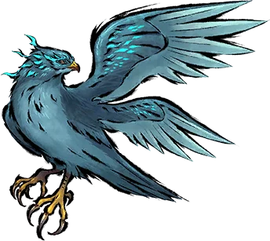

- 类型：金
- 五行：金

### 【练气 · 青锋隼】（图鉴未收录）

攻击 2 / 血量 7（基础数值）

通体覆盖青黑色金属光泽翎羽，翼尖与尾羽边缘泛冷冽银芒，飞行时羽刃割裂气流发出铮鸣

技能「远程」（锁定技）此卡牌的攻击模式为：**远程攻击**（单体）

技能「鹰击」（被动）每次行动会攻击两次

技能「鹰之力」（被动）自己的攻击无视护甲

### 【筑基 · 青锋隼】（图鉴未收录）

攻击 6 / 血量 17（基础数值）

通体覆盖青黑色金属光泽翎羽，翼尖与尾羽边缘泛冷冽银芒，飞行时羽刃割裂气流发出铮鸣

技能「远程」（锁定技）此卡牌的攻击模式为：**远程攻击**（单体）

技能「鹰击」（被动）每次行动会攻击两次

技能「鹰之力」（被动）自己的攻击无视护甲

### 【结丹 · 青锋隼】

攻击 16 / 血量 48（基础数值）

通体覆盖青黑色金属光泽翎羽，翼尖与尾羽边缘泛冷冽银芒，飞行时羽刃割裂气流发出铮鸣

技能「远程」（锁定技）此卡牌的攻击模式为：**远程攻击**（单体）

技能「鹰击」（被动）每次行动会攻击两次

技能「鹰之力」（被动）自己的攻击无视护甲

### 【元婴 · 刃翎】

攻击 44 / 血量 132（基础数值）

青锋隼化形为一名眼神锐利的刺客，我为他起名：刃翎

技能「远程」（锁定技）此卡牌的攻击模式为：**远程攻击**（单体）

技能「鹰击」（被动）每次行动会攻击两次

技能「鹰之力」（被动）自己的攻击无视护甲

### 【化神 · 刃翎】

攻击 122 / 血量 364（基础数值）

青锋隼化形为一名眼神锐利的刺客，我为他起名：刃翎

技能「远程」（锁定技）此卡牌的攻击模式为：**远程攻击**（单体）

技能「鹰击」（被动）每次行动会攻击两次

技能「鹰之力」（被动）自己的攻击无视护甲

---

## 5. 狻猊

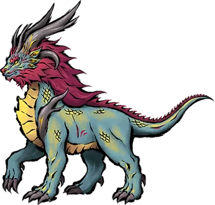

- 类型：金
- 五行：金

### 【练气 · 戮法金猊】（图鉴未收录）

攻击 1 / 血量 6（基础数值）

通体覆盖暗金鳞甲，脊生龙鬃如烈焰升腾，四足踏玄铁爪，步落时地面绽开金色法纹

珍稀灵兽，通过**结丹期**的灵兽神魄组合〔金〕妖王内丹孵化

技能「天罡叁」每回合开始时，使我方卡牌的〔攻击〕+1

技能「狻猊之力」使自己的天罡叁触发时，额外增加1〔护甲〕

### 【筑基 · 戮法金猊】（图鉴未收录）

攻击 3 / 血量 18（基础数值）

通体覆盖暗金鳞甲，脊生龙鬃如烈焰升腾，四足踏玄铁爪，步落时地面绽开金色法纹

珍稀灵兽，通过**结丹期**的灵兽神魄组合〔金〕妖王内丹孵化

技能「天罡叁」每回合开始时，使我方卡牌的〔攻击〕+2

技能「狻猊之力」使自己的天罡叁触发时，额外增加3〔护甲〕

### 【结丹 · 戮法金猊】

攻击 8 / 血量 50（基础数值）

通体覆盖暗金鳞甲，脊生龙鬃如烈焰升腾，四足踏玄铁爪，步落时地面绽开金色法纹

珍稀灵兽，通过**结丹期**的灵兽神魄组合〔金〕妖王内丹孵化

技能「天罡叁」每回合开始时，使我方卡牌的〔攻击〕+6

技能「狻猊之力」使自己的天罡叁触发时，额外增加8〔护甲〕

### 【元婴 · 催命】

攻击 21 / 血量 138（基础数值）

戮法金猊化形为判官，我为他起了名字：催命

技能「天罡叁」每回合开始时，使我方卡牌的〔攻击〕+16

技能「狻猊之力」使自己的天罡叁触发时，额外增加24〔护甲〕

### 【化神 · 催命】

攻击 58 / 血量 378（基础数值）

戮法金猊化形为判官，我为他起了名字：催命

技能「天罡叁」每回合开始时，使我方卡牌的〔攻击〕+45

技能「狻猊之力」使自己的天罡叁触发时，额外增加66〔护甲〕

---

## 6. 飞蛾

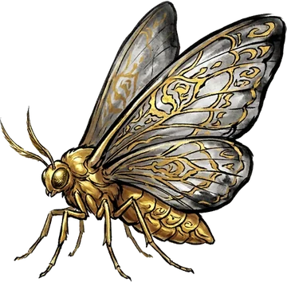

- 类型：金
- 五行：金

### 【练气 · 金丝蛾】（图鉴未收录）

攻击 3 / 血量 8（基础数值）

技能「远程」（锁定技）此卡牌的攻击模式为：**远程攻击**（单体）

技能「金粉」当我方有卡牌获得**光盾**时，给随机敌人施加2回合混乱

技能「蛾之力」当我方有卡牌失去**光盾**时，给随机敌人施加2回合混乱

### 【筑基 · 金丝蛾】（图鉴未收录）

攻击 7 / 血量 24（基础数值）

技能「远程」（锁定技）此卡牌的攻击模式为：**远程攻击**（单体）

技能「金粉」当我方有卡牌获得**光盾**时，给随机敌人施加2回合混乱

技能「蛾之力」当我方有卡牌失去**光盾**时，给随机敌人施加2回合混乱

### 【结丹 · 金丝蛾】（图鉴未收录）

攻击 19 / 血量 65（基础数值）

技能「远程」（锁定技）此卡牌的攻击模式为：**远程攻击**（单体）

技能「金粉」当我方有卡牌获得**光盾**时，给随机敌人施加2回合混乱

技能「蛾之力」当我方有卡牌失去**光盾**时，给随机敌人施加2回合混乱

### 【元婴 · 金侍儿】

攻击 53 / 血量 178（基础数值）

金缕（金蝉蛊）以本命蜕翼金气培育的专属灵蛾，着银金蝉翼纹长裙，清冷纤弱却暗藏妖煞。

技能「远程」（锁定技）此卡牌的攻击模式为：**远程攻击**（单体）

技能「金粉」当我方有卡牌获得**光盾**时，给随机敌人施加2回合混乱

技能「蛾之力」当我方有卡牌失去**光盾**时，给随机敌人施加2回合混乱

### 【化神 · 金侍儿】

攻击 146 / 血量 490（基础数值）

金缕（金蝉蛊）以本命蜕翼金气培育的专属灵蛾，着银金蝉翼纹长裙，清冷纤弱却暗藏妖煞。

技能「远程」（锁定技）此卡牌的攻击模式为：**远程攻击**（单体）

技能「金粉」当我方有卡牌获得**光盾**时，给随机敌人施加2回合混乱

技能「蛾之力」当我方有卡牌失去**光盾**时，给随机敌人施加2回合混乱

---

## 7. 鹿

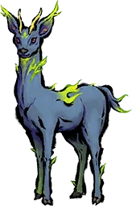

- 类型：木
- 五行：木

### 【练气 · 青鹿】

攻击 3 / 血量 8（基础数值）

生性胆小，生活在密林深处。如果出现在世间，那必定是祥瑞的征兆。

技能「唤灵贰」攻击后，召唤一张**花灵**

技能「鹿之力」花灵死亡时，会对随机敌人造成4伤害

### 【筑基 · 玉角鹿】

攻击 6 / 血量 21（基础数值）

青鹿的角越是晶莹剔透，证明它的境界越高。

技能「唤灵贰」攻击后，召唤一张**花灵**

技能「鹿之力」花灵死亡时，会对随机敌人造成11伤害

### 【结丹 · 虬枝鹿】

攻击 16 / 血量 59（基础数值）

青鹿的角如千年古木虬枝盘曲

技能「唤灵贰」攻击后，召唤一张**花灵**

技能「鹿之力」花灵死亡时，会对随机敌人造成29伤害

### 【元婴 · 清珩】

攻击 45 / 血量 162（基础数值）

虬枝鹿化形为一名俊美的白衣男子，我为他起名：清珩

技能「唤灵贰」攻击后，召唤一张**花灵**

技能「鹿之力」花灵死亡时，会对随机敌人造成79伤害

### 【化神 · 清珩】

攻击 124 / 血量 446（基础数值）

虬枝鹿化形为一名俊美的白衣男子，我为他起名：清珩

技能「唤灵贰」攻击后，召唤一张**花灵**

技能「鹿之力」花灵死亡时，会对随机敌人造成219伤害

---

## 8. 鹤

- 类型：木
- 五行：木

### 【练气 · 青霄鹤】（图鉴未收录）

攻击 1 / 血量 6（基础数值）

青霄鹤通体雪羽流溢青芒，翼展五丈如垂天之云

技能「远程」（锁定技）此卡牌的攻击模式为：**远程攻击**（全体）

技能「引路」攻击的目标如果有负面状态，则伤害结果〔伤害〕+3

技能「鹤之力」攻击的目标如果处于**中毒**，则将中毒伤害提前生效，使目标旁边随机卡牌受到相同的伤害

### 【筑基 · 青霄鹤】

攻击 2 / 血量 17（基础数值）

青霄鹤通体雪羽流溢青芒，翼展五丈如垂天之云

技能「远程」（锁定技）此卡牌的攻击模式为：**远程攻击**（全体）

技能「引路」攻击的目标如果有负面状态，则伤害结果〔伤害〕+5

技能「鹤之力」攻击的目标如果处于**中毒**，则将中毒伤害提前生效，使目标旁边随机卡牌受到相同的伤害

### 【结丹 · 紫霄鹤】

攻击 7 / 血量 45（基础数值）

当青霄鹤在九天雷云中食用紫电后，便化为紫霄鹤，飞行时周身缠绕电弧

技能「远程」（锁定技）此卡牌的攻击模式为：**远程攻击**（全体）

技能「引路」攻击的目标如果有负面状态，则伤害结果〔伤害〕+13

技能「鹤之力」攻击的目标如果处于**中毒**，则将中毒伤害提前生效，使目标旁边随机卡牌受到相同的伤害

### 【元婴 · 紫珩】

攻击 19 / 血量 124（基础数值）

紫霄鹤化形为一名俊白面书生，我为他起名：紫珩

技能「远程」（锁定技）此卡牌的攻击模式为：**远程攻击**（全体）

技能「引路」攻击的目标如果有负面状态，则伤害结果〔伤害〕+37

技能「鹤之力」攻击的目标如果处于**中毒**，则将中毒伤害提前生效，使目标旁边随机卡牌受到相同的伤害

### 【化神 · 紫珩】

攻击 53 / 血量 343（基础数值）

紫霄鹤化形为一名俊白面书生，我为他起名：紫珩

技能「远程」（锁定技）此卡牌的攻击模式为：**远程攻击**（全体）

技能「引路」攻击的目标如果有负面状态，则伤害结果〔伤害〕+102

技能「鹤之力」攻击的目标如果处于**中毒**，则将中毒伤害提前生效，使目标旁边随机卡牌受到相同的伤害

---

## 9. 熊

- 类型：木
- 五行：木

### 【练气 · 空桑兽】（图鉴未收录）

攻击 2 / 血量 12（基础数值）

空桑兽实在是太懒了，它不会主动攻击妖兽，它甚至都不会动。

珍稀灵兽，通过**筑基期**的灵兽神魄组合〔木〕妖王内丹孵化

技能「嘲讽」（锁定技）战斗中，会优先受到攻击

技能「荆棘」每回合第一次受到攻击时，**禁锢**随机敌方卡牌

技能「熊之力」荆棘还会使攻击者中毒

### 【筑基 · 空桑兽】

攻击 6 / 血量 32（基础数值）

空桑兽实在是太懒了，它不会主动攻击妖兽，它甚至都不会动。

珍稀灵兽，通过**筑基期**的灵兽神魄组合〔木〕妖王内丹孵化

技能「嘲讽」（锁定技）战斗中，会优先受到攻击

技能「荆棘」每回合第一次受到攻击时，**禁锢**随机敌方卡牌

技能「熊之力」荆棘还会使攻击者中毒

### 【结丹 · 空桑兽】

攻击 15 / 血量 89（基础数值）

空桑兽实在是太懒了，它不会主动攻击妖兽，它甚至都不会动。

珍稀灵兽，通过**筑基期**的灵兽神魄组合〔木〕妖王内丹孵化

技能「嘲讽」（锁定技）战斗中，会优先受到攻击

技能「荆棘」每回合第一次受到攻击时，**禁锢**随机敌方卡牌

技能「熊之力」荆棘还会使攻击者中毒

### 【元婴 · 墩儿】

攻击 42 / 血量 245（基础数值）

空桑兽化形为爱睡懒觉的小胖子，我为他起名：墩儿

技能「嘲讽」（锁定技）战斗中，会优先受到攻击

技能「荆棘」每回合第一次受到攻击时，**禁锢**随机敌方卡牌

技能「熊之力」荆棘还会使攻击者中毒

### 【化神 · 墩儿】

攻击 117 / 血量 671（基础数值）

空桑兽实在是太懒了，它不会主动攻击妖兽，它甚至都不会动。

珍稀灵兽，通过**筑基期**的灵兽神魄组合〔木〕妖王内丹孵化

技能「嘲讽」（锁定技）战斗中，会优先受到攻击

技能「荆棘」每回合第一次受到攻击时，**禁锢**随机敌方卡牌

技能「熊之力」荆棘还会使攻击者中毒

---

## 10. 兔

- 类型：木
- 五行：木

### 【练气 · 蓬茸兔】（图鉴未收录）

攻击 2 / 血量 5（基础数值）

通体覆盖雪白长毛，毛尖泛淡金灵光，奔跑时如流云拂地，静止时蜷缩如绒球

技能「分身」加入战场后的第一回合开始时，将自己一分为三

技能「兔之力」蓬茸兔死亡时，再召唤一只（每回合只触发1次）

### 【筑基 · 蓬茸兔】（图鉴未收录）

攻击 5 / 血量 14（基础数值）

通体覆盖雪白长毛，毛尖泛淡金灵光，奔跑时如流云拂地，静止时蜷缩如绒球

技能「分身」加入战场后的第一回合开始时，将自己一分为三

技能「兔之力」蓬茸兔死亡时，再召唤一只（每回合只触发1次）

### 【结丹 · 蓬茸兔】

攻击 14 / 血量 39（基础数值）

通体覆盖雪白长毛，毛尖泛淡金灵光，奔跑时如流云拂地，静止时蜷缩如绒球

技能「分身」加入战场后的第一回合开始时，将自己一分为三

技能「兔之力」蓬茸兔死亡时，再召唤一只（每回合只触发1次）

### 【元婴 · 茸儿】

攻击 38 / 血量 107（基础数值）

蓬茸兔化形为可爱的小姑娘，我为她起名：茸儿

技能「分身」加入战场后的第一回合开始时，将自己一分为三

技能「兔之力」蓬茸兔死亡时，再召唤一只（每回合只触发1次）

### 【化神 · 茸儿】

攻击 105 / 血量 294（基础数值）

蓬茸兔化形为可爱的小姑娘，我为她起名：茸儿

技能「分身」加入战场后的第一回合开始时，将自己一分为三

技能「兔之力」蓬茸兔死亡时，再召唤一只（每回合只触发1次）

---

## 11. 鸟

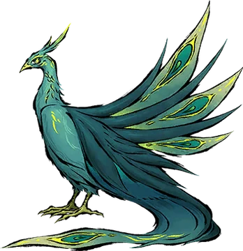

- 类型：木
- 五行：木

### 【练气 · 青羽神鸟】（图鉴未收录）

攻击 3 / 血量 7（基础数值）

通体覆盖青碧色翎羽，羽尖流转鎏金光泽，日光下泛起“晓天青”的柔光

珍稀灵兽，通过**结丹期**的灵兽神魄组合〔木〕妖王内丹孵化

技能「远程」（锁定技）此卡牌的攻击模式为：**远程攻击**（单体）

技能「封魔贰」回合开始前，使随机敌方卡牌的技能无效，且属性恢复至战斗初。

技能「神鸟之力」封魔的技能会额外触发一次

### 【筑基 · 青羽神鸟】（图鉴未收录）

攻击 8 / 血量 19（基础数值）

通体覆盖青碧色翎羽，羽尖流转鎏金光泽，日光下泛起“晓天青”的柔光

珍稀灵兽，通过**结丹期**的灵兽神魄组合〔木〕妖王内丹孵化

技能「远程」（锁定技）此卡牌的攻击模式为：**远程攻击**（单体）

技能「封魔贰」回合开始前，使随机敌方卡牌的技能无效，且属性恢复至战斗初。

技能「神鸟之力」封魔的技能会额外触发一次

### 【结丹 · 青羽神鸟】

攻击 23 / 血量 52（基础数值）

通体覆盖青碧色翎羽，羽尖流转鎏金光泽，日光下泛起“晓天青”的柔光

珍稀灵兽，通过**结丹期**的灵兽神魄组合〔木〕妖王内丹孵化

技能「远程」（锁定技）此卡牌的攻击模式为：**远程攻击**（单体）

技能「封魔贰」回合开始前，使随机敌方卡牌的技能无效，且属性恢复至战斗初。

技能「神鸟之力」封魔的技能会额外触发一次

### 【元婴 · 青鸾】

攻击 64 / 血量 142（基础数值）

青羽神鸟化形为高贵小姐，我为她起名：青鸾

技能「远程」（锁定技）此卡牌的攻击模式为：**远程攻击**（单体）

技能「封魔贰」回合开始前，使随机敌方卡牌的技能无效，且属性恢复至战斗初。

技能「神鸟之力」封魔的技能会额外触发一次

### 【化神 · 青鸾】

攻击 175 / 血量 392（基础数值）

青羽神鸟化形为高贵小姐，我为她起名：青鸾

技能「远程」（锁定技）此卡牌的攻击模式为：**远程攻击**（单体）

技能「封魔贰」回合开始前，使随机敌方卡牌的技能无效，且属性恢复至战斗初。

技能「神鸟之力」封魔的技能会额外触发一次

---

## 12. 蛇

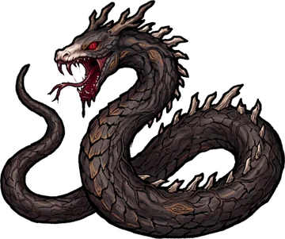

- 类型：木
- 五行：木

### 【练气 · 枯木蟒】（图鉴未收录）

攻击 3 / 血量 10（基础数值）

盘踞在饮岁（血藤古树）周围的巨蟒，栖于古树根系深处，久与古树同息，身化枯木。

技能「唤灵陆」当我方在战斗中召唤卡牌时，召唤一只拥有自身属性30%的青蛇；（每回合只触发一次）

技能「蟒蛇之力」当我方在战斗中召唤卡牌时，枯木蟒的攻击力和血量均获得提高；（每回合最多触发3次）

### 【筑基 · 枯木蟒】（图鉴未收录）

攻击 8 / 血量 25（基础数值）

盘踞在饮岁（血藤古树）周围的巨蟒，栖于古树根系深处，久与古树同息，身化枯木。

技能「唤灵陆」当我方在战斗中召唤卡牌时，召唤一只拥有自身属性30%的青蛇；（每回合只触发一次）

技能「蟒蛇之力」当我方在战斗中召唤卡牌时，枯木蟒的攻击力和血量均获得提高；（每回合最多触发3次）

### 【结丹 · 枯木蟒】（图鉴未收录）

攻击 23 / 血量 70（基础数值）

盘踞在饮岁（血藤古树）周围的巨蟒，栖于古树根系深处，久与古树同息，身化枯木。

技能「唤灵陆」当我方在战斗中召唤卡牌时，召唤一只拥有自身属性30%的青蛇；（每回合只触发一次）

技能「蟒蛇之力」当我方在战斗中召唤卡牌时，枯木蟒的攻击力和血量均获得提高；（每回合最多触发3次）

### 【元婴 · 墨渊】

攻击 64 / 血量 191（基础数值）

盘踞在饮岁（血藤古树）周围的巨蟒，栖于古树根系深处，久与古树同息，身化枯木。

技能「唤灵陆」当我方在战斗中召唤卡牌时，召唤一只拥有自身属性30%的青蛇；（每回合只触发一次）

技能「蟒蛇之力」当我方在战斗中召唤卡牌时，枯木蟒的攻击力和血量均获得提高；（每回合最多触发3次）

### 【化神 · 墨渊】

攻击 175 / 血量 524（基础数值）

盘踞在饮岁（血藤古树）周围的巨蟒，栖于古树根系深处，久与古树同息，身化枯木。

技能「唤灵陆」当我方在战斗中召唤卡牌时，召唤一只拥有自身属性30%的青蛇；（每回合只触发一次）

技能「蟒蛇之力」当我方在战斗中召唤卡牌时，枯木蟒的攻击力和血量均获得提高；（每回合最多触发3次）

---

## 13. 蛟

- 类型：水
- 五行：水

### 【练气 · 碧蛟】

攻击 3 / 血量 10（基础数值）

与凶猛的恶蛟不同的是，灵蛟的攻击性并不强，易于驯养。只是灵，恶蛟的外形并无区别，难以区分。

技能「星图」攻击后，为我方血量最少卡牌恢复4点〔血量〕

技能「蛟之力」使友方卡牌恢复血量时，还会获得4点减伤

### 【筑基 · 玄冰蛟】

攻击 7 / 血量 25（基础数值）

随着境界的提升，碧蛟逐渐长出了冰鳞片覆盖身体。

技能「星图」攻击后，为我方血量最少卡牌恢复12点〔血量〕

技能「蛟之力」使友方卡牌恢复血量时，还会获得11点减伤

### 【结丹 · 寒渊蛟】

攻击 19 / 血量 70（基础数值）

随着境界的提升，碧蛟逐渐长出了冰鳞片覆盖身体。

技能「星图」攻击后，为我方血量最少卡牌恢复35点〔血量〕

技能「蛟之力」使友方卡牌恢复血量时，还会获得30点减伤

### 【元婴 · 溟霜】

攻击 53 / 血量 191（基础数值）

寒渊蛟化形为外表酷冷的部落巫医，我为她起名：溟霜

技能「星图」攻击后，为我方血量最少卡牌恢复80点〔血量〕

技能「蛟之力」使友方卡牌恢复血量时，还会获得75点减伤

### 【化神 · 溟霜】

攻击 146 / 血量 524（基础数值）

寒渊蛟化形为外表酷冷的部落巫医，我为她起名：溟霜

技能「星图」攻击后，为我方血量最少卡牌恢复270点〔血量〕

技能「蛟之力」使友方卡牌恢复血量时，还会获得225点减伤

---

## 14. 狼

- 类型：水
- 五行：水

### 【练气 · 寒影狼】（图鉴未收录）

攻击 3 / 血量 6（基础数值）

寒影狼的爪牙能瞬间冻结同阶修士经脉，可怕的是只能和它硬碰硬。

技能「欺弱」攻击时，如果此卡牌的攻击力比目标要高，则伤害结果〔伤害〕将增加两者的差值的50%

技能「狼之力」（被动）战斗开始时，先进行一次攻击

### 【筑基 · 寒影狼】

攻击 8 / 血量 15（基础数值）

寒影狼的爪牙能瞬间冻结同阶修士经脉，可怕的是只能和它硬碰硬。

技能「欺弱」攻击时，如果此卡牌的攻击力比目标要高，则伤害结果〔伤害〕将增加两者的差值的50%

技能「狼之力」（被动）战斗开始时，先进行一次攻击

### 【结丹 · 冰魄狼】

攻击 22 / 血量 42（基础数值）

冰魄狼的毛发凝结透明冰甲，又冰晶尖刺从关节处长出，呼吸时喷吐霜雾，双目幽蓝如寒潭。

技能「欺弱」攻击时，如果此卡牌的攻击力比目标要高，则伤害结果〔伤害〕将增加两者的差值的50%

技能「狼之力」（被动）战斗开始时，先进行一次攻击

### 【元婴 · 凛牙】

攻击 59 / 血量 116（基础数值）

冰魄狼化形为外表酷冷的部落战士，我为他起名：凛牙

技能「欺弱」攻击时，如果此卡牌的攻击力比目标要高，则伤害结果〔伤害〕将增加两者的差值的50%

技能「狼之力」（被动）战斗开始时，先进行一次攻击

### 【化神 · 凛牙】

攻击 163 / 血量 318（基础数值）

冰魄狼化形为外表酷冷的部落战士，我为他起名：凛牙

技能「欺弱」攻击时，如果此卡牌的攻击力比目标要高，则伤害结果〔伤害〕将增加两者的差值的50%

技能「狼之力」（被动）战斗开始时，先进行一次攻击

---

## 15. 水母

- 类型：水
- 五行：水

### 【练气 · 雷云母】（图鉴未收录）

攻击 2 / 血量 9（基础数值）

雷云母的每根触须都能放出电流麻痹对手

珍稀灵兽，通过**筑基期**的灵兽神魄组合〔水〕妖王内丹孵化

技能「远程」（锁定技）此卡牌的攻击模式为：**远程攻击**（单体）

技能「卸力贰」前3回合，使随机2名敌人卡牌的〔攻击〕-2

技能「云母之力」使随机两名友军获得2点永久减伤

### 【筑基 · 雷云母】

攻击 5 / 血量 24（基础数值）

雷云母的每根触须都能放出电流麻痹对手

珍稀灵兽，通过**筑基期**的灵兽神魄组合〔水〕妖王内丹孵化

技能「远程」（锁定技）此卡牌的攻击模式为：**远程攻击**（单体）

技能「卸力贰」前3回合，使随机2名敌人卡牌的〔攻击〕-5

技能「云母之力」使随机两名友军获得5点永久减伤

### 【结丹 · 雷云母】

攻击 14 / 血量 67（基础数值）

雷云母的每根触须都能放出电流麻痹对手

珍稀灵兽，通过**筑基期**的灵兽神魄组合〔水〕妖王内丹孵化

技能「远程」（锁定技）此卡牌的攻击模式为：**远程攻击**（单体）

技能「卸力贰」前3回合，使随机2名敌人卡牌的〔攻击〕-12

技能「云母之力」使随机两名友军获得12点永久减伤

### 【元婴 · 溟絮】

攻击 38 / 血量 184（基础数值）

雷云母化形为面带纱巾的神秘美女，我为她起名：溟絮

技能「远程」（锁定技）此卡牌的攻击模式为：**远程攻击**（单体）

技能「卸力贰」前3回合，使随机2名敌人卡牌的〔攻击〕-25

技能「云母之力」使随机两名友军获得25点永久减伤

### 【化神 · 溟絮】

攻击 105 / 血量 503（基础数值）

雷云母化形为面带纱巾的神秘美女，我为她起名：溟絮

技能「远程」（锁定技）此卡牌的攻击模式为：**远程攻击**（单体）

技能「卸力贰」前3回合，使随机2名敌人卡牌的〔攻击〕-50

技能「云母之力」使随机两名友军获得50点永久减伤

---

## 16. 鲸

- 类型：水
- 五行：水

### 【练气 · 霜鳞鲸】（图鉴未收录）

攻击 2 / 血量 12（基础数值）

通体覆盖银白色菱形鳞甲，鳞片边缘凝结冰晶，日光下折射出虹彩光晕

技能「嘲讽」（锁定技）战斗中，会优先受到攻击

技能「星图叁」当我方卡牌恢复血量时，此卡牌将获得2点〔攻击〕和〔护甲〕

技能「鲸之力」（被动）攻击会对目标身旁卡牌造成50%伤害

### 【筑基 · 霜鳞鲸】（图鉴未收录）

攻击 6 / 血量 32（基础数值）

通体覆盖银白色菱形鳞甲，鳞片边缘凝结冰晶，日光下折射出虹彩光晕

技能「嘲讽」（锁定技）战斗中，会优先受到攻击

技能「星图叁」当我方卡牌恢复血量时，此卡牌将获得4点〔攻击〕和〔护甲〕

技能「鲸之力」（被动）攻击会对目标身旁卡牌造成50%伤害

### 【结丹 · 霜鳞鲸】

攻击 15 / 血量 89（基础数值）

通体覆盖银白色菱形鳞甲，鳞片边缘凝结冰晶，日光下折射出虹彩光晕

技能「嘲讽」（锁定技）战斗中，会优先受到攻击

技能「星图叁」当我方卡牌恢复血量时，此卡牌将获得11点〔攻击〕和〔护甲〕

技能「鲸之力」（被动）攻击会对目标身旁卡牌造成50%伤害

### 【元婴 · 溟铠】

攻击 42 / 血量 245（基础数值）

霜鳞鲸化形为勇猛的部落首领，我为他起名：溟铠

技能「嘲讽」（锁定技）战斗中，会优先受到攻击

技能「星图叁」当我方卡牌恢复血量时，此卡牌将获得30点〔攻击〕和〔护甲〕

技能「鲸之力」（被动）攻击会对目标身旁卡牌造成50%伤害

### 【化神 · 溟铠】

攻击 117 / 血量 671（基础数值）

霜鳞鲸化形为勇猛的部落首领，我为他起名：溟铠

技能「嘲讽」（锁定技）战斗中，会优先受到攻击

技能「星图叁」当我方卡牌恢复血量时，此卡牌将获得75点〔攻击〕和〔护甲〕

技能「鲸之力」（被动）攻击会对目标身旁卡牌造成50%伤害

---

## 17. 鹤

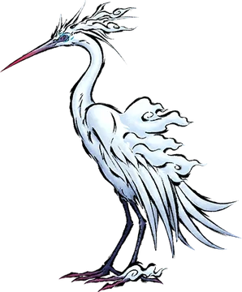

- 类型：水
- 五行：水

### 【练气 · 雾羽仙鹤】（图鉴未收录）

攻击 3 / 血量 6（基础数值）

仙鹤的翅膀乃由云雾凝成

珍稀灵兽，通过**结丹期**的灵兽神魄组合〔水〕妖王内丹孵化

技能「远程」（锁定技）此卡牌的攻击模式为：**远程攻击**（单体）

技能「星图贰」攻击造成伤害后，为我方所有卡牌恢复2点〔血量〕

技能「仙鹤之力」星图触发时，还会清除所有负面状态

### 【筑基 · 雾羽仙鹤】（图鉴未收录）

攻击 8 / 血量 17（基础数值）

仙鹤的翅膀乃由云雾凝成

珍稀灵兽，通过**结丹期**的灵兽神魄组合〔水〕妖王内丹孵化

技能「远程」（锁定技）此卡牌的攻击模式为：**远程攻击**（单体）

技能「星图贰」攻击造成伤害后，为我方所有卡牌恢复5点〔血量〕

技能「仙鹤之力」星图触发时，还会清除所有负面状态

### 【结丹 · 雾羽仙鹤】

攻击 23 / 血量 45（基础数值）

仙鹤的翅膀乃由云雾凝成

珍稀灵兽，通过**结丹期**的灵兽神魄组合〔水〕妖王内丹孵化

技能「远程」（锁定技）此卡牌的攻击模式为：**远程攻击**（单体）

技能「星图贰」攻击造成伤害后，为我方所有卡牌恢复15点〔血量〕

技能「仙鹤之力」星图触发时，还会清除所有负面状态

### 【元婴 · 云澜】

攻击 64 / 血量 124（基础数值）

雾羽仙鹤化形为带翅膀的仙女，我为她起名：云澜

技能「远程」（锁定技）此卡牌的攻击模式为：**远程攻击**（单体）

技能「星图贰」攻击造成伤害后，为我方所有卡牌恢复30点〔血量〕

技能「仙鹤之力」星图触发时，还会清除所有负面状态

### 【化神 · 云澜】

攻击 175 / 血量 343（基础数值）

雾羽仙鹤化形为带翅膀的仙女，我为她起名：云澜

技能「远程」（锁定技）此卡牌的攻击模式为：**远程攻击**（单体）

技能「星图贰」攻击造成伤害后，为我方所有卡牌恢复100点〔血量〕

技能「仙鹤之力」星图触发时，还会清除所有负面状态

---

## 18. 鳄鱼

- 类型：水
- 五行：水

### 【练气 · 玄甲鳄】（图鉴未收录）

攻击 4 / 血量 12（基础数值）

澜音（文鳐鱼）的麾下守将，伏于暗河淤泥百年不动，皮甲凝如玄铁，刀枪难入

技能「迟缓」（锁定技）它在首回合获得**嘲讽**但并不会行动

技能「潜力」这张卡牌没有技能，但它的属性会更高

技能「鳄之力」前10回合结束时，为自己恢复5〔血量〕

### 【筑基 · 玄甲鳄】（图鉴未收录）

攻击 9 / 血量 33（基础数值）

澜音（文鳐鱼）的麾下守将，伏于暗河淤泥百年不动，皮甲凝如玄铁，刀枪难入

技能「迟缓」（锁定技）它在首回合获得**嘲讽**但并不会行动

技能「潜力」这张卡牌没有技能，但它的属性会更高

技能「鳄之力」前10回合结束时，为自己恢复15〔血量〕

### 【结丹 · 玄甲鳄】（图鉴未收录）

攻击 25 / 血量 90（基础数值）

澜音（文鳐鱼）的麾下守将，伏于暗河淤泥百年不动，皮甲凝如玄铁，刀枪难入

技能「迟缓」（锁定技）它在首回合获得**嘲讽**但并不会行动

技能「潜力」这张卡牌没有技能，但它的属性会更高

技能「鳄之力」前10回合结束时，为自己恢复40〔血量〕

### 【元婴 · 苍屹】

攻击 69 / 血量 248（基础数值）

澜音（文鳐鱼）的麾下守将，伏于暗河淤泥百年不动，皮甲凝如玄铁，刀枪难入

技能「迟缓」（锁定技）它在首回合获得**嘲讽**但并不会行动

技能「潜力」这张卡牌没有技能，但它的属性会更高

技能「鳄之力」前10回合结束时，为自己恢复110〔血量〕

### 【化神 · 苍屹】

攻击 190 / 血量 682（基础数值）

澜音（文鳐鱼）的麾下守将，伏于暗河淤泥百年不动，皮甲凝如玄铁，刀枪难入

技能「迟缓」（锁定技）它在首回合获得**嘲讽**但并不会行动

技能「潜力」这张卡牌没有技能，但它的属性会更高

技能「鳄之力」前10回合结束时，为自己恢复310〔血量〕

---

## 19. 鲨鱼

- 类型：水
- 五行：水

### 【练气 · 裂浪鲨】（图鉴未收录）

攻击 3 / 血量 8（基础数值）

澜音（文鳐鱼）的麾下战将，生于汪洋暗流之中，掠食为生，性凶好杀，一击可裂百丈浪涛

技能「五行:血」（锁定技）：攻击附带吸血效果

技能「嗜血」（锁定技）此卡牌还拥有另一个五行：血；但它的属性并不会因此变弱

技能「鲨鱼之力」如果没有造成伤害，会再攻击敌人；（连续3次都没有造成伤害则会自动停止）

### 【筑基 · 裂浪鲨】（图鉴未收录）

攻击 8 / 血量 24（基础数值）

澜音（文鳐鱼）的麾下战将，生于汪洋暗流之中，掠食为生，性凶好杀，一击可裂百丈浪涛

技能「五行:血」（锁定技）：攻击附带吸血效果

技能「嗜血」（锁定技）此卡牌还拥有另一个五行：血；但它的属性并不会因此变弱

技能「鲨鱼之力」如果没有造成伤害，会再攻击敌人；（连续3次都没有造成伤害则会自动停止）

### 【结丹 · 裂浪鲨】（图鉴未收录）

攻击 23 / 血量 65（基础数值）

澜音（文鳐鱼）的麾下战将，生于汪洋暗流之中，掠食为生，性凶好杀，一击可裂百丈浪涛

技能「五行:血」（锁定技）：攻击附带吸血效果

技能「嗜血」（锁定技）此卡牌还拥有另一个五行：血；但它的属性并不会因此变弱

技能「鲨鱼之力」如果没有造成伤害，会再攻击敌人；（连续3次都没有造成伤害则会自动停止）

### 【元婴 · 沧牙】

攻击 64 / 血量 178（基础数值）

澜音（文鳐鱼）的麾下战将，生于汪洋暗流之中，掠食为生，性凶好杀，一击可裂百丈浪涛

技能「五行:血」（锁定技）：攻击附带吸血效果

技能「嗜血」（锁定技）此卡牌还拥有另一个五行：血；但它的属性并不会因此变弱

技能「鲨鱼之力」如果没有造成伤害，会再攻击敌人；（连续3次都没有造成伤害则会自动停止）

### 【化神 · 沧牙】

攻击 175 / 血量 490（基础数值）

澜音（文鳐鱼）的麾下战将，生于汪洋暗流之中，掠食为生，性凶好杀，一击可裂百丈浪涛

技能「五行:血」（锁定技）：攻击附带吸血效果

技能「嗜血」（锁定技）此卡牌还拥有另一个五行：血；但它的属性并不会因此变弱

技能「鲨鱼之力」如果没有造成伤害，会再攻击敌人；（连续3次都没有造成伤害则会自动停止）

---

## 20. 狮

- 类型：火
- 五行：火

### 【练气 · 炎狮】

攻击 2 / 血量 8（基础数值）

虽然凶猛，但代表正义，不会攻击凡人或弱小之物。

技能「先发」攻击的目标如果本回合还未出手，则此卡牌会攻击两次

技能「狮之力」（被动）每1点攻击能扣除2点护甲

### 【筑基 · 吼炎狮】

攻击 6 / 血量 24（基础数值）

提升境界的吼炎狮体型变得更大，但是其正义之心并无改变。

技能「先发」攻击的目标如果本回合还未出手，则此卡牌会攻击两次

技能「狮之力」（被动）每1点攻击能扣除2点护甲

### 【结丹 · 烬煌狮】

攻击 17 / 血量 65（基础数值）

提升境界的烬煌狮体型变得更大，但是其正义之心并无改变。

技能「先发」攻击的目标如果本回合还未出手，则此卡牌会攻击两次

技能「狮之力」（被动）每1点攻击能扣除2点护甲

### 【元婴 · 焱小跳】

攻击 48 / 血量 178（基础数值）

烬煌狮化形为顽劣的小孩，我为他起名：焱小跳

技能「先发」攻击的目标如果本回合还未出手，则此卡牌会攻击两次

技能「狮之力」（被动）每1点攻击能扣除2点护甲

### 【化神 · 焱小跳】

攻击 131 / 血量 490（基础数值）

烬煌狮化形为顽劣的小孩，我为他起名：焱小跳

技能「先发」攻击的目标如果本回合还未出手，则此卡牌会攻击两次

技能「狮之力」（被动）每1点攻击能扣除2点护甲

---

## 21. 乌鸦

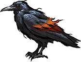

- 类型：火
- 五行：火

### 【练气 · 炽翎乌】（图鉴未收录）

攻击 2 / 血量 10（基础数值）

炽翎乌在赤焰梧桐的千年灰烬中涅槃而生，其鸣啼能引动地脉熔岩。

技能「远程」（锁定技）此卡牌的攻击模式为：**远程攻击**（单体）

技能「后发」攻击的目标如果本回合已经出手，则此卡牌会攻击两次

技能「乌鸟之力」（被动）死亡时，会进入不屈状态（保持1点血量直至回合结束）

### 【筑基 · 炽翎乌】

攻击 5 / 血量 25（基础数值）

炽翎乌在赤焰梧桐的千年灰烬中涅槃而生，其鸣啼能引动地脉熔岩。

技能「远程」（锁定技）此卡牌的攻击模式为：**远程攻击**（单体）

技能「后发」攻击的目标如果本回合已经出手，则此卡牌会攻击两次

技能「乌鸟之力」（被动）死亡时，会进入不屈状态（保持1点血量直至回合结束）

### 【结丹 · 赤霄乌】

攻击 14 / 血量 70（基础数值）

炽翎乌吞噬天火后，羽翼蜕变为赤金交织的“业火神羽”

技能「远程」（锁定技）此卡牌的攻击模式为：**远程攻击**（单体）

技能「后发」攻击的目标如果本回合已经出手，则此卡牌会攻击两次

技能「乌鸟之力」（被动）死亡时，会进入不屈状态（保持1点血量直至回合结束）

### 【元婴 · 焱小丫】

攻击 40 / 血量 191（基础数值）

赤霄乌化形为调皮的小女娃，我为她起名：焱小丫

技能「远程」（锁定技）此卡牌的攻击模式为：**远程攻击**（单体）

技能「后发」攻击的目标如果本回合已经出手，则此卡牌会攻击两次

技能「乌鸟之力」（被动）死亡时，会进入不屈状态（保持1点血量直至回合结束）

### 【化神 · 焱小丫】

攻击 110 / 血量 524（基础数值）

赤霄乌化形为调皮的小女娃，我为她起名：焱小丫

技能「远程」（锁定技）此卡牌的攻击模式为：**远程攻击**（单体）

技能「后发」攻击的目标如果本回合已经出手，则此卡牌会攻击两次

技能「乌鸟之力」（被动）死亡时，会进入不屈状态（保持1点血量直至回合结束）

---

## 22. 狗

- 类型：火
- 五行：火

### 【练气 · 祸斗(小)】（图鉴未收录）

攻击 5 / 血量 9（基础数值）

这虽然只是幼年的祸斗，但是它的性格俨然十分好斗。

珍稀灵兽，通过**筑基期**的灵兽神魄组合〔火〕妖王内丹孵化

技能「潜力」这张卡牌没有技能，但它的属性会更高

技能「犬之力」加入战斗的首个回合开始时，使自己的〔攻击〕，〔血量〕和〔护甲〕均+2且获得**嘲讽**

### 【筑基 · 祸斗(小)】

攻击 13 / 血量 24（基础数值）

这虽然只是幼年的祸斗，但是它的性格俨然十分好斗。

珍稀灵兽，通过**筑基期**的灵兽神魄组合〔火〕妖王内丹孵化

技能「潜力」这张卡牌没有技能，但它的属性会更高

技能「犬之力」加入战斗的首个回合开始时，使自己的〔攻击〕，〔血量〕和〔护甲〕均+7且获得**嘲讽**

### 【结丹 · 祸斗(小)】

攻击 37 / 血量 66（基础数值）

这虽然只是幼年的祸斗，但是它的性格俨然十分好斗。

珍稀灵兽，通过**筑基期**的灵兽神魄组合〔火〕妖王内丹孵化

技能「潜力」这张卡牌没有技能，但它的属性会更高

技能「犬之力」加入战斗的首个回合开始时，使自己的〔攻击〕，〔血量〕和〔护甲〕均+19且获得**嘲讽**

### 【元婴 · 祸斗】

攻击 102 / 血量 183（基础数值）

祸斗化形为周身火焰的士兵，不过他已有本名：祸斗

技能「潜力」这张卡牌没有技能，但它的属性会更高

技能「犬之力」加入战斗的首个回合开始时，使自己的〔攻击〕，〔血量〕和〔护甲〕均+51且获得**嘲讽**

### 【化神 · 祸斗】

攻击 280 / 血量 504（基础数值）

祸斗化形为周身火焰的士兵，不过他已有本名：祸斗

技能「潜力」这张卡牌没有技能，但它的属性会更高

技能「犬之力」加入战斗的首个回合开始时，使自己的〔攻击〕，〔血量〕和〔护甲〕均+140且获得**嘲讽**

---

## 23. 鼠

- 类型：火
- 五行：火

### 【练气 · 火岩鼠】（图鉴未收录）

攻击 3 / 血量 8（基础数值）

体内蕴藏“地脉炎核”，心脏跳动时鳞甲缝隙渗出火星；尾部尖端凝结黑曜石状结晶

技能「先发贰」（被动）战斗开始时，先进行一次攻击

技能「鼠之力」（被动）攻击目标为血量最少的敌方卡牌

### 【筑基 · 火岩鼠】（图鉴未收录）

攻击 7 / 血量 24（基础数值）

体内蕴藏“地脉炎核”，心脏跳动时鳞甲缝隙渗出火星；尾部尖端凝结黑曜石状结晶

技能「先发贰」（被动）战斗开始时，先进行一次攻击

技能「鼠之力」（被动）攻击目标为血量最少的敌方卡牌

### 【结丹 · 火岩鼠】

攻击 20 / 血量 65（基础数值）

体内蕴藏“地脉炎核”，心脏跳动时鳞甲缝隙渗出火星；尾部尖端凝结黑曜石状结晶

技能「先发贰」（被动）战斗开始时，先进行一次攻击

技能「鼠之力」（被动）攻击目标为血量最少的敌方卡牌

### 【元婴 · 焱小爷】

攻击 54 / 血量 178（基础数值）

火岩鼠化形为不良少年，我为他起名：焱小爷

技能「先发贰」（被动）战斗开始时，先进行一次攻击

技能「鼠之力」（被动）攻击目标为血量最少的敌方卡牌

### 【化神 · 焱小爷】

攻击 149 / 血量 490（基础数值）

火岩鼠化形为不良少年，我为他起名：焱小爷

技能「先发贰」（被动）战斗开始时，先进行一次攻击

技能「鼠之力」（被动）攻击目标为血量最少的敌方卡牌

---

## 24. 鸟

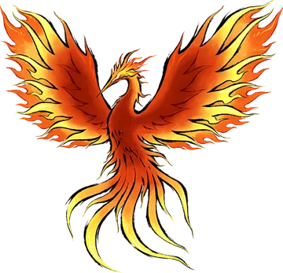

- 类型：火
- 五行：火

### 【练气 · 赤焰神鸟】（图鉴未收录）

攻击 1 / 血量 6（基础数值）

通体赤红如熔岩流淌，羽尖缀金纹似跃动火苗，展翅时翎羽延展如晚霞倾天，遮蔽日月光华

珍稀灵兽，通过**结丹期**的灵兽神魄组合〔火〕妖王内丹孵化

技能「远程」（锁定技）此卡牌的攻击模式为：**远程攻击**（全体）

技能「再攻贰」如果攻击将目标杀死，则再攻击一次（每回合只触发一次）

技能「火凤之力」（被动）死亡时，会满血复活（每场战斗一次）

### 【筑基 · 赤焰神鸟】（图鉴未收录）

攻击 4 / 血量 15（基础数值）

通体赤红如熔岩流淌，羽尖缀金纹似跃动火苗，展翅时翎羽延展如晚霞倾天，遮蔽日月光华

珍稀灵兽，通过**结丹期**的灵兽神魄组合〔火〕妖王内丹孵化

技能「远程」（锁定技）此卡牌的攻击模式为：**远程攻击**（全体）

技能「再攻贰」如果攻击将目标杀死，则再攻击一次（每回合只触发一次）

技能「火凤之力」（被动）死亡时，会满血复活（每场战斗一次）

### 【结丹 · 赤焰神鸟】

攻击 9 / 血量 42（基础数值）

通体赤红如熔岩流淌，羽尖缀金纹似跃动火苗，展翅时翎羽延展如晚霞倾天，遮蔽日月光华

珍稀灵兽，通过**结丹期**的灵兽神魄组合〔火〕妖王内丹孵化

技能「远程」（锁定技）此卡牌的攻击模式为：**远程攻击**（全体）

技能「再攻贰」如果攻击将目标杀死，则再攻击一次（每回合只触发一次）

技能「火凤之力」（被动）死亡时，会满血复活（每场战斗一次）

### 【元婴 · 火凤】

攻击 26 / 血量 116（基础数值）

赤焰神鸟化形为火焰神官，我为她起名：火凤

技能「远程」（锁定技）此卡牌的攻击模式为：**远程攻击**（全体）

技能「再攻贰」如果攻击将目标杀死，则再攻击一次（每回合只触发一次）

技能「火凤之力」（被动）死亡时，会满血复活（每场战斗一次）

### 【化神 · 火凤】

攻击 71 / 血量 318（基础数值）

赤焰神鸟化形为火焰神官，我为她起名：火凤

技能「远程」（锁定技）此卡牌的攻击模式为：**远程攻击**（全体）

技能「再攻贰」如果攻击将目标杀死，则再攻击一次（每回合只触发一次）

技能「火凤之力」（被动）死亡时，会满血复活（每场战斗一次）

---

## 25. 龟

- 类型：土
- 五行：土

### 【练气 · 玄龟】

攻击 None / 血量 14（基础数值）

灵龟的性格温和，适合驯养。但它不善攻击，只善挨打的特征并不特别受修仙者

（品质提升至天品以上，激活技能）喜爱。

技能「嘲讽」（锁定技）战斗中，会优先受到攻击

技能「忍耐」受到攻击后，此卡牌的〔攻击〕+3

技能「龟之力」（被动）受到近战攻击时，以50%攻击力反击攻击者

### 【筑基 · 山岳龟】

攻击 None / 血量 40（基础数值）

提升境界后的山岳龟似乎更加能挨打了。

技能「嘲讽」（锁定技）战斗中，会优先受到攻击

技能「忍耐」受到攻击后，此卡牌的〔攻击〕+7

技能「龟之力」（被动）受到近战攻击时，以50%攻击力反击攻击者

### 【结丹 · 地藏龟】

攻击 None / 血量 111（基础数值）

提升境界后的地藏龟似乎更加能挨打了。

技能「嘲讽」（锁定技）战斗中，会优先受到攻击

技能「忍耐」受到攻击后，此卡牌的〔攻击〕+15

技能「龟之力」（被动）受到近战攻击时，以50%攻击力反击攻击者

### 【元婴 · 藏坤】

攻击 None / 血量 305（基础数值）

地藏龟化形为一名外表稳重的男人，我为他起名：藏坤

技能「嘲讽」（锁定技）战斗中，会优先受到攻击

技能「忍耐」受到攻击后，此卡牌的〔攻击〕+30

技能「龟之力」（被动）受到近战攻击时，以50%攻击力反击攻击者

### 【化神 · 藏坤】

攻击 None / 血量 840（基础数值）

地藏龟化形为一名外表稳重的男人，我为他起名：藏坤

技能「嘲讽」（锁定技）战斗中，会优先受到攻击

技能「忍耐」受到攻击后，此卡牌的〔攻击〕+70

技能「龟之力」（被动）受到近战攻击时，以50%攻击力反击攻击者

---

## 26. 蚂蚁

- 类型：土
- 五行：土

### 【练气 · 裂地蚁】（图鉴未收录）

攻击 3 / 血量 7（基础数值）

上古修士曾以十万裂地蚂蚁为阵基，一夜夷平山脉

技能「护主」当队伍里的角色卡牌受到伤害时，此卡牌的〔攻击〕+1

技能「蚁之力」当持有者受到伤害时，会召唤另一只蚂蚁（每回合一次）

### 【筑基 · 裂地蚁】

攻击 7 / 血量 18（基础数值）

上古修士曾以十万裂地蚂蚁为阵基，一夜夷平山脉

技能「护主」当队伍里的角色卡牌受到伤害时，此卡牌的〔攻击〕+2

技能「蚁之力」当持有者受到伤害时，会召唤另一只蚂蚁（每回合一次）

### 【结丹 · 神蛰蚁】

攻击 19 / 血量 49（基础数值）

裂地蚁吸收地心精金后，背部催生出三道金色蛰痕，沉睡时蛰痕闭合如裂缝，觉醒时赤金光芒流溢

技能「护主」当队伍里的角色卡牌受到伤害时，此卡牌的〔攻击〕+5

技能「蚁之力」当持有者受到伤害时，会召唤另一只蚂蚁（每回合一次）

### 【元婴 · 壤生】

攻击 53 / 血量 134（基础数值）

神蛰蚁化形为一名外表普通的小男孩，我为他起名：壤生

技能「护主」当队伍里的角色卡牌受到伤害时，此卡牌的〔攻击〕+12

技能「蚁之力」当持有者受到伤害时，会召唤另一只蚂蚁（每回合一次）

### 【化神 · 壤生】

攻击 146 / 血量 367（基础数值）

神蛰蚁化形为一名外表普通的小男孩，我为他起名：壤生

技能「护主」当队伍里的角色卡牌受到伤害时，此卡牌的〔攻击〕+25

技能「蚁之力」当持有者受到伤害时，会召唤另一只蚂蚁（每回合一次）

---

## 27. 蜈蚣

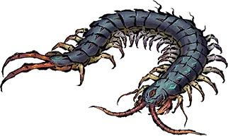

- 类型：土
- 五行：土

### 【练气 · 千足蜈】（图鉴未收录）

攻击 2 / 血量 10（基础数值）

千足蜈可不是那么容易驯服，修士需要用自身鲜血豢养。

珍稀灵兽，通过**筑基期**的灵兽神魄组合〔土〕妖王内丹孵化

技能「隐匿」（被动）只会攻击血量最少的敌人，并且造成真实伤害

技能「蜈蚣之力」每回合触发一次，如果杀死目标，再攻击一次

### 【筑基 · 千足蜈】

攻击 5 / 血量 25（基础数值）

千足蜈可不是那么容易驯服，修士需要用自身鲜血豢养。

珍稀灵兽，通过**筑基期**的灵兽神魄组合〔土〕妖王内丹孵化

技能「隐匿」（被动）只会攻击血量最少的敌人，并且造成真实伤害

技能「蜈蚣之力」每回合触发一次，如果杀死目标，再攻击一次

### 【结丹 · 千足蜈】

攻击 14 / 血量 70（基础数值）

千足蜈可不是那么容易驯服，修士需要用自身鲜血豢养。

珍稀灵兽，通过**筑基期**的灵兽神魄组合〔土〕妖王内丹孵化

技能「隐匿」（被动）只会攻击血量最少的敌人，并且造成真实伤害

技能「蜈蚣之力」每回合触发一次，如果杀死目标，再攻击一次

### 【元婴 · 蚀影】

攻击 40 / 血量 191（基础数值）

千足蜈化形为看不到容貌的杀手，我为他起名：蚀影

技能「隐匿」（被动）只会攻击血量最少的敌人，并且造成真实伤害

技能「蜈蚣之力」每回合触发一次，如果杀死目标，再攻击一次

### 【化神 · 蚀影】

攻击 110 / 血量 524（基础数值）

千足蜈化形为看不到容貌的杀手，我为他起名：蚀影

技能「隐匿」（被动）只会攻击血量最少的敌人，并且造成真实伤害

技能「蜈蚣之力」每回合触发一次，如果杀死目标，再攻击一次

---

## 28. 犀牛

- 类型：土
- 五行：土

### 【练气 · 晶甲犀】（图鉴未收录）

攻击 2 / 血量 9（基础数值）

体型如移动堡垒，通体覆盖六边形透明晶甲，甲片内嵌流动雷纹，日光下折射虹彩光晕

技能「护主贰」当队伍里的角色卡牌受到伤害时，为它增加5点〔护甲〕

技能「犀牛之力」当持有者受到伤害时，立刻使用地震波反击攻击者2〔伤害〕

### 【筑基 · 晶甲犀】（图鉴未收录）

攻击 4 / 血量 23（基础数值）

体型如移动堡垒，通体覆盖六边形透明晶甲，甲片内嵌流动雷纹，日光下折射虹彩光晕

技能「护主贰」当队伍里的角色卡牌受到伤害时，为它增加12点〔护甲〕

技能「犀牛之力」当持有者受到伤害时，立刻使用地震波反击攻击者5〔伤害〕

### 【结丹 · 晶甲犀】

攻击 12 / 血量 62（基础数值）

体型如移动堡垒，通体覆盖六边形透明晶甲，甲片内嵌流动雷纹，日光下折射虹彩光晕

技能「护主贰」当队伍里的角色卡牌受到伤害时，为它增加25点〔护甲〕

技能「犀牛之力」当持有者受到伤害时，立刻使用地震波反击攻击者14〔伤害〕

### 【元婴 · 镇煞】

攻击 32 / 血量 173（基础数值）

晶甲犀化形为重装士兵，我为他起名：镇煞

技能「护主贰」当队伍里的角色卡牌受到伤害时，为它增加60点〔护甲〕

技能「犀牛之力」当持有者受到伤害时，立刻使用地震波反击攻击者38〔伤害〕

### 【化神 · 镇煞】

攻击 87 / 血量 476（基础数值）

晶甲犀化形为重装士兵，我为他起名：镇煞

技能「护主贰」当队伍里的角色卡牌受到伤害时，为它增加175点〔护甲〕

技能「犀牛之力」当持有者受到伤害时，立刻使用地震波反击攻击者105〔伤害〕

---

## 29. 蜥蜴

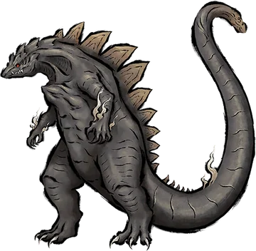

- 类型：土
- 五行：土

### 【练气 · 岩甲蜥蜴】（图鉴未收录）

攻击 1 / 血量 8（基础数值）

双目赤红如熔岩，瞳孔分层如齿轮咬合，可透视地脉能量流动

珍稀灵兽，通过**结丹期**的灵兽神魄组合〔土〕妖王内丹孵化

技能「远程」（锁定技）此卡牌的攻击模式为：**远程攻击**（全体）

技能「憾地」如果此卡牌有护甲，则回合结束时获得等同于护甲值的伤害加成

技能「蜥蜴之力」友方卡牌受到攻击后，自己增加1护甲

### 【筑基 · 岩甲蜥蜴】（图鉴未收录）

攻击 1 / 血量 20（基础数值）

双目赤红如熔岩，瞳孔分层如齿轮咬合，可透视地脉能量流动

珍稀灵兽，通过**结丹期**的灵兽神魄组合〔土〕妖王内丹孵化

技能「远程」（锁定技）此卡牌的攻击模式为：**远程攻击**（全体）

技能「憾地」如果此卡牌有护甲，则回合结束时获得等同于护甲值的伤害加成

技能「蜥蜴之力」友方卡牌受到攻击后，自己增加2护甲

### 【结丹 · 岩甲蜥蜴】

攻击 4 / 血量 55（基础数值）

双目赤红如熔岩，瞳孔分层如齿轮咬合，可透视地脉能量流动

珍稀灵兽，通过**结丹期**的灵兽神魄组合〔土〕妖王内丹孵化

技能「远程」（锁定技）此卡牌的攻击模式为：**远程攻击**（全体）

技能「憾地」如果此卡牌有护甲，则回合结束时获得等同于护甲值的伤害加成

技能「蜥蜴之力」友方卡牌受到攻击后，自己增加4护甲

### 【元婴 · 哥斯】

攻击 11 / 血量 151（基础数值）

岩甲蜥蜴化形为一名格斗士，我为他起名：哥斯

技能「远程」（锁定技）此卡牌的攻击模式为：**远程攻击**（全体）

技能「憾地」如果此卡牌有护甲，则回合结束时获得等同于护甲值的伤害加成

技能「蜥蜴之力」友方卡牌受到攻击后，自己增加10护甲

### 【化神 · 哥斯】

攻击 30 / 血量 417（基础数值）

岩甲蜥蜴化形为一名格斗士，我为他起名：哥斯

技能「远程」（锁定技）此卡牌的攻击模式为：**远程攻击**（全体）

技能「憾地」如果此卡牌有护甲，则回合结束时获得等同于护甲值的伤害加成

技能「蜥蜴之力」友方卡牌受到攻击后，自己增加27护甲

---

## 30. 蝎子

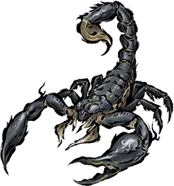

- 类型：阴
- 五行：阴

### 【练气 · 黄泉蝎】（图鉴未收录）

攻击 3 / 血量 10（基础数值）

黄泉蝎和千足蜈很相似，只是蝎子更加毒而已了

珍稀灵兽，通过**筑基期**的灵兽神魄组合〔阴〕妖王内丹孵化

技能「黄泉」每当战场中有卡牌阵亡时，此卡牌的〔攻击〕和〔血量〕+1

技能「蝎之力」（被动）获得吸血能力（30%）

### 【筑基 · 黄泉蝎】

攻击 7 / 血量 25（基础数值）

黄泉蝎和千足蜈很相似，只是蝎子更加毒而已了

珍稀灵兽，通过**筑基期**的灵兽神魄组合〔阴〕妖王内丹孵化

技能「黄泉」每当战场中有卡牌阵亡时，此卡牌的〔攻击〕和〔血量〕+2

技能「蝎之力」（被动）获得吸血能力（30%）

### 【结丹 · 黄泉蝎】

攻击 19 / 血量 70（基础数值）

黄泉蝎和千足蜈很相似，只是蝎子更加毒而已了

珍稀灵兽，通过**筑基期**的灵兽神魄组合〔阴〕妖王内丹孵化

技能「黄泉」每当战场中有卡牌阵亡时，此卡牌的〔攻击〕和〔血量〕+6

技能「蝎之力」（被动）获得吸血能力（30%）

### 【元婴 · 三更】

攻击 53 / 血量 191（基础数值）

黄泉蝎化形为容貌阴险的男人，我为他起名：三更

技能「黄泉」每当战场中有卡牌阵亡时，此卡牌的〔攻击〕和〔血量〕+16

技能「蝎之力」（被动）获得吸血能力（30%）

### 【化神 · 三更】

攻击 146 / 血量 524（基础数值）

黄泉蝎化形为容貌阴险的男人，我为他起名：三更

技能「黄泉」每当战场中有卡牌阵亡时，此卡牌的〔攻击〕和〔血量〕+45

技能「蝎之力」（被动）获得吸血能力（30%）

---

## 31. 蜘蛛

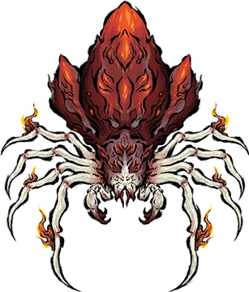

- 类型：阴
- 五行：阴

### 【练气 · 血玉蜘蛛】（图鉴未收录）

攻击 2 / 血量 7（基础数值）

八足如玄铁矛锋，足尖生倒钩，踏地时岩层晶化；口器含一对锯齿螯钳，撕咬时迸发腐蚀性毒雾

珍稀灵兽，通过**筑基期**的灵兽神魄组合〔阴〕妖王内丹孵化

技能「产卵」每当战场中有生物卡牌阵亡（角色/灵兽，召唤卡除外）时，召唤一只**毒蛛**（每回合最多触发5次）

技能「蜘蛛之力」小蜘蛛死亡时，会对随机敌人造成中毒

### 【筑基 · 血玉蜘蛛】（图鉴未收录）

攻击 6 / 血量 19（基础数值）

八足如玄铁矛锋，足尖生倒钩，踏地时岩层晶化；口器含一对锯齿螯钳，撕咬时迸发腐蚀性毒雾

珍稀灵兽，通过**筑基期**的灵兽神魄组合〔阴〕妖王内丹孵化

技能「产卵」每当战场中有生物卡牌阵亡（角色/灵兽，召唤卡除外）时，召唤一只**毒蛛**（每回合最多触发5次）

技能「蜘蛛之力」小蜘蛛死亡时，会对随机敌人造成中毒

### 【结丹 · 血玉蜘蛛】

攻击 18 / 血量 52（基础数值）

八足如玄铁矛锋，足尖生倒钩，踏地时岩层晶化；口器含一对锯齿螯钳，撕咬时迸发腐蚀性毒雾

珍稀灵兽，通过**筑基期**的灵兽神魄组合〔阴〕妖王内丹孵化

技能「产卵」每当战场中有生物卡牌阵亡（角色/灵兽，召唤卡除外）时，召唤一只**毒蛛**（每回合最多触发5次）

技能「蜘蛛之力」小蜘蛛死亡时，会对随机敌人造成中毒

### 【元婴 · 绛罗夫人】

攻击 51 / 血量 142（基础数值）

血玉蜘蛛化形为容貌绝美的贵妇人，我为她起名：绛罗夫人

技能「产卵」每当战场中有生物卡牌阵亡（角色/灵兽，召唤卡除外）时，召唤一只**毒蛛**（每回合最多触发5次）

技能「蜘蛛之力」小蜘蛛死亡时，会对随机敌人造成中毒

### 【化神 · 绛罗夫人】

攻击 140 / 血量 392（基础数值）

血玉蜘蛛化形为容貌绝美的贵妇人，我为她起名：绛罗夫人

技能「产卵」每当战场中有生物卡牌阵亡（角色/灵兽，召唤卡除外）时，召唤一只**毒蛛**（每回合最多触发5次）

技能「蜘蛛之力」小蜘蛛死亡时，会对随机敌人造成中毒

---

## 32. 蝴蝶

- 类型：阳
- 五行：阳

### 【练气 · 幻音蝶】（图鉴未收录）

攻击 3 / 血量 9（基础数值）

通体半透明如琉璃，翅翼缀满七彩音波纹路，鸣叫如空谷回响

珍稀灵兽，可以在灵兽谷（筑基区）遇到它

通过**结丹期**的灵兽神魄组合〔阳〕妖王内丹孵化

技能「远程」（锁定技）此卡牌的攻击模式为：**远程攻击**（单体）

技能「幻觉」（锁定技）加入战场的首个回合开始时，使所有敌人获得一回合**混乱**

技能「幻觉」造成伤害后，使目标获得两回合**混乱**

技能「蝶之力」加入战场后的首个回合，获得**光盾**

### 【筑基 · 幻音蝶】

攻击 7 / 血量 23（基础数值）

通体半透明如琉璃，翅翼缀满七彩音波纹路，鸣叫如空谷回响

珍稀灵兽，可以在灵兽谷（筑基区）遇到它

通过**结丹期**的灵兽神魄组合〔阳〕妖王内丹孵化

技能「远程」（锁定技）此卡牌的攻击模式为：**远程攻击**（单体）

技能「幻觉」（锁定技）加入战场的首个回合开始时，使所有敌人获得一回合**混乱**

技能「幻觉」造成伤害后，使目标获得两回合**混乱**

技能「蝶之力」加入战场后的首个回合，获得**光盾**

### 【结丹 · 幻音蝶】

攻击 19 / 血量 63（基础数值）

通体半透明如琉璃，翅翼缀满七彩音波纹路，鸣叫如空谷回响

珍稀灵兽，可以在灵兽谷（筑基区）遇到它

通过**结丹期**的灵兽神魄组合〔阳〕妖王内丹孵化

技能「远程」（锁定技）此卡牌的攻击模式为：**远程攻击**（单体）

技能「幻觉」（锁定技）加入战场的首个回合开始时，使所有敌人获得一回合**混乱**

技能「幻觉」造成伤害后，使目标获得两回合**混乱**

技能「蝶之力」加入战场后的首个回合，获得**光盾**

### 【元婴 · 梦漪姑娘】

攻击 53 / 血量 172（基础数值）

幻音蝶化形为衣服华丽的女子，我为她起名：梦漪姑娘

技能「远程」（锁定技）此卡牌的攻击模式为：**远程攻击**（单体）

技能「幻觉」（锁定技）加入战场的首个回合开始时，使所有敌人获得一回合**混乱**

技能「幻觉」造成伤害后，使目标获得两回合**混乱**

技能「蝶之力」加入战场后的首个回合，获得**光盾**

### 【化神 · 梦漪姑娘】

攻击 146 / 血量 472（基础数值）

幻音蝶化形为衣服华丽的女子，我为她起名：梦漪姑娘

技能「远程」（锁定技）此卡牌的攻击模式为：**远程攻击**（单体）

技能「幻觉」（锁定技）加入战场的首个回合开始时，使所有敌人获得一回合**混乱**

技能「幻觉」造成伤害后，使目标获得两回合**混乱**

技能「蝶之力」加入战场后的首个回合，获得**光盾**

---

## 33. 麒麟

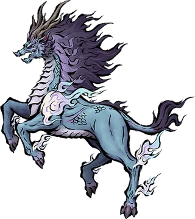

- 类型：阳
- 五行：阳

### 【练气 · 紫极麒麟】（图鉴未收录）

攻击 2 / 血量 8（基础数值）

双目如熔金漩涡，鬃毛似跃动紫焰，足踏之地绽开晶莲，尾如垂天星河，挥洒流火星辰

珍稀灵兽，可以在灵兽谷（结丹区）遇到它

通过**结丹期**的灵兽神魄组合〔阳〕妖王内丹孵化

技能「远程」（锁定技）此卡牌的攻击模式为：**远程攻击**（单体）

技能「天罚」加入战场的首个回合开始时，召唤两张**天雷卡**

技能「麒麟之力」天雷卡死亡时，会对全体敌人造成4伤害

### 【筑基 · 紫极麒麟】（图鉴未收录）

攻击 6 / 血量 20（基础数值）

双目如熔金漩涡，鬃毛似跃动紫焰，足踏之地绽开晶莲，尾如垂天星河，挥洒流火星辰

珍稀灵兽，可以在灵兽谷（结丹区）遇到它

通过**结丹期**的灵兽神魄组合〔阳〕妖王内丹孵化

技能「远程」（锁定技）此卡牌的攻击模式为：**远程攻击**（单体）

技能「天罚」加入战场的首个回合开始时，召唤两张**天雷卡**

技能「麒麟之力」天雷卡死亡时，会对全体敌人造成10伤害

### 【结丹 · 紫极麒麟】

攻击 15 / 血量 56（基础数值）

双目如熔金漩涡，鬃毛似跃动紫焰，足踏之地绽开晶莲，尾如垂天星河，挥洒流火星辰

珍稀灵兽，可以在灵兽谷（结丹区）遇到它

通过**结丹期**的灵兽神魄组合〔阳〕妖王内丹孵化

技能「远程」（锁定技）此卡牌的攻击模式为：**远程攻击**（单体）

技能「天罚」加入战场的首个回合开始时，召唤两张**天雷卡**

技能「麒麟之力」天雷卡死亡时，会对全体敌人造成28伤害

### 【元婴 · 紫微大帝】

攻击 42 / 血量 153（基础数值）

紫极麒麟形为霸气外漏的帝王，我为他起名：紫微大帝

技能「远程」（锁定技）此卡牌的攻击模式为：**远程攻击**（单体）

技能「天罚」加入战场的首个回合开始时，召唤两张**天雷卡**

技能「麒麟之力」天雷卡死亡时，会对全体敌人造成76伤害

### 【化神 · 紫微大帝】

攻击 117 / 血量 420（基础数值）

紫极麒麟形为霸气外漏的帝王，我为他起名：紫微大帝

技能「远程」（锁定技）此卡牌的攻击模式为：**远程攻击**（单体）

技能「天罚」加入战场的首个回合开始时，召唤两张**天雷卡**

技能「麒麟之力」天雷卡死亡时，会对全体敌人造成210伤害

---

## 34. 猞猁

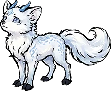

- 类型：阳
- 五行：阳

### 【练气 · 清云猞猁】

攻击 1 / 血量 3（基础数值）

曦和白猁的幼崽，但战斗力也不容小觑

技能「云雾」加入战场的首个回合开始时，召唤一团云雾

技能「猞猁之力」每回合开始时，为云雾增加6〔护甲〕

### 【筑基 · 清云猞猁】

攻击 3 / 血量 9（基础数值）

曦和白猁的幼崽，但战斗力也不容小觑

技能「云雾」加入战场的首个回合开始时，召唤一团云雾

技能「猞猁之力」每回合开始时，为云雾增加15〔护甲〕

### 【结丹 · 清云猞猁】

攻击 8 / 血量 25（基础数值）

曦和白猁的幼崽，但战斗力也不容小觑

技能「云雾」加入战场的首个回合开始时，召唤一团云雾

技能「猞猁之力」每回合开始时，为云雾增加40〔护甲〕

### 【元婴 · 云漪】

攻击 21 / 血量 68（基础数值）

曦和白猁的幼崽，但战斗力也不容小觑

技能「云雾」加入战场的首个回合开始时，召唤一团云雾

技能「猞猁之力」每回合开始时，为云雾增加100〔护甲〕

### 【化神 · 云漪】

攻击 59 / 血量 186（基础数值）

曦和白猁的幼崽，但战斗力也不容小觑

技能「云雾」加入战场的首个回合开始时，召唤一团云雾

技能「猞猁之力」每回合开始时，为云雾增加310〔护甲〕

---

## 35. 蚌

- 类型：阳
- 五行：阳

### 【练气 · 灵玉蚌】（图鉴未收录）

攻击 None / 血量 12（基础数值）

澜音（文鳐鱼）的麾下医师，性柔善疗，居于瑶光海底，吸月华月华凝珠

技能「凝珠」（被动）前10回合结束时，为我方血量最少卡牌恢复5〔血量〕

技能「蚌之力」回合开始时，为随机友军增加一次额外攻击次数，并且恢复它在战斗中减少的〔攻击〕

### 【筑基 · 灵玉蚌】（图鉴未收录）

攻击 None / 血量 34（基础数值）

澜音（文鳐鱼）的麾下医师，性柔善疗，居于瑶光海底，吸月华月华凝珠

技能「凝珠」（被动）前10回合结束时，为我方血量最少卡牌恢复15〔血量〕

技能「蚌之力」回合开始时，为随机友军增加一次额外攻击次数，并且恢复它在战斗中减少的〔攻击〕

### 【结丹 · 灵玉蚌】（图鉴未收录）

攻击 None / 血量 92（基础数值）

澜音（文鳐鱼）的麾下医师，性柔善疗，居于瑶光海底，吸月华月华凝珠

技能「凝珠」（被动）前10回合结束时，为我方血量最少卡牌恢复40〔血量〕

技能「蚌之力」回合开始时，为随机友军增加一次额外攻击次数，并且恢复它在战斗中减少的〔攻击〕

### 【元婴 · 凝珠】

攻击 None / 血量 254（基础数值）

澜音（文鳐鱼）的麾下医师，性柔善疗，居于瑶光海底，吸月华月华凝珠

技能「凝珠」（被动）前10回合结束时，为我方血量最少卡牌恢复110〔血量〕

技能「蚌之力」回合开始时，为随机友军增加一次额外攻击次数，并且恢复它在战斗中减少的〔攻击〕

### 【化神 · 凝珠】

攻击 None / 血量 700（基础数值）

澜音（文鳐鱼）的麾下医师，性柔善疗，居于瑶光海底，吸月华月华凝珠

技能「凝珠」（被动）前10回合结束时，为我方血量最少卡牌恢复310〔血量〕

技能「蚌之力」回合开始时，为随机友军增加一次额外攻击次数，并且恢复它在战斗中减少的〔攻击〕

---

## 36. 鲤鱼

- 类型：水
- 五行：水

### 【练气 · 阴阳鲤】（图鉴未收录）

攻击 3 / 血量 6（基础数值）

白鱼通体莹白如雪，鳞片流转金纹，龙须修长呈赤金色，双目如熔金漩涡

黑鱼玄甲如墨玉，鳞隙渗幽蓝冷光，龙须银白短锐

双鲤尾鳍交缠，形成太极符印

技能「嘲讽」（锁定技）战斗中，会优先受到攻击

技能「双命」（锁定技）（被动）死亡时会复活一次

技能「双命」（锁定技）（被动）死亡时会复活一次

技能「双鱼之力」死亡时复活，同时对全体敌人造成伤害。（每场战斗只会触发一次）

### 【筑基 · 阴阳鲤】

攻击 8 / 血量 17（基础数值）

白鱼通体莹白如雪，鳞片流转金纹，龙须修长呈赤金色，双目如熔金漩涡

黑鱼玄甲如墨玉，鳞隙渗幽蓝冷光，龙须银白短锐

双鲤尾鳍交缠，形成太极符印

技能「嘲讽」（锁定技）战斗中，会优先受到攻击

技能「双命」（锁定技）（被动）死亡时会复活一次

技能「双命」（锁定技）（被动）死亡时会复活一次

技能「双鱼之力」死亡时复活，同时对全体敌人造成伤害。（每场战斗只会触发一次）

### 【结丹 · 阴阳鲤】

攻击 23 / 血量 45（基础数值）

白鱼通体莹白如雪，鳞片流转金纹，龙须修长呈赤金色，双目如熔金漩涡

黑鱼玄甲如墨玉，鳞隙渗幽蓝冷光，龙须银白短锐

双鲤尾鳍交缠，形成太极符印

技能「嘲讽」（锁定技）战斗中，会优先受到攻击

技能「双命」（锁定技）（被动）死亡时会复活一次

技能「双命」（锁定技）（被动）死亡时会复活一次

技能「双鱼之力」死亡时复活，同时对全体敌人造成伤害。（每场战斗只会触发一次）

### 【元婴 · 珑白&玄墨】

攻击 64 / 血量 124（基础数值）

阴阳鲤形为一对双胞胎小孩，我为她们起名：珑白&玄墨

技能「嘲讽」（锁定技）战斗中，会优先受到攻击

技能「双命」（锁定技）（被动）死亡时会复活一次

技能「双命」（锁定技）（被动）死亡时会复活一次

技能「双鱼之力」死亡时复活，同时对全体敌人造成伤害。（每场战斗只会触发一次）

### 【化神 · 珑白&玄墨】

攻击 175 / 血量 343（基础数值）

阴阳鲤形为一对双胞胎小孩，我为她们起名：珑白&玄墨

技能「嘲讽」（锁定技）战斗中，会优先受到攻击

技能「双命」（锁定技）（被动）死亡时会复活一次

技能「双命」（锁定技）（被动）死亡时会复活一次

技能「双鱼之力」死亡时复活，同时对全体敌人造成伤害。（每场战斗只会触发一次）

---

## 37. 乌鸦

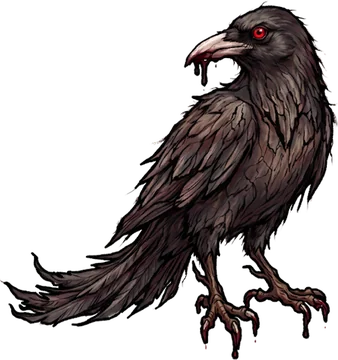

- 类型：血
- 五行：血

### 【练气 · 血睛鸦】（图鉴未收录）

攻击 3 / 血量 8（基础数值）

栖息在饮岁（血藤古树）身上的守林妖鸦，以血藤果实为食，日久通体浸染木煞，目化赤血。

技能「五行:血」（锁定技）：此卡牌拥有血属性，卡牌的〔血量〕比同级别卡稍低，但攻击附带吸血效果

技能「血引肆」当我方卡牌成功恢复〔血量〕时，使随机敌人获得1**易伤**

技能「鸦之力」血引肆的效果会生效2次

### 【筑基 · 血睛鸦】（图鉴未收录）

攻击 7 / 血量 21（基础数值）

栖息在饮岁（血藤古树）身上的守林妖鸦，以血藤果实为食，日久通体浸染木煞，目化赤血。

技能「五行:血」（锁定技）：此卡牌拥有血属性，卡牌的〔血量〕比同级别卡稍低，但攻击附带吸血效果

技能「血引肆」当我方卡牌成功恢复〔血量〕时，使随机敌人获得2**易伤**

技能「鸦之力」血引肆的效果会生效2次

### 【结丹 · 血睛鸦】（图鉴未收录）

攻击 18 / 血量 58（基础数值）

栖息在饮岁（血藤古树）身上的守林妖鸦，以血藤果实为食，日久通体浸染木煞，目化赤血。

技能「五行:血」（锁定技）：此卡牌拥有血属性，卡牌的〔血量〕比同级别卡稍低，但攻击附带吸血效果

技能「血引肆」当我方卡牌成功恢复〔血量〕时，使随机敌人获得3**易伤**

技能「鸦之力」血引肆的效果会生效2次

### 【元婴 · 墨翎】

攻击 50 / 血量 159（基础数值）

栖息在饮岁（血藤古树）身上的守林妖鸦，以血藤果实为食，日久通体浸染木煞，目化赤血。

技能「五行:血」（锁定技）：此卡牌拥有血属性，卡牌的〔血量〕比同级别卡稍低，但攻击附带吸血效果

技能「血引肆」当我方卡牌成功恢复〔血量〕时，使随机敌人获得8**易伤**

技能「鸦之力」血引肆的效果会生效2次

### 【化神 · 墨翎】

攻击 139 / 血量 437（基础数值）

栖息在饮岁（血藤古树）身上的守林妖鸦，以血藤果实为食，日久通体浸染木煞，目化赤血。

技能「五行:血」（锁定技）：此卡牌拥有血属性，卡牌的〔血量〕比同级别卡稍低，但攻击附带吸血效果

技能「血引肆」当我方卡牌成功恢复〔血量〕时，使随机敌人获得22**易伤**

技能「鸦之力」血引肆的效果会生效2次

---

## 38. 蛟

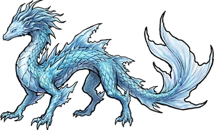

- 类型：冰
- 五行：冰

### 【练气 · 寒鳞鲛】（图鉴未收录）

攻击 3 / 血量 10（基础数值）

澜音（文鳐鱼）的麾下军师，生于深海极寒渊眼，百年不升水面，遂鳞甲凝霜成冰

技能「远程」（锁定技）此卡牌的攻击模式为：**远程攻击**（单体）

技能「寒鳞」当我方卡牌成功恢复〔血量〕，会同时获得1〔护甲〕

技能「冰蛟之力」当我方卡牌成功恢复〔血量〕后，用寒冰禁锢随机敌人两回合；（一场战斗最多触发3次）

### 【筑基 · 寒鳞鲛】（图鉴未收录）

攻击 7 / 血量 25（基础数值）

澜音（文鳐鱼）的麾下军师，生于深海极寒渊眼，百年不升水面，遂鳞甲凝霜成冰

技能「远程」（锁定技）此卡牌的攻击模式为：**远程攻击**（单体）

技能「寒鳞」当我方卡牌成功恢复〔血量〕，会同时获得4〔护甲〕

技能「冰蛟之力」当我方卡牌成功恢复〔血量〕后，用寒冰禁锢随机敌人两回合；（一场战斗最多触发3次）

### 【结丹 · 寒鳞鲛】（图鉴未收录）

攻击 19 / 血量 70（基础数值）

澜音（文鳐鱼）的麾下军师，生于深海极寒渊眼，百年不升水面，遂鳞甲凝霜成冰

技能「远程」（锁定技）此卡牌的攻击模式为：**远程攻击**（单体）

技能「寒鳞」当我方卡牌成功恢复〔血量〕，会同时获得10〔护甲〕

技能「冰蛟之力」当我方卡牌成功恢复〔血量〕后，用寒冰禁锢随机敌人两回合；（一场战斗最多触发3次）

### 【元婴 · 寒笙】

攻击 53 / 血量 191（基础数值）

澜音（文鳐鱼）的麾下军师，生于深海极寒渊眼，百年不升水面，遂鳞甲凝霜成冰

技能「远程」（锁定技）此卡牌的攻击模式为：**远程攻击**（单体）

技能「寒鳞」当我方卡牌成功恢复〔血量〕，会同时获得30〔护甲〕

技能「冰蛟之力」当我方卡牌成功恢复〔血量〕后，用寒冰禁锢随机敌人两回合；（一场战斗最多触发3次）

### 【化神 · 寒笙】

攻击 146 / 血量 524（基础数值）

澜音（文鳐鱼）的麾下军师，生于深海极寒渊眼，百年不升水面，遂鳞甲凝霜成冰

技能「远程」（锁定技）此卡牌的攻击模式为：**远程攻击**（单体）

技能「寒鳞」当我方卡牌成功恢复〔血量〕，会同时获得80〔护甲〕

技能「冰蛟之力」当我方卡牌成功恢复〔血量〕后，用寒冰禁锢随机敌人两回合；（一场战斗最多触发3次）

---

## 39. 鳐

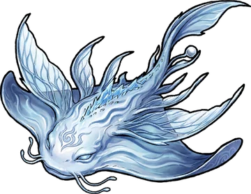

- 类型：风
- 五行：风

### 【练气 · 六翼鳐】（图鉴未收录）

攻击 1 / 血量 11（基础数值）

澜音（文鳐鱼）的麾下斥候，背生六翼，可游于水亦可翔于空，来去如风

技能「远程」（锁定技）此卡牌的攻击模式为：**远程攻击**（全体）

技能「噬力」当我方有卡牌成功恢复血量时，随机吸取一名敌人的1〔攻击〕；（每回合只触发一次）

技能「鳐之力」如果攻击将目标杀死，则为自己恢复5〔血量〕

### 【筑基 · 六翼鳐】（图鉴未收录）

攻击 1 / 血量 29（基础数值）

澜音（文鳐鱼）的麾下斥候，背生六翼，可游于水亦可翔于空，来去如风

技能「远程」（锁定技）此卡牌的攻击模式为：**远程攻击**（全体）

技能「噬力」当我方有卡牌成功恢复血量时，随机吸取一名敌人的2〔攻击〕；（每回合只触发一次）

技能「鳐之力」如果攻击将目标杀死，则为自己恢复15〔血量〕

### 【结丹 · 六翼鳐】（图鉴未收录）

攻击 4 / 血量 78（基础数值）

澜音（文鳐鱼）的麾下斥候，背生六翼，可游于水亦可翔于空，来去如风

技能「远程」（锁定技）此卡牌的攻击模式为：**远程攻击**（全体）

技能「噬力」当我方有卡牌成功恢复血量时，随机吸取一名敌人的3〔攻击〕；（每回合只触发一次）

技能「鳐之力」如果攻击将目标杀死，则为自己恢复40〔血量〕

### 【元婴 · 若云】

攻击 11 / 血量 216（基础数值）

澜音（文鳐鱼）的麾下斥候，背生六翼，可游于水亦可翔于空，来去如风

技能「远程」（锁定技）此卡牌的攻击模式为：**远程攻击**（全体）

技能「噬力」当我方有卡牌成功恢复血量时，随机吸取一名敌人的5〔攻击〕；（每回合只触发一次）

技能「鳐之力」如果攻击将目标杀死，则为自己恢复110〔血量〕

### 【化神 · 若云】

攻击 30 / 血量 595（基础数值）

澜音（文鳐鱼）的麾下斥候，背生六翼，可游于水亦可翔于空，来去如风

技能「远程」（锁定技）此卡牌的攻击模式为：**远程攻击**（全体）

技能「噬力」当我方有卡牌成功恢复血量时，随机吸取一名敌人的10〔攻击〕；（每回合只触发一次）

技能「鳐之力」如果攻击将目标杀死，则为自己恢复310〔血量〕

---
