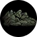
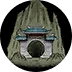
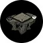
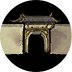
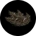
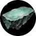
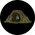
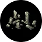

# 【卡牌修仙传】图鉴攻略 — 秘境

- 收录总数：44（游戏官方数据）
- 更新时间：2026-11-18 15:34

---

## 1. 秘境说明

秘境是世界地图上可以进入的特殊地点（游戏里地点分三类：城市 / 秘境 / 资源点）。进入时把主角和规定类型的卡牌放进入口的卡槽，进入后就切换到秘境自己的地图，里面有战斗、工作台、宝箱等内容。

### 【怎么找到秘境】

大部分固定秘境一开始不在地图上，要先拿到对应的「X传闻」卡：在客栈「打听线索」（放入「危险之地 / 宁静之地 / 灵脉之地 / 混沌之地 / 血煞之地」等传闻方向）、人物对话、剧情或因果都可能得到。

把「X传闻」放进探索 / 调查后，地图上就会出现这个秘境，同时得到一张「发现X」卡（点卡牌上的放大镜，镜头会移到秘境位置）。

结丹期时，地图上会自动浮现一批地点：可获得机缘以及古木幽森、灵兽谷、碧潭瀑布、镇妖塔、无字玉璧的传闻（已经开启的秘境不会重复给）。

还有一些秘境是御剑飞行时随机发现的（空间裂缝、天机棋盘、鬼市、未知之地、问道台、聚水漩涡…），它们出现一段时间后会消失；天赋 / 词条「寻龙分金」可以提高飞行时发现秘境的概率。

### 【进入时能带什么】

每个秘境入口都有固定的卡槽（例如战斗型：主角(任务卡)×2、战斗卡×4、丹药×4、口诀卡×4），只有放进卡槽的卡才会一起进入。

比武类秘境（问道台 / 比武擂台）是公平战斗：在秘境里无法打开灵纹戒，不能带超过限制的卡牌。

### 【小提示】

在秘境里，右键卡牌会自动收纳至安全区；因灵气不足无法操控的卡牌也可以收纳。

有些秘境太大了，找不到主角卡？鼠标左键双击空白的地图区域，主角卡就会自动飞过来

（词条「生生不息」的效果）战斗型秘境，都会生成一个额外的恢复工作台；秘境包括：古木幽森(战斗地图)，地火深洞，聚水漩涡，新手村山顶，冥狱(战斗地图)，镇妖塔，妖王聚集地

不限制进入的秘境里的内容都有刷新时间，一般为180日或360日游戏时间。

---

## 2. 妖兽巢穴

妖兽聚集的地方，会祸及附近的村民。待我准备妥当后，可进入巢穴清理妖兽，还附近一片清净！

巢穴每经过180日，才会刷新新的妖兽

### 【秘境类型】

战斗型秘境：进去要战斗，记得带好战斗卡、丹药和口诀

### 【进入时可放入的卡牌】

主角(任务卡)×2、战斗卡×4、丹药×4、口诀卡×4

### 【进入条件 / 内部区域】

练气期及以上：带上「通缉令」（进入时消耗），进入「缉拿目标」 —— 通缉令显示里面有目标，但不清楚人数，如果不尽快缉拿，他们就会逃跑了。

带上「赵子义的邀请」，进入「妖兽巢穴」 —— 我根据赵子义给的信息，直接进入便能找到他！

带上「断剑（下）」，进入「击杀鬼面蛛」 —— 巢穴里的鬼面蛛是筑基期的妖王，我原本不应该前去挑战，但赵道友已经在巢穴里等我了。待我做好充足准备后，便进入决一死战。

带上「村长的请求」，进入「击杀坟蛊鸪」 —— 我决定要帮村子消灭这只坟蛊鸪，虽然它只是练气期，和我实力相当，但我也应该做好万全准备再进入挑战。

练气期及以上：进入「妖兽巢穴」 —— 巢穴里有妖兽的气息，我可以进入将其全部消灭。

### 【妖王讨伐（踪迹卡）】

带上「坟蛊鸪踪迹」进入，可以讨伐妖王「坟蛊鸪」（筑基期及以上）

带上「鬼面蛛踪迹」进入，可以讨伐妖王「鬼面蛛」（筑基期及以上）

带上「祸斗踪迹」进入，可以讨伐妖王「祸斗」（筑基期及以上）

带上「黑焰虎踪迹」进入，可以讨伐妖王「黑焰虎」（筑基期及以上）

带上「青翼蝠王踪迹」进入，可以讨伐妖王「青翼蝠王」（筑基期及以上）

带上「妖剑踪迹」进入，可以讨伐妖王「妖剑」（筑基期及以上）

带上「狰踪迹」进入，可以讨伐妖王「狰」（结丹期及以上）

带上「九幽骨魅踪迹」进入，可以讨伐妖王「九幽骨魅」（结丹期及以上）

筑基期时还打不了：「狰」、「九幽骨魅」（妖王达到结丹期，境界不足）

### 【里面有什么】

里面有什么（来自游戏地图数据；「每N日刷新」的东西拿完后会重新出现，没写的只有一次）

区域 | 境界 | 内容

妖兽巢穴／（2 种布局随机一种） | 练气 | 妖兽：随机一张练气期妖兽（共20种）×5（30%概率出现，每180日刷新）、随机一张练气后期妖兽（共10种）（每180日刷新）／敌对修士：「清虚谷弟子」、「兽王府弟子」、「武极门弟子」、「玄剑阁弟子」、「雪隐宗弟子」、「紫霄殿弟子」（20%概率出现，每360日刷新）／任务：「断剑（下）」

妖兽巢穴／（4 种布局随机一种） | 筑基 | 妖王：「黑焰虎」×2、随机一张筑基后期妖王（共13种）（每180日刷新）／妖兽：随机一张筑基期妖兽（共11种）×4（30%概率出现，每180日刷新）、随机一张筑基后期妖兽（共11种）（每180日刷新）／敌对修士：「清虚谷弟子」、「兽王府弟子」、「武极门弟子」、「玄剑阁弟子」、「雪隐宗弟子」、「紫霄殿弟子」（20%概率出现，每360日刷新）／踪迹 / 线索：「路标」（每360日刷新）／人物：「哭泣的无名妖王」（每10日刷新）

妖兽巢穴 | 结丹 | 妖兽：随机一张结丹后期妖兽（共10种）×3（30%概率出现，每180日刷新）／敌对修士：「清虚谷高手」、「兽王府高手」、「武极门高手」、「玄剑阁高手」、「雪隐宗高手」、「紫霄殿高手」（20%概率出现，每360日刷新）

### 【冷却 / 刷新 / 存在时间】

里面的东西拿完 / 打完后，每 10 日 / 180 日 / 360 日刷新一次（具体见上面表格的「每N日刷新」）

### 【推荐行动（性价比）】

行动 | 能得到 | 性价比 | 说明

战斗 | 最多 妖兽×6、敌对修士×6、妖王×2 | ★★★★☆ | 妖王掉落内丹 / 稀有材料，战斗有风险；每180日/360日刷新，可以定期回来刷

数量是同一境界一次进入最多能遇到的数量（有些只是概率出现）；性价比是按「收获 / 风险 / 是否只有一次」给的建议，仅供参考。

### 【进入前应该带的东西】

战斗卡（主力法宝 / 灵兽 / 傀儡）、回血 / 恢复类丹药、口诀卡—— 有妖王，建议满状态进入

---

## 3. 月照之地

在黑暗的夜晚，月光竟聚集照射此处，像是在为人指路一般。

### 【秘境类型】

培养型秘境：里面有培养工作台，可以快速提升卡牌品质、种植灵草

### 【进入时可放入的卡牌】

主角(任务卡)×2、可培养卡×3、可培养卡×3、机缘卡×1

### 【进入条件 / 内部区域】

筑基期及以上：进入「月照之地」 —— 根据传闻，月照之地内可以快速的提升卡牌的品质，和种植更多的灵草。

### 【怎么找到 / 存在时间】

用「月照之地传闻」调查后，秘境出现在地图上；「月照之地传闻」的来源：在「客栈」打听「灵脉之地」的情报、人物对话 / 事件奖励、因果（根据传闻记载，我判断月照之地和湖月城有着千丝万缕的关系. 我决定在湖月城周围仔细调查！）

位置：在湖月城的北边发现月照之地。

### 【秘境里的说明】

在月照之地中，灵草会自动成长，且产量翻倍！

在月照之地中，就连灵草也可以生长。

在月照之地中，仅需一些时间，材料的品质就会提升。

在月照之地中，仅需一些时间，法宝的品质就会提升。

在月照之地中，仅需一些时间，灵兽的品质就会提升。

在月照之地中，仅需一些时间，傀儡的品质就会提升。

### 【里面有什么】

里面有什么（来自游戏地图数据；「每N日刷新」的东西拿完后会重新出现，没写的只有一次）

区域 | 境界 | 内容

月照之地 | 筑基 | 工作台：月照（培养）×2（50%概率出现）／灵草：随机一种灵草（共8种，例如百年魂婴果、冰雪莲、百年醉龙果、大幻神草…）（仙品/神品）／材料：随机一张筑基后期材料（共38种）×4／人物：「无名灵兽崽」

月照之地 | 结丹 | 工作台：月照（培养）×2（50%概率出现）／灵草：随机一种灵草（共8种，例如千年魂婴果、冰晶莲、千年醉龙果、幻魄草…）（仙品/神品）／材料：随机一张结丹后期材料（共39种）×4

月照之地 | 元婴 | 工作台：月照（培养）×2（50%概率出现）／灵草：随机一种灵草（共8种，例如千年魂婴果、冰晶莲、千年醉龙果、幻魄草…）（仙品/神品）／材料：随机一张元婴后期材料（共32种）×4

月照之地 | — | 敌对修士：「金缕」／人物：「金蝉蛊」×7（30%概率出现）

### 【冷却 / 刷新 / 存在时间】

里面的东西不会刷新，拿完就没有了

### 【推荐行动（性价比）】

行动 | 能得到 | 性价比 | 说明

用「月照 / 培养」工作台提升卡牌品质 | 工作台×2 | ★★★★★ | 比在外面培养快得多；带上想升品的法宝 / 灵兽 / 傀儡 / 灵草（可培养卡槽）

战斗 | 最多 敌对修士×1 | ★★★☆☆ | 掉落材料 / 灵石，战斗有风险

顺手采集资源 | 灵草×1、材料×4 | ★★★☆☆ | 不刷新，进去了就全拿走

数量是同一境界一次进入最多能遇到的数量（有些只是概率出现）；性价比是按「收获 / 风险 / 是否只有一次」给的建议，仅供参考。

### 【进入前应该带的东西】

战斗卡（主力法宝 / 灵兽 / 傀儡）、回血 / 恢复类丹药、口诀卡

想要提升品质的卡牌（放进「可培养卡」槽才会带进去）

机缘卡：放进「机缘卡」槽可以提高发现稀有东西的机会

---

## 4. 古木幽森

在森林不起眼的边缘，找到了一处入口.....

这片森林很大，我应该做好持续作战的准备再进入。

在森林不起眼的边缘，找到了一处自动开启入口.....

### 【秘境类型】

战斗型秘境：进去要战斗，记得带好战斗卡、丹药和口诀

### 【进入时可放入的卡牌】

主角(任务卡)×2、战斗卡×4、丹药×4、口诀卡×4

### 【进入条件 / 内部区域】

筑基期及以上：进入「古木幽森」 —— 根据传闻，这里应该是一个小型迷宫式的森林，也许里面很难恢复，我应该带好补给品再进入。

### 【怎么找到 / 存在时间】

用「古木幽森传闻」调查后，秘境出现在地图上；「古木幽森传闻」的来源：在「客栈」打听「危险之地」的情报、人物对话 / 事件奖励、分析线索、因果（根据传闻记载，古木幽森并非是无法进入，而是需要等待它的入口自行开启。我决定在森林边缘地方调查一番！）

位置：在森林边缘发现入口。

### 【秘境里的说明】

（词条「生生不息」的效果）战斗型秘境，都会生成一个额外的恢复工作台；秘境包括：古木幽森(战斗地图)，地火深洞，聚水漩涡，新手村山顶，冥狱(战斗地图)，镇妖塔，妖王聚集地

### 【里面有什么】

里面有什么（来自游戏地图数据；「每N日刷新」的东西拿完后会重新出现，没写的只有一次）

区域 | 境界 | 内容

古木幽森／（7 种布局随机一种） | 筑基 | 工作台：恢复（30%概率出现）／妖王：血藤古树/血肉灵芝（随机一种）／妖兽：随机一种妖兽（共10种，例如飞鼠人品、飞鼠神品、金毒蟾人品、金毒蟾神品…）×4（30%概率出现）、飞鼠绝品/金毒蟾绝品/长蛇绝品/鬼脸长臂猴绝品/化蛇绝品（随机一种）×3／敌对修士：「蚀月教精英」（30%概率出现）、「清虚谷弟子」、「兽王府弟子」、「武极门弟子」、「玄剑阁弟子」、「雪隐宗弟子」、「紫霄殿弟子」（20%概率出现）、「执黑二师兄」、「执黑三师姐」（50%概率出现）／灵草：蕴元仙萼/赤霄灵芝/缘玑仙草（随机一种）（绝品）、随机一种灵草（共12种，例如凝血草、千年土茯苓、大腐木菇、大洗骨花…）（人品/地品/天品）、随机一种灵草（共8种，例如百年魂婴果、冰雪莲、百年醉龙果、大幻神草…）（仙品/神品）（30%概率出现）／材料：养魂木/血纹树/绕骨藤/赤纹竹/辟虫灵木/凝阴树叶（随机一种）／灵气：「震木」×2（50%概率出现）／机缘：「机缘」／踪迹 / 线索：「地图玩法」、「路标」／人物：「无名骸骨」（50%概率出现）／任务：「无法动弹的人」

古木幽森／（10 种布局随机一种） | 结丹 | 工作台：恢复（30%概率出现）／妖王：血藤古树/血肉灵芝/肥遗绝品（随机一种）／妖兽：随机一种妖兽（共8种，例如三足金毒蟾人品、三足金毒蟾神品、噬金狂蚣人品、噬金狂蚣神品…）×2、三足金毒蟾绝品/噬金狂蚣绝品/鬼脸飞蛇绝品/千棘藤妖绝品（随机一种）×4（50%概率出现）／敌对修士：「蚀月教精英」（30%概率出现）、「清虚谷高手」、「兽王府高手」×2、「武极门高手」、「玄剑阁高手」、「雪隐宗高手」、「紫霄殿高手」（20%概率出现）、「执黑二师兄」、「执黑三师姐」、「执黑大师姐」（50%概率出现）、「埋伏的修士」／道具：玄铁令/六瓣冰莲/龙爪印/青竹片/武极符（随机一种）（30%概率出现）／灵草：蕴元仙萼/碧霄灵芝绝品/缘玑仙草（随机一种）、随机一种灵草（共12种，例如苍血草、万年土茯苓、腐尸菇、洗髓花…）（人品/地品/天品）、随机一种灵草（共8种，例如千年魂婴果、冰晶莲、千年醉龙果、幻魄草…）（仙品/神品）／材料：养魂木/血纹树/绕骨藤/赤纹竹/辟虫灵木/凝阴树叶（随机一种）／灵气：「青阳木精」×2（50%概率出现）／机缘：「机缘」／感悟：「生长」（30%概率出现）／踪迹 / 线索：「路标」、「这是尽头?」

古木幽森／（9 种布局随机一种） | — | 工作台：恢复（30%概率出现）、炼制／妖兽：「血藤」×3、「火灵树妖」／感悟：「归一」／踪迹 / 线索：「迷宫秘境」、「路标」×2、「慕容绛璃」／人物：「血树」、「饮岁」、「修士」、「火灵树妖」×10／任务：「被困住的修士」／通关奖励：「枯木的神念」

树干密室 | — | 踪迹 / 线索：「慕容绛璃」／人物：「无名骸骨」

### 【冷却 / 刷新 / 存在时间】

出现后约 180 日（游戏时间）后消失，过期就没了

里面的东西不会刷新，拿完就没有了

### 【推荐行动（性价比）】

行动 | 能得到 | 性价比 | 说明

用「炼制」工作台炼丹 / 炼器 | 工作台 | ★★★★☆ | 工作台是免费的；带上灵草 / 材料 / 图纸，配合里面采到的灵草效率最高

用「恢复」恢复受伤的卡牌 / 修复损坏的法宝、傀儡 | 工作台 | ★★★☆☆ | 打完仗顺便恢复，不用回城

清空敌人拿通关奖励 | 枯木的神念 | ★★★★☆ | 把里面的敌对人物全部击败后结算

战斗 | 最多 妖兽×4、敌对修士×10、妖王×1 | ★★★★☆ | 妖王掉落内丹 / 稀有材料，战斗有风险

顺手采集资源 | 灵气×2、材料×1、机缘×1、感悟×1、灵草×2、道具×1 | ★★★☆☆ | 不刷新，进去了就全拿走

数量是同一境界一次进入最多能遇到的数量（有些只是概率出现）；性价比是按「收获 / 风险 / 是否只有一次」给的建议，仅供参考。

### 【进入前应该带的东西】

战斗卡（主力法宝 / 灵兽 / 傀儡）、回血 / 恢复类丹药、口诀卡—— 有妖王，建议满状态进入

炼丹 / 炼器要用的灵草、材料和图纸（里面的灵草可以直接拿来当辅药）

---

## 5. 碧潭瀑布

瀑布从山上落下，带来了极大的水量冲击着底下的寒潭，但寒潭的水永不外溢，底下似有无限空间。

### 【秘境类型】

恢复型秘境：可以恢复卡牌、修复损坏的法宝 / 傀儡

### 【进入时可放入的卡牌】

主角(任务卡)×2、可恢复卡×3、损坏的卡×3、机缘卡×1

### 【进入条件 / 内部区域】

筑基期及以上：进入「碧潭瀑布」 —— 还没进入就感受到此处的宁静，想必此处不会有太多的危险，我可以放心进入。

### 【怎么找到 / 存在时间】

用「碧潭瀑布传闻」调查后，秘境出现在地图上；「碧潭瀑布传闻」的来源：在「客栈」打听「宁静之地」的情报、人物对话 / 事件奖励、分析线索、因果（根据传闻记载，瀑布的位置应该在某河流的上游。我觉得把大陆的河流上游都搜索一遍。）

位置：在金陵城西边发现瀑布。

### 【秘境里的说明】

我浸泡在碧潭瀑布，邪气以肉眼可见的速度消失。

（词条「天地接引」的效果）进入月照之地&碧潭瀑布&无字玉璧&天地熔炉秘境时，有50%概率发现额外的工作台

（词条「禁机缘」的效果）无法在秘境里使用机缘类卡牌； (无法在月照之地，碧潭瀑布，天地熔炉，无字玉璧使用机缘类卡牌获得更多的工作台)

### 【里面有什么】

里面有什么（来自游戏地图数据；「每N日刷新」的东西拿完后会重新出现，没写的只有一次）

区域 | 境界 | 内容

碧潭瀑布 | 筑基 | 工作台：愈灵（恢复）×2（50%概率出现）／灵气：「混沌灵气」、「坎水」×4／感悟：「心境」／人物：「重伤的修士」

碧潭瀑布 | 结丹 | 工作台：愈灵（恢复）×2（50%概率出现）／灵气：「混沌灵气」、「九阴黑水」×3／感悟：「心境」

潭底 | — | 任务：「鱼」

### 【冷却 / 刷新 / 存在时间】

里面的东西不会刷新，拿完就没有了

### 【推荐行动（性价比）】

行动 | 能得到 | 性价比 | 说明

用「愈灵（恢复）」恢复受伤的卡牌 / 修复损坏的法宝、傀儡 | 工作台×2 | ★★★☆☆ | 打完仗顺便恢复，不用回城

顺手采集资源 | 感悟×1、灵气×5 | ★★★☆☆ | 不刷新，进去了就全拿走

数量是同一境界一次进入最多能遇到的数量（有些只是概率出现）；性价比是按「收获 / 风险 / 是否只有一次」给的建议，仅供参考。

### 【进入前应该带的东西】

机缘卡：放进「机缘卡」槽可以提高发现稀有东西的机会

---

## 6. 地火深洞

因为地震导致地面出现了裂缝，地火从深处涌出，也就表明裂缝可以通往地底深处！

### 【秘境类型】

战斗型秘境：进去要战斗，记得带好战斗卡、丹药和口诀

### 【进入时可放入的卡牌】

主角(任务卡)×2、战斗卡×4、丹药×4、口诀卡×4

### 【进入条件 / 内部区域】

筑基期：进入「地火深洞」 —— 从深洞里散发的灵气可感知到里面存在着许多妖兽. 我该做好完全准备再进入

结丹期及以上：进入「地火深洞」 —— 从深洞里散发的灵气可感知到里面存在着一名强大的修士，也许还有其他..... 我该做好完全准备再进入

元婴期及以上：进入「地火深洞」 —— 从深洞里散发的灵气可感知到里面存在着2只元婴期妖王. 我该做好完全准备再进入

元婴期及以上：进入「深洞内部」 —— 从深洞里散发的灵气可感知到里面存在着一名强大的修士，也许还有其他..... 我该做好完全准备再进入

### 【怎么找到 / 存在时间】

用「地火深洞传闻」调查后，秘境出现在地图上；「地火深洞传闻」的来源：在「客栈」打听「危险之地」的情报、人物对话 / 事件奖励、因果（根据传闻记载，深洞里的火焰似乎能被附近的树木吸收。也许某颗火云树的附近，就是深洞所在之处？）

位置：在金陵城的北边发现深洞。

### 【秘境里的说明】

（词条「生生不息」的效果）战斗型秘境，都会生成一个额外的恢复工作台；秘境包括：古木幽森(战斗地图)，地火深洞，聚水漩涡，新手村山顶，冥狱(战斗地图)，镇妖塔，妖王聚集地

### 【里面有什么】

里面有什么（来自游戏地图数据；「每N日刷新」的东西拿完后会重新出现，没写的只有一次）

区域 | 境界 | 内容

地火深洞 | 筑基 | 工作台：恢复／妖王：「祸斗绝品」／妖兽：赤红豹人品/赤红豹神品/三头枳首蛇人品/三头枳首蛇神品（随机一种）×7、赤红豹绝品/三头枳首蛇绝品（随机一种）×2（30%概率出现）／敌对修士：「蚀月教精英」（30%概率出现）、「清虚谷弟子」、「兽王府弟子」、「玄剑阁弟子」、「雪隐宗弟子」、「紫霄殿弟子」（20%概率出现）、「执黑大师姐」、「执黑二师兄」、「执黑三师姐」（50%概率出现）、「不灭熔岩」／踪迹 / 线索：「路标」／任务：「宝藏」

地火深洞 | 结丹 | 工作台：恢复／妖王：祸斗绝品/黑焰虎/火云雀（随机一种）（50%概率出现）／妖兽：独角赤豹绝品/六头枳首蛇绝品（随机一种）×2／敌对修士：「夺宝修士」、「不灭熔岩」×2、「蚀月教精英」（30%概率出现）、「清虚谷高手」、「兽王府高手」、「玄剑阁高手」、「雪隐宗高手」、「紫霄殿高手」（20%概率出现）、「执黑大师姐」、「执黑二师兄」、「执黑三师姐」（50%概率出现）／踪迹 / 线索：「无法回头!!」／任务：「宝藏」

地火深洞 | 元婴 | 工作台：恢复／妖王：祸斗绝品/黑焰虎/火云雀（随机一种）×2／敌对修士：「执黑大师姐」、「执黑二师兄」、「执黑三师姐」（50%概率出现）、「清虚谷护法」、「兽王府护法」、「玄剑阁护法」、「雪隐宗护法」（20%概率出现）、「不灭熔岩」×4

深洞内部／（5 种布局随机一种） | — | 踪迹 / 线索：「无人在此」×2、「赤牙」／人物：「木桩」（每370日刷新）、「赤牙绝品」、「祸斗绝品」

地火深洞 | — | 踪迹 / 线索：「无法回头!!」／人物：「神秘高手的元婴」

### 【冷却 / 刷新 / 存在时间】

里面的东西拿完 / 打完后，每 370 日刷新一次（具体见上面表格的「每N日刷新」）

### 【推荐行动（性价比）】

行动 | 能得到 | 性价比 | 说明

用「恢复」恢复受伤的卡牌 / 修复损坏的法宝、傀儡 | 工作台 | ★★★☆☆ | 打完仗顺便恢复，不用回城

战斗 | 最多 妖兽×9、敌对修士×12、妖王×2 | ★★★★☆ | 妖王掉落内丹 / 稀有材料，战斗有风险

数量是同一境界一次进入最多能遇到的数量（有些只是概率出现）；性价比是按「收获 / 风险 / 是否只有一次」给的建议，仅供参考。

### 【进入前应该带的东西】

战斗卡（主力法宝 / 灵兽 / 傀儡）、回血 / 恢复类丹药、口诀卡—— 有妖王，建议满状态进入

---

## 7. 无字玉璧

远看玉璧上没有刻写任何文字，近看隐约可见“天地不仁以万物为刍狗”

### 【秘境类型】

感悟型秘境：可以修炼感悟 / 心法

### 【进入时可放入的卡牌】

主角(任务卡)×2、感悟卡×4、机缘卡×1

### 【进入条件 / 内部区域】

筑基期及以上：进入「无字玉璧」 —— 我远远的便望到一副玉璧，我应当更加靠近，试图感受那顿悟的清醒。

### 【怎么找到 / 存在时间】

用「无字玉璧传闻」调查后，秘境出现在地图上；「无字玉璧传闻」的来源：在「客栈」打听「宁静之地」的情报、分析线索、人物对话 / 事件奖励、因果（根据传闻记载，无字玉璧藏在茫茫雪山山脉之中。由此，我应当锁定在北方的雪山！）

位置：在雁荡城的东北方向发现玉璧。

### 【秘境里的说明】

在无字玉璧前，我惊讶的发现无须准备其他物品便能轻松修炼心法

在无字玉璧前，我的思绪变得无比的清晰。

在无字玉璧里，我无需用术，也可以提升口诀境界！

在无字玉璧里，我无需招式，也可以提升技能境界！

（词条「天地接引」的效果）进入月照之地&碧潭瀑布&无字玉璧&天地熔炉秘境时，有50%概率发现额外的工作台

（词条「禁机缘」的效果）无法在秘境里使用机缘类卡牌； (无法在月照之地，碧潭瀑布，天地熔炉，无字玉璧使用机缘类卡牌获得更多的工作台)

### 【里面有什么】

里面有什么（来自游戏地图数据；「每N日刷新」的东西拿完后会重新出现，没写的只有一次）

区域 | 境界 | 内容

无字玉璧／（2 种布局随机一种） | — | 工作台：顿悟（修炼感悟）×2（50%概率出现）／机缘：「机缘」（30%概率出现）／感悟：「悟道」／人物：玄剑阁精英/清虚谷精英/雪隐宗精英/武极门精英/兽王府精英/紫霄殿高手（随机一种）、玄剑阁精英/清虚谷精英/雪隐宗精英/武极门精英/兽王府精英/紫霄殿精英（随机一种）

### 【冷却 / 刷新 / 存在时间】

里面的东西不会刷新，拿完就没有了

### 【推荐行动（性价比）】

行动 | 能得到 | 性价比 | 说明

用「顿悟（修炼感悟）」修炼感悟 / 心法 | 工作台×2 | ★★★★☆ | 带上要修炼的感悟 / 心法卡

顺手采集资源 | 感悟×1、机缘×1 | ★★★☆☆ | 不刷新，进去了就全拿走

数量是同一境界一次进入最多能遇到的数量（有些只是概率出现）；性价比是按「收获 / 风险 / 是否只有一次」给的建议，仅供参考。

### 【进入前应该带的东西】

要修炼的感悟 / 心法卡

机缘卡：放进「机缘卡」槽可以提高发现稀有东西的机会

---

## 8. 聚水漩涡

海面上"无端端"地出现一个漩涡，不过天底下哪有无端出现的异象？

### 【秘境类型】

战斗型秘境：进去要战斗，记得带好战斗卡、丹药和口诀

### 【进入时可放入的卡牌】

主角(任务卡)×2、战斗卡×4、丹药×4、口诀卡×4

### 【进入条件 / 内部区域】

带上「鲲的气息」，进入「圣兽：鲲」 —— 远远地我便看到那遮天蔽日的鲲....

带上「赵子义的邀请」，进入「水龙卷」 —— 我发现了聚水漩涡，赵兄已经来此，直接进入便能找到他！

筑基期及以上：进入「聚水旋涡」 —— 一个奇怪的旋涡出现在海上，也许有妖王再此出没，我该做好完全准备再进入。

### 【怎么找到 / 存在时间】

御剑飞行时随机发现（主角筑基期起）

### 【秘境里的说明】

（词条「生生不息」的效果）战斗型秘境，都会生成一个额外的恢复工作台；秘境包括：古木幽森(战斗地图)，地火深洞，聚水漩涡，新手村山顶，冥狱(战斗地图)，镇妖塔，妖王聚集地

### 【里面有什么】

里面有什么（来自游戏地图数据；「每N日刷新」的东西拿完后会重新出现，没写的只有一次）

区域 | 境界 | 内容

水龙卷 | 筑基 | 妖王：「北海巨妖」×2

旋涡深处／（2 种布局随机一种） | 筑基 | 工作台：恢复／妖王：夔牛/北海巨妖（随机一种）／敌对修士：「蚀月教精英」（30%概率出现）、「执黑大师姐」（50%概率出现）／材料：随机一种材料（共8种，例如月泉灵乳、冥河水晶、黑魄寒冰、玄灵液…）／内丹：内丹人品/内丹神品/内丹绝品/无名妖兽的内丹绝品/夔牛的内丹/北海巨妖的内丹（随机一种）／人物：玄冰蛟人品/寒影狼人品/雷云母人品（随机一种）

旋涡深处／（2 种布局随机一种） | 结丹 | 工作台：恢复／妖王：夔牛/北海巨妖/文鳐鱼（随机一种）×2（50%概率出现）／敌对修士：「蚀月教精英」（30%概率出现）／材料：随机一种材料（共8种，例如月泉晶、幽冥寒晶、万年黑魄冰、天元灵液…）／内丹：随机一张结丹后期水属性内丹（共7种）／人物：寒渊蛟人品/冰魄狼人品/霜鳞鲸人品/雷云母人品/雾羽仙鹤人品（随机一种）

圣兽：鲲 | — | 人物：「鲲的分身神品」

聚水旋涡 | — | 踪迹 / 线索：「地图玩法」

旋涡深处 | — | 工作台：恢复

### 【冷却 / 刷新 / 存在时间】

进入（完成）一次后就会消失

里面的东西不会刷新，拿完就没有了

### 【推荐行动（性价比）】

行动 | 能得到 | 性价比 | 说明

用「恢复」恢复受伤的卡牌 / 修复损坏的法宝、傀儡 | 工作台 | ★★★☆☆ | 打完仗顺便恢复，不用回城

战斗 | 最多 妖王×3、敌对修士×2 | ★★★★☆ | 妖王掉落内丹 / 稀有材料，战斗有风险

顺手采集资源 | 材料×1、内丹×1 | ★★★☆☆ | 不刷新，进去了就全拿走

数量是同一境界一次进入最多能遇到的数量（有些只是概率出现）；性价比是按「收获 / 风险 / 是否只有一次」给的建议，仅供参考。

### 【进入前应该带的东西】

战斗卡（主力法宝 / 灵兽 / 傀儡）、回血 / 恢复类丹药、口诀卡—— 有妖王，建议满状态进入

---

## 9. 深山山顶

群山深处的最高峰，直穿云霄；因常年被密云包围，一般人也无法窥探。

只是时常有恐怖的妖兽叫声从穿云而来，煞是惊人！

### 【秘境类型】

战斗型秘境：进去要战斗，记得带好战斗卡、丹药和口诀

### 【进入时可放入的卡牌】

主角(任务卡)×2、战斗卡×4、丹药×4、口诀卡×4

### 【进入条件 / 内部区域】

进入「深山山顶」 —— 我找到村长说的山路，还没到山顶我便感知到众多的妖兽，看来静心草并不是那么容易摘下。

### 【怎么找到 / 存在时间】

用「深山山顶路线」调查后，秘境出现在地图上；「深山山顶路线」的来源：人物对话 / 事件奖励（根据村长的提示，我正在找寻前往山顶的神秘入口。）

位置：在无名村庄的西边发现了前往山顶的道路。

### 【里面有什么】

里面有什么（来自游戏地图数据；「每N日刷新」的东西拿完后会重新出现，没写的只有一次）

区域 | 境界 | 内容

深山山顶 | 练气 | 工作台：恢复（每360日刷新）／妖兽：随机一张练气后期妖兽（共10种）×6（30%概率出现，每180日刷新）、随机一张练气后期妖兽（共20种）×4（每180日刷新）／任务：「静心草」（每360日刷新）

### 【冷却 / 刷新 / 存在时间】

里面的东西拿完 / 打完后，每 180 日 / 360 日刷新一次（具体见上面表格的「每N日刷新」）

### 【推荐行动（性价比）】

行动 | 能得到 | 性价比 | 说明

用「恢复」恢复受伤的卡牌 / 修复损坏的法宝、傀儡 | 工作台 | ★★★☆☆ | 打完仗顺便恢复，不用回城

战斗 | 最多 妖兽×10 | ★★★☆☆ | 掉落材料 / 灵石，战斗有风险；每180日刷新，可以定期回来刷

数量是同一境界一次进入最多能遇到的数量（有些只是概率出现）；性价比是按「收获 / 风险 / 是否只有一次」给的建议，仅供参考。

### 【进入前应该带的东西】

战斗卡（主力法宝 / 灵兽 / 傀儡）、回血 / 恢复类丹药、口诀卡

---

## 10. 静室

静静伫立在悬崖上的静修室。应该是师傅的住处，现在我也住这里了。

我需要完成师傅交代的功课后，才能回静室

### 【进入时可放入的卡牌】

小孩&灵兽×2、法宝×3、修为×3

### 【进入条件 / 内部区域】

带上「小孩」，进入「静室」 —— 我要把灵兽狮子带回去给交功课。 (放置在靜室外的卡牌，不会丢失)

### 【怎么找到 / 存在时间】

与「炎狮」对话后出现

### 【里面有什么】

里面有什么（来自游戏地图数据；「每N日刷新」的东西拿完后会重新出现，没写的只有一次）

区域 | 境界 | 内容

静室 | — | 工作台：修炼、炼制、恢复、培养／踪迹 / 线索：「师傅的剑：夺目」、「师傅的扇：留客」、「师傅的伞：遮月」、「寿元丹神品」、「大衍周天经」、「无相诀」、「碧霄灵芝神品」、「万灵参神品」、「无名妖兽的内丹神品」、「剑芒神品」×2、「金制傀儡神品」×2／人物：「师傅」

### 【推荐行动（性价比）】

行动 | 能得到 | 性价比 | 说明

用「炼制」工作台炼丹 / 炼器 | 工作台 | ★★★★☆ | 工作台是免费的；带上灵草 / 材料 / 图纸，配合里面采到的灵草效率最高

用「修炼」修炼感悟 / 心法 | 工作台 | ★★★★☆ | 带上要修炼的感悟 / 心法卡

用「恢复」恢复受伤的卡牌 / 修复损坏的法宝、傀儡 | 工作台 | ★★★☆☆ | 打完仗顺便恢复，不用回城

用「月照 / 培养」工作台提升卡牌品质 | 工作台 | ★★★★★ | 比在外面培养快得多；带上想升品的法宝 / 灵兽 / 傀儡 / 灵草（可培养卡槽）

数量是同一境界一次进入最多能遇到的数量（有些只是概率出现）；性价比是按「收获 / 风险 / 是否只有一次」给的建议，仅供参考。

### 【进入前应该带的东西】

炼丹 / 炼器要用的灵草、材料和图纸（里面的灵草可以直接拿来当辅药）

要修炼的感悟 / 心法卡

想要提升品质的卡牌（放进「可培养卡」槽才会带进去）

---

## 11. 冥狱入口

据说这个深渊可以通往地下大陆"冥狱"，但往下的深渊之路预示着进入后无法回头！

### 【秘境类型】

战斗型秘境：进去要战斗，记得带好战斗卡、丹药和口诀

### 【进入时可放入的卡牌】

主角(任务卡)×2、战斗卡×4、丹药×4、口诀卡×4

### 【进入条件 / 内部区域】

进入「冥狱地下十一层」 —— 直接进入此处冥狱的最深处！

进入「冥狱地下六层」 —— 我直接从第六层继续深入！无论从哪里下裂缝，所达的区域，均无法预知！

筑基期及以上：进入「冥狱裂缝」 —— 我从地面往下看去，下方并非是岩土地面，而是被雾霾阴气笼罩的区域；无论从哪里下裂缝，所达的区域，均无法预知！

### 【怎么找到 / 存在时间】

用「冥狱裂缝传闻」调查后，秘境出现在地图上；「冥狱裂缝传闻」的来源：剧情模式主线故事、在「金陵城的桥」驻足观望，获得（根据我的记忆，冥狱裂缝就在雁荡城旁边的雪山上，而我出来的出口，则在湖月城的南边）

位置：在雁荡城的东边的雪上和湖月城的南边的草原发现冥狱裂缝。

### 【秘境里的说明】

（词条「生生不息」的效果）战斗型秘境，都会生成一个额外的恢复工作台；秘境包括：古木幽森(战斗地图)，地火深洞，聚水漩涡，新手村山顶，冥狱(战斗地图)，镇妖塔，妖王聚集地

### 【里面有什么】

里面有什么（来自游戏地图数据；「每N日刷新」的东西拿完后会重新出现，没写的只有一次）

区域 | 境界 | 内容

冥狱地下一层／（4 种布局随机一种） | 筑基 | 工作台：恢复／妖兽：随机一张筑基期妖兽（共22种）×5、随机一张筑基后期妖兽（共11种）×3（50%概率出现）／敌对修士：「蚀月教精英」（30%概率出现）、「清虚谷弟子」、「兽王府弟子」、「武极门弟子」、「玄剑阁弟子」、「雪隐宗弟子」、「紫霄殿弟子」（20%概率出现）／踪迹 / 线索：「地图玩法」／人物：「无名骸骨」×4

冥狱地下八层 | 筑基 | 工作台：恢复／丹药：随机一张结丹后期丹药(系统)（共8种）/随机一张筑基后期丹药(系统)（共7种）（随机一种）、随机一张筑基后期丹药(系统)（共8种）/随机一张筑基后期丹药(系统)（共7种）（随机一种）×3（50%概率出现）

冥狱地下二层／（4 种布局随机一种） | 筑基 | 工作台：恢复／妖王：坟蛊鸪/鬼面蛛/青翼蝠王（随机一种）／妖兽：随机一张筑基期妖兽（共22种）×6、随机一张筑基后期妖兽（共11种）×5（50%概率出现）／敌对修士：「蚀月教精英」（30%概率出现）／人物：「无名骸骨」×4

冥狱地下三层／（4 种布局随机一种） | 筑基 | 工作台：恢复／敌对修士：「蚀月教弟子」／丹药：随机一张筑基后期丹药(系统)（共8种）/随机一张筑基后期丹药(系统)（共7种）（随机一种）×3（50%概率出现）／道具：玄铁令/六瓣冰莲/龙爪印/青竹片/武极符（随机一种）（50%概率出现）／灵草：百年魂婴果/毒液/剧毒液/百年醉龙果/血灵芝（随机一种）（50%概率出现）／材料：随机一张筑基后期材料（共38种）／内丹：随机一张筑基后期内丹（共17种）（50%概率出现）／灵气：「混沌灵气」（50%概率出现）／人物：「无名骸骨」×5

冥狱地下四层／（2 种布局随机一种） | 筑基 | 工作台：恢复／妖王：坟蛊鸪/鬼面蛛/青翼蝠王（随机一种）×2／敌对修士：「蚀月教精英」（30%概率出现）、「清虚谷弟子」、「兽王府弟子」、「玄剑阁弟子」、「雪隐宗弟子」、「紫霄殿弟子」（20%概率出现）、「执黑大师姐」、「执黑二师兄」、「执黑三师姐」（50%概率出现）、「蚀月教弟子」×2

冥狱地下五层 | 筑基 | 材料：随机一张筑基后期材料（共38种）/随机一张筑基后期材料（共7种）（随机一种）／内丹：随机一张筑基后期内丹（共14种）／机缘：「机缘」（30%概率出现）／踪迹 / 线索：「路标」／人物：「无名骸骨」

冥狱地下六层／（4 种布局随机一种） | 结丹 | 工作台：恢复／妖兽：随机一张结丹期妖兽（共20种）×5、随机一张结丹后期妖兽（共10种）×3（50%概率出现）／敌对修士：「蚀月教精英」（30%概率出现）、「清虚谷高手」、「兽王府高手」、「武极门高手」、「玄剑阁高手」、「雪隐宗高手」、「紫霄殿高手」（20%概率出现）／踪迹 / 线索：「地图玩法」／人物：「无名骸骨」×4

冥狱地下七层／（4 种布局随机一种） | 结丹 | 工作台：恢复／妖王：坟蛊鸪/鬼面蛛/青翼蝠王/九幽骨魅（随机一种）／妖兽：随机一张结丹期妖兽（共20种）×6、随机一张结丹后期妖兽（共10种）×5（50%概率出现）／敌对修士：「蚀月教精英」（30%概率出现）、「清虚谷高手」、「兽王府高手」、「武极门高手」、「玄剑阁高手」、「雪隐宗高手」、「紫霄殿高手」（20%概率出现）／人物：「无名骸骨」×4

冥狱地下八层／（2 种布局随机一种） | 结丹 | 工作台：恢复／敌对修士：「蚀月教弟子」×2、「清虚谷高手」、「兽王府高手」、「武极门高手」、「玄剑阁高手」、「雪隐宗高手」、「紫霄殿高手」（20%概率出现）／道具：玄铁令/六瓣冰莲/龙爪印/青竹片/武极符（随机一种）（50%概率出现）／灵草：千年魂婴果/毒液/剧毒液/千年醉龙果/血灵芝（随机一种）（50%概率出现）／材料：随机一张结丹后期材料（共39种）／内丹：随机一张结丹后期内丹（共23种）（50%概率出现）／灵气：「混沌灵气」（50%概率出现）

冥狱地下九层／（2 种布局随机一种） | 结丹 | 工作台：恢复／妖王：坟蛊鸪/鬼面蛛/青翼蝠王/九幽骨魅（随机一种）×2／敌对修士：「蚀月教精英」（30%概率出现）、「清虚谷高手」、「兽王府高手」、「玄剑阁高手」、「雪隐宗高手」、「紫霄殿高手」（20%概率出现）、「执黑大师姐」、「执黑二师兄」、「执黑三师姐」（50%概率出现）、「蚀月教弟子」×2

冥狱地下十一层 | — | 妖王：坟蛊鸪/鬼面蛛/青翼蝠王/九幽骨魅（随机一种）×2／敌对修士：「素影」／人物：「素影」

冥狱裂缝 | — | 人物：「修士」

冥狱地下八层 | — | 人物：「无名骸骨」×5

冥狱地下十层 | — | 踪迹 / 线索：「路标」／人物：「无名骸骨」

### 【冷却 / 刷新 / 存在时间】

里面的东西不会刷新，拿完就没有了

### 【推荐行动（性价比）】

行动 | 能得到 | 性价比 | 说明

用「恢复」恢复受伤的卡牌 / 修复损坏的法宝、傀儡 | 工作台×5 | ★★★☆☆ | 打完仗顺便恢复，不用回城

战斗 | 最多 敌对修士×32、妖王×3、妖兽×11 | ★★★★☆ | 妖王掉落内丹 / 稀有材料，战斗有风险

顺手采集资源 | 灵气×1、材料×2、内丹×2、道具×1、灵草×1、丹药×7、机缘×1 | ★★★☆☆ | 不刷新，进去了就全拿走

数量是同一境界一次进入最多能遇到的数量（有些只是概率出现）；性价比是按「收获 / 风险 / 是否只有一次」给的建议，仅供参考。

### 【进入前应该带的东西】

战斗卡（主力法宝 / 灵兽 / 傀儡）、回血 / 恢复类丹药、口诀卡—— 有妖王，建议满状态进入

---

## 12. 灵兽谷

此地乃千年灵兽群聚之所，地脉灵气化泉成溪，滋养出藤蔓垂露、岩生蜜髓的洞天。

我想我可以在灵兽谷抓灵兽。据说击杀灵兽也有概率获得它的神魄。

### 【秘境类型】

战斗型秘境：进去要战斗，记得带好战斗卡、丹药和口诀

### 【进入时可放入的卡牌】

主角(任务卡)×2、战斗卡×4、丹药×4、灵石×1

### 【进入条件 / 内部区域】

带上「悦萱儿的发带」，进入「灵兽谷深处」 —— 天狐的气息指引着我前进。

带上「九尾天狐的气息」，进入「灵兽谷深处」 —— 天狐的气息指引着我前进。

进入「灵兽谷深处」 —— 除了悦宣儿，我还感受到3股结丹期的气息！！本次将直接进入任务场景。

筑基期及以上：进入「灵兽谷」 —— 根据传闻，峡谷里常有灵兽出没，但也会有妖兽存在。我可以准备充足后进入，也许可以捕捉到灵兽。

### 【妖王讨伐（踪迹卡）】

带上「血藤古树踪迹」进入，可以讨伐妖王「血藤古树」（筑基期及以上）

带上「巨灵烈象踪迹」进入，可以讨伐妖王「巨灵烈象」（筑基期及以上）

带上「金蝉蛊踪迹」进入，可以讨伐妖王「金蝉蛊」（筑基期及以上）

带上「血肉灵芝踪迹」进入，可以讨伐妖王「血肉灵芝」（筑基期及以上）

带上「铁骨熊踪迹」进入，可以讨伐妖王「铁骨熊」（筑基期及以上）

带上「肥遗踪迹」进入，可以讨伐妖王「肥遗」（结丹期及以上）

带上「石魈踪迹」进入，可以讨伐妖王「石魈」（结丹期及以上）

带上「火云雀踪迹」进入，可以讨伐妖王「火云雀」（结丹期及以上）

筑基期时还打不了：「肥遗」、「石魈」、「火云雀」（妖王达到结丹期，境界不足）

### 【怎么找到 / 存在时间】

用「灵兽谷传闻」调查后，秘境出现在地图上；「灵兽谷传闻」的来源：在「客栈」打听「混沌之地」的情报、人物对话 / 事件奖励、分析线索、因果（根据传闻记载，灵兽谷就位于湖月城的北边）

位置：在雁荡城的南边发现灵兽谷。

### 【里面有什么】

里面有什么（来自游戏地图数据；「每N日刷新」的东西拿完后会重新出现，没写的只有一次）

区域 | 境界 | 内容

灵兽谷 | 筑基 | 妖兽：随机一张筑基后期妖兽（共11种）、随机一张筑基期妖兽（共22种）×3（50%概率出现，每180日刷新）／人物：随机一张筑基后期人物(中立)（共7种）×4、随机一张筑基后期人物(中立)（共10种）×4（30%概率出现，每360日刷新）、「一只灵狐?」

灵兽谷 | 结丹 | 妖兽：随机一张结丹后期妖兽（共10种）、随机一张结丹期妖兽（共20种）×2（50%概率出现，每180日刷新）／人物：随机一张结丹后期人物(中立)（共14种）×3、随机一张结丹后期人物(中立)（共15种）×3（30%概率出现，每360日刷新）

灵兽谷深处／（2 种布局随机一种） | — | 敌对修士：「蚀月教精英」×3／人物：「九尾天狐的分身绝品」／任务：「悦萱儿」

### 【冷却 / 刷新 / 存在时间】

里面的东西拿完 / 打完后，每 180 日 / 360 日刷新一次（具体见上面表格的「每N日刷新」）

### 【推荐行动（性价比）】

行动 | 能得到 | 性价比 | 说明

战斗 | 最多 敌对修士×3、妖兽×4 | ★★★☆☆ | 掉落材料 / 灵石，战斗有风险；每180日刷新，可以定期回来刷

数量是同一境界一次进入最多能遇到的数量（有些只是概率出现）；性价比是按「收获 / 风险 / 是否只有一次」给的建议，仅供参考。

### 【进入前应该带的东西】

战斗卡（主力法宝 / 灵兽 / 傀儡）、回血 / 恢复类丹药、口诀卡

---

## 13. 镇妖塔

此地乃上古大能以周天星辰之力镇压万妖之所，塔身密布血契符箓，层叠如锁。

进入塔内，便是一场接一场的妖王战。

### 【秘境类型】

战斗型秘境：进去要战斗，记得带好战斗卡、丹药和口诀

### 【进入时可放入的卡牌】

主角(任务卡)×2、战斗卡×4、丹药×4、口诀卡×4

### 【进入条件 / 内部区域】

筑基期及以上：进入「镇妖塔一层」 —— 根据传闻，镇妖塔里关押着从世间各地运送来的妖王。我也感受到其气息十分危险，我应当做好完全准备再进入。

### 【怎么找到 / 存在时间】

用「镇妖塔传闻」调查后，秘境出现在地图上；「镇妖塔传闻」的来源：在「客栈」打听「血煞之地」的情报、人物对话 / 事件奖励、分析线索、因果（根据传闻记载，镇妖塔的位置，在雪山的沿海处。）

位置：在地图的最东北端发现镇妖塔。

### 【秘境里的说明】

（词条「生生不息」的效果）战斗型秘境，都会生成一个额外的恢复工作台；秘境包括：古木幽森(战斗地图)，地火深洞，聚水漩涡，新手村山顶，冥狱(战斗地图)，镇妖塔，妖王聚集地

（词条「强化镇妖塔」的效果）镇妖塔的每一层，都会额外增加一只妖王

### 【里面有什么】

里面有什么（来自游戏地图数据；「每N日刷新」的东西拿完后会重新出现，没写的只有一次）

区域 | 境界 | 内容

镇妖塔二层 | 筑基 | 工作台：恢复／妖王：随机一张筑基后期妖王（共13种）×2

镇妖塔三层 | 筑基 | 工作台：恢复／妖王：随机一张筑基后期妖王（共13种）×2／敌对修士：「清虚谷弟子」、「兽王府弟子」、「武极门弟子」、「玄剑阁弟子」、「紫霄殿弟子」（20%概率出现）、「蚀月教精英」（30%概率出现）、「执黑大师姐」、「执黑二师兄」、「执黑三师姐」（50%概率出现）／通关奖励：「人魂」

镇妖塔五层 | 筑基 | 工作台：恢复／妖王：随机一张筑基后期妖王（共13种）×2／通关奖励：「地魂」

镇妖塔七层 | 筑基 | 工作台：恢复／妖王：随机一张筑基后期妖王（共13种）×2／踪迹 / 线索：「顶层」／通关奖励：「天魂」、「本源兽魄」

镇妖塔四层 | 筑基 | 工作台：恢复／妖王：随机一张筑基后期妖王（共13种）×2

镇妖塔六层 | 筑基 | 工作台：恢复／妖王：随机一张筑基后期妖王（共13种）×2

镇妖塔二层 | 结丹 | 工作台：恢复／妖王：随机一张结丹后期妖王（共19种）×2

镇妖塔三层 | 结丹 | 工作台：恢复／妖王：随机一张结丹后期妖王（共19种）×3／敌对修士：「清虚谷高手」、「兽王府高手」、「武极门高手」、「玄剑阁高手」、「雪隐宗高手」、「紫霄殿高手」（20%概率出现）、「蚀月教精英」（30%概率出现）、「执黑大师姐」、「执黑二师兄」、「执黑三师姐」（50%概率出现）

镇妖塔四层 | 结丹 | 工作台：恢复／妖王：随机一张结丹后期妖王（共19种）×2

镇妖塔五层 | 结丹 | 工作台：恢复／妖王：随机一张结丹后期妖王（共19种）×3／通关奖励：「无法前进？」、「发现雷霆漩涡」、「本源兽魄」

镇妖塔二层 | 元婴 | 工作台：恢复／妖王：随机一张元婴后期妖王（共19种）×2

镇妖塔三层 | 元婴 | 工作台：恢复／妖王：随机一张元婴后期妖王（共19种）×2

镇妖塔四层 | 元婴 | 工作台：恢复／妖王：随机一张元婴后期妖王（共19种）×2／踪迹 / 线索：「顶层」

镇妖塔一层／（2 种布局随机一种） | — | 踪迹 / 线索：「地图玩法」、「词条激活」、「无法回头!!」／人物：「???」

### 【冷却 / 刷新 / 存在时间】

里面的东西不会刷新，拿完就没有了

### 【推荐行动（性价比）】

行动 | 能得到 | 性价比 | 说明

用「恢复」恢复受伤的卡牌 / 修复损坏的法宝、傀儡 | 工作台×6 | ★★★☆☆ | 打完仗顺便恢复，不用回城

清空敌人拿通关奖励 | 人魂、地魂、天魂、本源兽魄 | ★★★★☆ | 把里面的敌对人物全部击败后结算

战斗 | 最多 妖王×12、敌对修士×10 | ★★★★☆ | 妖王掉落内丹 / 稀有材料，战斗有风险

数量是同一境界一次进入最多能遇到的数量（有些只是概率出现）；性价比是按「收获 / 风险 / 是否只有一次」给的建议，仅供参考。

### 【进入前应该带的东西】

战斗卡（主力法宝 / 灵兽 / 傀儡）、回血 / 恢复类丹药、口诀卡—— 有妖王，建议满状态进入

---

## 14. 剑冢

残剑如林，断刃覆骨。此地乃剑修飞升知处，我只能携带剑进入。

### 【秘境类型】

剑修秘境：只能携带剑（以及无双剑匣、感悟卡）进入

### 【进入时可放入的卡牌】

主角(任务卡)×2、剑×6、无双剑匣×2、感悟卡×4

### 【进入条件 / 内部区域】

筑基期及以上：进入「剑冢」 —— 只要我拿着除剑以外的卡牌靠近，剑冢的大门便会紧紧关闭；我只能携带剑进入了

### 【怎么找到 / 存在时间】

用「剑冢传闻」调查后，秘境出现在地图上；「剑冢传闻」的来源：在「客栈」打听「血煞之地」的情报、人物对话 / 事件奖励、因果（根据传闻记载，剑冢的位置某个小岛之上。）

位置：在无名村庄的东边小岛上发现剑冢。

### 【里面有什么】

里面有什么（来自游戏地图数据；「每N日刷新」的东西拿完后会重新出现，没写的只有一次）

区域 | 境界 | 内容

剑冢 | 筑基 | 工作台：恢复／敌对修士：「蚀月教精英」（30%概率出现）、「清虚谷弟子」、「兽王府弟子」、「武极门弟子」、「玄剑阁弟子」、「雪隐宗弟子」、「紫霄殿弟子」（20%概率出现）、「执黑大师姐」、「执黑二师兄」、「执黑三师姐」（50%概率出现）／踪迹 / 线索：「地图玩法」

剑冢 | 结丹 | 工作台：恢复／敌对修士：「蚀月教精英」（30%概率出现）、「清虚谷高手」、「兽王府高手」、「武极门高手」、「玄剑阁高手」、「雪隐宗高手」、「紫霄殿高手」（20%概率出现）、「执黑大师姐」、「执黑二师兄」、「执黑三师姐」（50%概率出现）／踪迹 / 线索：「地图玩法」

### 【冷却 / 刷新 / 存在时间】

里面的东西不会刷新，拿完就没有了

### 【推荐行动（性价比）】

行动 | 能得到 | 性价比 | 说明

用「恢复」恢复受伤的卡牌 / 修复损坏的法宝、傀儡 | 工作台 | ★★★☆☆ | 打完仗顺便恢复，不用回城

战斗 | 最多 敌对修士×10 | ★★★☆☆ | 掉落材料 / 灵石，战斗有风险

数量是同一境界一次进入最多能遇到的数量（有些只是概率出现）；性价比是按「收获 / 风险 / 是否只有一次」给的建议，仅供参考。

### 【进入前应该带的东西】

战斗卡（主力法宝 / 灵兽 / 傀儡）、回血 / 恢复类丹药、口诀卡

---

## 15. 天地熔炉

地乃地脉暴烈处喷涌出的天然熔炉，山岩化赤金矿髓，草木燃青磷异火。

这不正是一个天然的炼制炉？

### 【秘境类型】

炼制型秘境：里面有特殊的炼制工作台（也可以带战斗卡防身）

### 【进入时可放入的卡牌】

主角(任务卡)×2、战斗卡×4、材料卡×4、机缘卡×1

### 【进入条件 / 内部区域】

筑基期及以上：进入「天地熔炉」 —— 我原本以为这只是一座简单的火山，但未曾想到在火山口竟有如此秘境。

### 【怎么找到 / 存在时间】

用「天地熔炉传闻」调查后，秘境出现在地图上；「天地熔炉传闻」的来源：在「客栈」打听「混沌之地」的情报、人物对话 / 事件奖励、因果（根据传闻记载，天地熔炉位于雁荡城的北边的火山上。）

位置：在雁荡城的北边发现火山。

### 【秘境里的说明】

在天地熔炉里，我仅需一样材料便可打造出对应的法宝。

在天地熔炉里，我可以直接将法宝提升一个境界，并且保留其原来的品质。

在天地熔炉里，我可以直接将傀儡提升一个境界，并且保留其原来的品质。

在天地熔炉里，我可以直接将灵兽提升一个境界，并且保留其原来的品质。

在天地熔炉里，只需要一味药，便可炼制出极好的丹药。

（词条「天地接引」的效果）进入月照之地&碧潭瀑布&无字玉璧&天地熔炉秘境时，有50%概率发现额外的工作台

### 【里面有什么】

里面有什么（来自游戏地图数据；「每N日刷新」的东西拿完后会重新出现，没写的只有一次）

区域 | 境界 | 内容

天地熔炉 | — | 工作台：熔炉（炼制）×2（50%概率出现）／机缘：「机缘」（30%概率出现）／任务：「鱼」

### 【冷却 / 刷新 / 存在时间】

里面的东西不会刷新，拿完就没有了

### 【推荐行动（性价比）】

行动 | 能得到 | 性价比 | 说明

用「熔炉（炼制）」工作台炼丹 / 炼器 | 工作台×2 | ★★★★☆ | 工作台是免费的；带上灵草 / 材料 / 图纸，配合里面采到的灵草效率最高

顺手采集资源 | 机缘×1 | ★★★☆☆ | 不刷新，进去了就全拿走

数量是同一境界一次进入最多能遇到的数量（有些只是概率出现）；性价比是按「收获 / 风险 / 是否只有一次」给的建议，仅供参考。

### 【进入前应该带的东西】

炼丹 / 炼器要用的灵草、材料和图纸（里面的灵草可以直接拿来当辅药）

机缘卡：放进「机缘卡」槽可以提高发现稀有东西的机会

---

## 16. 比武擂台

仙界比武大会每5年举办一次，所有筑基期或结丹期的修士们均可以参加！

参与获得名次者，可获得由金陵城赞助的特别奖励。

### 【秘境类型】

战斗型秘境：进去要战斗，记得带好战斗卡、丹药和口诀

### 【进入时可放入的卡牌】

主角×2、战斗卡×4、丹药×4、口诀卡×4

### 【进入条件 / 内部区域】

筑基期、结丹期：进入「比武大会报名处」 —— 难得五年一届的比武会，我又怎能错过呢？我需要做好准备再进入，把我最强的法宝灵兽，丹药，口诀都带上！(比武是公平竞技，如果我携带的卡牌超出允许数量，则无法进入) (比武大会每5年才举办一次，进入会场则视为开始玩法,无论胜负，都需要等5年才会继续开启)

### 【里面有什么】

里面有什么（来自游戏地图数据；「每N日刷新」的东西拿完后会重新出现，没写的只有一次）

区域 | 境界 | 内容

比武大会报名处／（2 种布局随机一种） | 筑基 | 敌对修士：「悔念真人」／心法：随机一张筑基后期心法（共22种）（仙品）／材料：随机一张筑基后期材料（共38种）／传闻：混沌之地/血煞之地/灵脉之地（随机一种）／踪迹 / 线索：「比赛规则」／奖品：「魁首奖品」／人物：「参赛修士」×4、「悔念真人」

比武大会报名处／（2 种布局随机一种） | 结丹 | 敌对修士：「悔念真人」／心法：随机一张结丹后期心法（共11种）（仙品）／材料：随机一张结丹后期材料（共39种）／传闻：混沌之地/血煞之地/灵脉之地（随机一种）／踪迹 / 线索：「比赛规则」／奖品：「魁首奖品」／人物：「悔念真人」、「参赛修士」×4

比武:海选赛场 | — | 工作台：恢复／敌对修士：「对手」／踪迹 / 线索：「海选」

比武:淘汰赛(16进8) | — | 工作台：恢复／敌对修士：「对手」／踪迹 / 线索：「16强」

比武:淘汰赛(8进4) | — | 工作台：恢复／敌对修士：「对手」／踪迹 / 线索：「8强」

比武:四强赛 | — | 工作台：恢复／敌对修士：「对手」／踪迹 / 线索：「4强」

比武:冠军赛 | — | 工作台：恢复／踪迹 / 线索：「冠军赛」

### 【冷却 / 刷新 / 存在时间】

金陵城每 5 年举办一次比武大会，错过要等下一届

出现后约 360 日（游戏时间）后消失，过期就没了

里面的东西不会刷新，拿完就没有了

### 【推荐行动（性价比）】

行动 | 能得到 | 性价比 | 说明

优先拿一次性宝物 | 随机一张筑基后期心法（共22种）、随机一张结丹后期心法（共11种） | ★★★★★ | 只有一次，拿完不会再刷新

用「恢复」恢复受伤的卡牌 / 修复损坏的法宝、傀儡 | 工作台×5 | ★★★☆☆ | 打完仗顺便恢复，不用回城

战斗 | 最多 敌对修士×4 | ★★★☆☆ | 掉落材料 / 灵石，战斗有风险

顺手采集资源 | 材料×1 | ★★★☆☆ | 不刷新，进去了就全拿走

数量是同一境界一次进入最多能遇到的数量（有些只是概率出现）；性价比是按「收获 / 风险 / 是否只有一次」给的建议，仅供参考。

### 【进入前应该带的东西】

战斗卡（主力法宝 / 灵兽 / 傀儡）、回血 / 恢复类丹药、口诀卡

---

## 17. 坊市

这里原来是金陵城的活动广场，不知从何时起，陆续有修士在此交易，逐渐就形成了一个广场坊市。

### 【进入时可放入的卡牌】

主角×2、灵石×1、物品卡×4

### 【进入条件 / 内部区域】

结丹期及以上：进入「坊市广场(结丹)」 —— 带上我的灵石，去逛逛坊市，兴许能买到合适的物品。

筑基期：进入「坊市广场(筑基)」 —— 带上我的灵石，去逛逛坊市，兴许能买到合适的物品。

### 【里面有什么】

里面有什么（来自游戏地图数据；「每N日刷新」的东西拿完后会重新出现，没写的只有一次）

区域 | 境界 | 内容

坊市广场(筑基)／（3 种布局随机一种） | 筑基 | 敌对修士：玄剑阁高手/清虚谷高手/雪隐宗高手/武极门高手/兽王府高手（随机一种）×4／踪迹 / 线索：「邪气」／商人：「商人」×3（每360日刷新）／人物：「蒙面人」、「玄剑阁弟子」×4、「雪隐宗弟子」×4、「兽王府弟子」×4、「清虚谷弟子」×4、「武极门弟子」×4（75%概率出现，每360日刷新）、「紫霄殿弟子」×2、「蚀月教弟子」、「神秘人」（50%概率出现，每360日刷新）

坊市广场(结丹)／（3 种布局随机一种） | 结丹 | 敌对修士：玄剑阁精英/清虚谷精英/雪隐宗精英/武极门精英/兽王府精英/紫霄殿高手（随机一种）×4／踪迹 / 线索：「邪气」／商人：「商人」×2（每360日刷新）／人物：「蒙面人」、「玄剑阁高手」×3、「雪隐宗高手」×3、「兽王府高手」×3、「清虚谷高手」×3、「武极门高手」×3（75%概率出现，每360日刷新）、「紫霄殿高手」、「蚀月教弟子」（50%概率出现，每360日刷新）、「神秘人」（50%概率出现，每350日刷新）

### 【冷却 / 刷新 / 存在时间】

里面的东西拿完 / 打完后，每 350 日 / 360 日刷新一次（具体见上面表格的「每N日刷新」）

### 【推荐行动（性价比）】

行动 | 能得到 | 性价比 | 说明

战斗 | 最多 敌对修士×4 | ★★★☆☆ | 掉落材料 / 灵石，战斗有风险

数量是同一境界一次进入最多能遇到的数量（有些只是概率出现）；性价比是按「收获 / 风险 / 是否只有一次」给的建议，仅供参考。

### 【进入前应该带的东西】

战斗卡（主力法宝 / 灵兽 / 傀儡）、回血 / 恢复类丹药、口诀卡

---

## 18. 天帝宝库

漂浮在天上悄无声息出现的神秘地方，只隐约看到门前牌匾上篆刻着：天帝

### 【秘境类型】

战斗型秘境：进去要战斗，记得带好战斗卡、丹药和口诀

### 【进入时可放入的卡牌】

主角×2、战斗卡×4、口诀卡×4、物品卡×4

### 【进入条件 / 内部区域】

筑基期及以上：进入「天帝宝库大门」 —— 从天帝宝库里传来一阵威压，我只能独自进入。

### 【怎么找到 / 存在时间】

与「金不换」对话后出现

因果（探索「因果？」）后出现

位置：在北方的雪山上，发现了天帝宝库。

### 【秘境里的说明】

（词条「神佑之人」的效果）天帝宝库会出现2把钥匙

### 【里面有什么】

里面有什么（来自游戏地图数据；「每N日刷新」的东西拿完后会重新出现，没写的只有一次）

区域 | 境界 | 内容

天帝宝库大门 | 筑基／结丹 | 踪迹 / 线索：「天关魁的神念」×4／人物：「金制傀儡」×2

天帝宝库内部／（6 种布局随机一种） | 筑基 | 道途：「武道绝品」、「器道绝品」、「兽道绝品」、「丹道绝品」、「术道绝品」（需要「一把秘钥」才能拿）／天赋：「百炼钢躯绝品」×3、「真炎道绝品」、「浴火之躯绝品」、「金锋破绝品」、「笑里藏锋绝品」、「剑术精通绝品」、「御剑无锋绝品」、「剑气四射绝品」、「器心通明绝品」、「敛锋蕴气绝品」、「生死契约绝品」、「驭兽之道绝品」、「不动如山绝品」、「磐石之躯绝品」、「与兽共舞绝品」、「长生之法绝品」、「千幻毒手绝品」、「丹元催化绝品」、「元殒毒术绝品」、「青冥引绝品」、「花之魂绝品」、「落叶归根绝品」、「万法归流绝品」×2、「法术精通绝品」、「灵力亲和绝品」、「灵脉之躯绝品」、「生生不息绝品」、「无形冰绝品」（需要「一把秘钥」才能拿）／法宝：「无双」×6、「豢灵」×6（需要「一把秘钥」才能拿）／道具：「一把秘钥」×2

天帝宝库内部／（6 种布局随机一种） | 结丹 | 天赋：「百炼钢躯绝品」×2、「真炎道绝品」、「神魂锻体绝品」、「太素炼形绝品」、「天窍绝品」、「浴火之躯绝品」、「金锋破绝品」、「笑里藏锋绝品」、「剑术精通绝品」×2、「御剑无锋绝品」、「剑气四射绝品」、「断邪斩绝品」、「器心通明绝品」、「虚境遥观绝品」、「敛锋蕴气绝品」、「洞虚灵眸绝品」、「生死契约绝品」、「驭兽之道绝品」、「不动如山绝品」、「灵愈血契绝品」、「载天盾绝品」、「远古血脉绝品」、「磐石之躯绝品」、「与兽共舞绝品」、「长生之法绝品」、「千幻毒手绝品」、「丹元催化绝品」×2、「元殒毒术绝品」、「青冥引绝品」、「万斛丹源绝品」、「灵植之心绝品」、「幻尘毒手绝品」、「丹元通玄绝品」、「花之魂绝品」、「落叶归根绝品」、「灵脉之躯绝品」、「万法归流绝品」×2、「法术精通绝品」、「灵力亲和绝品」、「落珠回春绝品」、「夺灵绝品」、「生生不息绝品」、「无形冰绝品」（需要「一把秘钥」才能拿）／技能：「连击」、「吸血绝品」、「拳风」（需要「一把秘钥」才能拿）／法宝：「无双」×6、「豢灵」×6（需要「一把秘钥」才能拿）／道具：「一把秘钥」×2

### 【冷却 / 刷新 / 存在时间】

里面的东西不会刷新，拿完就没有了

### 【推荐行动（性价比）】

行动 | 能得到 | 性价比 | 说明

优先拿一次性宝物 | 武道绝品、百炼钢躯绝品、真炎道绝品、浴火之躯绝品、器道绝品… | ★★★★★ | 只有一次，拿完不会再刷新；要先拿到「一把秘钥」（只有 2 把，每把开一件，挑最需要的拿）

顺手采集资源 | 道具×2 | ★★★☆☆ | 不刷新，进去了就全拿走

数量是同一境界一次进入最多能遇到的数量（有些只是概率出现）；性价比是按「收获 / 风险 / 是否只有一次」给的建议，仅供参考。

### 【进入前应该带的东西】

要先拿到「一把秘钥」（在秘境里找）才能拿走宝物

---

## 19. 十万大山

十万大山，绵亘无尽，横跨大陆，其广莫测，其深难寻。

### 【秘境类型】

战斗型秘境：进去要战斗，记得带好战斗卡、丹药和口诀

### 【进入时可放入的卡牌】

主角(任务卡)×2、战斗卡×4、口诀卡×4、物品卡×4

### 【进入条件 / 内部区域】

带上「白龙的气息」，进入「十万大山深处」 —— 十万大山的范围太大，进入里面很容易迷路。但有了白龙的气息，我可以直接找到它！

带上「赵子义的邀请」，进入「十万大山深处」 —— 我根据赵子义给的信息，直接进入便能找到他！

进入「十万大山深处」 —— 除了悦宣儿，我还感受到3股结丹期的气息！！本次将直接进入任务场景。

进入「十万大山外层」 —— 十万大山的范围太大，进入里面很容易迷路。据说有前辈高人在山里设置了搜山大阵，用妖兽内丹驱动可以探索一大片区域

### 【妖王讨伐（踪迹卡）】

带上「坟蛊鸪踪迹」进入，可以讨伐妖王「坟蛊鸪」（筑基期及以上）

带上「妖剑踪迹」进入，可以讨伐妖王「妖剑」（筑基期及以上）

带上「血藤古树踪迹」进入，可以讨伐妖王「血藤古树」（筑基期及以上）

带上「夔牛踪迹踪迹」进入，可以讨伐妖王「夔牛」（筑基期及以上）

带上「祸斗踪迹」进入，可以讨伐妖王「祸斗」（筑基期及以上）

带上「巨灵烈象踪迹」进入，可以讨伐妖王「巨灵烈象」（筑基期及以上）

带上「鬼面蛛踪迹」进入，可以讨伐妖王「鬼面蛛」（筑基期及以上）

带上「金蝉蛊踪迹」进入，可以讨伐妖王「金蝉蛊」（筑基期及以上）

带上「血肉灵芝踪迹」进入，可以讨伐妖王「血肉灵芝」（筑基期及以上）

带上「北海巨妖踪迹」进入，可以讨伐妖王「北海巨妖」（筑基期及以上）

带上「黑焰虎踪迹」进入，可以讨伐妖王「黑焰虎」（筑基期及以上）

带上「铁骨熊踪迹」进入，可以讨伐妖王「铁骨熊」（筑基期及以上）

带上「青翼蝠王踪迹」进入，可以讨伐妖王「青翼蝠王」（筑基期及以上）

带上「狰踪迹」进入，可以讨伐妖王「狰」（结丹期及以上）

带上「肥遗踪迹」进入，可以讨伐妖王「肥遗」（结丹期及以上）

带上「文鳐鱼踪迹」进入，可以讨伐妖王「文鳐鱼」（结丹期及以上）

带上「火云雀踪迹」进入，可以讨伐妖王「火云雀」（结丹期及以上）

带上「石魈踪迹」进入，可以讨伐妖王「石魈」（结丹期及以上）

带上「九幽骨魅踪迹」进入，可以讨伐妖王「九幽骨魅」（结丹期及以上）

筑基期时还打不了：「狰」、「肥遗」、「文鳐鱼」、「火云雀」、「石魈」、「九幽骨魅」（妖王达到结丹期，境界不足）

### 【怎么找到 / 存在时间】

位置：在州原的西北方向最远处，是十万大山的入口。

### 【里面有什么】

里面有什么（来自游戏地图数据；「每N日刷新」的东西拿完后会重新出现，没写的只有一次）

区域 | 境界 | 内容

十万大山深处／（2 种布局随机一种） | 筑基 | 妖王：「铁骨熊」×2／法宝：「无争」×6

十万大山深处／（2 种布局随机一种） | 结丹 | 敌对修士：「蚀月教精英」×3／法宝：「无争」×6

十万大山深处 | 元婴 | 法宝：「无争」×6

十万大山深处 | — | 人物：「白龙的分身神品」／任务：「悦萱儿」

十万大山外层 | — | 工作台：寻龙阵

### 【冷却 / 刷新 / 存在时间】

里面的东西不会刷新，拿完就没有了

「十万大山外层」有「寻龙阵」：带「洞天福地」传闻调查可进入洞天福地（药王殿、仙人洞府…见单独条目）；带「调查绝命禁地」可找到妖王聚集地

### 【推荐行动（性价比）】

行动 | 能得到 | 性价比 | 说明

优先拿一次性宝物 | 无争 | ★★★★★ | 只有一次，拿完不会再刷新

用「寻龙阵」调查 | 工作台 | ★★★★☆ | 放入「洞天福地」传闻 → 随机进入一处洞天福地；「调查绝命禁地」→ 妖王聚集地

战斗 | 最多 妖王×2、敌对修士×3 | ★★★★☆ | 妖王掉落内丹 / 稀有材料，战斗有风险

数量是同一境界一次进入最多能遇到的数量（有些只是概率出现）；性价比是按「收获 / 风险 / 是否只有一次」给的建议，仅供参考。

### 【进入前应该带的东西】

战斗卡（主力法宝 / 灵兽 / 傀儡）、回血 / 恢复类丹药、口诀卡—— 有妖王，建议满状态进入

---

## 20. 空间裂缝

不知为何出现的一道撕裂的空间裂缝.......无法得知进入后会传送到哪里。

### 【秘境类型】

战斗型秘境：进去要战斗，记得带好战斗卡、丹药和口诀

### 【进入时可放入的卡牌】

主角(任务卡)×2、战斗卡×4、丹药×4、口诀卡×4

### 【进入条件 / 内部区域】

筑基期：进入「月照之地」/「碧潭瀑布」/「地火深洞」/「无字玉璧」/「聚水旋涡」/「剑冢」/「天地熔炉」/「天帝宝库大门」/「圣兽：鲲」/「凶兽：三头凶蛟」/「天机棋盘」/「十万大山深处」/「药王殿」/「无名之地」 —— 此处是一个空间裂缝，但不知与何处相连....进入需要谨慎!

结丹期及以上：进入「月照之地」/「碧潭瀑布」/「地火深洞」/「无字玉璧」/「聚水旋涡」/「剑冢」/「天地熔炉」/「天帝宝库大门」/「圣兽：鲲」/「凶兽：三头凶蛟」/「天机棋盘」/「十万大山深处」 —— 此处是一个空间裂缝，但不知与何处相连....进入需要谨慎!

### 【怎么找到 / 存在时间】

御剑飞行时随机发现（主角筑基期起）

出现后约 60 日（游戏时间）后消失，要尽快进入

### 【秘境里的说明】

（词条「禁空间裂缝」的效果）无法进入秘境：空间裂缝

### 【裂缝通往哪里（随机）】

境界 | 可能到达的地点（概率）

筑基 | 「月照之地」8%、「碧潭瀑布」8%、「地火深洞」8%、「无字玉璧」8%、「聚水旋涡」8%、「剑冢」8%、「天地熔炉」8%、「天帝宝库大门」4%、「圣兽：鲲」4%、「凶兽：三头凶蛟」4%、「天机棋盘」4%、「天机棋盘」4%、「天机棋盘」4%、「天机棋盘」4%、「十万大山深处」4%、「药王殿」4%、「无名之地」4%

结丹 | 「月照之地」9%、「碧潭瀑布」9%、「地火深洞」9%、「无字玉璧」9%、「聚水旋涡」9%、「剑冢」9%、「天地熔炉」9%、「天帝宝库大门」5%、「圣兽：鲲」5%、「凶兽：三头凶蛟」5%、「天机棋盘」5%、「天机棋盘」5%、「天机棋盘」5%、「天机棋盘」5%、「十万大山深处」5%

元婴 | 「月照之地」9%、「碧潭瀑布」9%、「地火深洞」9%、「无字玉璧」9%、「聚水旋涡」9%、「剑冢」9%、「天地熔炉」9%、「天帝宝库大门」5%、「圣兽：鲲」5%、「凶兽：三头凶蛟」5%、「天机棋盘」5%、「天机棋盘」5%、「天机棋盘」5%、「天机棋盘」5%、「十万大山深处」5%

空间裂缝是进入其它秘境的捷径：月照之地、碧潭瀑布、天帝宝库等原本要传闻才能找到的地方，都可能直接到达；药王殿、无名之地只在这里出现。

---

## 21. 仙人洞府

这是一座洞府，已经多年无人打理了，想必前辈是飞升....或者殒命了吧。

---

## 22. 天机棋盘

此处的地板.........怎么像是个棋盘？

执黑提供的情报，此处的棋盘入口不会在进入后消失

### 【秘境类型】

战斗型秘境：进去要战斗，记得带好战斗卡、丹药和口诀

### 【进入时可放入的卡牌】

主角(任务卡)×2、战斗卡×4、丹药×4、口诀卡×4

### 【进入条件 / 内部区域】

筑基期及以上：进入「天机棋盘」 —— 奇怪.....这竟然是一个巨大的棋盘？

### 【怎么找到 / 存在时间】

用「天机棋盘传闻」调查后，秘境出现在地图上；「天机棋盘传闻」的来源：人物对话 / 事件奖励（根据执黑的情报，我在森林的南方调查）

御剑飞行时随机发现（主角筑基期起）

位置：调查了执黑的情报后，我发现了一处天机棋盘的入口，它位于森林的南方

### 【里面有什么】

里面有什么（来自游戏地图数据；「每N日刷新」的东西拿完后会重新出现，没写的只有一次）

区域 | 境界 | 内容

天机棋盘 | 筑基 | 道具：「一个黑棋」／材料：随机一张筑基后期材料（共26种）/随机一张筑基后期材料（共7种）/随机一张筑基后期法宝（共76种）/随机一张筑基后期灵兽（共17种）/随机一张筑基后期材料（共17种）/机缘/机关傀儡/骸骨傀儡/熔岩傀儡/灵纹戒仙品（随机一种）×3（需要「一个黑棋」才能拿）

天机棋盘 | 结丹 | 道具：「一个黑棋」／材料：随机一张结丹后期材料（共27种）/随机一张结丹后期材料（共7种）/随机一张结丹后期法宝（共76种）/随机一张结丹后期灵兽（共29种）/机缘/机关傀儡/骸骨傀儡/骨龙/熔岩傀儡/灵纹戒仙品/切磋邀请：玄剑阁/切磋邀请：清虚谷/切磋邀请：雪隐宗/切磋邀请：武极门/切磋邀请：兽王府/切磋邀请：散修（随机一种）×3（需要「一个黑棋」才能拿）

天机棋盘／（2 种布局随机一种） | — | 踪迹 / 线索：「破眼」、「做眼」

### 【冷却 / 刷新 / 存在时间】

出现后约 60 日（游戏时间）后消失，过期就没了

里面的东西不会刷新，拿完就没有了

### 【推荐行动（性价比）】

行动 | 能得到 | 性价比 | 说明

顺手采集资源 | 道具×1、材料×3 | ★★★☆☆ | 不刷新，进去了就全拿走

数量是同一境界一次进入最多能遇到的数量（有些只是概率出现）；性价比是按「收获 / 风险 / 是否只有一次」给的建议，仅供参考。

### 【进入前应该带的东西】

要先拿到「一个黑棋」（在秘境里找）才能拿走宝物

---

## 23. 玄机阁

遍布大陆的玄机阁，在各大城市附近均有分店；可以在这里购买所需的物品，也可以出售法宝/丹药。

### 【进入时可放入的卡牌】

主角×2、灵石×1、物品卡×4

### 【进入条件 / 内部区域】

筑基期及以上：进入「玄机阁大堂」 —— 玄机阁乃第一大商铺，商品包罗万象。在玄机阁内，可以直接出售一整组的卡牌

### 【秘境里的说明】

（词条「捡漏高手」的效果）进入玄机阁，有小概率发现掉落在地上标错价格的商品(仅售1)。(每个商品3%概率，每360日独立计算一次，仓库区不会出现)

### 【里面有什么】

里面有什么（来自游戏地图数据；「每N日刷新」的东西拿完后会重新出现，没写的只有一次）

区域 | 境界 | 内容

玄机阁大堂／（2 种布局随机一种） | 练气 | 心法：随机一张练气期心法（共10种）×4（3%概率出现，每180日/360日刷新）／道具：「灵纹戒人品」×2（3%概率出现，每180日/360日刷新）／传闻：灵气异常之地/危险之地/宁静之地/藏宝之地（练气）（随机一种）×2（有3%/30%概率出现，每180日/360日刷新）／踪迹 / 线索：「貔貅」×3（30%概率出现，每180日刷新）／人物：「掌柜（害怕中）」、玄机阁掌柜人品/玄机阁掌柜神品（随机一种）（每60日刷新）

商品区(筑基) | 筑基 | 心法：随机一张筑基期木属性心法（共7种）/随机一张筑基期水属性心法（共8种）/随机一张筑基期火属性心法（共7种）/随机一张筑基期土属性心法（共7种）/千芒术/初尘剑谱/阴阳两仪剑/无相剑典/归流剑经（随机一种）（人品/地品/天品/仙品）×6（3%概率出现，每360日刷新）／法宝：随机一张筑基后期法宝（共76种）×4（50%概率出现，每180日刷新）、随机一张筑基后期法宝（共111种）×4（3%概率出现，每360日刷新）／傀儡：机关傀儡/骸骨傀儡/熔岩傀儡/血木傀儡（随机一种）×2（3%概率出现，每180日/360日刷新）／载具：「千机纸鹤」×2（3%概率出现，每180日/360日刷新）／丹药：醉心露神品/真悟丹神品/燃魂散神品/逆元丹神品/修为丹神品/寿元丹神品（随机一种）×2（有3%/50%概率出现，每180日/360日刷新）、随机一张筑基后期丹药(系统)（共10种）（仙品/神品）×4（3%概率出现，每180日/360日刷新）／道具：「灵纹戒地品」×2（3%概率出现，每180日/360日刷新）／材料：随机一张筑基后期材料（共38种）×8（3%概率出现，每180日/360日刷新）、随机一张筑基后期材料（共17种）×4（有3%/30%概率出现，每180日/360日刷新）／传闻：混沌之地/血煞之地/灵脉之地/藏宝之地（筑基）（随机一种）×2（有3%/30%概率出现，每180日/360日刷新）／踪迹 / 线索：「貔貅」×3（30%概率出现，每180日刷新）／人物：「学徒」（每180日刷新）

仓库／（3 种布局随机一种） | 筑基 | 心法：随机一张筑基期木属性心法（共7种）/随机一张筑基期水属性心法（共8种）/随机一张筑基期火属性心法（共7种）/随机一张筑基期土属性心法（共7种）/千芒术/初尘剑谱/阴阳两仪剑/无相剑典/归流剑经（随机一种）（人品/地品/天品/仙品）×4（每360日刷新）／法宝：随机一张筑基后期法宝（共76种）×8／材料：随机一张筑基后期材料（共38种）×6、随机一张筑基后期材料（共17种）×4（每180日刷新）

商品区(结丹) | 结丹 | 法宝：随机一张结丹后期法宝（共76种）×4（50%概率出现，每180日刷新）、随机一张结丹后期法宝（共111种）×4（3%概率出现，每360日刷新）／傀儡：机关傀儡/骸骨傀儡/骨龙/熔岩傀儡/血木傀儡（随机一种）×2（3%概率出现，每180日/360日刷新）／载具：「千机纸鹤」×2（3%概率出现，每180日/360日刷新）／丹药：随机一张结丹后期丹药(系统)（共10种）（仙品/神品）×4（3%概率出现，每180日/360日刷新）、醉心露神品/真悟丹神品/燃魂散神品/逆元丹神品/修为丹神品/寿元丹神品（随机一种）×2（有3%/50%概率出现，每180日/360日刷新）／道具：「灵纹戒天品」（每180日刷新）、「灵纹戒地品」（3%概率出现，每360日刷新）／材料：随机一张结丹后期材料（共27种）×4（有3%/30%概率出现，每180日/360日刷新）、随机一张结丹后期材料（共39种）×8（3%概率出现，每180日/360日刷新）／感悟：凝聚/生长/包容/释放/承载（随机一种）×2（每360日刷新）／传闻：绝命禁地/洞天福地/藏宝之地（结丹）（随机一种）×2（有3%/30%概率出现，每180日/360日刷新）／踪迹 / 线索：「貔貅」×3（30%概率出现，每180日刷新）／人物：「学徒」（每180日刷新）

仓库／（2 种布局随机一种） | 结丹 | 法宝：随机一张结丹后期法宝（共76种）×8／材料：随机一张结丹后期材料（共39种）×6（每180日刷新）、随机一张结丹后期材料（共27种）×4

### 【冷却 / 刷新 / 存在时间】

里面的东西拿完 / 打完后，每 60 日 / 180 日 / 360 日刷新一次（具体见上面表格的「每N日刷新」）

### 【推荐行动（性价比）】

行动 | 能得到 | 性价比 | 说明

优先拿一次性宝物 | 随机一张练气期心法（共10种）、随机一张筑基期木属性心法（共7种）/随机一张筑基期水属性心法（共8种）/随机一张筑基期火属性心法（共7种）/随机一张筑基期土属性心法（共7种）/千芒术/初尘剑谱/阴阳两仪剑/无相剑典/归流剑经（随机一种）、随机一张筑基后期法宝（共76种）、随机一张筑基后期法宝（共111种）、机关傀儡/骸骨傀儡/熔岩傀儡/血木傀儡（随机一种）… | ★★★★★ | 只有一次，拿完不会再刷新

定期回来采集 | 道具×2、丹药×6、材料×22、感悟×2 | ★★★☆☆ | 拿完会按时间刷新，适合当长期资源点

顺手采集资源 | 材料×4 | ★★★☆☆ | 不刷新，进去了就全拿走

数量是同一境界一次进入最多能遇到的数量（有些只是概率出现）；性价比是按「收获 / 风险 / 是否只有一次」给的建议，仅供参考。

---

## 24. 风暴妖巢

海上妖兽聚集的地方，虽然远离陆地，但也有小小岛屿可以落脚。

商品每经过180日会更新一次。

### 【秘境类型】

战斗型秘境：进去要战斗，记得带好战斗卡、丹药和口诀

### 【进入时可放入的卡牌】

主角(任务卡)×2、战斗卡×4、丹药×4、口诀卡×4

### 【进入条件 / 内部区域】

带上「鲲的气息」，进入「圣兽：鲲」 —— 远远地我便看到那遮天蔽日的鲲....

筑基期及以上：进入「风暴妖巢」 —— 海里有妖兽的气息，我可以进入将其全部消灭。

### 【妖王讨伐（踪迹卡）】

带上「夔牛踪迹踪迹」进入，可以讨伐妖王「夔牛」（筑基期及以上）

带上「北海巨妖踪迹」进入，可以讨伐妖王「北海巨妖」（筑基期及以上）

带上「青翼蝠王踪迹」进入，可以讨伐妖王「青翼蝠王」（筑基期及以上）

带上「文鳐鱼踪迹」进入，可以讨伐妖王「文鳐鱼」（结丹期及以上）

带上「火云雀踪迹」进入，可以讨伐妖王「火云雀」（结丹期及以上）

筑基期时还打不了：「文鳐鱼」、「火云雀」（妖王达到结丹期，境界不足）

### 【里面有什么】

里面有什么（来自游戏地图数据；「每N日刷新」的东西拿完后会重新出现，没写的只有一次）

区域 | 境界 | 内容

风暴妖巢 | 筑基 | 妖兽：北海巨妖（小）绝品/入水蛟绝品（随机一种）（每180日刷新）、北海巨妖（小）神品/入水蛟神品（随机一种）×4（30%概率出现，每180日刷新）

风暴妖巢 | 结丹 | 妖兽：凶蛟绝品/彩鳞龙鲤绝品（随机一种）×3（30%概率出现，每180日刷新）

圣兽：鲲 | — | 人物：「鲲的分身神品」

### 【冷却 / 刷新 / 存在时间】

里面的东西拿完 / 打完后，每 180 日刷新一次（具体见上面表格的「每N日刷新」）

### 【推荐行动（性价比）】

行动 | 能得到 | 性价比 | 说明

战斗 | 最多 妖兽×5 | ★★★☆☆ | 掉落材料 / 灵石，战斗有风险；每180日刷新，可以定期回来刷

数量是同一境界一次进入最多能遇到的数量（有些只是概率出现）；性价比是按「收获 / 风险 / 是否只有一次」给的建议，仅供参考。

### 【进入前应该带的东西】

战斗卡（主力法宝 / 灵兽 / 傀儡）、回血 / 恢复类丹药、口诀卡

---

## 25. 城墙

雁荡城外的巨大城墙，用于抵御从十万大山溢出的妖兽......

### 【秘境类型】

战斗型秘境：进去要战斗，记得带好战斗卡、丹药和口诀

### 【进入时可放入的卡牌】

主角(任务卡)×1、战斗卡×4、丹药×4、口诀卡×4

### 【进入条件 / 内部区域】

筑基期及以上：进入「战场」 —— 十万大山兽潮来袭....我可以前往守城。进入后，如提前结束玩法，则视为守城失败。

### 【里面有什么】

里面有什么（来自游戏地图数据；「每N日刷新」的东西拿完后会重新出现，没写的只有一次）

区域 | 境界 | 内容

战场 | 筑基 | 工作台：恢复×3／妖王：随机一张筑基期妖王（共12种）／妖兽：随机一张筑基期妖兽（共11种）×2／傀儡：「机关傀儡」×30／人物：随机一张筑基期人物(中立)（共11种）×4

战场 | 结丹 | 工作台：恢复×3／妖王：随机一张结丹期妖王（共18种）／妖兽：随机一张结丹期妖兽（共10种）×2／傀儡：「机关傀儡」×30／人物：随机一张结丹期人物(中立)（共11种）×4

### 【冷却 / 刷新 / 存在时间】

出现后约 360 日（游戏时间）后消失，过期就没了

里面的东西不会刷新，拿完就没有了

### 【推荐行动（性价比）】

行动 | 能得到 | 性价比 | 说明

优先拿一次性宝物 | 机关傀儡 | ★★★★★ | 只有一次，拿完不会再刷新

用「恢复」恢复受伤的卡牌 / 修复损坏的法宝、傀儡 | 工作台×3 | ★★★☆☆ | 打完仗顺便恢复，不用回城

战斗 | 最多 妖兽×2、妖王×1 | ★★★★☆ | 妖王掉落内丹 / 稀有材料，战斗有风险

数量是同一境界一次进入最多能遇到的数量（有些只是概率出现）；性价比是按「收获 / 风险 / 是否只有一次」给的建议，仅供参考。

### 【进入前应该带的东西】

战斗卡（主力法宝 / 灵兽 / 傀儡）、回血 / 恢复类丹药、口诀卡—— 有妖王，建议满状态进入

---

## 26. 妖兽脚印？

我注意到这里有一个很大的脚印，似乎留下这脚印的生物体型十分巨大！

### 【秘境类型】

战斗型秘境：进去要战斗，记得带好战斗卡、丹药和口诀

### 【进入时可放入的卡牌】

主角(任务卡)×1、战斗卡×4、丹药×4、口诀卡×4

### 【进入条件 / 内部区域】

筑基期及以上：进入「妖王」 —— 这里有一只妖王出没，但我不清楚是哪一只，但再不在将其击杀，它就逃跑了。

### 【怎么找到 / 存在时间】

御剑飞行时随机发现（主角筑基期起）

### 【里面有什么】

里面有什么（来自游戏地图数据；「每N日刷新」的东西拿完后会重新出现，没写的只有一次）

区域 | 境界 | 内容

妖王 | 筑基 | 妖王：祸斗绝品/巨灵烈象/黑焰虎/铁骨熊（随机一种）／敌对修士：「蚀月教精英」（30%概率出现）、「清虚谷弟子」、「兽王府弟子」、「玄剑阁弟子」、「雪隐宗弟子」、「紫霄殿弟子」（20%概率出现）、「执黑大师姐」、「执黑二师兄」、「执黑三师姐」（50%概率出现）

妖王 | 结丹 | 妖王：祸斗绝品/巨灵烈象/黑焰虎/铁骨熊/狰/石魈（随机一种）／敌对修士：「蚀月教精英」（30%概率出现）、「清虚谷高手」、「兽王府高手」、「玄剑阁高手」、「雪隐宗高手」、「紫霄殿高手」（20%概率出现）、「执黑大师姐」、「执黑二师兄」、「执黑三师姐」（50%概率出现）

妖王 | 元婴 | 妖王：祸斗绝品/巨灵烈象/黑焰虎/铁骨熊/狰/石魈（随机一种）／敌对修士：「清虚谷护法」、「兽王府护法」、「玄剑阁护法」、「雪隐宗护法」（20%概率出现）、「执黑大师姐」、「执黑二师兄」、「执黑三师姐」（50%概率出现）

### 【冷却 / 刷新 / 存在时间】

出现后约 180 日（游戏时间）后消失，过期就没了

里面的东西不会刷新，拿完就没有了

### 【推荐行动（性价比）】

行动 | 能得到 | 性价比 | 说明

战斗 | 最多 敌对修士×9、妖王×1 | ★★★★☆ | 妖王掉落内丹 / 稀有材料，战斗有风险

数量是同一境界一次进入最多能遇到的数量（有些只是概率出现）；性价比是按「收获 / 风险 / 是否只有一次」给的建议，仅供参考。

### 【进入前应该带的东西】

战斗卡（主力法宝 / 灵兽 / 傀儡）、回血 / 恢复类丹药、口诀卡—— 有妖王，建议满状态进入

---

## 27. 水龙卷

一股水龙卷卷向天，似乎有什么妖王在此出没！

### 【秘境类型】

战斗型秘境：进去要战斗，记得带好战斗卡、丹药和口诀

### 【进入时可放入的卡牌】

主角(任务卡)×1、战斗卡×4、丹药×4、口诀卡×4

### 【进入条件 / 内部区域】

带上「赵子义的邀请」，进入「水龙卷」 —— 我发现了水龙卷，赵兄已经来此，直接进入便能找到他！

筑基期及以上：进入「水龙卷」 —— 仅有庞大的妖王，才能制造出水龙卷这样的奇观，但再不在将其击杀，它就逃跑了。

### 【怎么找到 / 存在时间】

御剑飞行时随机发现（主角筑基期起）

### 【里面有什么】

里面有什么（来自游戏地图数据；「每N日刷新」的东西拿完后会重新出现，没写的只有一次）

区域 | 境界 | 内容

水龙卷／（2 种布局随机一种） | 筑基 | 妖王：「北海巨妖」×2、夔牛/北海巨妖/坟蛊鸪/青翼蝠王（随机一种）／敌对修士：「蚀月教精英」（30%概率出现）、「清虚谷弟子」、「兽王府弟子」、「武极门弟子」、「玄剑阁弟子」、「雪隐宗弟子」、「紫霄殿弟子」（20%概率出现）、「执黑大师姐」、「执黑二师兄」、「执黑三师姐」（50%概率出现）

水龙卷 | 结丹 | 妖王：夔牛/北海巨妖/坟蛊鸪/青翼蝠王/文鳐鱼/火云雀（随机一种）／敌对修士：「蚀月教精英」（30%概率出现）、「清虚谷高手」、「兽王府高手」、「武极门高手」、「玄剑阁高手」、「雪隐宗高手」、「紫霄殿高手」（20%概率出现）、「执黑二师兄」、「执黑三师姐」、「执黑大师姐」（50%概率出现）

水龙卷 | 元婴 | 妖王：夔牛/北海巨妖/坟蛊鸪/青翼蝠王/文鳐鱼/火云雀（随机一种）／敌对修士：「清虚谷护法」、「兽王府护法」、「武极门护法」、「玄剑阁护法」、「雪隐宗护法」（20%概率出现）、「执黑二师兄」、「执黑三师姐」、「执黑大师姐」（50%概率出现）

### 【冷却 / 刷新 / 存在时间】

出现后约 180 日（游戏时间）后消失，过期就没了

里面的东西不会刷新，拿完就没有了

### 【推荐行动（性价比）】

行动 | 能得到 | 性价比 | 说明

战斗 | 最多 敌对修士×10、妖王×2 | ★★★★☆ | 妖王掉落内丹 / 稀有材料，战斗有风险

数量是同一境界一次进入最多能遇到的数量（有些只是概率出现）；性价比是按「收获 / 风险 / 是否只有一次」给的建议，仅供参考。

### 【进入前应该带的东西】

战斗卡（主力法宝 / 灵兽 / 傀儡）、回血 / 恢复类丹药、口诀卡—— 有妖王，建议满状态进入

---

## 28. 通天水龙卷

一股水龙卷卷向天，似乎有什么妖王在此出没！......

不对，这水龙卷比常见的大得多！

### 【秘境类型】

战斗型秘境：进去要战斗，记得带好战斗卡、丹药和口诀

### 【进入时可放入的卡牌】

主角(任务卡)×1、战斗卡×4、丹药×4、口诀卡×4

### 【进入条件 / 内部区域】

进入「通天水龙卷」 —— 除了悦宣儿，我还感受到3股结丹期的气息！！本次将直接进入任务场景。

进入「圣兽：鲲」 —— 奇怪....水龙卷处竟然有一大片的阴云遮挡？并且一股强大的气息从头上传来。

### 【里面有什么】

里面有什么（来自游戏地图数据；「每N日刷新」的东西拿完后会重新出现，没写的只有一次）

区域 | 境界 | 内容

通天水龙卷 | 结丹 | 敌对修士：「蚀月教精英」×3

圣兽：鲲 | — | 人物：「鲲的分身神品」／任务：「悦萱儿」

鬼市／（3 种布局随机一种） | — | 踪迹 / 线索：「鬼火介绍员」、「鬼火典当员」、「鬼火兑换员：心法」、「鬼火兑换员：战斗」、「鬼火兑换员：丹药」、「金缕的元婴」、「暴君的元婴」、「玄墨的元婴」、「赤牙的元婴」、「饮岁的元婴」、「素影的元婴」×2、「鬼火」、「吞天」、「玄霄神气」、「天眷福泽」、「一瞬明悟」、「聪慧绝伦」、「准：口诀」、「准：技能」、「准：炼丹」、「准：炼法宝」、「启：熔炉」、「启：月照」、「启：愈灵」、「准：忘尘庙」、「准：空间裂缝」、「准：机缘」／人物：「扶溟神品」、「收藏家」、「玄剑阁护法」、「清虚谷护法」、「雪隐宗护法」、「武极门护法」、「兽王府护法」、「玄墨」、「金缕」、「暴君」、「赤牙绝品」、「饮岁」、「素影」、「澜音」（50%概率出现）

### 【冷却 / 刷新 / 存在时间】

里面的东西不会刷新，拿完就没有了

### 【推荐行动（性价比）】

行动 | 能得到 | 性价比 | 说明

战斗 | 最多 敌对修士×3 | ★★★☆☆ | 掉落材料 / 灵石，战斗有风险

数量是同一境界一次进入最多能遇到的数量（有些只是概率出现）；性价比是按「收获 / 风险 / 是否只有一次」给的建议，仅供参考。

### 【进入前应该带的东西】

战斗卡（主力法宝 / 灵兽 / 傀儡）、回血 / 恢复类丹药、口诀卡

---

## 29. 雷电漩涡

与普通的海上漩涡不同的是，此处竟有雷电之力？

### 【秘境类型】

战斗型秘境：进去要战斗，记得带好战斗卡、丹药和口诀

### 【进入时可放入的卡牌】

主角(任务卡)×1、战斗卡×4、丹药×4、口诀卡×4

### 【进入条件 / 内部区域】

进入「雷霆漩涡」 —— 除了悦宣儿，我还感受到3股结丹期的气息！！本次将直接进入任务场景。

进入「雷霆漩涡」 —— 这不是普通的漩涡.....有明显的雷电环绕....隐约传来一阵....呼噜声？

### 【里面有什么】

里面有什么（来自游戏地图数据；「每N日刷新」的东西拿完后会重新出现，没写的只有一次）

区域 | 境界 | 内容

雷霆漩涡／（2 种布局随机一种） | 结丹 | 妖兽：凶蛟绝品/彩鳞龙鲤绝品（随机一种）×3（每180日刷新）／敌对修士：「蚀月教精英」×3／任务：「悦萱儿」

凶兽：三头凶蛟 | — | 人物：「三头凶蛟的分身神品」

### 【冷却 / 刷新 / 存在时间】

里面的东西拿完 / 打完后，每 180 日刷新一次（具体见上面表格的「每N日刷新」）

### 【推荐行动（性价比）】

行动 | 能得到 | 性价比 | 说明

战斗 | 最多 妖兽×3、敌对修士×3 | ★★★☆☆ | 掉落材料 / 灵石，战斗有风险；每180日刷新，可以定期回来刷

数量是同一境界一次进入最多能遇到的数量（有些只是概率出现）；性价比是按「收获 / 风险 / 是否只有一次」给的建议，仅供参考。

### 【进入前应该带的东西】

战斗卡（主力法宝 / 灵兽 / 傀儡）、回血 / 恢复类丹药、口诀卡

---

## 30. 未知之地

我发现一个奇怪的地方，看上去像是一个洞府？

我发现一个奇怪的地方，里面的灵气十分充裕。

我发现一个奇怪的地方，看上去像是一个坟墓？

我发现一个奇怪的地方，看上去像是一个洞穴？

### 【进入时可放入的卡牌】

主角×2、灵石×1、物品卡×4

### 【进入条件 / 内部区域】

筑基期及以上：进入「仙人洞府」 —— 我并不清楚里面是什么，但似乎没什么危险

筑基期及以上：进入「灵气充裕之地」 —— 我并不清楚里面是什么，但似乎没什么危险

筑基期及以上：进入「长眠之地」/「妖兽坟墓」 —— 我并不清楚里面是什么，但似乎没什么危险

筑基期及以上：进入「药王殿」 —— 我并不清楚里面是什么，但似乎没什么危险

筑基期及以上：进入「深山谷地」/「灵石矿洞」 —— 我并不清楚里面是什么，但似乎没什么危险

### 【怎么找到 / 存在时间】

御剑飞行时随机发现（主角筑基期起）

### 【里面有什么】

里面有什么（来自游戏地图数据；「每N日刷新」的东西拿完后会重新出现，没写的只有一次）

区域 | 境界 | 内容

仙人洞府／（2 种布局随机一种） | 筑基 | 心法：随机一张筑基期心法（共47种）（人品/地品/天品/仙品/神品）／法宝：随机一张筑基后期法宝（共111种）×3

灵气充裕之地 | 筑基 | 工作台：培养×3／灵气：「混沌灵气」×4（50%概率出现）、兑金/震木/坎水/离火/艮土（随机一种）×3

长眠之地 | 筑基 | 灵魂：随机一张筑基期灵魂（共13种）

妖兽坟墓 | 筑基 | 道具：兽血地品/兽皮人品/巨兽皮（随机一种）×2（50%概率出现）／材料：随机一张筑基后期材料（共17种）/随机一张筑基后期材料（共12种）（随机一种）×6（50%概率出现）／内丹：随机一张筑基后期内丹（共17种）×2

药王殿 | 筑基 | 工作台：炼制×3／灵草：随机一种灵草（共20种，例如凝血草、千年土茯苓、大腐木菇、大洗骨花…）（人品/地品/天品/仙品/神品）×4

深山谷地 | 筑基 | 灵兽：随机一张筑基后期灵兽（共7种）

灵石矿洞 | 筑基／结丹／元婴 | 灵石：「大块灵石」、「小块灵石」×5（50%概率出现）

仙人洞府／（2 种布局随机一种） | 结丹 | 心法：随机一张结丹期心法（共26种）（人品/地品/天品/仙品/神品）／法宝：随机一张结丹后期法宝（共76种）×3

灵气充裕之地 | 结丹 | 工作台：培养×3／灵气：「混沌灵气」×4（50%概率出现）、太乙精金/青阳木精/九阴黑水/三昧真火/镇地黄土（随机一种）×3

长眠之地 | 结丹 | 灵魂：随机一张结丹期灵魂（共13种）

妖兽坟墓／（2 种布局随机一种） | 结丹 | 道具：兽血地品/兽皮人品/巨兽皮（随机一种）×2（50%概率出现）／材料：随机一张结丹后期材料（共27种）/随机一张结丹后期材料（共12种）（随机一种）×6、随机一张元婴后期材料（共27种）/随机一张结丹后期材料（共12种）（随机一种）×6（50%概率出现）／内丹：随机一张结丹后期内丹（共23种）×2

药王殿 | 结丹 | 工作台：炼制×3／灵草：随机一种灵草（共20种，例如苍血草、万年土茯苓、腐尸菇、洗髓花…）（人品/地品/天品/仙品/神品）×4

深山谷地 | 结丹 | 灵兽：随机一张结丹后期灵兽（共14种）

仙人洞府／（2 种布局随机一种） | 元婴 | 心法：随机一张元婴期心法（共8种）（人品/地品/天品/仙品/神品）／法宝：随机一张元婴后期法宝（共76种）/随机一张元婴后期灵兽/傀儡/法宝（共39种）（随机一种）

灵气充裕之地 | 元婴 | 工作台：培养×3／灵气：「混沌灵气」×4（50%概率出现）、「本源灵气」×3

长眠之地 | 元婴 | 灵魂：随机一张元婴期灵魂（共11种）

药王殿 | 元婴 | 工作台：炼制×3／灵草：随机一种灵草（共19种，例如苍血草、万年土茯苓、腐尸菇、洗髓花…）（人品/地品/天品/仙品/神品）×4

深山谷地 | 元婴 | 灵兽：随机一张元婴后期灵兽（共14种）

### 【冷却 / 刷新 / 存在时间】

出现后约 120 日（游戏时间）后消失，过期就没了

里面的东西不会刷新，拿完就没有了

### 【推荐行动（性价比）】

行动 | 能得到 | 性价比 | 说明

优先拿一次性宝物 | 随机一张筑基期心法（共47种）、随机一张筑基后期法宝（共111种）、随机一张结丹期心法（共26种）、随机一张结丹后期法宝（共76种）、随机一张元婴期心法（共8种）… | ★★★★★ | 只有一次，拿完不会再刷新

用「月照 / 培养」工作台提升卡牌品质 | 工作台×3 | ★★★★★ | 比在外面培养快得多；带上想升品的法宝 / 灵兽 / 傀儡 / 灵草（可培养卡槽）

用「炼制」工作台炼丹 / 炼器 | 工作台×3 | ★★★★☆ | 工作台是免费的；带上灵草 / 材料 / 图纸，配合里面采到的灵草效率最高

顺手采集资源 | 灵气×7、道具×2、材料×6、内丹×2、灵草×4、灵石×6 | ★★★☆☆ | 不刷新，进去了就全拿走

数量是同一境界一次进入最多能遇到的数量（有些只是概率出现）；性价比是按「收获 / 风险 / 是否只有一次」给的建议，仅供参考。

### 【进入前应该带的东西】

想要提升品质的卡牌（放进「可培养卡」槽才会带进去）

炼丹 / 炼器要用的灵草、材料和图纸（里面的灵草可以直接拿来当辅药）

---

## 31. 问道台

有道友在此设立了问道台，但我需要有切磋邀请方能进入与之比武！

各大宗门（玄剑阁 / 清虚谷 / 雪隐宗 / 武极门 / 兽王府）的精英，或化形的妖王会在地图上设立问道台，进入后与其比武（比武是公平的，只能携带指定数量的卡牌）。

### 【秘境类型】

战斗型秘境：进去要战斗，记得带好战斗卡、丹药和口诀

### 【进入时可放入的卡牌】

主角(任务卡)×2、神识×1、战斗卡×4、战斗卡×4

### 【进入条件 / 内部区域】

结丹期、元婴期及以上：带上对应的「切磋邀请：玄剑阁」、「切磋邀请：清虚谷」、「切磋邀请：雪隐宗」、「切磋邀请：武极门」、「切磋邀请：兽王府」、「切磋邀请：散修」（进入时消耗），进入「问道台」 —— 战斗是公平的，在秘境里无法打开灵纹戒，不能携带超过限制的卡牌；问道台只能进入一次

### 【怎么找到 / 存在时间】

御剑飞行时随机发现（主角结丹期起）

### 【里面有什么】

里面有什么（来自游戏地图数据；「每N日刷新」的东西拿完后会重新出现，没写的只有一次）

区域 | 境界 | 内容

问道台／（5 种布局随机一种） | 结丹 | 敌对修士：「玄剑阁精英绝品」、「清虚谷精英绝品」、「雪隐宗精英绝品」、「武极门精英绝品」、「兽王府精英绝品」／踪迹 / 线索：「地图玩法」／奖品：法宝人品/心法人品/材料人品（随机一种）、法宝人品/心法人品/材料人品/秘闻（随机一种）、法宝人品/心法人品/材料人品/灵兽人品（随机一种）

问道台／（6 种布局随机一种） | 元婴 | 敌对修士：「玄剑阁精英绝品」、「清虚谷精英绝品」、「雪隐宗精英绝品」、「武极门精英绝品」、「兽王府精英绝品」、「澜音」×2／踪迹 / 线索：「地图玩法」／奖品：法宝人品/心法人品/材料人品（随机一种）、法宝人品/心法人品/材料人品/秘闻（随机一种）、法宝人品/材料人品/灵兽人品（随机一种）

### 【冷却 / 刷新 / 存在时间】

出现后约 720 日（游戏时间）后消失，过期就没了

里面的东西不会刷新，拿完就没有了

### 【推荐行动（性价比）】

行动 | 能得到 | 性价比 | 说明

战斗 | 最多 敌对修士×2 | ★★★☆☆ | 掉落材料 / 灵石，战斗有风险

数量是同一境界一次进入最多能遇到的数量（有些只是概率出现）；性价比是按「收获 / 风险 / 是否只有一次」给的建议，仅供参考。

### 【进入前应该带的东西】

战斗卡（主力法宝 / 灵兽 / 傀儡）、回血 / 恢复类丹药、口诀卡

---

## 32. 月照之地(稀薄)

在黑暗的夜晚，月光竟聚集照射此处，像是在为人指路一般。

但是此秘境的灵气较为稀薄，仅能凝聚一个月照工作台

### 【秘境类型】

培养型秘境：里面有培养工作台，可以快速提升卡牌品质、种植灵草

### 【进入时可放入的卡牌】

主角(任务卡)×2、可培养卡×3、可培养卡×3、机缘卡×1

### 【进入条件 / 内部区域】

筑基期及以上：进入「月照之地(稀薄)」 —— 根据传闻，月照之地内可以快速的提升卡牌的品质，和种植更多的灵草。

### 【怎么找到 / 存在时间】

御剑飞行时随机发现（主角筑基期起）

### 【秘境里的说明】

在月照之地中，灵草会自动成长，且产量翻倍！

在月照之地中，就连灵草也可以生长。

在月照之地中，仅需一些时间，材料的品质就会提升。

在月照之地中，仅需一些时间，法宝的品质就会提升。

在月照之地中，仅需一些时间，灵兽的品质就会提升。

在月照之地中，仅需一些时间，傀儡的品质就会提升。

### 【里面有什么】

里面有什么（来自游戏地图数据；「每N日刷新」的东西拿完后会重新出现，没写的只有一次）

区域 | 境界 | 内容

月照之地(稀薄) | 筑基 | 工作台：月照（培养）／灵草：随机一种灵草（共8种，例如百年魂婴果、冰雪莲、百年醉龙果、大幻神草…）（仙品/神品）／材料：随机一张筑基后期材料（共38种）×4

月照之地(稀薄) | 结丹 | 工作台：月照（培养）／灵草：随机一种灵草（共8种，例如千年魂婴果、冰晶莲、千年醉龙果、幻魄草…）（仙品/神品）／材料：随机一张结丹后期材料（共39种）×4

月照之地(稀薄)／（2 种布局随机一种） | 元婴 | 工作台：月照（培养）／敌对修士：「金缕」／灵草：随机一种灵草（共8种，例如千年魂婴果、冰晶莲、千年醉龙果、幻魄草…）（仙品/神品）／材料：随机一张元婴后期材料（共32种）×4／人物：「金蝉蛊」

### 【冷却 / 刷新 / 存在时间】

出现后约 120 日（游戏时间）后消失，过期就没了

里面的东西不会刷新，拿完就没有了

### 【推荐行动（性价比）】

行动 | 能得到 | 性价比 | 说明

用「月照 / 培养」工作台提升卡牌品质 | 工作台 | ★★★★★ | 比在外面培养快得多；带上想升品的法宝 / 灵兽 / 傀儡 / 灵草（可培养卡槽）

战斗 | 最多 敌对修士×1 | ★★★☆☆ | 掉落材料 / 灵石，战斗有风险

顺手采集资源 | 灵草×1、材料×4 | ★★★☆☆ | 不刷新，进去了就全拿走

数量是同一境界一次进入最多能遇到的数量（有些只是概率出现）；性价比是按「收获 / 风险 / 是否只有一次」给的建议，仅供参考。

### 【进入前应该带的东西】

战斗卡（主力法宝 / 灵兽 / 傀儡）、回血 / 恢复类丹药、口诀卡

想要提升品质的卡牌（放进「可培养卡」槽才会带进去）

机缘卡：放进「机缘卡」槽可以提高发现稀有东西的机会

---

## 33. 日陨坑(小)

日星陨落所化之境，万丈深坑之内有火焰冒出。

此处仅是一个小小的陨坑

### 【秘境类型】

炼制型秘境：里面有特殊的炼制工作台（也可以带战斗卡防身）

### 【进入时可放入的卡牌】

主角(任务卡)×2、战斗卡×4、材料卡×4、机缘卡×1

### 【进入条件 / 内部区域】

筑基期及以上：进入「日陨坑(小)」 —— 日陨坑的深处，我看见地脉之火从中燃烧着；但并没有什么危险。

### 【怎么找到 / 存在时间】

御剑飞行时随机发现（主角筑基期起）

### 【里面有什么】

里面有什么（来自游戏地图数据；「每N日刷新」的东西拿完后会重新出现，没写的只有一次）

区域 | 境界 | 内容

日陨坑(小) | 筑基／结丹 | 工作台：熔炉（炼制）

### 【冷却 / 刷新 / 存在时间】

出现后约 120 日（游戏时间）后消失，过期就没了

### 【推荐行动（性价比）】

行动 | 能得到 | 性价比 | 说明

用「熔炉（炼制）」工作台炼丹 / 炼器 | 工作台 | ★★★★☆ | 工作台是免费的；带上灵草 / 材料 / 图纸，配合里面采到的灵草效率最高

数量是同一境界一次进入最多能遇到的数量（有些只是概率出现）；性价比是按「收获 / 风险 / 是否只有一次」给的建议，仅供参考。

### 【进入前应该带的东西】

炼丹 / 炼器要用的灵草、材料和图纸（里面的灵草可以直接拿来当辅药）

机缘卡：放进「机缘卡」槽可以提高发现稀有东西的机会

---

## 34. 鬼市

一间阴森的房间，我感到有股强大的神识在里面，但似乎没有恶意

### 【进入时可放入的卡牌】

主角(任务卡)×2、机缘卡×1

### 【进入条件 / 内部区域】

进入「鬼市」 —— 走近一看，此房间里竟然有一丝热闹声传来？

### 【怎么找到 / 存在时间】

御剑飞行时随机发现（主角结丹期起）

### 【秘境里的说明】

（词条「禁鬼市」的效果）无法进入地图上遇到的秘境：鬼市

### 【里面有什么】

里面有什么（来自游戏地图数据；「每N日刷新」的东西拿完后会重新出现，没写的只有一次）

区域 | 境界 | 内容

鬼市／（4 种布局随机一种） | — | 踪迹 / 线索：「鬼火介绍员」、「鬼火典当员」、「鬼火兑换员：心法」、「鬼火兑换员：战斗」、「鬼火兑换员：丹药」、「金缕的元婴」、「暴君的元婴」、「玄墨的元婴」、「赤牙的元婴」、「饮岁的元婴」、「素影的元婴」×2、「灵火服务员」、「鬼火」、「吞天」、「玄霄神气」、「天眷福泽」、「一瞬明悟」、「聪慧绝伦」、「准：口诀」、「准：技能」、「准：炼丹」、「准：炼法宝」、「启：熔炉」、「启：月照」、「启：愈灵」、「准：忘尘庙」、「准：空间裂缝」、「准：机缘」／人物：「扶溟神品」、「收藏家」、「玄剑阁护法」、「清虚谷护法」、「雪隐宗护法」、「武极门护法」、「兽王府护法」、「玄墨」、「金缕」、「暴君」、「赤牙绝品」、「饮岁」、「素影」、「澜音」（50%概率出现）

### 【冷却 / 刷新 / 存在时间】

出现后约 120 日（游戏时间）后消失，过期就没了

### 【进入前应该带的东西】

机缘卡：放进「机缘卡」槽可以提高发现稀有东西的机会

---

## 35. 终焉之地

这便是我记忆中回想起来的地方，距离真相只剩一步之遥！

重要：此场景会触发不同结局，请提前存档。

### 【进入时可放入的卡牌】

主角(任务卡)×2

### 【进入条件 / 内部区域】

进入「回忆：故事终焉」 —— 无论前方是什么，都不是阻挡我寻找真相的理由。重要：此场景会触发不同结局，请提前存档。

### 【怎么找到 / 存在时间】

剧情模式主线故事中出现

---

## 36. 妖王聚集地

某个妖王大量聚集的地方，数量比世间其他地方看到的都要多（进入一次后妖王便会离去）。

属于战斗型秘境，带好战斗卡、丹药和口诀。

### 【会出现的聚集地】

「坟蛊鸪」、「妖剑」、「血藤古树」、「夔牛」、「祸斗」、「巨灵烈象」、「鬼面蛛」、「金蝉蛊」、「血肉灵芝」、「北海巨妖」、「黑焰虎」、「铁骨熊」、「青翼蝠王」、「狰」、「肥遗」、「文鳐鱼」、「火云雀」、「石魈」、「九幽骨魅」（每个聚集地只有对应的那一种妖王）

### 【秘境里的说明】

（词条「生生不息」的效果）战斗型秘境，都会生成一个额外的恢复工作台；秘境包括：古木幽森(战斗地图)，地火深洞，聚水漩涡，新手村山顶，冥狱(战斗地图)，镇妖塔，妖王聚集地

### 【里面有什么】

里面有什么（来自游戏地图数据；「每N日刷新」的东西拿完后会重新出现，没写的只有一次）

区域 | 境界 | 内容

妖王聚集地／（13 种布局随机一种） | 筑基 | 工作台：恢复／妖王：「坟蛊鸪」×5、「妖剑」×5、「血藤古树」×5、「夔牛」×5、「祸斗绝品」×5、「巨灵烈象」×5、「鬼面蛛」×5、「金蝉蛊」×5、「血肉灵芝」×5、「北海巨妖」×5、「黑焰虎」×5、「铁骨熊」×5、「青翼蝠王」×5（50%概率出现）／内丹：「坟蛊鸪的内丹」、「妖剑的眼」、「血藤古树的内丹」、「夔牛的内丹」、「祸斗的内丹」、「巨灵烈象的内丹」、「鬼面蛛的内丹」、「金蝉蛊的内丹」、「血肉灵芝的内丹」、「北海巨妖的内丹」、「黑焰虎的内丹」、「铁骨熊的内丹」、「青翼蝠王的内丹」

妖王聚集地／（19 种布局随机一种） | 结丹／元婴 | 工作台：恢复／妖王：「坟蛊鸪」×5、「妖剑」×5、「血藤古树」×5、「鬼面蛛」×5、「金蝉蛊」×5、「血肉灵芝」×5、「北海巨妖」×5、「铁骨熊」×5、「狰」×5、「肥遗绝品」×5、「文鳐鱼」×5、「火云雀」×5、「石魈」×5、「九幽骨魅」×5（50%概率出现）、「夔牛」×5、「祸斗绝品」×5、「巨灵烈象」×5、「黑焰虎」×5、「青翼蝠王」×5／内丹：「坟蛊鸪的内丹」、「妖剑的眼」、「血藤古树的内丹」、「夔牛的内丹」、「祸斗的内丹」、「巨灵烈象的内丹」、「鬼面蛛的内丹」、「金蝉蛊的内丹」、「血肉灵芝的内丹」、「北海巨妖的内丹」、「黑焰虎的内丹」、「铁骨熊的内丹」、「青翼蝠王的内丹」、「狰的内丹」、「肥遗的内丹」、「文鳐鱼的内丹」、「火云雀的内丹」、「石魈的内丹」、「九幽骨魅的内丹」／任务：「重伤的赵子义」

每个聚集地只有其中一种妖王（约 5 只）和它的内丹，表里是全部可能出现的妖王。

### 【冷却 / 刷新 / 存在时间】

进入（完成）一次后就会消失

里面的东西不会刷新，拿完就没有了

### 【推荐行动（性价比）】

行动 | 能得到 | 性价比 | 说明

用「恢复」恢复受伤的卡牌 / 修复损坏的法宝、傀儡 | 工作台 | ★★★☆☆ | 打完仗顺便恢复，不用回城

战斗 | 最多 妖王×5 | ★★★★☆ | 妖王掉落内丹 / 稀有材料，战斗有风险

顺手采集资源 | 内丹×1 | ★★★☆☆ | 不刷新，进去了就全拿走

数量是同一境界一次进入最多能遇到的数量（有些只是概率出现）；性价比是按「收获 / 风险 / 是否只有一次」给的建议，仅供参考。

### 【进入前应该带的东西】

战斗卡（主力法宝 / 灵兽 / 傀儡）、回血 / 恢复类丹药、口诀卡—— 有妖王，建议满状态进入

---

## 37. 圣地：白龙

一股威压传来.....我的神识无法施展；只能抬头望去，那.....是一条白龙！

### 【里面有什么】

里面有什么（来自游戏地图数据；「每N日刷新」的东西拿完后会重新出现，没写的只有一次）

区域 | 境界 | 内容

十万大山深处 | — | 人物：「白龙的分身神品」／任务：「悦萱儿」

---

## 38. 洞天福地：灵气充裕之地

十万大山里的洞天福地之一：有 3 个培养工作台，还有大量灵气（混沌灵气 / 五行灵气，元婴期是本源灵气）。

（游戏里没有这个地点的介绍文字，以上根据地图数据整理。）

### 【怎么进入】

在「十万大山外层」的「寻龙阵」放入「洞天福地」传闻调查（筑基 / 结丹 / 元婴各一套地点），从 8 个洞天福地里随机进入一个（每个 1/8）；「洞天福地」传闻的来源：茶舍、赠送人物礼物的回礼、人物对话 / 事件奖励、外出游历、神识扫描

御剑飞行发现的「未知之地」也可能通往这里（「未知之地」有好几种，其中一种固定通往这里）

### 【里面有什么】

里面有什么（来自游戏地图数据；「每N日刷新」的东西拿完后会重新出现，没写的只有一次）

区域 | 境界 | 内容

灵气充裕之地 | 筑基 | 工作台：培养×3／灵气：「混沌灵气」×4（50%概率出现）、兑金/震木/坎水/离火/艮土（随机一种）×3

灵气充裕之地 | 结丹 | 工作台：培养×3／灵气：「混沌灵气」×4（50%概率出现）、太乙精金/青阳木精/九阴黑水/三昧真火/镇地黄土（随机一种）×3

灵气充裕之地 | 元婴 | 工作台：培养×3／灵气：「混沌灵气」×4（50%概率出现）、「本源灵气」×3

### 【冷却 / 刷新 / 存在时间】

洞天福地是一次性的：离开后这个地点就消失，想再来要重新调查

里面的东西不会刷新，拿完就没有了

### 【推荐行动（性价比）】

行动 | 能得到 | 性价比 | 说明

用「月照 / 培养」工作台提升卡牌品质 | 工作台×3 | ★★★★★ | 比在外面培养快得多；带上想升品的法宝 / 灵兽 / 傀儡 / 灵草（可培养卡槽）

顺手采集资源 | 灵气×7 | ★★★☆☆ | 不刷新，进去了就全拿走

数量是同一境界一次进入最多能遇到的数量（有些只是概率出现）；性价比是按「收获 / 风险 / 是否只有一次」给的建议，仅供参考。

### 【进入前应该带的东西】

想要提升品质的卡牌（放进「可培养卡」槽才会带进去）

---

## 39. 洞天福地：药王殿

十万大山里的洞天福地之一：有 3 个炼制工作台和 4 株随机灵草；空间裂缝里的药王殿还藏着一张绝品丹道。

（游戏里没有这个地点的介绍文字，以上根据地图数据整理。）

### 【怎么进入】

在「十万大山外层」的「寻龙阵」放入「洞天福地」传闻调查（筑基 / 结丹 / 元婴各一套地点），从 8 个洞天福地里随机进入一个（每个 1/8）；「洞天福地」传闻的来源：茶舍、赠送人物礼物的回礼、人物对话 / 事件奖励、外出游历、神识扫描

御剑飞行发现的「空间裂缝」也可能通往这里（进入「空间裂缝」时约 4% 是这里）

御剑飞行发现的「未知之地」也可能通往这里（「未知之地」有好几种，其中一种固定通往这里）

### 【里面有什么】

里面有什么（来自游戏地图数据；「每N日刷新」的东西拿完后会重新出现，没写的只有一次）

区域 | 境界 | 内容

药王殿 | 筑基 | 工作台：炼制×3／灵草：随机一种灵草（共20种，例如凝血草、千年土茯苓、大腐木菇、大洗骨花…）（人品/地品/天品/仙品/神品）×4

药王殿（空间裂缝） | 筑基 | 道途：「丹道绝品」

药王殿 | 结丹 | 工作台：炼制×3／灵草：随机一种灵草（共20种，例如苍血草、万年土茯苓、腐尸菇、洗髓花…）（人品/地品/天品/仙品/神品）×4

药王殿 | 元婴 | 工作台：炼制×3／灵草：随机一种灵草（共19种，例如苍血草、万年土茯苓、腐尸菇、洗髓花…）（人品/地品/天品/仙品/神品）×4

### 【冷却 / 刷新 / 存在时间】

洞天福地是一次性的：离开后这个地点就消失，想再来要重新调查

里面的东西不会刷新，拿完就没有了

### 【推荐行动（性价比）】

行动 | 能得到 | 性价比 | 说明

优先拿一次性宝物 | 丹道绝品 | ★★★★★ | 只有一次，拿完不会再刷新

用「炼制」工作台炼丹 / 炼器 | 工作台×3 | ★★★★☆ | 工作台是免费的；带上灵草 / 材料 / 图纸，配合里面采到的灵草效率最高

顺手采集资源 | 灵草×4 | ★★★☆☆ | 不刷新，进去了就全拿走

数量是同一境界一次进入最多能遇到的数量（有些只是概率出现）；性价比是按「收获 / 风险 / 是否只有一次」给的建议，仅供参考。

### 【进入前应该带的东西】

炼丹 / 炼器要用的灵草、材料和图纸（里面的灵草可以直接拿来当辅药）

---

## 40. 洞天福地：深山谷地

十万大山里的洞天福地之一：可以得到一只随机灵兽。

（游戏里没有这个地点的介绍文字，以上根据地图数据整理。）

### 【怎么进入】

在「十万大山外层」的「寻龙阵」放入「洞天福地」传闻调查（筑基 / 结丹 / 元婴各一套地点），从 8 个洞天福地里随机进入一个（每个 1/8）；「洞天福地」传闻的来源：茶舍、赠送人物礼物的回礼、人物对话 / 事件奖励、外出游历、神识扫描

御剑飞行发现的「未知之地」也可能通往这里（进入「未知之地」时约 50% 是这里）

### 【里面有什么】

里面有什么（来自游戏地图数据；「每N日刷新」的东西拿完后会重新出现，没写的只有一次）

区域 | 境界 | 内容

深山谷地 | 筑基 | 灵兽：随机一张筑基后期灵兽（共7种）

深山谷地 | 结丹 | 灵兽：随机一张结丹后期灵兽（共14种）

深山谷地 | 元婴 | 灵兽：随机一张元婴后期灵兽（共14种）

### 【冷却 / 刷新 / 存在时间】

洞天福地是一次性的：离开后这个地点就消失，想再来要重新调查

里面的东西不会刷新，拿完就没有了

### 【推荐行动（性价比）】

行动 | 能得到 | 性价比 | 说明

优先拿一次性宝物 | 随机一张筑基后期灵兽（共7种）、随机一张结丹后期灵兽（共14种）、随机一张元婴后期灵兽（共14种） | ★★★★★ | 只有一次，拿完不会再刷新

数量是同一境界一次进入最多能遇到的数量（有些只是概率出现）；性价比是按「收获 / 风险 / 是否只有一次」给的建议，仅供参考。

---

## 41. 洞天福地：妖兽坟墓

十万大山里的洞天福地之一：妖兽埋骨之地：内丹、妖兽材料、兽血 / 兽皮。

（游戏里没有这个地点的介绍文字，以上根据地图数据整理。）

### 【怎么进入】

在「十万大山外层」的「寻龙阵」放入「洞天福地」传闻调查（筑基 / 结丹 / 元婴各一套地点），从 8 个洞天福地里随机进入一个（每个 1/8）；「洞天福地」传闻的来源：茶舍、赠送人物礼物的回礼、人物对话 / 事件奖励、外出游历、神识扫描

御剑飞行发现的「未知之地」也可能通往这里（进入「未知之地」时约 50% 是这里）

### 【里面有什么】

里面有什么（来自游戏地图数据；「每N日刷新」的东西拿完后会重新出现，没写的只有一次）

区域 | 境界 | 内容

妖兽坟墓 | 筑基 | 道具：兽血地品/兽皮人品/巨兽皮（随机一种）×2（50%概率出现）／材料：随机一张筑基后期材料（共17种）/随机一张筑基后期材料（共12种）（随机一种）×6（50%概率出现）／内丹：随机一张筑基后期内丹（共17种）×2

妖兽坟墓／（2 种布局随机一种） | 结丹 | 道具：兽血地品/兽皮人品/巨兽皮（随机一种）×2（50%概率出现）／材料：随机一张结丹后期材料（共27种）/随机一张结丹后期材料（共12种）（随机一种）×6、随机一张元婴后期材料（共27种）/随机一张结丹后期材料（共12种）（随机一种）×6（50%概率出现）／内丹：随机一张结丹后期内丹（共23种）×2

### 【冷却 / 刷新 / 存在时间】

洞天福地是一次性的：离开后这个地点就消失，想再来要重新调查

里面的东西不会刷新，拿完就没有了

### 【推荐行动（性价比）】

行动 | 能得到 | 性价比 | 说明

顺手采集资源 | 道具×2、材料×6、内丹×2 | ★★★☆☆ | 不刷新，进去了就全拿走

数量是同一境界一次进入最多能遇到的数量（有些只是概率出现）；性价比是按「收获 / 风险 / 是否只有一次」给的建议，仅供参考。

---

## 42. 洞天福地：灵石矿洞

.webp)

十万大山里的洞天福地之一：可以开采灵石（大块灵石 / 小块灵石）。

（游戏里没有这个地点的介绍文字，以上根据地图数据整理。）

### 【怎么进入】

在「十万大山外层」的「寻龙阵」放入「洞天福地」传闻调查（筑基 / 结丹 / 元婴各一套地点），从 8 个洞天福地里随机进入一个（每个 1/8）；「洞天福地」传闻的来源：茶舍、赠送人物礼物的回礼、人物对话 / 事件奖励、外出游历、神识扫描

御剑飞行发现的「未知之地」也可能通往这里（进入「未知之地」时约 50% 是这里）

### 【里面有什么】

里面有什么（来自游戏地图数据；「每N日刷新」的东西拿完后会重新出现，没写的只有一次）

区域 | 境界 | 内容

灵石矿洞 | 筑基／结丹／元婴 | 灵石：「大块灵石」、「小块灵石」×5（50%概率出现）

### 【冷却 / 刷新 / 存在时间】

洞天福地是一次性的：离开后这个地点就消失，想再来要重新调查

里面的东西不会刷新，拿完就没有了

### 【推荐行动（性价比）】

行动 | 能得到 | 性价比 | 说明

顺手采集资源 | 灵石×6 | ★★★☆☆ | 不刷新，进去了就全拿走

数量是同一境界一次进入最多能遇到的数量（有些只是概率出现）；性价比是按「收获 / 风险 / 是否只有一次」给的建议，仅供参考。

---

## 43. 洞天福地：仙人洞府

十万大山里的洞天福地之一：前辈修士的洞府（藏书型 / 藏兵型两种布局）：心法、法宝。

（游戏里没有这个地点的介绍文字，以上根据地图数据整理。）

### 【怎么进入】

在「十万大山外层」的「寻龙阵」放入「洞天福地」传闻调查（筑基 / 结丹 / 元婴各一套地点），从 8 个洞天福地里随机进入一个（每个 1/8）；「洞天福地」传闻的来源：茶舍、赠送人物礼物的回礼、人物对话 / 事件奖励、外出游历、神识扫描

御剑飞行发现的「未知之地」也可能通往这里（进入「未知之地」时约 50% 是这里）

### 【里面有什么】

里面有什么（来自游戏地图数据；「每N日刷新」的东西拿完后会重新出现，没写的只有一次）

区域 | 境界 | 内容

仙人洞府／（2 种布局随机一种） | 筑基 | 心法：随机一张筑基期心法（共47种）（人品/地品/天品/仙品/神品）／法宝：随机一张筑基后期法宝（共111种）×3

仙人洞府／（2 种布局随机一种） | 结丹 | 心法：随机一张结丹期心法（共26种）（人品/地品/天品/仙品/神品）／法宝：随机一张结丹后期法宝（共76种）×3

仙人洞府／（2 种布局随机一种） | 元婴 | 心法：随机一张元婴期心法（共8种）（人品/地品/天品/仙品/神品）／法宝：随机一张元婴后期法宝（共76种）/随机一张元婴后期灵兽/傀儡/法宝（共39种）（随机一种）

### 【冷却 / 刷新 / 存在时间】

洞天福地是一次性的：离开后这个地点就消失，想再来要重新调查

里面的东西不会刷新，拿完就没有了

### 【推荐行动（性价比）】

行动 | 能得到 | 性价比 | 说明

优先拿一次性宝物 | 随机一张筑基期心法（共47种）、随机一张筑基后期法宝（共111种）、随机一张结丹期心法（共26种）、随机一张结丹后期法宝（共76种）、随机一张元婴期心法（共8种）… | ★★★★★ | 只有一次，拿完不会再刷新

数量是同一境界一次进入最多能遇到的数量（有些只是概率出现）；性价比是按「收获 / 风险 / 是否只有一次」给的建议，仅供参考。

---

## 44. 洞天福地：长眠之地

十万大山里的洞天福地之一：前辈修士长眠之地，可以得到一个随机灵魂。

（游戏里没有这个地点的介绍文字，以上根据地图数据整理。）

### 【怎么进入】

在「十万大山外层」的「寻龙阵」放入「洞天福地」传闻调查（筑基 / 结丹 / 元婴各一套地点），从 8 个洞天福地里随机进入一个（每个 1/8）；「洞天福地」传闻的来源：茶舍、赠送人物礼物的回礼、人物对话 / 事件奖励、外出游历、神识扫描

御剑飞行发现的「未知之地」也可能通往这里（进入「未知之地」时约 50% 是这里）

### 【里面有什么】

里面有什么（来自游戏地图数据；「每N日刷新」的东西拿完后会重新出现，没写的只有一次）

区域 | 境界 | 内容

长眠之地 | 筑基 | 灵魂：随机一张筑基期灵魂（共13种）

长眠之地 | 结丹 | 灵魂：随机一张结丹期灵魂（共13种）

长眠之地 | 元婴 | 灵魂：随机一张元婴期灵魂（共11种）

### 【冷却 / 刷新 / 存在时间】

洞天福地是一次性的：离开后这个地点就消失，想再来要重新调查

里面的东西不会刷新，拿完就没有了

### 【推荐行动（性价比）】

行动 | 能得到 | 性价比 | 说明

优先拿一次性宝物 | 随机一张筑基期灵魂（共13种）、随机一张结丹期灵魂（共13种）、随机一张元婴期灵魂（共11种） | ★★★★★ | 只有一次，拿完不会再刷新

数量是同一境界一次进入最多能遇到的数量（有些只是概率出现）；性价比是按「收获 / 风险 / 是否只有一次」给的建议，仅供参考。

---
