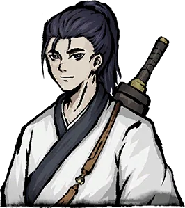
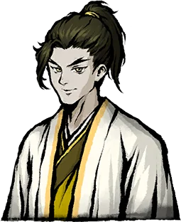
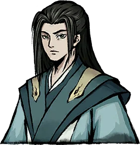
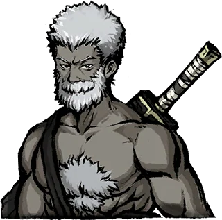
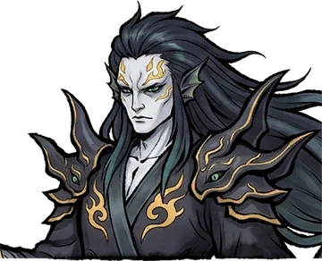
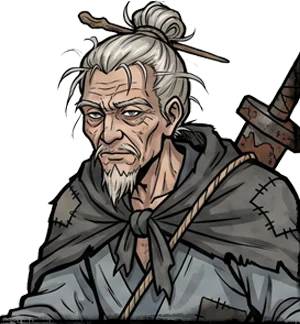
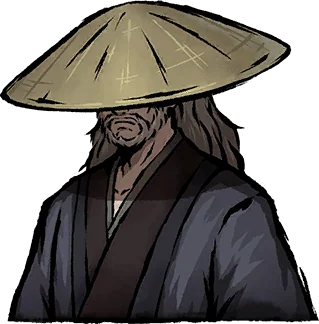
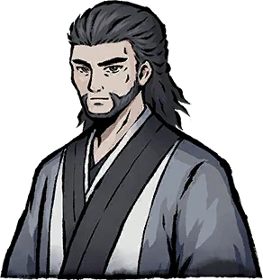

# 【卡牌修仙传】图鉴攻略 — 人物

- 收录总数：20（游戏官方数据）
- 更新时间：2026-11-20 16:59

---

## 1. 赵子义

### 【 · 赵子义】

身份：玄剑阁弟子

初见地：无名村庄

主要活动范围：金陵城，雁荡城，玄剑阁

背景故事：因师兄失踪而前往无名村庄调查，得知师兄命丧妖兽巢穴后，发誓继承师兄志向：清除世间的妖王

（赵子义的支线从无名村庄开始）

---

## 2. 悦萱儿

### 【 · 悦萱儿】

身份：湖月城城主之女

初见地：灵兽谷

主要活动范围：湖月城

背景故事：作为湖月城未来城主，因湖月城的实力日渐衰落，而踏上寻找圣兽修炼之路，却在灵兽谷误触禁制被变成小灵狐

（悦萱儿的支线从湖月城/灵兽谷开始）

---

## 3. 慕容绛璃

### 【 · 慕容绛璃】

身份：清虚谷掌门关门弟子

初见地：金陵城或湖月城

主要活动范围：金陵城，湖月城，雁荡城

背景故事：身为清虚谷的关门弟子，但因常年在谷内不外出而性格胆小，此次下山是受师傅的秘托：寻找枯木道人

（慕容绛璃的支线从湖月城/古木幽森开始）

---

## 4. 武破岳

### 【 · 武破岳】

身份：武极门弟子

初见地：金陵城或雁荡城

主要活动范围：金陵城，雁荡城

背景故事：只是一名普通的武极门弟子，但对肉身成圣十分执着，为人憨厚且常与各位道友切磋

（武破岳的支线从金陵城/地火深洞开始）

---

## 5. 金不换

### 【 · 金不换】

身份：？？？

初见地：坊市

主要活动范围：坊市，醉仙阁，无字玉璧

背景故事：不知来历的一名散修，实力达到强悍的结丹期，在坊市里以逗低阶修士为乐趣，但有时却在醉仙阁醉酒。

（金不换的支线从坊市/醉仙阁开始）

---

## 6. 敖月

### 【 · 敖月】

身份：上古血脉之女

初见地：聚水漩涡

主要活动范围：聚水漩涡

背景故事：是上古龙族与人帝混血的后代，因有龙血在身，提前化形而遭到各修士的捕猎，所以藏于漩涡，对闯入漩涡之人都怀有强烈的敌意

（敖月的支线从聚水漩涡开始）

---

## 7. 李长歌

### 【 · 李长歌】

身份：玄剑阁弟子

初见地：碧潭瀑布。

主要活动范围：玄剑阁，雁荡城

背景故事：是保管玄剑阁秘钥的守护人之一，但被其师弟暗算而失去秘钥，而重伤与碧潭瀑布

（李长歌的支线从碧潭瀑布开始）

---

## 8. 执黑

### 【 · 执黑】

身份：雪隐宗弟子

初见地：天机棋盘。

主要活动范围：天机棋盘，雁荡城

背景故事：执黑乃师门一脉中的年纪最小者，但却被师傅授予的秘传：刺杀术，引得师兄师姐一路追杀，最后藏身于天机棋盘

（执黑的支线从天机棋盘开始）

---

## 9. 柳昭昭

### 【 · 柳昭昭】

身份：醉仙阁歌女

初见地：醉仙阁。

主要活动范围：醉仙阁

背景故事：原是富家豪门的小姐，但家道中落而沦为歌女，但意外的有极高的修仙资质。

（柳昭昭的支线从醉仙阁开始）

---

## 10. 苏软软

### 【 · 苏软软】

身份：兽王府弟子

初见地：金陵城。

主要活动范围：金陵城

背景故事：兽王府的普通弟子，因喜爱灵兽所以游历世界，目标是找到全世界的所有灵兽

（苏软软的支线从金陵城开始）

---

## 11. 神秘高手

### 【 · 神秘高手】

身份：散修

初见地：醉仙阁或地火深洞

主要活动范围：醉仙阁，地火深洞

背景故事：一名在地火深洞修炼的武修修士，嗜酒如命，而他的真实姓名，似乎很少人知道

（神秘高手的支线从地火深洞开始）

---

## 12. 白璎

### 【 · 白璎】

身份：曦和白猁化形

初见地：金陵城上方的妖兽巢穴（兽态）

主要活动范围：整片大洲

背景故事：虽然是元婴期的妖王，但实力较弱，又因是阳属性妖王，经常被追杀

（白璎的支线从金陵城上方的妖兽巢穴开始）

---

## 13. 收藏家

### 【 · 收藏家】

身份：？？？

初见地：鬼市

主要活动范围：？？？

背景故事：？？？

---

## 14. 霜螭

### 【 · 霜螭】

身份：？？？

初见地：无名村庄（筑基期后）

主要活动范围：？？？

背景故事：？？？

---

## 15. 乞丐修士

### 【 · 乞丐修士】

一名衣衫褴褛的....乞丐修士？和他对话了解背后故事。

（游戏图鉴里没有这个人物；他是大地图上的奇遇，花 100 灵石可以向他买一个秘闻。）

---

## 16. 蒙面人

### 【 · 蒙面人】

神秘的蒙面人，元婴期的魔修，认为修士把天地灵气都吸进体内害了无数生灵，所以专门猎杀修士。

加入魔道之后，可以向他献祭一个活人换取魔修功法、秘钥和〈万魂幡图纸〉。

（游戏图鉴里没有这个人物。）

---

## 17. 温明德

### 【 · 温明德】

一名剑术高超的散修，他正在寻找木属性的灵兽或者灵兽神魄。

此角色由内测玩家「瑞」设计。（游戏图鉴里没有这个人物。）

---

## 18. 曦和白猁

### 【 · 曦和白猁】

我曾帮助它找回丢失的孩子！现在又遇见它了。

它对待人类较为友善，如果我有善缘的话.....

（游戏图鉴里没有这个人物。）

---

## 19. 幽姨

### 【 · 幽姨】

主线回忆里护着苏怜烟的结丹期修士。（游戏图鉴里没有这个人物。）

---

## 20. 古碑龟

### 【 · 古碑龟】

不知其年岁的龟妖王，奇特的是它背负着一个古碑，上面似乎写着一些文字。（游戏图鉴里没有这个人物。）

---
