# 【卡牌修仙传】图鉴攻略 — 任务道具

- 收录总数：88（游戏官方数据）
- 更新时间：2026-11-20 16:59

---

## 1. 奇怪的地方

站在此处，我能感受到空气涌进身体，十分怪异。

类型：任务卡

### 【获取途径 / 用途】

怎么来：开局剧情：点主角卡「这是何处？」

---

## 2. 半掩的鼎炉

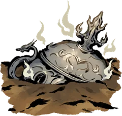

土里半掩埋着一个鼎炉，混乱的气流便是从鼎炉和土地之间的缝隙里涌出来的。

类型：任务卡

### 【获取途径 / 用途】

怎么来：开局剧情：把主角拖到〈奇怪的地方〉上（「奇怪的地方」）

---

## 3. 伤口

我在挖鼎炉的时候，不小心划伤了手臂，一股淡淡的血腥味散在空气里。只好静静地等待它散去。

(不过怎么有不祥的预感萦绕在心头？)

类型：任务卡

### 【获取途径 / 用途】

怎么来：开局剧情：把主角拖到〈半掩的鼎炉〉上（「挖出鼎炉」）

---

## 4. 一道身影

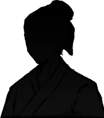

在前往山脉的途中，我远远的看到了一个身影；可能是我的错觉吧，这道人影似乎在追赶我？

类型：任务卡

### 【获取途径 / 用途】

怎么来：开局剧情：点主角卡「前往远处的山」

---

## 5. 前往村庄的路

老人所在的村庄正在寻找修士帮忙！于是老人把前往村庄的道路告诉了我。

放入调查工作台可探索出村庄的位置

类型：任务卡

### 【获取途径 / 用途】

怎么来：击败「老人」（出现在「金陵城」）

怎么来：「老人」的计时结束（成功抵御）

怎么来：和「老人」对话

---

## 6. 兽影

发现有妖兽跟在我的身后，我需要做好战斗准备！

类型：任务卡

### 【获取途径 / 用途】

怎么来：开局剧情：点主角卡「前往远处的山」

---

## 7. 炎狮

虽然凶猛，但代表正义，不会攻击凡人或弱小之物。

(品质提升至天品以上，激活技能)

类型：任务卡

### 【获取途径 / 用途】

怎么来：新手教学：在炼制工作台「炼化灵兽」放入〈灵兽神魄〉 + 〈内丹〉 + 〈兽血〉

用在哪：交给「师傅」可以听到相关的对话（没有奖励）

---

## 8. 大道

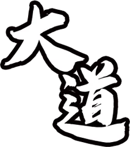

从炼气到大乘的所有修为积淀

类型：任务卡

### 【获取途径 / 用途】

怎么来：第 1 步：故事模式最后的「回忆：故事终焉」里，把主角（萧枕墨）拖到「师傅」身上听完真相，他化成〈师傅（魔）〉 → 击败他

怎么来：第 2 步：进入「回忆：天门」，把〈萧枕墨〉（主角）放到「天门？」上 → 天地认同你击败了大乘期修士，开启天门 → 得到〈命运〉和〈大道〉

用在哪：结局：拿齐〈大道〉〈七情六欲〉〈过往〉后，〈命运〉打开「前方是何路？」，把想保留的卡放进「选择」格；保留哪几张决定 7 种结局（见【玩法机制】结局）

---

## 9. 七情六欲

七情是心之所感，六欲是身之所求，合为世人难逃的情与念。

类型：任务卡

### 【获取途径 / 用途】

怎么来：先在「回忆：天门」开启天门（见〈大道〉）

怎么来：从天门走第二段回忆：师傅如父 → 情同手足 → 好友重逢 → 情窦初开，在「回忆：情窦初开」地上拿到〈七情六欲〉

用在哪：结局：拿齐〈大道〉〈七情六欲〉〈过往〉后，〈命运〉打开「前方是何路？」，把想保留的卡放进「选择」格；保留哪几张决定 7 种结局（见【玩法机制】结局）

---

## 10. 过往

指尖流沙、眸中残梦，皆为已逝的前尘岁月也

类型：任务卡

### 【获取途径 / 用途】

怎么来：先在「回忆：天门」开启天门（见〈大道〉）

怎么来：从天门走第一段回忆：村庄 → 曼珠沙华花开 → 柴房内 → 山上 → 比武 → 入世 → 命途，在「回忆：命途」地上拿到〈过往〉

用在哪：结局：拿齐〈大道〉〈七情六欲〉〈过往〉后，〈命运〉打开「前方是何路？」，把想保留的卡放进「选择」格；保留哪几张决定 7 种结局（见【玩法机制】结局）

---

## 11. 异宝

把此卡牌交给乞丐修士，可以获知一份异宝的图纸(自选)。

类型：任务卡

### 【获取途径 / 用途】

怎么来：和「乞丐修士」对话，花 100 灵石

用在哪：交给「乞丐修士」，换来 〈容器图纸〉

---

## 12. 圣兽

把此卡牌交给乞丐修士，可以获知一只圣兽的名字(自选)。

类型：任务卡

### 【获取途径 / 用途】

怎么来：和「乞丐修士」对话，花 100 灵石

用在哪：交给「乞丐修士」，换来 〈鲲的分身〉、〈三头凶蛟的分身〉、〈白龙的分身〉、〈九尾天狐的分身〉

---

## 13. 秘境

把此卡牌交给乞丐修士，可以获知一处秘境的传闻(随机)。

类型：任务卡

### 【获取途径 / 用途】

怎么来：和「乞丐修士」对话，花 100 灵石

用在哪：交给「乞丐修士」可以听到相关的对话（没有奖励）

---

## 14. 大妈的请求

大妈的女儿疑似跑去远处的山脚下，求救于我去把她带回来。

我需要把这张卡先放进山脚，然后再进行探索。

类型：任务卡

### 【获取途径 / 用途】

怎么来：和「着急的大妈」对话（在「无名村庄」）

用在哪：交给「着急的大妈」可以听到相关的对话（没有奖励）

---

## 15. 大妈的发带

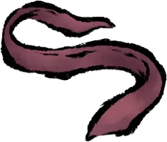

找到小女孩后，将发带出示给小女孩，这样小女孩才会相信你。

当获得小女孩信任后，把小女孩堆叠在主角上可以一起返回村庄

类型：任务卡

### 【获取途径 / 用途】

怎么来：和「着急的大妈」对话（在「无名村庄」）

用在哪：拖到〈走失的小女孩〉上，就能拿走它

---

## 16. 大妈的首饰

我将大妈的女儿安全的带回村里，大妈把她首饰都送给我了！

可我是修道中人，凡物对我无多大用处，不如找个商人卖了换点灵石。

类型：任务卡

### 【获取途径 / 用途】

怎么来：把〈走失的小女孩〉给「着急的大妈」（在「无名村庄」）

---

## 17. 村长的请求

村长请求我去妖兽巢穴消灭坟蛊鸪

把此任务卡和主角卡堆叠在一起，进入妖兽巢穴，将会进入任务场景！

类型：任务卡

### 【获取途径 / 用途】

怎么来：和「村长」对话（在「无名村庄」）

用在哪：交给「村长」，完成任务【请求】「完成"无名村庄"村长的请求」，换来 〈深山山顶路线〉、〈大块灵石天品〉

---

## 18. 坟蛊鸪的头颅

坟蛊鸪的头颅。

把此卡牌和村长的请求堆叠在一起其交给村长。

类型：任务卡

### 【获取途径 / 用途】

怎么来：击败「坟蛊鸪」（出现在「水龙卷」/「妖王聚集地」）

用在哪：交给「村长」，完成任务【请求】「完成"无名村庄"村长的请求」，换来 〈深山山顶路线〉、〈大块灵石天品〉

---

## 19. 大块灵石

一大块灵石，但品质一般

商人无法收购大型灵石，村长告诉我只能到金陵城的玄机阁掌柜处出售此灵石。

咦,怎么有一大块灵石矿在房子里？；卖给城市里的商店，应该有不少钱！

在金芒矿发现了一大块的灵石矿；卖给城市里的商店，应该有不少钱！

类型：任务卡

### 【获取途径 / 用途】

怎么来：把〈村长的请求〉 + 〈坟蛊鸪的头颅〉给「村长」（在「无名村庄」）

---

## 20. 正

我认为蒙面人为了大多数的生灵着想，是正义之举

类型：任务卡

### 【获取途径 / 用途】

怎么来：和「蒙面人」对话（在「金陵城」）

用在哪：交给「蒙面人」可以听到相关的对话（没有奖励）

---

## 21. 住处位置

神秘人告诉我，他的住处在雁荡城左侧柱子下的山洞里，找到他的住处也是一次考验。

找到雁荡城的房子后，把此卡牌交还给蒙面人以获得奖励。

类型：任务卡

### 【获取途径 / 用途】

怎么来：和「蒙面人」对话（在「金陵城」）

用在哪：交给「蒙面人」，换来 〈秘钥〉

---

## 22. 半截黑伞

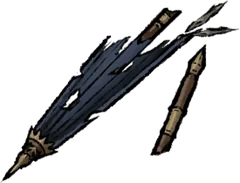

醉仙阁里遗留的半截黑伞，仍有少量灵气萦绕。也许我该找到黑伞的主人，TA应该离此地不远

伞柄上刻着字迹：顾杳杳法宝初作。

此卡牌由内测玩家：月老设计

类型：任务卡

### 【获取途径 / 用途】

怎么来：和「半截黑伞」对话（在「醉仙阁」），获得

用在哪：交给「庄兰台」，换来 〈一把黑伞〉

---

## 23. 一把黑伞

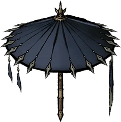

庄兰台消失后留下的黑伞，我可以去哪里打听黑伞的来源呢？

类型：任务卡

### 【获取途径 / 用途】

怎么来：把〈半截黑伞〉给「庄兰台」（在「金陵城」）

---

## 24. 应

答应赵子义的邀请。

(答应后，赵子义不再出现直到完成任务)

类型：任务卡

### 【获取途径 / 用途】

怎么来：和「赵子义」对话

用在哪：交给「赵子义」，完成任务【赵子义】「"应"赵子义的邀请(北海巨妖)」，换来 〈赵子义的邀请〉

---

## 25. 辞

推辞赵子义的邀请。

(暂时推辞赵子义的邀请，不会影响任务进度，也不会影响好感度)

类型：任务卡

### 【获取途径 / 用途】

怎么来：和「赵子义」对话

用在哪：交给「赵子义」可以听到相关的对话（没有奖励）

---

## 26. 赵子义的邀请

赵子义留下的信号，我需要在铁骨熊消失前赶往十万大山。

十万大山位于州原的西北方上。

把此任务卡和主角卡堆叠在一起，进入十万大山，将会进入任务场景！

完成后把此卡交还给赵子义，获得好感。

赵子义留下的信号，我需要在海上找到地点：龙卷水或聚水漩涡。

龙卷水或聚水漩涡属于奇遇地点，在海上御剑飞行时有概率遇见。

把此任务卡和主角卡堆叠在一起进入地点，将会进入任务场景！

赵子义留下的信号，我需要前往金陵城北边的妖兽巢穴

把此任务卡和主角卡堆叠在一起，进入妖兽巢穴，将会进入任务场景！

类型：任务卡

### 【获取途径 / 用途】

怎么来：把〈应〉给「赵子义」

用在哪：交给「赵子义」（会被收走）

---

## 27. 沾血的信

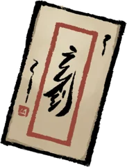

血字：在下李长歌，因师弟觊觎我保管的藏经阁秘钥，伙同魔教中人将我击晕并抢走秘钥；时间紧迫，我只能独自追踪希望能夺回秘钥，以回宗门请罪

无论你是谁，如果你看到这封信，证明我已身亡，请将此信转达玄剑阁长老

李长歌绝笔。

类型：任务卡

### 【获取途径 / 用途】

怎么来：和「李长歌（死亡）」对话（把主角拖到TA身上）

用在哪：交给「玄剑阁长老」，完成任务【李长歌】「把李长歌的绝笔信交给玄剑阁长老」、【李长歌】「李长歌的秘钥(完成)」，换来 〈灵脉之躯绝品〉

---

## 28. 无名灵兽崽

把灵兽崽带回给苏软软，这只灵兽有点怪，我应该单独问问她。

把灵兽崽带回给苏软软

类型：任务卡

### 【获取途径 / 用途】

怎么来：击败「无名灵兽崽」（出现在「金陵城」/「月照之地」）

怎么来：完成「无名灵兽崽」（在「金陵城」）的心愿：交给TA 〈翠茸仙糕〉（和「后厨小孩」对话（在「醉仙阁」），花 50 灵石）

怎么来：完成「无名灵兽崽」（在「月照之地」）的心愿

用在哪：交给「苏软软」，完成任务【苏软软】「帮助苏软软找到丢失的灵兽崽(位于金陵城内)」、【苏软软】「发现苏软软的所有幼崽(一共3只)」，换来 〈妖王内丹〉

---

## 29. 清云猞猁

把灵兽崽交还给哭泣的无名妖王！

类型：任务卡

### 【获取途径 / 用途】

怎么来：把〈苏软软〉给「哭泣的无名妖王」（在「妖兽巢穴」）

用在哪：交给「哭泣的无名妖王」，完成任务【苏软软】「把清云猞猁交给哭泣的妖王」、【苏软软】「"捡来"的灵兽崽(完成)」，换来 〈本源兽魄〉、〈碧潭瀑布传闻〉

---

## 30. 照顾灵草

由于我帮慕容绛璃收集到一本心法，她愿意帮我照顾灵草(灵田工作台)

把此卡牌拖给慕容绛璃，她将会变成可以帮我照顾灵药的卡牌

(当慕容绛璃照顾灵草时，将无法在其他地方刷新，直到把灵草收集)

类型：任务卡

### 【获取途径 / 用途】

怎么来：和「慕容绛璃」对话

用在哪：交给「慕容绛璃」，换来 〈慕容绛璃〉

---

## 31. 慕容绛璃

(此卡牌只能帮忙照顾灵田，无法战斗，卡牌消失后可重新召唤)

类型：任务卡

### 【获取途径 / 用途】

怎么来：带着〈照顾灵草〉和「慕容绛璃」对话，获得

---

## 32. 沾染白龙气息的发带

发带上沾染了圣兽：白龙的气息，我需要把发带交还给湖月城的悦萱儿

类型：任务卡

### 【获取途径 / 用途】

怎么来：把〈悦萱儿的发带〉给「白龙的分身」（在「十万大山深处」）

用在哪：交给「悦萱儿」，完成任务【悦萱儿】「把沾染白龙气息的发带交还给悦萱儿」，换来 〈悦萱儿的发带〉

---

## 33. 沾染鲲气息的发带

发带上沾染了圣兽：鲲的气息，我需要把发带交还给湖月城的悦萱儿

类型：任务卡

### 【获取途径 / 用途】

怎么来：把〈悦萱儿的发带〉给「鲲的分身」（在「圣兽：鲲」）

用在哪：交给「悦萱儿」，完成任务【悦萱儿】「把沾染鲲气息的发带交还给悦萱儿」，换来 〈悦萱儿的发带〉

---

## 34. 沾染凶蛟气息的发带

发带上沾染了圣兽：三头凶蛟的气息，我需要把发带交还给湖月城的悦萱儿

类型：任务卡

### 【获取途径 / 用途】

怎么来：把〈悦萱儿的发带〉给「三头凶蛟的分身」（在「凶兽：三头凶蛟」）

用在哪：交给「悦萱儿」，完成任务【悦萱儿】「把沾染凶蛟气息的发带交还给悦萱儿」，换来 〈悦萱儿的发带〉

---

## 35. 奇怪的信

奇怪的人掉的信竟然还用法力封印了；只有元婴期的修士才能解开

我应该拿给悦家家主看

类型：任务卡

### 【获取途径 / 用途】

怎么来：击败「奇怪的人」（出现在「湖月城」）

用在哪：交给「悦家家主」，完成任务【悦萱儿】「接受悦家家主的请求」

---

## 36. 切磋

武破岳邀请我切磋。

(答应后，武破岳会暂时变成敌对卡牌，战胜后恢复)

类型：任务卡

### 【获取途径 / 用途】

怎么来：和「武破岳」对话

用在哪：交给「武破岳」可以听到相关的对话（没有奖励）

---

## 37. 跟我走

找到可锻体的〔火〕秘境，邀请武破岳跟自己前往。

(此卡牌给武破岳后，武破岳会暂时变成可控)

类型：任务卡

### 【获取途径 / 用途】

怎么来：和「武破岳」对话

用在哪：交给「武破岳」可以听到相关的对话（没有奖励）

---

## 38. 问剑！

问剑

问剑是玄剑阁独有的选拔弟子的仪式，当完成3层问战挑战后，将可以加入玄剑阁！

每层都有一名守关的玄剑阁弟子，战胜TA便能继续往上挑战！

如果你找到玄剑阁的推荐信，那也可以跳过问剑流程！

类型：任务卡

### 【获取途径 / 用途】

怎么来：和「玄剑阁弟子」对话（在「问剑之路」）

用在哪：交给「玄剑阁弟子」可以听到相关的对话（没有奖励）

---

## 39. 加入玄剑阁

把此卡牌交给华夫人，从此便加入了玄剑阁

类型：任务卡

### 【获取途径 / 用途】

怎么来：和「华夫人」对话（在「玄剑阁」）

用在哪：拖到〈华夫人〉上，换来 〈玄剑阁〉

---

## 40. 宗门叛徒

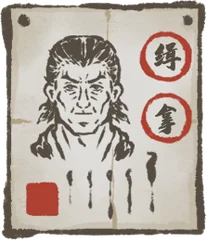

我得知了叛徒的相貌，把此卡牌放入调查工作台即可找到此人。

类型：任务卡

### 【获取途径 / 用途】

怎么来：和「宗门叛徒」对话（在「玄剑阁」），获得

---

## 41. 大量骸骨

在灵土堆附近发现了一处大量骸骨的地方；这应该是有一只极为凶残的妖兽造成的。

类型：任务卡

### 【获取途径 / 用途】

怎么来：在「凝土墟(小)」「探索凝土墟」、在「凝土墟(小)」「派出灵兽」 等 3 种

怎么来：在「凝土墟」「探索凝土墟」、在「凝土墟」「派出灵兽」 等 3 种

---

## 42. 血衣

在战场发现一件物品，在它的表面上残留着强大的怨念。

放入调查工作台调查背后故事

受亡人所托，带去给他的父亲。

类型：任务卡

### 【获取途径 / 用途】

怎么来：在「修士战场」「探索战场」放入 〈机缘〉或〈善缘〉、在「修士战场」「探索战场」

怎么来：和「无名灵体」对话

用在哪：交给「老人」，换来 〈思绪〉

---

## 43. 断剑（下）

一把断剑，从剑身处断裂。但剑身依然保存有一定的灵力，我应该调查此剑？

一把断剑，从剑身处断裂，剑尖上面刻有玄剑阁三个字。

(主角携带此卡进入妖兽巢穴，可直接发现鬼面蛛)

剑上抽离出怒意，我应该调查怒意，方能更深入了解此剑。

类型：任务卡

### 【获取途径 / 用途】

怎么来：在「妖兽巢穴」地图上直接出现（点它 / 和它互动就能拿到）

用在哪：交给「无名灵体」，完成任务【赵子义】「把"断剑"给无名灵体」，换来 〈断剑（下）〉

用在哪：交给「赵子义」，完成任务【赵子义】「调查"断剑"」、【赵子义】「把"断剑"给赵子义查看(可选做)」，换来 〈断剑（下）〉、〈一股怒意〉

---

## 44. 断剑（上）

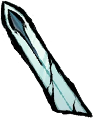

无名灵体生前的佩剑，但只剩下剑柄端了！

把断剑上和断剑下堆叠后，交给村庄里的赵子义吧！

类型：任务卡

### 【获取途径 / 用途】

怎么来：把〈鬼面蛛的脑袋〉给「无名灵体」

用在哪：交给「赵子义」，完成任务【赵子义】「子义寻兄(完成)」、【赵子义】「结交赵子义」，换来 〈赵子义的神念〉

---

## 45. 鬼面蛛的脑袋

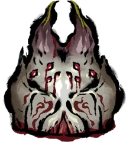

鬼面蛛的脑袋，将其交给无名灵体。

类型：任务卡

### 【获取途径 / 用途】

怎么来：击败「鬼面蛛」（出现在「妖王聚集地」）

用在哪：交给「无名灵体」，完成任务【赵子义】「把头颅交给"无名灵体"」，换来 〈断剑（上）〉

---

## 46. 一股怒意

当断剑接触到兽血的一瞬间，剑身颤抖不已，一股怒意从中迸发而出，随后消散往远处的墓碑聚拢而去。

类型：任务卡

### 【获取途径 / 用途】

怎么来：把〈断剑（下）〉给「赵子义」

怎么来：在线索卡「断剑（下）」里放入 〈兽血地品〉

---

## 47. 鱼

生活在极寒潭底的鱼，实在是奇怪

此卡牌由内测玩家：王宁心设计

竟然生活在火山的熔岩里的鱼，实在是奇怪

类型：任务卡

### 【获取途径 / 用途】

怎么来：在「潭底」地图上直接出现（点它 / 和它互动就能拿到）

怎么来：在「天地熔炉」地图上直接出现（点它 / 和它互动就能拿到）

用在哪：放进培养工作台「鱼?」

---

## 48. 李长歌的密信

信中潦草的写着：他们接头的房子在金陵城。

(主角携带此卡牌进入金陵城，触发李长歌任务)

(注意：本任务只有一次进入机会)

类型：任务卡

### 【获取途径 / 用途】

怎么来：和「李长歌（受伤）」对话

---

## 49. 傲月的请求

位于聚水漩涡的傲月请求我赠予她一个珠子法宝：定海。

完成任务后，把此请求交还给傲月以获取奖励。

类型：任务卡

### 【获取途径 / 用途】

怎么来：和「敖月」对话

用在哪：交给「敖月」，换来 〈寒冰咒〉

---

## 50. 悦萱儿的发带

悦萱儿给的发带，需要在遇到以下圣兽时:

十万大山的白龙

海上的鲲

行踪不定的三头巨蛟

当遇到圣兽后，用发带触碰圣兽收集位置信息，回湖月城告诉悦萱儿。

类型：任务卡

### 【获取途径 / 用途】

怎么来：和「悦萱儿」对话

怎么来：把〈沾染白龙气息的发带〉，或〈沾染鲲气息的发带〉，或〈沾染凶蛟气息的发带〉给「悦萱儿」

用在哪：交给「鲲的分身」（会被收走），完成任务【悦萱儿】「找到位于海上的鲲」，换来 〈沾染鲲气息的发带〉

用在哪：交给「白龙的分身」（会被收走），完成任务【悦萱儿】「找到位于十万大山的白龙」，换来 〈沾染白龙气息的发带〉

用在哪：交给「三头凶蛟的分身」（会被收走），完成任务【悦萱儿】「找到位于镇妖塔附近的三头凶蛟(结丹期方能完成)」，换来 〈沾染凶蛟气息的发带〉、〈三头凶蛟的分身神品〉

---

## 51. 你会说话?

虽然天狐的实力很恐怖，但他竟然能说话！？？

可以把此卡牌于天狐碰撞进行下一步的交流。

类型：任务卡

### 【获取途径 / 用途】

怎么来：和「九尾天狐的分身」对话（在「灵兽谷深处」）

用在哪：交给「九尾天狐的分身」，换来 〈询问飞升〉

---

## 52. 连忙道歉

天狐的实力远高于我，在这里认输并不是一件坏事。

可以把此卡牌于天狐碰撞进行下一步的交流。

类型：任务卡

### 【获取途径 / 用途】

怎么来：和「九尾天狐的分身」对话（在「灵兽谷深处」）

用在哪：交给「九尾天狐的分身」可以听到相关的对话（没有奖励）

---

## 53. 询问飞升

天狐已修练至合体期，距离飞升已不远，或许可从天狐口中一窥天道？

类型：任务卡

### 【获取途径 / 用途】

怎么来：把〈你会说话?〉给「九尾天狐的分身」（在「灵兽谷深处」）

用在哪：交给「九尾天狐的分身」，换来 〈询问修炼〉、〈天关魁？〉

---

## 54. 询问修炼

修仙世界，实力为尊。有幸遇到合体期的前辈，无论是人是妖，请教一番总是没错的。

类型：任务卡

### 【获取途径 / 用途】

怎么来：把〈询问飞升〉给「九尾天狐的分身」（在「灵兽谷深处」）

用在哪：交给「九尾天狐的分身」可以听到相关的对话（没有奖励）

---

## 55. 如何寻回记忆

元婴期的修士已经可以翻山填海，说不定天狐的实力能帮我找回记忆。

类型：任务卡

### 【获取途径 / 用途】

怎么来：把〈天关魁？〉给「九尾天狐的分身」（在「灵兽谷深处」）

用在哪：交给「九尾天狐的分身」可以听到相关的对话（没有奖励）

---

## 56. 天关魁？

（游戏里没有简介）

类型：任务卡

### 【获取途径 / 用途】

怎么来：把〈询问飞升〉给「九尾天狐的分身」（在「灵兽谷深处」）

用在哪：交给「九尾天狐的分身」，换来 〈如何寻回记忆〉

---

## 57. 天魂

代表先天良知与灵性本源，不生不灭，承载所有轮回记忆。

魂魄极易消散，我应该先回去塔底将其归位！(魂魄消失会导致本次任务无法完成)

类型：任务卡

### 【获取途径 / 用途】

怎么来：通关「镇妖塔七层」的奖励

---

## 58. 地魂

记录善恶业力与因果报应，属阴性能量。

魂魄极易消散，我应该先回去塔底将其归位！(魂魄消失会导致本次任务无法完成)

类型：任务卡

### 【获取途径 / 用途】

怎么来：通关「镇妖塔五层」的奖励

---

## 59. 人魂

与肉身和血脉相连，掌管七情六欲及现世记忆。

魂魄极易消散，我应该先回去塔底将其归位！(魂魄消失会导致本次任务无法完成)

类型：任务卡

### 【获取途径 / 用途】

怎么来：通关「镇妖塔三层」的奖励

---

## 60. 虚弱的赵子义

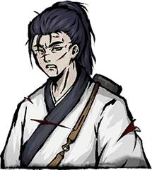

赵子义受的伤太重了，普通丹药对他无效

我应该将赵子义带回金陵城，交给玄剑阁的长老(位于某个房子的屋顶)。

(如果此赵子义卡牌消失，则赵子义永久死亡)

类型：任务卡

### 【获取途径 / 用途】

怎么来：奇遇「重伤的赵子义」

用在哪：交给「玄剑阁长老」，完成任务【赵子义】「把赵子义带回金陵城玄剑阁长老处！」

---

## 61. 易容中

我换了个模样，现在可以正常的进入各城市

当卡牌消失后，便恢复原来身份！(把此卡牌拖动给主角，可立即解除易容)

类型：任务卡

### 【获取途径 / 用途】

怎么来：把〈面具〉拖到主角身上

用在哪：拖到主角身上，可以看到主角的想法

---

## 62. 奇怪的符号

在我修炼了刺杀术之后，身上竟然多了一个奇怪的符号！

如果我再次遇到执黑，我应该要问清楚！

这是执黑设下的追踪符，在遭遇执黑师兄前来夺取心法时，执黑才能及时赶到

把执黑大师兄也击败后，再以此与执黑领取奖励。

类型：任务卡

### 【获取途径 / 用途】

怎么来：在修炼工作台「修炼」放入 〈刺杀术〉

用在哪：交给「执黑」 / 「重伤的执黑」，完成任务【执黑】「被追杀的执黑(完成)」、【执黑】「找到执黑，质问符号」，换来 〈一个黑棋〉、〈天机棋盘传闻〉

---

## 63. 需200寿元

把此卡牌拖动到房间的藏品里，可以拿走它！

注意：拿走藏品将花费200年寿元，如果寿元不足则主角会立刻死亡

类型：任务卡

### 【获取途径 / 用途】

怎么来：和「扶溟」对话（在「鬼市」）

怎么来：和「收藏家」对话（在「鬼市」）

用在哪：拖到〈聪慧绝伦〉 / 〈准：口诀〉 / 〈准：技能〉 / 〈准：炼丹〉 / 〈准：炼法宝〉 等 11 个上，换来 〈修改天道〉

用在哪：拖到〈吞天〉 / 〈玄霄神气〉 / 〈天眷福泽〉 / 〈一瞬明悟〉上，就能拿走它

---

## 64. 走失的小女孩

小女孩相信了我，我可以带她回到村子里。

(把小女孩堆叠在主角卡上进入村庄)

(我需要在限定时间里把小女孩送回去)

类型：任务卡

### 【获取途径 / 用途】

怎么来：在「山脚下」「寻找小女孩」放入 主角 + 〈神识〉

用在哪：交给「着急的大妈」，完成任务【请求】「完成"无名村庄"大妈的请求」，换来 〈大妈的首饰〉、〈金陵城〉、〈善缘神品〉

---

## 65. 重伤的冷无峰

（游戏里没有简介）

类型：任务卡

### 【获取途径 / 用途】

怎么来：击败「冷无峰」

---

## 66. 重伤的陆逸尘

（游戏里没有简介）

类型：任务卡

### 【获取途径 / 用途】

怎么来：击败「陆逸尘」

---

## 67. "乱灵阵"

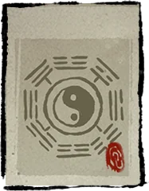

乱灵阵：一种阵法，利用法宝将某个区域的灵气扰乱，形成"浓雾"把人困住。

施法者越强大，"浓雾"的范围越广。

类型：线索

### 【获取途径 / 用途】

怎么来：剧情卡「"乱灵阵"」集齐线索后点「唤醒记忆」

用在哪：调查「奇怪的"雾"」时放入

---

## 68. 师弟：冷无峰

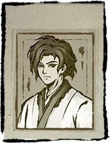

我的师弟冷无峰，也曾来过金陵城，也许会有其他人见过他

可以拿师弟的画像询问城里的修士，说不定会有所收获

类型：线索

### 【获取途径 / 用途】

怎么来：剧情卡「初至金陵」集齐线索后点「唤醒记忆」

用在哪：交给「紫霄殿精英」 / 「玄剑阁长老」 / 「袁白」 / 「神秘高手」（会被收走），完成任务【支线】「调查出师弟的下落」，换来 〈查清事实！〉

用在哪：交给「杨巅峰」、「庄兰台」、「玄剑阁执事」、「陆逸尘」 等 7 人可以听到相关的对话（没有奖励）

---

## 69. 抽干血的尸体

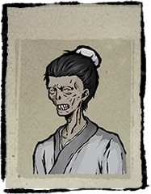

失踪的修士都是被一击毙命，而且抽干了血液

类型：线索

### 【获取途径 / 用途】

怎么来：剧情卡「调查金陵城」集齐线索后点「唤醒记忆」

用在哪：拖到主角身上，可以看到主角的想法

用在哪：调查「她的身份」时放入

---

## 70. 似曾相识

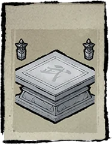

在踏入比武台的一刹那，我感觉我曾经来过这里，虽然建筑已经老化了不少，但我似乎认识这里的布局，想去哪里，脚步自然就迈开了。

类型：线索

### 【获取途径 / 用途】

怎么来：在「比武大会报名处」地图上直接出现（点它 / 和它互动就能拿到）

用在哪：拖到主角身上，可以看到主角的想法

用在哪：调查「参加比武」时放入

---

## 71. 紫衣女子

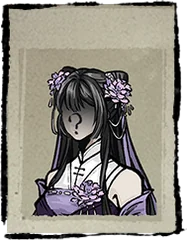

紫衣女子多次在我的回忆里出现，我需要知道她是谁！起码想记起她的名字。

我可以在金陵城向谁打听此女子呢？

类型：线索

### 【获取途径 / 用途】

怎么来：剧情卡「回忆：比武」集齐线索后点「唤醒记忆」

用在哪：交给「醉仙阁掌柜」（会被收走），完成任务【主线】「回想起紫衣女子的名字」

用在哪：交给「杨巅峰」、「庄兰台」、「玄剑阁执事」、「紫霄殿精英」 等 9 人可以听到相关的对话（没有奖励）

---

## 72. 年轻的陆逸尘

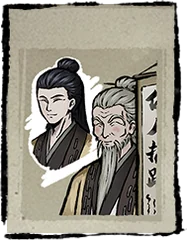

回忆里和比赛的陆逸尘，怎么和算命先生长得如此像？

我应该前去询问算命先生，他就在金陵城的某个地方。

在清芜夫人的证明下，算命先生就是我所认识的陆逸尘。这次，我已经有足够的证据去质问他！

类型：线索

### 【获取途径 / 用途】

怎么来：剧情卡「回忆：比武」集齐线索后点「唤醒记忆」

用在哪：交给「陆逸尘」，完成任务【支线】「与陆逸尘？第一次相认」

用在哪：交给「慕容绛璃」（会被收走），换来 〈隐世老祖〉

用在哪：交给「杨巅峰」、「庄兰台」、「玄剑阁执事」、「紫霄殿精英」 等 6 人可以听到相关的对话（没有奖励）

---

## 73. 隐世老祖

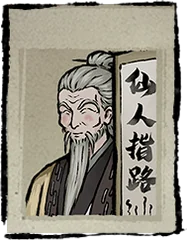

陆逸尘是清虚谷的隐世人物，据说在离开清虚谷的时候，境界已经达到了合体期

类型：线索

### 【获取途径 / 用途】

怎么来：把〈年轻的陆逸尘〉给「慕容绛璃」

用在哪：交给「陆逸尘」（会被收走），完成任务【支线】「与陆逸尘？第一次相认」，换来 〈证明身份〉

---

## 74. 无相殿

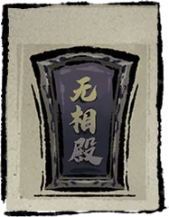

在比武的兽潮事件后，无相殿被认作"魔教"

前殿主名:苏惊雨，有一女：苏怜烟

类型：线索

### 【获取途径 / 用途】

怎么来：剧情卡「回忆：兽潮」集齐线索后点「唤醒记忆」

用在哪：拖到主角身上，可以看到主角的想法

用在哪：调查「查清事实！」时放入

用在哪：调查「她的身份」时放入

---

## 75. 凶手苏怜烟？

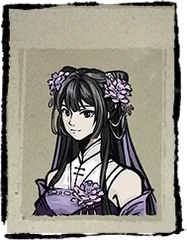

苏怜烟，是无相殿前殿主之女，目前被指控为杀害金陵城失踪修士的凶手

类型：线索

### 【获取途径 / 用途】

怎么来：剧情卡「她的身份」集齐线索后点「唤醒记忆」

用在哪：拖到主角身上，可以看到主角的想法

用在哪：调查「师傅的安排」时放入

---

## 76. 雁荡城战场

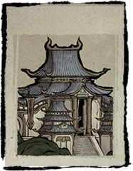

雁荡城是守护十万大山的屏障，也是十分适合隐匿的地方。

类型：线索

### 【获取途径 / 用途】

怎么来：在「雁荡城」地图上直接出现（点它 / 和它互动就能拿到）

用在哪：拖到主角身上，可以看到主角的想法

用在哪：调查「追踪魔教」时放入

---

## 77. 阴脉

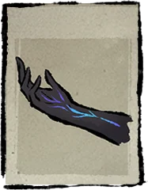

苏怜烟天生患有的阴脉，发作时全身冷如冰窖，身体覆盖冰霜；但曼珠沙华却能把冰霜吸收。

类型：线索

### 【获取途径 / 用途】

怎么来：剧情卡「绝境求生」集齐线索后点「唤醒记忆」

用在哪：拖到主角身上，可以看到主角的想法

用在哪：调查「凶手？」时放入

---

## 78. 送走的玩伴

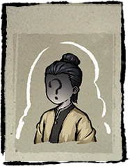

在清溪村，我的有一个玩伴叫陆逸尘，后来他被送到清虚谷。

如果可以，我需要找一个人来证明这件事。

类型：线索

### 【获取途径 / 用途】

怎么来：剧情卡「村子惨剧」集齐线索后点「唤醒记忆」

用在哪：交给「清芜夫人」 / 「无名骸骨」（会被收走），换来 〈小陆逸尘〉

---

## 79. 静心草？

静心草这味药似乎并不像其他的灵药一般，我该如何寻找静心草呢？或者可以找找一些人询问

把此卡牌与其他卡牌交互，即可询问线索！

类型：线索

### 【获取途径 / 用途】

怎么来：剧情卡「初窥筑基」集齐线索后点「完成事件」

用在哪：交给「贪玩的年轻人」、「年迈的老人」、「勤劳的农夫」、「玄剑阁弟子」 等 15 人可以听到相关的对话（没有奖励）

---

## 80. 沈砚秋

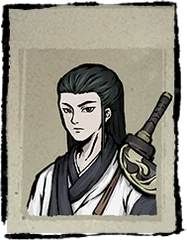

在我的记忆里，他是玄剑阁的修士，也许可以询问玄剑阁的人获得他的消息。

类型：线索

### 【获取途径 / 用途】

怎么来：剧情卡「森林对立」集齐线索后点「唤醒记忆」

怎么来：击败「沈砚秋」

用在哪：交给「玄剑阁长老」，换来 〈瀑布之战〉

---

## 81. 小六子

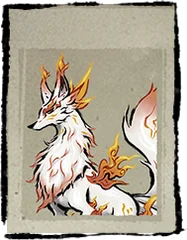

苏怜烟给当时的六尾灵狐取的名字。不知道我还能遇见它吗？也许它还记得我

类型：线索

### 【获取途径 / 用途】

怎么来：剧情卡「被追杀的灵狐」集齐线索后点「唤醒记忆」

用在哪：交给「九尾天狐的分身」（会被收走），完成任务【支线】「与九尾妖狐相认」，换来 〈瀑布之战〉

---

## 82. 同党是我？

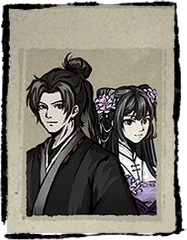

在一些回忆碎片里，我都和苏怜烟站在同一阵线.....莫非？

类型：线索

### 【获取途径 / 用途】

怎么来：剧情卡「对立」集齐线索后点「唤醒记忆」

怎么来：剧情卡「误会大了」集齐线索后点「唤醒记忆」

用在哪：拖到主角身上，可以看到主角的想法

用在哪：调查「同党？」时放入

---

## 83. 瀑布之战

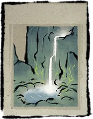

师弟与沈砚秋都是在碧潭瀑布里阵亡的.....当时我也在场吗？

类型：线索

### 【获取途径 / 用途】

怎么来：把〈沈砚秋〉给「玄剑阁长老」（在「金陵城」）

怎么来：把〈小六子〉给「九尾天狐的分身」（在「灵兽谷深处」）

怎么来：剧情卡「恢复伤口」集齐线索后点「唤醒记忆」

用在哪：拖到主角身上，可以看到主角的想法

用在哪：调查「何处遭遇？」时放入

---

## 84. 小陆逸尘

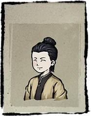

清芜长老向我证明了，清虚谷的陆逸尘，便是当年村里的玩伴！！！

类型：线索

### 【获取途径 / 用途】

怎么来：把〈送走的玩伴〉给「清芜夫人」

怎么来：把〈送走的玩伴〉给「无名骸骨」（在「冥狱地下十层」）

用在哪：交给「陆逸尘」（会被收走），完成任务【支线】「与陆逸尘？第一次相认」、【主线】「与陆逸尘第二次相认」

---

## 85. 第二朵花

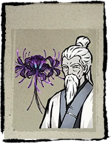

师弟告诉我，师傅拥有另一朵花！这是在清溪村获得的。

类型：线索

### 【获取途径 / 用途】

怎么来：剧情卡「瀑布激战」集齐线索后点「唤醒记忆」

用在哪：拖到主角身上，可以看到主角的想法

用在哪：调查「另有其人」时放入

---

## 86. 花的真正效果

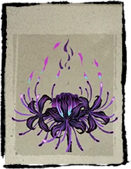

师傅曾向清芜长老请教曼珠沙华的事情。师傅已经知晓曼珠沙华的真正功效。

类型：线索

### 【获取途径 / 用途】

怎么来：把〈枯萎的曼珠沙华〉给「清芜夫人」

怎么来：把〈枯萎的曼珠沙华〉给「无名骸骨」（在「冥狱地下十层」）

用在哪：拖到主角身上，可以看到主角的想法

用在哪：调查「另有其人」时放入

---

## 87. "死因"

失踪的修士已经死亡，伤口不规则，并非常见利器所为

类型：线索

### 【获取途径 / 用途】

怎么来：带着〈尸体〉和「武极门高手」对话，有概率获得

怎么来：把〈玄剑阁高手〉交给「尸体」，有概率获得

怎么来：带着〈萧枕墨〉和「尸体」对话，有概率获得

---

## 88. "死状"

死亡的修士除了一处伤口外，全身的血液都被吸干了

类型：线索

### 【获取途径 / 用途】

怎么来：带着〈尸体〉和「武极门高手」对话，有概率获得

怎么来：把〈玄剑阁高手〉交给「尸体」，有概率获得

怎么来：带着〈萧枕墨〉和「尸体」对话，有概率获得

---
