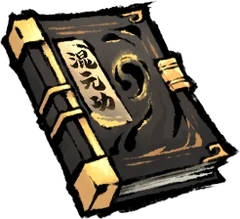
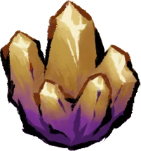
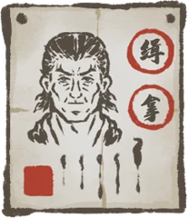

# 【卡牌修仙传】图鉴攻略 — 任务

- 收录总数：21（游戏官方数据）
- 更新时间：2026-11-18 17:00

---

## 1. 主线剧情

【剧情故事】主线：共 23 步（练气期 ~ 结丹期）

主角失忆后，一步步解开自己身份的剧情任务（游戏里【任务】面板不显示这一页，是剧情事件自动推进的）。

### 【任务步骤】

左边是做这一步时主角大概的境界；没写「后出现」的步骤，接在上一步后面。

练气：1. 解开「我的身份?」的答案

练气：2. 解开「我的名字是?」的答案

练气：3. 回想起曾经修炼的主心法

练气：4. 解开「奇怪的雾」的答案 —— 完成「解开「我的名字是?」的答案」后出现

筑基：5. 回想起与陆逸尘的关系 —— 完成「回想起曾经修炼的主心法」后出现

练气：6. 学习御剑飞行 —— 完成「回想起曾经修炼的主心法」后出现

练气：7. 御剑前往并进入金陵城

筑基：8. 回想起紫衣女子的名字 —— 完成「回想起曾经修炼的主心法」后出现

筑基：9. 参加一次比武并获得名次卡 —— 完成「御剑前往并进入金陵城」后出现

筑基：10. 解开「无名花朵」的答案 —— 完成「回想起紫衣女子的名字」后出现

筑基：11. 回想起紫衣女子的身份 —— 完成「回想起紫衣女子的名字」后出现

筑基：12. 回想起师傅的命令 —— 完成「参加一次比武并获得名次卡」后出现

筑基：13. 前往雁荡城寻找答案 —— 完成「解开「无名花朵」的答案」后出现

筑基：14. 回想起雁荡城的经过

筑基：15. 前往冥狱寻找答案

筑基：16. 回想起小时候的村庄

筑基：17. 回想起苏怜烟的秘密 —— 完成「前往冥狱寻找答案」后出现

结丹：18. 回想起与怜烟在古木幽森的经历

结丹：19. 回想起与怜烟在灵兽谷的经历 —— 完成「回想起苏怜烟的秘密」后出现

结丹：20. 回想起与怜烟在镇妖塔的经历 —— 完成「回想起苏怜烟的秘密」后出现

结丹：21. 与陆逸尘第二次相认 —— 完成【支线】「与陆逸尘？第一次相认」后出现

结丹：22. 回想起瀑布之战 —— 不用等前面的步骤，满足条件随时可以完成

结丹：23. 前往终焉之地

---

## 2. 剧情支线

【剧情故事】支线：共 13 步（练气期 ~ 结丹期）

主角失忆后，一步步解开自己身份的剧情任务（游戏里【任务】面板不显示这一页，是剧情事件自动推进的）。

### 【任务步骤】

左边是做这一步时主角大概的境界；没写「后出现」的步骤，接在上一步后面。

练气：1. 解开「持剑之人」的答案 —— 完成【主线】「解开「我的身份?」的答案」后出现

练气：2. 解开「炼器」的答案 —— 不用等前面的步骤，满足条件随时可以完成

练气：3. 解开「围攻」的答案 —— 不用等前面的步骤，满足条件随时可以完成

练气：4. 解开「灵草」的答案 —— 不用等前面的步骤，满足条件随时可以完成

练气：5. 解开「谁先御剑」的答案 —— 不用等前面的步骤，满足条件随时可以完成

练气：6. 解开「心魔」的答案 —— 不用等前面的步骤，满足条件随时可以完成

筑基：7. 调查出师弟的下落 —— 完成「解开「持剑之人」的答案」后出现

筑基：8. 与陆逸尘？第一次相认 —— 完成【主线】「回想起与陆逸尘的关系」后出现

筑基：9. 前往湖月城 —— 完成【主线】「学习御剑飞行」后出现

筑基：10. 发现湖月城小屋

结丹：11. 回想起与怜烟在无字玉璧的经历

结丹：12. 回想起与怜烟在碧潭瀑布的经历 —— 完成「发现湖月城小屋」后出现

结丹：13. 与九尾妖狐相认 —— 完成【主线】「回想起与怜烟在古木幽森的经历」后出现

---

## 3. 修炼之路·修炼

【修炼之路】修炼：共 32 步（练气期 ~ 元婴期）

修炼 / 炼器 / 炼丹 / 驭兽的教学任务，按顺序做能把各个工作台都用一遍。

### 【任务步骤】

左边是做这一步时主角大概的境界；没写「后出现」的步骤，接在上一步后面。

练气：1. 进行一次普通修炼

练气：2. 使用灵气进行修炼

练气：3. 使用混沌灵气进行修炼

练气：4. 修炼一次「混元功」 —— 完成【主线】「回想起曾经修炼的主心法」后出现

练气：5. 将思绪转化成悟道 —— 完成「进行一次普通修炼」后出现

练气：6. 领悟出新的心法 —— 完成「使用混沌灵气进行修炼」后出现

练气：7. 修炼心法领悟任意口诀 —— 完成「将思绪转化成悟道」后出现

练气：8. 修炼心法领悟任意技能 —— 完成「将思绪转化成悟道」后出现

练气：9. 修炼心法领悟任意天赋 —— 完成「将思绪转化成悟道」后出现

练气：10. 消除一次心魔 —— 不用等前面的步骤，满足条件随时可以完成

练气：11. 突破至筑基期 —— 完成「进行一次普通修炼」后出现

筑基：12. 领悟一本筑基期心法

筑基：13. 修炼筑基期神品心法

筑基：14. 将任意口诀提升至筑基期 —— 完成「修炼心法领悟任意口诀」后出现

筑基：15. 将任意技能提升至筑基期 —— 完成「修炼心法领悟任意技能」后出现

筑基：16. 成功抵御贪念！ —— 不用等前面的步骤，满足条件随时可以完成

筑基：17. 击败嗔念！ —— 不用等前面的步骤，满足条件随时可以完成

筑基：18. 成功抵御愚钝！ —— 不用等前面的步骤，满足条件随时可以完成

筑基：19. 成功度过悲伤！ —— 不用等前面的步骤，满足条件随时可以完成

筑基：20. 获得道途工作台（突破至筑基中期） —— 完成「突破至筑基期」后出现

筑基：21. 请教神秘人如何获得道（可选做）

筑基：22. 突破至结丹期 —— 完成「获得道途工作台（突破至筑基中期）」后出现

结丹：23. 在培养工作台修炼金丹

结丹：24. 在修炼工作台修炼金丹 —— 完成「突破至结丹期」后出现

结丹：25. 在月照之地修炼金丹

结丹：26. 在血红树（位于古木幽森）修炼金丹 —— 完成「在培养工作台修炼金丹」后出现

结丹：27. 在碧潭瀑布修炼金丹 —— 完成「在培养工作台修炼金丹」后出现

结丹：28. 在地火深洞修炼金丹 —— 完成「在培养工作台修炼金丹」后出现

结丹：29. 在无字玉璧修炼金丹 —— 完成「在修炼工作台修炼金丹」后出现

结丹：30. 在天地熔炉修炼金丹 —— 完成「在培养工作台修炼金丹」后出现

结丹：31. 渡劫！成功结婴！ —— 完成「突破至结丹期」后出现

元婴：32. 修炼他人的元婴

---

## 4. 修炼之路·炼器

【修炼之路】炼器：共 16 步（练气期 ~ 元婴期）

修炼 / 炼器 / 炼丹 / 驭兽的教学任务，按顺序做能把各个工作台都用一遍。

### 【任务步骤】

左边是做这一步时主角大概的境界；没写「后出现」的步骤，接在上一步后面。

练气：1. 使用灵气炼化出材料

练气：2. 使用任意材料炼制一次法宝

练气：3. 完美炼化一个神品内丹 —— 完成「使用灵气炼化出材料」后出现

练气：4. 提升一次法宝品质 —— 完成「使用任意材料炼制一次法宝」后出现

练气：5. 直接炼制出神品法宝 —— 完成「使用任意材料炼制一次法宝」后出现

练气：6. 重铸一次法宝 —— 不用等前面的步骤，满足条件随时可以完成

练气：7. 炼制出一具傀儡 —— 完成「使用任意材料炼制一次法宝」后出现

练气：8. 炼化一个绝品内丹 —— 完成「完美炼化一个神品内丹」后出现

筑基：9. 将一把法宝提升至筑基期 —— 完成「提升一次法宝品质」后出现

筑基：10. 炼化一个妖王内丹 —— 完成「完美炼化一个神品内丹」后出现

结丹：11. 修炼出本命物 —— 完成「将一把法宝提升至筑基期」后出现

筑基：12. 把一个法宝提升至绝品 —— 完成「将一把法宝提升至筑基期」后出现

筑基：13. 炼制出一个容器法宝 —— 不用等前面的步骤，满足条件随时可以完成

筑基：14. 恢复一把法宝/载具的耐久度 —— 不用等前面的步骤，满足条件随时可以完成

筑基：15. 炼制出载具 —— 不用等前面的步骤，满足条件随时可以完成

元婴：16. 炼制他人的元婴 —— 完成【修炼】「渡劫！成功结婴！」后出现

---

## 5. 修炼之路·炼丹

【修炼之路】炼丹：共 8 步（练气期 ~ 筑基期）

修炼 / 炼器 / 炼丹 / 驭兽的教学任务，按顺序做能把各个工作台都用一遍。

### 【任务步骤】

左边是做这一步时主角大概的境界；没写「后出现」的步骤，接在上一步后面。

练气：1. 培养一次灵草 —— 完成【修炼】「进行一次普通修炼」后出现

练气：2. 使用任意灵草炼制出丹药 —— 完成【修炼】「进行一次普通修炼」后出现

练气：3. 培养一次仙品灵草 —— 完成「培养一次灵草」后出现

练气：4. 直接炼制出神品丹药 —— 完成「使用任意灵草炼制出丹药」后出现

练气：5. 只使用丹药击杀一只妖兽 —— 完成「使用任意灵草炼制出丹药」后出现

筑基：6. 使用灵田种植灵草（需完成悦萱儿任务） —— 完成【历练】「前往湖月城」后出现

筑基：7. 种植一次绝品灵草 —— 完成【历练】「使用一次NPC的神念」后出现

筑基：8. 使用绝品灵草作为主药炼制丹药 —— 完成「使用任意灵草炼制出丹药」后出现

---

## 6. 修炼之路·驭兽

【修炼之路】驭兽：共 8 步（练气期 ~ 筑基期）

修炼 / 炼器 / 炼丹 / 驭兽的教学任务，按顺序做能把各个工作台都用一遍。

### 【任务步骤】

左边是做这一步时主角大概的境界；没写「后出现」的步骤，接在上一步后面。

练气：1. 将灵兽神魄炼制出灵兽 —— 完成【修炼】「进行一次普通修炼」后出现

练气：2. 把灵兽派去探索地点 —— 完成【修炼】「进行一次普通修炼」后出现

练气：3. 提升一次灵兽品质 —— 完成「将灵兽神魄炼制出灵兽」后出现

练气：4. 把一只灵兽提升至神品 —— 完成「将灵兽神魄炼制出灵兽」后出现

筑基：5. 将一只灵兽提升至筑基期

筑基：6. 驯服（完成灵兽需求）一只中立灵兽 —— 完成【探索】「发现秘境：灵兽谷」后出现

筑基：7. 将灵兽神魄炼制出稀有灵兽（需使用妖王内丹） —— 完成「将灵兽神魄炼制出灵兽」后出现

筑基：8. 将一只灵兽提升至绝品 —— 完成「把一只灵兽提升至神品」后出现

---

## 7. 江湖经历·历练

【江湖经历】历练：共 33 步（练气期 ~ 结丹期）

历练、探索秘境、人物请求、奇遇。

### 【任务步骤】

左边是做这一步时主角大概的境界；没写「后出现」的步骤，接在上一步后面。

练气：1. 发现并进入「无名村庄」

练气：2. 击杀10只妖兽

练气：3. 与一名其他角色对话

练气：4. 与其他人交换物品 —— 不用等前面的步骤，满足条件随时可以完成

练气：5. 用「神识卡」成功探查其他人 —— 不用等前面的步骤，满足条件随时可以完成

练气：6. 击败「嗔」心魔 —— 不用等前面的步骤，满足条件随时可以完成

练气：7. 招募一名其他门派的弟子供自己调遣 —— 不用等前面的步骤，满足条件随时可以完成

练气：8. 主角被击败1次 —— 不用等前面的步骤，满足条件随时可以完成

筑基：9. 前往金陵城

筑基：10. 前往湖月城

筑基：11. 前往雁荡城

筑基：12. 参加一次比武 —— 完成「前往金陵城」后出现

筑基：13. 获得魁首（筑基期）

筑基：14. 参加一次守卫雁荡城（每年累计概率触发） —— 完成「前往雁荡城」后出现

筑基：15. 成功守卫雁荡城

筑基：16. 使用一次NPC的神念 —— 完成「与一名其他角色对话」后出现

筑基：17. 进入古木幽森最深处 —— 完成【探索】「发现秘境：古木幽森」后出现

筑基：18. 清理地火深洞的所有妖兽 —— 完成【探索】「发现秘境：地火深洞」后出现

筑基：19. 在玉璧进行一次悟道 —— 完成【探索】「发现秘境：无字玉璧」后出现

筑基：20. 进入冥狱地下5层 —— 完成【主线】「前往冥狱寻找答案」后出现

筑基：21. 攻入镇妖塔最高层 —— 完成【探索】「发现秘境：镇妖塔」后出现

筑基：22. 在剑冢进行一次拔剑 —— 完成【探索】「发现秘境：剑冢」后出现

筑基：23. 使用一次「月照」工作台 —— 完成【探索】「发现秘境：月照之地」后出现

筑基：24. 使用一次「愈灵」工作台 —— 完成【探索】「发现秘境：碧潭瀑布」后出现

筑基：25. 使用一次「熔炉工作台」 —— 完成【探索】「发现秘境：天地熔炉」后出现

筑基：26. 使用一次「寻龙阵」 —— 完成【探索】「发现并进入：十万大山」后出现

结丹：27. 获得魁首（结丹期） —— 完成「获得魁首（筑基期）」后出现

结丹：28. 参加一次守卫雁荡城（结丹） —— 完成「参加一次守卫雁荡城（每年累计概率触发）」后出现

结丹：29. 进入古木幽森最深处（结丹） —— 完成「进入古木幽森最深处」后出现

结丹：30. 清理地火深洞的所有妖兽（结丹） —— 完成「清理地火深洞的所有妖兽」后出现

结丹：31. 进入冥狱地下10层 —— 完成「进入冥狱地下5层」后出现

结丹：32. 攻入镇妖塔最高层（结丹） —— 完成「攻入镇妖塔最高层」后出现

结丹：33. 在问道台战胜一次 —— 完成【探索】「发现秘境：聚水漩涡」后出现

---

## 8. 江湖经历·探索

【江湖经历】探索：共 16 步（练气期 ~ 筑基期）

历练、探索秘境、人物请求、奇遇。

### 【任务步骤】

左边是做这一步时主角大概的境界；没写「后出现」的步骤，接在上一步后面。

练气：1. 发现秘境：妖兽巢穴 —— 完成【历练】「发现并进入「无名村庄」」后出现

筑基：2. 发现秘境：月照之地 —— 完成【主线】「学习御剑飞行」后出现

筑基：3. 发现秘境：古木幽森 —— 完成【主线】「学习御剑飞行」后出现

筑基：4. 发现秘境：碧潭瀑布 —— 完成【主线】「学习御剑飞行」后出现

筑基：5. 发现秘境：地火深洞 —— 完成【主线】「学习御剑飞行」后出现

筑基：6. 发现秘境：无字玉璧 —— 完成【主线】「学习御剑飞行」后出现

筑基：7. 发现秘境：聚水旋涡 —— 完成【主线】「学习御剑飞行」后出现

筑基：8. 发现秘境：灵兽谷 —— 完成【主线】「学习御剑飞行」后出现

筑基：9. 发现秘境：镇妖塔 —— 完成【主线】「学习御剑飞行」后出现

筑基：10. 发现秘境：剑冢 —— 完成【主线】「学习御剑飞行」后出现

筑基：11. 发现秘境：天地熔炉 —— 完成【主线】「学习御剑飞行」后出现

筑基：12. 发现并进入：坊市 —— 完成【主线】「学习御剑飞行」后出现

筑基：13. 发现秘境：聚水漩涡 —— 完成【修炼】「突破至结丹期」后出现

筑基：14. 发现并进入：醉仙阁 —— 完成【主线】「御剑前往并进入金陵城」后出现

筑基：15. 发现秘境：天帝宝库 —— 不用等前面的步骤，满足条件随时可以完成

筑基：16. 发现并进入：十万大山 —— 完成【主线】「学习御剑飞行」后出现

---

## 9. 江湖经历·请求

【江湖经历】请求：共 8 步（练气期 ~ 筑基期）

历练、探索秘境、人物请求、奇遇。

### 【任务步骤】

左边是做这一步时主角大概的境界；没写「后出现」的步骤，接在上一步后面。

练气：1. 完成「无名村庄」村长的请求 —— 完成【历练】「发现并进入「无名村庄」」后出现

练气：2. 完成「无名村庄」大妈的请求 —— 完成【历练】「发现并进入「无名村庄」」后出现

练气：3. 完成「无名村庄」农夫的请求 —— 完成【历练】「发现并进入「无名村庄」」后出现

筑基：4. 完美完成「战场灵体」的请求 —— 完成【主线】「学习御剑飞行」后出现

筑基：5. 完成「镇妖塔灵体」的请求 —— 完成【探索】「发现秘境：镇妖塔」后出现

筑基：6. 完成庄兰台的请求 —— 完成【历练】「前往金陵城」后出现

筑基：7. 帮助杨巅峰 —— 不用等前面的步骤，满足条件随时可以完成

筑基：8. 帮助林衍 —— 完成【历练】「前往湖月城」后出现

---

## 10. 江湖经历·奇遇

【江湖经历】奇遇：共 22 步（筑基期 ~ 结丹期）

历练、探索秘境、人物请求、奇遇。

### 【任务步骤】

左边是做这一步时主角大概的境界；没写「后出现」的步骤，接在上一步后面。

筑基：1. 培养出因果 —— 不用等前面的步骤，满足条件随时可以完成

筑基：2. 炼制因果 —— 不用等前面的步骤，满足条件随时可以完成

筑基：3. 炼制因果 —— 不用等前面的步骤，满足条件随时可以完成

筑基：4. 炼制因果 —— 不用等前面的步骤，满足条件随时可以完成

筑基：5. 发现圣兽栖息地：九尾天狐 —— 不用等前面的步骤，满足条件随时可以完成

筑基：6. 发现圣兽栖息地：白龙 —— 不用等前面的步骤，满足条件随时可以完成

筑基：7. 发现圣兽栖息地：鲲 —— 不用等前面的步骤，满足条件随时可以完成

筑基：8. 发现圣兽栖息地：三头凶蛟 —— 不用等前面的步骤，满足条件随时可以完成

筑基：9. 获得心法：血煞剑魄 —— 不用等前面的步骤，满足条件随时可以完成

筑基：10. 找到偷偷进入天帝宝库的方法 —— 不用等前面的步骤，满足条件随时可以完成

结丹：11. 强攻天帝宝库！ —— 不用等前面的步骤，满足条件随时可以完成

筑基：12. 发现秘境：空间裂缝 —— 不用等前面的步骤，满足条件随时可以完成

筑基：13. 发现秘境：天机棋盘 —— 不用等前面的步骤，满足条件随时可以完成

筑基：14. 发现秘境：福地 —— 不用等前面的步骤，满足条件随时可以完成

筑基：15. 发现秘境：聚水漩涡 —— 不用等前面的步骤，满足条件随时可以完成

结丹：16. 炼制因果 —— 不用等前面的步骤，满足条件随时可以完成

结丹：17. 跟随九尾天狐修炼金丹 —— 不用等前面的步骤，满足条件随时可以完成

结丹：18. 跟随白龙修炼金丹 —— 不用等前面的步骤，满足条件随时可以完成

结丹：19. 跟随鲲修炼金丹 —— 不用等前面的步骤，满足条件随时可以完成

结丹：20. 跟随三头凶蛟修炼金丹 —— 不用等前面的步骤，满足条件随时可以完成

结丹：21. 跟随灵剑修炼金丹 —— 不用等前面的步骤，满足条件随时可以完成

筑基：22. 发现秘境：日陨坑 —— 不用等前面的步骤，满足条件随时可以完成

---

## 11. 赵子义的支线

【支线人物】赵子义：共 37 步（练气期 ~ 结丹期）

可以结交的人物各自的支线剧情。

### 【任务步骤】

左边是做这一步时主角大概的境界；没写「后出现」的步骤，接在上一步后面。

练气：1. 结交赵子义 —— 完成【历练】「发现并进入「无名村庄」」后出现

练气：2. 进入妖兽巢穴（达到练气中期后进行调查）

练气：3. 调查「断剑」

练气：4. 调查「一股怒意」

练气：5. 把「断剑」给无名灵体

练气：6. 把「断剑」给赵子义查看（可选做）

练气：7. 携带「断剑」进入巢穴，击杀鬼面蛛 —— 完成「把「断剑」给无名灵体」后出现

练气：8. 把头颅交给「无名灵体」

练气：9. 把断剑（上）和（下）交给赵子义

练气：10. 子义寻兄（完成）

筑基：11. 再遇赵子义

筑基：12. 「应」赵子义的邀请（铁骨熊）

筑基：13. 前往十万大山击杀铁骨熊

筑基：14. 等待赵子义归来（需要180天）

筑基：15. 「应」赵子义的邀请（北海巨妖）

筑基：16. 在海上发现水龙卷（可选）

筑基：17. 在海上发现聚水漩涡（可选） —— 完成「「应」赵子义的邀请（北海巨妖）」后出现

筑基：18. 败北海巨妖 —— 完成「「应」赵子义的邀请（北海巨妖）」后出现

筑基：19. 等待赵子义归来（需要180天）

筑基：20. 「应」赵子义的邀请（幽灵?）

筑基：21. 前往巢穴击败「幽灵?」

筑基：22. 等待赵子义归来（需要180天）

筑基：23. 赵子义的志向（完成）

筑基：24. 获得玄剑阁推荐信 —— 不用等前面的步骤，满足条件随时可以完成

结丹：25. 子义的任务？ —— 不用等前面的步骤，满足条件随时可以完成

结丹：26. 前往金陵城打听子义的去处

结丹：27. 前往十万大山妖王聚集地寻找赵子义

结丹：28. 救下重伤的赵子义

结丹：29. 把赵子义带回金陵城玄剑阁长老处！

结丹：30. 找到丹药救下赵子义

结丹：31. 寻找失落的赵子义（醉仙阁）

结丹：32. 寻找失落的赵子义（湖月城）

结丹：33. 寻找失落的赵子义（雁荡城）

结丹：34. 寻找失落的赵子义（无名村庄）

结丹：35. 击败山豹后，对话赵子义

结丹：36. 炼制一把白玉刚剑（结丹期）给赵子义

结丹：37. 赵子义的剑意（完成）

---

## 12. 悦萱儿的支线

【支线人物】悦萱儿：共 30 步（筑基期 ~ 结丹期）

可以结交的人物各自的支线剧情。

### 【任务步骤】

左边是做这一步时主角大概的境界；没写「后出现」的步骤，接在上一步后面。

筑基：1. 帮助湖月城管家（可选） —— 不用等前面的步骤，满足条件随时可以完成

筑基：2. 发现秘境：灵兽谷

筑基：3. 发现并对话奇怪的灵狐

筑基：4. 想办法和灵狐对话！

筑基：5. 成功解救灵狐，结交悦萱儿

筑基：6. 告知悦家家主悦萱儿已安全

筑基：7. 协助悦萱儿接触九尾天狐 —— 完成「成功解救灵狐，结交悦萱儿」后出现

筑基：8. 回湖月城找悦宣儿 —— 完成「告知悦家家主悦萱儿已安全」后出现

筑基：9. 找到位于十万大山的白龙

筑基：10. 把沾染白龙气息的发带交还给悦宣儿

筑基：11. 协助悦萱儿接触白龙

筑基：12. 找到位于海上的鲲 —— 完成「回湖月城找悦宣儿」后出现

筑基：13. 把沾染鲲气息的发带交还给悦宣儿

筑基：14. 协助悦萱儿接触鲲

筑基：15. 找到位于镇妖塔附近的三头凶蛟（结丹期方能完成） —— 完成「回湖月城找悦宣儿」后出现

筑基：16. 把沾染凶蛟气息的发带交还给悦宣儿

筑基：17. 协助悦萱儿接触凶蛟

筑基：18. 悦宣儿寻找圣兽（完成）

结丹：19. 把任意一个圣兽名字交予悦萱儿

结丹：20. 发现湖月城的异常！（要经过一段时间）

结丹：21. 如何处理奇怪的人？（对话赶走3次或击杀）

结丹：22. 发现3次奇怪的人（支线选择） —— 不用等前面的步骤，满足条件随时可以完成

结丹：23. 接受悦家家主/管家（在金陵城）的请求

结丹：24. 击杀奇怪的人（支线选择） —— 不用等前面的步骤，满足条件随时可以完成

结丹：25. 把奇怪的信交予悦家家主查看

结丹：26. 接受悦家家主的请求

结丹：27. 前往圣地 —— 完成「接受悦家家主/管家（在金陵城）的请求」后出现

结丹：28. 救下悦宣儿 —— 完成「接受悦家家主的请求」后出现

结丹：29. 告知悦家家主悦萱儿已安全

结丹：30. 湖悦城危机上（完成）

---

## 13. 慕容绛璃的支线

【支线人物】慕容绛璃：共 7 步（筑基期）

可以结交的人物各自的支线剧情。

### 【任务步骤】

左边是做这一步时主角大概的境界；没写「后出现」的步骤，接在上一步后面。

筑基：1. 结交慕容绛璃 —— 完成【支线】「前往湖月城」后出现

筑基：2. 获得慕容绛璃的好感

筑基：3. 发现秘境：古木幽森

筑基：4. 在古木幽森遇见慕容绛璃，并帮助她 —— 完成「获得慕容绛璃的好感」后出现

筑基：5. 寻得幽森密室

筑基：6. 成功调查石桌

筑基：7. 慕容绛璃的师命（一）（完成）

---

## 14. 武破岳的支线

【支线人物】武破岳：共 6 步（筑基期）

可以结交的人物各自的支线剧情。

### 【任务步骤】

左边是做这一步时主角大概的境界；没写「后出现」的步骤，接在上一步后面。

筑基：1. 结交武破岳 —— 完成【主线】「御剑前往并进入金陵城」后出现

筑基：2. 在其他秘境里与武破岳切磋，并且胜利

筑基：3. 武破岳有点不对劲？（切磋胜利3次）

筑基：4. 再遇武破岳...但是？

筑基：5. 战胜入魔的武破岳！

筑基：6. 入魔的武破岳（完成）

---

## 15. 金不换的支线

【支线人物】金不换：共 9 步（筑基期）

可以结交的人物各自的支线剧情。

### 【任务步骤】

左边是做这一步时主角大概的境界；没写「后出现」的步骤，接在上一步后面。

筑基：1. 结交金不换 —— 完成【探索】「发现并进入：坊市」后出现

筑基：2. 想办法拉近与金不换的关系

筑基：3. 请金不换喝酒（可拉近关系） —— 不用等前面的步骤，满足条件随时可以完成

筑基：4. 请金不换喝好酒（隐藏） —— 不用等前面的步骤，满足条件随时可以完成

筑基：5. 提升器道（隐藏）

筑基：6. 在无字玉璧获得金不换指点（可拉近关系） —— 不用等前面的步骤，满足条件随时可以完成

筑基：7. 拉近与金不换的关系（完成3次后和金不换对话） —— 完成「想办法拉近与金不换的关系」后出现

筑基：8. 给予金不换因果

筑基：9. 金不换的难言之隐（完成）

---

## 16. 敖月的支线

【支线人物】敖月：共 6 步（筑基期）

可以结交的人物各自的支线剧情。

### 【任务步骤】

左边是做这一步时主角大概的境界；没写「后出现」的步骤，接在上一步后面。

筑基：1. 发现秘境：聚水漩涡 —— 不用等前面的步骤，满足条件随时可以完成

筑基：2. 发现敖月，但？

筑基：3. 战胜敖月！

筑基：4. 结交敖月

筑基：5. 炼制出定海并交给敖月

筑基：6. 敖月的身世（完成）

---

## 17. 李长歌的支线

【支线人物】李长歌：共 12 步（筑基期）

可以结交的人物各自的支线剧情。

### 【任务步骤】

左边是做这一步时主角大概的境界；没写「后出现」的步骤，接在上一步后面。

筑基：1. 发现秘境：碧潭瀑布 —— 不用等前面的步骤，满足条件随时可以完成

筑基：2. 想办法救下重伤的修士

筑基：3. 结交李长歌

筑基：4. 按照密信位置前往金陵城帮助李长歌？

筑基：5. 战胜李长歌的师弟

筑基：6. 搜索尸体获得秘钥

筑基：7. 把秘钥还给李长歌？

筑基：8. 没有帮助李长歌 —— 不用等前面的步骤，满足条件随时可以完成

筑基：9. 找到李长歌

筑基：10. 把李长歌的绝笔信交给玄剑阁长老

筑基：11. 使用秘钥偷走一本玄剑阁心法 —— 不用等前面的步骤，满足条件随时可以完成

筑基：12. 李长歌的秘钥（完成）

---

## 18. 柳昭昭的支线

【支线人物】柳昭昭：共 5 步（筑基期）

可以结交的人物各自的支线剧情。

### 【任务步骤】

左边是做这一步时主角大概的境界；没写「后出现」的步骤，接在上一步后面。

筑基：1. 听柳昭昭唱歌 —— 完成【探索】「发现并进入：醉仙阁」后出现

筑基：2. 倾听柳昭昭的难处

筑基：3. 为柳昭昭赎身

筑基：4. 赠送柳昭昭一本心法

筑基：5. 歌姬柳昭昭（完成）

---

## 19. 执黑的支线

【支线人物】执黑：共 13 步（筑基期）

可以结交的人物各自的支线剧情。

### 【任务步骤】

左边是做这一步时主角大概的境界；没写「后出现」的步骤，接在上一步后面。

筑基：1. 结交执黑

筑基：2. 帮助执黑离开棋盘

筑基：3. 击败执黑四师兄或寻找受伤的执黑？

筑基：4. 得知执黑被追杀的缘由 —— 不用等前面的步骤，满足条件随时可以完成

筑基：5. 帮助执黑击败四师兄 —— 不用等前面的步骤，满足条件随时可以完成

筑基：6. 得知执黑被追杀的缘由 —— 不用等前面的步骤，满足条件随时可以完成

筑基：7. 获得并修炼：刺杀术 —— 完成「击败执黑四师兄或寻找受伤的执黑？」后出现

筑基：8. 找到执黑，质问符号

筑基：9. 击败三师姐（我不知她何时来刺杀我） —— 完成「获得并修炼：刺杀术」后出现

筑基：10. 击败二师兄（我不知她何时来刺杀我） —— 完成「获得并修炼：刺杀术」后出现

筑基：11. 击败大师姐（我不知她何时来刺杀我） —— 完成「获得并修炼：刺杀术」后出现

筑基：12. 让执黑消除符号（把符号卡交给执黑）

筑基：13. 被追杀的执黑（完成）

---

## 20. 苏软软的支线

【支线人物】苏软软：共 10 步（筑基期）

可以结交的人物各自的支线剧情。

### 【任务步骤】

左边是做这一步时主角大概的境界；没写「后出现」的步骤，接在上一步后面。

筑基：1. 结交苏软软 —— 完成【主线】「御剑前往并进入金陵城」后出现

筑基：2. 帮助苏软软找到丢失的灵兽崽（位于金陵城内）

筑基：3. 找回奇怪的灵兽崽

筑基：4. 发现苏软软的所有幼崽（一共3只） —— 完成「帮助苏软软找到丢失的灵兽崽（位于金陵城内）」后出现

筑基：5. 在金陵城北方的妖兽巢穴（需探索）发现哭泣的妖王

筑基：6. 获知妖王哭泣的原因

筑基：7. 告诉苏软软奇怪灵兽崽的身份

筑基：8. 让苏软软对话哭泣的妖王

筑基：9. 把清云猞猁交给哭泣的妖王

筑基：10. 「捡来」的灵兽崽（完成）

---

## 21. 地火深洞的神秘高手

【世外高人】地火深洞的神秘高手：共 13 步（筑基期 ~ 结丹期）

世外高人的指点任务。

### 【任务步骤】

左边是做这一步时主角大概的境界；没写「后出现」的步骤，接在上一步后面。

筑基：1. 遇见并对话神秘高手 —— 不用等前面的步骤，满足条件随时可以完成

筑基：2. 在醉仙阁遇到神秘高手，并请他喝酒

筑基：3. 请神秘高手喝好酒（隐藏） —— 不用等前面的步骤，满足条件随时可以完成

筑基：4. 提升武道（隐藏）

筑基：5. 在地火深洞深处拜访神秘高手 —— 完成「遇见并对话神秘高手」后出现

筑基：6. 获得神秘高手的第一次教导（体） —— 完成「在醉仙阁遇到神秘高手，并请他喝酒」后出现

筑基：7. 赠予机缘（隐藏，降低百炼钢躯要求1层） —— 不用等前面的步骤，满足条件随时可以完成

筑基：8. 赠予善缘（隐藏，降低百炼钢躯要求2层） —— 不用等前面的步骤，满足条件随时可以完成

筑基：9. 赠予因果（隐藏，降低百炼钢躯要求4层） —— 不用等前面的步骤，满足条件随时可以完成

筑基：10. 百炼钢躯修炼至第6层以上（对话木桩检验） —— 完成「获得神秘高手的第一次教导（体）」后出现

结丹：11. 获得神秘高手的第二次教导（体）

结丹：12. 百炼钢躯修炼至第12层以上（对话木桩检验）

结丹：13. 获得神秘高手的第三次教导（体）

---
