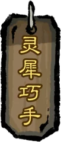
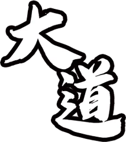

# 【卡牌修仙传】图鉴攻略 — 玩法机制

- 收录总数：9（游戏官方数据）
- 更新时间：2026-11-20 06:49

---

## 1. 法宝修复

法宝、傀儡、载具损坏后怎么修，要什么材料。

### 【在哪里】

法宝 / 傀儡 / 载具在战斗中损坏后，放进「恢复工作台」修复（法宝叫「重铸」，60 秒）。

在秘境、比武场里的恢复台修复全部免费。

### 【法宝重铸要什么】

材料 / 灵气要和法宝同属性。

法宝品质 | 平时 | 有天赋「灵犀巧手」

人品 | 免费 | —

地品 / 天品 | 1 张同属性材料，或 1 张同属性灵气，或〈混沌灵气〉 | 免费

仙品 | 1 张同属性材料 | 免费

神品 / 绝品 | 2 张同属性材料 | 1 张同属性材料 / 灵气 / 混沌灵气

没有这些属性的材料时用什么代替

法宝属性 | 可以用

阴 | 金 / 水

阳 | 木 / 火

血 | 阴 / 水

风 | 木 / 土

### 【本命物】

损坏的本命物重铸不要材料，但要扣 5 年寿元。

### 【傀儡】

傀儡 | 修复要什么

机关（木质）傀儡 | 任意木属性材料（人~天品）；仙品以上用〈傀儡零件〉

骸骨傀儡 | 〈小根兽骨〉（人~天品，20 秒）；仙品以上用〈尸体〉/〈无名骸骨〉

骨龙等阴属性傀儡 | 任意阴属性材料；仙品以上要神品～绝品阴材料

熔岩傀儡 | 任意火属性材料；仙品以上要〈不灭熔岩神品〉

血木傀儡 | 〈兽血地品〉；高品质要神品～绝品木材料，绝品要〈血木〉

### 【载具】

载具修复 180 秒。

载具 | 修复要什么

白龙（霜螭所赠） | 〈因果〉

千机纸鹤 | 〈混沌灵气〉

其他载具 | 〈青翼影膜〉/〈夜飞双翼神品〉/〈涅槃火羽神品〉（各载具不同）

---

## 2. 灵气值（主角的灵气）

主角的灵气值怎么用、怎么恢复（不是五行灵气卡）。

### 【灵气值是什么】

这里说的「灵气值」是主角身上的一个数值（主角卡上显示），不是〈金灵气〉〈混沌灵气〉这些灵气卡。

放出法宝 / 灵兽 / 傀儡 / 魂体进入战斗、施展口诀都要花灵气值；场上的卡超过神识的部分要额外花灵气值。灵气值为 0 时战斗卡不能移动。

五行灵气卡（〈金灵气〉〈木灵气〉〈水灵气〉〈火灵气〉〈土灵气〉和它们筑基 / 结丹的高阶版本）以及〈混沌灵气〉是材料卡，放进修炼工作台能回灵气值（见下表），也能用来炼器、修法宝；怎么得到看它们各自的【获取途径】。

### 【修炼台回灵气值】

在「修炼工作台」修炼时会恢复主角的灵气值（表里是回多少点）：

主角境界 | 不放卡（30 秒） | 放一张五行灵气卡（15 秒） | 放〈混沌灵气〉（15 秒）

练气 1 级 | 1 | 1 | 1

练气 2～4 级 | 1 | 3 | 5

筑基 | 2 | 3 | 5

结丹 | 4 | 3 | 5

元婴 | 5 | 5 | 5

---

## 3. 魔修之路

蒙面人、魔功心法、秘钥和进攻玄剑阁。

### 【在哪里】

金陵城里的「蒙面人」（主角筑基期起）。他认为修士把天地灵气都吸进体内，害得无数生灵失去灵气，所以专门猎杀修士。

他的住处在雁荡城左侧柱子下的「无名山洞」。

### 【流程】

第一次：在金陵城和蒙面人对话，他问你「正」还是「邪」（给〈正〉〈邪绝品〉两张卡，选一张交给他）

选邪：「等你成熟了，我再把你项上人头摘下」；想法变了可以去雁荡城找他，他会再问一次

选正：他要你在城里的比武大会拿到前三：把比武三甲的证明卡（季魁 / 亚魁 / 魁首）交给他 → 随机一本魔功心法，并给〈住处位置〉

直接通过：已经修过魔功天赋（噬魂 / 杀戮 / 拘魂）、带着心魔「色」，或者杀戮 ≥ 10，他会直接给魔功心法和〈住处位置〉

入门：修炼魔功心法后，去雁荡城「无名山洞」把〈住处位置〉交还给他 → 正式入门，得到〈秘钥〉 —— 没修魔功就拿着住处位置去，会被赶走；杀戮 ≥ 10 时去山洞，他也会直接让你入门。在山洞里交〈邪绝品〉会被蚀月教精英围攻

秘钥：〈秘钥〉可以解开山洞里一本心法的禁制（自己去旁边选一本），或者交回给他换〈万魂幡图纸〉 —— 万魂幡战败会出现恶名

更多秘钥：把一位好友带去献祭（好友会被吸干血液，永久死亡），或者交出任意一张修士卡（被制成魂体）→ 再给〈秘钥〉

进攻玄剑阁：入门后把〈玄剑阁推荐信〉或〈秘钥绝品〉交给他 → 他派圣教弟子做内应；你进攻玄剑阁时圣教弟子会来助战，玄剑阁长老由他对付（玄剑阁广场上会出现蒙面人）

### 【注意】

修炼魔功后会产生魔气，有些地方再也去不得了。

在金陵城（被屠城后）和坊市广场上遇到的另一个蒙面人会喊「来人，把这杀人魔头拿下！」，叫玄剑阁高手埋伏你。

### 【魔修证明】

〈噬魂证道〉：修士死亡时只要伤害过它，就能额外获得修为

〈杀戮证道〉：击杀修士时可以把它的灵魂拘下为己所用

〈拘魂证道〉：可以把一名修士炼制成魂体。

拥有证明后，江湖中的遭遇会变得不同。

---

## 4. 开局词条

自由模式开新档时能选的全部词条：属性、气运、出身、天资、宝物、天道，以及每个难度给多少词条点数（故事模式不能选词条）。

### 【怎么选】

只有「自由模式」才能选词条：开新档时选自由模式（没有主线剧情），先选难度，再在「选择词条」界面挑词条。每个难度给一定的「词条点数」

「故事模式」（主角萧枕墨，有主线和结局）开局是固定的，只能选难度，不能选词条。四档难度两种模式都有。

点数是正数的词条（好处）要花点数，点数是负数的词条（坏处，例如「体弱气虚」「天罚之人」「禁丹」）会把点数还给你，用来换更多好词条。

属性词条里的「御物 / 驭兽 / 控儡」是放一张法宝 / 灵兽 / 傀儡要花的灵气，所以「- 1」是好处、「+ 1」是坏处。

### 【难度和词条点数】

难度 | 词条点数 | 一句话 | 和「正常」不一样的地方

体验 | 40 | 数值难度较低，适合从未接触此类型游戏的玩家 | 卡牌的消失时间：较久；卡牌的出售价格：较高；普通材料的生成品质：最高仙品；妖王材料的生成品质：神品；毒药的抗性：较低；敌人的实力：较弱；雷劫的伤害：较低；敌意奇遇的概率：较低；培养灵药的时间：较短；跨境界战斗的伤害衰减：较低；战斗时上阵卡牌数不受神识限制

正常 | 15 | 难度适中，适合对游戏机制有所了解的玩家 | 普通材料的生成品质：最高天品；妖王材料的生成品质：仙品；战斗时有五行相生克的机制；战斗时上阵卡牌数不受神识限制

挑战 | 10 | 对战斗搭配的要求更高，生存压力大，适合喜欢难度挑战的玩家 | 普通材料的生成品质：最高天品；妖王材料的生成品质：仙品；无法种植绝品灵药；跨境界战斗的伤害衰减：较高；战斗时有五行相生克的机制；战斗时无法上阵超过神识值的卡牌

真仙 | 5 | 数值更高，必须开启专注模式的硬核挑战模式 | 卡牌的消失时间：较短；卡牌的出售价格：较低；普通材料的生成品质：最高天品；妖王材料的生成品质：仙品；毒药的抗性：较高；敌人的实力：较强；雷劫的伤害：较高；敌意奇遇的概率：较高；无法种植绝品灵药；跨境界战斗的伤害衰减：极高；战斗时有五行相生克的机制；战斗时无法上阵超过神识值的卡牌

### 【全部词条】

按游戏里的 6 个分类列出；同一类里按点数从高到低排。

属性（改变主角的初始属性）—— 共 25 个，其中 15 个要花点数

词条 | 点数 | 效果

神识悠远 | +15 | 主角的神识 + 1

玄命之体 | +10 | 主角的寿元 + 100

太虚灵体 | +6 | 主角的灵气 + 30

丹道根基 | +6 | 主角的毒伤 + 10

器道根基 | +5 | 主角的御物（放法宝耗的灵气） - 1

兽道根基 | +5 | 主角的驭兽（放灵兽耗的灵气） - 1

术道根基 | +4 | 主角的法伤 + 5

遁行如风 | +4 | 主角的遁速 + 10

磐石之体 | +3 | 主角的血量 + 50

锐骨之体 | +3 | 主角的攻击 + 10

清灵之体 | +3 | 主角的灵气 + 10

金刚骨血 | +2 | 主角的攻击 + 3 和 血量 + 15

儡道根基 | +2 | 主角的控儡（放傀儡耗的灵气） - 1

天生厚肤 | +1 | 主角的血量 + 15

天生蛮力 | +1 | 主角的攻击 + 3

一心向武 | 0 | 主角天生额外自带一个技能格子；但主角的御物（放法宝耗的灵气） + 4；驭兽（放灵兽耗的灵气） + 4；控儡（放傀儡耗的灵气） + 4

体弱气虚 | -1 | 主角的血量 - 15

筋骨残缺 | -1 | 主角的攻击 - 3

不善控儡 | -2 | 主角的控儡（放傀儡耗的灵气） + 1

衰灵体质 | -3 | 主角的灵气 - 10

寿元浅薄 | -4 | 主角的寿元 - 40

身法迟缓 | -4 | 主角的遁速 - 10

不善御器 | -5 | 主角的御物（放法宝耗的灵气） + 1

不善驭兽 | -5 | 主角的驭兽（放灵兽耗的灵气） + 1

神识虚弱 | -15 | 主角的神识 - 1

气运（在指定的时机触发的一些运气事件）—— 共 8 个，其中 7 个要花点数

词条 | 点数 | 效果

神佑之人 | +20 | 天帝宝库会出现2把钥匙

天眷福泽 | +15 | 开局时获得一张气运卡，可激活一次使用：每经过1年，获得一张机缘卡，持续20年

生生不息 | +8 | 战斗型秘境，都会生成一个额外的恢复工作台；秘境包括：古木幽森(战斗地图)，地火深洞，聚水漩涡，新手村山顶，冥狱(战斗地图)，镇妖塔，妖王聚集地

一瞬明悟 | +7 | 开局时获得一张气运卡，可激活一次使用：每经过60日，获得一张顿悟卡，持续480日

捡漏高手 | +6 | 进入玄机阁，有小概率发现掉落在地上标错价格的商品(仅售1灵石)。(每个商品3%概率，每360日独立计算一次，仓库区不会出现)

天地接引 | +6 | 进入月照之地、碧潭瀑布、无字玉璧、天地熔炉秘境时，有50%概率发现额外的工作台

灵脉溢散 | +3 | 飞行时可以发现散落在世界的灵石

亡命之徒 | -20 | 开局时获得一张气运卡，每经过1年，都会生成一个寻仇工作台；直到主角元婴期后，才能将此气运卡消除

出身（在游戏开局时，携带的初始卡牌）—— 共 11 个，其中 11 个要花点数

词条 | 点数 | 效果

炼制世家 | +15 | 游戏开始时，自带一个炼制工作台(额外)

培养大师 | +15 | 游戏开始时，自带一个培养工作台(额外)

天命之人 | +13 | 游戏开始时，自选一样本命物(练气期)；注：不影响结丹期炼制本命物的限制；在结丹期炼制本命物前，无法放弃此本命物

富家子弟 | +10 | 游戏开始时，自带500000灵石

醉中仙 | +7 | 游戏开始时，自带一个技能：醉拳(每次行动会攻击2次，但自身进入无法清除的混乱状态)

傀儡师 | +4 | 游戏开始时，自带神品机关傀儡,且可以在恢复工作台恢复傀儡的血量

鬼师 | +4 | 游戏开始时，自带炼化修士的能力；注：不会变成魔道

观星者 | +3 | 游戏开始时，自带一本心法：观星术

机关学徒 | +2 | 游戏开始时，自带人品机关傀儡

驭兽师 | +2 | 游戏开始时，自选一只练气期人品的灵兽。

清贫子弟 | +1 | 游戏开始时，自带一个包袱(可获得一把随机绿法宝，一本随机心法)

天资（主角携带的天赋或能力）—— 共 15 个，其中 12 个要花点数

词条 | 点数 | 效果

先天道种 | +20 | 修炼心法无需辅助物或辅助地点，且仅需30日便能修炼完心法

奇门八卦 | +13 | 天赋：主角额外增加一个技能格子；(可以在仙途界面查看)

寻龙分金 | +11 | 天赋：在御剑飞行时，发现地点和秘境的概率提高！；每个难度提高的概率略有不同，难度越高，提高的概率越高。

灵炉溢丹 | +8 | 天赋：炼制丹药的最后一轮产量 + 2；(可以在仙途界面查看)

药泽加身 | +7 | 天赋：种植灵草的产量上限 + 3；(可以在仙途界面查看)

引气通脉 | +6 | 天赋：主角在吸收灵气时的恢复量 + 5；(可以在仙途界面查看)

敛锋蕴气 | +6 | 天赋：战斗脱战的卡牌将会恢复40血量；(装载在容器内的卡牌也会恢复)

玄肌固腑 | +4 | 天赋：主角在恢复工作台的恢复系数 + 10；(可以在仙途界面查看)

修理大师 | +4 | 可以在恢复工作台修复法宝和载具的耐久

生死契约 | +3 | 天赋：灵兽死亡时额外恢复10血量；(可以在仙途界面查看)

灵台清明 | +3 | 无需心境便能快速消除心魔卡(贪嗔痴恶悲色邪)

邪魔外道 | +3 | 炼制骸骨傀儡不需要灵兽神魄

天残地缺 | -13 | 天赋：主角天生减少一个技能格子；(可以在仙途界面查看)

愚钝守心 | -15 | 修炼思绪仅能获得随机的感悟卡，无法指向性合成

天罚之人 | -15 | 主角进入战斗时，敌人队列会出现两张天雷；直到主角升至元婴期，才能无视天罚的效果

宝物（有着特殊功能的宝物）—— 共 9 个，其中 9 个要花点数

词条 | 点数 | 效果

家传宝刀 | +35 | 游戏开始时，自带一把合体期的人品刀法宝：破军(无技能，卡牌属性：3176攻击，2540血量)

本命灵种 | +14 | 本命灵种可以无限生成灵草：每经过180天，随机生成1-3株灵草(与灵种境界相符)。；人品灵草：10%；地品灵草：15%；天品灵草：25%；仙品灵草：25%；神品灵草：15%；绝品灵草：10%；当主角提升境界后，把此卡牌拖动主角上升级此宝物的境界；把主角拖动到此卡牌上，可关闭卡牌自动产卡的功能

玄霄神气 | +9 | 来自传说中的神域：玄霄的灵气。能将一个元婴期以下的法宝提升至下一品质。；使用后不会消失，而是进入3年的冷却期

小灵气源 | +6 | 一个小型的灵气源:每经过90天，随机生成一张灵气卡(与灵气源境界相同)，有小概率(10%)生成混沌灵气；当主角提升境界后，把此卡牌拖动主角上升级此宝物的境界；把主角拖动到此卡牌上，可关闭卡牌自动产卡的功能

聚魂台 | +5 | 可以帮助我召唤附近境界相同的灵体，但每次召唤均消耗5年寿命；把聚魂台拖动到主角上，便能召唤灵体；把聚魂台放置在五行地点处，可召唤对应生前与之相同五行的灵体

无名地图 | +4 | 在客栈使用，可以获得该客栈附近所有秘境的传闻卡；此地图仅能使用一次

仙灵余脉 | +3 | 一个小型的灵石矿：每经过60天，都会随机的生成灵石卡；当主角提升境界后，把此卡牌拖动主角上升级此宝物的境界；把主角拖动到此卡牌上，可关闭卡牌自动产卡的功能

千劫傀 | +3 | 把千劫傀放入战斗后，可以把其他卡牌抽离战斗！；千劫傀永不损坏，每次战败后需要120日恢复。

回天箓 | +2 | 不会消耗；可代替灵气/材料激活恢复工作台的恢复阵法；回复量与使用仙品材料效果相同

天道（游戏规则的改变）—— 共 16 个，其中 3 个要花点数

词条 | 点数 | 效果

强化因果 | +27 | 开局自带一个因果；在炼制工作台炼制因果，会获得双份奖励；在修炼工作台修炼因果，会获得双份奖励

强化培养 | +11 | 可以在培养工作台使用机缘培养出因果

宽阔世界 | +6 | 游戏桌面扩大30%

禁天衍诀 | -2 | 完成支线任务时，不会获得天衍诀(无法开启无视境界压制功能)

禁法 | -5 | 无法通过工作台提升口诀卡牌的境界

强化镇妖塔 | -5 | 镇妖塔的每一层，都会额外增加一只妖王

禁鬼市 | -7 | 无法进入地图上遇到的秘境：鬼市

禁技 | -10 | 无法通过工作台提升技能卡牌的境界

禁法宝 | -10 | 无法在工作台使用材料卡牌炼制法宝

禁忘尘庙 | -10 | 无法使用忘尘庙

禁空间裂缝 | -10 | 无法进入秘境：空间裂缝

禁机缘 | -10 | 无法在秘境里使用机缘类卡牌；(无法在月照之地，碧潭瀑布，天地熔炉，无字玉璧使用机缘类卡牌获得更多的工作台)

禁熔炉 | -15 | 无法使用熔炉工作台

禁月照 | -15 | 无法使用月照工作台

禁愈灵 | -15 | 无法使用愈灵工作台

禁丹 | -20 | 无法通过炼制工作台炼制丹药(可以在熔炉炼制)

### 【几个常用搭配的说明】

「天窍」类：「一心向武」「奇门八卦」都是多一个技能格子；「天残地缺」是少一个格子（还你 13 点）。

「亡命之徒」「天罚之人」的坏处到主角元婴期才会解除，点数给得多，但前期压力很大。

「无名地图」只能用一次：在客栈用，可以拿到这家客栈附近所有秘境的传闻卡（每家客栈能打听到的地方见【地点】客栈）。

「神佑之人」让天帝宝库多出 1 把〈秘钥〉（共 2 把）；「强化镇妖塔」让镇妖塔每层多 1 只妖王（还你 5 点）。

---

## 5. 结局

故事模式的最后：天门、两段回忆，以及按保留的卡决定的 7 种结局。

### 【怎么走到结局（故事模式）】

第 1 步：主线最后进入「回忆：故事终焉」：把主角（萧枕墨）拖到「师傅」身上，听他说完真相（他为了用曼珠沙华延长寿命，挑起了各门派的争端），他化成〈师傅（魔）〉 → 击败他

第 2 步：进入「回忆：天门」，把〈萧枕墨〉（主角）放到「天门？」上 → 天地认同你击败了大乘期修士，开启天门 → 得到〈命运〉和〈大道〉 —— 天门地图上有两道门，分别通往下面两段回忆

第 3 步：走第一段回忆：村庄 → 曼珠沙华花开 → 柴房内 → 山上 → 比武 → 入世 → 命途；在「回忆：命途」地上拿到〈过往〉，从这里的门回到天门

第 4 步：走第二段回忆：师傅如父 → 情同手足 → 好友重逢 → 情窦初开；在「回忆：情窦初开」地上拿到〈七情六欲〉，回到天门

第 5 步：拿齐三张卡后，〈命运〉会打开「前方是何路？——我终于了解清楚事情的全部！面对真相，我该如何做出选择？」：把想保留的卡（〈大道〉〈七情六欲〉〈过往〉里任选）放进「选择」格，保留哪几张决定结局

### 【7 种结局】

〈大道〉= 修为（仙途），〈七情六欲〉= 人的情与念，〈过往〉= 经历过的事。没放进去的就是舍弃的。

保留的卡 | 结局 | 之后 | 主角的想法

〈大道〉、〈七情六欲〉、〈过往〉 | 我依然难以承受这一切，只好再次将自己封印。 | 从头再来（主角再次封印自己，开始新的一轮） | 大道为我根基，七情六欲为我灵魂，过往为我存世痕迹。纵使舍此中分毫，我也不再是完整的我。无论前路是千重劫难，或是万缕纠葛，也只能由我独自承担，直面所有因果。

〈七情六欲〉、〈过往〉 | 我放下一切，坦然接受。 | 故事结束，回到主菜单 | 于我而言，仙途道修早已非心之所重，唯愿守着人之情欲，历经的旧事，于人间烟火处安度晚年。

〈大道〉、〈七情六欲〉 | 我忘却过去，继续仙途 | 回到大世界，可以继续修仙 | 前尘诸事皆已尘埃落定，我若仍将其镌于心头，不过是徒然招惹心魔、平添悲戚罢了；只要我的道力尚存，七情未泯、执念犹在，便可续写乾坤。

〈大道〉、〈过往〉 | 我舍弃欲望，继续仙途 | 回到大世界，可以继续修仙 | 前尘往事我无法忘却，但它会阻挡我的修道之途，将七情六欲抛弃才能避免心魔！

〈大道〉 | 我斩断尘缘，抛弃过往，只为飞升为仙人 | 故事结束，回到主菜单 | 我乃修道之人，所求便是长生证道！仙与凡本非一条路，只有斩断尘缘因果，抛弃世俗过往，褪去七情六欲，方可叩开天门，羽化登仙！

〈七情六欲〉 | 我忘却过去，只为重回凡人 | 故事结束，回到主菜单 | 前尘诸事皆已尘埃落定，我已不愿记起；修道求进此等仙途要事，亦无关紧要；我只愿守着人身之根本，做个寻常世间人便足矣。

〈过往〉 | 我舍弃欲望，作为凡人孤独一生 | 故事结束，回到主菜单 | 于我而言，仙途道修早已非心之所重，纵使将七情六欲尽数抛却，亦不足惜；唯独那历经的旧事，却是断断不能相忘的。

---

## 6. 灵田（种灵草）

灵田只在湖月城；怎么种灵草：辅助卡、每格产量、成熟时间、绝品仙草的种法，以及没有灵田时怎么用培养工作台种（含神品灵草的条件）。

### 【在哪里】

目前只有湖月城有灵田（悦家的地盘），其他地方都没有：

城里的空地：湖月城里有 5 个位置会长出灵田：每个位置 30% 概率出现，每 360 日刷新一次 —— 品质随机：人品 / 地品 / 天品各约 25%，仙品、神品各约 12%

悦家家主：做完悦萱儿那段剧情后，湖月城的「悦家农民」会说家主在找你；去湖月堡中间和「悦家家主」对话 → 送你一块〈灵田绝品〉，湖月城声望也提高 —— 只送一次

悦家农民：之后花 500 灵石请「悦家农民」帮你从水里捞一块灵田 —— 品质不保证：人品 / 地品 / 天品 / 仙品各约 25% / 25% / 25% / 20%，神品 5%

### 【怎么种】

把灵草放进「灵田」工作台（培养灵草），每个格子都会长出同名的灵草；可以再放一张辅助卡：

〈药渣〉提高产量；葫芦 / 瓶子类法宝缩短成熟时间（品质越高越快）；傀儡提高产量但更慢（品质越高越好）；药童、慕容绛璃会帮你照料。

慕容绛璃每帮你收一次灵草，她自己的修为 +1（绝品仙草 +5）。这是她本人的修为，不是主角的：攒够了她会突破境界，突破到结丹 / 元婴时还会送你礼物，详见【玩法机制】「人物的修为、好感和寿元」。

辅助卡的品质 / 境界比灵草低就用不了；修士〈尸体〉产量高、时间短，但会带来邪名；绝品仙草里只有〈血灵芝〉能用尸体。

挑战 / 真仙难度下，普通的绝品灵草不能培养（运行一次只得到一株，用来完成「培养绝品灵药」的任务）。

体验难度的成熟时间是正常的 3/4。

### 【每种灵草的产量和时间】

人品灵草（例如 止血草/土茯苓/腐木菇）；筑基 / 结丹 / 元婴的同品质灵草一样

辅助卡 | 每格产量 | 成熟时间（正常 / 挑战 / 真仙） | 另外

不放辅助卡 | 3～6 株 | 240 秒（体验 180） | —

〈药渣〉 | 4～8 株 | 240 秒（体验 180） | —

葫芦 / 瓶子法宝人品 | 3～6 株 | 215 秒（体验 161） | —

葫芦 / 瓶子法宝地品 | 3～6 株 | 190 秒（体验 143） | —

葫芦 / 瓶子法宝天品 | 3～6 株 | 165 秒（体验 124） | —

葫芦 / 瓶子法宝仙品 | 3～6 株 | 140 秒（体验 105） | —

葫芦 / 瓶子法宝神品 | 3～6 株 | 120 秒（体验 90） | —

葫芦 / 瓶子法宝绝品 | 4～7 株 | 120 秒（体验 90） | —

傀儡人品 | 4～7 株 | 360 秒（体验 270） | —

傀儡地品 | 4～8 株 | 335 秒（体验 251） | —

傀儡天品 | 5～8 株 | 310 秒（体验 233） | —

傀儡仙品 | 5～8 株 | 290 秒（体验 218） | —

傀儡神品 | 5～8 株 | 260 秒（体验 195） | —

傀儡绝品 | 5～9 株 | 240 秒（体验 180） | —

〈勤奋的药童〉 | 6～9 株 | 240 秒（体验 180） | —

〈药童〉 | 6～9 株 | 240 秒（体验 180） | —

〈疲惫的药童〉 | 6～9 株 | 240 秒（体验 180） | 药童之后会离开

〈尸体〉 | 6～9 株 | 165 秒（体验 124） | 得到心魔〈邪〉

〈慕容绛璃〉 | 4～7 株 | 165 秒（体验 124） | 慕容绛璃自己的修为 +1

地品灵草（例如 洗骨花/断魂花/迷魂香/兽涎水）；筑基 / 结丹 / 元婴的同品质灵草一样

辅助卡 | 每格产量 | 成熟时间（正常 / 挑战 / 真仙） | 另外

不放辅助卡 | 3～6 株 | 300 秒（体验 225） | —

〈药渣〉 | 4～8 株 | 300 秒（体验 225） | —

葫芦 / 瓶子法宝地品 | 3～6 株 | 240 秒（体验 180） | —

葫芦 / 瓶子法宝天品 | 3～6 株 | 210 秒（体验 158） | —

葫芦 / 瓶子法宝仙品 | 3～6 株 | 180 秒（体验 135） | —

葫芦 / 瓶子法宝神品 | 3～6 株 | 150 秒（体验 113） | —

葫芦 / 瓶子法宝绝品 | 4～7 株 | 150 秒（体验 113） | —

傀儡地品 | 4～8 株 | 420 秒（体验 315） | —

傀儡天品 | 5～8 株 | 390 秒（体验 293） | —

傀儡仙品 | 5～8 株 | 360 秒（体验 270） | —

傀儡神品 | 5～8 株 | 330 秒（体验 248） | —

傀儡绝品 | 5～9 株 | 300 秒（体验 225） | —

〈勤奋的药童〉 | 6～9 株 | 300 秒（体验 225） | —

〈药童〉 | 6～9 株 | 300 秒（体验 225） | —

〈疲惫的药童〉 | 6～9 株 | 300 秒（体验 225） | 药童之后会离开

〈尸体〉 | 6～9 株 | 210 秒（体验 158） | 得到心魔〈邪〉

〈慕容绛璃〉 | 4～7 株 | 210 秒（体验 158） | 慕容绛璃自己的修为 +1

天品灵草（例如 红仁果/白莲子/青焰根）；筑基 / 结丹 / 元婴的同品质灵草一样

辅助卡 | 每格产量 | 成熟时间（正常 / 挑战 / 真仙） | 另外

不放辅助卡 | 3～5 株 | 360 秒（体验 270） | —

〈药渣〉 | 4～7 株 | 360 秒（体验 270） | —

葫芦 / 瓶子法宝天品 | 3～5 株 | 215 秒（体验 161） | —

葫芦 / 瓶子法宝仙品 | 3～5 株 | 180 秒（体验 135） | —

葫芦 / 瓶子法宝神品 | 3～5 株 | 180 秒（体验 135） | —

葫芦 / 瓶子法宝绝品 | 4～6 株 | 180 秒（体验 135） | —

傀儡天品 | 5～7 株 | 470 秒（体验 353） | —

傀儡仙品 | 5～7 株 | 430 秒（体验 323） | —

傀儡神品 | 5～7 株 | 400 秒（体验 300） | —

傀儡绝品 | 5～8 株 | 360 秒（体验 270） | —

〈勤奋的药童〉 | 6～8 株 | 360 秒（体验 270） | —

〈药童〉 | 6～8 株 | 360 秒（体验 270） | —

〈疲惫的药童〉 | 6～8 株 | 360 秒（体验 270） | 药童之后会离开

〈尸体〉 | 6～8 株 | 215 秒（体验 161） | 得到心魔〈邪〉

〈慕容绛璃〉 | 4～6 株 | 215 秒（体验 161） | 慕容绛璃自己的修为 +1

仙品灵草（例如 魂婴果/醉龙果/幻神草/百灵参）；筑基 / 结丹 / 元婴的同品质灵草一样

辅助卡 | 每格产量 | 成熟时间（正常 / 挑战 / 真仙） | 另外

不放辅助卡 | 2～5 株 | 720 秒（体验 540） | —

〈药渣〉 | 3～6 株 | 720 秒（体验 540） | —

葫芦 / 瓶子法宝仙品 | 2～5 株 | 430 秒（体验 323） | —

葫芦 / 瓶子法宝神品 | 2～5 株 | 360 秒（体验 270） | —

葫芦 / 瓶子法宝绝品 | 3～6 株 | 360 秒（体验 270） | —

傀儡仙品 | 4～7 株 | 860 秒（体验 645） | —

傀儡神品 | 4～7 株 | 790 秒（体验 593） | —

傀儡绝品 | 4～7 株 | 720 秒（体验 540） | —

〈勤奋的药童〉 | 4～7 株 | 720 秒（体验 540） | —

〈药童〉 | 4～7 株 | 720 秒（体验 540） | —

〈疲惫的药童〉 | 4～7 株 | 720 秒（体验 540） | 药童之后会离开

〈尸体〉 | 4～7 株 | 580 秒（体验 435） | 得到心魔〈邪〉

〈慕容绛璃〉 | 3～6 株 | 580 秒（体验 435） | 慕容绛璃自己的修为 +1

神品灵草（例如 血精果/腐骨草/菩提果）；筑基 / 结丹 / 元婴的同品质灵草一样

辅助卡 | 每格产量 | 成熟时间（正常 / 挑战 / 真仙） | 另外

不放辅助卡 | 2～4 株 | 1260 秒（体验 945） | —

〈药渣〉 | 3～4 株 | 1260 秒（体验 945） | —

葫芦 / 瓶子法宝神品 | 2～4 株 | 630 秒（体验 473） | —

葫芦 / 瓶子法宝绝品 | 2～5 株 | 630 秒（体验 473） | —

傀儡神品 | 3～6 株 | 1390 秒（体验 1043） | —

傀儡绝品 | 4～6 株 | 1260 秒（体验 945） | —

〈勤奋的药童〉 | 3～6 株 | 1260 秒（体验 945） | —

〈药童〉 | 3～6 株 | 1260 秒（体验 945） | —

〈疲惫的药童〉 | 3～6 株 | 1260 秒（体验 945） | 药童之后会离开

〈尸体〉 | 3～6 株 | 1000 秒（体验 750） | 得到心魔〈邪〉

〈慕容绛璃〉 | 3～5 株 | 1000 秒（体验 750） | 慕容绛璃自己的修为 +1

绝品仙草（一块灵田只能种同名的；不放辅助卡不会长）

仙草 | 葫芦 / 瓶子绝品 | 傀儡绝品 | 〈勤奋的药童〉 | 〈慕容绛璃〉 | 〈尸体〉

九霄灵芝 | 每格 3～4 株，3600 秒成熟 | 每格 3～6 株，4680 秒成熟 | 每格 3～4 株，3600 秒成熟／得到〈疲惫的药童〉 | 每格 2～3 株，1800 秒成熟／慕容绛璃自己的修为 +5 | 用不了

赤霄灵芝 | 每格 3～4 株，7200 秒成熟 | 每格 3～6 株，9360 秒成熟 | 每格 3～4 株，7200 秒成熟／得到〈疲惫的药童〉 | 每格 2～3 株，3600 秒成熟／慕容绛璃自己的修为 +5 | 用不了

碧霄灵芝 | 每格 3～4 株，7200 秒成熟 | 每格 3～6 株，9360 秒成熟 | 每格 3～4 株，7200 秒成熟／得到〈疲惫的药童〉 | 每格 2～3 株，3600 秒成熟／慕容绛璃自己的修为 +5 | 用不了

血灵芝／（筑基） | 用不了 | 用不了 | 每格 3～4 株，3600 秒成熟／得到心魔〈邪〉 | 每格 3～4 株，1800 秒成熟 | 每格 3～4 株，3600 秒成熟／得到心魔〈邪〉

血灵芝／（结丹 / 元婴） | 用不了 | 用不了 | 每格 3～4 株，7200 秒成熟／得到心魔〈邪〉 | 每格 3～4 株，3600 秒成熟 | 每格 3～4 株，7200 秒成熟／得到心魔〈邪〉

缘玑仙草 | 每格 3～4 株，7200 秒成熟 | 每格 3～6 株，9360 秒成熟 | 每格 3～4 株，7200 秒成熟／得到〈疲惫的药童〉 | 每格 3～4 株，3600 秒成熟／慕容绛璃自己的修为 +5 | 用不了

蕴元仙萼 | 每格 3～4 株，1800 秒成熟 | 每格 3～6 株，2340 秒成熟 | 每格 3～4 株，1800 秒成熟／得到〈疲惫的药童〉 | 每格 3～4 株，900 秒成熟／慕容绛璃自己的修为 +5 | 用不了

### 【没有灵田：用培养工作台种灵草】

没有灵田也能种灵草：把灵草放进「培养工作台」（配方「培养灵草」/「培养珍稀灵草」），每个格子长出同名的灵草。能不能种、要放什么，看灵草的品质：

想种神品灵草：只能放一个绝品的葫芦或瓶子类法宝，每格 2～3 株，360 秒；仙品灵草要神品或绝品的葫芦 / 瓶子。灵气、药渣都不行。

葫芦 / 瓶子的境界不能比灵草低：练气期灵草不限；筑基后期的灵草要筑基后期以上的葫芦 / 瓶子，结丹、元婴同理。

绝品仙草只能用灵田种（见上面的「灵田在哪」）。

灵草品质 | 培养工作台的配方 | 要放什么 | 每种辅助卡的产量和时间（练气期灵草，其它境界一样）

人品灵草 | 培养灵草 | 不放辅助卡也会长 | 不放辅助卡：每格 3～5 株，120 秒／〈混沌灵气〉：每格 3～5 株，30 秒／任意灵气：每格 3～5 株，60 秒／〈药渣〉：每格 5～7 株，120 秒／地品葫芦 / 瓶子：每格 3～5 株，96 秒／天品葫芦 / 瓶子：每格 3～5 株，84 秒／仙品葫芦 / 瓶子：每格 3～5 株，72 秒／神品葫芦 / 瓶子：每格 3～5 株，60 秒／绝品葫芦 / 瓶子：每格 4～6 株，60 秒

地品灵草 | 培养灵草 | 不放辅助卡也会长 | 不放辅助卡：每格 3～5 株，150 秒／〈混沌灵气〉：每格 3～5 株，37 秒／任意灵气：每格 3～5 株，75 秒／〈药渣〉：每格 5～7 株，150 秒／天品葫芦 / 瓶子：每格 3～5 株，105 秒／仙品葫芦 / 瓶子：每格 3～5 株，90 秒／神品葫芦 / 瓶子：每格 3～5 株，75 秒／绝品葫芦 / 瓶子：每格 4～6 株，75 秒

天品灵草 | 培养灵草 | 不放辅助卡也会长 | 不放辅助卡：每格 3～5 株，180 秒／〈混沌灵气〉：每格 3～5 株，45 秒／任意灵气：每格 3～5 株，90 秒／〈药渣〉：每格 4～6 株，180 秒／仙品葫芦 / 瓶子：每格 3～5 株，108 秒／神品葫芦 / 瓶子：每格 3～5 株，90 秒／绝品葫芦 / 瓶子：每格 4～6 株，90 秒

仙品灵草 | 培养珍稀灵草 | 只能放葫芦 / 瓶子（灵气、药渣都不行），不放不会长 | 神品葫芦 / 瓶子：每格 2～4 株，320 秒／绝品葫芦 / 瓶子：每格 2～5 株，270 秒

神品灵草 | 培养珍稀灵草 | 只能放葫芦 / 瓶子（灵气、药渣都不行），不放不会长 | 绝品葫芦 / 瓶子：每格 2～3 株，360 秒

绝品仙草 | 培养珍稀灵草 | 培养工作台种不了 | 游戏里的提示：「灵草是世间罕见的灵草，我不知道用什么方法培养它。也许，要在某些秘境里，才可培养？」

---

## 7. 寻仇

杀了门派弟子之后，同门高手会来寻仇；怎么洗掉「得罪」。

### 【怎么会被寻仇】

在大世界杀了某个门派的弟子，就会出现「寻仇」：附近的同门高手赶来找你（从下表里随机来一位），同时你得到〈得罪X〉。

〈得罪X〉期间，在战斗秘境里可能遇到对你有敌意的这个门派的弟子。

想洗掉：去北方雪山里的「忘尘庙」忏悔（〈得罪X〉上写着「北方的雪山之中，有一座古老的庙宇可以清洗我身上的罪孽」）。

### 【各门派的反应】

玄剑阁：玄剑门弟子最讲义气，在得知同门遇害之后，在附近的精英弟子立刻过来寻仇！

清虚谷：清虚谷的门下弟子一般不愿意出山，但听闻有弟子遇害，也不得不破例！

雪隐宗：雪隐宗距离此处较远，但听闻同门遇害的消息，不远万里也来寻仇！

武极门：武极门的弟子对于敌人一般都是双人共同外出！

兽王府：兽王府人数较少，每个弟子都是独一无二，因此对门下弟子遇害的消息十分重视！

紫霄殿：紫霄殿的正式弟子，均是结丹期以上的不世高人

### 【杀了哪个境界的弟子，来的是谁】

门派 | 被杀弟子的境界 | 来寻仇的人

玄剑阁 | 练气 | 〈玄剑阁高手〉（练气）

玄剑阁 | 筑基 | 〈玄剑阁高手〉（筑基）

玄剑阁 | 结丹 | 〈玄剑阁精英〉（结丹）

玄剑阁 | 元婴 | 〈玄剑阁精英〉

清虚谷 | 练气 | 〈清虚谷高手〉（练气）

清虚谷 | 筑基 | 〈清虚谷高手〉（筑基）

清虚谷 | 结丹 | 〈清虚谷精英〉（结丹）

清虚谷 | 元婴 | 〈清虚谷精英〉

雪隐宗 | 练气 | 〈雪隐宗高手〉（练气）

雪隐宗 | 筑基 | 〈雪隐宗高手〉（筑基）

雪隐宗 | 结丹 | 〈雪隐宗精英〉（结丹）

雪隐宗 | 元婴 | 〈雪隐宗精英〉

武极门 | 练气 | 〈武极门高手〉（练气），另外还一定会来 〈武极门高手〉（练气）

武极门 | 筑基 | 〈武极门高手〉（筑基），另外还一定会来 〈武极门高手〉（筑基）

武极门 | 结丹 | 〈武极门精英〉（结丹）、〈武极门精英〉（结丹）

武极门 | 元婴 | 〈武极门精英〉，另外还一定会来 〈武极门精英〉

兽王府 | 练气 | 〈兽王府高手〉（练气）

兽王府 | 筑基 | 〈兽王府高手〉（筑基）

兽王府 | 结丹 | 〈兽王府精英〉（结丹）

兽王府 | 元婴 | 〈兽王府精英〉

紫霄殿 | 练气 | 〈紫霄殿高手〉（结丹）

紫霄殿 | 筑基 | 〈紫霄殿精英〉（元婴）

紫霄殿 | 结丹 | 〈紫霄殿精英〉（元婴）

### 【词条「亡命之徒」】

自由模式开局选了「亡命之徒」（还你 20 点）：每过 1 年就会出现一个「寻仇」，随机来一位门派弟子追杀你（境界跟着你走）。

主角还是凡人时不会触发；到元婴期后才能把这张气运卡拖到主角身上消除。

---

## 8. 人物的修为、好感和寿元

赵子义、慕容绛璃等人物自己的修为、好感、寿元：怎么帮他们涨，好感够了会送什么。

### 【人物也会修炼】

赵子义、悦萱儿、慕容绛璃、武破岳、苏软软、柳昭昭、执黑等人物和主角一样有自己的境界，身上有三个看不见的数值：修为、好感、寿元。

修为：每过 1 年自己涨一点（每人不同，见下面各人物），也可以靠你帮忙涨。修为够了就突破到下一个境界，之后你遇到的这个人物（人物卡、和你交手时的对手卡）都换成新境界的版本，更强。

好感：送他们想要的东西会涨，骗他们会掉。好感够了，他们会每年送你礼物（每年一份，按当时的好感给最高的那一档）、在你突破时送贺礼、在他们自己突破时和你分享。

寿元：用完就会坐化；好感够高的话会留下遗言和遗物。送〈寿元丹〉能给他们续命（练气期的 +5 年、筑基期的 +10 年、结丹期的 +20 年，好感也 +5）。

注意：在雁荡城「无名山洞」把人物献祭给蒙面人，这个人物会直接死掉（寿元清零）。

### 【修为够多少才突破】

突破 | 要多少修为

筑基初期 → 筑基中期 | 70

筑基中期 → 筑基圆满 | 125

筑基圆满 → 结丹前期 | 265

结丹前期 → 结丹圆满 | 580

结丹圆满 → 元婴前期 | 1345

### 【慕容绛璃】

一开始是筑基初期，寿元约 170 年，每年自己涨 5～9 点修为。

怎么帮慕容绛璃涨修为 / 好感 / 寿元

做法 | 修为 | 好感 | 寿元

在灵田帮你照料灵草（每收一次） | +1（绝品仙草 +5） | — | —

送仙品灵草 | +5 | +1 | —

送神品灵草 | +10 | +1 | —

主角结丹后送人品的〈丹道〉 | +25 | — | —

主角结丹后送神品的〈丹道〉 | +50 | +5 | —

主角结丹后送绝品的〈丹道〉 | +150 | +10 | —

送练气期的〈寿元丹〉 | — | +5 | +5 年

送筑基期的〈寿元丹〉 | — | +5 | +10 年

送结丹期的〈寿元丹〉 | — | +5 | +20 年

每年送你的礼物（每年一份，按当时的好感给最高的那一档）

好感 | 主角筑基期 | 主角结丹期

好感 ≥ 45 | 随机一张筑基后期丹药（共17种）（80% 再给〈慕容绛璃的神念〉） | 随机一张结丹后期丹药（共17种）（80% 再给〈慕容绛璃的神念〉，20% 再给一张切磋邀请（门派随机））

好感 ≥ 25 | 随机一张筑基后期丹药（共7种）（40% 再给〈慕容绛璃的神念〉） | 随机一张结丹后期丹药（共7种）（40% 再给〈慕容绛璃的神念〉，20% 再给一张切磋邀请（门派随机））

好感 ≥ 10 | 随机一张筑基后期灵草（共23种）（20% 再给〈慕容绛璃的神念〉） | 随机一张结丹后期灵草（共23种）（20% 再给〈慕容绛璃的神念〉）

突破 / 坐化时送的东西

什么时候 | 要多少好感 | 送什么

主角突破到筑基圆满 | ≥ 10 | 〈丹修结丹〉

主角突破到结丹前期 | ≥ 30 | 〈生长〉

慕容绛璃突破到结丹前期 | ≥ 15 | 〈生长〉 + 〈慕容绛璃的神念〉

慕容绛璃突破到元婴前期 | ≥ 45 | 〈生长〉 + 〈慕容绛璃的神念〉

慕容绛璃寿元耗尽坐化时 | ≥ 50 | 随机 3 张结丹后期丹药（共14种）

### 【赵子义】

一开始是筑基初期，寿元约 170 年，每年自己涨 3～11 点修为。

怎么帮赵子义涨修为 / 好感 / 寿元

做法 | 修为 | 好感 | 寿元

送〈断剑（下）〉 | — | +10 | —

送〈断剑（上）〉 | — | +10 | —

送〈赵子义的邀请〉 | — | +5 | —

主角结丹后送人品的〈器道〉 | +25 | — | —

主角结丹后送神品的〈器道〉 | +50 | +5 | —

主角结丹后送绝品的〈器道〉 | +150 | +10 | —

送练气期的〈寿元丹〉 | — | +5 | +5 年

送筑基期的〈寿元丹〉 | — | +5 | +10 年

送结丹期的〈寿元丹〉 | — | +5 | +20 年

每年送你的礼物（每年一份，按当时的好感给最高的那一档）

好感 | 主角筑基期 | 主角结丹期

好感 ≥ 45 | 〈藏宝之地（筑基）〉（80% 再给〈赵子义的神念〉） | 〈藏宝之地（结丹）〉（80% 再给〈赵子义的神念〉，20% 再给一张切磋邀请（门派随机））

好感 ≥ 25 | 混沌之地/血煞之地/灵脉之地/藏宝之地（筑基）（随机一种）（40% 再给〈赵子义的神念〉） | 藏宝之地（结丹）/绝命禁地/洞天福地（随机一种）（40% 再给〈赵子义的神念〉，20% 再给一张切磋邀请（门派随机））

好感 ≥ 10 | 〈灵气异常之地〉（20% 再给〈赵子义的神念〉） | 〈灵气异常之地〉（20% 再给〈赵子义的神念〉）

突破 / 坐化时送的东西

什么时候 | 要多少好感 | 送什么

主角突破到筑基初期 | ≥ 10 | 〈银霄天令图纸〉

主角突破到筑基圆满 | ≥ 10 | 〈器修结丹〉

主角突破到结丹前期 | ≥ 30 | 〈招式〉

赵子义突破到结丹前期 | ≥ 15 | 〈剑意〉 + 〈赵子义的神念〉

赵子义突破到元婴前期 | ≥ 45 | 〈剑意〉 + 〈赵子义的神念〉

赵子义寿元耗尽坐化时 | ≥ 50 | 〈白玉刚剑〉

### 【悦萱儿】

一开始是筑基中期，寿元约 170 年，每年自己涨 5～13 点修为。

怎么帮悦萱儿涨修为 / 好感 / 寿元

做法 | 修为 | 好感 | 寿元

主角结丹后送人品的〈兽道〉 | +25 | — | —

主角结丹后送神品的〈兽道〉 | +50 | +5 | —

主角结丹后送绝品的〈兽道〉 | +250 | +10 | —

送练气期的〈寿元丹〉 | — | +5 | +5 年

送筑基期的〈寿元丹〉 | — | +5 | +10 年

送结丹期的〈寿元丹〉 | — | +5 | +20 年

每年送你的礼物（每年一份，按当时的好感给最高的那一档）

好感 | 主角筑基期 | 主角结丹期

好感 ≥ 45 | 一笔灵石（80% 再给〈悦萱儿的神念〉） | 一笔灵石（80% 再给〈悦萱儿的神念〉，20% 再给一张切磋邀请（门派随机））

好感 ≥ 25 | 一笔灵石（40% 再给〈悦萱儿的神念〉） | 一笔灵石（40% 再给〈悦萱儿的神念〉，20% 再给一张切磋邀请（门派随机））

好感 ≥ 10 | 一笔灵石（20% 再给〈悦萱儿的神念〉） | 一笔灵石（20% 再给〈悦萱儿的神念〉）

突破 / 坐化时送的东西

什么时候 | 要多少好感 | 送什么

主角突破到筑基圆满 | ≥ 10 | 〈兽修结丹〉

主角突破到结丹前期 | ≥ 30 | 〈灵纹戒神品〉

悦萱儿突破到结丹前期 | ≥ 15 | 随机一张筑基后期内丹（共14种） + 〈悦萱儿的神念〉

悦萱儿突破到元婴前期 | ≥ 45 | 随机一张结丹后期内丹（共20种） + 〈悦萱儿的神念〉

悦萱儿寿元耗尽坐化时 | ≥ 50 | 〈貔貅人品〉

### 【武破岳】

一开始是筑基初期，寿元约 170 年，每年自己涨 1～13 点修为。

怎么帮武破岳涨修为 / 好感 / 寿元

做法 | 修为 | 好感 | 寿元

骗他 3 次（说好去拜会高人或探险秘境，你却没去） | — | 降到 0 | —

主角结丹后送人品的〈武道〉 | +25 | — | —

主角结丹后送神品的〈武道〉 | +50 | +5 | —

主角结丹后送绝品的〈武道〉 | +150 | +10 | —

送练气期的〈寿元丹〉 | — | +5 | +5 年

送筑基期的〈寿元丹〉 | — | +5 | +10 年

送结丹期的〈寿元丹〉 | — | +5 | +20 年

每年送你的礼物（每年一份，按当时的好感给最高的那一档）

好感 | 主角筑基期 | 主角结丹期

好感 ≥ 45 | 随机 3 张筑基后期材料（共38种）（80% 再给〈武破岳的神念〉） | 随机 3 张结丹后期材料（共39种）（80% 再给〈武破岳的神念〉，20% 再给一张切磋邀请（门派随机））

好感 ≥ 25 | 随机 2 张筑基后期材料（共38种）（40% 再给〈武破岳的神念〉） | 随机 2 张结丹后期材料（共39种）（40% 再给〈武破岳的神念〉，20% 再给一张切磋邀请（门派随机））

好感 ≥ 10 | 随机一张筑基后期材料（共38种）（20% 再给〈武破岳的神念〉） | 随机一张结丹后期材料（共39种）（20% 再给〈武破岳的神念〉）

突破 / 坐化时送的东西

什么时候 | 要多少好感 | 送什么

主角突破到筑基圆满 | ≥ 10 | 〈体修结丹〉

主角突破到结丹前期 | ≥ 30 | 〈释放〉

武破岳突破到结丹前期 | ≥ 15 | 血髓功（二） + 〈武破岳的神念〉

武破岳突破到元婴前期 | ≥ 45 | 血髓功（二） + 〈武破岳的神念〉

武破岳寿元耗尽坐化时 | ≥ 50 | 〈百炼钢躯绝品〉 ×2 + 〈神魂锻体绝品〉 + 〈太素炼形绝品〉

### 【苏软软】

一开始是筑基初期，寿元约 170 年，每年自己涨 4～10 点修为。

怎么帮苏软软涨修为 / 好感 / 寿元

做法 | 修为 | 好感 | 寿元

多次骗她（之后她不理你；去忘尘庙忏悔可以洗清欺骗之名） | — | 降到 0 | —

送〈无名灵兽崽〉 | — | +10 / +5 | —

主角结丹后送人品的〈兽道〉 | +25 | — | —

主角结丹后送神品的〈兽道〉 | +50 | +5 | —

主角结丹后送绝品的〈兽道〉 | +250 | +10 | —

送练气期的〈寿元丹〉 | — | +5 | +5 年

送筑基期的〈寿元丹〉 | — | +5 | +10 年

送结丹期的〈寿元丹〉 | — | +5 | +20 年

每年送你的礼物（每年一份，按当时的好感给最高的那一档）

好感 | 主角筑基期 | 主角结丹期

好感 ≥ 45 | 内丹绝品（80% 再给〈苏软软的神念〉） | 内丹绝品（80% 再给〈苏软软的神念〉，20% 再给一张切磋邀请（门派随机））

好感 ≥ 25 | 内丹神品（40% 再给〈苏软软的神念〉） | 内丹神品（40% 再给〈苏软软的神念〉，20% 再给一张切磋邀请（门派随机））

好感 ≥ 10 | 内丹人品（20% 再给〈苏软软的神念〉） | 内丹人品（20% 再给〈苏软软的神念〉）

突破 / 坐化时送的东西

什么时候 | 要多少好感 | 送什么

主角突破到筑基圆满 | ≥ 30 | 〈兽修结丹〉

主角突破到结丹前期 | ≥ 30 | 〈承载〉

苏软软突破到结丹前期 | ≥ 15 | 〈灵兽神魄人品〉 + 〈苏软软的神念〉

苏软软突破到元婴前期 | ≥ 45 | 〈灵兽神魄人品〉 + 〈苏软软的神念〉

苏软软寿元耗尽坐化时 | ≥ 50 | 〈紫极麒麟人品〉

### 【柳昭昭】

一开始是筑基初期，寿元约 150 年，每年自己涨 5～15 点修为。

怎么帮柳昭昭涨修为 / 好感 / 寿元

做法 | 修为 | 好感 | 寿元

送她当前想要的那种属性的心法（筑基期 / 结丹期，金木水火土阴，每次不同） | +20 | — | —

送练气期的〈寿元丹〉 | — | +5 | +5 年

送筑基期的〈寿元丹〉 | — | +5 | +10 年

送结丹期的〈寿元丹〉 | — | — | +20 年

每年送你的礼物（每年一份，按当时的好感给最高的那一档）

好感 | 主角筑基期 | 主角结丹期

好感 ≥ 50 | 〈机缘〉 + 〈柳昭昭的神念〉 + 〈修为〉 | 〈机缘〉 + 〈柳昭昭的神念〉 + 〈修为〉

突破 / 坐化时送的东西

什么时候 | 要多少好感 | 送什么

柳昭昭寿元耗尽坐化时 | ≥ 50 | 〈因果〉

### 【执黑】

一开始是筑基中期，寿元约 150 年，每年自己涨 5～13 点修为。

怎么帮执黑涨修为 / 好感 / 寿元

做法 | 修为 | 好感 | 寿元

送〈奇怪的符号〉 | — | +5 | —

主角结丹后送人品的〈器道〉 | +25 | — | —

主角结丹后送神品的〈器道〉 | +50 | +5 | —

主角结丹后送绝品的〈器道〉 | +150 | +10 | —

送练气期的〈寿元丹〉 | — | +5 | +5 年

送筑基期的〈寿元丹〉 | — | +5 | +10 年

送结丹期的〈寿元丹〉 | — | +5 | +20 年

突破 / 坐化时送的东西

什么时候 | 要多少好感 | 送什么

主角突破到筑基圆满 | ≥ 5 | 〈面具〉

---

## 9. 培养工作台

培养工作台能做什么（种灵草、提升法宝 / 材料 / 傀儡 / 灵兽品质、培养金丹……），以及在哪里能得到。

### 【在这里能做什么】

培养工作台的功能很多，下面每一项点进对应的条目看细节：

培养灵草 / 培养珍稀灵草：种灵草：人品～神品灵草都能种，绝品仙草不行。详见【玩法机制】「灵田（种灵草）」里的「没有灵田：用培养工作台种灵草」 —— 游戏里共 21 个配方

培养种子：放入〈灵草种子〉，长出随机的灵草 —— 游戏里共 7 个配方

培养静心草：〈静心草〉加任意灵气，让它保持不凋谢（炼〈筑基丹〉要用） —— 游戏里共 1 个配方

锻造法宝：法宝加材料，提升法宝的品质 —— 游戏里共 190 个配方

精炼材料：提升主材料的品质 —— 游戏里共 112 个配方

精制傀儡：傀儡加〈傀儡零件〉，提升傀儡的品质 —— 游戏里共 86 个配方

培养灵兽：灵兽加内丹，提升灵兽的品质 —— 游戏里共 19 个配方

培养金丹：结丹后放入〈本源灵气〉〈本源兽魄〉〈碧霄神气〉强化金丹（本源兽魄、碧霄神气各只能吸收一次） —— 游戏里共 4 个配方

灵兽神魄：两份〈灵兽神魄〉融合成〈本源兽魄〉 —— 游戏里共 1 个配方

机缘：两张〈机缘〉炼成〈因果〉 —— 游戏里共 1 个配方

鱼：一阴一阳两条鱼融合，得到〈阴阳鲤〉或〈珑白&玄墨〉 —— 游戏里共 6 个配方

### 【怎么得到培养工作台】

突破：突破到「练气中期」时得到一个培养工作台

调查：把〈灵气异常之地〉或〈异常之地〉放进调查工作台调查，也可能得到

探索：在「愈魂池」（〔水〕地点）探索，有机会得到

秘境里：「静室」「月照之地」和洞天福地「灵气充裕之地」里都摆着培养工作台（灵气充裕之地有 3 个）

---
