# 【卡牌修仙传】图鉴攻略 — 妖兽

- 收录总数：19（游戏官方数据）
- 更新时间：2026-11-20 06:49

---

## 1. 豹

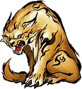

- 类型：火
- 五行：火

### 【练气 · 山豹】

在山间出没的生物，目击者只看到形体像豹。

技能「迅猛」攻击的目标如果本回合还未出手，则此卡牌会攻击两次

技能「迅猛」（被动）此卡牌每次行动，会攻击两次

技能「硬肤」加入战场时，获得10点〔护甲〕

### 【筑基 · 赤红豹】

山豹修炼至筑基期后，全身皮肤泛红，煞是恐怖。

技能「迅猛」攻击的目标如果本回合还未出手，则此卡牌会攻击两次

技能「迅猛」（被动）此卡牌每次行动，会攻击两次

技能「硬肤」加入战场时，获得20点〔护甲〕

### 【结丹 · 独角赤豹】

赤红豹结丹后，头上竟然长出独角，击杀甚是不易。

技能「迅猛」攻击的目标如果本回合还未出手，则此卡牌会攻击两次

技能「迅猛」（被动）此卡牌每次行动，会攻击两次

技能「硬肤」加入战场时，获得50点〔护甲〕

---

## 2. 蛇（木）

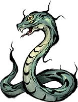

- 类型：木
- 五行：木

### 【练气 · 青蛇】

修炼至练气期的青色巨蛇，一口可吞下整只牛羊。

技能「唤蛇」（被动）加入战场的首个回合开始时，会召唤另外一条青蛇

技能「唤蛇」（被动）加入战场的首个回合开始时，会召唤另外三条青蛇

技能「硬肤」加入战场时，获得10点〔护甲〕

### 【筑基 · 长蛇】

青蛇的身体逐渐变长，甚至达到数丈之长。

技能「唤蛇」（被动）加入战场的首个回合开始时，会召唤另外一条青蛇

技能「唤蛇」（被动）加入战场的首个回合开始时，会召唤另外三条青蛇

技能「硬肤」加入战场时，获得20点〔护甲〕

---

## 3. 鸟

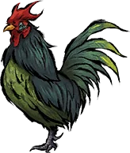

- 类型：土
- 五行：土

### 【练气 · 鸣鸟】

常年生活在坟地的鸟，每次鸣叫之时，意味着某个生命的流逝。

技能「远程」（锁定技）此卡牌的攻击模式为：**远程攻击**（全体）

技能「鸟鸣」（被动）战斗开始时，会先执行一次攻击

技能「硬肤」加入战场时，获得10点〔护甲〕

### 【筑基 · 鸣坟鸠】

集聚坟头阴气而筑基，身形较鸣鸟更加庞大。

技能「远程」（锁定技）此卡牌的攻击模式为：**远程攻击**（全体）

技能「鸟鸣」（被动）战斗开始时，会先执行一次攻击

技能「硬肤」加入战场时，获得20点〔护甲〕

### 【结丹 · 尸鸠】

此尸鸠非布谷鸟，而是借由一具尸体结丹的死亡之鸟。

技能「远程」（锁定技）此卡牌的攻击模式为：**远程攻击**（全体）

技能「鸟鸣」（被动）战斗开始时，会先执行一次攻击

技能「硬肤」加入战场时，获得50点〔护甲〕

---

## 4. 鼠

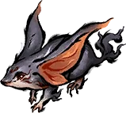

- 类型：金
- 五行：金

### 【练气 · 耳鼠】

耳朵肥大的老鼠，善藏匿，常用耳朵把身体覆盖来躲避天敌。

技能「聚光」（被动）加入战场时，获得**光盾**

技能「聚光」加入战场与回合结束时，获得**光盾**（仅前5回合生效）

技能「聚光」加入战场与回合结束时，获得**光盾**（仅前5回合生效）

技能「硬肤」加入战场时，获得10点〔护甲〕

### 【筑基 · 飞鼠】

耳鼠的耳朵修炼得更大，竟能扇动而御风飞行。

技能「聚光」（被动）加入战场时，获得**光盾**

技能「聚光」加入战场与回合结束时，获得**光盾**（仅前5回合生效）

技能「聚光」加入战场与回合结束时，获得**光盾**（仅前5回合生效）

技能「硬肤」加入战场时，获得20点〔护甲〕

---

## 5. 象

- 类型：土
- 五行：土

### 【练气 · 巨象】

因更能吸收天地灵气使得身体比普通大象更为巨大的象。

技能「硬肤」（被动）加入战场时，获得10点〔血量〕，且受到近战攻击时，反弹20%伤害

技能「反弹」

技能「硬肤」（被动）加入战场时，获得20点〔血量〕，且受到近战攻击时，反弹40%伤害

技能「反弹」

---

## 6. 蟾蜍

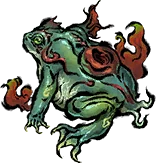

- 类型：金
- 五行：金

### 【练气 · 毒蟾】

身体有特殊的构造，能将灵气转化毒气。

技能「毒素」攻击后，使受击者**中毒**

技能「毒素」攻击后，使受击者**中毒**，当毒触发后，会使随机敌人再次**中毒**

技能「毒素」

技能「硬肤」加入战场时，获得10点〔护甲〕

### 【筑基 · 金毒蟾】

毒气凝聚在皮肤里，竟使得皮肤变得金灿灿。贪婪之人如以为是黄金而取之，后果不堪设想。

技能「毒素」攻击后，使受击者**中毒**

技能「毒素」攻击后，使受击者**中毒**，当毒触发后，会使随机敌人再次**中毒**

技能「毒素」

技能「硬肤」加入战场时，获得20点〔护甲〕

### 【结丹 · 三足金毒蟾】

金毒蟾的凝聚的毒性太强，所以它牺牲一只脚结丹，结丹后终于能驾驭身体的毒气。

技能「毒素」攻击后，使受击者**中毒**

技能「毒素」攻击后，使受击者**中毒**，当毒触发后，会使随机敌人再次**中毒**

技能「毒素」

技能「硬肤」加入战场时，获得50点〔护甲〕

---

## 7. 蛇（火）

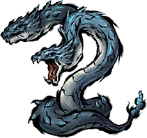

- 类型：火
- 五行：火

### 【练气 · 枳首蛇】

这只蛇天生就长着两个头，危险程度无需说明。

技能「怒火」受到攻击后，此卡牌的〔攻击〕+1

技能「怒火」受到攻击后，此卡牌的〔攻击〕+2；且攻击会对目标身旁卡牌造成50%伤害

技能「怒火」

技能「硬肤」加入战场时，获得10点〔护甲〕

### 【筑基 · 三头枳首蛇】

筑基后，枳首蛇更是多长了一个头，不祥之兆愈发明显。

技能「怒火」受到攻击后，此卡牌的〔攻击〕+2

技能「怒火」受到攻击后，此卡牌的〔攻击〕+6；且攻击会对目标身旁卡牌造成50%伤害

技能「怒火」

技能「硬肤」加入战场时，获得20点〔护甲〕

### 【结丹 · 六头枳首蛇】

结丹后的歧头蛇实力比以前直接翻倍，六个蛇头互相撕咬，煞是可怕。

技能「怒火」受到攻击后，此卡牌的〔攻击〕+8

技能「怒火」受到攻击后，此卡牌的〔攻击〕+20；且攻击会对目标身旁卡牌造成50%伤害

技能「怒火」

技能「硬肤」加入战场时，获得50点〔护甲〕

---

## 8. 猴

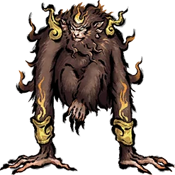

- 类型：木
- 五行：木

### 【练气 · 长臂猴】

手臂过长，以至于垂在地上，形态较为怪异。

技能「蓄力」回合开始前，此卡牌的〔攻击〕和〔血量〕均+2

技能「蓄力」回合开始前，此卡牌的〔攻击〕和〔血量〕均+3；如果攻击的目标有〔护甲〕，则造成的伤害提高

技能「蓄力」

技能「硬肤」加入战场时，获得10点〔护甲〕

### 【筑基 · 鬼脸长臂猴】

修炼至筑基后，猴子的脸开始变得狰狞起来，更像是来自蛮荒的凶兽。

技能「蓄力」回合开始前，此卡牌的〔攻击〕和〔血量〕均+3

技能「蓄力」回合开始前，此卡牌的〔攻击〕和〔血量〕均+5；如果攻击的目标有〔护甲〕，则造成的伤害提高

技能「蓄力」

技能「硬肤」加入战场时，获得20点〔护甲〕

---

## 9. 鱼

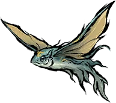

- 类型：水
- 五行：水

### 【练气 · 飞鱼】

鱼本是活于水中，但有种鱼总是跃出水面滑行，世间戏称：飞鱼。

技能「卸力」攻击造成伤害后，使目标的〔攻击〕-2；（一场战斗只会触发5次）

技能「噬魂」造成伤害后，吸取3点〔攻击〕附加于此卡牌上

技能「硬肤」加入战场时，获得10点〔护甲〕

---

## 10. 章鱼

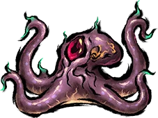

- 类型：水
- 五行：水

### 【练气 · 花臂章鱼】

章鱼的每条手臂，都修炼出独自的意识。

技能「缠绕」回合开始前，使随机敌方卡牌的技能无效，且属性恢复至战斗初。

技能「缠绕」回合开始前，使随机敌方卡牌的技能无效，且属性恢复至战斗初。章鱼的攻击对有负面状态的卡牌会造成额外伤害。

技能「硬肤」加入战场时，获得10点〔护甲〕

### 【筑基 · 北海巨妖(小)】

手臂多的章鱼修炼速度比普通灵兽更快，体型因为吸收太多的灵气而变得庞大。

技能「缠绕」回合开始前，使随机敌方卡牌的技能无效，且属性恢复至战斗初。

技能「缠绕」回合开始前，使随机敌方卡牌的技能无效，且属性恢复至战斗初。章鱼的攻击对有负面状态的卡牌会造成额外伤害。

技能「硬肤」加入战场时，获得20点〔护甲〕

---

## 11. 化蛇

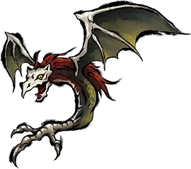

- 类型：木
- 五行：木

### 【筑基 · 化蛇】

在地上爬行的蛇，也渴望天空的自由，遂修炼出翅膀，不过对于陆地上的生物来说，这便是一场灾难。

技能「嘲讽」（锁定技）战斗中，会优先受到攻击

技能「唤蛇」每回合开始时，召唤一只**长蛇**

技能「唤蛇」每回合开始时，召唤一只**长蛇**；且化蛇受到近战攻击的伤害减少50%

技能「硬肤」加入战场时，获得20点〔护甲〕

### 【结丹 · 鬼脸飞蛇】

结丹后的化蛇，逐渐长出了凶恶的鬼脸，更是添上一丝不详。

技能「嘲讽」（锁定技）战斗中，会优先受到攻击

技能「唤蛇」每回合开始时，召唤一只**长蛇**

技能「唤蛇」每回合开始时，召唤一只**长蛇**；且化蛇受到近战攻击的伤害减少50%

技能「硬肤」加入战场时，获得50点〔护甲〕

---

## 12. 蛟

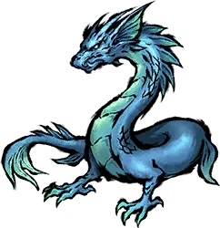

- 类型：水
- 五行：水

### 【筑基 · 入水蛟】

在深水池塘边修炼的蛟，能上天入地和下海。

技能「噬魂」造成伤害后，吸取5点〔攻击〕附加于此卡牌上

技能「噬魂」攻击后，吸取8点〔攻击〕附加于此卡牌上，且伤害结果会附加与目标的攻击力差值的50%

技能「硬肤」加入战场时，获得20点〔护甲〕

### 【结丹 · 凶蛟】

结丹后的蛟，长出了三个蛟头。想要击杀，必须将三颗蛟头斩杀，否则它都可重生。

技能「噬魂」造成伤害后，吸取8点〔攻击〕附加于此卡牌上

技能「噬魂」攻击后，吸取12点〔攻击〕附加于此卡牌上，且伤害结果会附加与目标的攻击力差值的50%

技能「硬肤」加入战场时，获得50点〔护甲〕

---

## 13. 猪

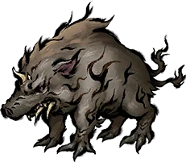

- 类型：土
- 五行：土

### 【筑基 · 青口兽】

长期修炼使得大口变得青幽，看似无害实则异常凶横。

技能「反击」（被动）受到近战攻击后，以70%的攻击力反击攻击者

技能「反击」（被动）此卡牌造成真实伤害，受到近战攻击后，反击攻击者

技能「硬肤」加入战场时，获得20点〔护甲〕

### 【结丹 · 獠牙烈兽】

长期修炼使得大口变得青幽，看似无害实则异常凶横。

技能「反击」（被动）受到近战攻击后，以70%的攻击力反击攻击者

技能「反击」（被动）此卡牌造成真实伤害，受到近战攻击后，反击攻击者

技能「硬肤」加入战场时，获得50点〔护甲〕

---

## 14. 蜈蚣

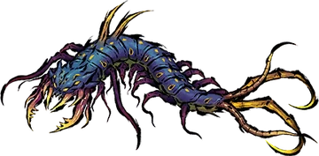

- 类型：金
- 五行：金

### 【结丹 · 噬金狂蚣】

通体覆盖着厚重、棱角分明的暗青色或铁灰色的金属甲壳，犹如身披天然的沉重板甲

技能「隐匿」（被动）只会攻击血量最少的敌人，并且造成真实伤害

技能「伺机」回合结束时，提高20〔攻击〕

技能「硬肤」加入战场时，获得50点〔护甲〕

---

## 15. 藤妖

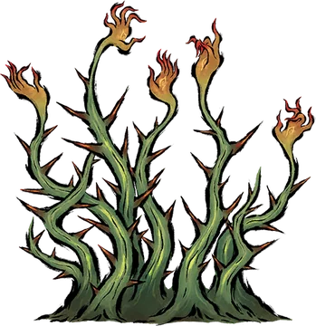

- 类型：木
- 五行：木

### 【结丹 · 千棘藤妖】

千棘藤妖

技能「反弹」（被动）将受到的攻击伤害反弹30%给攻击者

技能「反弹」（被动）将受到的攻击伤害反弹50%给攻击者

技能「连根」（被动）回合开始时，场上每有一张〔木〕或〔水〕卡牌，藤妖的〔血量〕+20

技能「硬肤」加入战场时，获得50点〔护甲〕

---

## 16. 鲤鱼

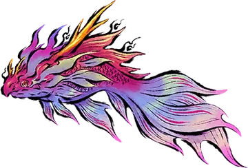

- 类型：水
- 五行：水

### 【结丹 · 彩鳞龙鲤】

鳞片如镜面般光滑，在阳光下折射出七彩光晕。

技能「远程」（锁定技）此卡牌的攻击模式为：**远程攻击**（全体）

技能「噬魂」造成伤害后，吸取3点〔攻击〕附加于此卡牌上

技能「噬魂」造成伤害后，吸取5点〔攻击〕附加于此卡牌上

技能「硬肤」加入战场时，获得50点〔护甲〕

---

## 17. 蜘蛛

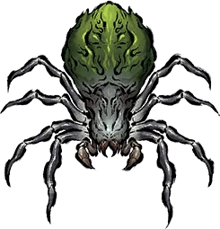

- 类型：阴
- 五行：阴

### 【练气 · 毒蛛】

从鬼面蛛的囊袋里孵化的小毒蛛，虽然实力不强，但数量众多。

技能「中毒肆」回合结束后，使随机敌人获得**中毒**

### 【筑基 · 毒蛛】

从鬼面蛛的囊袋里孵化的小毒蛛，虽然实力不强，但数量众多。

技能「中毒肆」回合结束后，使随机敌人获得**中毒**

### 【结丹 · 毒蛛】

从鬼面蛛的囊袋里孵化的小毒蛛，虽然实力不强，但数量众多。

技能「中毒肆」回合结束后，使随机敌人获得**中毒**

---

## 18. 灵剑

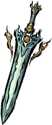

- 类型：金
- 五行：金

### 【筑基 · 灵剑】

应该是前来探索的修士佩剑，受剑冢影响产生了最初始的神识

技能「聚光」（被动）加入战场时，获得**光盾**

技能「连击」（被动）灵剑每次行动会攻击两次

### 【结丹 · 灵剑】

应该是前来探索的修士佩剑，受剑冢影响产生了最初始的神识

技能「聚光」（被动）加入战场时，获得**光盾**

技能「连击」（被动）灵剑每次行动会攻击两次

---

## 19. 树妖

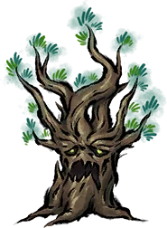

- 类型：火
- 五行：火

### 【练气 · 树妖】（图鉴未收录）

普通树木吸收灵气形成的精怪。初得灵识，较为调皮，但不会伤人性命。

### 【练气 · 火灵树妖】（图鉴未收录）

在火属性区域修炼的树妖，会逐渐演变成火灵树妖

### 【筑基 · 火灵树妖】（图鉴未收录）

本是普通的树妖，但盘踞在火云树里修炼，使得样貌也发生了变化

其树枝上的火焰似乎可摘下？

出现在：〔火〕地点「火云树」—— 派灵兽 / 傀儡去探索火云树时，会同时引出一只火灵树妖（出现后约 120 日不处理就会消失）。

击败后掉落「灵火芯」和「内丹」：灵火芯可以修炼出口诀，或者提升〔火〕火属性法宝的品质。

技能「火云庇护」树妖和火云树有着密切联系，在进入战斗时获得大量护甲，且每回合结束后攻击力提高5

### 【结丹 · 火灵树妖】（图鉴未收录）

奇怪....森林里怎么会有火灵树妖；而且，它好像被控制了？

出现在：「古木幽森」深处（清虚谷剧情：被枯木师叔布置的机关控制的火灵树妖）。

技能「火云庇护」树妖和火云树有着密切联系，在进入战斗时获得大量护甲，且每回合结束后攻击力提高20

---
