# 【卡牌修仙传】图鉴攻略 — 妖王

- 收录总数：31（游戏官方数据）
- 更新时间：2026-11-18 07:56

---

## 1. 坟蛊鸪

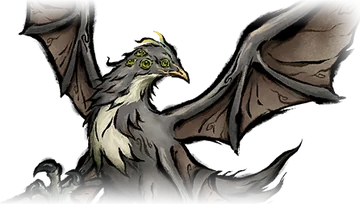

- 类型：阴
- 五行：阴

### 【练气 · 坟蛊鸪】

在坟场里修炼的鸟类凶兽，喜欢死亡的气息，对凡人的威胁相当大！

技能「鸟鸣」此卡牌的攻击模式为：远程单体

技能「荆棘」每回合第一次受到伤害时，**禁锢**随机敌方卡牌2回合

### 【筑基 · 坟蛊鸪】

在坟场里修炼的鸟类凶兽，喜欢死亡的气息，对凡人的威胁相当大！

技能「鸟鸣」此卡牌的攻击模式为：远程单体

技能「荆棘」每回合第一次受到伤害时，**禁锢**随机敌方卡牌2回合

技能「噬魂」攻击后，吸取5点〔攻击〕附加于此卡牌上

### 【结丹 · 坟蛊鸪】

在坟场里修炼的鸟类凶兽，喜欢死亡的气息，对凡人的威胁相当大！

技能「鸟鸣」此卡牌的攻击模式为：远程全体攻击

技能「荆棘」每回合第一次受到伤害时，**禁锢**随机敌方卡牌2回合

技能「噬魂」攻击后，吸取7点〔攻击〕附加于此卡牌上

### 【元婴 · 坟蛊鸪】

在坟场里修炼的鸟类凶兽，喜欢死亡的气息，对凡人的威胁相当大！

技能「鸟鸣」此卡牌的攻击模式为：远程全体攻击

技能「荆棘」每回合第一次受到伤害时，**禁锢**随机敌方卡牌2回合

技能「噬魂」攻击后，吸取10点〔攻击〕附加于此卡牌上

### 【化神 · 坟蛊鸪】

在坟场里修炼的鸟类凶兽，喜欢死亡的气息，对凡人的威胁相当大！

技能「鸟鸣」此卡牌的攻击模式为：远程全体攻击

技能「荆棘」每回合第一次受到伤害时，**禁锢**随机敌方卡牌2回合

技能「噬魂」攻击后，吸取20点〔攻击〕附加于此卡牌上

---

## 2. 妖剑

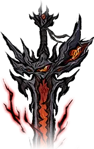

- 类型：金
- 五行：金

### 【筑基 · 妖剑】

不知发生何种情况，这把巨剑竟然长出了眼睛。

技能「剑罡」受到攻击后，自身获得**光盾**

技能「剑意」每当战场里有光盾消失，妖剑的〔攻击〕+3

技能「剑招」（被动）受到近战攻击后，以50%攻击力反击攻击者

### 【结丹 · 妖剑】

不知发生何种情况，这把巨剑竟然长出了眼睛。

技能「剑罡」受到攻击后，自身获得**光盾**

技能「剑意」每当战场里有光盾消失，妖剑的〔攻击〕+9

技能「剑招」（被动）受到近战攻击后，以50%攻击力反击攻击者

### 【元婴 · 妖剑】

不知发生何种情况，这把巨剑竟然长出了眼睛。

技能「剑罡」受到攻击后，自身获得**光盾**

技能「剑意」每当战场里有光盾消失，妖剑的〔攻击〕+25

技能「剑招」（被动）受到近战攻击后，以50%攻击力反击攻击者

### 【化神 · 妖剑】

不知发生何种情况，这把巨剑竟然长出了眼睛。

技能「剑罡」受到攻击后，自身获得**光盾**

技能「剑意」每当战场里有光盾消失，妖剑的〔攻击〕+65

技能「剑招」（被动）受到近战攻击后，以50%攻击力反击攻击者

---

## 3. 血藤古树

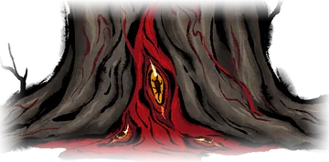

- 类型：木
- 五行：木

### 【筑基 · 血藤古树】

生长在古木幽森里的古树，千年来靠吸食误入森林的人类的精血为生，虽无法行走，但危险性极大。

技能「连根」（被动）回合开始时，场上每有一张〔木〕或〔水〕卡牌，古树的〔攻击〕+5；每有一张〔火〕卡牌，古树的〔攻击〕-5

技能「吸血」（被动）攻击后，造成的伤害将恢复到自身血量

### 【结丹 · 血藤古树】

生长在古木幽森里的古树，千年来靠吸食误入森林的人类的精血为生，虽无法行走，但危险性极大。

技能「连根」（被动）回合开始时，场上每有一张〔木〕或〔水〕卡牌，古树的〔攻击〕+14；每有一张〔火〕卡牌，古树的〔攻击〕-14

技能「吸血」（被动）攻击后，造成的伤害将恢复到自身血量

### 【元婴 · 血藤古树】

生长在古木幽森里的古树，千年来靠吸食误入森林的人类的精血为生，虽无法行走，但危险性极大。

技能「连根」（被动）回合开始时，场上每有一张〔木〕或〔水〕卡牌，古树的〔攻击〕+58；每有一张〔火〕卡牌，古树的〔攻击〕-58

技能「吸血」（被动）攻击后，造成的伤害将恢复到自身血量

### 【化神 · 血藤古树】

生长在古木幽森里的古树，千年来靠吸食误入森林的人类的精血为生，虽无法行走，但危险性极大。

技能「连根」（被动）回合开始时，场上每有一张〔木〕或〔水〕卡牌，古树的〔攻击〕+105；每有一张〔火〕卡牌，古树的〔攻击〕-105

技能「吸血」（被动）攻击后，造成的伤害将恢复到自身血量

---

## 4. 夔牛

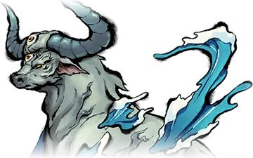

- 类型：水
- 五行：水

### 【筑基 · 夔牛】

独足踏云的青苍巨牛，双目赤红如熔岩，呼吸间雷霆若现。每行一步，地裂山崩，风雨交加，雷鸣电闪。

技能「落雷」（被动）回合开始时，对所有敌人造成5点〔伤害〕

技能「雷霆之力」落雷还会导致随机2名敌人的〔攻击〕-8

技能「践踏」（被动）此卡牌的攻击还会时目标身旁卡牌混乱1回合

### 【结丹 · 夔牛】

独足踏云的青苍巨牛，双目赤红如熔岩，呼吸间雷霆若现。每行一步，地裂山崩，风雨交加，雷鸣电闪。

技能「落雷」（被动）回合开始时，对所有敌人造成15点〔伤害〕

技能「雷霆之力」落雷还会导致随机2名敌人的〔攻击〕-15

技能「践踏」（被动）此卡牌的攻击还会时目标身旁卡牌混乱1回合

### 【元婴 · 夔牛】

独足踏云的青苍巨牛，双目赤红如熔岩，呼吸间雷霆若现。每行一步，地裂山崩，风雨交加，雷鸣电闪。

技能「落雷」（被动）回合开始时，对所有敌人造成40点〔伤害〕

技能「雷霆之力」落雷还会导致随机2名敌人的〔攻击〕-30

技能「践踏」（被动）此卡牌的攻击还会时目标身旁卡牌混乱1回合

### 【化神 · 夔牛】

独足踏云的青苍巨牛，双目赤红如熔岩，呼吸间雷霆若现。每行一步，地裂山崩，风雨交加，雷鸣电闪。

技能「落雷」（被动）回合开始时，对所有敌人造成80点〔伤害〕

技能「雷霆之力」落雷还会导致随机2名敌人的〔攻击〕-50

技能「践踏」（被动）此卡牌的攻击还会时目标身旁卡牌混乱1回合

---

## 5. 祸斗

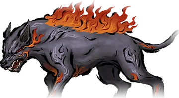

- 类型：火
- 五行：火

### 【筑基 · 祸斗】

一头赤焰巨犬，身覆流火，尾若流星，呼吸间火星迸溅，所过之地草木成灰，江河蒸腾。

技能「迅猛」（被动）此卡牌每次行动，会攻击多次

技能「浴火」（被动）此卡牌免疫〔火〕伤害，但受到〔水〕卡牌的伤害翻倍

### 【结丹 · 祸斗】

一头赤焰巨犬，身覆流火，尾若流星，呼吸间火星迸溅，所过之地草木成灰，江河蒸腾。

技能「迅猛」（被动）此卡牌每次行动，会攻击多次

技能「浴火」（被动）此卡牌免疫〔火〕伤害，但受到〔水〕卡牌的伤害翻倍

### 【元婴 · 祸斗】

一头赤焰巨犬，身覆流火，尾若流星，呼吸间火星迸溅，所过之地草木成灰，江河蒸腾。

技能「迅猛」（被动）此卡牌每次行动，会攻击多次

技能「浴火」（被动）此卡牌免疫〔火〕伤害，但受到〔水〕卡牌的伤害翻倍

### 【化神 · 祸斗】

一头赤焰巨犬，身覆流火，尾若流星，呼吸间火星迸溅，所过之地草木成灰，江河蒸腾。

技能「迅猛」（被动）此卡牌每次行动，会攻击多次

技能「浴火」（被动）此卡牌免疫〔火〕伤害，但受到〔水〕卡牌的伤害翻倍

---

## 6. 巨灵烈象

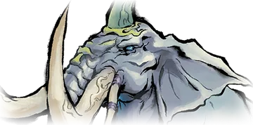

- 类型：土
- 五行：土

### 【筑基 · 巨灵烈象】

其形如山峦般巍峨，皮肤如钻石般坚硬，四足踏地时地涌岩浆，每一步届震裂土地。

技能「硬肤」（被动）进入战斗后，会获得大量护甲；回合结束时，获得35护甲；受到近战攻击时，会反弹伤害

### 【结丹 · 巨灵烈象】

其形如山峦般巍峨，皮肤如钻石般坚硬，四足踏地时地涌岩浆，每一步届震裂土地。

技能「硬肤」（被动）进入战斗后，会获得大量护甲；回合结束时，获得80护甲；受到近战攻击时，会反弹伤害

### 【元婴 · 巨灵烈象】

其形如山峦般巍峨，皮肤如钻石般坚硬，四足踏地时地涌岩浆，每一步届震裂土地。

技能「硬肤」（被动）进入战斗后，会获得大量护甲；回合结束时，获得150护甲；受到近战攻击时，会反弹伤害

### 【化神 · 巨灵烈象】

其形如山峦般巍峨，皮肤如钻石般坚硬，四足踏地时地涌岩浆，每一步届震裂土地。

技能「硬肤」（被动）进入战斗后，会获得大量护甲；回合结束时，获得400护甲；受到近战攻击时，会反弹伤害

---

## 7. 鬼面蛛

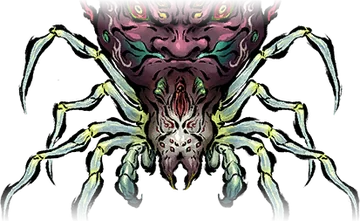

- 类型：阴
- 五行：阴

### 【练气 · 鬼面蛛】

其形如小山，腹部隆起如腐尸堆积，表面纹路交织成一张狰狞鬼脸，鬼脸能吐出紫黑色毒雾。

技能「蛛网」回合开始时，使随机2名敌人卡牌获得**中毒**；前3回合，还会使中毒的敌人无法行动2回合

### 【筑基 · 鬼面蛛】

其形如小山，腹部隆起如腐尸堆积，表面纹路交织成一张狰狞鬼脸，鬼脸能吐出紫黑色毒雾。

技能「蛛网」回合开始时，使随机2名敌人卡牌获得**中毒**；前3回合，还会使中毒的敌人无法行动2回合

技能「引毒」攻击的目标如果有**中毒**，则将中毒伤害提前生效，使目标旁边随机卡牌受到相同的伤害

### 【结丹 · 鬼面蛛】

其形如小山，腹部隆起如腐尸堆积，表面纹路交织成一张狰狞鬼脸，鬼脸能吐出紫黑色毒雾。

技能「蛛网」回合开始时，使随机2名敌人卡牌获得**中毒**；前3回合，还会使中毒的敌人无法行动2回合

技能「引毒」攻击的目标如果有**中毒**，则将中毒伤害提前生效，使目标旁边随机卡牌受到相同的伤害

### 【元婴 · 鬼面蛛】

其形如小山，腹部隆起如腐尸堆积，表面纹路交织成一张狰狞鬼脸，鬼脸能吐出紫黑色毒雾。

技能「蛛网」回合开始时，使随机2名敌人卡牌获得**中毒**；前3回合，还会使中毒的敌人无法行动2回合

技能「引毒」攻击的目标如果有**中毒**，则将中毒伤害提前生效，使目标旁边随机卡牌受到相同的伤害

### 【化神 · 鬼面蛛】

其形如小山，腹部隆起如腐尸堆积，表面纹路交织成一张狰狞鬼脸，鬼脸能吐出紫黑色毒雾。

技能「蛛网」回合开始时，使随机2名敌人卡牌获得**中毒**；前3回合，还会使中毒的敌人无法行动2回合

技能「引毒」攻击的目标如果有**中毒**，则将中毒伤害提前生效，使目标旁边随机卡牌受到相同的伤害

---

## 8. 九尾天狐的分身

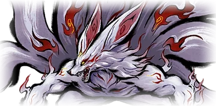

- 类型：金
- 五行：金

### 【合体 · 九尾天狐的分身】

一股强大的压力向我袭来。我无法侦查九尾天狐的任何信息。

技能「???」？？？

---

## 9. 金蝉蛊

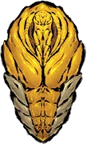

- 类型：金
- 五行：金

### 【筑基 · 金蝉蛊】

通体如熔金浇筑，甲壳覆盖细密梵文状天然纹路，翅翼薄如琉璃，振翅时洒落金色磷粉，触及草木即枯

技能「孵化」（被动）进入战斗后，等待2回合才会进行攻击.攻击模式为：全体攻击

技能「蛊力」（被动）每次受到攻击，自身的〔攻击〕+2

### 【结丹 · 金蝉蛊】

通体如熔金浇筑，甲壳覆盖细密梵文状天然纹路，翅翼薄如琉璃，振翅时洒落金色磷粉，触及草木即枯

技能「孵化」（被动）进入战斗后，等待2回合才会进行攻击.攻击模式为：全体攻击

技能「蛊力」（被动）每次受到攻击，自身的〔攻击〕+3

### 【元婴 · 金蝉蛊】

通体如熔金浇筑，甲壳覆盖细密梵文状天然纹路，翅翼薄如琉璃，振翅时洒落金色磷粉，触及草木即枯

技能「孵化」（被动）进入战斗后，等待2回合才会进行攻击.攻击模式为：全体攻击

技能「蛊力」（被动）每次受到攻击，自身的〔攻击〕+4

### 【化神 · 金蝉蛊】

通体如熔金浇筑，甲壳覆盖细密梵文状天然纹路，翅翼薄如琉璃，振翅时洒落金色磷粉，触及草木即枯

技能「孵化」（被动）进入战斗后，等待2回合才会进行攻击.攻击模式为：全体攻击

技能「蛊力」（被动）每次受到攻击，自身的〔攻击〕+5

---

## 10. 血肉灵芝

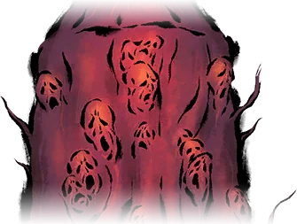

- 类型：木
- 五行：木

### 【筑基 · 血肉灵芝】

本体为直径十丈的暗红色肉团，表面布满跳动的血管与扭曲的人脸，触手状菌丝如活蛇般蠕动，渗出琥珀色粘液

技能「分裂」（被动）每回合开始时，召唤2张小血肉灵芝卡

技能「汲取」（被动）回合结束时，场上每有一张〔木〕卡片，〔血量〕+10

技能「嘲讽」（锁定技）战斗中，会优先受到攻击

### 【结丹 · 血肉灵芝】

本体为直径十丈的暗红色肉团，表面布满跳动的血管与扭曲的人脸，触手状菌丝如活蛇般蠕动，渗出琥珀色粘液

技能「分裂」（被动）每回合开始时，召唤2张小血肉灵芝卡

技能「汲取」（被动）回合结束时，场上每有一张〔木〕卡片，〔血量〕+20

技能「嘲讽」（锁定技）战斗中，会优先受到攻击

### 【元婴 · 血肉灵芝】

本体为直径十丈的暗红色肉团，表面布满跳动的血管与扭曲的人脸，触手状菌丝如活蛇般蠕动，渗出琥珀色粘液

技能「分裂」（被动）每回合开始时，召唤2张小血肉灵芝卡

技能「汲取」（被动）回合结束时，场上每有一张〔木〕卡片，〔血量〕+50

技能「嘲讽」（锁定技）战斗中，会优先受到攻击

### 【化神 · 血肉灵芝】

本体为直径十丈的暗红色肉团，表面布满跳动的血管与扭曲的人脸，触手状菌丝如活蛇般蠕动，渗出琥珀色粘液

技能「分裂」（被动）每回合开始时，召唤2张小血肉灵芝卡

技能「汲取」（被动）回合结束时，场上每有一张〔木〕卡片，〔血量〕+100

技能「嘲讽」（锁定技）战斗中，会优先受到攻击

---

## 11. 北海巨妖

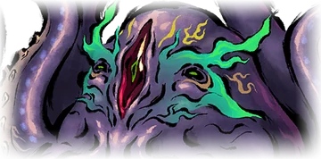

- 类型：水
- 五行：水

### 【筑基 · 北海巨妖】

体长千丈，通体覆盖青黑色鳞甲，八条主触手粗如山岳，每条触手分化数百附肢，末端生有锯齿状骨刃，可轻易撕裂法宝护盾

技能「触须」（被动）加入战场时，召唤4条手臂

技能「再生」每回合结束时，恢复全体友军10点〔血量〕

### 【结丹 · 北海巨妖】

体长千丈，通体覆盖青黑色鳞甲，八条主触手粗如山岳，每条触手分化数百附肢，末端生有锯齿状骨刃，可轻易撕裂法宝护盾

技能「触须」（被动）加入战场时，召唤4条手臂

技能「再生」每回合结束时，恢复全体友军20点〔血量〕

### 【元婴 · 北海巨妖】

体长千丈，通体覆盖青黑色鳞甲，八条主触手粗如山岳，每条触手分化数百附肢，末端生有锯齿状骨刃，可轻易撕裂法宝护盾

技能「触须」（被动）加入战场时，召唤4条手臂

技能「再生」每回合结束时，恢复全体友军50点〔血量〕

### 【化神 · 北海巨妖】

体长千丈，通体覆盖青黑色鳞甲，八条主触手粗如山岳，每条触手分化数百附肢，末端生有锯齿状骨刃，可轻易撕裂法宝护盾

技能「触须」（被动）加入战场时，召唤4条手臂

技能「再生」每回合结束时，恢复全体友军100点〔血量〕

---

## 12. 黑焰虎

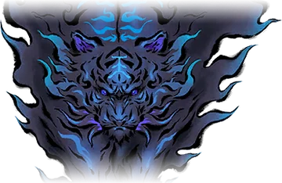

- 类型：火
- 五行：火

### 【筑基 · 黑焰虎】

首生有三目，眉下双目不怒自威，额间竖瞳摄魂夺魄，四爪缠绕镇魂锁链，玄焰不触大地亦燃

技能「燃魄」（被动）黑焰虎造成的伤害为真实伤害，在攻击前会先对目标进行一次火焰攻击

技能「魂体」（被动）兵器（刀/剑/双刀/暗器/枪/锤/）无法对黑焰虎造成伤害，但受到乐器伤害翻倍

### 【结丹 · 黑焰虎】

首生有三目，眉下双目不怒自威，额间竖瞳摄魂夺魄，四爪缠绕镇魂锁链，玄焰不触大地亦燃

技能「燃魄」（被动）黑焰虎造成的伤害为真实伤害，在攻击前会先对目标进行一次火焰攻击

技能「魂体」（被动）兵器（刀/剑/双刀/暗器/枪/锤/）无法对黑焰虎造成伤害，但受到乐器伤害翻倍

### 【元婴 · 黑焰虎】

首生有三目，眉下双目不怒自威，额间竖瞳摄魂夺魄，四爪缠绕镇魂锁链，玄焰不触大地亦燃

技能「燃魄」（被动）黑焰虎造成的伤害为真实伤害，在攻击前会先对目标进行一次火焰攻击

技能「魂体」（被动）兵器（刀/剑/双刀/暗器/枪/锤/）无法对黑焰虎造成伤害，但受到乐器伤害翻倍

### 【化神 · 黑焰虎】

首生有三目，眉下双目不怒自威，额间竖瞳摄魂夺魄，四爪缠绕镇魂锁链，玄焰不触大地亦燃

技能「燃魄」（被动）黑焰虎造成的伤害为真实伤害，在攻击前会先对目标进行一次火焰攻击

技能「魂体」（被动）兵器（刀/剑/双刀/暗器/枪/锤/）无法对黑焰虎造成伤害，但受到乐器伤害翻倍

---

## 13. 铁骨熊

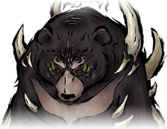

- 类型：土
- 五行：土

### 【筑基 · 铁骨熊】

覆盖青黑色骨甲，甲缝间流淌熔岩纹路；背部耸立三排锯齿状骨刺，四肢关节包裹青铜色金属护甲，利爪如开山巨斧，挥动时撕裂空气发出爆鸣

技能「铁骨」（被动）战斗中获得护甲；受到远程攻击的伤害减少0.5

技能「重掌」如果未造成伤害，则再攻击一次

技能「铁骨贰」每受到一次攻击，自己会获得2增伤

### 【结丹 · 铁骨熊】

覆盖青黑色骨甲，甲缝间流淌熔岩纹路；背部耸立三排锯齿状骨刺，四肢关节包裹青铜色金属护甲，利爪如开山巨斧，挥动时撕裂空气发出爆鸣

技能「铁骨」（被动）战斗中获得护甲；受到远程攻击的伤害减少0.5

技能「重掌」如果未造成伤害，则再攻击一次

技能「铁骨贰」每受到一次攻击，自己会获得3增伤

### 【元婴 · 铁骨熊】

覆盖青黑色骨甲，甲缝间流淌熔岩纹路；背部耸立三排锯齿状骨刺，四肢关节包裹青铜色金属护甲，利爪如开山巨斧，挥动时撕裂空气发出爆鸣

技能「铁骨」（被动）战斗中获得护甲；受到远程攻击的伤害减少0.5

技能「重掌」如果未造成伤害，则再攻击一次

技能「铁骨贰」每受到一次攻击，自己会获得4增伤

### 【化神 · 铁骨熊】

覆盖青黑色骨甲，甲缝间流淌熔岩纹路；背部耸立三排锯齿状骨刺，四肢关节包裹青铜色金属护甲，利爪如开山巨斧，挥动时撕裂空气发出爆鸣

技能「铁骨」（被动）战斗中获得护甲；受到远程攻击的伤害减少0.5

技能「重掌」如果未造成伤害，则再攻击一次

技能「铁骨贰」每受到一次攻击，自己会获得5增伤

---

## 14. 青翼蝠王

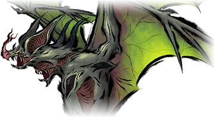

- 类型：阴
- 五行：阴

### 【筑基 · 青翼蝠王】

本体为上古异种“幽冥血蝠”，因吞噬地脉阴煞之气与修士精血，修炼万年蜕变为妖王

技能「音波」（被动）回合开始时，使全体敌人卡牌获得混乱

技能「嗜血」如果攻击将目标杀死，则再攻击一次（每回合只触发一次）

### 【结丹 · 青翼蝠王】

本体为上古异种“幽冥血蝠”，因吞噬地脉阴煞之气与修士精血，修炼万年蜕变为妖王

技能「音波」（被动）回合开始时，使全体敌人卡牌获得混乱

技能「嗜血」如果攻击将目标杀死，则再攻击一次（每回合只触发一次）

### 【元婴 · 青翼蝠王】

本体为上古异种“幽冥血蝠”，因吞噬地脉阴煞之气与修士精血，修炼万年蜕变为妖王

技能「音波」（被动）回合开始时，使全体敌人卡牌获得混乱

技能「嗜血」如果攻击将目标杀死，则再攻击一次（每回合只触发一次）

### 【化神 · 青翼蝠王】

本体为上古异种“幽冥血蝠”，因吞噬地脉阴煞之气与修士精血，修炼万年蜕变为妖王

技能「音波」（被动）回合开始时，使全体敌人卡牌获得混乱

技能「嗜血」如果攻击将目标杀死，则再攻击一次（每回合只触发一次）

---

## 15. 狰

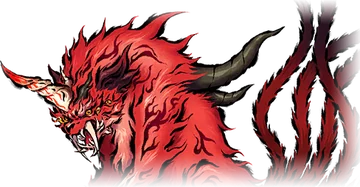

- 类型：金
- 五行：金

### 【结丹 · 狰】

面部中央生有螺旋状独角，角尖萦绕空间裂隙；双目呈熔金色，竖瞳开合间迸射庚金煞气，凝视可瓦解低阶法宝灵光

技能「狂暴」（被动）攻击造成伤害后，会使自己获得狂暴；造成伤害提高和受到伤害减少5点

### 【元婴 · 狰】

面部中央生有螺旋状独角，角尖萦绕空间裂隙；双目呈熔金色，竖瞳开合间迸射庚金煞气，凝视可瓦解低阶法宝灵光

技能「狂暴」（被动）攻击造成伤害后，会使自己获得狂暴；造成伤害提高和受到伤害减少14点

### 【化神 · 狰】

面部中央生有螺旋状独角，角尖萦绕空间裂隙；双目呈熔金色，竖瞳开合间迸射庚金煞气，凝视可瓦解低阶法宝灵光

技能「狂暴」（被动）攻击造成伤害后，会使自己获得狂暴；造成伤害提高和受到伤害减少39点

---

## 16. 肥遗

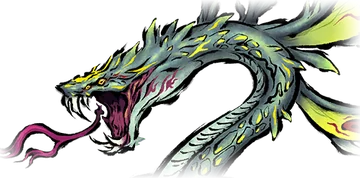

- 类型：木
- 五行：木

### 【结丹 · 肥遗】

蛇身覆盖暗金色鳞甲，六只利爪如熔岩铸就，四翼展开遮天蔽日，翼膜流淌赤红火纹，扇动时掀起焚风热浪

技能「蛇毒」（被动）回合开始时，随机禁锢一名敌人（前3回合生效）；随机封印一名敌人；使一名随机敌人中毒

技能「横扫」攻击会对目标身旁卡牌造成同等伤害

技能「横扫贰」（被动）攻击的目标如果有负面状态，则伤害结果〔伤害〕+0

### 【元婴 · 肥遗】

蛇身覆盖暗金色鳞甲，六只利爪如熔岩铸就，四翼展开遮天蔽日，翼膜流淌赤红火纹，扇动时掀起焚风热浪

技能「蛇毒」（被动）回合开始时，随机禁锢一名敌人（前3回合生效）；随机封印一名敌人；使一名随机敌人中毒

技能「横扫」攻击会对目标身旁卡牌造成同等伤害

技能「横扫贰」（被动）攻击的目标如果有负面状态，则伤害结果〔伤害〕+0

### 【化神 · 肥遗】

蛇身覆盖暗金色鳞甲，六只利爪如熔岩铸就，四翼展开遮天蔽日，翼膜流淌赤红火纹，扇动时掀起焚风热浪

技能「蛇毒」（被动）回合开始时，随机禁锢一名敌人（前3回合生效）；随机封印一名敌人；使一名随机敌人中毒

技能「横扫」攻击会对目标身旁卡牌造成同等伤害

技能「横扫贰」（被动）攻击的目标如果有负面状态，则伤害结果〔伤害〕+0

---

## 17. 文鳐鱼

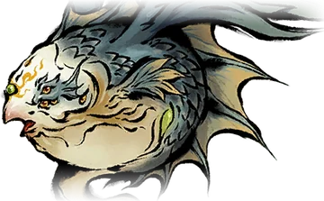

- 类型：水
- 五行：水

### 【结丹 · 文鳐鱼】

鱼身覆盖青黑色苍文鳞甲，头部雪白，赤喙如血玉；背生四对半透明羽翼，翼展时洒落莹蓝光尘，振翅引动云雨漩涡

技能「远程」（锁定技）此卡牌的攻击模式为：**远程攻击**（全体）

技能「噬魂」（被动）造成伤害后，吸取4点〔攻击〕附加于此卡牌上

技能「吸血」（被动）攻击后，造成的伤害的30%将恢复到自身血量

### 【元婴 · 文鳐鱼】

鱼身覆盖青黑色苍文鳞甲，头部雪白，赤喙如血玉；背生四对半透明羽翼，翼展时洒落莹蓝光尘，振翅引动云雨漩涡

技能「远程」（锁定技）此卡牌的攻击模式为：**远程攻击**（全体）

技能「噬魂」（被动）造成伤害后，吸取10点〔攻击〕附加于此卡牌上

技能「吸血」（被动）攻击后，造成的伤害的30%将恢复到自身血量

### 【化神 · 文鳐鱼】

鱼身覆盖青黑色苍文鳞甲，头部雪白，赤喙如血玉；背生四对半透明羽翼，翼展时洒落莹蓝光尘，振翅引动云雨漩涡

技能「远程」（锁定技）此卡牌的攻击模式为：**远程攻击**（全体）

技能「噬魂」（被动）造成伤害后，吸取28点〔攻击〕附加于此卡牌上

技能「吸血」（被动）攻击后，造成的伤害的30%将恢复到自身血量

---

## 18. 火云雀

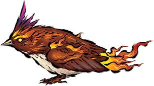

- 类型：火
- 五行：火

### 【结丹 · 火云雀】

翼展十丈，通体赤红翎羽，羽尖流淌熔岩纹路；双目如熔金宝石，翼生七彩流火，头顶如紫羽王冠

技能「溅射」攻击会对目标身旁卡牌造成同样伤害

技能「燃火之躯」（被动）对〔金〕，〔木〕和〔阴〕的卡牌造成2倍伤害；但受到〔水〕卡牌的伤害翻倍

### 【元婴 · 火云雀】

翼展十丈，通体赤红翎羽，羽尖流淌熔岩纹路；双目如熔金宝石，翼生七彩流火，头顶如紫羽王冠

技能「溅射」攻击会对目标身旁卡牌造成同样伤害

技能「燃火之躯」（被动）对〔金〕，〔木〕和〔阴〕的卡牌造成2倍伤害；但受到〔水〕卡牌的伤害翻倍

### 【化神 · 火云雀】

翼展十丈，通体赤红翎羽，羽尖流淌熔岩纹路；双目如熔金宝石，翼生七彩流火，头顶如紫羽王冠

技能「溅射」攻击会对目标身旁卡牌造成同样伤害

技能「燃火之躯」（被动）对〔金〕，〔木〕和〔阴〕的卡牌造成2倍伤害；但受到〔水〕卡牌的伤害翻倍

---

## 19. 石魈

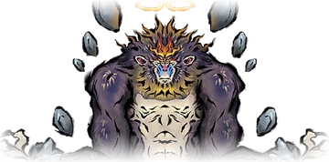

- 类型：土
- 五行：土

### 【结丹 · 石魈】

技能「兽威」（被动）如果敌对灵兽在石魈面前攻击，会使它愤怒（获得10〔攻击〕和10〔护甲〕）

技能「投石」（被动）受到近战攻击时，会以50%攻击力反击攻击者

### 【元婴 · 石魈】

技能「兽威」（被动）如果敌对灵兽在石魈面前攻击，会使它愤怒（获得32〔攻击〕和32〔护甲〕）

技能「投石」（被动）受到近战攻击时，会以50%攻击力反击攻击者

### 【化神 · 石魈】

技能「兽威」（被动）如果敌对灵兽在石魈面前攻击，会使它愤怒（获得90〔攻击〕和90〔护甲〕）

技能「投石」（被动）受到近战攻击时，会以50%攻击力反击攻击者

---

## 20. 九幽骨魅

- 类型：阴
- 五行：阴

### 【筑基 · 九幽骨魅】

本体为上古战场尸山核心的怨灵集合体，由战死者骸骨融合“九幽裂隙”泄露的幽冥之气而生，吞噬十万骸骨后蜕变为妖王

技能「分身」战斗开始时，一分为三

技能「死灵之躯」（被动）每当战场中有卡牌阵亡，自身〔攻击〕+8，〔血量〕和〔护甲〕+27；但受到〔金〕，〔火〕和〔阳〕卡牌的伤害提高50%。（一场战斗只会触发2次）

### 【结丹 · 九幽骨魅】

本体为上古战场尸山核心的怨灵集合体，由战死者骸骨融合“九幽裂隙”泄露的幽冥之气而生，吞噬十万骸骨后蜕变为妖王

技能「分身」战斗开始时，一分为三

技能「死灵之躯」（被动）每当战场中有卡牌阵亡，自身〔攻击〕+21，〔血量〕和〔护甲〕+74；但受到〔金〕，〔火〕和〔阳〕卡牌的伤害提高50%。（一场战斗只会触发2次）

技能「分身」战斗开始时，一分为三

### 【元婴 · 九幽骨魅】

本体为上古战场尸山核心的怨灵集合体，由战死者骸骨融合“九幽裂隙”泄露的幽冥之气而生，吞噬十万骸骨后蜕变为妖王

技能「分身」战斗开始时，一分为三

技能「死灵之躯」（被动）每当战场中有卡牌阵亡，自身〔攻击〕+57，〔血量〕和〔护甲〕+203；但受到〔金〕，〔火〕和〔阳〕卡牌的伤害提高50%。（一场战斗只会触发2次）

### 【化神 · 九幽骨魅】

本体为上古战场尸山核心的怨灵集合体，由战死者骸骨融合“九幽裂隙”泄露的幽冥之气而生，吞噬十万骸骨后蜕变为妖王

技能「分身」战斗开始时，一分为三

技能「死灵之躯」（被动）每当战场中有卡牌阵亡，自身〔攻击〕+158，〔血量〕和〔护甲〕+558；但受到〔金〕，〔火〕和〔阳〕卡牌的伤害提高50%。（一场战斗只会触发2次）

---

## 21. 鲲的分身

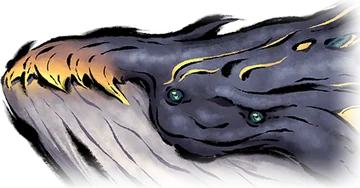

- 类型：风
- 五行：风

### 【合体 · 鲲的分身】

北冥深渊孕育的洪荒异种，入水化鲲（身长千里，背若山峦），上天为鹏（翼展蔽日，翅若垂天之云），掌控空间法则与风水之力。

它实在太大了，我无法引起它的注意力！

技能「坚硬之躯」前5回合，鲲拥有2500减伤效果

技能「呼风唤雨」鲲的攻击方式为：全体远程攻击；对〔火〕卡牌造成2倍伤害

---

## 22. 灵剑

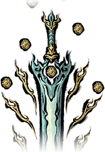

- 类型：金
- 五行：金

### 【筑基 · 灵剑】

在剑冢拔剑时唤出来的一把大型飞剑，幸好它并没有攻击倾向

技能「剑气」此卡牌的攻击方式：远程单体。攻击造成伤害后，在目标身上留下2**易伤**

技能「剑罡」每受到一次攻击，自己的攻击次数也增加

### 【结丹 · 灵剑】

守卫望剑崖的一把巨型灵剑，应该是剑阁前辈的留下的。

技能「剑气」此卡牌的攻击方式：远程单体。攻击造成伤害后，在目标身上留下3**易伤**

技能「剑罡」每受到一次攻击，自己的攻击次数也增加

---

## 23. 白龙的分身

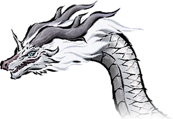

- 类型：冰
- 五行：冰

### 【合体 · 白龙的分身】

一条鳞片银白、鬃毛与尾羽呈灰白的蜿蜒白龙。

看到此白龙，总感觉到一丝的亲切感.....

技能「霜寒之躯」？？？

技能「化鳞为剑」？？？

---

## 24. 三头凶蛟的分身

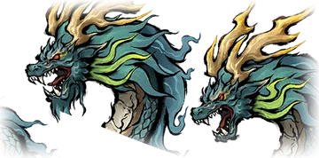

- 类型：水
- 五行：水

### 【合体 · 三头凶蛟的分身】

蛟龙醒来了！它看起来十分生气.....快跑！

技能「三头凶躯」？？？

技能「引雷之击」？？？

---

## 25. 饮岁

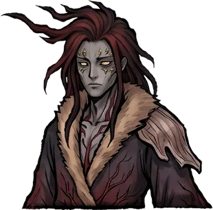

- 类型：血
- 五行：血

### 【元婴 · 饮岁】

身份：血藤古树化形

初见地：古木幽森或大洲的平原上

立场：敌对（初始状态）

出没范围：平原

技能「五行:血」（锁定技）：此卡牌拥有血属性，卡牌的〔血量〕比同级别卡稍低，但攻击附带吸血效果

技能「连根」（被动）回合开始时，场上每有一张〔木〕或〔水〕卡牌，饮岁的〔攻击〕+58；每有一张〔火〕卡牌，饮岁的〔攻击〕-58；每有一张血卡牌，饮岁的〔血量〕+116

技能「汲取」当敌方的生物卡牌（人物/灵兽）战败后，会为饮岁恢复530〔血量〕（超出部分转化为〔护甲〕）

技能「汲取贰」当敌方的非生物卡牌（法宝/傀儡/本命物）战败后，会为饮岁增加53〔攻击〕

技能「分裂」当饮岁的攻击没有造成〔伤害〕时，会消耗88〔血量〕分裂出一具血木傀儡

---

## 26. 赤牙

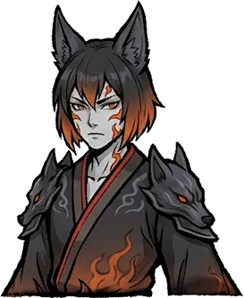

- 类型：火
- 五行：火

### 【元婴 · 赤牙】

身份：祸斗化形

初见地：地火深洞

立场：中立（初始状态）

出没范围：沙漠

技能「地火领域」位于地火深洞中，战斗双方均受到地火的影响：每回合结束时，对场上所有的〔金〕，〔木〕，〔阴〕卡牌造成45〔伤害〕

---

## 27. 金缕

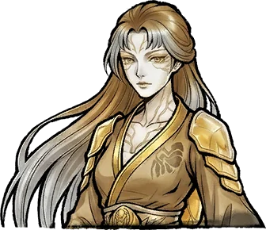

- 类型：金
- 五行：金

### 【元婴 · 金缕】

身份：金蝉蛊化形

初见地：月照之地

立场：中立（初始状态）

出没范围：整片大陆（对玩家敌对时）；平原（对玩家中立时）

技能「孵化」（被动）攻击模式为：全体攻击；但金缕会等待2回合才会进行攻击.在前2回合，金缕获得嘲讽和大量减伤

技能「蛊力」（被动）每次受到攻击，自身的〔攻击〕+4且获得1点增伤

技能「光障」每回合前3次受到攻击时，为随机友军施加**光盾**和增伤

技能「凝障」（被动）当友方卡牌战败时，自己获得一回合的**嘲讽**和**减伤**

---

## 28. 玄墨

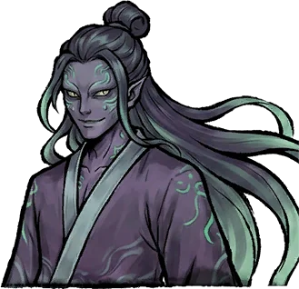

- 类型：水
- 五行：水

### 【元婴 · 玄墨】

位于陆地上的玄墨，有部分法宝无法施展

技能「触须」（被动）加入战场时，召唤4条手臂

技能「吸魂」当有敌人战败时，恢复任意友军卡牌所有〔血量〕

技能「海之力」前10回合结束时，恢复全体友军50点〔血量〕，超出部分转化为护甲

---

## 29. 暴君

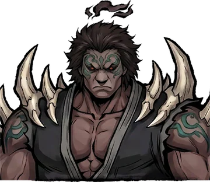

- 类型：土
- 五行：土

### 【元婴 · 暴君】

身份：铁骨熊化形

初见地：大洲的沙漠上

立场：敌对（初始状态）

出没范围：沙漠（对玩家敌对时）；整片大陆（对玩家中立时）

技能「铁骨」（被动）战斗中获得护甲；受到远程攻击的伤害减少0.5

技能「重掌」如果未造成伤害，则再攻击一次

技能「血骨铸」（被动）当自己的法宝战败时，拔出自己的骨刺（消耗150〔血量〕但同时提高〔攻击〕）重新生成一把随机法宝

技能「铁骨贰」每受到一次攻击，自己会获得4增伤

---

## 30. 澜音

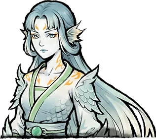

- 类型：水
- 五行：水

### 【元婴 · 澜音】

身份：文鳐鱼化形

初见地：问道台或海洋上

立场：中立（初始状态）

出没范围：海洋

技能「远程」（锁定技）此卡牌的攻击模式为：**远程攻击**（单体）

技能「噬魂」造成伤害后，吸取8点〔攻击〕附加于此卡牌和随机友军上

技能「治愈之力」（被动）前10回合结束时，为所有友军恢复30〔血量〕

技能「海上之王」（被动）战斗开始时，召唤一只〔水〕灵兽

技能「诅咒歌声」每回合开始时，使随机一名敌人获得嘲讽（1回合）和4易伤

---

## 31. 素影

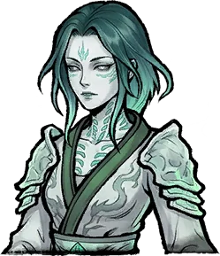

- 类型：阴
- 五行：阴

### 【元婴 · 素影】

身份：九幽骨魅化形

初见地：冥狱入口的最深处或大洲的雪山上

立场：敌对（初始状态）

出没范围：雪山

技能「分身」（被动）战斗开始时，一分为三

技能「死灵之躯」（被动）每当战场中有卡牌阵亡，自身〔攻击〕+4，〔血量〕和〔护甲〕+47；（每回合最多触发5次）

技能「骨魅」每当战场中有卡牌阵亡，召唤一个骸骨傀儡；（每回合最多触发1次）

技能「回收灵魂」（被动）当自己的分身（九幽骨魅）战败后，增加一次攻击次数（本场战斗生效）

---
